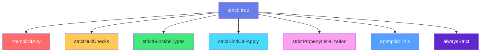

# 🔒 TypeScript：严格模式与类型体操

> **文档说明**：深入讲解 TypeScript 严格模式（strict mode）的完整配置与类型体操（Type Gymnastics）的高级实战技巧，涵盖严格模式总览（strict: true 一键开启全家桶）、7 个核心严格选项详解（noImplicitAny / strictNullChecks / strictFunctionTypes / strictBindCallApply / strictPropertyInitialization / noImplicitThis / alwaysStrict）、3 个附加严格选项（useUnknownInCatchVariables / exactOptionalPropertyTypes / noUncheckedIndexedAccess）、从非严格模式迁移到严格模式的渐进策略（逐步开启/类型注释/断言兜底）、类型体操的核心工具回顾（条件类型/映射类型/infer/模板字面量/递归类型/分布式条件类型）、高级类型体操实战（TupleToUnion 元组转联合/UnionToIntersection 联合转交叉/DeepReadonly 深度只读/Path 类型安全路径/Parameters/ReturnType/Awaited/StringToArray/Join/Split/CamelCase/PascalCase/类型安全的 getter/类型安全事件系统/IsAny/IsNever/IsUnion）、类型体操的性能考量（递归深度限制 50 层/编译速度/尾递归优化 TS4.5+）、类型测试方法（expectTypeOf / @ts-expect-error / @ts-ignore / tsd）、常见类型体操模式与套路、何时该用类型体操何时不该用（避免过度工程）、严格模式下的常见错误与修复、最佳实践。
>
> **适用人群**：中高级前端/全栈开发者、TypeScript 爱好者、库作者、希望掌握类型编程的工程师
>
> **前置知识**：[[TypeScript-类型系统进阶]] · [[TypeScript-泛型与条件类型]]

---

## 一、严格模式总览

### 1.1 什么是严格模式

**严格模式（strict mode）** 是 TypeScript 提供的一组更严格的类型检查选项，开启后能在编译时捕获更多潜在错误，提升代码质量和可维护性。

```json
// tsconfig.json — 一键开启所有严格检查
{
  "compilerOptions": {
    "strict": true
  }
}
```

`strict: true` 等价于同时开启以下 7 个选项：



### 1.2 为什么要开启严格模式

| 不开启严格模式 | 开启严格模式 |
|--------------|------------|
| `any` 到处都是，类型安全形同虚设 | 禁止隐式 any，强制类型标注 |
| `null`/`undefined` 可以赋给任何类型 | 严格空检查，必须处理空值 |
| 函数参数类型不兼容也能通过 | 函数类型严格检查 |
| 类属性可以不初始化 | 类属性必须初始化或有明确类型 |
| `this` 隐式 any | `this` 必须有明确类型 |
| 编译通过但运行时报错 | 编译时捕获更多错误 |

> **建议**：所有新项目都应开启 `strict: true`。老项目可以逐步迁移。

---

## 二、严格选项详解

### 2.1 noImplicitAny：禁止隐式 any

**作用**：当类型无法推断且未显式标注时，报错而不是默认推断为 `any`。

```typescript
// ❌ 报错：参数 'x' 隐式具有 any 类型
function double(x) {
  return x * 2
}

// ✅ 显式标注类型
function double(x: number): number {
  return x * 2
}

// ❌ 报错：解构参数隐式 any
function process({ name, age }) {
  console.log(name, age)
}

// ✅ 显式标注
function process({ name, age }: { name: string; age: number }) {
  console.log(name, age)
}

// ❌ 回调参数隐式 any
const nums = [1, 2, 3]
nums.map(n => n * 2)  // ✅ 可以推断（从数组类型）

const obj = { a: 1 }
Object.keys(obj).map(k => k)  // ✅ 可以推断
```

### 2.2 strictNullChecks：严格空检查

**作用**：`null` 和 `undefined` 不能赋给其他类型，必须显式处理。

```typescript
// ❌ 报错：不能将 null 赋给 string
let name: string = null

// ✅ 联合类型允许空值
let name: string | null = null
let name: string | undefined = undefined

// ❌ 报错：可能为 null
function getLength(s: string | null): number {
  return s.length  // s 可能为 null
}

// ✅ 收窄后使用
function getLength(s: string | null): number {
  if (s === null) return 0
  return s.length  // 这里 s 被收窄为 string
}

// ✅ 可选链
function getLength(s: string | null): number {
  return s?.length ?? 0
}

// ✅ 非空断言（确定不为空时）
function getLength(s: string | null): number {
  return s!.length
}
```

**常见空值场景**：
```typescript
// DOM 查询可能返回 null
const el = document.getElementById('app')
el.textContent = 'hello'  // ❌ el 可能为 null
el!.textContent = 'hello' // ✅ 非空断言
if (el) el.textContent = 'hello' // ✅ 收窄

// 数组索引可能为 undefined
const arr = [1, 2, 3]
const first = arr[0]  // number（默认不检查，见 noUncheckedIndexedAccess）
```

### 2.3 strictFunctionTypes：函数类型严格检查

**作用**：函数参数类型检查更严格（逆变而非双变）。

```typescript
interface Animal { name: string }
interface Dog extends Animal { breed: string }

// 函数类型参数是逆变的
type Handler = (animal: Animal) => void

// ❌ 报错：Dog 的处理函数不能赋给 Animal 的处理函数
// 因为 Handler 可能传入 Cat（也是 Animal），但 DogHandler 只处理 Dog
const dogHandler: Handler = (dog: Dog) => console.log(dog.breed)

// ✅ 正确：Animal 的处理函数可以赋给 Dog 的处理函数
type DogHandler = (dog: Dog) => void
const animalHandler: DogHandler = (animal: Animal) => console.log(animal.name)
```

> 这个选项主要影响函数类型的兼容性，方法（method）语法不受影响（保持双变以兼容）。

### 2.4 strictBindCallApply：bind/call/apply 严格检查

**作用**：`bind`、`call`、`apply` 的参数类型严格检查。

```typescript
function add(a: number, b: number): number {
  return a + b
}

// ❌ 报错：参数类型不匹配
const add10 = add.bind(null, '10')  // '10' 不是 number

// ✅ 正确
const add10 = add.bind(null, 10)
add10(5)  // 15

// ❌ 报错：参数数量不对
add.call(null, 1)  // 缺少第二个参数

// ✅ 正确
add.call(null, 1, 2)
add.apply(null, [1, 2])
```

### 2.5 strictPropertyInitialization：类属性必须初始化

**作用**：类的属性必须在声明时初始化，或在构造函数中赋值，或使用明确赋值断言 `!`。

```typescript
class User {
  // ❌ 报错：属性 'name' 没有初始化器，也没有在构造函数中赋值
  name: string
  
  // ✅ 声明时初始化
  age: number = 0
  
  // ✅ 构造函数中赋值
  email: string
  constructor(email: string) {
    this.email = email
  }
  
  // ✅ 明确赋值断言（确定会在其他地方初始化）
  role!: string
}
```

**与 Vue 3 的关系**：
```typescript
// Vue 3 的 ref/reactive 会自动初始化，不需要 !
const count = ref(0)  // ✅

// 但有时需要明确赋值断言
class MyComponent {
  @Prop() msg!: string  // ✅ Vue 会注入，用 ! 断言
}
```

### 2.6 noImplicitThis：禁止隐式 this

**作用**：`this` 隐式为 `any` 时报错。

```typescript
// ❌ 报错：this 隐式 any
const obj = {
  name: 'test',
  greet() {
    setTimeout(function() {
      console.log(this.name)  // this 是 any（普通函数的 this）
    }, 1000)
  }
}

// ✅ 箭头函数继承 this
const obj = {
  name: 'test',
  greet() {
    setTimeout(() => {
      console.log(this.name)  // this 是 obj 类型
    }, 1000)
  }
}

// ✅ 显式标注 this 类型
function handler(this: { name: string }) {
  console.log(this.name)
}
```

### 2.7 alwaysStrict：始终严格模式

**作用**：每个文件自动以 `'use strict'` 解析，确保编译输出也是严格模式。

这个选项通常不需要手动处理，`strict: true` 会自动开启。

---

## 三、附加严格选项

### 3.1 useUnknownInCatchVariables：catch 变量为 unknown

```typescript
// TS 4.4+，strict 模式下 catch 变量默认为 unknown
try {
  // ...
} catch (err) {
  // err 是 unknown，不是 any
  console.log(err.message)  // ❌ unknown 没有 message
  if (err instanceof Error) {
    console.log(err.message)  // ✅ 收窄后使用
  }
}
```

### 3.2 exactOptionalPropertyTypes：精确可选属性类型

```typescript
interface User {
  name: string
  age?: number  // 严格模式下：number | undefined
}

// 开启 exactOptionalPropertyTypes 后：
const user: User = { name: 'Alice', age: undefined }
// ❌ 报错：age 是可选的，但不能显式设为 undefined
// 可选属性意味着「可以不存在」，不是「可以是 undefined」
```

### 3.3 noUncheckedIndexedAccess：索引访问结果加 undefined

```typescript
const arr = [1, 2, 3]
const first = arr[0]  // number | undefined（开启此选项后）

const obj: Record<string, number> = { a: 1 }
const val = obj['b']  // number | undefined（键可能不存在）
```

> 这个选项不在 `strict: true` 中，需要单独开启。它能捕获更多越界错误，但也会让代码更啰嗦。

---

## 四、从非严格迁移到严格模式

### 4.1 渐进迁移策略


**具体步骤**：
1. **先开启 `strict: true`**，统计错误数量
2. **优先修复 `noImplicitAny`**：给隐式 any 加类型标注
3. **再修复 `strictNullChecks`**：处理 null/undefined，用收窄或非空断言
4. **然后修复其他选项**：类属性初始化、this 类型等
5. **最后考虑附加选项**：`noUncheckedIndexedAccess` 等

### 4.2 临时兜底技巧

```typescript
// 临时用 any 兜底（标记 TODO，后续修复）
function legacy(data: any) {  // TODO: 替换为具体类型
  // ...
}

// 用 unknown 替代 any（更安全）
function legacy(data: unknown) {
  if (typeof data === 'string') {
    // 收窄后使用
  }
}

// 非空断言（确定不为空时）
const el = document.getElementById('app')!
```

---

## 五、类型体操核心工具回顾

### 5.1 五大核心工具

| 工具 | 语法 | 作用 |
|------|------|------|
| **条件类型** | `T extends U ? X : Y` | 类型级 if-else |
| **映射类型** | `{ [K in keyof T]: T[K] }` | 遍历类型属性 |
| **infer** | `infer R` | 类型推断/提取 |
| **模板字面量** | `` `${T}` `` | 字符串类型操作 |
| **递归类型** | 自引用类型 | 深度/无限结构 |

### 5.2 分布式条件类型

```typescript
// 裸类型参数 + 联合类型 → 分布式展开
type Wrap<T> = T extends any ? { value: T } : never

type R = Wrap<string | number>
// { value: string } | { value: number }
// 而非 { value: string | number }

// 阻止分布式：用元组包裹
type WrapNonDist<T> = [T] extends [any] ? { value: T } : never
type R2 = WrapNonDist<string | number>
// { value: string | number }
```

---

## 六、高级类型体操实战

### 6.1 TupleToUnion：元组转联合

```typescript
type TupleToUnion<T extends readonly any[]> = T[number]

type R = TupleToUnion<['a', 'b', 'c']>
// 'a' | 'b' | 'c'
```

### 6.2 UnionToIntersection：联合转交叉

```typescript
type UnionToIntersection<U> = 
  (U extends any ? (x: U) => void : never) extends (x: infer I) => void 
    ? I 
    : never

type R = UnionToIntersection<{ a: 1 } | { b: 2 }>
// { a: 1 } & { b: 2 }
```

**原理**：利用函数参数的逆变特性——联合的函数参数交叉后取交集。

### 6.3 DeepReadonly：深度只读

```typescript
type DeepReadonly<T> = {
  readonly [K in keyof T]: T[K] extends object 
    ? T[K] extends Function 
      ? T[K]  // 函数不需要深度只读
      : DeepReadonly<T[K]>
    : T[K]
}

interface Config {
  server: { host: string; port: number }
  debug: boolean
}

type ReadonlyConfig = DeepReadonly<Config>
// { readonly server: { readonly host: string; readonly port: number }; readonly debug: boolean }
```

### 6.4 Path：类型安全的对象路径

```typescript
// 获取对象的所有路径（如 'a.b.c'）
type Path<T, Prefix extends string = ''> = 
  T extends object
    ? {
        [K in keyof T]: K extends string
          ? Prefix extends ''
            ? K | Path<T[K], K>
            : `${Prefix}.${K}` | Path<T[K], `${Prefix}.${K}`>
          : never
      }[keyof T]
    : never

interface User {
  name: string
  address: { city: string; zip: string }
}

type UserPaths = Path<User>
// 'name' | 'address' | 'address.city' | 'address.zip'

// 类型安全的 get 函数
function get<T, P extends Path<T>>(obj: T, path: P): any {
  return path.split('.').reduce((o, k) => o?.[k as keyof typeof o], obj)
}

const user: User = { name: 'Alice', address: { city: 'NY', zip: '10001' } }
get(user, 'address.city')  // ✅ 类型安全的路径
get(user, 'address.xxx')   // ❌ 报错：路径不存在
```

### 6.5 StringToArray：字符串转字符元组

```typescript
type StringToArray<S extends string> = 
  S extends `${infer C}${infer Rest}`
    ? [C, ...StringToArray<Rest>]
    : []

type R = StringToArray<'abc'>
// ['a', 'b', 'c']
```

### 6.6 CamelCase：下划线转驼峰

```typescript
type CamelCase<S extends string> = 
  S extends `${infer P}_${infer Q}`
    ? `${P}${CamelCase<Capitalize<Q>>}`
    : S

type R = CamelCase<'user_name_and_age'>
// 'userNameAndAge'
```

### 6.7 IsAny / IsNever / IsUnion

```typescript
// IsAny：any 是唯一同时满足 0 extends 1 的类型
type IsAny<T> = 0 extends 1 & T ? true : false

type R1 = IsAny<any>      // true
type R2 = IsAny<number>   // false

// IsNever
type IsNever<T> = [T] extends [never] ? true : false

type R3 = IsNever<never>   // true
type R4 = IsNever<string>  // false

// IsUnion
type IsUnion<T, U = T> = 
  [T] extends [never]
    ? false
    : T extends any
      ? [U] extends [T] ? false : true
      : false

type R5 = IsUnion<'a' | 'b'>  // true
type R6 = IsUnion<string>     // false
```

### 6.8 类型安全的事件系统

```typescript
interface EventMap {
  click: { x: number; y: number }
  hover: { element: string }
  submit: { data: FormData }
}

class TypedEmitter<E extends Record<string, any>> {
  private listeners = new Map<keyof E, Set<(payload: any) => void>>()

  on<K extends keyof E>(event: K, handler: (payload: E[K]) => void) {
    if (!this.listeners.has(event)) {
      this.listeners.set(event, new Set())
    }
    this.listeners.get(event)!.add(handler)
    return () => this.listeners.get(event)!.delete(handler)
  }

  emit<K extends keyof E>(event: K, payload: E[K]) {
    this.listeners.get(event)?.forEach(handler => handler(payload))
  }
}

const emitter = new TypedEmitter<EventMap>()
emitter.on('click', ({ x, y }) => console.log(x, y))  // ✅ 类型安全
emitter.emit('click', { x: 10, y: 20 })  // ✅
emitter.emit('click', { x: 10 })  // ❌ 缺少 y
```

---

## 七、类型体操性能考量

### 7.1 递归深度限制

TypeScript 的类型递归有深度限制（约 50 层），过深的递归会报错：

```typescript
// 递归过深会报错：Type instantiation is excessively deep
type DeepRecursive<T> = T extends { children: infer C }
  ? DeepRecursive<C>  // 递归
  : T

// 优化：增加深度计数器，限制递归层数
type DeepRecursive<T, D extends number[] = []> = 
  D['length'] extends 10  // 最多 10 层
    ? T
    : T extends { children: infer C }
      ? DeepRecursive<C, [...D, 1]>
      : T
```

### 7.2 编译速度

- 复杂的条件类型和映射类型会拖慢编译速度
- 大型项目中，过度的类型体操可能导致 IDE 卡顿
- **建议**：将复杂类型封装为命名工具类型，避免内联复杂表达式
- 使用 `@ts-expect-error` 测试类型时注意不要影响编译速度

### 7.3 尾递归优化（TS 4.5+）

TypeScript 4.5 对尾递归形式的条件类型有优化，可以支持更深的递归：

```typescript
// 尾递归形式（最后一步是递归调用）
type TrimLeft<S extends string, Acc extends string = ''> = 
  S extends `${infer C}${infer Rest}`
    ? C extends ' ' | '\n' | '\t'
      ? TrimLeft<Rest, Acc>  // 尾递归
      : `${Acc}${S}`
    : Acc
```

---

## 八、类型测试

### 8.1 expectTypeOf

```typescript
import { expectTypeOf } from 'expect-type'

expectTypeOf(1).toEqualTypeOf<number>()
expectTypeOf('a').not.toEqualTypeOf<number>()
expectTypeOf({ a: 1 }).toMatchTypeOf<{ a: number }>()
```

```text
### 8.2 @ts-expect-error
```

```typescript
// 期望下一行报错（用于测试类型错误）
// @ts-expect-error
const x: number = 'string'  // ✅ 这行确实报错，@ts-expect-error 不报错

// 如果下一行不报错，@ts-expect-error 本身会报错
// @ts-expect-error
const y: number = 1  // ❌ 这行不报错，所以 @ts-expect-error 报错
```

```text
### 8.3 @ts-ignore vs @ts-expect-error
```

| 指令 | 行为 | 推荐 |
|------|------|------|
| `@ts-ignore` | 忽略下一行错误，即使下一行没错误也不提示 | ❌ 不推荐 |
| `@ts-expect-error` | 期望下一行报错，没报错则提示 | ✅ 推荐 |

---

## 九、何时用类型体操，何时不用

### 9.1 适合用类型体操的场景

| 场景 | 示例 |
|------|------|
| **库作者** | 提供精确的类型推断（如 Vue 3、React Redux） |
| **通用工具函数** | 类型安全的 get、pick、omit、deepMerge |
| **类型安全的 API** | 事件系统、表单、路由 |
| **消除重复类型** | 从已有类型派生新类型（Partial、Pick） |
| **编译时验证** | 确保配置对象的类型正确 |

### 9.2 不适合用类型体操的场景

| 场景 | 原因 |
|------|------|
| **业务代码** | 过度复杂的类型增加维护成本 |
| **一次性代码** | 不值得花时间写复杂类型 |
| **团队不熟悉** | 其他人看不懂，成为技术债 |
| **性能敏感** | 复杂类型拖慢 IDE 和编译 |
| **可以用运行时检查替代** | zod/yup 等运行时校验更直观 |

> **原则**：类型体操是工具，不是目的。能用简单类型解决的，不要用复杂类型。

---

## 十、严格模式常见错误与修复

| 错误 | 原因 | 修复 |
|------|------|------|
| `Parameter 'x' implicitly has an 'any' type` | noImplicitAny | 显式标注类型 |
| `Object is possibly 'null'` | strictNullChecks | 收窄/非空断言/可选链 |
| `Property 'name' has no initializer` | strictPropertyInitialization | 初始化/构造函数赋值/!断言 |
| `'this' implicitly has type 'any'` | noImplicitThis | 箭头函数/显式标注 this |
| `Argument of type X is not assignable to Y` | strictFunctionTypes | 调整函数参数类型 |
| `Type 'undefined' is not assignable` | strictNullChecks | 联合类型/默认值 |
| `Index signature is missing` | 索引类型 | 添加索引签名/用 Record |
| `Type instantiation is excessively deep` | 递归过深 | 限制递归层数/尾递归优化 |

---

## 十一、最佳实践

1. **新项目必须开启 strict: true**：这是 TypeScript 的「安全底线」
2. **优先用 unknown 而非 any**：unknown 强制收窄，any 绕过所有检查
3. **用类型收窄而非断言**：if/typeof/instanceof 比 as 更安全
4. **非空断言要谨慎**：`!` 只在 100% 确定不为空时使用
5. **类型体操要封装**：复杂类型封装为命名工具类型，加注释
6. **写类型测试**：用 expectTypeOf / @ts-expect-error 验证类型
7. **避免过度工程**：业务代码用简单类型，库代码才需要复杂类型
8. **定期 review 类型**：类型也是代码，需要维护和重构
9. **关注编译速度**：复杂类型可能拖慢 IDE，必要时简化
10. **渐进迁移**：老项目逐步开启严格选项，不要一次全开

---

## 十二、关联笔记

### TypeScript 系列
- [[TypeScript基础语法]] · [[TypeScript-类型系统进阶]] · [[TypeScript-泛型与条件类型]]
- [[TypeScript-模块与声明文件]] · [[TypeScript-装饰器与元数据]] · [[Vue3-TypeScript最佳实践]]

### 前端工程
- [[Vue3-编译优化与PatchFlags]] · [[组件库设计与发布]] · [[ElementPlus-二次封装]]
- [[ESLint与代码规范]]

### 导航
- [[MOC-前端开发]] · [[MOC-TypeScript]] · [[Home]] · [[学习路线总览]]

> 🔍 **知识点深度解析**
>
> **作用**：严格模式与类型体操解决的是「如何让 TypeScript 的类型检查达到最大效力，在编译时捕获尽可能多的错误，同时通过类型编程实现精确的类型推断和类型安全的 API 设计」的核心问题——严格模式是 TypeScript 的「安全底线」，类型体操是 TypeScript 的「高级编程能力」，两者结合让 TypeScript 从「JavaScript + 类型注解」升级为「类型编程语言」。
>
> **底层原理**：①严格模式的本质是「关闭 TypeScript 的『宽容模式』」——TypeScript 为了兼容 JavaScript，默认允许很多不安全的行为（隐式 any、null 赋值、未初始化属性等）。严格模式逐一关闭这些「后门」，强制开发者写出类型安全的代码。每个严格选项对应一类常见错误：noImplicitAny 防止「忘记标注类型」，strictNullChecks 防止「空指针异常」，strictPropertyInitialization 防止「未初始化属性」，strictFunctionTypes 防止「函数参数不兼容」，noImplicitThis 防止「this 指向错误」。这些选项的共同目标是「让编译时错误替代运行时错误」。②strictNullChecks 是影响最大的严格选项——它将 `null` 和 `undefined` 从「任何类型的子类型」降级为「独立类型」，必须显式联合才能包含空值。这迫使开发者处理空值场景，从根源上消除「Cannot read property of undefined」这类最常见的 JavaScript 运行时错误。配合类型收窄（if/typeof/可选链/非空断言），strictNullChecks 让空值处理变得显式和安全。③类型体操的本质是「在类型层面写程序」——条件类型是 if-else，映射类型是 map/循环，infer 是变量提取，模板字面量是字符串操作，递归类型是递归函数。这些工具组合起来，TypeScript 的类型系统就变成了一门图灵完备的编程语言，可以实现任意复杂的类型计算。类型体操的目标不是炫技，而是「让 API 的类型更精确」——如 Path 类型实现类型安全的对象路径访问，TypedEmitter 实现类型安全的事件系统。④分布式条件类型是类型体操中最精妙也最容易误解的特性——当条件类型的参数是「裸类型参数」（naked type parameter）且为联合类型时，条件类型会自动展开为每个成员的条件类型联合。这个特性是 Exclude/Extract/NonNullable 等工具类型的基础，也是 UnionToIntersection 等高级类型的核心。理解「裸类型参数」是掌握分布式条件类型的关键——被元组/数组/Promise 包裹的类型参数不会分布式。⑤infer 关键字的本质是「类型层面的正则捕获组」——在条件类型的 extends 子句中用 infer 声明一个类型变量，TypeScript 会从实际类型中「匹配并提取」这个变量的值。infer 可以出现在函数参数、返回值、Promise 泛型、数组元素、模板字面量等位置，是 ReturnType/Parameters/Awaited/ArrayElementType 等工具类型的核心。⑥类型体操的性能瓶颈是「递归深度」——TypeScript 的类型检查器对递归类型有深度限制（约 50 层），过深的递归会报「Type instantiation is excessively deep」。优化方法包括：增加深度计数器限制递归、使用尾递归形式（TS 4.5+ 优化）、将复杂类型拆分为多个简单类型。库作者需要特别关注类型性能，因为用户的 IDE 体验直接受影响。⑦类型测试是类型体操质量的保障——就像运行时代码需要单元测试一样，复杂的类型定义也需要测试。expectTypeOf 库提供了流畅的类型断言 API，@ts-expect-error 指令可以验证「某段代码确实会报类型错误」。没有测试的类型体操就像没有测试的运行时代码——改一下就可能坏掉，而且很难发现。
>
> **用法要点**：① 严格模式：strict:true一键开启7个选项(noImplicitAny/strictNullChecks/strictFunctionTypes/strictBindCallApply/strictPropertyInitialization/noImplicitThis/alwaysStrict) ② 附加选项：useUnknownInCatchVariables(catch为unknown)/exactOptionalPropertyTypes(可选不能显式undefined)/noUncheckedIndexedAccess(索引结果加undefined) ③ 迁移策略：先开strict统计错误→修noImplicitAny→修strictNullChecks→修其他→附加选项，临时用any兜底标记TODO ④ 类型体操五大工具：条件类型(if-else)/映射类型(map)/infer(提取)/模板字面量(字符串)/递归类型(深度) ⑤ 分布式条件类型：裸类型参数+联合自动展开，[T]阻止分布式 ⑥ 高级体操：TupleToUnion(T[number])/UnionToIntersection(函数逆变)/DeepReadonly(递归映射)/Path(递归模板字面量)/StringToArray(infer C+递归)/CamelCase(infer+Capitalize)/IsAny(0 extends 1&T)/IsNever([T]extends[never])/IsUnion/类型安全事件系统(泛型EventMap) ⑦ 性能：递归深度限制50层/深度计数器/尾递归优化(TS4.5+)/封装命名类型避免内联 ⑧ 类型测试：expectTypeOf/@ts-expect-error(期望下一行报错)/@ts-ignore(不推荐) ⑨ 适用场景：库作者/通用工具函数/类型安全API/消除重复类型；不适用：业务代码/一次性代码/团队不熟悉/性能敏感 ⑩ 常见错误：隐式any(标注)/可能为null(收窄/断言/可选链)/属性未初始化(初始化/!)/this隐式any(箭头函数/标注)/函数参数不兼容(调整类型)/递归过深(限制层数) ⑪ 最佳实践：新项目必开strict/优先unknown而非any/用收窄而非断言/非空断言谨慎/类型体操封装加注释/写类型测试/避免过度工程/定期review类型/关注编译速度/渐进迁移。

> 💡 **深度讲解**：严格模式与类型体操最核心的智慧是「类型不是束缚，而是工具——严格模式让类型成为安全网，类型体操让类型成为编程语言，两者结合让 TypeScript 从『带类型的 JavaScript』升级为『类型驱动的开发范式』」——很多初学者对严格模式有抵触，觉得「太严格、写起来麻烦」，但这正是严格模式的价值——它强迫你思考每一个变量的类型、每一个可能为空的地方、每一个未初始化的属性，把运行时错误提前到编译时。初期可能觉得繁琐，但一旦习惯，你会发现代码质量显著提升，重构时更有信心，IDE 提示更准确。类型体操则是 TypeScript 的「高级玩法」——它让你能在类型层面实现复杂的逻辑，如类型安全的对象路径、自动推导的 API 客户端、精确的事件系统。这些能力在写库和框架时至关重要——Vue 3 的响应式系统、React 的 hooks 类型、Prisma 的查询类型，都是类型体操的杰作。但类型体操也是一把双刃剑——过度的类型体操会让代码难以理解、拖慢编译速度、成为团队的技术债。好的类型体操应该像好的代码一样：清晰、简洁、有命名、有注释、有测试。「能用简单类型解决的，不要用复杂类型」是最重要的原则。在 AI 时代，严格模式和类型体操更加重要——AI 生成代码时，有严格类型约束的项目生成质量远高于 any 满天飞的项目；AI 辅助重构时，类型系统是最可靠的安全网；AI 甚至可以帮你写类型体操（如「帮我实现一个 DeepPartial 类型」），但你需要能判断 AI 写的类型是否正确、是否高效。掌握严格模式与类型体操，就是掌握了 TypeScript 的「高阶能力」——从「用类型」升级为「设计类型」，这是从中级开发者到高级开发者的关键一步。

> 📝 **精简总结**：严格模式与类型体操=TypeScript高阶能力。严格模式：strict:true开启7项(noImplicitAny/strictNullChecks/strictFunctionTypes/strictBindCallApply/strictPropertyInitialization/noImplicitThis/alwaysStrict)，附加useUnknownInCatchVariables/exactOptionalPropertyTypes/noUncheckedIndexedAccess。迁移：渐进开启，先修any再修null。类型体操：条件类型/映射类型/infer/模板字面量/递归/分布式条件类型。高级实战：TupleToUnion/UnionToIntersection/DeepReadonly/Path/StringToArray/CamelCase/IsAny/IsNever/类型安全事件系统。性能：递归深度限制50层/尾递归优化/封装命名类型。类型测试：expectTypeOf/@ts-expect-error。原则：库作者用体操，业务代码用简单类型，避免过度工程。最佳实践：必开strict/优先unknown/收窄而非断言/类型封装加注释/写类型测试/定期review。

> **学习路径建议**：先学习 [[TypeScript-类型系统进阶]] 和 [[TypeScript-泛型与条件类型]] 打好基础 → 学习本文档的严格模式每个选项 → 实践：在项目中开启 strict，修复所有错误 → 学习类型体操核心工具（条件类型/映射类型/infer/模板字面量） → 实践：实现 Partial/Pick/Omit/DeepReadonly 等工具类型 → 学习高级类型体操（UnionToIntersection/Path/类型安全事件系统） → 实践：为一个工具函数设计精确的类型 → 学习类型测试（expectTypeOf） → 研究 Vue 3 / Prisma 的类型定义源码 → 形成「类型驱动开发」的思维和能力。

---

> **严格模式与类型体操的本质是「类型不是束缚，而是工具——严格模式让类型成为安全网，类型体操让类型成为编程语言，两者结合让 TypeScript 从带类型的 JavaScript 升级为类型驱动的开发范式」——很多初学者对严格模式有抵触，觉得太严格、写起来麻烦，但这正是它的价值：强迫你思考每个变量的类型、每个可能为空的地方、每个未初始化的属性，把运行时错误提前到编译时。初期繁琐，习惯后代码质量显著提升，重构更有信心，IDE 提示更准确。类型体操是 TypeScript 的高级玩法——在类型层面实现复杂逻辑，如类型安全的对象路径、自动推导的 API 客户端、精确的事件系统。Vue 3 的响应式类型、React 的 hooks 类型、Prisma 的查询类型，都是类型体操的杰作。但类型体操是双刃剑——过度使用会让代码难理解、拖慢编译、成为技术债。好的类型体操像好代码：清晰、简洁、有命名、有注释、有测试。「能用简单类型解决的，不要用复杂类型」是最重要的原则。在 AI 时代，严格模式和类型体操更加重要——AI 生成代码时，有严格类型约束的项目生成质量远高于 any 满天飞的项目；AI 辅助重构时，类型系统是最可靠的安全网；AI 甚至可以帮你写类型体操，但你需要能判断它写得是否正确、是否高效。掌握严格模式与类型体操，就是掌握了 TypeScript 的高阶能力——从用类型升级为设计类型，这是从中级到高级开发者的关键一步。从今天开始，如果你的项目还没开 strict，今天就打开它——第一次可能有几百个错误，但每修复一个，你的代码就更安全一分。如果已经开了 strict，试着挑战一个类型体操题目——比如实现一个类型安全的 get 函数——你会发现 TypeScript 的类型系统比你想象的强大得多。**
