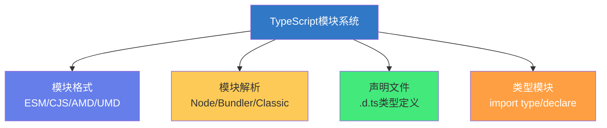

# 📦 TypeScript：模块与声明文件

> **文档说明**：系统讲解 TypeScript 的模块系统与声明文件（.d.ts）机制，涵盖 TypeScript 模块格式（ES Modules / CommonJS / AMD / UMD / System）、模块导入导出语法（命名导出/默认导出/重新导出/命名空间）、模块解析策略（Classic / Node / Node16 / Bundler）、路径别名与 baseUrl 配置、声明文件（.d.ts）的作用与编写方法、内置声明文件（lib.d.ts / DOM 类型）、第三方库类型声明（@types 组织 / DefinitelyTyped）、自定义声明文件（declare module / declare namespace / declare global / declare var）、模块补充（Module Augmentation）扩展第三方类型、全局变量与全局命名空间声明、三斜线指令（/// <reference path/types />）、发布带类型的 npm 包（package.json 的 types/typings 字段 / tsc 生成 .d.ts / 类型入口）、tsconfig.json 关键配置（module / moduleResolution / target / lib / types / typeRoots）、ES 模块与 CommonJS 互操作（esModuleInterop / allowSyntheticDefaultImports）、类型仅导入（import type）、常见问题（找不到模块/类型缺失/默认导入报错/循环依赖）与最佳实践。
>
> **适用人群**：TypeScript 开发者、前端工程师、需要编写和发布类型声明的库作者、全栈开发者
>
> **前置知识**：[[TypeScript基础语法]] · [[TypeScript-类型系统进阶]]

---

## 一、概述

### 1.1 TypeScript 模块系统

TypeScript 沿用了 ECMAScript 的模块系统，并扩展了类型层面的模块能力：



**核心概念**：
- **模块（Module）**：包含 import/export 的文件，有独立作用域
- **脚本（Script）**：没有 import/export 的文件，全局作用域
- **声明文件（.d.ts）**：只包含类型声明，不包含实现的文件
- **模块解析（Module Resolution）**：TypeScript 如何找到 import 的模块

### 1.2 模块 vs 脚本

```typescript
// 模块：有 import/export，有独立作用域
import { foo } from './foo';
export const bar = 1;

// 脚本：没有 import/export，变量在全局作用域
const baz = 2;  // 这个变量是全局的！
```

> 只要文件中有 `import` 或 `export`，它就是一个模块，否则是全局脚本。

---

## 二、模块导入导出

### 2.1 命名导出与导入

```typescript
// math.ts
export const PI = 3.14159;
export function add(a: number, b: number): number {
  return a + b;
}
export interface Point {
  x: number;
  y: number;
}

// 使用
import { PI, add, Point } from './math';
import { add as sum } from './math';  // 重命名
```

### 2.2 默认导出

```typescript
// utils.ts
export default function() {
  console.log('default export');
}

// 使用（不需要花括号）
import myFunc from './utils';
```

> 一个模块只能有一个默认导出。

### 2.3 重新导出（Re-export）

```typescript
// index.ts - 统一导出入口
export { foo, bar } from './moduleA';
export { default as ModuleB } from './moduleB';
export * from './moduleC';  // 导出所有命名导出
export * as Namespace from './moduleD';  // 作为命名空间导出
```

### 2.4 命名空间（Namespace）

```typescript
// 内部模块（已不推荐，推荐用 ES 模块）
namespace MyApp {
  export function util() {
    return 'util';
  }
  export interface Config {
    debug: boolean;
  }
}

MyApp.util();
const config: MyApp.Config = { debug: true };
```

> **注意**：现代 TypeScript 推荐用 ES 模块（import/export），命名空间（namespace）主要用于声明文件中描述全局库。

---

## 三、模块解析

### 3.1 解析策略

tsconfig.json 中的 `moduleResolution` 决定 TypeScript 如何查找模块：

| 策略 | 说明 | 适用场景 |
|------|------|---------|
| **node**（经典） | 模拟 Node.js 的 CommonJS 解析 | Node.js 项目 |
| **node16** / **nodenext** | 支持 ESM 和 CJS，区分 .mts/.cts | Node.js 原生 ESM |
| **bundler** | 支持 package.json 的 exports/imports | Vite/Webpack/Rollup |
| **classic** | 旧版 TypeScript 解析方式 | 兼容旧代码 |

### 3.2 Node 解析流程

```typescript
import { foo } from './module';     // 相对路径
import { bar } from 'lodash';       // 包名
```

**相对路径解析**：
1. 找 `./module.ts`
2. 找 `./module.tsx`
3. 找 `./module.d.ts`
4. 找 `./module/index.ts`

**包名解析**：
1. 找 `node_modules/lodash`
2. 读 `package.json` 的 `types` 或 `typings` 字段
3. 找 `node_modules/lodash/index.d.ts`
4. 找 `node_modules/@types/lodash`

### 3.3 路径别名（baseUrl + paths）

```json
// tsconfig.json
{
  "compilerOptions": {
    "baseUrl": ".",
    "paths": {
      "@/*": ["src/*"],
      "@components/*": ["src/components/*"],
      "@utils": ["src/utils/index.ts"]
    }
  }
}
```

```typescript
// 使用别名
import { Button } from '@components/Button';
import { debounce } from '@utils';
```

> 注意：TypeScript 的 paths 只做类型检查时的路径映射，运行时需要构建工具（Vite/Webpack）也配置对应的 alias。

---

## 四、声明文件（.d.ts）

### 4.1 什么是声明文件

声明文件（`.d.ts`）只包含**类型声明**，不包含实现：

```typescript
// math.d.ts
export declare function add(a: number, b: number): number;
export declare const PI: number;
export interface Point {
  x: number;
  y: number;
}
```

**作用**：
- 为 JavaScript 库提供类型信息
- 描述全局变量和 API
- 发布 npm 包时提供类型定义

### 4.2 内置声明文件

TypeScript 自带了一组内置声明文件：

| 文件 | 说明 |
|------|------|
| `lib.d.ts` | JavaScript 内置对象（Array/Object/Promise 等） |
| `lib.dom.d.ts` | DOM API（document/window/HTMLElement 等） |
| `lib.es2015.d.ts` | ES2015 新特性（Map/Set/Proxy 等） |
| `lib.es2020.d.ts` | ES2020 新特性（BigInt/Promise.allSettled 等） |

通过 tsconfig 的 `lib` 选项控制包含哪些：
```json
{
  "compilerOptions": {
    "lib": ["ES2020", "DOM", "DOM.Iterable"]
  }
}
```

### 4.3 第三方库类型：@types

大多数 JavaScript 库没有自带类型，社区在 **DefinitelyTyped** 仓库中维护，通过 `@types` 组织发布：

```bash
# 安装类型声明（开发依赖）
npm install -D @types/lodash
npm install -D @types/node
npm install -D @types/react
```

安装后 TypeScript 自动识别，无需额外配置。

> 现代库（如 Vue 3、React 18+）通常自带类型（package.json 的 types 字段），不需要 @types。

---

## 五、编写自定义声明文件

### 5.1 声明全局变量

```typescript
// global.d.ts
declare const MY_GLOBAL: string;
declare function globalFunc(a: number): void;
declare var process: NodeJS.Process;

// 使用
console.log(MY_GLOBAL);
globalFunc(42);
```

### 5.2 声明模块（为无类型的 JS 库补充类型）

```typescript
// declarations/some-lib.d.ts
declare module 'some-js-lib' {
  export function init(config: { debug: boolean }): void;
  export const version: string;
  export interface Options {
    timeout?: number;
  }
}
```

```typescript
// 使用
import { init, version } from 'some-js-lib';
init({ debug: true });
```

### 5.3 声明命名空间（全局库）

```typescript
// jquery.d.ts（简化版）
declare namespace jQuery {
  interface AjaxSettings {
    url: string;
    method?: string;
  }
  function ajax(settings: AjaxSettings): Promise<any>;
}

declare const $: typeof jQuery;
```

### 5.4 模块补充（Module Augmentation）

扩展第三方库的类型：

```typescript
// vue-router-augmentation.d.ts
import 'vue-router';

declare module 'vue-router' {
  interface RouteMeta {
    // 扩展路由 meta 的类型
    title?: string;
    requiresAuth?: boolean;
  }
}
```

```typescript
// 使用
const route = useRoute();
route.meta.title;        // ✅ 有类型
route.meta.requiresAuth; // ✅ 有类型
```

### 5.5 全局扩展

```typescript
// 扩展 String 的原型
declare global {
  interface String {
    capitalize(): string;
  }
}

// 实现（在 .ts 文件中）
String.prototype.capitalize = function() {
  return this.charAt(0).toUpperCase() + this.slice(1);
};

// 使用
'hello'.capitalize();  // 'Hello'
```

> 扩展全局类型时，文件必须有 import/export（是模块），否则会覆盖而非扩展。

---

## 六、三斜线指令

三斜线指令是声明文件中的引用方式：

```typescript
/// <reference path="./other.d.ts" />       // 引用其他声明文件
/// <reference types="node" />              // 引用 @types/node
/// <reference lib="es2020" />              // 引用内置 lib
```

> 现代项目中三斜线指令用得较少，主要在声明文件和特殊场景中使用。

---

## 七、发布带类型的 npm 包

### 7.1 package.json 配置

```json
{
  "name": "my-lib",
  "version": "1.0.0",
  "main": "dist/index.js",
  "types": "dist/index.d.ts",
  "exports": {
    ".": {
      "import": "./dist/index.mjs",
      "require": "./dist/index.cjs",
      "types": "./dist/index.d.ts"
    }
  },
  "files": ["dist"]
}
```

| 字段 | 说明 |
|------|------|
| `types` / `typings` | 类型声明文件入口 |
| `main` | CommonJS 入口 |
| `module` | ESM 入口 |
| `exports` | 现代包导出配置（支持多条件） |
| `files` | 发布时包含的文件 |

### 7.2 生成 .d.ts

```json
// tsconfig.json
{
  "compilerOptions": {
    "declaration": true,        // 生成 .d.ts
    "declarationMap": true,     // 生成 .d.ts.map（跳转到源码）
    "outDir": "dist",
    "rootDir": "src"
  }
}
```

```bash
tsc  # 同时生成 .js 和 .d.ts
```

### 7.3 类型入口文件

```typescript
// src/index.ts
export { Button } from './components/Button';
export { Input } from './components/Input';
export type { ButtonProps, InputProps } from './types';
```

---

## 八、tsconfig.json 关键配置

```json
{
  "compilerOptions": {
    "target": "ES2020",           // 编译目标
    "module": "ESNext",           // 模块格式
    "moduleResolution": "bundler", // 模块解析策略
    "lib": ["ES2020", "DOM"],     // 内置类型库
    "strict": true,               // 严格模式
    "esModuleInterop": true,      // ESM/CJS 互操作
    "allowSyntheticDefaultImports": true, // 允许默认导入
    "declaration": true,          // 生成声明文件
    "baseUrl": ".",               // 路径别名基础
    "paths": { "@/*": ["src/*"] }, // 路径别名
    "types": ["node"],            // 包含的 @types 包
    "typeRoots": ["./node_modules/@types", "./src/types"] // 类型查找目录
  },
  "include": ["src/**/*"],
  "exclude": ["node_modules", "dist"]
}
```

---

## 九、ESM 与 CJS 互操作

### 9.1 问题

CommonJS 模块没有「默认导出」的概念，但很多 CJS 库用 `module.exports = ...`：

```javascript
// cjs-lib.js（CommonJS）
module.exports = function() { return 'hello'; };
```

直接用 ESM 默认导入会报错：
```typescript
import cjsLib from 'cjs-lib';  // ❌ 类型错误
```

### 9.2 解决方案

```json
// tsconfig.json
{
  "compilerOptions": {
    "esModuleInterop": true,
    "allowSyntheticDefaultImports": true
  }
}
```

```typescript
// ✅ 现在可以默认导入
import cjsLib from 'cjs-lib';

// 或者用命名空间导入
import * as cjsLib from 'cjs-lib';
```

| 配置 | 作用 |
|------|------|
| `esModuleInterop` | 运行时创建默认导入的辅助函数 |
| `allowSyntheticDefaultImports` | 类型检查时允许默认导入（不影响运行时） |

---

## 十、类型仅导入（import type）

TypeScript 3.8+ 支持只导入类型：

```typescript
// 只导入类型，编译后会被移除
import type { User, Config } from './types';
import type { AxiosRequestConfig } from 'axios';

// 混合导入
import { fetchData, type ApiResponse } from './api';
```

**好处**：
- 避免运行时导入不存在的类型（某些类型只在编译时存在）
- 减少打包体积（类型导入会被完全移除）
- `isolatedModules` 模式下必须用 `import type`

---

## 十一、常见问题

| 问题 | 原因 | 解决方案 |
|------|------|---------|
| **找不到模块 'xxx'** | 没有安装类型声明 | `npm install -D @types/xxx` 或自建 .d.ts |
| **找不到模块 './xxx'** | 路径错误或缺少扩展名 | 检查路径，确认文件存在，配置 paths |
| **默认导入报错** | CJS 库没有默认导出 | 开启 `esModuleInterop`，或用 `import * as` |
| **类型不完整/错误** | @types 版本与库版本不匹配 | 安装对应版本的 @types，或模块补充修正 |
| **全局变量报错** | 没有声明全局变量 | 在 .d.ts 中 `declare const xxx: type` |
| **扩展第三方类型不生效** | 声明文件没被包含 | 检查 tsconfig include，确保 .d.ts 在范围内 |
| **循环依赖类型** | 模块互相导入类型 | 用 `import type` 避免运行时循环 |
| **.d.ts 生成失败** | declaration 未开启或有语法错误 | 开启 declaration，修复 TS 错误 |
| **isolatedModules 报错** | 类型和值混合导入 | 用 `import type` 明确区分 |

---

## 十二、最佳实践

1. **优先用 ES 模块**：import/export，避免 namespace（除非写全局库声明）
2. **统一导出入口**：用 index.ts 重新导出，保持导入路径简洁
3. **路径别名**：配置 `@/*` 别名，避免深层相对路径（`../../../../`）
4. **类型与实现分离**：类型用 `import type`，值用普通 import
5. **发布包自带类型**：配置 `declaration: true` 和 `types` 字段，不要依赖 @types
6. **声明文件放 src/types**：自定义 .d.ts 统一管理，确保被 tsconfig 包含
7. **扩展第三方类型用模块补充**：`declare module 'xxx'` 而非修改 node_modules
8. **esModuleInterop 必开**：避免 CJS/ESM 互操作问题
9. **定期检查 @types 版本**：与库版本保持一致
10. **避免 any**：声明文件中尽量精确，不要图省事写 any

---

## 十三、关联笔记

### TypeScript 系列
- [[TypeScript基础语法]] · [[TypeScript-类型系统进阶]] · [[TypeScript-泛型与条件类型]]
- [[TypeScript-装饰器与元数据]] · [[Vue3-TypeScript最佳实践]]

### 前端工程化
- [[pnpm-monorepo架构]] · [[Vite构建工具原理]] · [[ESLint与代码规范]]
- [[npm与包管理基础]]

### 导航
- [[MOC-前端开发]] · [[MOC-TypeScript]] · [[Home]] · [[学习路线总览]]

> 🔍 **知识点深度解析**
>
> **作用**：TypeScript 模块与声明文件解决的是「如何在 TypeScript 中组织代码模块、如何为 JavaScript 代码提供类型信息、如何发布和消费带类型的库」的核心工程问题——模块系统决定了代码的组织和复用方式，声明文件决定了 TypeScript 能否对 JavaScript 生态进行类型检查。理解这两个机制是从「会写 TypeScript」到「能工程化使用 TypeScript」的关键。
>
> **底层原理**：①TypeScript 的模块系统本质是「ES 模块 + 类型扩展」——运行时的模块格式（ESM/CJS/AMD）由 `module` 选项决定，编译时的类型模块解析由 `moduleResolution` 决定。TypeScript 在编译时做类型检查，编译后剥离类型信息，输出指定格式的 JS 模块。这种「类型与运行时分离」的设计让 TypeScript 可以兼容各种 JS 模块生态。②声明文件（.d.ts）的本质是「类型契约」——它描述了一个模块或库的「形状」（有哪些函数、什么参数、返回什么类型），但不包含实现。这类似于 C/C++ 的头文件（.h）：声明文件是「接口」，JS 文件是「实现」。TypeScript 通过声明文件为纯 JS 库提供类型检查能力，这是 TypeScript 能融入庞大 JS 生态的关键。③模块解析的核心是「查找算法」——当你写 `import x from 'foo'` 时，TypeScript 需要找到 `foo` 的类型定义。Node 策略模拟 Node.js 的查找逻辑（node_modules/package.json/types字段），Bundler 策略支持 package.json 的 exports 字段（现代打包工具的标准），Node16 策略区分 ESM 和 CJS（需要 .mts/.cts 扩展名）。选择正确的解析策略是避免「找不到模块」错误的关键。④模块补充（Module Augmentation）的本质是「类型的开放扩展」——TypeScript 的接口（interface）是开放的，可以多次声明自动合并。通过 `declare module 'xxx' { interface YYY { ... } }`，可以为第三方库的类型添加属性，而不需要修改库本身。这在扩展 Vue Router 的 route.meta、扩展 Vue 的全局属性等场景非常有用。⑤`esModuleInterop` 解决的是「ESM 和 CJS 的默认导入不兼容」问题——CJS 的 `module.exports = foo` 在 ESM 中没有对应的「默认导出」，直接 `import foo from 'cjs-lib'` 会报错。开启 esModuleInterop 后，TypeScript 会在编译时注入辅助函数，将 CJS 的 module.exports 包装成有默认导出的对象，让两种模块格式可以互操作。⑥`import type` 的本质是「类型层面的树摇」——普通 import 在编译后会保留运行时导入语句，而 `import type` 会被完全移除。这对于「只需要类型不需要运行时」的场景（如导入接口、类型别名）非常重要，可以避免运行时导入不存在的类型（某些类型只在编译时存在，运行时没有对应值），也能减少打包体积。
>
> **用法要点**：① 模块：有import/export的文件是模块(独立作用域)，否则是全局脚本 ② 导出：命名导出export const/默认导出export default/重新导出export * from/命名空间namespace(不推荐) ③ 模块解析：moduleResolution选node(传统)/bundler(Vite/Webpack)/node16(Node原生ESM)，paths配置@/*别名 ④ 声明文件.d.ts：只含类型不含实现，declare function/const/interface/module/namespace/global ⑤ 内置类型：lib.d.ts(JS内置)/lib.dom.d.ts(DOM)/lib.es2020.d.ts，tsconfig的lib控制 ⑥ 第三方类型：npm install -D @types/xxx，现代库自带types字段 ⑦ 自定义声明：declare module 'xxx'补充无类型库，declare global扩展全局，模块补充declare module 'vue-router'扩展第三方类型 ⑧ 发布带类型包：tsconfig开declaration，package.json配types字段，index.ts统一导出 ⑨ ESM/CJS互操作：开esModuleInterop+allowSyntheticDefaultImports ⑩ import type：只导入类型，编译后移除，isolatedModules必须用 ⑪ 常见问题：找不到模块→装@types或自建.d.ts，默认导入报错→开esModuleInterop，扩展类型不生效→检查include ⑫ 最佳实践：ES模块优先/index.ts统一入口/路径别名/import type/发布自带类型/声明文件放src/types。

> 💡 **深度讲解**：TypeScript 模块与声明文件最核心的智慧是「用类型契约连接 TypeScript 和庞大的 JavaScript 生态」——TypeScript 最大的优势不是「新语言」，而是「JavaScript 的超集」——它可以无缝使用所有现有的 JS 库和工具链。但 JS 库没有类型信息，TypeScript 怎么对它们做类型检查？答案就是声明文件（.d.ts）——通过为 JS 库编写「类型契约」，TypeScript 就能在不修改 JS 代码的情况下提供类型安全。这种「类型与实现分离」的设计是 TypeScript 成功的关键：它不需要整个生态重写为 TypeScript，只需要逐步补充类型声明。DefinitelyTyped 社区维护了上万个 @types 包，现代库越来越多地自带类型，TypeScript 的类型覆盖率越来越高。模块系统的另一个深层智慧是「编译时与运行时分离」——TypeScript 的模块解析和类型检查在编译时完成，编译后类型信息被完全剥离，输出纯 JS。这意味着 TypeScript 不会给运行时增加任何负担，也不会引入新的模块运行时（不像某些语言需要自己的模块加载器）。你可以用 ESM、CJS、AMD 任何模块格式，TypeScript 都能适配。这种「零运行时开销」的设计让 TypeScript 可以嵌入任何 JS 项目。在实际开发中，最常见的 TypeScript 问题不是「类型语法不会」，而是「模块找不到」「类型缺失」「默认导入报错」——这些都是模块和声明文件的问题。理解了本文档的内容，你就能解决 90% 的 TypeScript 工程化问题，从「写代码时到处报红」变成「流畅地使用 TypeScript 生态」。

> 📝 **精简总结**：TypeScript模块与声明文件=代码组织+类型契约。模块：有import/export是模块(独立作用域)，命名导出/默认导出/重新导出，moduleResolution选node/bundler/node16，paths配@/*别名。声明文件.d.ts：只含类型不含实现，declare function/const/module/namespace/global。内置类型lib.d.ts/lib.dom.d.ts，第三方用@types/xxx。自定义：declare module补充无类型库，declare global扩展全局，模块补充扩展第三方类型(如vue-router的route.meta)。发布带类型包：declaration:true+package.json的types字段。ESM/CJS互操作：esModuleInterop。import type只导入类型编译后移除。常见问题：找不到模块→装@types或自建.d.ts，默认导入报错→开esModuleInterop。最佳实践：ES模块优先/index.ts统一入口/路径别名/import type/发布自带类型。

> **学习路径建议**：先学习 [[TypeScript基础语法]] 和 [[TypeScript-类型系统进阶]] → 学习本文档的模块和声明文件 → 实践：为你的项目配置 tsconfig.json（module/moduleResolution/paths） → 实践：为一个无类型的 JS 库编写声明文件 → 实践：用模块补充扩展第三方库类型（如 Vue Router 的 route.meta） → 学习 [[pnpm-monorepo架构]] 中的类型共享 → 实践：发布一个带类型的 npm 包 → 学习 [[TypeScript-泛型与条件类型]] 深化类型能力 → 形成 TypeScript 工程化的完整能力。

---

> **TypeScript 模块与声明文件的本质是「用类型契约连接类型安全的 TypeScript 世界和庞大的 JavaScript 生态」——TypeScript 之所以能成为前端的事实标准，不是因为它发明了新的运行时，而是因为它在「不改变 JavaScript」的前提下提供了类型安全。这种「零侵入」的设计非常精妙：你的 JS 代码不需要任何修改，只需要一个 .d.ts 声明文件，TypeScript 就能为它提供类型检查。声明文件就是 TypeScript 和 JavaScript 之间的「翻译官」——它把 JS 库的 API「翻译」成类型信息，让 TypeScript 能理解和检查。模块系统则是 TypeScript 工程化的基础——它决定了代码如何组织、如何复用、如何解析。很多 TypeScript 初学者觉得「类型语法不难，但工程配置到处报错」，根源就是对模块解析和声明文件理解不够。当你理解了 `moduleResolution` 如何查找模块、`@types` 如何提供类型、`declare module` 如何补充类型、`esModuleInterop` 如何解决互操作，你就掌握了 TypeScript 工程化的核心。在 AI 时代，TypeScript 的重要性进一步提升——AI 生成代码时，有类型的代码生成质量远高于无类型的代码；AI 辅助重构时，类型系统是最可靠的安全网；AI 代码审查时，类型错误是最容易发现的问题。掌握 TypeScript 的模块和声明文件，不仅是「写好 TypeScript」的基础，更是「与 AI 高效协作」的基础——因为类型就是最精确的「代码文档」，AI 能读懂类型，就能更好地理解和生成代码。从今天开始，检查你的 tsconfig.json，确保模块解析和类型配置正确；为你使用的无类型库补充声明文件；在发布库时自带类型——这些看似琐碎的工程细节，正是 TypeScript 项目质量的基石。**
