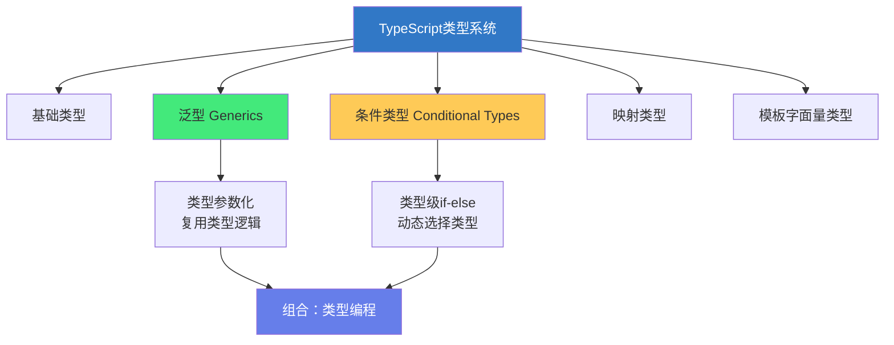

# 🎯 TypeScript：泛型与条件类型

> **文档说明**：深入讲解 TypeScript 泛型（Generics）与条件类型（Conditional Types）的高级用法与组合模式，涵盖泛型全景（泛型函数/泛型接口/泛型类/泛型类型别名/泛型约束 extends/泛型默认参数/泛型参数推断/多泛型参数/泛型与联合类型）、条件类型全景（基本语法/分布式条件类型/条件类型与 infer/条件类型与映射类型组合/递归条件类型/条件类型重载）、泛型与条件类型的组合模式（类型级函数/条件类型分支/嵌套条件类型/模板字面量+条件类型/映射类型+条件类型）、高级类型体操实战（DeepPartial/DeepReadonly/GetRequired/GetOptional/UnionToIntersection/PromiseType/ArrayElementType/StringParser 等）、类型安全的 API 客户端设计、通用数据结构的泛型实现、类型安全的事件系统、常见类型错误排查、最佳实践与性能考量。
>
> **适用人群**：有 TypeScript 基础、希望掌握类型编程的中高级前端/全栈开发者、库作者
>
> **前置知识**：[[TypeScript-类型系统进阶]] · [[TypeScript基础语法]]

---

## 一、概述

### 1.1 泛型与条件类型的定位



**泛型**解决「类型复用」——同一个逻辑适用于多种类型，用类型参数 T 代替具体类型。
**条件类型**解决「类型分支」——根据类型关系动态选择不同的类型结果。
**两者组合**实现「类型编程」——在类型层面实现复杂的逻辑计算。

### 1.2 为什么需要泛型+条件类型

| 场景 | 不用泛型 | 用泛型 |
|------|---------|--------|
|  identity 函数 | 写 string/number/... 多个版本 | `function identity<T>(x: T): T` |
|  API 响应 | `any` 丢失类型 | `ApiResponse<T>` 保留数据类型 |
|  条件返回 | 联合类型不够精确 | 条件类型根据输入决定输出 |
|  工具类型 | 重复定义 | Partial/Pick/Omit 等泛型工具 |

---

## 二、泛型深入

### 2.1 泛型函数

```typescript
// 基本泛型函数
function identity<T>(value: T): T {
  return value;
}

const num = identity(42);      // number
const str = identity('hello'); // string

// 显式指定类型参数
const arr = identity<number[]>([1, 2, 3]);  // number[]
```

### 2.2 泛型接口

```typescript
interface Box<T> {
  value: T;
  getValue(): T;
  setValue(value: T): void;
}

const numberBox: Box<number> = {
  value: 42,
  getValue() { return this.value; },
  setValue(v) { this.value = v; }
};
```

### 2.3 泛型类

```typescript
class Stack<T> {
  private items: T[] = [];
  
  push(item: T): void { this.items.push(item); }
  pop(): T | undefined { return this.items.pop(); }
  peek(): T | undefined { return this.items[this.items.length - 1]; }
  isEmpty(): boolean { return this.items.length === 0; }
}

const numberStack = new Stack<number>();
numberStack.push(1);
numberStack.push(2);
```

### 2.4 泛型类型别名

```typescript
type ApiResponse<T = any> = {
  data: T;
  code: number;
  message: string;
  timestamp: number;
};

type UserResponse = ApiResponse<{ id: number; name: string }>;
// { data: { id: number; name: string }; code: number; ... }
```

### 2.5 泛型约束（extends）

```typescript
// 约束：T 必须有 length 属性
function logLength<T extends { length: number }>(value: T): T {
  console.log(value.length);
  return value;
}

logLength('hello');   // ✅ string 有 length
logLength([1, 2]);    // ✅ 数组有 length
logLength(42);        // ❌ number 没有 length

// 约束为键
function getProperty<T, K extends keyof T>(obj: T, key: K): T[K] {
  return obj[key];
}
```

### 2.6 泛型默认参数

```typescript
interface PaginatedResponse<T = any> {
  items: T[];
  total: number;
  page: number;
  pageSize: number;
}

// 不指定 T 时默认为 any
type Default = PaginatedResponse;  // items: any[]
type Users = PaginatedResponse<User>;  // items: User[]
```

### 2.7 泛型参数推断

```typescript
// TypeScript 自动推断 T 的类型
function pair<T, U>(first: T, second: U): [T, U] {
  return [first, second];
}

const p = pair(42, 'hello');  // [number, string]，自动推断

// 从返回值推断
function createPair<T>(first: T) {
  return function<U>(second: U): [T, U] {
    return [first, second];
  };
}
const withNumber = createPair(42);  // <U>(second: U) => [number, U]
const result = withNumber('hello'); // [number, string]
```

### 2.8 多泛型参数

```typescript
// 键值对映射
function mapObject<T, U>(obj: Record<string, T>, fn: (value: T) => U): Record<string, U> {
  const result: Record<string, U> = {};
  for (const key in obj) {
    result[key] = fn(obj[key]);
  }
  return result;
}

const nums = { a: 1, b: 2 };
const strs = mapObject(nums, (n) => n.toString());  // Record<string, string>
```

---

## 三、条件类型深入

### 3.1 基本语法

```typescript
type IsString<T> = T extends string ? true : false;

type A = IsString<'hello'>;  // true
type B = IsString<42>;       // false
type C = IsString<string | number>;  // boolean（分布式展开）
```

### 3.2 分布式条件类型

当条件类型的参数是**裸类型参数（naked type parameter）**且为联合类型时，会分布式展开：

```typescript
type ToArray<T> = T extends any ? T[] : never;

type Result = ToArray<string | number>;
// 分布式展开：string[] | number[]
// 而非：(string | number)[]

// 阻止分布式：用元组包裹
type ToArrayNonDist<T> = [T] extends [any] ? T[] : never;
type Result2 = ToArrayNonDist<string | number>;
// (string | number)[]
```

### 3.3 条件类型 + infer

```typescript
// 获取函数返回类型
type MyReturnType<T> = T extends (...args: any[]) => infer R ? R : never;

type R1 = MyReturnType<() => string>;  // string
type R2 = MyReturnType<(a: number) => boolean>;  // boolean

// 获取 Promise 的值类型（递归）
type MyAwaited<T> = T extends Promise<infer U> ? MyAwaited<U> : T;

type A1 = MyAwaited<Promise<string>>;  // string
type A2 = MyAwaited<Promise<Promise<number>>>;  // number
type A3 = MyAwaited<number>;  // number（不是 Promise，直接返回）
```

### 3.4 条件类型 + 映射类型

```typescript
// 只保留函数类型的属性
type FunctionProperties<T> = {
  [K in keyof T as T[K] extends Function ? K : never]: T[K];
};

interface User {
  id: number;
  name: string;
  save: () => void;
  delete: () => Promise<void>;
}

type UserFunctions = FunctionProperties<User>;
// { save: () => void; delete: () => Promise<void>; }
```

### 3.5 递归条件类型

```typescript
// 深度只读
type DeepReadonly<T> = {
  readonly [K in keyof T]: T[K] extends object ? DeepReadonly<T[K]> : T[K];
};

// 深度可选
type DeepPartial<T> = {
  [K in keyof T]?: T[K] extends object ? DeepPartial<T[K]> : T[K];
};
```

### 3.6 条件类型重载

```typescript
// 根据输入类型决定返回类型
type Wrap<T> = 
  T extends string ? { type: 'string'; value: T } :
  T extends number ? { type: 'number'; value: T } :
  T extends boolean ? { type: 'boolean'; value: T } :
  { type: 'other'; value: T };

function wrap<T>(value: T): Wrap<T> {
  // 实现...
}
```

---

## 四、组合模式：类型编程

### 4.1 类型级函数

```typescript
// 类型级的 if-else 函数
type If<C extends boolean, T, F> = C extends true ? T : F;

type R1 = If<true, string, number>;   // string
type R2 = If<false, string, number>;  // number
```

### 4.2 嵌套条件类型

```typescript
// 判断类型类别
type TypeName<T> =
  T extends string ? 'string' :
  T extends number ? 'number' :
  T extends boolean ? 'boolean' :
  T extends undefined ? 'undefined' :
  T extends Function ? 'function' :
  'object';

type N1 = TypeName<'hello'>;  // 'string'
type N2 = TypeName<42>;       // 'number'
type N3 = TypeName<{}>;       // 'object'
```

### 4.3 模板字面量 + 条件类型

```typescript
// 获取事件名：onClick → click
type EventName<T extends string> = T extends `on${infer E}` ? Uncapitalize<E> : T;

type E1 = EventName<'onClick'>;    // 'click'
type E2 = EventName<'onHover'>;    // 'hover'
type E3 = EventName<'submit'>;     // 'submit'（不匹配，原样返回）
```

### 4.4 映射类型 + 条件类型

```typescript
// 可选属性提取
type GetOptional<T> = {
  [K in keyof T as T[K] extends Required<T>[K] ? never : K]: T[K];
};

interface Example {
  a: number;
  b?: string;
  c: boolean;
  d?: object;
}

type Optional = GetOptional<Example>;
// { b?: string; d?: object; }
```

---

## 五、类型体操实战

### 5.1 DeepPartial

```typescript
type DeepPartial<T> = {
  [K in keyof T]?: T[K] extends Array<infer U> 
    ? Array<DeepPartial<U>>
    : T[K] extends object 
      ? DeepPartial<T[K]> 
      : T[K];
};
```

### 5.2 UnionToIntersection（联合转交叉）

```typescript
type UnionToIntersection<U> = 
  (U extends any ? (x: U) => void : never) extends (x: infer I) => void 
    ? I 
    : never;

type U = UnionToIntersection<{ a: 1 } | { b: 2 }>;
// { a: 1 } & { b: 2 }
```

### 5.3 GetRequired（提取必选属性）

```typescript
type GetRequired<T> = {
  [K in keyof T as T[K] extends Required<T>[K] ? K : never]: T[K];
};
```

### 5.4 ArrayElementType（数组元素类型）

```typescript
type ArrayElementType<T> = T extends (infer E)[] ? E : never;

type E1 = ArrayElementType<number[]>;     // number
type E2 = ArrayElementType<string[]>;     // string
type E3 = ArrayElementType<[number, string]>;  // number | string
```

### 5.5 PromiseType（解包 Promise）

```typescript
type PromiseType<T> = T extends Promise<infer U> ? U : T;

type P1 = PromiseType<Promise<string>>;  // string
type P2 = PromiseType<number>;           // number（不是 Promise）
```

### 5.6 StringParser（字符串解析）

```typescript
// 解析 "getUser" → { method: 'get'; resource: 'User' }
type ParseMethod<T extends string> = 
  T extends `${infer M}${infer R}` 
    ? M extends 'g' ? { method: 'get'; resource: R }
    : M extends 'p' ? { method: 'post'; resource: R }
    : { method: 'unknown'; resource: T }
    : never;

type P = ParseMethod<'getUser'>;  // { method: 'get'; resource: 'User' }
```

---

## 六、实战案例

### 6.1 类型安全的 API 客户端

```typescript
// 定义 API 路由映射
interface ApiRoutes {
  '/users': { GET: { response: User[] }; POST: { body: UserCreate; response: User } };
  '/users/:id': { GET: { response: User }; PUT: { body: UserUpdate; response: User }; DELETE: { response: void } };
}

// 类型安全的请求函数
async function request<
  Path extends keyof ApiRoutes,
  Method extends keyof ApiRoutes[Path]
>(
  path: Path,
  method: Method,
  body?: ApiRoutes[Path][Method] extends { body: infer B } ? B : never
): Promise<ApiRoutes[Path][Method] extends { response: infer R } ? R : never> {
  // 实现...
  return fetch(path, { method: method as string, body: JSON.stringify(body) }).then(r => r.json());
}

// 使用：完全类型安全
const users = await request('/users', 'GET');  // User[]
const newUser = await request('/users', 'POST', { name: 'Alice' });  // User
```

### 6.2 类型安全的事件系统

```typescript
// 事件映射
interface EventMap {
  click: { x: number; y: number };
  hover: { element: string };
  submit: { data: FormData };
}

// 类型安全的事件发射器
class TypedEventEmitter<E extends Record<string, any>> {
  private listeners: Map<keyof E, Set<(payload: any) => void>> = new Map();

  on<K extends keyof E>(event: K, handler: (payload: E[K]) => void): void {
    if (!this.listeners.has(event)) {
      this.listeners.set(event, new Set());
    }
    this.listeners.get(event)!.add(handler);
  }

  emit<K extends keyof E>(event: K, payload: E[K]): void {
    this.listeners.get(event)?.forEach(handler => handler(payload));
  }
}

const emitter = new TypedEventEmitter<EventMap>();
emitter.on('click', ({ x, y }) => console.log(x, y));  // 类型安全
emitter.emit('click', { x: 10, y: 20 });  // ✅
emitter.emit('click', { x: 10 });  // ❌ 缺少 y
```

---

## 七、常见问题

| 问题 | 原因 | 解决方案 |
|------|------|---------|
| **泛型推断失败** | 参数无法推断 T | 显式指定 `<T>` 或加约束 |
| **条件类型不分布式** | T 不是裸类型参数 | 用 `[T] extends [U]` 阻止分布式 |
| **递归类型报错** | 递归过深或循环引用 | 加终止条件，用接口替代类型别名 |
| **infer 推断为 unknown** | 匹配失败 | 检查 extends 条件是否正确 |
| **any 侵入泛型** | 传入 any 导致类型丢失 | 用 unknown 替代 any，加约束 |
| **类型体操过度** | 类型太复杂，可读性差 | 封装为命名工具类型，加注释 |
| **泛型默认参数不生效** | 显式传了 undefined | 用 `T = Default` 并确保不传参 |
| **条件类型分支过多** | 嵌套太深 | 用分布式条件类型或映射类型简化 |

---

## 八、最佳实践

1. **泛型命名规范**：T（Type）、U（第二个类型）、K（Key）、V（Value）、E（Element）、R（Return）
2. **优先用约束而非 any**：`T extends X` 比 `T = any` 更安全
3. **泛型参数尽量少**：能用一个就不用两个，保持简洁
4. **条件类型要加注释**：复杂的条件类型必须说明意图
5. **封装工具类型**：常用的类型体操封装为命名类型，如 `DeepPartial<T>`
6. **避免过度类型体操**：类型是为了帮助开发，不是炫技
7. **用 satisfies 操作符**：`const x = {...} satisfies Type` 保持字面量类型
8. **测试类型**：用 `expectTypeOf` 或 `@ts-expect-error` 测试类型
9. **注意性能**：复杂的递归条件类型可能导致编译变慢
10. **渐进引入**：从简单泛型开始，逐步引入条件类型

---

## 九、关联笔记

### TypeScript 系列
- [[TypeScript基础语法]] · [[TypeScript-类型系统进阶]] · [[TypeScript-模块与声明文件]]
- [[TypeScript-装饰器与元数据]] · [[Vue3-TypeScript最佳实践]]

### 前端工程化
- [[Vue3-组合式API]] · [[组件库设计与发布]] · [[pnpm-monorepo架构]]

### 导航
- [[MOC-前端开发]] · [[MOC-TypeScript]] · [[Home]] · [[学习路线总览]]

> 🔍 **知识点深度解析**
>
> **作用**：泛型与条件类型解决的是「如何在 TypeScript 中实现类型层面的逻辑复用和动态计算，让类型系统从『静态注解』升级为『类型编程』」的核心问题——泛型实现类型参数化（同一个逻辑适用于多种类型），条件类型实现类型级 if-else（根据类型关系动态选择结果），两者组合可以实现极其强大的类型计算（DeepPartial、类型安全的 API 客户端、事件系统等）。
>
> **底层原理**：①泛型（Generics）的本质是「类型层面的函数」——就像函数接受值参数并返回值，泛型接受类型参数并返回类型。`function identity<T>(x: T): T` 中，T 是类型参数，调用时 TypeScript 根据传入的值推断 T 的具体类型，然后用 T 替换所有出现的位置。这种「类型参数化」让同一个函数/接口/类可以适用于多种类型，同时保持类型安全。泛型约束（`T extends X`）的本质是「类型参数的类型」——就像函数参数有类型，类型参数也可以有约束，确保 T 必须满足某些条件（如有 length 属性、是某个对象的键等）。②条件类型（Conditional Types）的本质是「类型层面的三元表达式」——`T extends U ? X : Y` 在编译时判断 T 是否可赋值给 U，如果是则结果为 X，否则为 Y。这和 JavaScript 的 `condition ? a : b` 完全对应，只是操作的是类型而非值。条件类型让 TypeScript 能根据输入类型动态决定输出类型，这是类型编程的基础。③分布式条件类型（Distributive Conditional Types）是条件类型最精妙的特性——当条件类型的参数是「裸类型参数」（没有被元组/数组/Promise 等包裹）且为联合类型时，条件类型会自动展开为每个成员的条件类型联合。例如 `ToArray<string | number>` 会变成 `string[] | number[]` 而非 `(string | number)[]`。这种分布式行为是 Exclude/Extract/NonNullable 等工具类型的基础。理解分布式条件类型的关键是「裸类型参数」——只有直接的类型参数才会分布式，被包裹的（如 `[T]`、`T[]`、`Promise<T>`）不会分布式。④infer 关键字的本质是「类型层面的正则捕获组」——在条件类型的 extends 子句中，`infer R` 声明一个类型变量 R，TypeScript 会从实际类型中「推断」出 R 的值。例如 `T extends (...args: any[]) => infer R ? R : never` 中，如果 T 是函数类型，R 就被推断为返回类型。infer 让条件类型能从复杂类型中「提取」子类型，这是 ReturnType/Parameters/Awaited 等工具类型的核心。⑤泛型+条件类型的组合实现了「类型级函数」——泛型提供参数，条件类型提供逻辑，infer 提供变量提取，映射类型提供遍历，模板字面量提供字符串操作。这些工具组合起来，TypeScript 的类型系统就变成了一门完整的编程语言，可以实现任意复杂的类型计算（理论上图灵完备）。这就是「类型体操」的基础——在类型层面写程序。⑥类型推断（Type Inference）是泛型能易用的关键——调用泛型函数时，TypeScript 会根据传入的参数自动推断类型参数的值，不需要显式指定。例如 `identity(42)` 自动推断 T 为 number。这种推断基于「最佳通用类型」和「上下文类型」，让泛型的使用几乎和普通函数一样简单。
>
> **用法要点**：① 泛型：函数/接口/类/类型别名都支持泛型，用<T>声明类型参数 ② 泛型约束：T extends X限制类型参数范围，keyof T获取键联合 ③ 泛型默认参数：T = Default，不指定时用默认值 ④ 泛型推断：调用时自动推断，也可显式指定<T> ⑤ 条件类型：T extends U ? X : Y，类型级三元表达式 ⑥ 分布式条件类型：裸类型参数+联合类型自动展开，用[T]阻止分布式 ⑦ infer：条件类型中推断类型，ReturnType/Parameters/Awaited的核心 ⑧ 递归条件类型：DeepPartial/DeepReadonly用递归映射类型 ⑨ 组合模式：类型级函数If/嵌套条件类型/模板字面量+条件类型/映射类型+条件类型 ⑩ 类型体操：DeepPartial/UnionToIntersection/GetRequired/ArrayElementType/PromiseType/StringParser ⑪ 实战：类型安全API客户端(路由映射+泛型请求函数)/类型安全事件系统(EventMap+泛型Emitter) ⑫ 常见问题：推断失败(显式指定)/不分布式(用[T])/递归报错(加终止条件)/infer为unknown(检查条件) ⑬ 最佳实践：命名规范(T/U/K/V/E)/优先约束而非any/参数尽量少/复杂类型加注释/封装工具类型/避免过度体操/用satisfies/测试类型/注意编译性能。

> 💡 **深度讲解**：泛型与条件类型最核心的智慧是「将类型从『静态的标签』升级为『可计算的程序』——泛型让类型可以参数化复用，条件类型让类型可以根据输入动态变化，两者组合让 TypeScript 的类型系统成为一门真正的编程语言」——很多初学者学 TypeScript 只学到「给变量加个 string/number」，觉得高级类型「太复杂、没必要」。但当你需要写一个通用的工具函数（如深拷贝、防抖、API 请求）、一个通用的数据结构（如 Stack、Map）、一个类型安全的框架（如 Vue 3、React）时，你会发现：没有泛型，你只能用 any，丢失所有类型安全；没有条件类型，你无法根据输入类型决定输出类型，API 设计就不够精确。泛型+条件类型的组合是 TypeScript 最强大的特性——它让你能在类型层面实现复杂的逻辑：DeepPartial 递归地将所有属性变可选，类型安全的 API 客户端根据路由和方法自动推断请求体和响应类型，类型安全的事件系统确保事件名和 payload 匹配。这些能力让 TypeScript 从「JavaScript + 类型注解」升级为「类型编程语言」。但这里有一个重要的平衡：**类型编程的目标是帮助开发，不是炫技**。过度的「类型体操」（复杂的递归条件类型、嵌套的 infer、晦涩的模板字面量组合）会让代码难以理解和维护，甚至拖慢编译速度。好的类型编程应该像好的代码一样：清晰、简洁、有命名、有注释。将常用的类型模式封装为命名的工具类型（如 `DeepPartial<T>`、`ApiResponse<T>`），比在代码中写一长串条件类型好得多。在 AI 时代，泛型与条件类型更加重要——AI 生成代码时，有精确泛型定义的 API 生成质量远高于 any 类型的 API；AI 辅助重构时，类型系统是最可靠的安全网；AI 代码审查时，类型错误是最容易发现的问题。掌握泛型与条件类型，就是掌握了「让类型系统为你工作」的能力——类型不再是束缚，而是最强大的开发工具。

> 📝 **精简总结**：泛型与条件类型=TypeScript类型编程的两大支柱。泛型：类型参数化，<T>声明，extends约束，默认参数，自动推断，适用于函数/接口/类/类型别名。条件类型：T extends U ? X : Y，类型级三元；分布式条件类型(裸参数+联合自动展开，[T]阻止)；infer推断类型(ReturnType/Parameters/Awaited核心)；递归条件类型(DeepPartial/DeepReadonly)；条件类型+映射类型(FunctionProperties/GetOptional)。组合模式：类型级函数If/嵌套条件/模板字面量+条件/映射+条件。类型体操：DeepPartial/UnionToIntersection/GetRequired/ArrayElementType/PromiseType/StringParser。实战：类型安全API客户端(路由映射+泛型请求)/类型安全事件系统(EventMap+泛型Emitter)。最佳实践：命名规范(T/U/K/V)/优先约束/参数少/复杂类型加注释/封装工具类型/避免过度体操/用satisfices/测试类型。

> **学习路径建议**：先学习 [[TypeScript-类型系统进阶]] 掌握联合/交叉/映射/工具类型 → 学习本文档的泛型基础（函数/接口/类/约束/默认参数） → 实践：为你的项目中的通用函数加泛型 → 学习条件类型基础和分布式条件类型 → 实践：实现 Exclude/Extract/NonNullable 等工具类型 → 学习 infer 和递归条件类型 → 实践：实现 DeepPartial/DeepReadonly → 学习组合模式和类型体操 → 实践：设计类型安全的 API 客户端或事件系统 → 研究 Vue 3 / React 的类型定义源码 → 形成「类型编程」的思维和能力。

---

> **泛型与条件类型的本质是「让类型系统成为一门可计算的编程语言——泛型提供参数化复用，条件类型提供动态分支，infer 提供类型提取，映射类型提供遍历，模板字面量提供字符串操作，组合起来可以实现任意复杂的类型计算」——在静态类型语言的传统认知中，类型是「静态的标签」：编译时检查，运行时擦除，不参与逻辑。但 TypeScript 打破了这个认知——它的类型系统是「图灵完备」的，理论上可以用类型实现任何计算。这意味着你可以在类型层面写「程序」：用泛型做参数，用条件类型做 if-else，用 infer 做变量提取，用映射类型做循环，用模板字面量做字符串处理。这种「类型编程」能力让 TypeScript 能表达极其精确的类型关系——从 DeepPartial 到类型安全的 API 客户端，从事件系统到表单验证，类型系统不再是「束缚」，而是「最强大的开发工具」。但这里有一个深刻的权衡：**类型编程的复杂度应该与业务价值匹配**。简单的函数不需要复杂的泛型，通用的库需要精确的类型定义，框架级别的代码需要类型体操。过度的类型体操会让代码难以理解、拖慢编译、增加维护成本——类型是为了帮助人，不是为了炫技。好的类型编程应该像好的代码一样：清晰、简洁、有命名、有注释。将常用的类型模式封装为命名的工具类型（`DeepPartial<T>`、`ApiResponse<T>`），比在代码中写一长串条件类型好得多。在 AI 时代，泛型与条件类型的价值更加凸显——AI 生成代码时，有精确泛型定义的 API 生成质量远高于 any 类型；AI 辅助重构时，类型系统是最可靠的安全网；AI 代码审查时，类型错误是最容易发现的问题。掌握泛型与条件类型，就是掌握了「让类型系统为你工作」的能力——从今天开始，遇到 any 时想一想：能不能用泛型替代？遇到联合类型不够精确时，试一试条件类型？让类型系统成为你最强大的开发伙伴，而非最烦人的约束。**
