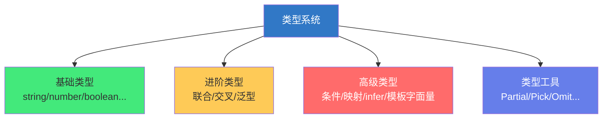
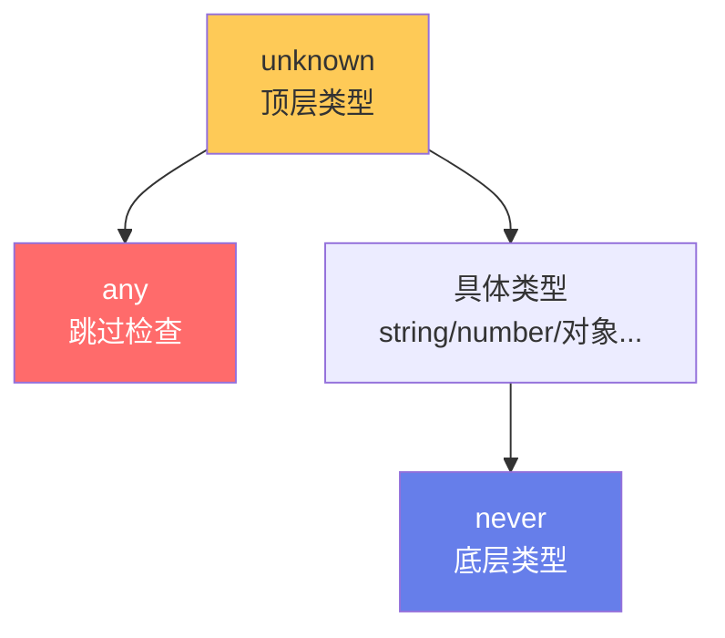

# 🎭 TypeScript：类型系统进阶

> **文档说明**：系统讲解 TypeScript 类型系统的高级特性与实战技巧，涵盖联合类型与交叉类型（Union & Intersection）、类型守卫与类型收窄（typeof / instanceof / in / 自定义谓词 is / 断言函数）、可辨识联合（Discriminated Unions，带 tag 的联合类型 + exhaustiveness 检查）、映射类型（Mapped Types，`[K in keyof T]` + 修饰符 readonly/? / +- / as 重映射）、条件类型（Conditional Types，`T extends U ? X : Y` + 分布式条件类型）、infer 关键字（类型推断）、模板字面量类型（Template Literal Types，`${T}` 拼接）、keyof 与 typeof 操作符、索引访问类型（`T[K]`）、内置工具类型全解（Partial / Required / Readonly / Pick / Omit / Record / ReturnType / Parameters / Awaited / Exclude / Extract / NonNullable / Uppercase 等 20+ 个）、泛型进阶（约束 extends / 默认参数 / 条件类型泛型 / 泛型推断）、严格模式（strict 全家桶）、顶层类型与底层类型（any / unknown / never / void / null / undefined 的区别与使用场景）、类型断言（as）与非空断言（!）、类型体操实战（DeepPartial / DeepReadonly / GetOptional / 字符串解析等）、常见类型错误排查、最佳实践。
>
> **适用人群**：有 TypeScript 基础、希望深入掌握类型系统的前端/全栈开发者、需要编写复杂类型定义的库作者
>
> **前置知识**：[[TypeScript基础语法]] · [[TypeScript-模块与声明文件]]

---

## 一、概述

### 1.1 TypeScript 类型系统的层次



| 层次 | 内容 | 难度 |
|------|------|------|
| 基础 | 原始类型、数组、对象、函数 | ⭐ |
| 进阶 | 联合、交叉、泛型、类型别名 | ⭐⭐ |
| 高级 | 条件类型、映射类型、infer、模板字面量 | ⭐⭐⭐⭐ |
| 专家 | 类型体操、复杂工具类型、类型推断 | ⭐⭐⭐⭐⭐ |

### 1.2 类型系统的设计哲学

TypeScript 的类型系统是**结构化类型（Structural Typing）**，而非名义类型（Nominal Typing）：

```typescript
interface Point { x: number; y: number; }
interface Vector { x: number; y: number; }

const p: Point = { x: 1, y: 2 };
const v: Vector = p;  // ✅ 允许！结构相同即可，不管名字
```

> 「如果它走起来像鸭子，叫起来像鸭子，那它就是鸭子」——鸭子类型。

---

## 二、联合类型与交叉类型

### 2.1 联合类型（Union）

```typescript
type StringOrNumber = string | number;

function padLeft(value: string, padding: string | number) {
  if (typeof padding === 'number') {
    return ' '.repeat(padding) + value;
  }
  return padding + value;
}
```

### 2.2 交叉类型（Intersection）

```typescript
interface User { id: number; name: string; }
interface Admin { role: string; permissions: string[]; }

type AdminUser = User & Admin;
// 等价于 { id: number; name: string; role: string; permissions: string[]; }

const admin: AdminUser = {
  id: 1,
  name: 'Alice',
  role: 'superadmin',
  permissions: ['read', 'write', 'delete']
};
```

### 2.3 联合 vs 交叉

| 类型 | 符号 | 含义 | 成员关系 |
|------|------|------|---------|
| 联合 | `\|` | A 或 B | 至少满足一个 |
| 交叉 | `&` | A 且 B | 必须同时满足 |

---

## 三、类型守卫与类型收窄

### 3.1 类型收窄（Narrowing）

TypeScript 通过控制流分析，在特定分支中自动收窄类型：

```typescript
function example(x: string | number) {
  x;  // string | number
  
  if (typeof x === 'string') {
    x;  // string ✅ 收窄了
    x.toUpperCase();
  } else {
    x;  // number ✅
    x.toFixed(2);
  }
}
```

### 3.2 五种类型守卫

| 守卫 | 语法 | 适用场景 |
|------|------|---------|
| **typeof** | `typeof x === 'string'` | 原始类型 |
| **instanceof** | `x instanceof Date` | 类实例 |
| **in** | `'prop' in x` | 对象属性 |
| **自定义谓词** | `x is Type` | 任意类型 |
| **断言函数** | `asserts x is Type` | 运行时断言 |

#### typeof 守卫

```typescript
function printId(id: number | string) {
  if (typeof id === 'number') {
    console.log(id.toFixed(2));  // number
  } else {
    console.log(id.toUpperCase());  // string
  }
}
```

#### instanceof 守卫

```typescript
function getDate(date: Date | string) {
  if (date instanceof Date) {
    return date.getTime();  // Date
  }
  return new Date(date).getTime();  // string
}
```

#### in 守卫

```typescript
interface Fish { swim: () => void; }
interface Bird { fly: () => void; }

function move(animal: Fish | Bird) {
  if ('swim' in animal) {
    animal.swim();  // Fish
  } else {
    animal.fly();   // Bird
  }
}
```

#### 自定义谓词（Type Predicate）

```typescript
interface Cat { meow: () => void; }
interface Dog { bark: () => void; }

function isCat(animal: Cat | Dog): animal is Cat {
  return (animal as Cat).meow !== undefined;
}

function speak(animal: Cat | Dog) {
  if (isCat(animal)) {
    animal.meow();  // Cat ✅
  } else {
    animal.bark();  // Dog ✅
  }
}
```

#### 断言函数（Assertion Function）

```typescript
function assertIsString(value: unknown): asserts value is string {
  if (typeof value !== 'string') {
    throw new Error('Not a string');
  }
}

function process(value: unknown) {
  assertIsString(value);
  value.toUpperCase();  // string ✅ 断言后收窄
}
```

---

## 四、可辨识联合（Discriminated Unions）

### 4.1 核心模式

给联合类型的每个成员加一个**共同的可辨识属性**（tag）：

```typescript
interface Circle {
  kind: 'circle';    // 可辨识 tag
  radius: number;
}
interface Square {
  kind: 'square';    // 可辨识 tag
  side: number;
}
interface Rectangle {
  kind: 'rectangle'; // 可辨识 tag
  width: number;
  height: number;
}

type Shape = Circle | Square | Rectangle;

function area(shape: Shape): number {
  switch (shape.kind) {
    case 'circle':
      return Math.PI * shape.radius ** 2;    // Circle ✅
    case 'square':
      return shape.side ** 2;                // Square ✅
    case 'rectangle':
      return shape.width * shape.height;     // Rectangle ✅
  }
}
```

### 4.2 Exhaustiveness 检查

确保 switch 覆盖了所有情况：

```typescript
function area(shape: Shape): number {
  switch (shape.kind) {
    case 'circle': return Math.PI * shape.radius ** 2;
    case 'square': return shape.side ** 2;
    case 'rectangle': return shape.width * shape.height;
    default: {
      const _exhaustive: never = shape;  // ✅ 如果有遗漏，这里会报错
      return _exhaustive;
    }
  }
}
```

> 如果 Shape 新增了成员但没加 case，`const _exhaustive: never = shape` 会报类型错误，提醒你补全。

---

## 五、keyof 与 typeof

### 5.1 keyof：获取键的联合类型

```typescript
interface User {
  id: number;
  name: string;
  email: string;
}

type UserKeys = keyof User;  // 'id' | 'name' | 'email'

function getProperty<T, K extends keyof T>(obj: T, key: K): T[K] {
  return obj[key];
}

const user: User = { id: 1, name: 'Alice', email: 'a@b.com' };
getProperty(user, 'name');  // string ✅
getProperty(user, 'age');   // ❌ 报错：'age' 不在 keyof User 中
```

### 5.2 typeof：获取值的类型

```typescript
const config = {
  apiUrl: 'https://api.example.com',
  timeout: 5000,
  retry: true
};

type Config = typeof config;
// { apiUrl: string; timeout: number; retry: boolean; }
```

### 5.3 索引访问类型

```typescript
type UserId = User['id'];        // number
type UserNameOrEmail = User['name' | 'email'];  // string
type UserValues = User[keyof User];  // number | string
```

---

## 六、映射类型（Mapped Types）

### 6.1 基本语法

基于已有类型创建新类型：

```typescript
type MyPartial<T> = {
  [K in keyof T]?: T[K];  // 所有属性变可选
};

type MyReadonly<T> = {
  readonly [K in keyof T]: T[K];  // 所有属性变只读
};
```

### 6.2 修饰符：+ / -

```typescript
// 移除 readonly 和 ?
type Mutable<T> = {
  -readonly [K in keyof T]-?: T[K];
};

// 添加 readonly 和 ?
type ReadonlyPartial<T> = {
  +readonly [K in keyof T]+?: T[K];
};
```

### 6.3 as 重映射（TypeScript 4.1+）

```typescript
// 所有属性名加 'on' 前缀
type EventHandlers<T> = {
  [K in keyof T as `on${Capitalize<string & K>}`]: () => void;
};

interface Button { click: void; hover: void; }
type ButtonEvents = EventHandlers<Button>;
// { onClick: () => void; onHover: () => void; }

// 过滤掉某些属性
type RemoveKindField<T> = {
  [K in keyof T as Exclude<K, 'kind'>]: T[K];
};
```

---

## 七、条件类型（Conditional Types）

### 7.1 基本语法

```typescript
type IsString<T> = T extends string ? true : false;

type A = IsString<'hello'>;  // true
type B = IsString<42>;       // false
```

### 7.2 分布式条件类型

当条件类型的参数是联合类型时，会**分布式**展开：

```typescript
type ToArray<T> = T extends any ? T[] : never;

type Result = ToArray<string | number>;
// 分布式展开：string[] | number[]
// 而非：(string | number)[]
```

### 7.3 内置条件类型

```typescript
// Exclude：从 T 中排除 U
type T1 = Exclude<'a' | 'b' | 'c', 'a'>;  // 'b' | 'c'

// Extract：从 T 中提取 U
type T2 = Extract<'a' | 'b' | 'c', 'a' | 'b'>;  // 'a' | 'b'

// NonNullable：排除 null 和 undefined
type T3 = NonNullable<string | null | undefined>;  // string

// ReturnType：获取函数返回类型
type T4 = ReturnType<() => string>;  // string

// Parameters：获取函数参数类型
type T5 = Parameters<(a: number, b: string) => void>;  // [number, string]

// Awaited：解包 Promise
type T6 = Awaited<Promise<string>>;  // string
type T7 = Awaited<Promise<Promise<number>>>;  // number
```

---

## 八、infer 关键字

### 8.1 类型推断

在条件类型中用 `infer` 声明一个待推断的类型变量：

```typescript
// 获取函数返回类型（ReturnType 的实现）
type MyReturnType<T> = T extends (...args: any[]) => infer R ? R : never;

type R = MyReturnType<() => number>;  // number

// 获取 Promise 的值类型
type UnwrapPromise<T> = T extends Promise<infer U> ? U : T;
type U = UnwrapPromise<Promise<string>>;  // string

// 获取数组元素类型
type ElementOf<T> = T extends (infer E)[] ? E : never;
type E = ElementOf<number[]>;  // number
```

### 8.2 infer 实战：获取第一个元素

```typescript
type FirstOf<T extends any[]> = T extends [infer F, ...any[]] ? F : never;
type F = FirstOf<[number, string, boolean]>;  // number
```

---

## 九、模板字面量类型

### 9.1 字符串拼接类型

```typescript
type Greeting = `Hello, ${string}!`;

const g1: Greeting = 'Hello, World!';  // ✅
const g2: Greeting = 'Hi, World!';     // ❌ 必须以 Hello, 开头

// 联合类型分布式展开
type EventName = `on${'Click' | 'Hover' | 'Focus'}`;
// 'onClick' | 'onHover' | 'onFocus'
```

### 9.2 字符串操作类型

```typescript
type Upper = Uppercase<'hello'>;      // 'HELLO'
type Lower = Lowercase<'HELLO'>;      // 'hello'
type Cap = Capitalize<'hello'>;       // 'Hello'
type Uncap = Uncapitalize<'Hello'>;   // 'hello'
```

### 9.3 实战：CSS 属性名转换

```typescript
type CSSProperty = 'font-size' | 'background-color' | 'margin-top';

// kebab-case → camelCase
type KebabToCamel<S extends string> = 
  S extends `${infer P}-${infer Q}` 
    ? `${P}${Capitalize<KebabToCamel<Q>>}` 
    : S;

type CamelCSS = KebabToCamel<CSSProperty>;
// 'fontSize' | 'backgroundColor' | 'marginTop'
```

---

## 十、内置工具类型全解

### 10.1 对象属性操作

| 工具类型 | 作用 | 示例 |
|---------|------|------|
| `Partial<T>` | 所有属性变可选 | `Partial<{a:number}>` → `{a?:number}` |
| `Required<T>` | 所有属性变必选 | `Required<{a?:number}>` → `{a:number}` |
| `Readonly<T>` | 所有属性变只读 | `Readonly<{a:number}>` → `{readonly a:number}` |
| `Pick<T, K>` | 选取部分属性 | `Pick<{a:number;b:string}, 'a'>` → `{a:number}` |
| `Omit<T, K>` | 排除部分属性 | `Omit<{a:number;b:string}, 'a'>` → `{b:string}` |

### 10.2 联合类型操作

| 工具类型 | 作用 |
|---------|------|
| `Record<K, V>` | 创建键为 K、值为 V 的对象类型 |
| `Exclude<T, U>` | 从 T 排除 U |
| `Extract<T, U>` | 从 T 提取 U |
| `NonNullable<T>` | 排除 null/undefined |

### 10.3 函数操作

| 工具类型 | 作用 |
|---------|------|
| `ReturnType<T>` | 获取函数返回类型 |
| `Parameters<T>` | 获取函数参数元组 |
| `ConstructorParameters<T>` | 获取构造函数参数 |
| `InstanceType<T>` | 获取构造函数实例类型 |
| `ThisParameterType<T>` | 获取 this 参数类型 |
| `OmitThisParameter<T>` | 移除 this 参数 |

### 10.4 字符串操作

| 工具类型 | 作用 |
|---------|------|
| `Uppercase<T>` | 转大写 |
| `Lowercase<T>` | 转小写 |
| `Capitalize<T>` | 首字母大写 |
| `Uncapitalize<T>` | 首字母小写 |

### 10.5 Promise 操作

| 工具类型 | 作用 |
|---------|------|
| `Awaited<T>` | 递归解包 Promise |

---

## 十一、泛型进阶

### 11.1 泛型约束

```typescript
// 约束：T 必须有 length 属性
function logLength<T extends { length: number }>(value: T): T {
  console.log(value.length);
  return value;
}

logLength('hello');     // ✅ string 有 length
logLength([1, 2, 3]);   // ✅ 数组有 length
logLength(42);          // ❌ number 没有 length
```

### 11.2 泛型默认参数

```typescript
interface ApiResponse<T = any> {
  data: T;
  code: number;
  message: string;
}

type DefaultResponse = ApiResponse;  // data: any
type UserResponse = ApiResponse<User>;  // data: User
```

### 11.3 条件类型 + 泛型

```typescript
// 根据输入类型决定返回类型
type Wrap<T> = T extends string ? { type: 'string'; value: T }
              : T extends number ? { type: 'number'; value: T }
              : { type: 'other'; value: T };

function wrap<T>(value: T): Wrap<T> {
  if (typeof value === 'string') {
    return { type: 'string', value } as Wrap<T>;
  }
  if (typeof value === 'number') {
    return { type: 'number', value } as Wrap<T>;
  }
  return { type: 'other', value } as Wrap<T>;
}
```

---

## 十二、顶层类型与底层类型

### 12.1 类型层次



| 类型 | 含义 | 赋值规则 | 使用场景 |
|------|------|---------|---------|
| **any** | 任意类型，跳过类型检查 | 任何值可赋给 any，any 可赋给任何 | 临时绕过（不推荐） |
| **unknown** | 未知类型，类型安全的 any | 任何值可赋给 unknown，但 unknown 不能直接用 | 不确定类型时的安全选择 |
| **never** | 不可能存在的值 | never 可赋给任何类型，但任何类型不能赋给 never | 穷尽检查、抛出异常的函数返回 |
| **void** | 无返回值 | 函数无 return 或 return 无值 | 函数返回类型 |
| **null** | 空值 | - | 显式空值 |
| **undefined** | 未定义 | - | 未初始化 |

### 12.2 unknown vs any

```typescript
let value: any = 'hello';
value.toUpperCase();  // ✅ 不检查，可能运行时报错

let safe: unknown = 'hello';
safe.toUpperCase();   // ❌ 报错：unknown 不能直接操作

// 必须先收窄
if (typeof safe === 'string') {
  safe.toUpperCase();  // ✅
}
```

> **原则**：优先用 unknown 而非 any，保持类型安全。

---

## 十三、类型断言与非空断言

### 13.1 类型断言（as）

```typescript
const value = someValue as string;  // 告诉 TS：我知道这是 string

// 双重断言（极端情况）
const weird = someValue as unknown as number;
```

> 类型断言不是类型转换，运行时不做任何转换，只是编译时告诉 TypeScript「相信我」。

### 13.2 非空断言（!）

```typescript
const element = document.getElementById('app');
element.innerHTML = 'hello';  // ❌ element 可能为 null

element!.innerHTML = 'hello';  // ✅ 非空断言：我确定它不为 null
```

> 非空断言要谨慎使用，确定不为 null 时才用。

---

## 十四、类型体操实战

### 14.1 DeepPartial

```typescript
type DeepPartial<T> = {
  [K in keyof T]?: T[K] extends object ? DeepPartial<T[K]> : T[K];
};

interface Config {
  server: { host: string; port: number; };
  debug: boolean;
}

type PartialConfig = DeepPartial<Config>;
// { server?: { host?: string; port?: number; }; debug?: boolean; }
```

### 14.2 DeepReadonly

```typescript
type DeepReadonly<T> = {
  readonly [K in keyof T]: T[K] extends object ? DeepReadonly<T[K]> : T[K];
};
```

### 14.3 GetOptional

```typescript
type GetOptional<T> = {
  [K in keyof T as T[K] extends Required<T>[K] ? never : K]: T[K];
};
```

---

## 十五、严格模式

tsconfig.json 中开启 `strict: true` 会启用以下所有检查：

| 选项 | 作用 |
|------|------|
| `noImplicitAny` | 不允许隐式 any |
| `strictNullChecks` | null/undefined 不能赋给其他类型 |
| `strictFunctionTypes` | 函数参数类型检查更严格 |
| `strictBindCallApply` | bind/call/apply 类型检查 |
| `strictPropertyInitialization` | 类属性必须初始化 |
| `noImplicitThis` | this 不能隐式 any |
| `alwaysStrict` | 每个文件自动 use strict |

> **建议**：所有新项目都开启 `strict: true`。

---

## 十六、常见问题

| 问题 | 原因 | 解决方案 |
|------|------|---------|
| **类型收窄不生效** | 函数调用后 TS 不跟踪 | 用类型守卫或断言函数 |
| **联合类型报错** | 没有可辨识 tag | 加 kind/type 字段，用可辨识联合 |
| **any 太多** | 类型定义不完整 | 用 unknown + 类型守卫，补充类型 |
| **泛型推断失败** | 类型参数无法推断 | 显式指定泛型参数或加约束 |
| **条件类型不分布式** | 参数不是裸类型参数 | 用 `T extends any ? ... : never` 包裹 |
| **索引签名报错** | 对象类型不确定 | 用 `Record<string, T>` 或索引签名 |
| **this 类型错误** | 函数中 this 隐式 any | 显式声明 this 参数或用箭头函数 |
| **类型循环引用** | 类型互相引用 | 用接口（支持递归）或延迟引用 |

---

## 十七、最佳实践

1. **开启 strict 模式**：所有新项目必须开启
2. **优先 unknown 而非 any**：保持类型安全
3. **用可辨识联合**：处理复杂联合类型，加 tag
4. **善用内置工具类型**：Partial/Pick/Omit/Record 等，不要重复造轮子
5. **类型断言要谨慎**：尽量用类型守卫收窄，少用 as
6. **泛型约束要合理**：不要过度约束，也不要完全不约束
7. **避免类型体操过度**：复杂类型要加注释，可读性优先
8. **导出类型定义**：公共 API 的类型要导出，方便使用者
9. **用 satisfies 操作符**：`const config = {...} satisfies Config` 保持字面量类型
10. **定期 review 类型**：类型也是代码，需要维护和重构

---

## 十八、关联笔记

### TypeScript 系列
- [[TypeScript基础语法]] · [[TypeScript-模块与声明文件]] · [[TypeScript-泛型与条件类型]]
- [[TypeScript-装饰器与元数据]] · [[Vue3-TypeScript最佳实践]]

### 前端工程化
- [[Vue3-组合式API]] · [[pnpm-monorepo架构]] · [[Vite构建工具原理]]
- [[ESLint与代码规范]]

### 导航
- [[MOC-前端开发]] · [[MOC-TypeScript]] · [[Home]] · [[学习路线总览]]

> 🔍 **知识点深度解析**
>
> **作用**：TypeScript 类型系统进阶解决的是「如何利用 TypeScript 强大的类型系统表达复杂的类型关系，在编译时捕获更多错误，同时保持代码的灵活性和可维护性」的核心问题——基础类型只能覆盖简单场景，复杂应用需要联合类型、条件类型、映射类型、泛型等高级特性来精确描述数据形状和函数契约，从而在编译时保证类型安全，减少运行时错误。
>
> **底层原理**：①TypeScript 的类型系统是「结构化类型（Structural Typing）」——两个类型是否兼容不取决于名字，而取决于结构（属性和方法）。这和 Java/C# 的名义类型不同，更接近 JavaScript 的鸭子类型。这种设计让 TypeScript 能更好地适配 JavaScript 的灵活特性，但也意味着「同名不同结构」的类型可能被误判为兼容。②类型收窄（Narrowing）的核心是「控制流分析」——TypeScript 编译器在编译时分析代码的控制流（if/else/switch/return/throw），在每个分支中自动将联合类型收窄为更具体的类型。typeof/instanceof/in/自定义谓词都是给编译器提供「收窄线索」的方式。这种分析是静态的（编译时），不运行代码，但能模拟运行时的类型状态。③可辨识联合（Discriminated Union）的本质是「用一个共同的字面量属性作为类型标签」——通过 `kind`/`type` 等 tag 属性，TypeScript 能在 switch 中精确收窄类型，甚至通过 `never` 类型实现穷尽检查（exhaustiveness check）。这是处理复杂状态（如 Redux action、UI 状态机）的最佳模式。④条件类型（Conditional Types）的本质是「类型层面的 if-else」——`T extends U ? X : Y` 在编译时根据 T 是否可赋值给 U 来选择 X 或 Y。分布式条件类型是其关键特性：当 T 是联合类型时，条件类型会自动展开为每个成员的条件类型联合，这使得 Exclude/Extract/NonNullable 等工具类型成为可能。⑤映射类型（Mapped Types）的本质是「类型层面的 map 函数」——`[K in keyof T]: T[K]` 遍历 T 的所有键，对每个键做转换（可选/只读/重命名/过滤）。as 重映射（TypeScript 4.1+）进一步增强了映射类型的能力，可以在映射时修改键名或过滤键。⑥infer 关键字的本质是「类型层面的正则捕获组」——在条件类型的 extends 子句中用 infer 声明一个类型变量，TypeScript 会从实际类型中「推断」出这个变量的值。这使得 ReturnType/Parameters/Awaited 等强大的类型提取工具成为可能。⑦模板字面量类型的本质是「类型层面的字符串模板」——`${T}` 可以拼接类型，配合联合类型的分布式特性，可以实现复杂的字符串类型操作（kebab-case 转 camelCase、事件名生成等）。这是 TypeScript 类型系统「图灵完备」的重要组成部分。
>
> **用法要点**：① 联合类型|和交叉类型&：联合是「或」，交叉是「且」 ② 类型守卫：typeof(原始)/instanceof(类)/in(属性)/自定义谓词(is)/断言函数(asserts)，实现类型收窄 ③ 可辨识联合：加kind/tag属性，switch收窄，never做穷尽检查 ④ keyof获取键联合，typeof获取值类型，T[K]索引访问 ⑤ 映射类型：[K in keyof T]遍历，?和readonly修饰符，+/-增删，as重映射 ⑥ 条件类型：T extends U ? X : Y，联合类型分布式展开 ⑦ infer：条件类型中推断类型，ReturnType/Parameters/UnwrapPromise ⑧ 模板字面量：`${T}`拼接，Uppercase/Lowercase/Capitalize，联合分布式 ⑨ 工具类型：Partial/Required/Readonly/Pick/Omit/Record/Exclude/Extract/NonNullable/ReturnType/Parameters/Awaited ⑩ 泛型：extends约束/默认参数/条件类型泛型 ⑪ 类型层次：unknown(顶层安全)/any(顶层跳过)/never(底层)/void(无返回)，优先unknown而非any ⑫ 断言：as类型断言(谨慎)/!非空断言(确定不为null时) ⑬ 严格模式：strict:true开启所有严格检查 ⑭ 类型体操：DeepPartial/DeepReadonly用递归映射类型 ⑮ 最佳实践：开strict/用可辨识联合/善用工具类型/避免any/复杂类型加注释。

> 💡 **深度讲解**：TypeScript 类型系统进阶最核心的智慧是「类型不是约束，而是文档和工具——精确的类型定义能在编译时捕获错误、提供智能提示、辅助重构，让代码更可靠、更易维护」——很多初学者觉得 TypeScript 的高级类型「太复杂、没必要」，这是因为他们还停留在「给变量加类型注解」的初级阶段。当项目变大、团队变多、接口变复杂时，类型系统的价值才真正显现：一个精确的 API 类型定义就是最好的文档，IDE 的智能提示就是最好的开发体验，编译时的类型错误就是最早的 Bug 发现。高级类型（条件类型、映射类型、infer、模板字面量）让 TypeScript 能描述极其复杂的类型关系——从 DeepPartial 到事件名自动生成，从函数参数提取到 Promise 解包，这些能力让类型系统从「注解工具」升级为「类型编程」。TypeScript 的类型系统甚至是「图灵完备」的——理论上可以用类型实现任何计算。但这并不意味着你应该写复杂的「类型体操」——类型的首要目标是「可读性和可维护性」，复杂的类型要加注释、要封装成命名的工具类型、要在团队内达成共识。在 AI 时代，精确的类型定义更加重要——AI 生成代码时，有类型的代码生成质量远高于无类型的代码；AI 辅助重构时，类型系统是最可靠的安全网；AI 代码审查时，类型错误是最容易发现的问题。掌握 TypeScript 类型系统进阶，不仅是「写好 TypeScript」的基础，更是「与 AI 高效协作」的基础——因为类型就是最精确的「代码文档」，AI 能读懂类型，就能更好地理解和生成代码。

> 📝 **精简总结**：TypeScript类型系统进阶=从基础类型到类型编程。联合|交叉&，类型守卫(typeof/instanceof/in/自定义谓词is/断言函数)实现收窄。可辨识联合加kind tag+switch+never穷尽检查。keyof获取键，typeof获取值类型，T[K]索引访问。映射类型[K in keyof T]遍历，?/readonly修饰，as重映射。条件类型T extends U?X:Y，联合分布式。infer推断类型(ReturnType/Parameters)。模板字面量`${T}`拼接+字符串操作。工具类型：Partial/Required/Readonly/Pick/Omit/Record/Exclude/Extract/NonNullable/ReturnType/Parameters/Awaited。泛型extends约束+默认参数。类型层次：unknown(安全顶层)/any(跳过)/never(底层)/void。严格模式strict:true。类型体操：DeepPartial递归映射。最佳实践：开strict/用可辨识联合/善用工具类型/优先unknown/复杂类型加注释。

> **学习路径建议**：先学习 [[TypeScript基础语法]] 掌握基础类型 → 学习本文档的联合类型、类型守卫、可辨识联合 → 实践：为你的项目中的复杂状态用可辨识联合重构 → 学习映射类型和条件类型 → 实践：实现 DeepPartial/DeepReadonly 等工具类型 → 学习 infer 和模板字面量类型 → 实践：实现 kebab-case 转 camelCase 的类型工具 → 学习 [[TypeScript-泛型与条件类型]] 深化 → 实践：为一个开源库编写复杂的类型定义 → 研究 Vue 3 / React 的类型定义源码 → 形成「类型编程」的思维和能力。

---

> **TypeScript 类型系统进阶的本质是「将类型从『代码的注解』升级为『代码的文档、工具和安全网』——精确的类型定义能在编译时捕获错误、在开发时提供智能提示、在重构时提供安全保障」——很多人学 TypeScript 只学到「给变量加个 string/number」就停了，觉得高级类型「太复杂、没必要」。但当项目变大、团队变多、接口变复杂时，你会发现：一个精确的 API 类型定义就是最好的文档（不用翻文档，IDE 直接提示），编译时的类型错误就是最早的 Bug 发现（比测试更早、比线上更便宜），类型系统的重构辅助就是最可靠的安全网（改一个接口，所有调用处自动报错）。高级类型（条件类型、映射类型、infer、模板字面量）让 TypeScript 能描述极其复杂的类型关系——从 DeepPartial 到事件名自动生成，从函数参数提取到 Promise 解包——这些能力让类型系统从「注解工具」升级为「类型编程」。但这里有一个重要的平衡：**类型的首要目标是可读性和可维护性，不是炫技**。复杂的「类型体操」如果没有注释、没有封装、团队不理解，那就是「技术债务」而非「技术资产」。好的类型定义应该像好的代码一样：清晰、简洁、有命名、有注释。在 AI 时代，精确的类型定义更加重要——AI 生成代码时，有类型的代码生成质量远高于无类型的代码；AI 辅助重构时，类型系统是最可靠的安全网；AI 代码审查时，类型错误是最容易发现的问题。掌握 TypeScript 类型系统进阶，不仅是「写好 TypeScript」的基础，更是「与 AI 高效协作」的基础——因为类型就是最精确的「代码文档」，AI 能读懂类型，就能更好地理解和生成代码。从今天开始，开启 strict 模式，用可辨识联合处理复杂状态，用工具类型减少重复，用 unknown 替代 any——让类型系统成为你最强大的开发伙伴，而非最烦人的约束。**
