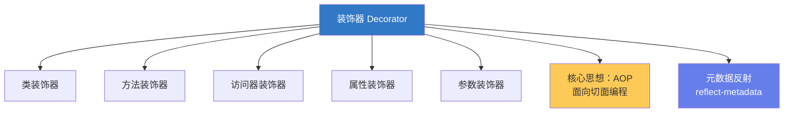
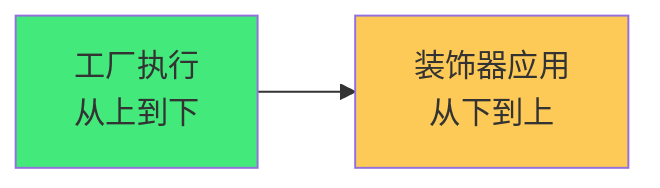

# 🎨 TypeScript：装饰器与元数据

> **文档说明**：系统讲解 TypeScript 装饰器（Decorator）与元数据反射（Metadata Reflection）的原理与实战，涵盖装饰器的概念与起源（AOP 面向切面编程/Python 装饰器/Java 注解）、TypeScript 装饰器的演进（实验性装饰器 experimentalDecorators / TC39 标准装饰器 Stage 3）、五种装饰器类型详解（类装饰器 ClassDecorator / 方法装饰器 MethodDecorator / 访问器装饰器 AccessorDecorator / 属性装饰器 PropertyDecorator / 参数装饰器 ParameterDecorator）、装饰器工厂（带参数的装饰器函数）、装饰器组合与执行顺序（工厂从上到下执行/装饰器从下到上应用）、元数据反射（reflect-metadata 库 / Reflect.defineMetadata / Reflect.getMetadata / 设计时元数据 design:type / design:paramtypes / design:returntype）、依赖注入原理（用装饰器+元数据实现 DI 容器）、常见装饰器模式（日志/缓存/权限校验/参数校验/性能计时/防抖节流）、与主流框架的关系（Angular / NestJS / TypeORM / routing-controllers / class-validator）、TC39 新装饰器语法、常见问题与最佳实践。
>
> **适用人群**：中高级前端/全栈开发者、框架使用者与开发者、需要理解 NestJS/Angular 底层原理的工程师
>
> **前置知识**：[[TypeScript-类型系统进阶]] · [[TypeScript-泛型与条件类型]]

---

## 一、概述

### 1.1 什么是装饰器

**装饰器（Decorator）** 是一种特殊类型的声明，它可以附加到**类声明、方法、访问器、属性或参数**上，修改类的行为。装饰器使用 `@expression` 语法，`expression` 是一个函数，在运行时被调用，被装饰的声明信息作为参数传入。



**核心思想**：装饰器是 **AOP（面向切面编程）** 在 TypeScript 中的实现——在不修改原有代码的前提下，动态地给类/方法添加额外功能（日志、权限、缓存、校验等）。

### 1.2 装饰器的起源

| 语言/技术 | 类似概念 | 说明 |
|----------|---------|------|
| **Python** | `@decorator` | 函数装饰器，语法最相似 |
| **Java** | Annotation（注解） | 元数据标记，运行时反射 |
| **C#** | Attribute | 类似 Java 注解 |
| **JavaScript** | TC39 Decorators | 标准提案，Stage 3 |

### 1.3 启用装饰器

```json
// tsconfig.json
{
  "compilerOptions": {
    "experimentalDecorators": true,   // 启用实验性装饰器
    "emitDecoratorMetadata": true     // 启用元数据发射（配合 reflect-metadata）
  }
}
```

> 注意：TypeScript 5.0+ 已支持 TC39 标准装饰器（无需 experimentalDecorators），但生态中大量库仍使用实验性装饰器。

---

## 二、五种装饰器类型

### 2.1 类装饰器（ClassDecorator）

应用于类构造函数，可以用来监视、修改或替换类定义。

```typescript
// 基本类装饰器
function sealed(constructor: Function) {
  Object.seal(constructor);
  Object.seal(constructor.prototype);
}

@sealed
class Greeter {
  greeting: string;
  constructor(message: string) {
    this.greeting = message;
  }
  greet() { return `Hello, ${this.greeting}`; }
}
```

**类装饰器签名**：
```typescript
type ClassDecorator = <TFunction extends Function>(target: TFunction) => TFunction | void;
```

- `target`：被装饰的类构造函数
- 返回新的构造函数可以替换原类

### 2.2 方法装饰器（MethodDecorator）

应用于方法的属性描述符，可以用来监视、修改或替换方法定义。

```typescript
function log(target: Object, propertyKey: string, descriptor: PropertyDescriptor) {
  const originalMethod = descriptor.value;
  descriptor.value = function (...args: any[]) {
    console.log(`调用 ${propertyKey}，参数：`, args);
    const result = originalMethod.apply(this, args);
    console.log(`返回：`, result);
    return result;
  };
  return descriptor;
}

class Calculator {
  @log
  add(a: number, b: number): number {
    return a + b;
  }
}

new Calculator().add(1, 2);
// 输出：调用 add，参数：[1, 2]
// 输出：返回：3
```

**方法装饰器签名**：
```typescript
type MethodDecorator = <T>(
  target: Object,
  propertyKey: string | symbol,
  descriptor: TypedPropertyDescriptor<T>
) => TypedPropertyDescriptor<T> | void;
```

- `target`：类的原型对象（静态方法则是构造函数）
- `propertyKey`：方法名
- `descriptor`：方法的属性描述符

### 2.3 访问器装饰器（AccessorDecorator）

应用于 get/set 访问器。

```typescript
function configurable(value: boolean) {
  return function (target: Object, propertyKey: string, descriptor: PropertyDescriptor) {
    descriptor.configurable = value;
  };
}

class Point {
  private _x: number;
  private _y: number;
  
  @configurable(false)
  get x() { return this._x; }
  
  @configurable(false)
  get y() { return this._y; }
}
```

> 注意：不能同时装饰同一个成员的 get 和 set 访问器。

### 2.4 属性装饰器（PropertyDecorator）

应用于类的属性。

```typescript
function format(target: Object, propertyKey: string) {
  let value: string;
  const getter = () => value;
  const setter = (newVal: string) => {
    value = newVal.trim().toLowerCase();
  };
  Object.defineProperty(target, propertyKey, {
    get: getter,
    set: setter,
    enumerable: true,
    configurable: true
  });
}

class User {
  @format
  name: string;
}

const user = new User();
user.name = '  Alice  ';
console.log(user.name);  // 'alice'
```

**属性装饰器签名**：
```typescript
type PropertyDecorator = (target: Object, propertyKey: string | symbol) => void;
```

> 属性装饰器没有 descriptor 参数，因为 TypeScript 在定义属性时无法获取属性描述符。

### 2.5 参数装饰器（ParameterDecorator）

应用于方法的参数。

```typescript
function required(target: Object, propertyKey: string, parameterIndex: number) {
  console.log(`参数 ${parameterIndex} 在方法 ${propertyKey} 中是必填的`);
}

class UserService {
  createUser(@required name: string, age?: number) {
    // ...
  }
}
```

**参数装饰器签名**：
```typescript
type ParameterDecorator = (
  target: Object,
  propertyKey: string | symbol,
  parameterIndex: number
) => void;
```

- `parameterIndex`：参数在函数参数列表中的索引

---

## 三、装饰器工厂

**装饰器工厂**是一个返回装饰器的函数，允许装饰器接收参数：

```typescript
// 装饰器工厂：接收参数，返回装饰器
function logWithPrefix(prefix: string) {
  return function (target: Object, propertyKey: string, descriptor: PropertyDescriptor) {
    const original = descriptor.value;
    descriptor.value = function (...args: any[]) {
      console.log(`[${prefix}] 调用 ${propertyKey}`);
      return original.apply(this, args);
    };
  };
}

class Service {
  @logWithPrefix('DEBUG')
  doSomething() { /* ... */ }
}
```

---

## 四、装饰器组合与执行顺序

### 4.1 多个装饰器

```typescript
@decoratorA
@decoratorB
@decoratorC
class MyClass { }
```

### 4.2 执行顺序



**规则**：
1. **工厂函数**：从上到下执行（先执行 decoratorA 的工厂，再 decoratorB，再 decoratorC）
2. **装饰器应用**：从下到上应用（先应用 decoratorC，再 decoratorB，再 decoratorA）

```typescript
function f() {
  console.log("f(): 工厂执行");
  return function (target: any, propertyKey: string) {
    console.log("f(): 装饰器应用");
  };
}

function g() {
  console.log("g(): 工厂执行");
  return function (target: any, propertyKey: string) {
    console.log("g(): 装饰器应用");
  };
}

class C {
  @f()
  @g()
  method() {}
}

// 输出顺序：
// f(): 工厂执行
// g(): 工厂执行
// g(): 装饰器应用
// f(): 装饰器应用
```

---

## 五、元数据反射

### 5.1 什么是元数据

```text
**元数据（Metadata）** 是「关于数据的数据」——装饰器可以给类/方法/属性附加额外的元信息，运行时通过反射读取这些信息。

### 5.2 reflect-metadata 库
```

```bash
npm install reflect-metadata
```

```typescript
import 'reflect-metadata';

// 定义元数据
Reflect.defineMetadata('key', 'value', target, propertyKey);

// 读取元数据
const value = Reflect.getMetadata('key', target, propertyKey);

// 检查元数据是否存在
const exists = Reflect.hasMetadata('key', target, propertyKey);
```

### 5.3 设计时元数据

启用 `emitDecoratorMetadata: true` 后，TypeScript 会自动发射三种设计时元数据：

| 元数据键 | 含义 | 示例 |
|---------|------|------|
| `design:type` | 属性/方法的类型 | `String`, `Number`, `UserService` |
| `design:paramtypes` | 方法参数类型数组 | `[String, Number]` |
| `design:returntype` | 方法返回类型 | `Promise<User>` |

```typescript
import 'reflect-metadata';

class UserService {
  @log
  getUser(id: number): string {
    return 'user';
  }
}

// 读取设计时元数据
const paramTypes = Reflect.getMetadata('design:paramtypes', UserService.prototype, 'getUser');
console.log(paramTypes);  // [Function: Number]

const returnType = Reflect.getMetadata('design:returntype', UserService.prototype, 'getUser');
console.log(returnType);  // [Function: String]
```

> 这是依赖注入（DI）框架的核心原理——通过 `design:paramtypes` 自动获取构造函数参数的类型，然后实例化并注入。

---

## 六、依赖注入原理

### 6.1 简易 DI 容器

```typescript
import 'reflect-metadata';

// 可注入装饰器
function Injectable() {
  return function (target: Function) {};
}

// DI 容器
class DIContainer {
  private instances = new Map<Function, any>();

  resolve<T>(target: Function): T {
    if (this.instances.has(target)) {
      return this.instances.get(target);
    }

    // 通过元数据获取构造函数参数类型
    const paramTypes = Reflect.getMetadata('design:paramtypes', target) || [];
    
    // 递归解析依赖
    const dependencies = paramTypes.map((dep: Function) => this.resolve(dep));
    
    // 实例化
    const instance = new (target as any)(...dependencies);
    this.instances.set(target, instance);
    return instance;
  }
}

// 使用
@Injectable()
class Logger { log(msg: string) { console.log(msg); } }

@Injectable()
class UserService {
  constructor(private logger: Logger) {}
  create() { this.logger.log('用户创建'); }
}

const container = new DIContainer();
const userService = container.resolve<UserService>(UserService);
userService.create();  // 用户创建
```

> 这就是 NestJS、Angular 等框架依赖注入的核心原理。

---

## 七、常见装饰器模式

### 7.1 日志装饰器

```typescript
function Log(target: Object, key: string, descriptor: PropertyDescriptor) {
  const original = descriptor.value;
  descriptor.value = function (...args: any[]) {
    console.log(`[LOG] ${key}(${args.join(', ')})`);
    const result = original.apply(this, args);
    console.log(`[LOG] ${key} 返回:`, result);
    return result;
  };
}
```

### 7.2 缓存装饰器

```typescript
function Cache(ttl: number = 60000) {
  const cache = new Map<string, { value: any; expiry: number }>();
  return function (target: Object, key: string, descriptor: PropertyDescriptor) {
    const original = descriptor.value;
    descriptor.value = function (...args: any[]) {
      const cacheKey = `${key}_${JSON.stringify(args)}`;
      const cached = cache.get(cacheKey);
      if (cached && Date.now() < cached.expiry) {
        return cached.value;
      }
      const result = original.apply(this, args);
      cache.set(cacheKey, { value: result, expiry: Date.now() + ttl });
      return result;
    };
  };
}
```

### 7.3 权限校验装饰器

```typescript
function RequireRole(role: string) {
  return function (target: Object, key: string, descriptor: PropertyDescriptor) {
    const original = descriptor.value;
    descriptor.value = function (...args: any[]) {
      const currentUser = (this as any).currentUser;
      if (!currentUser || !currentUser.roles.includes(role)) {
        throw new Error(`需要 ${role} 权限`);
      }
      return original.apply(this, args);
    };
  };
}
```

### 7.4 参数校验装饰器

```typescript
function Validate(target: Object, key: string, descriptor: PropertyDescriptor) {
  const original = descriptor.value;
  descriptor.value = function (...args: any[]) {
    // 简单校验：参数不能为 null/undefined
    args.forEach((arg, i) => {
      if (arg === null || arg === undefined) {
        throw new Error(`参数 ${i} 不能为空`);
      }
    });
    return original.apply(this, args);
  };
}
```

### 7.5 性能计时装饰器

```typescript
function Timed(target: Object, key: string, descriptor: PropertyDescriptor) {
  const original = descriptor.value;
  descriptor.value = function (...args: any[]) {
    const start = performance.now();
    const result = original.apply(this, args);
    const elapsed = performance.now() - start;
    console.log(`[TIMED] ${key} 耗时 ${elapsed.toFixed(2)}ms`);
    return result;
  };
}
```

---

## 八、与主流框架的关系

| 框架 | 装饰器用途 | 典型装饰器 |
|------|-----------|-----------|
| **Angular** | 组件/指令/服务/模块 | `@Component`, `@Injectable`, `@NgModule` |
| **NestJS** | 控制器/服务/模块/路由 | `@Controller`, `@Get`, `@Post`, `@Injectable` |
| **TypeORM** | 实体/列/关系 | `@Entity`, `@Column`, `@OneToMany` |
| **routing-controllers** | 路由/中间件 | `@Controller`, `@Get`, `@UseBefore` |
| **class-validator** | 属性校验 | `@IsString`, `@IsEmail`, `@Min` |
| **class-transformer** | 序列化 | `@Expose`, `@Transform`, `@Type` |
| **Vue 3** | 有限支持 | 主要用组合式 API，不依赖装饰器 |

> NestJS 是装饰器+元数据的集大成者——它的整个架构（控制器、服务、模块、依赖注入、守卫、拦截器、管道）都建立在装饰器和元数据反射之上。

---

## 九、TC39 标准装饰器

TypeScript 5.0+ 支持 TC39 标准装饰器（Stage 3），语法与实验性装饰器不同：

```typescript
// TC39 标准装饰器
function logged(value: Function, context: ClassMethodDecoratorContext) {
  return function (this: any, ...args: any[]) {
    console.log(`调用 ${String(context.name)}`);
    return value.apply(this, args);
  };
}

class Calculator {
  @logged
  add(a: number, b: number) {
    return a + b;
  }
}
```

**主要区别**：
- 标准装饰器接收 `(value, context)` 而非 `(target, key, descriptor)`
- `context` 对象包含 `kind`（class/method/field 等）、`name`、`metadata` 等
- 原生支持元数据（`context.metadata`），不再需要 reflect-metadata
- 访问器装饰器更强大

---

## 十、常见问题

| 问题 | 原因 | 解决方案 |
|------|------|---------|
| **装饰器不生效** | 未启用 experimentalDecorators | tsconfig 中开启 |
| **元数据为 undefined** | 未启用 emitDecoratorMetadata 或未 import reflect-metadata | 开启选项 + `import 'reflect-metadata'` |
| **this 指向错误** | 装饰器中用箭头函数或丢失 this | 用 `function` 关键字，`original.apply(this, args)` |
| **属性装饰器无法获取值** | 属性装饰器没有 descriptor | 用 Object.defineProperty 自定义 getter/setter |
| **参数装饰器无法修改参数** | 参数装饰器只能记录元数据 | 配合方法装饰器一起使用 |
| **装饰器顺序混乱** | 不了解工厂和应用的顺序 | 工厂从上到下，应用从下到上 |
| **循环依赖** | A 依赖 B，B 依赖 A | 用 `@Inject(forwardRef(() => Service))` |
| **标准装饰器不兼容** | 库用实验性装饰器，项目用标准装饰器 | 统一使用一种，或用适配器 |

---

## 十一、最佳实践

1. **优先用组合式 API**：Vue 3 项目中优先用组合式函数，装饰器作为补充
2. **装饰器要纯函数**：装饰器工厂应该是纯函数，不产生副作用
3. **保留原方法引用**：修改 descriptor.value 时保存原方法，调用时用 apply
4. **元数据键用 Symbol**：避免元数据键冲突，用 `Symbol('my-key')`
5. **装饰器要加类型**：用 ClassDecorator/MethodDecorator 等类型标注
6. **避免过度装饰**：一个方法上不要堆太多装饰器，可读性优先
7. **测试装饰器**：装饰器逻辑要单独测试，确保不破坏原有功能
8. **文档说明**：自定义装饰器要写清楚用途、参数、返回值
9. **注意性能**：装饰器在类加载时执行，不要做耗时操作
10. **关注标准进展**：TC39 装饰器即将标准化，新代码考虑用标准语法

---

## 十二、关联笔记

### TypeScript 系列
- [[TypeScript基础语法]] · [[TypeScript-类型系统进阶]] · [[TypeScript-泛型与条件类型]]
- [[TypeScript-模块与声明文件]] · [[Vue3-TypeScript最佳实践]]

### 后端与框架
- [[NestJS框架入门]] · [[依赖注入与控制反转]] · [[面向切面编程AOP]]
- [[RESTful API设计]]

### 导航
- [[MOC-前端开发]] · [[MOC-TypeScript]] · [[Home]] · [[学习路线总览]]

> 🔍 **知识点深度解析**
>
> **作用**：装饰器与元数据解决的是「如何在不修改原有代码的前提下，动态地给类/方法/属性添加额外功能（日志、权限、缓存、校验、依赖注入等），并在运行时通过反射读取附加的元信息」的核心问题——这是 AOP（面向切面编程）在 TypeScript 中的实现，也是 NestJS、Angular、TypeORM 等框架的底层基石。
>
> **底层原理**：①装饰器的本质是「语法糖+函数调用」——`@decorator` 在编译后变成 `decorator(target, key, descriptor)` 这样的函数调用。TypeScript 编译器在遇到装饰器时，会生成 `__decorate` 辅助函数，按顺序调用装饰器并传入目标信息。装饰器可以修改 descriptor（属性描述符）来改变方法行为，或返回新的构造函数来替换类。这种「在不修改源码的情况下修改行为」的能力就是 AOP 的核心。②五种装饰器的区别在于传入的参数不同——类装饰器接收构造函数，方法/访问器装饰器接收 target+key+descriptor，属性装饰器只接收 target+key（没有 descriptor，因为 TS 无法在定义时获取属性描述符），参数装饰器接收 target+key+parameterIndex。理解每种装饰器能拿到什么信息，是正确使用装饰器的关键。③装饰器工厂的本质是「柯里化」——`@logWithPrefix('DEBUG')` 先执行 `logWithPrefix('DEBUG')` 返回真正的装饰器函数，然后这个装饰器函数再被应用到目标上。这就是为什么工厂执行顺序是从上到下，而装饰器应用顺序是从下到上——工厂先全部执行（收集参数），然后装饰器从最内层开始应用。④元数据反射的本质是「WeakMap 存储」——reflect-metadata 库内部用 WeakMap 存储「目标对象→元数据 Map」的映射，`Reflect.defineMetadata(key, value, target)` 就是往这个 WeakMap 里存数据，`Reflect.getMetadata(key, target)` 就是取数据。设计时元数据（design:type/paramtypes/returntype）是 TypeScript 编译器在 `emitDecoratorMetadata: true` 时自动生成的，它把 TypeScript 的类型信息（编译后通常会擦除）以元数据的形式保留下来，让运行时能知道「这个参数是什么类型」。⑤依赖注入（DI）的核心原理就是「装饰器+元数据」——`@Injectable()` 标记一个类可被注入，DI 容器在解析时通过 `Reflect.getMetadata('design:paramtypes', target)` 获取构造函数参数的类型，然后递归解析每个依赖并实例化，最后传入构造函数。这就是 NestJS/Angular 能自动注入依赖的底层原理。⑥TC39 标准装饰器与实验性装饰器的核心区别是「context 对象」——标准装饰器用 `(value, context)` 替代了 `(target, key, descriptor)`，context.kind 告诉装饰器这是什么类型（class/method/field/getter/setter/accessor），context.metadata 提供了原生的元数据存储（不再需要 reflect-metadata），context.addInitializer 允许在类初始化时执行代码。标准装饰器更统一、更强大，但生态迁移需要时间。
>
> **用法要点**：① 启用：tsconfig中experimentalDecorators:true + emitDecoratorMetadata:true + import 'reflect-metadata' ② 五种装饰器：类装饰器(改构造函数)/方法装饰器(改descriptor)/访问器装饰器(改get set)/属性装饰器(无descriptor，用Object.defineProperty)/参数装饰器(记录parameterIndex) ③ 装饰器工厂：函数返回装饰器，支持参数@decorator(arg) ④ 执行顺序：工厂从上到下执行，装饰器从下到上应用 ⑤ 元数据：Reflect.defineMetadata/getMetadata/hasMetadata，设计时元数据design:type/paramtypes/returntype ⑥ DI原理：@Injectable标记+design:paramtypes获取参数类型+递归解析+单例缓存 ⑦ 常见模式：日志/缓存(ttl+Map)/权限校验(角色检查)/参数校验(非空)/性能计时(performance.now) ⑧ 框架：Angular/NestJS(控制器服务DI)/TypeORM(实体列)/class-validator(校验) ⑨ TC39标准装饰器：(value, context)语法，context.kind/name/metadata，原生元数据 ⑩ 常见问题：未启用选项/this指向用apply/属性装饰器无descriptor/参数装饰器只能记录元数据/循环依赖用forwardRef ⑪ 最佳实践：Vue3优先组合式API/装饰器纯函数/保留原方法/元数据键用Symbol/加类型/避免过度装饰/测试/关注标准进展。

> 💡 **深度讲解**：装饰器与元数据最核心的智慧是「用声明式的元数据标记替代命令式的样板代码，让框架在运行时通过反射自动完成重复工作——这是『约定优于配置』和『面向切面编程』在 TypeScript 中的完美结合」——在没有装饰器的时代，给方法加日志要在每个方法里写 console.log，做依赖注入要手动 new 并传入依赖，做参数校验要在每个方法开头写 if 判断。这些「横切关注点」（日志、权限、缓存、校验、事务）散落在各个业务方法中，既重复又难以维护。装饰器的出现改变了这一切——你只需要在方法上加一个 `@Log`，装饰器会自动包装方法、添加日志逻辑；你只需要在类上加一个 `@Injectable`，DI 容器会自动解析依赖、实例化并注入；你只需要在属性上加一个 `@IsEmail`，校验库会自动验证格式。这种「声明式编程」的核心是「元数据」——装饰器本身不做实际工作，它只是给目标打上「标记」（元数据），真正的工作由框架在运行时通过反射读取元数据来完成。这就是为什么 NestJS 能做到「你写一个 `@Controller()` 和 `@Get()`，框架自动注册路由」——装饰器标记了元数据，框架启动时扫描所有类，读取元数据，自动完成路由注册、依赖注入、中间件绑定等工作。理解了装饰器+元数据的原理，你就理解了 NestJS/Angular 等「魔法框架」的底层——没有魔法，只有元数据和反射。在 AI 时代，装饰器+元数据有了新的意义——AI 可以通过读取元数据理解代码的结构和意图（这个类是 Controller，这个方法是 GET 路由，这个参数是必填的），从而更准确地生成代码、辅助重构、自动测试。元数据就是「代码的代码」——它让代码变得「可被机器理解」。掌握装饰器与元数据，不仅是理解框架底层的关键，更是迈向「声明式编程」和「元编程」的重要一步。

> 📝 **精简总结**：装饰器与元数据=TypeScript的AOP实现+元数据反射。五种装饰器：类(改构造)/方法(改descriptor)/访问器(改get set)/属性(无descriptor)/参数(记录索引)。装饰器工厂：函数返回装饰器，支持参数。执行顺序：工厂从上到下，应用从下到上。元数据：reflect-metadata库，defineMetadata/getMetadata，设计时元数据design:type/paramtypes/returntype。DI原理：@Injectable+design:paramtypes+递归解析+单例。常见模式：日志/缓存/权限/校验/计时。框架：NestJS/Angular/TypeORM/class-validator。TC39标准装饰器：(value, context)语法，原生元数据。最佳实践：Vue3优先组合式API/装饰器纯函数/保留原方法用apply/元数据键用Symbol/避免过度装饰/关注标准进展。

> **学习路径建议**：先学习 [[TypeScript-类型系统进阶]] 和 [[TypeScript-泛型与条件类型]] 打好基础 → 学习本文档的五种装饰器和元数据基础 → 实践：写一个日志装饰器和缓存装饰器 → 学习 [[依赖注入与控制反转]] 理解 DI 原理 → 实践：实现一个简易 DI 容器 → 学习 NestJS（[[NestJS框架入门]]），理解装饰器在真实框架中的应用 → 研究 TypeORM/class-validator 的装饰器源码 → 了解 TC39 标准装饰器进展 → 形成「声明式编程」和「元编程」的思维。

---

> **装饰器与元数据的本质是「用声明式的元数据标记替代命令式的样板代码，让框架在运行时通过反射自动完成重复工作——这是『约定优于配置』和『面向切面编程』在 TypeScript 中的完美结合」——在没有装饰器的时代，给方法加日志要在每个方法里写 console.log，做依赖注入要手动 new 并传入依赖，做参数校验要在每个方法开头写 if 判断。这些「横切关注点」散落在业务代码中，既重复又难以维护。装饰器的出现改变了这一切——`@Log` 自动加日志，`@Injectable` 自动注入依赖，`@IsEmail` 自动校验格式。这种「声明式编程」的核心是「元数据」：装饰器只是打标记，框架通过反射读取标记并自动完成工作。这就是 NestJS「魔法」的底层——没有魔法，只有元数据和反射。理解了装饰器+元数据，你就理解了现代后端框架的设计哲学：**开发者只需要声明「是什么」，框架自动处理「怎么做」**。这种范式极大地提升了开发效率，让开发者专注于业务逻辑而非样板代码。在 AI 时代，元数据的价值更加凸显——AI 可以通过读取元数据理解代码的结构和意图（这个类是 Controller，这个方法是 GET 路由），从而更准确地生成代码、辅助重构。元数据就是「代码的代码」，它让代码变得「可被机器理解」。掌握装饰器与元数据，不仅是理解框架底层的关键，更是迈向「声明式编程」和「元编程」的重要一步——从「告诉计算机怎么做」升级为「告诉计算机是什么」，让框架和 AI 帮你完成剩下的工作。**
