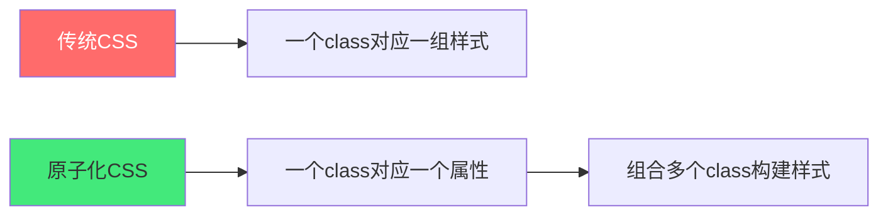
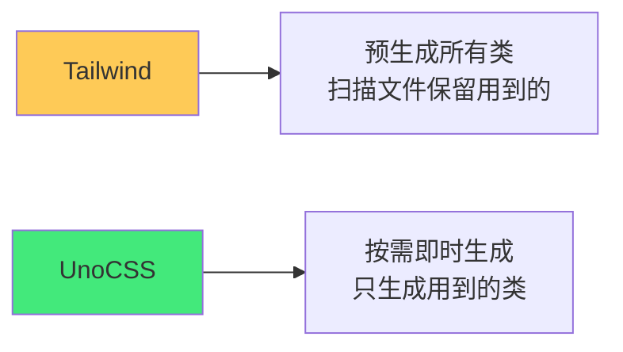

# 🎨 UnoCSS / Tailwind：原子化 CSS 实战

> **文档说明**：系统讲解原子化 CSS 的核心概念与两大主流框架（Tailwind CSS / UnoCSS）的实战用法，涵盖原子化 CSS 概念与原理（什么是原子化 CSS / Utility-First 理念 / 与传统 CSS 和 CSS-in-JS 的对比）、Tailwind CSS 详解（核心概念 / 常用工具类速查 / JIT 即时编译引擎 / tailwind.config.js 配置 / 自定义主题扩展 / 响应式前缀体系 / 状态变体 hover/focus/active/disabled / 暗黑模式 dark: / 组件抽象 @apply / 层叠 layers）、UnoCSS 详解（即时按需生成原理 / 无构建时扫描 / 预设体系 presets / attributify 属性化模式 / shortcuts 快捷方式 / 纯 CSS 引擎 / 比 Tailwind 更快更小的原因 / 与 Tailwind 兼容）、Tailwind vs UnoCSS 全面对比、原子化 CSS 最佳实践（常用类速查表 / 组件抽象时机 / 避免过度使用 / 与 Element Plus 等组件库配合 / 语义化 class 与工具类的平衡）、常用布局模式（Flexbox / Grid / 水平垂直居中 / 卡片布局 / 导航栏 / 响应式栅格）、响应式设计（断点体系 / mobile-first / 容器查询）、暗黑模式实现（class 策略 / media 策略 / 切换方案）、性能优化（JIT 按需生成 / 生产构建体积 / CSS 压缩 / 预加载）、与 Vue3 + Vite 集成步骤、常见问题（类名不生效 / 与 scoped 冲突 / 动态类名 / 自定义颜色）与最佳实践。
>
> **适用人群**：前端开发者、全栈工程师、想提升 CSS 开发效率的开发者
>
> **前置知识**：[[HTML5与CSS3基础入门]] · [[CSS3布局与样式基础]]

---

## 一、原子化 CSS 概述

### 1.1 什么是原子化 CSS

**原子化 CSS（Atomic CSS / Utility-First CSS）** 是一种 CSS 架构理念：每个 class 只做一件事（一个样式属性），通过组合多个原子 class 来构建复杂样式。



**传统写法**：
```html
<div class="card">卡片内容</div>
<style>
.card {
  padding: 16px;
  border-radius: 8px;
  background: white;
  box-shadow: 0 2px 8px rgba(0,0,0,0.1);
}
</style>
```

**原子化写法**：
```html
<div class="p-4 rounded-lg bg-white shadow-md">卡片内容</div>
```

### 1.2 原子化 CSS 的优势

| 优势 | 说明 |
|------|------|
| **无需起名** | 不用为 class 想名字（最耗时的事情之一） |
| **CSS 不增长** | 项目越大，CSS 文件增长越慢（复用原子类） |
| **上下文切换少** | HTML 和样式在一起，不用来回切文件 |
| **一致性好** | 统一的间距、颜色、字体体系 |
| **响应式快** | 前缀 `md:` `lg:` 快速实现响应式 |
| **状态简单** | `hover:` `focus:` `dark:` 一行搞定 |

### 1.3 三种 CSS 方案对比

| 方案 | 代表 | 优点 | 缺点 |
|------|------|------|------|
| **传统 CSS** | CSS/SCSS/BEM | 灵活、语义化 | 起名难、文件大、上下文切换 |
| **CSS-in-JS** | styled-components | 组件化、动态样式 | 运行时开销、SSR 复杂 |
| **原子化 CSS** | Tailwind/UnoCSS | 开发快、体积小、一致性 | 类名多、学习曲线、HTML 冗长 |

---

## 二、Tailwind CSS 详解

### 2.1 核心概念

Tailwind 是目前最流行的原子化 CSS 框架，提供了大量实用工具类。

**常用类速查**：

| 类别 | 示例 | 说明 |
|------|------|------|
| **间距** | `p-4` `m-2` `px-3` `mt-1` | padding/margin，单位 0.25rem |
| **尺寸** | `w-full` `h-10` `max-w-4xl` | width/height |
| **文字** | `text-lg` `font-bold` `text-center` | 字体大小/粗细/对齐 |
| **颜色** | `text-blue-600` `bg-gray-100` | 文字/背景颜色 |
| **边框** | `border` `rounded-lg` `border-gray-200` | 边框/圆角 |
| **弹性** | `flex` `items-center` `justify-between` | Flexbox |
| **网格** | `grid` `grid-cols-3` `gap-4` | Grid |
| **定位** | `absolute` `top-0` `right-4` | position |
| **显示** | `hidden` `block` `inline-flex` | display |
| **阴影** | `shadow-md` `shadow-lg` | box-shadow |
| **过渡** | `transition` `hover:scale-105` | transition/transform |

### 2.2 响应式前缀

Tailwind 默认断点（mobile-first）：

| 前缀 | 断点 | 设备 |
|------|------|------|
| `sm:` | ≥ 640px | 手机横屏 |
| `md:` | ≥ 768px | 平板 |
| `lg:` | ≥ 1024px | 笔记本 |
| `xl:` | ≥ 1280px | 桌面 |
| `2xl:` | ≥ 1536px | 大屏 |

```html
<!-- 手机单列，平板双列，桌面三列 -->
<div class="grid grid-cols-1 md:grid-cols-2 lg:grid-cols-3 gap-4">
```

### 2.3 状态变体

```html
<!-- 悬停变色 -->
<button class="bg-blue-500 hover:bg-blue-600">按钮</button>

<!-- 聚焦样式 -->
<input class="border focus:border-blue-500 focus:ring-2" />

<!-- 禁用状态 -->
<button class="disabled:opacity-50 disabled:cursor-not-allowed">禁用</button>

<!-- 暗黑模式 -->
<div class="bg-white dark:bg-gray-800 text-gray-900 dark:text-white">
```

### 2.4 配置文件 tailwind.config.js

```javascript
/** @type {import('tailwindcss').Config} */
export default {
  content: ['./index.html', './src/**/*.{vue,js,ts,jsx,tsx}'],
  theme: {
    extend: {
      colors: {
        primary: {
          50: '#eff6ff',
          500: '#3b82f6',
          600: '#2563eb',
          700: '#1d4ed8'
        }
      },
      fontFamily: {
        sans: ['Inter', 'system-ui', 'sans-serif']
      },
      spacing: {
        '128': '32rem'
      }
    }
  },
  plugins: [],
  darkMode: 'class'  // 'media' 或 'class'
}
```

### 2.5 组件抽象：@apply

当一组工具类频繁复用时，用 `@apply` 抽象为组件类：

```css
/* components.css */
@layer components {
  .btn-primary {
    @apply px-4 py-2 bg-blue-500 text-white rounded-lg 
           hover:bg-blue-600 transition-colors;
  }
  
  .card {
    @apply p-6 bg-white rounded-xl shadow-md dark:bg-gray-800;
  }
}
```

```html
<button class="btn-primary">提交</button>
<div class="card">卡片内容</div>
```

### 2.6 层叠 layers

```css
@tailwind base;      /* 基础样式（reset） */
@tailwind components; /* 组件类（@apply 抽象） */
@tailwind utilities;  /* 工具类（最高优先级） */
```

---

## 三、UnoCSS 详解

### 3.1 什么是 UnoCSS

**UnoCSS** 是原子化 CSS 的下一代引擎，由 Anthony Fu（Vue 核心团队成员）创建，核心特点是**即时按需生成**——不需要预生成所有类，也不需要扫描文件，在构建时根据实际使用的类名实时生成 CSS。



### 3.2 UnoCSS vs Tailwind

| 特性 | Tailwind | UnoCSS |
|------|----------|--------|
| **生成方式** | JIT 扫描文件 | 即时按需生成 |
| **构建速度** | 快 | 更快（无扫描） |
| **CSS 体积** | 小 | 更小 |
| **预设体系** | 内置 | 可插拔 presets |
| **Attributify** | 不支持 | 支持（属性化模式） |
| **Shortcuts** | 不支持 | 支持（快捷方式） |
| **纯 CSS 引擎** | 否 | 是（@unocss/core） |
| **Tailwind 兼容** | — | 完全兼容（preset-wind） |
| **生态成熟度** | 非常成熟 | 快速成长 |

### 3.3 UnoCSS 核心特性

#### Attributify 模式（属性化）

不用写 class，直接用属性：

```html
<!-- 传统写法 -->
<button class="bg-blue-500 text-white px-4 py-2 rounded">按钮</button>

<!-- Attributify 写法 -->
<button bg="blue-500" text="white" p="x-4 y-2" rounded>按钮</button>
```

#### Shortcuts（快捷方式）

```typescript
// uno.config.ts
import { defineConfig, presetUno } from 'unocss'

export default defineConfig({
  presets: [presetUno()],
  shortcuts: {
    'btn-primary': 'px-4 py-2 bg-blue-500 text-white rounded-lg hover:bg-blue-600',
    'card': 'p-6 bg-white rounded-xl shadow-md',
    'flex-center': 'flex items-center justify-center'
  }
})
```

```html
<button class="btn-primary">提交</button>
<div class="card flex-center">居中内容</div>
```

#### 预设体系

| 预设 | 说明 |
|------|------|
| `presetUno` | 默认预设（类似 Tailwind） |
| `presetWind` | Tailwind/Windi 兼容 |
| `presetAttributify` | 属性化模式 |
| `presetIcons` | 纯 CSS 图标（Iconify） |
| `presetTypography` | 排版预设（prose） |
| `presetWebFonts** | Web 字体 |

### 3.4 Vite + Vue3 集成

```bash
pnpm add -D unocss
```

```typescript
// vite.config.ts
import UnoCSS from 'unocss/vite'

export default {
  plugins: [
    UnoCSS()  // 自动读取 uno.config.ts
  ]
}
```

```typescript
// main.ts
import 'virtual:uno.css'  // 引入 UnoCSS
```

```typescript
// uno.config.ts
import { defineConfig, presetUno, presetAttributify, presetIcons } from 'unocss'

export default defineConfig({
  presets: [
    presetUno(),
    presetAttributify(),
    presetIcons({ scale: 1.2 })
  ],
  shortcuts: {
    'btn': 'px-4 py-2 rounded-lg font-medium transition-colors',
    'btn-primary': 'btn bg-blue-500 text-white hover:bg-blue-600'
  },
  theme: {
    colors: {
      primary: '#3b82f6'
    }
  }
})
```

---

## 四、常用布局模式

### 4.1 水平垂直居中

```html
<!-- Flex 居中 -->
<div class="flex items-center justify-center h-screen">
  居中内容
</div>

<!-- Grid 居中 -->
<div class="grid place-items-center h-screen">
  居中内容
</div>
```

### 4.2 卡片布局

```html
<div class="max-w-sm rounded-xl overflow-hidden shadow-lg bg-white">
  
  <div class="p-6">
    <h3 class="text-xl font-bold mb-2">卡片标题</h3>
    <p class="text-gray-600">卡片描述文字...</p>
  </div>
  <div class="px-6 pb-6">
    <button class="btn-primary">查看详情</button>
  </div>
</div>
```

### 4.3 导航栏

```html
<nav class="flex items-center justify-between px-6 py-4 bg-white shadow-sm">
  <div class="text-xl font-bold">Logo</div>
  <div class="hidden md:flex space-x-6">
    <a href="#" class="text-gray-600 hover:text-blue-500">首页</a>
    <a href="#" class="text-gray-600 hover:text-blue-500">产品</a>
    <a href="#" class="text-gray-600 hover:text-blue-500">关于</a>
  </div>
  <button class="md:hidden">菜单</button>
</nav>
```

### 4.4 响应式栅格

```html
<div class="grid grid-cols-1 sm:grid-cols-2 lg:grid-cols-3 xl:grid-cols-4 gap-6">
  <div v-for="item in items" class="card">{{ item }}</div>
</div>
```

---

## 五、暗黑模式

### 5.1 Tailwind 暗黑模式

```javascript
// tailwind.config.js
export default {
  darkMode: 'class'  // 或 'media'（跟随系统）
}
```

```html
<div class="bg-white dark:bg-gray-900 text-gray-900 dark:text-white">
  内容
</div>
```

```typescript
// 切换暗黑模式
function toggleDark() {
  document.documentElement.classList.toggle('dark')
  localStorage.setItem('dark', document.documentElement.classList.contains('dark'))
}

// 初始化
if (localStorage.getItem('dark') === 'true') {
  document.documentElement.classList.add('dark')
}
```

### 5.2 UnoCSS 暗黑模式

```typescript
// uno.config.ts
export default defineConfig({
  presets: [presetUno({ dark: 'class' })]
})
```

---

## 六、与组件库配合

### 6.1 与 Element Plus 配合

原子化 CSS 和组件库不冲突——组件库负责复杂组件（表格、表单、弹窗），原子化 CSS 负责布局和微调：

```vue
<template>
  <!-- 用原子类做布局和间距 -->
  <div class="flex gap-4 p-6">
    <!-- Element Plus 组件 -->
    <el-button type="primary" class="!px-6 !py-3">
      自定义内边距
    </el-button>
  </div>
</template>
```

> `!` 前缀可以提升优先级（important），用于覆盖组件库默认样式。

### 6.2 自定义主题覆盖

```css
/* 用 CSS 变量覆盖 Element Plus 主题，用 Tailwind 做布局 */
:root {
  --el-color-primary: #3b82f6;  /* 与 Tailwind blue-500 一致 */
}
```

---

## 七、性能优化

| 优化点 | Tailwind | UnoCSS |
|--------|----------|--------|
| **按需生成** | JIT 模式（v3 默认） | 即时按需（核心特性） |
| **生产体积** | PurgeCSS 自动清理 | 只生成用到的类 |
| **CSS 压缩** | 构建工具自动压缩 | 构建工具自动压缩 |
| **关键 CSS** | 需手动配置 | 需手动配置 |
| **预加载** | 普通 CSS 预加载 | 普通 CSS 预加载 |

> UnoCSS 的核心优势就是「零配置按需生成」——不需要配置 content 扫描路径，不需要 PurgeCSS，构建时只生成实际用到的类，CSS 体积最小。

---

## 八、常见问题

| 问题 | 原因 | 解决方案 |
|------|------|---------|
| **类名不生效** | 不在 content 扫描路径 | 检查 tailwind.config.js 的 content 配置 |
| **动态类名不生效** | JIT 无法识别动态拼接 | 用完整类名映射，不要拼接 `p-${size}` |
| **与 scoped 冲突** | scoped 优先级问题 | 用 `:deep()` 或 `!` 前缀 |
| **颜色不显示** | 自定义颜色未配置 | 在 theme.extend.colors 中添加 |
| **暗黑模式不切换** | darkMode 配置错误 | 确认 `darkMode: 'class'` 并切换 html class |
| **UnoCSS 类不生效** | 未引入 virtual:uno.css | 在 main.ts 中 `import 'virtual:uno.css'` |
| **HTML 太冗长** | 工具类太多 | 用 @apply / shortcuts 抽象为组件类 |
| **与 UI 库样式冲突** | 优先级问题 | 用 `!` 前缀或调整 CSS 引入顺序 |

### 动态类名正确写法

```vue
<script setup>
const sizeClass = {
  sm: 'px-2 py-1 text-sm',
  md: 'px-4 py-2 text-base',
  lg: 'px-6 py-3 text-lg'
}
</script>

<template>
  <!-- ✅ 正确：完整类名映射 -->
  <button :class="sizeClass[size]">按钮</button>
  
  <!-- ❌ 错误：动态拼接，JIT 无法识别 -->
  <button :class="`px-${size} py-${size}`">按钮</button>
</template>
```

---

## 九、最佳实践

1. **先学常用 50 个类**：间距、文字、颜色、Flex、Grid、响应式前缀，覆盖 80% 场景
2. **不要过早抽象**：一组类重复 3 次以上再用 @apply/shortcuts 抽象
3. **保持 HTML 可读**：类名按逻辑分组（布局→间距→颜色→状态），用换行或注释分隔
4. **响应式 mobile-first**：先写手机样式，再加 `md:` `lg:` 扩展
5. **统一设计系统**：在配置中定义颜色、间距、字体，不要到处写任意值
6. **与组件库分工**：组件库负责复杂交互组件，原子化 CSS 负责布局和微调
7. **暗黑模式从开始就考虑**：写每个颜色类时都加上 `dark:` 对应
8. **用 `!` 谨慎**：important 是最后手段，优先调整选择器和引入顺序
9. ** UnoCSS 优先选**：新项目推荐 UnoCSS（更快、更小、更灵活），老项目用 Tailwind
10. **善用文档**：Tailwind 官网搜索是最好的参考，不确定的类直接查

---

## 十、关联笔记

### 前端基础
- [[HTML5与CSS3基础入门]] · [[CSS3布局与样式基础]] · [[JavaScript核心语法与ES6+]]
- [[前端性能优化实战]]

### 工程化
- [[Vite构建工具原理]] · [[Vue3-组合式API]] · [[ElementPlus-二次封装]]

### UI 与设计
- [[产品原型设计方法]] · [[对话式UI组件设计]] · [[ECharts-AI数据可视化]]

### 导航
- [[MOC-前端开发]] · [[MOC-基础语言]] · [[Home]] · [[学习路线总览]]

> 🔍 **知识点深度解析**
>
> **作用**：原子化 CSS 解决的是「如何快速、一致、高效地编写 CSS，避免传统 CSS 中起名难、文件大、上下文切换频繁的痛点，同时保持设计系统的一致性」的核心问题——原子化 CSS 将样式拆分为最小单元（一个 class 一个属性），通过组合构建复杂样式，本质上是「CSS 的乐高积木」。
>
> **底层原理**：①原子化 CSS 的本质是「样式与选择器解耦」——传统 CSS 中，一个 class 绑定一组样式（`.card { padding: 16px; border-radius: 8px; }`），样式和语义绑定在一起；原子化 CSS 中，一个 class 只对应一个属性（`.p-4 { padding: 1rem; }`），样式和语义解耦，通过在 HTML 中组合多个原子类来实现样式。这种解耦带来的好处是：CSS 文件大小与项目规模弱相关（原子类被大量复用），不需要为每个组件想 class 名，样式和 HTML 在一起减少上下文切换。②Tailwind 的 JIT（Just-In-Time）引擎本质是「按需生成 + 静态扫描」——Tailwind v3 的 JIT 模式在构建时扫描项目文件（HTML/Vue/JS），提取所有用到的 class 名，只生成这些 class 对应的 CSS，而不是预生成所有可能的 class。这解决了 v2 版本 CSS 文件过大的问题。但 JIT 仍然需要扫描文件，对于动态生成的 class 名（如 `p-${size}`）无法识别，需要用完整类名映射。③UnoCSS 的「即时按需生成」比 JIT 更进一步——它不需要预扫描所有文件，而是在 Vite 的 HMR（热更新）和构建过程中，根据每个模块实际使用的 class 名实时生成 CSS。UnoCSS 的核心是一个「纯 CSS 引擎」（@unocss/core），它接收 class 名，返回对应的 CSS 规则，不依赖文件系统扫描。这种设计让 UnoCSS 比 Tailwind 更快（无扫描开销）、更灵活（可插拔预设）、CSS 体积更小（只生成实际用到的）。④Attributify 模式的本质是「将 class 拆分为属性」——传统方式是 `class="bg-blue-500 text-white p-4"`，Attributify 方式是 `bg="blue-500" text="white" p="4"`。这不是简单的语法糖——它让同类属性聚合在一起（所有背景相关的在 bg 属性中），提高可读性，同时减少 class 字符串的长度。UnoCSS 通过预设 presetAttributify 实现这个功能，在构建时将属性转换为对应的 CSS 规则。⑤Shortcuts 的本质是「原子类的组合别名」——当一组原子类频繁复用时（如按钮样式），可以定义一个 shortcut（如 `btn-primary`），在构建时展开为对应的原子类组合。这和 Tailwind 的 `@apply` 类似，但 Shortcuts 是在 UnoCSS 配置中定义的（JS/TS），不需要写 CSS 文件，更灵活。Shortcuts 还支持动态参数（如 `btn-{color}`）。⑥原子化 CSS 的「设计系统一致性」是通过配置文件实现的——tailwind.config.js / uno.config.ts 中定义了颜色体系（50-900 色阶）、间距体系（0.25rem 倍数）、字体体系、断点体系，所有工具类都基于这些设计 token 生成。这意味着整个项目的间距、颜色、字体都是统一的，不会出现「这个页面 padding 15px，那个页面 17px」的混乱情况。这种「设计系统即代码」的理念是原子化 CSS 的核心价值之一。
>
> **用法要点**：① 原子化CSS：一个class一个属性，组合构建样式，无需起名/CSS不增长/一致性好 ② Tailwind常用类：间距(p-4/m-2)/尺寸(w-full)/文字(text-lg/font-bold)/颜色(text-blue-600/bg-gray-100)/边框(rounded-lg)/Flex(flex items-center)/Grid(grid grid-cols-3)/定位(absolute top-0)/显示(hidden)/阴影(shadow-md)/过渡(transition hover:scale-105) ③ 响应式：sm(640)/md(768)/lg(1024)/xl(1280)/2xl(1536)，mobile-first ④ 状态变体：hover:/focus:/disabled:/dark: ⑤ 配置：tailwind.config.js(content扫描/theme.extend自定义颜色字体/darkMode) ⑥ 组件抽象：@layer components + @apply 抽象复用类 ⑦ UnoCSS：即时按需生成(无扫描)/presets可插拔/Attributify属性化/shortcuts快捷方式/比Tailwind更快更小 ⑧ UnoCSS集成：vite.config加UnoCSS插件/main.ts import 'virtual:uno.css'/uno.config.ts配置 ⑨ 布局模式：Flex居中(flex items-center justify-center)/卡片/导航栏/响应式栅格(grid-cols-1 md:grid-cols-2 lg:grid-cols-3) ⑩ 暗黑模式：darkMode:'class'+切换html.dark/每个颜色加dark:对应 ⑪ 与组件库配合：组件库负责复杂组件，原子CSS负责布局微调/!前缀提升优先级覆盖组件样式 ⑫ 性能：JIT按需生成/生产只保留用到的类/CSS压缩 ⑬ 常见问题：类不生效(检查content)/动态类不生效(用完整映射不要拼接)/与scoped冲突(:deep或!)/暗黑不切换(darkMode配置)/HTML冗长(@apply抽象) ⑭ 最佳实践：先学50个常用类/重复3次再抽象/mobile-first/统一设计系统/与组件库分工/暗黑从开始考虑/!谨慎用/新项目选UnoCSS/善用文档。

> 💡 **深度讲解**：原子化 CSS 最核心的智慧是「不要为 CSS 起名——把样式拆成最小单元，像搭积木一样组合，让 HTML 自己说话」——传统 CSS 开发中最耗时的事情不是写样式，而是「为 class 起名」。`.card`？`.card-container`？`.card-wrapper`？每个组件都要想一堆名字，而且名字往往不准确（`.card` 里可能放的不是卡片）。原子化 CSS 彻底解决了这个问题——不需要起名，直接用 `p-4 rounded-lg shadow-md`，一看就知道是什么样式。这种「样式即文档」的特性让代码可读性反而更高——看到 HTML 就知道元素的样式，不需要跳转到 CSS 文件。原子化 CSS 的另一个核心优势是「CSS 文件不随项目增长」——传统项目中，CSS 文件随页面增加而线性增长，因为每个页面都有新的 class；原子化 CSS 中，工具类被大量复用，项目越大 CSS 增长越慢，最终趋于稳定（因为常用的工具类就那几百个）。这对大型项目的性能优势明显。Tailwind 和 UnoCSS 的选择：Tailwind 是事实标准，生态最成熟，文档最全，团队熟悉度高；UnoCSS 是下一代引擎，更快更小更灵活，支持 Attributify 和 Shortcuts，作者是 Vue 核心团队成员，与 Vite 集成最好。新项目如果用 Vite，推荐 UnoCSS；团队已经熟悉 Tailwind 或需要最成熟的生态，选 Tailwind。两者 API 基本兼容（UnoCSS 的 preset-wind 完全兼容 Tailwind），迁移成本低。原子化 CSS 不是银弹——它的缺点是 HTML 类名多（看起来冗长）、有学习曲线（需要记住常用类）、不适合需要高度动态样式的场景（如用户自定义主题）。最佳实践是「原子化 CSS + 组件抽象」——布局和微调用原子类，频繁复用的组合用 @apply/shortcuts 抽象为组件类（如 `.btn-primary`、`.card`），复杂交互组件用组件库（Element Plus/Ant Design）。三者配合，既高效又可维护。在 AI 时代，原子化 CSS 特别适合 AI 生成代码——AI 可以直接生成原子化 class，不需要起名，不需要写 CSS 文件，生成的代码一致性好、体积小。很多 AI 代码生成工具（如 v0、bolt.new）默认使用 Tailwind，就是因为原子化 CSS 最适合 AI 生成。掌握原子化 CSS，就是掌握了「高效、一致、可维护」的 CSS 开发方式——这是现代前端开发者的必备技能。

> 📝 **精简总结**：UnoCSS/Tailwind原子化CSS=一个class一个属性，组合构建样式。Tailwind：JIT按需生成/常用类(间距文字颜色FlexGrid)/响应式前缀(sm md lg)/状态变体(hover focus dark)/配置文件/@apply组件抽象。UnoCSS：即时按需生成(无扫描更快)/presets可插拔/Attributify属性化/shortcuts快捷方式/纯CSS引擎/与Tailwind兼容。布局：Flex居中/卡片/导航栏/响应式栅格。暗黑模式：darkMode:class+切换html.dark。与组件库：组件库负责复杂组件，原子CSS负责布局微调，!前缀覆盖。性能：按需生成/只保留用到的类/CSS压缩。常见问题：类不生效(content配置)/动态类(完整映射)/scoped冲突(:deep)/HTML冗长(@apply抽象)。最佳实践：先学50个常用类/重复3次再抽象/mobile-first/统一设计系统/新项目选UnoCSS。

> **学习路径建议**：先学习 [[CSS3布局与样式基础]] 打好 CSS 基础 → 学习 Tailwind 核心概念和常用类（50个常用类覆盖80%） → 实践：用 Tailwind 做一个响应式 landing page → 学习 @apply 组件抽象和自定义主题 → 学习 UnoCSS（Attributify/shortcuts/即时生成） → 实践：将项目迁移到 UnoCSS → 学习暗黑模式和响应式设计 → 学习与组件库配合 → 形成自己的「原子化 CSS + 组件抽象」工作流。

---

> **原子化 CSS 最核心的智慧是「不要为 CSS 起名——把样式拆成最小单元，像搭积木一样组合，让 HTML 自己说话」——传统 CSS 开发中最耗时的不是写样式，而是为 class 起名。.card？.card-container？.card-wrapper？每个组件都要想一堆名字，而且往往不准确。原子化 CSS 彻底解决了这个问题——不需要起名，直接用 p-4 rounded-lg shadow-md，一看就知道什么样式，样式即文档，看到 HTML 就知道元素样式，不需要跳转到 CSS 文件。另一个核心优势是 CSS 文件不随项目增长——传统项目 CSS 随页面线性增长，原子化 CSS 工具类大量复用，项目越大增长越慢，最终趋于稳定，对大型项目性能优势明显。Tailwind 和 UnoCSS 的选择：Tailwind 是事实标准，生态最成熟文档最全；UnoCSS 是下一代引擎，更快更小更灵活，支持 Attributify 和 Shortcuts，与 Vite 集成最好，新项目用 Vite 推荐 UnoCSS，团队熟悉 Tailwind 或需最成熟生态选 Tailwind，两者 API 基本兼容迁移成本低。原子化 CSS 不是银弹——HTML 类名多、有学习曲线、不适合高度动态样式。最佳实践是原子化 CSS + 组件抽象：布局微调用原子类，频繁复用组合用 @apply/shortcuts 抽象为组件类，复杂交互用组件库，三者配合既高效又可维护。AI 时代原子化 CSS 特别适合 AI 生成代码——AI 直接生成原子化 class，不需要起名不需要写 CSS 文件，生成代码一致性好体积小，很多 AI 代码生成工具默认用 Tailwind 就是这个原因。掌握原子化 CSS，就是掌握了高效一致可维护的 CSS 开发方式——这是现代前端开发者的必备技能。下次你写 CSS 时，试试不用 class 名，直接用原子类——你会发现开发速度快了很多。**
