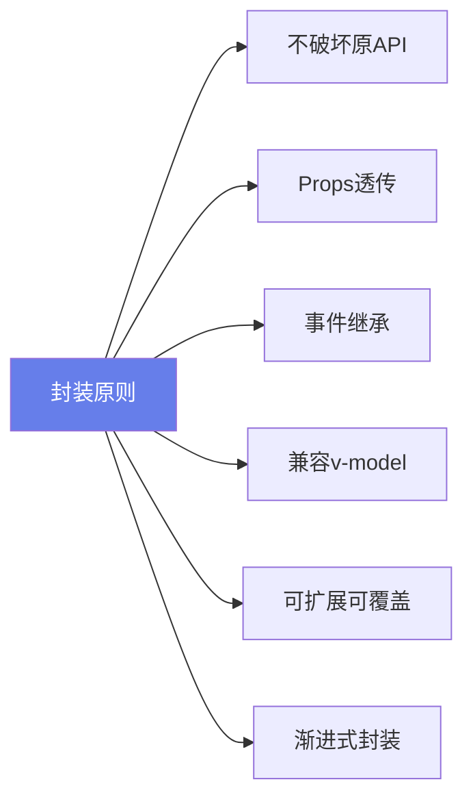
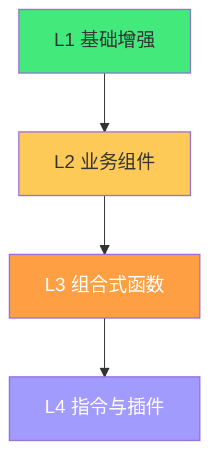

# 🧩 Element Plus 二次封装

> **文档说明**：系统讲解基于 Element Plus 的组件二次封装方法论与实战，涵盖二次封装的概念与价值（统一视觉风格/减少重复代码/业务逻辑沉淀/团队规范落地）、封装核心原则（不破坏原 API/Props 透传/事件继承/兼容 v-model/可扩展可覆盖/渐进式封装）、封装层级体系（基础组件增强/业务组件封装/组合式函数 Composables/指令与插件）、典型组件封装实战（ElButton 统一风格/ElForm 表单封装含自动校验与提交/ElTable 表格封装含分页排序搜索/ElDialog 弹窗封装含确认取消/ElMessage 全局统一封装/ElUpload 上传封装含裁剪与预览/ElSelect 远程搜索封装）、Props 透传与 $attrs 继承机制、v-model 双向绑定封装（modelValue/update:modelValue）、Slots 透传与默认插槽、defineExpose 暴露方法、全局注册与按需引入（unplugin-vue-components 自动导入）、主题定制与 CSS 变量覆盖、与 TypeScript 结合（Props 类型/泛型组件/实例类型）、高级封装模式（函数式调用组件/渲染函数 h/Teleport 全局挂载/Provider 注入配置）、常见问题（样式覆盖/类型丢失/事件不触发/性能问题）与最佳实践。
>
> **适用人群**：中高级前端开发者、需要搭建团队组件规范的技术负责人、全栈工程师
>
> **前置知识**：[[Vue3-组合式API]] · [[组件库设计与发布]] · [[TypeScript-类型系统进阶]]

---

## 一、概述

### 1.1 为什么要二次封装

Element Plus 提供了丰富的基础组件，但在实际项目中直接使用会遇到：

| 痛点 | 二次封装解决 |
|------|------------|
| 每个页面重复写分页、搜索、表格 | 封装通用业务表格组件 |
| 表单校验逻辑重复 | 封装带自动校验的表单组件 |
| 弹窗确认逻辑千篇一律 | 封装统一弹窗组件 |
| 按钮风格不统一 | 封装项目级 Button |
| 团队成员写法各异 | 封装层统一规范 |
| 升级 Element Plus 影响大 | 封装层隔离，升级只改一处 |

**封装价值**：
- 🎨 **统一风格**：项目级视觉和交互一致
- 📦 **减少重复**：通用逻辑一次编写多处使用
- 🔧 **业务沉淀**：将业务逻辑封装为组件
- 📏 **团队规范**：通过封装层落地编码规范
- 🔄 **易于升级**：底层组件升级只改封装层

### 1.2 封装原则



| 原则 | 说明 |
|------|------|
| **不破坏原 API** | 原组件的 Props/Events/Slots 都要能用 |
| **Props 透传** | 未声明的 Props 自动透传到原组件（$attrs） |
| **事件继承** | 原组件的事件自动传递（$attrs 包含事件） |
| **兼容 v-model** | 支持 v-model 双向绑定 |
| **可扩展可覆盖** | 封装的默认行为可以被覆盖 |
| **渐进式封装** | 先封装最常用的，不追求一次到位 |

> 核心法则：**封装是「增强」而非「替换」**——用户应该既能用封装后的便捷 API，又能在需要时使用原组件的全部能力。

---

## 二、封装层级体系

### 2.1 四层封装



| 层级 | 说明 | 示例 |
|------|------|------|
| **L1 基础增强** | 对 Element Plus 组件做轻量增强，统一默认值 | ProButton、ProInput |
| **L2 业务组件** | 组合多个基础组件，封装业务逻辑 | ProTable、ProForm、ProDialog |
| **L3 组合式函数** | 抽取可复用的逻辑，非 UI | useTable、useForm、usePagination |
| **L4 指令与插件** | 全局能力扩展 | v-permission、$message 全局封装 |

---

## 三、核心机制

### 3.1 Props 透传（$attrs）

Vue3 中未在 `defineProps` 中声明的属性会自动透传到根元素：

```vue
<script setup lang="ts">
// 只声明需要的 Props，其余自动透传
defineProps<{
  type?: 'primary' | 'default'  // 封装层自定义
}>()
</script>

<template>
  <!-- size/disabled/loading 等未声明的 Props 自动透传 -->
  <el-button type="primary" round>
    <slot />
  </el-button>
</template>
```

> 如果根元素不是原组件，需要手动 `v-bind="$attrs"` 透传。

### 3.2 事件继承

Vue3 中 `$attrs` 包含事件监听器（`onClick`、`onChange` 等），透传 `$attrs` 时事件自动继承：

```vue
<template>
  <!-- $attrs 包含 Props 和 Events，一次性透传 -->
  <el-input v-bind="$attrs" class="pro-input" />
</template>
```

```text
### 3.3 v-model 封装
```

```vue
<script setup lang="ts">
const props = defineProps<{
  modelValue: string  // v-model 的值
}>()
const emit = defineEmits<{
  'update:modelValue': [value: string]
}>()

function handleChange(val: string) {
  emit('update:modelValue', val)
}
</script>

<template>
  <el-input 
    :model-value="modelValue" 
    @update:model-value="handleChange"
  />
</template>
```

使用时：
```vue
<ProInput v-model="text" />
```

### 3.4 Slots 透传

```vue
<script setup lang="ts">
// 用 useSlots 获取所有插槽
</script>

<template>
  <el-dialog v-bind="$attrs">
    <!-- 透传所有插槽 -->
    <template v-for="(_, name) in $slots" #[name]="slotData">
      <slot :name="name" v-bind="slotData || {}" />
    </template>
  </el-dialog>
</template>
```

### 3.5 defineExpose 暴露方法

```vue
<script setup lang="ts">
import { ref } from 'vue'

const inputRef = ref()

function focus() {
  inputRef.value?.focus()
}

function clear() {
  // ...
}

// 暴露给父组件
defineExpose({ focus, clear })
</script>
```

父组件使用：
```vue
<ProInput ref="inputRef" />
<script setup>
const inputRef = ref()
inputRef.value?.focus()
</script>
```

---

## 四、典型组件封装实战

### 4.1 ProButton：统一按钮风格

```vue
<!-- components/ProButton.vue -->
<script setup lang="ts">
interface Props {
  type?: 'primary' | 'success' | 'warning' | 'danger' | 'default'
  size?: 'large' | 'default' | 'small'
  loading?: boolean
  disabled?: boolean
}
withDefaults(defineProps<Props>(), {
  type: 'primary',
  size: 'default'
})
</script>

<template>
  <el-button v-bind="$attrs" :type="type" :size="size" class="pro-button">
    <slot />
  </el-button>
</template>

<style scoped>
.pro-button {
  border-radius: 6px;
  font-weight: 500;
  transition: all 0.2s;
}
.pro-button:hover {
  transform: translateY(-1px);
  box-shadow: 0 2px 8px rgba(0,0,0,0.15);
}
</style>
```

### 4.2 ProForm：表单封装（自动校验+提交）

```vue
<!-- components/ProForm.vue -->
<script setup lang="ts">
import { ref, reactive } from 'vue'
import type { FormInstance, FormRules } from 'element-plus'

interface Props {
  modelValue: Record<string, any>
  rules?: FormRules
  labelWidth?: string
  disabled?: boolean
}
const props = withDefaults(defineProps<Props>(), {
  labelWidth: '100px'
})

const emit = defineEmits<{
  'update:modelValue': [value: Record<string, any>]
  'submit': [value: Record<string, any>]
}>()

const formRef = ref<FormInstance>()
const form = reactive({ ...props.modelValue })

async function handleSubmit() {
  if (!formRef.value) return
  try {
    await formRef.value.validate()
    emit('submit', { ...form })
  } catch (error) {
    console.error('校验失败', error)
  }
}

function resetFields() {
  formRef.value?.resetFields()
}

defineExpose({ handleSubmit, resetFields, validate: () => formRef.value?.validate() })
</script>

<template>
  <el-form
    ref="formRef"
    :model="form"
    :rules="rules"
    :label-width="labelWidth"
    :disabled="disabled"
    v-bind="$attrs"
    @submit.prevent
  >
    <slot />
    <el-form-item v-if="$slots.footer !== false">
      <slot name="footer">
        <el-button @click="resetFields">重置</el-button>
        <el-button type="primary" @click="handleSubmit">提交</el-button>
      </slot>
    </el-form-item>
  </el-form>
</template>
```

**使用**：
```vue
<ProForm v-model="formData" :rules="rules" @submit="handleSubmit">
  <el-form-item label="用户名" prop="username">
    <el-input v-model="formData.username" />
  </el-form-item>
  <el-form-item label="邮箱" prop="email">
    <el-input v-model="formData.email" />
  </el-form-item>
</ProForm>
```

### 4.3 ProTable：表格封装（分页+搜索+排序）

```vue
<!-- components/ProTable.vue -->
<script setup lang="ts">
import { ref, reactive, watch } from 'vue'

interface Column {
  prop: string
  label: string
  width?: number
  sortable?: boolean
  formatter?: (row: any) => string
}

interface Props {
  columns: Column[]
  request: (params: any) => Promise<{ list: any[]; total: number }>
  pageSize?: number
}
const props = withDefaults(defineProps<Props>(), { pageSize: 10 })

const loading = ref(false)
const data = ref<any[]>([])
const total = ref(0)
const pagination = reactive({ page: 1, pageSize: props.pageSize })
const searchParams = ref<Record<string, any>>({})

async function fetchData() {
  loading.value = true
  try {
    const res = await props.request({
      ...searchParams.value,
      page: pagination.page,
      pageSize: pagination.pageSize
    })
    data.value = res.list
    total.value = res.total
  } finally {
    loading.value = false
  }
}

function handleSearch(params: Record<string, any>) {
  searchParams.value = params
  pagination.page = 1
  fetchData()
}

function handlePageChange(page: number) {
  pagination.page = page
  fetchData()
}

function refresh() {
  fetchData()
}

defineExpose({ refresh, handleSearch })

// 初始化
fetchData()
</script>

<template>
  <div class="pro-table">
    <!-- 搜索区域插槽 -->
    <div v-if="$slots.search" class="pro-table__search">
      <slot name="search" :search="handleSearch" />
    </div>
    
    <!-- 表格 -->
    <el-table :data="data" v-loading="loading" v-bind="$attrs">
      <el-table-column
        v-for="col in columns"
        :key="col.prop"
        :prop="col.prop"
        :label="col.label"
        :width="col.width"
        :sortable="col.sortable"
      >
        <template #default="scope">
          <slot :name="`col-${col.prop}`" :row="scope.row" :value="scope.row[col.prop]">
            {{ col.formatter ? col.formatter(scope.row) : scope.row[col.prop] }}
          </slot>
        </template>
      </el-table-column>
      <slot />
    </el-table>
    
    <!-- 分页 -->
    <el-pagination
      v-model:current-page="pagination.page"
      v-model:page-size="pagination.pageSize"
      :total="total"
      layout="total, prev, pager, next, jumper"
      @current-change="handlePageChange"
    />
  </div>
</template>
```

**使用**：
```vue
<ProTable
  :columns="columns"
  :request="fetchUsers"
>
  <template #search="{ search }">
    <el-input v-model="keyword" @keyup.enter="search({ keyword })" />
    <el-button @click="search({ keyword })">搜索</el-button>
  </template>
  <template #col-status="{ row }">
    <el-tag :type="row.status === 1 ? 'success' : 'danger'">
      {{ row.status === 1 ? '正常' : '禁用' }}
    </el-tag>
  </template>
</ProTable>
```

### 4.4 ProDialog：弹窗封装

```vue
<!-- components/ProDialog.vue -->
<script setup lang="ts">
interface Props {
  modelValue: boolean
  title?: string
  width?: string | number
  confirmText?: string
  cancelText?: string
  showFooter?: boolean
}
const props = withDefaults(defineProps<Props>(), {
  title: '提示',
  width: '500px',
  confirmText: '确定',
  cancelText: '取消',
  showFooter: true
})

const emit = defineEmits<{
  'update:modelValue': [value: boolean]
  'confirm': []
  'cancel': []
}>()

function handleConfirm() {
  emit('confirm')
}
function handleCancel() {
  emit('cancel')
  emit('update:modelValue', false)
}
function close() {
  emit('update:modelValue', false)
}

defineExpose({ close })
</script>

<template>
  <el-dialog
    :model-value="modelValue"
    :title="title"
    :width="width"
    v-bind="$attrs"
    @update:model-value="emit('update:modelValue', $event)"
  >
    <slot />
    <template #footer v-if="showFooter">
      <slot name="footer">
        <el-button @click="handleCancel">{{ cancelText }}</el-button>
        <el-button type="primary" @click="handleConfirm">{{ confirmText }}</el-button>
      </slot>
    </template>
  </el-dialog>
</template>
```

### 4.5 全局 Message 封装

```typescript
// utils/message.ts
import { ElMessage, ElMessageBox, ElNotification } from 'element-plus'

export const message = {
  success(msg: string) {
    ElMessage({ message: msg, type: 'success', duration: 2000 })
  },
  error(msg: string) {
    ElMessage({ message: msg, type: 'error', duration: 3000 })
  },
  warning(msg: string) {
    ElMessage({ message: msg, type: 'warning' })
  },
  info(msg: string) {
    ElMessage({ message: msg, type: 'info' })
  },
  // 确认弹窗
  confirm(content: string, title = '提示') {
    return ElMessageBox.confirm(content, title, {
      confirmButtonText: '确定',
      cancelButtonText: '取消',
      type: 'warning'
    })
  },
  // 通知
  notify(title: string, message: string, type: 'success' | 'error' = 'success') {
    ElNotification({ title, message, type, duration: 3000 })
  }
}
```

### 4.6 ProUpload：上传封装

```vue
<!-- components/ProUpload.vue -->
<script setup lang="ts">
import { ref } from 'vue'
import type { UploadProps, UploadUserFile } from 'element-plus'

interface Props {
  modelValue?: string | string[]
  action?: string
  maxSize?: number  // MB
  accept?: string
  multiple?: boolean
  tip?: string
}
const props = withDefaults(defineProps<Props>(), {
  maxSize: 5,
  accept: 'image/*'
})

const emit = defineEmits<{
  'update:modelValue': [value: string | string[]]
  'success': [url: string]
}>()

const fileList = ref<UploadUserFile[]>([])

const beforeUpload: UploadProps['beforeUpload'] = (file) => {
  if (file.size / 1024 / 1024 > props.maxSize) {
    message.error(`文件大小不能超过 ${props.maxSize}MB`)
    return false
  }
  return true
}

function handleSuccess(response: any) {
  const url = response.url
  if (props.multiple) {
    const urls = Array.isArray(props.modelValue) ? [...props.modelValue, url] : [url]
    emit('update:modelValue', urls)
  } else {
    emit('update:modelValue', url)
  }
  emit('success', url)
  message.success('上传成功')
}
</script>

<template>
  <el-upload
    :action="action"
    :accept="accept"
    :multiple="multiple"
    :file-list="fileList"
    :before-upload="beforeUpload"
    :on-success="handleSuccess"
    v-bind="$attrs"
  >
    <el-button type="primary">点击上传</el-button>
    <template #tip>
      <div class="el-upload__tip">{{ tip || `支持 ${accept}，不超过 ${maxSize}MB` }}</div>
    </template>
  </el-upload>
</template>
```

---

## 五、主题定制

### 5.1 CSS 变量覆盖

```css
/* styles/element-override.css */
:root {
  /* 主色 */
  --el-color-primary: #4f46e5;
  --el-color-primary-light-3: #7569ee;
  --el-color-primary-light-5: #9c93f3;
  --el-color-primary-light-7: #c2bcf7;
  --el-color-primary-light-8: #d6d1fa;
  --el-color-primary-light-9: #eae8fc;
  --el-color-primary-dark-2: #3f37b7;
  
  /* 圆角 */
  --el-border-radius-base: 6px;
  
  /* 字体 */
  --el-font-size-base: 14px;
}
```

### 5.2 暗黑模式

```css
html.dark {
  --el-bg-color: #1d1e1f;
  --el-text-color-primary: #e5eaf3;
  --el-border-color: #4c4d4f;
  --el-color-primary: #409eff;
}
```

---

## 六、全局注册与自动导入

### 6.1 自动导入组件

```bash
pnpm add -D unplugin-vue-components unplugin-auto-import
```

```typescript
// vite.config.ts
import AutoImport from 'unplugin-auto-import/vite'
import Components from 'unplugin-vue-components/vite'
import { ElementPlusResolver } from 'unplugin-vue-components/resolvers'

export default defineConfig({
  plugins: [
    AutoImport({ resolvers: [ElementPlusResolver()] }),
    Components({ resolvers: [ElementPlusResolver()] })
  ]
})
```

### 6.2 全局注册封装组件

```typescript
// components/index.ts
import type { App } from 'vue'
import ProButton from './ProButton.vue'
import ProForm from './ProForm.vue'
import ProTable from './ProTable.vue'
import ProDialog from './ProDialog.vue'

const components = [ProButton, ProForm, ProTable, ProDialog]

export function setupProComponents(app: App) {
  components.forEach(comp => {
    app.component(comp.name || comp.__name, comp)
  })
}
```

---

## 七、TypeScript 类型支持

### 7.1 Props 类型

```typescript
// components/ProTable/types.ts
export interface ProTableColumn {
  prop: string
  label: string
  width?: number
  minWidth?: number
  sortable?: boolean | 'custom'
  fixed?: 'left' | 'right'
  formatter?: (row: any, value: any) => string
}

export interface ProTableRequestParams {
  page: number
  pageSize: number
  [key: string]: any
}

export interface ProTableRequestResult {
  list: any[]
  total: number
}
```

### 7.2 组件实例类型

```typescript
// 获取组件实例类型
import ProTable from './ProTable.vue'
export type ProTableInstance = InstanceType<typeof ProTable>
```

---

## 八、高级封装模式

### 8.1 函数式调用组件（Confirm）

```typescript
// utils/confirm.ts
import { createVNode, render } from 'vue'
import ConfirmDialog from './ConfirmDialog.vue'

export function confirm(options: { title?: string; content: string }) {
  return new Promise((resolve, reject) => {
    const container = document.createElement('div')
    const vnode = createVNode(ConfirmDialog, {
      ...options,
      onConfirm: () => {
        cleanup()
        resolve(true)
      },
      onCancel: () => {
        cleanup()
        reject(false)
      }
    })
    render(vnode, container)
    document.body.appendChild(container)
    
    function cleanup() {
      render(null, container)
      document.body.removeChild(container)
    }
  })
}
```

### 8.2 Provider 全局配置

```typescript
// components/config.ts
import { inject, provide } from 'vue'

const configKey = Symbol('pro-config')

export function provideProConfig(config: { size?: 'large' | 'default' | 'small' }) {
  provide(configKey, config)
}

export function useProConfig() {
  return inject(configKey, { size: 'default' })
}
```

---

## 九、常见问题

| 问题 | 原因 | 解决方案 |
|------|------|---------|
| **样式不生效** | scoped 样式无法穿透 | 用 `:deep(.el-button)` 或全局样式 |
| **类型丢失** | 封装后 Props 类型不完整 | 用 `Partial<InstanceType<typeof ElButton>['$props']>` 扩展 |
| **事件不触发** | 未透传 $attrs | 确保根元素 `v-bind="$attrs"` |
| **v-model 不工作** | 未正确 emit update | 检查 `modelValue` prop 和 `update:modelValue` emit |
| **ref 拿不到方法** | 未 defineExpose | 用 `defineExpose({ method })` 暴露 |
| **插槽不显示** | 未透传插槽 | 用 `v-for` 遍历 `$slots` 透传 |
| **性能问题** | 大表格全量渲染 | 虚拟滚动、分页、懒加载 |
| **升级 Element Plus 报错** | API 变更 | 封装层隔离，只改封装组件 |

---

## 十、最佳实践

1. **先封装最常用的 20%**：不要追求全量封装，先解决 80% 的重复场景
2. **保持原组件 API 可用**：透传 $attrs，让用户能使用原组件的全部能力
3. **命名统一**：Pro 前缀（ProTable/ProForm），团队一眼识别
4. **每个组件有文档和示例**：封装的组件要有使用说明和 Demo
5. **类型完整**：Props/Events/Slots/Expose 都要有 TypeScript 类型
6. **样式用 CSS 变量**：不要写死颜色，用 Element Plus 的 CSS 变量覆盖
7. **逻辑抽离为 Composables**：可复用的逻辑（useTable/useForm）抽离，组件只负责 UI
8. **渐进式迁移**：老页面可以继续用原组件，新页面用封装组件
9. **定期 review**：封装层也要持续优化，删除没人用的封装
10. **不要过度封装**：简单场景直接用原组件，不要为了封装而封装

---

## 十一、关联笔记

### Vue3 生态
- [[Vue3-组合式API]] · [[Vue3-组件通信与插槽]] · [[VueUse-工具函数库]]
- [[Vue3-编译优化与PatchFlags]] · [[pnpm-monorepo架构]]

### 工程化
- [[组件库设计与发布]] · [[TypeScript-类型系统进阶]] · [[Vite构建工具原理]]
- [[ESLint与代码规范]]

### UI 与设计
- [[产品原型设计方法]] · [[对话式UI组件设计]] · [[前端性能优化实战]]

### 导航
- [[MOC-前端开发]] · [[MOC-Vue3生态]] · [[Home]] · [[学习路线总览]]

> 🔍 **知识点深度解析**
>
> **作用**：Element Plus 二次封装解决的是「如何在通用组件库基础上，构建符合项目/团队规范的业务组件层，减少重复代码、统一视觉风格、沉淀业务逻辑，同时不破坏原组件的灵活性」的核心问题——Element Plus 提供了基础组件，但直接使用会导致大量重复代码（表格+分页+搜索、表单+校验+提交）和风格不统一，二次封装在原组件和业务之间建立一个「增强层」。
>
> **底层原理**：①二次封装的本质是「装饰器模式 + 透传机制」——封装组件在原组件外层增加自定义逻辑（默认值、业务逻辑、统一风格），同时通过 Vue3 的 `$attrs` 透传机制将未声明的 Props 和 Events 传递给原组件。这种「增强而非替换」的设计让封装组件既提供了便捷的默认行为，又保留了原组件的全部能力——用户可以用简化的 API，也可以在需要时使用原组件的高级特性。②`$attrs` 透传是 Vue3 封装的核心机制——在 Vue3 中，未在 `defineProps` 中声明的属性（包括 Props 和 Events）会自动收集到 `$attrs` 中，并默认透传到组件的根元素。如果根元素就是原组件，透传自动完成；如果根元素是其他元素，需要手动 `v-bind="$attrs"`。这和 Vue2 的 `$listeners` 分离不同，Vue3 统一了 Props 和 Events 的透传，简化了封装。③v-model 封装的本质是「语法糖的传递」——Vue3 的 v-model 是 `modelValue` prop + `update:modelValue` 事件的语法糖。封装组件时需要声明 `modelValue` prop、emit `update:modelValue` 事件，并在内部绑定到原组件。支持多个 v-model（`v-model:title`）时同理，只是 prop 名变成 `title`，事件变成 `update:title`。④插槽透传的本质是「动态插槽名」——用 `v-for="(_, name) in $slots"` 遍历所有插槽，用 `#[name]` 动态插槽名透传，同时用 `v-bind="slotData"` 传递插槽作用域。这让封装组件不需要知道具体有哪些插槽，就能全部透传。⑤defineExpose 是封装组件「暴露方法」的机制——组合式 API 默认不暴露组件内部方法，父组件通过 ref 拿不到。需要用 `defineExpose({ method1, method2 })` 显式暴露。这是 Vue3 封装的重要部分——如 ProTable 的 refresh()、ProForm 的 validate()。⑥函数式调用组件（如 confirm、message）的本质是「createVNode + render」——在 JS 中动态创建 VNode，render 到一个临时容器，挂载到 body，使用完毕后 render(null) 卸载。这是 Element Plus 的 ElMessage/ElMessageBox 的实现原理，也是封装全局确认弹窗、通知等的标准方式。⑦Provider 全局配置的本质是「依赖注入」——用 provide/inject 将全局配置（如默认 size、主题）注入到所有封装组件，避免每个组件重复传参。这和 Element Plus 的 `ElConfigProvider` 原理一致。⑧TypeScript 类型支持是封装质量的关键——封装组件的 Props 类型应该扩展原组件的 Props 类型（`Partial<InstanceType<typeof ElButton>['$props']>`），确保用户能使用原组件的所有属性。实例类型用 `InstanceType<typeof Component>` 获取，方便父组件 ref 类型标注。
>
> **用法要点**：① 封装价值：统一风格/减少重复/业务沉淀/团队规范/易于升级 ② 封装原则：不破坏原API/Props透传($attrs)/事件继承/兼容v-model/可扩展/渐进式 ③ 四层封装：L1基础增强(ProButton)/L2业务组件(ProTable/ProForm)/L3组合式函数(useTable)/L4指令插件(v-permission) ④ 核心机制：$attrs透传Props和Events/v-model(modelValue+update:modelValue)/插槽透传(v-for $slots)/defineExpose暴露方法 ⑤ 典型封装：ProButton(统一风格)/ProForm(自动校验提交)/ProTable(分页搜索排序)/ProDialog(确认取消)/全局Message/ProUpload(校验预览) ⑥ 主题定制：CSS变量覆盖(--el-color-primary)/暗黑模式 ⑦ 自动导入：unplugin-vue-components + ElementPlusResolver ⑧ TS类型：Props类型扩展原组件/InstanceType获取实例类型 ⑨ 高级模式：函数式调用(createVNode+render)/Provider全局配置(provide/inject) ⑩ 常见问题：样式穿透(:deep)/类型丢失(扩展原Props)/事件不触发($attrs)/v-model不工作(检查emit)/ref拿不到(defineExpose) ⑪ 最佳实践：先封装最常用20%/保持原API可用/Pro前缀命名/有文档示例/类型完整/CSS变量样式/逻辑抽Composables/渐进迁移/定期review/不过度封装。

> 💡 **深度讲解**：Element Plus 二次封装最核心的智慧是「增强而非替换——在原组件和业务之间建立一个薄而灵活的增强层，既提供便捷的默认行为，又保留原组件的全部灵活性」——很多团队做二次封装走入两个极端：一种是「完全重写」，抛弃原组件自己实现，结果是维护成本高、升级困难、bug 多；另一种是「简单包一层」，只改个默认值，没有真正解决重复代码问题。好的二次封装是「恰到好处的增强」——对于最常用的场景提供简化的 API（如 ProTable 只需传 columns 和 request），对于特殊场景保留原组件的全部能力（通过 $attrs 透传）。这种「默认便捷，高级可及」的设计是优秀封装的标志。$attrs 透传是 Vue3 封装的核心机制——它让封装组件不需要声明原组件的所有 Props，就能自动传递。这和 Vue2 需要分别处理 props 和 listeners 相比简洁了很多。但要注意：如果封装组件的根元素不是原组件（如外面包了一层 div），透传会到 div 上而不是原组件，需要手动 `v-bind="$attrs"` 到原组件。v-model 封装是另一个关键点——很多初学者封装后 v-model 不工作，就是因为没有正确处理 modelValue prop 和 update:modelValue 事件。理解 v-model 只是语法糖后，封装就清晰了。函数式调用组件（如全局 confirm）是高级封装技巧——用 createVNode + render 在 JS 中动态创建和卸载组件，这是 Element Plus 内部实现 message/notification 的方式，也是封装全局确认弹窗、全局 loading 的标准方法。在 AI 时代，二次封装有了新的意义——AI 生成代码时，如果团队有封装好的 ProTable/ProForm，AI 会优先使用这些组件，生成的代码自然符合团队规范；如果没有封装，AI 会写「野生代码」，风格和质量不可控。封装层就是团队的「代码标准」，AI 会遵循这个标准。掌握二次封装，就是掌握了「在通用组件库基础上构建团队规范」的能力——这是从「用组件」到「造组件」的关键一步。

> 📝 **精简总结**：ElementPlus二次封装=在原组件上建立增强层，统一风格+减少重复+沉淀业务。核心原则：不破坏原API/Props透传($attrs)/事件继承/兼容v-model/可扩展/渐进式。四层封装：基础增强(ProButton)/业务组件(ProTable/ProForm/ProDialog)/组合式函数(useTable)/指令插件。核心机制：$attrs透传/v-model(modelValue+update)/插槽透传(v-for $slots)/defineExpose暴露方法。典型封装：ProButton统一风格/ProForm自动校验/ProTable分页搜索/ProDialog确认取消/全局Message/ProUpload校验。主题：CSS变量覆盖+暗黑模式。自动导入：unplugin-vue-components。TS：Props扩展原类型/InstanceType实例。高级：函数式调用(createVNode+render)/Provider全局配置。最佳实践：先封装20%常用/保持原API/Pro前缀/有文档/类型完整/CSS变量/逻辑抽Composables/不过度封装。

> **学习路径建议**：先学习 [[Vue3-组件通信与插槽]] 和 [[Vue3-组合式API]] 打好基础 → 学习本文档的封装原则和核心机制（$attrs/v-model/插槽/expose） → 实践：封装一个 ProButton（统一风格） → 学习 TypeScript 类型扩展 → 实践：封装 ProForm（自动校验+提交） → 实践：封装 ProTable（分页+搜索+排序） → 学习函数式调用组件（createVNode+render） → 实践：封装全局 confirm → 研究 Element Plus 源码中 message/notification 的实现 → 学习 [[组件库设计与发布]] 深化 → 形成自己的「Pro 组件库」。

---

> **Element Plus 二次封装的本质是「增强而非替换——在原组件和业务之间建立一个薄而灵活的增强层，既提供便捷的默认行为，又保留原组件的全部灵活性」——很多团队做二次封装走入两个极端：一种是完全重写，抛弃原组件自己实现，结果维护成本高、升级困难；另一种是简单包一层，只改默认值，没真正解决重复。好的封装是恰到好处的增强——常用场景提供简化 API（ProTable 只需 columns+request），特殊场景保留原组件全部能力（$attrs 透传）。这种「默认便捷，高级可及」是优秀封装的标志。$attrs 透传是 Vue3 封装的核心——未声明的 Props 和 Events 自动收集并透传到根元素，让封装组件不需要声明原组件所有属性。v-model 封装是另一个关键点——理解它只是 modelValue prop + update 事件的语法糖，封装就清晰了。函数式调用组件（全局 confirm）是高级技巧——用 createVNode+render 动态创建卸载组件，这是 Element Plus 内部实现 message 的方式。在 AI 时代，二次封装有了新意义——AI 生成代码时，如果团队有封装好的 ProTable/ProForm，AI 会优先使用，生成的代码自然符合规范；没有封装，AI 会写野生代码。封装层就是团队的代码标准，AI 会遵循。掌握二次封装，就是掌握了在通用组件库基础上构建团队规范的能力——这是从用组件到造组件的关键一步。从今天开始，审视你的项目：哪些组件在重复写？哪些逻辑可以抽出来？先封装最常用的 20%，解决 80% 的重复——好的封装，从一个 ProButton 开始。**
