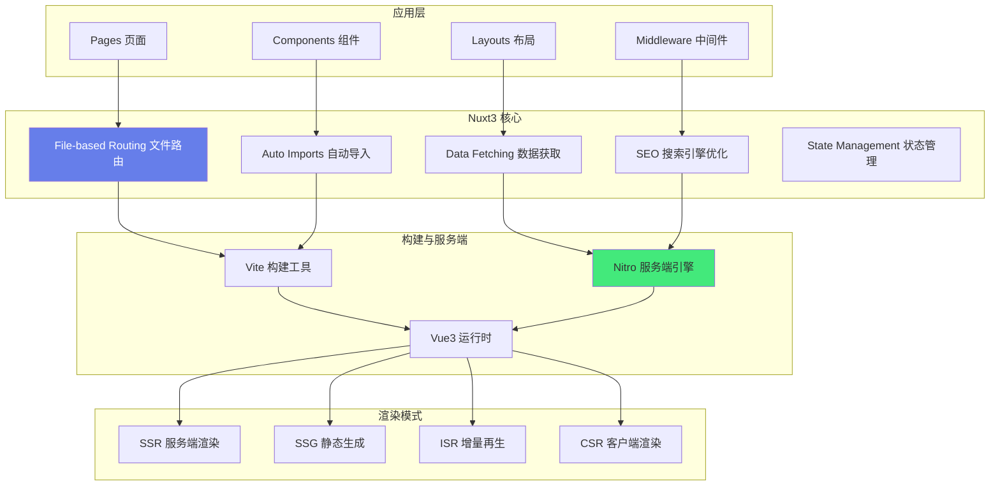
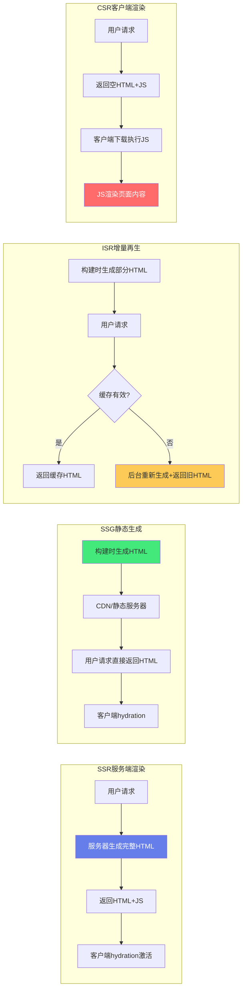

# 🚀 Nuxt3 SSR 全栈框架

> **文档说明**：系统讲解 Nuxt3 全栈框架的完整知识体系，涵盖 Nuxt3 概述（什么是 Nuxt3 / 为什么用 Nuxt3 / 与纯 Vue3 + Vite 的区别 / 适用场景 / 版本演进 Nuxt2→Nuxt3）、渲染模式详解（SSR 服务端渲染 / SSG 静态站点生成 / CSR 客户端渲染 / ISR 增量静态再生 / SPA 单页应用，各模式原理、优缺点、适用场景、如何选择）、核心特性（文件路由 File-based Routing / 自动导入 Auto Imports / 数据获取 useFetch/useAsyncData / 状态管理 useState / SEO useHead / 中间件 middleware / 插件 plugins / 布局 layouts / 组件 components）、Nitro 服务端引擎（什么是 Nitro / API 路由 server/api / 服务端工具 / 部署目标 / 跨平台支持）、项目结构（标准目录结构 / 各目录作用 / 约定优于配置 / 最佳实践组织方式）、数据获取深入（useFetch vs useAsyncData vs useLazyFetch vs $fetch / 服务端与客户端执行时机 / 缓存与去重 / 错误处理 / 最佳实践）、SEO 优化（useHead / useSeoMeta / meta 标签管理 / sitemap 模块 / robots.txt / Open Graph / Twitter Card / 结构化数据）、性能优化（ISR 增量静态再生 / 缓存策略 / 代码分割 / 图片优化 NuxtImage / 预加载 prefetch / 字体优化 / 水合优化）、部署实战（Vercel / Netlify / Node 服务器 / Docker 容器 / 静态托管 / 多目标部署配置 / 环境变量 / CI/CD）、常见问题与解决方案（hydration 不匹配 / 客户端 API 不可用 / 构建慢 / 内存泄漏 / 跨域问题 / 环境变量不生效 / 静态部署动态路由）、最佳实践（渲染模式选择策略 / 项目结构规范 / 性能优化清单 / 安全实践 / 类型安全 / 测试策略 / 从 Nuxt2 迁移）。
>
> **适用人群**：Vue 前端开发者、全栈工程师、想构建 SEO 友好应用的开发者、从 Nuxt2 迁移到 Nuxt3 的团队
>
> **前置知识**：[[Vue3-组合式API]] · [[Vite-构建原理与插件开发]]

---

## 一、Nuxt3 概述

### 1.1 什么是 Nuxt3

**Nuxt3** 是基于 Vue3 + Vite + Nitro 的全栈框架，它在 Vue3 之上提供了一层「约定优于配置」的抽象，内置了路由、状态管理、数据获取、SEO、服务端 API 等全栈能力，让开发者可以专注于业务逻辑而不是基础设施。



### 1.2 为什么用 Nuxt3

| 优势 | 说明 |
|------|------|
| **SEO 友好** | 服务端渲染完整 HTML，搜索引擎可直接抓取，首屏内容完整 |
| **首屏性能** | SSR 首屏 HTML 直接返回，不需要等待 JS 加载执行，白屏时间短 |
| **全栈能力** | 内置 Nitro 服务端引擎，可以写 API 接口、服务端逻辑，不需要单独后端 |
| **约定优于配置** | 文件路由、自动导入、目录约定，减少样板代码和配置 |
| **多渲染模式** | 同一套代码可以 SSR/SSG/ISR/CSR，根据页面需求灵活选择 |
| **丰富模块生态** | 官方和社区模块（NuxtImage/NuxtContent/NuxtUI 等），一键集成 |
| **部署灵活** | Nitro 支持部署到 Vercel/Netlify/Node/Docker/静态托管等多种目标 |

### 1.3 与纯 Vue3 + Vite 的区别

| 维度 | 纯 Vue3 + Vite | Nuxt3 |
|------|---------------|-------|
| **路由** | 手动配置 vue-router | 文件路由（pages 目录自动生成） |
| **SSR** | 需要手动配置（vite-plugin-ssr 等） | 内置，开箱即用 |
| **数据获取** | 自己实现（onMounted + axios） | useFetch/useAsyncData 内置，支持 SSR |
| **SEO** | 需要手动处理 meta | useHead 内置，支持 SSR 注入 |
| **服务端 API** | 需要单独后端（Express/Koa） | Nitro 内置，server/api 目录 |
| **状态管理** | Pinia（需安装配置） | useState 内置（轻量）+ Pinia 模块 |
| **自动导入** | 需配置 unplugin-auto-import | 内置，components/composables 自动导入 |
| **部署** | 静态部署或自配 Node | Nitro 多目标部署，零配置 |
| **学习曲线** | 需自己组装生态 | 约定多，需学习 Nuxt 概念 |

### 1.4 适用场景

| 场景 | 推荐渲染模式 | 理由 |
|------|------------|------|
| **营销官网/落地页** | SSG/ISR | 内容相对固定，SEO 重要，静态部署成本低 |
| **电商商品页** | SSR/ISR | 动态内容，SEO 重要，ISR 缓存热门商品 |
| **博客/文档站** | SSG | 内容更新不频繁，纯静态性能最好 |
| **后台管理系统** | CSR/SPA | 不需要 SEO，用户登录后使用，客户端渲染即可 |
| **新闻/资讯站** | SSR/ISR | 内容更新频繁，SEO 重要，ISR 增量更新 |
| **社交平台动态页** | SSR | 内容动态，SEO 重要，需要服务端实时渲染 |
| **企业官网** | SSG | 内容稳定，SEO 重要，静态部署 |

---

## 二、渲染模式详解

### 2.1 四种渲染模式对比



| 维度 | SSR | SSG | ISR | CSR |
|------|-----|-----|-----|-----|
| **HTML 生成时机** | 每次请求时 | 构建时 | 首次请求/缓存过期时 | 客户端运行时 |
| **SEO** | ✅ 优秀 | ✅ 优秀 | ✅ 优秀 | ❌ 差（需预渲染） |
| **首屏速度** | ✅ 快（TTFB 稍慢） | ✅ 最快 | ✅ 快（缓存命中） | ❌ 慢（白屏长） |
| **服务器成本** | 高（每次渲染） | 低（静态文件） | 中（按需渲染） | 低（静态文件） |
| **动态内容** | ✅ 实时 | ❌ 构建时固定 | ✅ 缓存+更新 | ✅ 实时（客户端请求） |
| **部署复杂度** | 中（需 Node 服务器） | 低（静态托管） | 中（需 Node+缓存） | 低（静态托管） |
| **适用页面** | 动态详情页 | 博客/文档/官网 | 电商/新闻 | 后台/仪表盘 |

### 2.2 SSR 服务端渲染

**SSR（Server-Side Rendering）**：用户每次请求时，服务器执行 Vue 组件生成完整 HTML，返回给浏览器，浏览器显示 HTML 后下载 JS 并进行 hydration（水合）激活交互。

```typescript
// nuxt.config.ts - 全局启用 SSR（默认）
export default defineNuxtConfig({
  ssr: true,  // 默认 true，全局 SSR
})

// 单页面禁用 SSR（CSR）
<!-- pages/admin.vue -->
<script setup>
// 该页面只在客户端渲染
</script>
<template>
  <div>Admin Dashboard</div>
</template>

// 或使用 routeRules
export default defineNuxtConfig({
  routeRules: {
    '/admin/**': { ssr: false },  // 后台页面 CSR
    '/blog/**': { ssr: true },     // 博客 SSR
  }
})
```

**SSR 执行流程**：
1. 用户请求 URL
2. Nuxt 服务器创建 Vue 应用实例
3. 执行 setup 中的数据获取（useFetch/useAsyncData）
4. 渲染组件为 HTML 字符串
5. 将数据序列化到 HTML 中（`__NUXT_DATA__`）
6. 返回 HTML + JS 资源
7. 浏览器显示 HTML（首屏可见）
8. 下载并执行 JS
9. Hydration：Vue 接管已有 DOM，激活交互

### 2.3 SSG 静态站点生成

**SSG（Static Site Generation）**：构建时（`nuxt generate`）预渲染所有页面为静态 HTML 文件，部署到静态服务器或 CDN。

```bash
# 构建静态站点
npx nuxi generate
# 或
npx nuxi build --prerender=true

# 输出目录：.output/public
```

```typescript
// nuxt.config.ts - 预渲染配置
export default defineNuxtConfig({
  // 预渲染所有页面（SSG）
  nitro: {
    prerender: {
      crawlLinks: true,      // 自动爬取链接预渲染
      routes: ['/sitemap.xml'],  // 额外预渲染的路由
    }
  },
  
  // 或使用 routeRules
  routeRules: {
    '/blog/**': { prerender: true },  // 博客预渲染
  }
})
```

**SSG 适用场景**：
- 内容相对固定（博客、文档、官网、营销页）
- 不需要实时数据
- 追求极致性能和最低成本
- 可以接受构建时内容快照

### 2.4 ISR 增量静态再生

**ISR（Incremental Static Regeneration）**：结合 SSG 的性能和 SSR 的灵活性，页面首次请求时生成 HTML 并缓存，缓存过期后后台重新生成（用户仍返回旧缓存）。

```typescript
// nuxt.config.ts - ISR 配置
export default defineNuxtConfig({
  routeRules: {
    // 首页缓存 1 小时
    '/': { isr: 3600 },
    
    // 商品详情页缓存 10 分钟
    '/products/**': { isr: 600 },
    
    // 博客文章缓存 1 天
    '/blog/**': { isr: 86400 },
    
    // 不缓存（实时 SSR）
    '/api/**': { isr: false },
  }
})

// 也可以在页面中使用 defineRouteMeta
<!-- pages/products/[id].vue -->
<script setup>
defineRouteMeta({
  isr: 600,  // 缓存 10 分钟
})
</script>
```

**ISR 工作流程**：
1. 首次请求：页面不存在缓存 → 服务器渲染 HTML → 缓存 → 返回给用户
2. 缓存有效期内请求：直接返回缓存 HTML（极快）
3. 缓存过期后请求：立即返回旧缓存 HTML → 后台异步重新生成 → 更新缓存
4. 后续请求：返回新缓存 HTML

**ISR 优势**：
- 首屏性能接近 SSG（缓存命中时）
- 内容可以定期更新（不需要重新构建）
- 服务器成本低于纯 SSR（大部分请求命中缓存）
- 适合内容更新频率中等的场景（电商、新闻）

### 2.5 渲染模式选择策略

```text
选择决策树：

页面需要 SEO？
├── 否 → CSR（后台管理、仪表盘、用户中心）
└── 是 → 内容更新频率？
    ├── 几乎不更新（博客、文档、官网）→ SSG
    ├── 定期更新（电商商品、新闻列表）→ ISR
    ├── 实时更新（社交动态、实时数据）→ SSR
    └── 混合场景 → 按页面配置 routeRules
        ├── 营销页 → SSG
        ├── 商品页 → ISR
        ├── 用户动态 → SSR
        └── 后台 → CSR
```

---

## 三、核心特性

### 3.1 文件路由（File-based Routing）

Nuxt3 根据 `pages/` 目录结构自动生成路由，不需要手动配置 vue-router。

```text
pages/
├── index.vue              → /
├── about.vue              → /about
├── products/
│   ├── index.vue          → /products
│   └── [id].vue           → /products/:id
├── users/
│   ├── [id].vue           → /users/:id
│   └── [id]/
│       └── posts.vue      → /users/:id/posts
├── [...slug].vue          → 捕获所有路由（404页）
└── (marketing)/           → 路由组（不影响URL）
    ├── home.vue           → /home
    └── about.vue          → /about
```

```vue
<!-- pages/products/[id].vue -->
<script setup>
// 获取路由参数
const route = useRoute()
const productId = route.params.id

// 导航
const router = useRouter()
const goHome = () => router.push('/')
</script>

<template>
  <div>
    <h1>Product {{ productId }}</h1>
    <NuxtLink to="/">Home</NuxtLink>
    <NuxtLink :to="`/products/${Number(productId) + 1}`">Next</NuxtLink>
  </div>
</template>
```

**动态路由参数**：
- `[id].vue` → 单个参数 `/products/123`
- `[...slug].vue` → 捕获所有 `/a/b/c`
- `[[id]].vue` → 可选参数 `/products` 或 `/products/123`

### 3.2 自动导入（Auto Imports）

Nuxt3 自动导入 Vue API、Nuxt API、composables、components，不需要手动 import。

```vue
<script setup>
// ✅ 不需要 import，自动导入
// Vue API
const ref = ref(0)
const computed = computed(() => ref.value * 2)
const onMounted = onMounted(() => console.log('mounted'))

// Nuxt API
const route = useRoute()
const router = useRouter()
const { data } = await useFetch('/api/users')
const state = useState('count', () => 0)

// 自动导入 composables（composables/ 目录）
// composables/useAuth.ts → useAuth()
const { user, login } = useAuth()

// 自动导入 components（components/ 目录）
// components/MyButton.vue → <MyButton />
</script>

<template>
  <div>
    <MyButton @click="ref++">Count: {{ ref }}</MyButton>
  </div>
</template>
```

```typescript
// nuxt.config.ts - 自动导入配置
export default defineNuxtConfig({
  imports: {
    dirs: [
      'composables',      // 默认
      'utils',            // 额外目录
      'stores',           // Pinia stores
    ],
  },
  
  components: [
    { path: '~/components', pathPrefix: false },
    // 嵌套目录组件
    { path: '~/components/ui', prefix: 'Ui' },  // UiButton
  ],
})
```

### 3.3 数据获取

Nuxt3 提供多种数据获取方式，支持 SSR 和 CSR。

```vue
<script setup>
// 1. useFetch - 最简单，基于 URL 的数据获取
const { data: users, error, pending, refresh } = await useFetch('/api/users')

// 带参数和选项
const { data: product } = await useFetch(`/api/products/${route.params.id}`, {
  method: 'GET',
  headers: { Authorization: 'Bearer token' },
  // 缓存键（默认基于 URL 和参数）
  key: 'product-' + route.params.id,
  // 服务端获取（默认 true）
  server: true,
  // 客户端懒加载（不阻塞 SSR）
  lazy: false,
  // 默认值
  default: () => ({ name: 'Loading...' }),
  // 转换响应
  transform: (res) => res.data,
  // 轮询
  watch: [() => route.params.id],  // 参数变化时重新获取
})

// 2. useAsyncData - 更灵活，自定义异步逻辑
const { data: posts } = await useAsyncData('posts', () => 
  $fetch('/api/posts', { method: 'POST', body: { page: 1 } })
)

// 3. useLazyFetch - 懒加载，不阻塞 SSR（客户端加载）
const { data: comments, pending } = useLazyFetch('/api/comments')
// pending 为 true 时显示加载状态

// 4. $fetch - 底层 HTTP 客户端（基于 ofetch）
// 可以在任何地方使用（包括服务端 API）
const data = await $fetch('/api/data', {
  method: 'POST',
  body: { key: 'value' },
})

// 5. useFetch 与 Pinia 结合
const authStore = useAuthStore()
const { data: profile } = await useFetch('/api/profile', {
  headers: { Authorization: `Bearer ${authStore.token}` },
})
</script>

<template>
  <div>
    <!-- 加载状态 -->
    <div v-if="pending">Loading...</div>
    <div v-else-if="error">Error: {{ error.message }}</div>
    <div v-else>
      <div v-for="user in users" :key="user.id">{{ user.name }}</div>
    </div>
    
    <!-- 手动刷新 -->
    <button @click="refresh()">Refresh</button>
  </div>
</template>
```

**useFetch vs useAsyncData vs $fetch**：

| 特性 | useFetch | useAsyncData | $fetch |
|------|----------|-------------|--------|
| **适用场景** | 简单 URL 请求 | 复杂异步逻辑 | 底层 HTTP 调用 |
| **SSR 支持** | ✅ | ✅ | ❌（需配合 useAsyncData） |
| **缓存去重** | ✅（自动） | ✅（需指定 key） | ❌ |
| **懒加载** | ✅（useLazyFetch） | ✅（useLazyAsyncData） | ❌ |
| **灵活性** | 中 | 高 | 最高 |

### 3.4 状态管理

```vue
<script setup>
// 1. useState - Nuxt 内置轻量状态（SSR 友好）
// 语法：useState(key, initFunction)
const count = useState('count', () => 0)
const user = useState('user', () => null)

// 跨组件共享（同一个 key 共享状态）
// ComponentA.vue
const count = useState('count', () => 0)
count.value++

// ComponentB.vue
const count = useState('count')  // 共享同一个状态
// count.value 已经是 1

// 2. Pinia - 复杂状态管理（推荐用于大型应用）
// stores/auth.ts
import { defineStore } from 'pinia'

export const useAuthStore = defineStore('auth', () => {
  const token = ref(localStorage.getItem('token') || '')
  const user = ref(null)
  
  const isLoggedIn = computed(() => !!token.value)
  
  async function login(credentials) {
    const res = await $fetch('/api/auth/login', { method: 'POST', body: credentials })
    token.value = res.token
    user.value = res.user
    localStorage.setItem('token', res.token)
  }
  
  function logout() {
    token.value = ''
    user.value = null
    localStorage.removeItem('token')
  }
  
  return { token, user, isLoggedIn, login, logout }
})

// 使用
const authStore = useAuthStore()
await authStore.login({ username: 'admin', password: '123' })
</script>
```

**useState vs Pinia**：
- **useState**：简单、轻量、SSR 友好，适合简单的跨组件共享状态
- **Pinia**：功能完整（getters/actions/持久化/插件），适合复杂业务逻辑、大型应用

### 3.5 SEO 优化

```vue
<script setup>
// 1. useHead - 管理 head 标签
useHead({
  title: 'My Page Title',
  meta: [
    { name: 'description', content: 'Page description' },
    { name: 'keywords', content: 'nuxt, vue, ssr' },
    { property: 'og:title', content: 'Open Graph Title' },
    { property: 'og:description', content: 'OG Description' },
    { property: 'og:image', content: 'https://example.com/image.jpg' },
    { name: 'twitter:card', content: 'summary_large_image' },
  ],
  link: [
    { rel: 'canonical', href: 'https://example.com/page' },
  ],
  script: [
    { src: 'https://analytics.js', async: true },
  ],
})

// 2. useSeoMeta - 更简洁的 SEO meta 管理
useSeoMeta({
  title: 'My Page',
  description: 'Page description',
  ogTitle: 'My Page',
  ogDescription: 'Page description',
  ogImage: 'https://example.com/image.jpg',
  twitterCard: 'summary_large_image',
})

// 3. 动态 SEO（根据数据）
const { data: product } = await useFetch(`/api/products/${route.params.id}`)

useSeoMeta({
  title: () => `${product.value?.name} - My Store`,
  description: () => product.value?.description,
  ogImage: () => product.value?.image,
})
</script>

<template>
  <div>
    <!-- Nuxt 内置 SEO 组件 -->
    <NuxtSeoMeta 
      title="Page Title"
      description="Page description"
    />
  </div>
</template>
```

### 3.6 中间件与插件

```typescript
// middleware/auth.ts - 路由中间件
export default defineNuxtRouteMiddleware((to, from) => {
  const authStore = useAuthStore()
  
  // 未登录跳转到登录页
  if (!authStore.isLoggedIn && to.path !== '/login') {
    return navigateTo(`/login?redirect=${to.fullPath}`)
  }
  
  // 已登录用户不能访问登录页
  if (authStore.isLoggedIn && to.path === '/login') {
    return navigateTo('/dashboard')
  }
})

// 在页面中使用中间件
<!-- pages/dashboard.vue -->
<script setup>
definePageMeta({
  middleware: ['auth'],  // 应用 auth 中间件
})
</script>

// 全局中间件（middleware/auth.global.ts 自动全局执行）
export default defineNuxtRouteMiddleware((to) => {
  console.log('Global middleware:', to.path)
})

// plugins/analytics.client.ts - 客户端插件
export default defineNuxtPlugin((nuxtApp) => {
  // 只在客户端执行
  console.log('Client plugin')
  
  // 提供全局方法
  return {
    provide: {
      analytics: {
        track: (event: string) => console.log('Track:', event),
      }
    }
  }
})

// 使用插件提供的方法
const { $analytics } = useNuxtApp()
$analytics.track('page_view')
```

---

## 四、Nitro 服务端引擎

### 4.1 什么是 Nitro

**Nitro** 是 Nuxt3 的服务端引擎，提供：
- 跨平台部署（Node/Deno/Bun/Cloudflare Workers/Vercel/Netlify 等）
- API 路由（server/api 目录）
- 服务端工具（数据库、缓存、文件）
- 热重载（开发时）
- 自动代码分割

### 4.2 API 路由

```text
server/
├── api/
│   ├── users/
│   │   ├── index.get.ts      → GET /api/users
│   │   ├── index.post.ts     → POST /api/users
│   │   └── [id].get.ts       → GET /api/users/:id
│   └── products.ts           → /api/products（所有方法）
├── routes/
│   └── webhook.ts            → /webhook（不带 /api 前缀）
├── utils/
│   └── db.ts                 → 服务端工具函数
└── middleware/
    └── auth.ts               → 服务端中间件
```

```typescript
// server/api/users/index.get.ts
export default defineEventHandler(async (event) => {
  // 获取查询参数
  const query = getQuery(event)
  const page = Number(query.page) || 1
  const limit = Number(query.limit) || 10
  
  // 查询数据库
  const users = await db.user.findMany({
    skip: (page - 1) * limit,
    take: limit,
  })
  
  const total = await db.user.count()
  
  return {
    data: users,
    pagination: { page, limit, total },
  }
})

// server/api/users/[id].get.ts
export default defineEventHandler(async (event) => {
  const id = getRouterParam(event, 'id')
  const user = await db.user.findUnique({ where: { id: Number(id) } })
  
  if (!user) {
    throw createError({
      statusCode: 404,
      statusMessage: 'User not found',
    })
  }
  
  return user
})

// server/api/users/index.post.ts
export default defineEventHandler(async (event) => {
  // 读取请求体
  const body = await readBody(event)
  
  // 验证
  if (!body.email || !body.name) {
    throw createError({ statusCode: 400, message: 'Missing fields' })
  }
  
  // 创建用户
  const user = await db.user.create({ data: body })
  
  // 设置响应状态码
  setResponseStatus(event, 201)
  
  return user
})

// 带认证的 API
// server/middleware/auth.ts
export default defineEventHandler((event) => {
  const token = getHeader(event, 'authorization')?.replace('Bearer ', '')
  
  if (!token && event.path.startsWith('/api/admin')) {
    throw createError({ statusCode: 401, message: 'Unauthorized' })
  }
  
  // 验证 token 并设置用户上下文
  if (token) {
    event.context.user = verifyToken(token)
  }
})
```

### 4.3 服务端工具

```typescript
// server/utils/db.ts
import { PrismaClient } from '@prisma/client'

// 单例模式（开发热重载时避免重复连接）
const globalForPrisma = globalThis as unknown as { prisma: PrismaClient }

export const prisma = globalForPrisma.prisma || new PrismaClient()

if (process.env.NODE_ENV !== 'production') {
  globalForPrisma.prisma = prisma
}

// server/utils/cache.ts
// Nitro 内置缓存
export default defineEventHandler(async (event) => {
  // 缓存 1 小时
  const data = await useStorage('redis').getItem('cache:key')
  if (data) return data
  
  const freshData = await fetchFromAPI()
  await useStorage('redis').setItem('cache:key', freshData, { ttl: 3600 })
  
  return freshData
})
```

---

## 五、项目结构

### 5.1 标准目录结构

```text
my-nuxt-app/
├── .nuxt/                    # 自动生成（不要手动修改）
├── .output/                  # 构建输出
├── assets/                   # 静态资源（CSS/图片/字体，会被构建处理）
│   ├── css/
│   │   └── main.css
│   └── images/
├── components/               # Vue 组件（自动导入）
│   ├── ui/                   # UI 组件
│   │   ├── Button.vue
│   │   └── Modal.vue
│   └── layout/
├── composables/              # 组合式函数（自动导入）
│   ├── useAuth.ts
│   └── useFetch.ts
├── layouts/                  # 布局组件
│   ├── default.vue
│   └── admin.vue
├── middleware/               # 路由中间件
│   ├── auth.ts
│   └── auth.global.ts        # 全局中间件
├── pages/                    # 页面（文件路由）
│   ├── index.vue
│   ├── about.vue
│   └── products/
│       ├── index.vue
│       └── [id].vue
├── plugins/                  # 插件
│   ├── analytics.client.ts
│   └── pinia.ts
├── public/                   # 公共静态文件（直接复制到根目录）
│   ├── favicon.ico
│   └── robots.txt
├── server/                   # 服务端代码（Nitro）
│   ├── api/                  # API 路由
│   │   └── users/
│   ├── routes/               # 其他服务端路由
│   ├── middleware/           # 服务端中间件
│   └── utils/                # 服务端工具函数
├── stores/                   # Pinia stores
│   └── auth.ts
├── types/                    # TypeScript 类型定义
│   └── index.d.ts
├── .env                      # 环境变量
├── .env.production           # 生产环境变量
├── app.vue                   # 根组件
├── nuxt.config.ts            # Nuxt 配置
├── tsconfig.json             # TypeScript 配置
└── package.json
```

### 5.2 关键文件说明

| 文件/目录 | 作用 |
|----------|------|
| `nuxt.config.ts` | Nuxt 配置（模块、渲染模式、构建配置等） |
| `app.vue` | 根组件，应用入口 |
| `pages/` | 页面目录，文件路由自动生成 |
| `components/` | 组件目录，自动导入 |
| `composables/` | 组合式函数目录，自动导入 |
| `server/api/` | 服务端 API 路由 |
| `layouts/` | 布局组件 |
| `middleware/` | 路由中间件 |
| `public/` | 静态文件（直接访问，不经过构建） |
| `assets/` | 构建资源（CSS/图片，经过 Vite 处理） |
| `stores/` | Pinia 状态管理 |

---

## 六、部署实战

### 6.1 多目标部署配置

```typescript
// nuxt.config.ts
export default defineNuxtConfig({
  // Nitro 部署预设
  nitro: {
    // 自动检测（根据部署平台）
    preset: 'node-server',  // 或 'vercel' / 'netlify' / 'static' / 'docker'
  },
})

// 或通过环境变量指定
// NITRO_PRESET=vercel npx nuxi build
```

| 部署目标 | preset | 说明 |
|---------|--------|------|
| **Node 服务器** | `node-server` | 默认，需要 Node 环境 |
| **Vercel** | `vercel` | 自动检测，Serverless 函数 |
| **Netlify** | `netlify` | 自动检测，Netlify Functions |
| **静态托管** | `static` | 纯静态，需要 SSG/预渲染 |
| **Docker** | `node-server` | 容器化部署 |
| **Cloudflare** | `cloudflare` | Workers 部署 |
| **Deno** | `deno-server` | Deno 运行时 |
| **Bun** | `bun` | Bun 运行时 |

### 6.2 Docker 部署

```dockerfile
# Dockerfile
FROM node:20-alpine AS builder
WORKDIR /app
COPY package*.json ./
RUN npm ci
COPY . .
RUN npm run build

FROM node:20-alpine
WORKDIR /app
COPY --from=builder /app/.output ./.output
ENV NITRO_HOST=0.0.0.0
ENV NITRO_PORT=3000
EXPOSE 3000
CMD ["node", ".output/server/index.mjs"]
```

```yaml
# docker-compose.yml
version: '3.8'
services:
  nuxt-app:
    build: .
    ports:
      - "3000:3000"
    environment:
      - NODE_ENV=production
      - DATABASE_URL=postgresql://user:pass@db:5432/mydb
    depends_on:
      - db
  db:
    image: postgres:15
    environment:
      POSTGRES_USER: user
      POSTGRES_PASSWORD: pass
      POSTGRES_DB: mydb
    volumes:
      - pgdata:/var/lib/postgresql/data
volumes:
  pgdata:
```

### 6.3 Vercel 部署

```bash
# 1. 安装 Vercel CLI
npm i -g vercel

# 2. 登录
vercel login

# 3. 部署
vercel --prod

# Nuxt 会自动检测 Vercel 并使用 vercel preset
# 不需要额外配置
```

```json
// vercel.json（可选配置）
{
  "buildCommand": "npm run build",
  "outputDirectory": ".output",
  "devCommand": "npm run dev",
  "installCommand": "npm ci"
}
```

### 6.4 环境变量

```bash
# .env - 开发环境
NUXT_PUBLIC_API_BASE=http://localhost:3000/api
DATABASE_URL=postgresql://localhost:5432/mydb
SECRET_KEY=your-secret-key

# .env.production - 生产环境
NUXT_PUBLIC_API_BASE=https://api.example.com
DATABASE_URL=postgresql://user:pass@db:5432/mydb
```

```typescript
// nuxt.config.ts - 环境变量配置
export default defineNuxtConfig({
  runtimeConfig: {
    // 服务端私有变量（不会暴露给客户端）
    secretKey: process.env.SECRET_KEY,
    databaseUrl: process.env.DATABASE_URL,
    
    // 客户端可访问的变量（需要 public 前缀）
    public: {
      apiBase: process.env.NUXT_PUBLIC_API_BASE || '/api',
    }
  }
})

// 使用
const config = useRuntimeConfig()
console.log(config.public.apiBase)  // 客户端可访问
console.log(config.secretKey)        // 仅服务端可访问
```

---

## 七、常见问题与解决方案

| 问题 | 原因 | 解决方案 |
|------|------|---------|
| **Hydration 不匹配** | 服务端和客户端渲染结果不一致 | 避免在 setup 中使用 `Math.random()`/`Date.now()`；用 `useState` 共享状态；检查条件渲染是否一致 |
| **客户端 API 不可用** | 在 SSR 阶段使用了 `window`/`document` | 用 `process.client` 判断；或 `.client.ts` 后缀插件；或 `onMounted` 中使用 |
| **构建慢** | 依赖多、图片大、未优化 | 启用 `experimental.inlineSSRStyles`；优化图片；使用 `nuxt build --analyze` 分析 |
| **内存泄漏** | 服务端全局变量未清理 | 避免在模块顶层创建可变全局状态；用 `useState` 代替全局变量；检查事件监听器清理 |
| **跨域问题** | 前端请求不同域 API | 用 Nitro 代理（`routeRules` proxy）；或服务端 API 转发；或配置 CORS |
| **环境变量不生效** | 变量名未加 `NUXT_` 前缀或未在 runtimeConfig 声明 | 公共变量用 `NUXT_PUBLIC_` 前缀；私有变量在 `runtimeConfig` 中声明 |
| **静态部署动态路由 404** | SSG 未预渲染动态路由 | 配置 `nitro.prerender.crawlLinks: true`；或手动列出路由；或改用 ISR/SSR |
| **useFetch 不更新** | 缓存键未变化或未监听参数 | 配置 `watch` 选项监听响应式变量；或手动调用 `refresh()`；检查 `key` 是否正确 |
| **SEO meta 不生效** | useHead 在客户端执行或数据未加载 | 确保在 setup 顶层调用；数据用 `await useFetch` 保证 SSR 完成；用 `useSeoMeta` |
| **图片加载慢** | 未优化、未懒加载 | 用 `NuxtImg`/`NuxtPicture` 组件；配置图片 CDN；启用懒加载；使用 WebP/AVIF 格式 |

### 7.1 Hydration 不匹配详解

```vue
<script setup>
// ❌ 错误：服务端和客户端生成不同的随机数
const id = ref(Math.random())  // SSR 和 CSR 值不同 → hydration 不匹配

// ✅ 正确：用 useState 共享状态（SSR 生成后序列化到客户端）
const id = useState('random-id', () => Math.random())

// ❌ 错误：在 setup 中直接使用 Date.now()
const now = ref(Date.now())

// ✅ 正确：在 onMounted 中使用客户端 API
const now = ref(null)
onMounted(() => {
  now.value = Date.now()
})

// ❌ 错误：条件渲染依赖客户端 API
const isMobile = ref(window.innerWidth < 768)  // window 在 SSR 不可用

// ✅ 正确：服务端默认值，客户端更新
const isMobile = ref(false)
onMounted(() => {
  isMobile.value = window.innerWidth < 768
})
</script>
```

---

## 八、最佳实践

### 8.1 性能优化清单

```text
✅ 渲染模式优化
- 静态页面用 SSG，动态页面用 SSR/ISR
- 后台管理用 CSR（不需要 SEO）
- ISR 缓存热门页面（电商商品、新闻）

✅ 数据获取优化
- 用 useFetch/useAsyncData（支持 SSR 缓存）
- 避免重复请求（相同 key 自动去重）
- 用 lazy 模式加载非关键数据
- 服务端 API 用缓存（useStorage/Redis）

✅ 图片优化
- 用 NuxtImg/NuxtPicture 组件
- 配置图片 CDN（Cloudinary/ImageKit）
- 懒加载（loading="lazy"）
- 使用现代格式（WebP/AVIF）
- 响应式图片（srcset）

✅ 代码分割
- Nuxt 自动按路由分割代码
- 大型组件用 defineAsyncComponent 懒加载
- 第三方库按需导入（不要 import 整个库）

✅ 字体优化
- 用 fontsource 自托管字体
- font-display: swap
- preload 关键字体

✅ 水合优化
- 减少客户端 JS 体积
- 静态内容用 <ClientOnly> 包裹不需要交互的部分
- 用 NuxtIsland 组件（完全静态岛屿，无水合）
```

### 8.2 安全实践

```typescript
// 1. API 认证与授权
// server/middleware/auth.ts
export default defineEventHandler((event) => {
  if (event.path.startsWith('/api/admin')) {
    const token = getHeader(event, 'authorization')?.replace('Bearer ', '')
    if (!token || !verifyToken(token)) {
      throw createError({ statusCode: 401, message: 'Unauthorized' })
    }
  }
})

// 2. 输入验证
// server/api/users/index.post.ts
import { z } from 'zod'

const userSchema = z.object({
  email: z.string().email(),
  name: z.string().min(2).max(50),
  password: z.string().min(8),
})

export default defineEventHandler(async (event) => {
  const body = await readBody(event)
  const result = userSchema.safeParse(body)
  
  if (!result.success) {
    throw createError({
      statusCode: 400,
      message: 'Validation failed',
      data: result.error.flatten(),
    })
  }
  
  // 处理验证后的数据
  return createUser(result.data)
})

// 3. XSS 防护
// Vue 自动转义文本插值，不要用 v-html
// <div v-html="userContent"></div> → 危险，需先消毒
// 使用 DOMPurify 消毒用户输入

// 4. 环境变量安全
// 敏感信息放在 runtimeConfig（不暴露给客户端）
// 不要把密钥放在 public 中
```

### 8.3 从 Nuxt2 迁移要点

| Nuxt2 | Nuxt3 | 说明 |
|-------|-------|------|
| `asyncData` | `useAsyncData`/`useFetch` | 数据获取 |
| `fetch` | `useFetch` | 同上 |
| `vuex` | `useState`/`Pinia` | 状态管理 |
| `@nuxtjs/axios` | `$fetch`/`useFetch` | HTTP 客户端 |
| `@nuxtjs/composition-api` | 内置 Composition API | 组合式 API |
| `nuxt.config.js` | `nuxt.config.ts` | 配置文件（推荐 TS） |
| `serverMiddleware` | `server/api/` | 服务端 API |
| `@nuxtjs/tailwindcss` | `@nuxtjs/tailwindcss`（v6+） | Tailwind 模块 |
| Webpack | Vite | 构建工具（更快） |
| `head()` 选项 | `useHead` | SEO |
| `middleware/` | `middleware/`（defineNuxtRouteMiddleware） | 中间件 |

---

## 九、关联笔记

### 前端开发
- [[Vue3-组合式API]] · [[Nuxt3-SSR全栈框架]] · [[Vite-构建原理与插件开发]]
- [[TypeScript入门与进阶]] · [[Pinia-状态管理核心]] · [[Vue-Router路由管理]]
- [[ElementPlus组件库]] · [[Axios网络请求封装]] · [[前端性能优化实战]]

### 全栈项目
- [[实战-SpringBoot+Vue3权限管理系统]] · [[实战-FastAPI+Vue3后台管理系统]]
- [[实战-Streamlit数据分析仪表盘]] · [[实战-RAG企业知识库问答系统]]

### 后端与服务
- [[Node.js-异步编程与Express]] · [[Nginx反向代理与负载均衡]] · [[Docker容器化]]
- [[CI-CD持续集成与部署]] · [[RESTful API设计]]

### 导航
- [[MOC-前端开发]] · [[MOC-Vue3生态]] · [[MOC-项目实战]] · [[Home]] · [[学习路线总览]]

> 🔍 **核心认知深度解析**
>
> **作用**：Nuxt3 解决的是「Vue3 单页应用（SPA）SEO 差、首屏慢、需要单独后端、配置繁琐」的核心问题——通过内置 SSR/SSG/ISR 多渲染模式、文件路由、自动导入、Nitro 服务端引擎、数据获取等全栈能力，让开发者用一套代码同时获得 SEO 友好、首屏快速、全栈能力、部署灵活的优势，是构建现代 Web 应用的最佳选择之一。
>
> **底层原理**：①SSR（服务端渲染）的本质是「在服务器上执行 Vue 组件生成 HTML 字符串，返回给浏览器，浏览器显示 HTML 后下载 JS 并进行 hydration 激活交互」——传统 SPA 是服务器返回空 HTML + JS，浏览器下载执行 JS 后才渲染内容，导致首屏白屏时间长、搜索引擎爬虫抓不到内容（SEO 差）。SSR 在服务器上就执行 Vue 组件、获取数据、生成完整 HTML，浏览器拿到 HTML 就能显示内容（首屏快），搜索引擎爬虫也能直接抓取完整 HTML（SEO 好）。但 SSR 的代价是：服务器成本高（每次请求都要渲染）、TTFB（首字节时间）稍长（服务器渲染需要时间）、需要 Node 服务器环境、客户端和服务端环境差异导致 hydration 问题。Hydration（水合）是 SSR 的关键概念——服务器生成的 HTML 是静态的，浏览器下载 JS 后，Vue 会「接管」已有的 DOM 节点，绑定事件监听器、激活响应式数据，让静态 HTML 变成可交互的 Vue 应用，这个过程就是 hydration。hydration 要求服务端和客户端渲染的 DOM 结构完全一致，否则会出现「hydration 不匹配」错误，导致页面交互异常。②多渲染模式的本质是「在 SEO、性能、成本、动态性之间做权衡」——SSG（静态站点生成）在构建时预渲染所有页面为静态 HTML，部署到 CDN，性能最好、成本最低、SEO 最好，但内容是构建时的快照，不适合实时动态内容；SSR（服务端渲染）每次请求实时渲染，内容实时、SEO 好，但服务器成本高、TTFB 稍长；ISR（增量静态再生）结合两者优势，首次请求生成并缓存 HTML，缓存过期后后台重新生成（用户仍返回旧缓存），性能接近 SSG、内容可以定期更新、成本低于纯 SSR，是电商、新闻等内容更新频率中等场景的最佳选择；CSR（客户端渲染）就是传统 SPA，服务器返回空 HTML + JS，客户端渲染，不需要 Node 服务器、成本最低、交互流畅，但 SEO 差、首屏白屏长，适合不需要 SEO 的后台管理、仪表盘等场景。Nuxt3 的 `routeRules` 允许按页面粒度配置渲染模式（营销页 SSG、商品页 ISR、用户动态页 SSR、后台 CSR），这是 Nuxt3 的核心优势之一——同一套代码、不同页面用最合适的渲染模式。③Nitro 是 Nuxt3 的「跨平台服务端引擎」——传统 Node.js 服务端框架（Express/Koa）只能运行在 Node 环境，部署到 Serverless 平台（Vercel/Netlify/Cloudflare Workers）需要额外适配，Nitro 解决了这个问题：它抽象了服务端运行时，同一套服务端代码（API 路由、中间件、工具函数）可以部署到 Node、Deno、Bun、Vercel、Netlify、Cloudflare Workers、Docker 等多种目标，构建时自动适配目标平台的 API 格式和运行时约束。Nitro 还提供了内置的存储抽象（`useStorage`，支持内存/文件系统/Redis/Cloudflare KV 等多种后端）、缓存 API、自动代码分割、热重载等能力，让服务端开发体验和前端一样流畅。Nitro 的设计理念是「write once, deploy anywhere」，这也是现代全栈框架的发展趋势——不再绑定特定的服务器运行时，而是让开发者专注于业务逻辑，部署目标可以灵活切换。④文件路由和自动导入的本质是「约定优于配置（Convention over Configuration）」——传统 Vue 项目需要手动配置 vue-router（每个路由写 path/component/name）、手动 import 组件和 composables（每个文件写一堆 import 语句），这些是重复性的样板代码，增加了开发成本和出错概率。Nuxt3 用「约定」代替「配置」：pages 目录下的文件结构自动生成路由（`pages/products/[id].vue` → `/products/:id`）、components 目录下的组件自动导入（`components/MyButton.vue` → 直接用 `<MyButton>`）、composables 目录下的组合式函数自动导入（`composables/useAuth.ts` → 直接调用 `useAuth()`）、Vue/Nuxt API 自动导入（`ref`/`computed`/`useRoute`/`useFetch` 不需要 import）。这种设计大幅减少了样板代码，让开发者专注于业务逻辑，目录结构本身就是文档（看目录就知道有哪些页面、组件、功能）。但约定优于配置的代价是「学习成本」——新手需要学习 Nuxt 的目录约定和自动导入规则，而且过度依赖自动导入可能导致代码可读性下降（不知道某个函数从哪里来的），最佳实践是保持目录结构清晰、命名规范、必要时显式 import。⑤数据获取（useFetch/useAsyncData）的核心是「SSR 感知 + 缓存去重 + 响应式」——传统 Vue 项目在 `onMounted` 中用 axios 获取数据，这在 SSR 场景下有问题：服务端渲染时不会执行 `onMounted`（那是客户端生命周期），导致服务端生成的 HTML 没有数据（空内容），SEO 差、首屏需要等客户端 JS 执行后才显示数据。Nuxt3 的 `useFetch`/`useAsyncData` 是 SSR 感知的：在服务端渲染时执行数据获取，将获取到的数据序列化到 HTML 中（`__NUXT_DATA__`），客户端 hydration 时直接使用序列化的数据，不需要重新请求（避免重复请求和内容闪烁）。`useFetch` 还内置了缓存去重（相同 key 的请求只执行一次，多个组件共享数据）、响应式（data/error/pending 都是 ref，自动更新）、懒加载（`useLazyFetch` 不阻塞 SSR，适合非关键数据）、参数监听（`watch` 选项，参数变化时自动重新获取）等能力。`useFetch` 是基于 URL 的简化封装，`useAsyncData` 更灵活（可以执行任意异步逻辑，如复杂的数据库查询、多请求组合），`$fetch` 是底层 HTTP 客户端（基于 ofetch，支持拦截器、错误处理、类型推断）。理解这三者的区别和适用场景是 Nuxt3 数据获取的关键。⑥ISR（增量静态再生）的本质是「缓存 + 后台更新」——SSG 的问题是内容固定（构建时快照），要更新内容必须重新构建部署；SSR 的问题是每次请求都渲染，服务器成本高。ISR 结合两者：页面首次请求时执行 SSR 生成 HTML 并缓存（类似 SSG 的效果），后续请求在缓存有效期内直接返回缓存 HTML（极快，不需要渲染），缓存过期后，请求立即返回旧缓存 HTML（用户不等待），同时后台异步重新渲染页面更新缓存（下次请求返回新内容）。这种「stale-while-revalidate」策略让 ISR 同时具备 SSG 的性能（缓存命中时）和 SSR 的动态性（内容定期更新），服务器成本也远低于纯 SSR（大部分请求命中缓存）。ISR 特别适合内容更新频率中等的场景：电商商品页（价格/库存变化，但不需要实时）、新闻文章（发布后偶尔更新）、博客文章（评论更新）等。Nuxt3 的 ISR 通过 `routeRules` 的 `isr` 选项配置（单位秒，`isr: 3600` 表示缓存 1 小时），也可以在页面中用 `defineRouteMeta({ isr: 600 })` 配置。ISR 需要 Node 服务器（不能纯静态部署），但可以搭配 CDN 进一步提升性能。⑦Nuxt3 的全栈能力本质是「前后端一体化开发体验」——传统全栈开发需要分别维护前端项目（Vue + Vite）和后端项目（Express/Koa + 数据库），两者之间通过 HTTP API 通信，需要处理跨域、认证、类型共享等问题，开发体验割裂。Nuxt3 将前后端统一在一个项目中：前端页面在 `pages/`，后端 API 在 `server/api/`，两者共享 TypeScript 类型、共享 composables、共享环境变量，API 调用用 `useFetch('/api/users')` 不需要配置 baseURL（同源），不需要处理跨域（同源），认证状态可以通过 cookie/SSR 上下文共享。这种一体化开发体验大幅提升了全栈开发效率，特别适合中小型全栈应用（不需要独立的后端团队和复杂的微服务架构）。Nitro 的跨平台部署能力让这套全栈代码可以部署到任何平台（Vercel/Netlify/Docker/Node），不需要为不同平台写不同的后端代码。Nuxt3 的定位是「全栈应用框架」，而不仅仅是「Vue SSR 框架」，这是它与纯前端框架（Vue + Vite）和纯后端框架（Express）的本质区别。
>
> **用法要点**：① 渲染模式：SSR(默认服务端实时渲染SEO好)、SSG(构建时预渲染nuxt generate性能最好内容固定)、ISR(缓存+后台更新routeRules isr:秒数适合中等更新频率)、CSR(客户端渲染ssr:false适合后台不需要SEO)、按页面配置routeRules灵活选择 ② 文件路由：pages目录自动生成路由、[id].vue动态参数、[...slug].vue捕获所有、[[id]].vue可选参数、(group).vue路由组不影响URL、NuxtLink导航组件 ③ 自动导入：components/composables自动导入、Vue/Nuxt API自动导入、imports.dirs配置额外目录、components.prefix配置前缀、显式import用于可读性 ④ 数据获取：useFetch(基于URL最简单SSR缓存去重)、useAsyncData(自定义异步逻辑灵活)、useLazyFetch(懒加载不阻塞SSR)、$fetch(底层HTTP客户端ofetch)、key缓存键/watch参数监听/server服务端执行/lazy懒加载/default默认值/transform转换 ⑤ 状态管理：useState(轻量SSR友好useState(key,init)跨组件共享)、Pinia(复杂业务defineStore/getters/actions/持久化插件)、简单状态useState复杂状态Pinia ⑥ SEO：useHead(管理title/meta/link/script)、useSeoMeta(更简洁的SEO meta)、动态SEO用computed/响应式数据、sitemap模块、robots.txt、Open Graph/Twitter Card ⑦ Nitro：server/api目录API路由(.get.ts/.post.ts方法后缀)、server/routes其他路由、server/middleware服务端中间件、server/utils服务端工具、defineEventHandler/getQuery/getRouterParam/readBody/createError/setResponseStatus、useStorage缓存抽象、跨平台部署preset(node-server/vercel/netlify/static/docker/cloudflare) ⑧ 中间件：defineNuxtRouteMiddleware((to,from)=>{})、页面definePageMeta({middleware:['auth']})、.global.ts后缀全局中间件、navigateTo跳转/abortNavigation中止 ⑨ 插件：defineNuxtPlugin((nuxtApp)=>{})、.client.ts仅客户端/.server.ts仅服务端、provide提供全局方法($xxx)、useNuxtApp()访问 ⑩ 部署：NITRO_PRESET环境变量或nitro.preset配置、Vercel/Netlify自动检测、Docker(node:20-alpine多阶段构建.output)、静态托管(nuxt generate+SSG)、环境变量runtimeConfig(私有/NUXT_PUBLIC_公开前缀) ⑪ 性能优化：渲染模式选择(静态SSG/动态ISR/后台CSR)、图片NuxtImg+CDN+懒加载+WebP、代码分割(路由自动+异步组件)、字体fontsource+swap+preload、水合优化(NuxtIsland静态岛屿+ClientOnly+减少JS)、ISR缓存+CDN ⑫ 安全：API认证中间件(JWT/Bearer)、输入验证(zod)、XSS防护(避免v-html+DOMPurify)、环境变量安全(密钥不放public)、CORS配置、HTTPS ⑬ 常见问题：hydration不匹配(useState共享+onMounted客户端API+避免随机数)、客户端API不可用(process.client判断+.client.ts插件)、构建慢(inlineSSRStyles+图片优化+analyze)、内存泄漏(避免全局可变状态+useState+清理监听器)、跨域(Nitro代理proxy+服务端转发) ⑭ 迁移Nuxt2：asyncData→useAsyncData、vuex→useState/Pinia、@nuxtjs/axios→$fetch/useFetch、serverMiddleware→server/api、Webpack→Vite、head()→useHead、nuxt.config.js→nuxt.config.ts ⑮ 最佳实践：目录结构清晰(约定优于配置)、命名规范(PascalCase组件/camelCase composables)、类型安全(TypeScript+API类型共享)、测试(Vitest+Playwright)、监控(Sentry+性能监控)、文档(README+目录说明)。

> 💡 **深度讲解**：Nuxt3 最核心的智慧是「约定优于配置的全栈框架 + 多渲染模式灵活切换 + Nitro 跨平台服务端引擎，让开发者用一套代码同时获得 SEO 友好、首屏快速、全栈能力、部署灵活的优势」——现代 Web 应用面临的核心矛盾是「SEO/首屏性能 vs 开发效率/部署成本」：纯 SPA（Vue + Vite）开发效率高、部署简单（静态文件），但 SEO 差、首屏白屏长；纯 SSR（Next.js/Nuxt）SEO 好、首屏快，但需要 Node 服务器、开发复杂度高、部署成本高。Nuxt3 的解决方案是「多渲染模式 + 约定优于配置 + 全栈一体化」：同一套代码，不同页面可以用不同的渲染模式（营销页 SSG、商品页 ISR、用户动态页 SSR、后台 CSR），每个页面用最合适的模式，在 SEO、性能、成本之间取得最优平衡；约定优于配置（文件路由、自动导入、目录约定）大幅减少样板代码，提升开发效率；Nitro 跨平台引擎让全栈代码可以部署到任何平台，不需要为不同运行时写不同代码。SSR 的本质是在服务器执行 Vue 组件生成 HTML，浏览器显示 HTML 后 hydration 激活交互，解决了 SPA 的 SEO 和首屏问题，但代价是服务器成本和 hydration 复杂度；ISR 是 SSR + 缓存 + 后台更新的折中，用 stale-while-revalidate 策略同时获得性能和动态性，是内容更新频率中等场景的最佳选择；Nitro 的跨平台抽象让「write once, deploy anywhere」成为现实，这是现代全栈框架的发展趋势；文件路由和自动导入的约定优于配置让目录结构本身就是文档，减少了重复性的配置代码，但需要学习 Nuxt 的约定规则。useFetch/useAsyncData 的 SSR 感知和缓存去重是 Nuxt 数据获取的核心——服务端获取数据并序列化到 HTML，客户端 hydration 直接使用，避免重复请求和内容闪烁，这是 SSR 应用数据获取的最佳实践。Nuxt3 的定位是「全栈应用框架」而不仅仅是「Vue SSR 框架」，它将前后端统一在一个项目中，共享类型、共享环境变量、同源 API 调用，大幅提升了全栈开发效率，特别适合中小型全栈应用。掌握 Nuxt3 的关键是理解「不同渲染模式的适用场景和权衡」、「Nitro 服务端引擎的跨平台能力」、「数据获取的 SSR 感知机制」，而不仅仅是记住 API 用法——理解了为什么这么设计，才能在实际项目中做出正确的技术选型和架构决策。

> 📝 **精简总结**：Nuxt3=Vue3+Vite+Nitro的全栈框架，支持SSR/SSG/ISR/CSR多渲染模式。核心：文件路由(pages自动生成)、自动导入(components/composables)、数据获取(useFetch/useAsyncData SSR感知缓存)、Nitro服务端引擎(server/api跨平台部署)、SEO(useHead)、状态管理(useState/Pinia)。渲染选择：营销页SSG、商品页ISR、动态页SSR、后台CSR。部署：Vercel/Netlify自动检测、Docker多阶段、静态托管nuxt generate。常见问题：hydration不匹配(useState+onMounted)、客户端API不可用(.client.ts)、构建慢(优化图片+inlineSSRStyles)。

> **学习路径建议**：先学习 [[Vue3-组合式API]] 掌握 Vue3 基础 → 学习 [[Vite-构建原理与插件开发]] 理解构建工具 → 学习本文档掌握 Nuxt3 全栈框架 → 学习 [[TypeScript入门与进阶]] 提升类型安全 → 学习 [[Pinia-状态管理核心]] 掌握状态管理 → 学习 [[Node.js-异步编程与Express]] 理解服务端开发 → 动手实践：用 Nuxt3 构建一个博客系统（SSG）→ 构建一个电商商品页（ISR）→ 构建一个全栈应用（SSR + server/api）→ 学习部署（Vercel/Docker）→ 学习性能优化和安全实践 → 在实际项目中应用 Nuxt3。

---

> **Nuxt3 最核心的智慧是「约定优于配置的全栈框架+多渲染模式灵活切换+Nitro跨平台服务端引擎让开发者用一套代码同时获得SEO友好首屏快速全栈能力部署灵活的优势」——现代 Web 应用面临的核心矛盾是 SEO/首屏性能 vs 开发效率/部署成本：纯 SPA 开发效率高部署简单但 SEO 差首屏白屏长纯 SSR SEO 好首屏快但需要 Node 服务器开发复杂度高部署成本高。Nuxt3 的解决方案是多渲染模式+约定优于配置+全栈一体化：同一套代码不同页面可以用不同的渲染模式（营销页 SSG商品页 ISR用户动态页 SSR后台 CSR）每个页面用最合适的模式在 SEO性能成本之间取得最优平衡约定优于配置（文件路由自动导入目录约定）大幅减少样板代码提升开发效率Nitro 跨平台引擎让全栈代码可以部署到任何平台不需要为不同运行时写不同代码。SSR 的本质是在服务器执行 Vue 组件生成 HTML浏览器显示 HTML 后 hydration 激活交互解决了 SPA 的 SEO 和首屏问题但代价是服务器成本和 hydration 复杂度ISR 是 SSR+缓存+后台更新的折衷用 stale-while-revalidate 策略同时获得性能和动态性是内容更新频率中等场景的最佳选择Nitro 的跨平台抽象让 write once deploy anywhere 成为现实这是现代全栈框架的发展趋势文件路由和自动导入的约定优于配置让目录结构本身就是文档减少了重复性的配置代码但需要学习 Nuxt 的约定规则。useFetch/useAsyncData 的 SSR 感知和缓存去重是 Nuxt 数据获取的核心——服务端获取数据并序列化到 HTML客户端 hydration 直接使用避免重复请求和内容闪烁这是 SSR 应用数据获取的最佳实践。Nuxt3 的定位是全栈应用框架而不仅仅是 Vue SSR 框架它将前后端统一在一个项目中共享类型共享环境变量同源 API 调用大幅提升了全栈开发效率特别适合中小型全栈应用。掌握 Nuxt3 的关键是理解不同渲染模式的适用场景和权衡Nitro 服务端引擎的跨平台能力数据获取的 SSR 感知机制而不仅仅是记住 API 用法——理解了为什么这么设计才能在实际项目中做出正确的技术选型和架构决策。**
