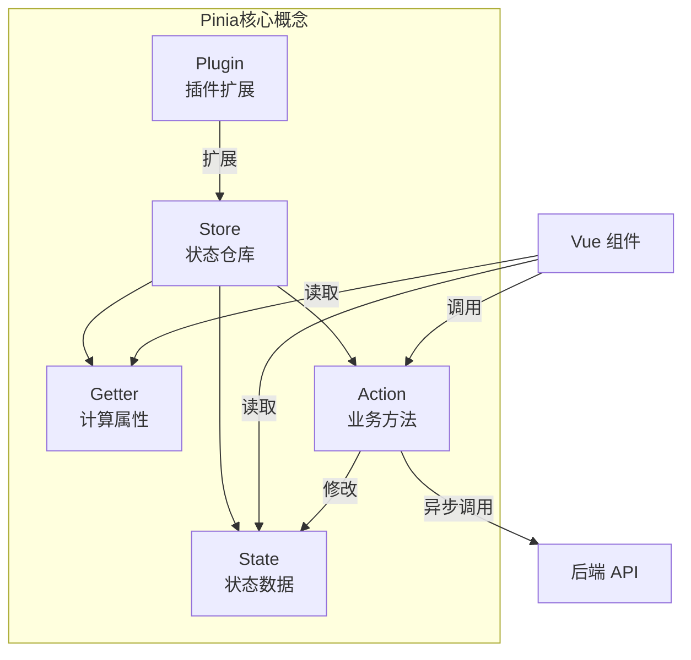

# Pinia 状态管理核心

> **文档说明**：系统讲解 Vue3 官方推荐的状态管理库 Pinia 的核心概念、API 用法、最佳实践和高级技巧，包括 Store 定义（Options API / Composition API 两种风格）、State / Getter / Action、持久化插件、模块化组织、TypeScript 类型支持、SSR 支持、与 Vuex 对比、调试与测试，以及大型项目的状态管理架构设计。
>
> **适用人群**：Vue3 前端开发工程师、从 Vuex 迁移到 Pinia 的开发者、需要设计大型前端状态管理架构的工程师
>
> **前置知识**：[[Vue3-组合式API设计模式]]、[[JavaScript核心语法与ES6+]]、[[TypeScript-类型系统进阶_backup_skeleton]]

---

## 一、概述

**Pinia** 是 Vue.js 官方推荐的新一代状态管理库，由 Vue 核心团队成员 Eduardo San Martin Morote 开发，于 2021 年成为 Vue 官方状态管理方案，逐步取代 Vuex。

### 1. Pinia vs Vuex

| 特性 | Pinia | Vuex 3/4 |
|------|-------|----------|
| **官方推荐** | ✅ Vue3 官方推荐 | ⚠️ 维护模式，不再新增功能 |
| **Vue2 支持** | ✅ 支持（需插件） | ✅ 支持 |
| **Vue3 支持** | ✅ 原生支持 | ✅ 支持 |
| **TypeScript** | ✅ 一流支持，类型推断完善 | ⚠️ 类型支持较弱，需大量类型声明 |
| **Mutations** | ❌ 移除了 Mutations，直接修改 State | ✅ 必须通过 Mutations 修改 State |
| **模块化** | ✅ 每个 Store 独立模块，自动命名空间 | ⚠️ 需手动配置 namespaced |
| **嵌套模块** | ❌ 不支持嵌套模块（用组合 Store 替代） | ✅ 支持嵌套模块 |
| **代码分割** | ✅ 天然支持，Store 按需加载 | ⚠️ 需手动配置 |
| **DevTools** | ✅ 支持时间旅行、状态追踪 | ✅ 支持 |
| **SSR** | ✅ 原生支持 | ✅ 支持 |
| **API 风格** | Options API + Composition API 双风格 | Options API 为主 |
| **Bundle 体积** | ~1KB（极轻量） | 较大 |
| **学习曲线** | 平缓（概念少） | 较陡（Mutations/Actions/Modules） |

**为什么 Pinia 移除了 Mutations**：
- Mutations 必须是同步的，限制了开发灵活性
- 实际开发中 Mutations 往往只是简单赋值，增加了样板代码
- Pinia 允许直接修改 State（类似 Vuex 的 `$patch`），同时保留 Action 处理异步逻辑
- DevTools 仍能追踪每次 State 修改，不影响调试

### 2. Pinia 核心概念



| 概念 | 说明 | 类比 |
|------|------|------|
| **Store** | 状态管理的基本单位，每个 Store 是一个独立的状态仓库 | Vuex 的 Module |
| **State** | Store 的数据部分，响应式状态 | Vuex 的 State / Vue 的 data |
| **Getter** | Store 的计算属性，基于 State 派生数据 | Vuex 的 Getter / Vue 的 computed |
| **Action** | Store 的方法，封装业务逻辑，可同步可异步 | Vuex 的 Action + Mutation |
| **Plugin** | 扩展 Pinia 功能（如持久化、日志） | Vuex 的 Plugin |

### 3. 安装与配置

```bash
# 安装
npm install pinia
# 或
yarn add pinia
# 或
pnpm add pinia
```

```typescript
// main.ts
import { createApp } from 'vue'
import { createPinia } from 'pinia'
import App from './App.vue'

const app = createApp(App)
const pinia = createPinia()

// 注册插件（可选）
// pinia.use(piniaPluginPersistedstate)  // 持久化插件

app.use(pinia)
app.mount('#app')
```

---

## 二、Store 定义

### 1. Options API 风格（类似 Vuex）

```typescript
// stores/user.ts
import { defineStore } from 'pinia'

export const useUserStore = defineStore('user', {
  // ===== State：状态数据 =====
  state: () => ({
    id: null as number | null,
    name: '',
    email: '',
    avatar: '',
    role: 'guest' as 'admin' | 'user' | 'guest',
    token: '',
    preferences: {
      theme: 'light' as 'light' | 'dark',
      language: 'zh-CN',
      notifications: true,
    },
  }),

  // ===== Getter：计算属性 =====
  getters: {
    // 基本 getter
    isLoggedIn: (state) => !!state.token,

    // 依赖其他 getter
    isAdmin: (state): boolean => {
      return state.role === 'admin'
    },

    // 使用 this 访问其他 getter（需指定返回类型）
    displayName(state): string {
      return state.name || state.email || '游客'
    },

    // 带参数的 getter（返回函数）
    hasPermission: (state) => (permission: string): boolean => {
      const permissions: Record<string, string[]> = {
        admin: ['user:manage', 'content:edit', 'system:config'],
        user: ['content:edit'],
        guest: [],
      }
      return permissions[state.role]?.includes(permission) ?? false
    },
  },

  // ===== Action：业务方法 =====
  actions: {
    // 同步 Action：直接修改 state
    setUser(user: Partial<UserState>) {
      this.id = user.id ?? this.id
      this.name = user.name ?? this.name
      this.email = user.email ?? this.email
      this.avatar = user.avatar ?? this.avatar
      this.role = user.role ?? this.role
    },

    // 异步 Action：调用 API
    async login(credentials: { email: string; password: string }) {
      try {
        const response = await authApi.login(credentials)
        this.token = response.data.token
        this.setUser(response.data.user)
        // 保存到 localStorage
        localStorage.setItem('token', this.token)
        return response.data
      } catch (error) {
        throw new Error('登录失败')
      }
    },

    async logout() {
      try {
        await authApi.logout()
      } finally {
        this.$reset()  // 重置 state 到初始值
        localStorage.removeItem('token')
      }
    },

    // 更新偏好设置
    updatePreferences(prefs: Partial<UserState['preferences']>) {
      this.preferences = { ...this.preferences, ...prefs }
    },
  },
})
```

### 2. Composition API 风格（推荐，Vue3 原生）

```typescript
// stores/user.ts
import { defineStore } from 'pinia'
import { ref, computed } from 'vue'

export const useUserStore = defineStore('user', () => {
  // ===== State：用 ref 定义 =====
  const id = ref<number | null>(null)
  const name = ref('')
  const email = ref('')
  const avatar = ref('')
  const role = ref<'admin' | 'user' | 'guest'>('guest')
  const token = ref('')
  const preferences = ref({
    theme: 'light' as 'light' | 'dark',
    language: 'zh-CN',
    notifications: true,
  })

  // ===== Getter：用 computed 定义 =====
  const isLoggedIn = computed(() => !!token.value)
  const isAdmin = computed(() => role.value === 'admin')
  const displayName = computed(() => name.value || email.value || '游客')

  const hasPermission = (permission: string): boolean => {
    const permissions: Record<string, string[]> = {
      admin: ['user:manage', 'content:edit', 'system:config'],
      user: ['content:edit'],
      guest: [],
    }
    return permissions[role.value]?.includes(permission) ?? false
  }

  // ===== Action：普通函数 =====
  const setUser = (user: Partial<{ id: number; name: string; email: string; avatar: string; role: string }>) => {
    if (user.id !== undefined) id.value = user.id
    if (user.name !== undefined) name.value = user.name
    if (user.email !== undefined) email.value = user.email
    if (user.avatar !== undefined) avatar.value = user.avatar
    if (user.role !== undefined) role.value = user.role as any
  }

  const login = async (credentials: { email: string; password: string }) => {
    const response = await authApi.login(credentials)
    token.value = response.data.token
    setUser(response.data.user)
    localStorage.setItem('token', token.value)
    return response.data
  }

  const logout = async () => {
    try {
      await authApi.logout()
    } finally {
      // Composition API 风格没有 $reset，需手动重置
      id.value = null
      name.value = ''
      email.value = ''
      avatar.value = ''
      role.value = 'guest'
      token.value = ''
      localStorage.removeItem('token')
    }
  }

  const updatePreferences = (prefs: Partial<typeof preferences.value>) => {
    preferences.value = { ...preferences.value, ...prefs }
  }

  // 必须 return 所有需要暴露的内容
  return {
    // state
    id, name, email, avatar, role, token, preferences,
    // getters
    isLoggedIn, isAdmin, displayName, hasPermission,
    // actions
    setUser, login, logout, updatePreferences,
  }
})
```

**两种风格对比**：

| 维度 | Options API | Composition API |
|------|-------------|-----------------|
| **语法** | 对象配置（state/getters/actions） | 函数式（ref/computed/function） |
| **Vue3 契合度** | 中 | 高（与 Vue3 Composition API 一致） |
| **TypeScript** | 需手动标注类型 | 类型推断更好 |
| **代码复用** | 需用 setup 函数 | 可直接用 Composable 函数 |
| **$reset** | ✅ 自动支持 | ❌ 需手动实现或用插件 |
| **适用场景** | 简单 Store、从 Vuex 迁移 | 复杂 Store、需要组合复用 |

**推荐**：新项目优先使用 **Composition API 风格**，与 Vue3 组合式 API 保持一致，类型支持更好。

---

## 三、组件中使用 Store

### 1. 基本用法

```vue
<script setup lang="ts">
import { useUserStore } from '@/stores/user'
import { storeToRefs } from 'pinia'

const userStore = useUserStore()

// 方式1：直接使用（失去响应式，不推荐）
// const name = userStore.name

// 方式2：使用 storeToRefs（保持响应式，推荐）
const { name, email, isLoggedIn, displayName } = storeToRefs(userStore)

// Action 直接解构（不需要 storeToRefs）
const { login, logout, updatePreferences } = userStore
</script>

<template>
  <div class="user-profile">
    <!-- 读取 State -->
    
    <h2>{{ displayName }}</h2>
    <p>{{ email }}</p>

    <!-- 读取 Getter -->
    <span v-if="isAdmin" class="badge admin">管理员</span>
    <span v-else-if="isLoggedIn" class="badge user">已登录</span>
    <span v-else class="badge guest">游客</span>

    <!-- 调用 Action -->
    <button v-if="!isLoggedIn" @click="login({ email: 'test@example.com', password: '123456' })">
      登录
    </button>
    <button v-else @click="logout">退出</button>

    <!-- 带参数的 Getter -->
    <button v-if="userStore.hasPermission('user:manage')">用户管理</button>
  </div>
</template>
```

### 2. storeToRefs 的作用

`storeToRefs` 是 Pinia 提供的工具函数，用于从 Store 中解构出响应式的 State 和 Getter：

```typescript
import { storeToRefs } from 'pinia'

const userStore = useUserStore()

// ❌ 直接解构会失去响应式
const { name, email } = userStore  // name, email 是普通值，不是 ref

// ✅ 使用 storeToRefs 保持响应式
const { name, email, isLoggedIn } = storeToRefs(userStore)  // 都是 ref

// Action 不需要 storeToRefs，直接解构即可
const { login, logout } = userStore
```

**原理**：`storeToRefs` 会遍历 Store 的所有属性，将 State 和 Getter 包装成 `ref`，跳过 Action（函数不需要响应式）。

### 3. 修改 State 的方式

```typescript
const userStore = useUserStore()

// 方式1：直接修改（最简单）
userStore.name = '新名字'
userStore.preferences.theme = 'dark'

// 方式2：$patch 批量修改（性能更好，一次触发更新）
userStore.$patch({
  name: '新名字',
  email: 'new@example.com',
  preferences: {
    ...userStore.preferences,
    theme: 'dark',
  },
})

// 方式3：$patch 函数式（适合复杂修改逻辑）
userStore.$patch((state) => {
  state.name = '新名字'
  state.preferences.theme = 'dark'
  // 可以写任意复杂逻辑
  if (state.role === 'admin') {
    state.preferences.notifications = true
  }
})

// 方式4：通过 Action 修改（推荐，封装业务逻辑）
userStore.setUser({ name: '新名字' })
userStore.updatePreferences({ theme: 'dark' })

// 方式5：$reset 重置到初始值（仅 Options API 风格自动支持）
userStore.$reset()
```

**$patch vs 直接修改**：
- 直接修改多个属性会触发多次更新，`$patch` 只触发一次
- `$patch` 在 DevTools 中显示为一次操作，便于调试
- 简单修改用直接赋值，批量修改用 `$patch`，复杂逻辑用 Action

### 4. 监听 Store 变化

```typescript
import { watch } from 'vue'

const userStore = useUserStore()

// 监听整个 Store
watch(
  () => userStore.$state,
  (state) => {
    console.log('Store 变化:', state)
  },
  { deep: true }
)

// 监听特定属性
watch(
  () => userStore.token,
  (newToken, oldToken) => {
    if (newToken) {
      localStorage.setItem('token', newToken)
    } else {
      localStorage.removeItem('token')
    }
  }
)

// Pinia 内置 $subscribe（类似 watch，但专门用于 Store）
userStore.$subscribe((mutation, state) => {
  // mutation: { type, storeId, payload, events }
  // state: 最新的 state
  console.log('Store 变化:', mutation.type, state)
}, { detached: true })  // detached: 组件卸载后仍保持监听
```

---

## 四、Store 间组合与调用

### 1. 在一个 Store 中调用另一个 Store

```typescript
// stores/cart.ts
import { defineStore } from 'pinia'
import { useUserStore } from './user'
import { useProductStore } from './product'

export const useCartStore = defineStore('cart', () => {
  const items = ref<CartItem[]>([])
  const userStore = useUserStore()
  const productStore = useProductStore()

  // Getter：计算总价（含会员折扣）
  const totalPrice = computed(() => {
    const subtotal = items.value.reduce((sum, item) => sum + item.price * item.quantity, 0)
    // 调用 userStore 的 getter
    if (userStore.isAdmin) {
      return subtotal * 0.8  // 管理员 8 折
    }
    return subtotal
  })

  // Action：添加商品到购物车
  const addItem = async (productId: number, quantity = 1) => {
    // 调用 productStore 的 Action
    const product = await productStore.fetchProduct(productId)
    const existing = items.value.find(item => item.productId === productId)
    if (existing) {
      existing.quantity += quantity
    } else {
      items.value.push({
        productId,
        name: product.name,
        price: product.price,
        quantity,
      })
    }
  }

  // Action：结算（需要用户登录）
  const checkout = async () => {
    if (!userStore.isLoggedIn) {
      throw new Error('请先登录')
    }
    const order = await orderApi.createOrder({
      userId: userStore.id,
      items: items.value,
      total: totalPrice.value,
    })
    items.value = []  // 清空购物车
    return order
  }

  return { items, totalPrice, addItem, checkout }
})
```

**注意事项**：
- 在 Store 的 Action 中调用其他 Store 是安全的
- 不要在 Store 定义的顶层（State/Getter 初始化时）调用其他 Store，可能导致循环依赖
- 如果需要在 Getter 中使用其他 Store，可以在 Getter 函数内部获取（延迟获取）

### 2. 避免循环依赖

```typescript
// ❌ 错误：在顶层获取其他 Store，可能导致循环依赖
const useStoreA = defineStore('A', () => {
  const storeB = useStoreB()  // 顶层获取，如果 B 也获取 A 就循环依赖了
  // ...
})

// ✅ 正确：在 Action/Getter 内部延迟获取
const useStoreA = defineStore('A', () => {
  const someAction = () => {
    const storeB = useStoreB()  // 运行时获取，不会循环依赖
    // ...
  }

  const someGetter = computed(() => {
    const storeB = useStoreB()  // Getter 内部获取
    return storeB.someValue
  })

  return { someAction, someGetter }
})
```

---

## 五、持久化插件

```text
### 1. pinia-plugin-persistedstate
```

最常用的 Pinia 持久化插件，支持 localStorage / sessionStorage / 自定义存储。

```bash
npm install pinia-plugin-persistedstate
```

```typescript
// main.ts
import { createPinia } from 'pinia'
import piniaPluginPersistedstate from 'pinia-plugin-persistedstate'

const pinia = createPinia()
pinia.use(piniaPluginPersistedstate)
```

```typescript
// stores/user.ts - Options API 风格
export const useUserStore = defineStore('user', {
  state: () => ({
    token: '',
    name: '',
    preferences: { theme: 'light' },
  }),
  // 开启持久化
  persist: true,  // 默认全部 state 持久化到 localStorage，key 为 store id
})
```

**高级配置**：
```typescript
export const useUserStore = defineStore('user', {
  state: () => ({
    token: '',
    name: '',
    password: '',  // 不希望持久化
    preferences: { theme: 'light' },
  }),
  persist: {
    key: 'user-store',          // 存储的 key
    storage: localStorage,       // 存储方式：localStorage / sessionStorage
    paths: ['token', 'name', 'preferences'],  // 只持久化指定路径（password 不持久化）
    // 自定义序列化
    serializer: {
      serialize: (state) => JSON.stringify(state),
      deserialize: (value) => JSON.parse(value),
    },
    // 持久化前的钩子
    beforeRestore: (ctx) => {
      console.log('即将恢复 state:', ctx.store.$id)
    },
    // 恢复后的钩子
    afterRestore: (ctx) => {
      console.log('state 已恢复:', ctx.store.$id)
    },
  },
})
```

**Composition API 风格**：
```typescript
export const useUserStore = defineStore('user', () => {
  const token = ref('')
  const name = ref('')
  // ...
  return { token, name }
}, {
  persist: true,  // 第三个参数配置持久化
})
```

### 2. 自定义持久化（Cookie / IndexedDB）

```typescript
// 自定义 Cookie 存储
import Cookies from 'js-cookie'

const cookieStorage = {
  getItem: (key: string) => Cookies.get(key) ?? null,
  setItem: (key: string, value: string) => Cookies.set(key, value, { expires: 7 }),
}

// 使用
persist: {
  storage: cookieStorage,
  paths: ['token'],  // token 存 Cookie
}
```

---

## 六、TypeScript 类型支持

### 1. Store 类型推断

Pinia 对 TypeScript 有一流支持，Composition API 风格的类型推断尤其出色：

```typescript
// stores/user.ts
import { defineStore } from 'pinia'
import { ref, computed } from 'vue'

export const useUserStore = defineStore('user', () => {
  const id = ref<number | null>(null)
  const name = ref('')
  const role = ref<'admin' | 'user' | 'guest'>('guest')

  const isAdmin = computed(() => role.value === 'admin')

  const setName = (newName: string) => {
    name.value = newName
  }

  return { id, name, role, isAdmin, setName }
})

// 使用时自动推断类型
const userStore = useUserStore()
userStore.id          // 类型：number | null
userStore.name        // 类型：string
userStore.role        // 类型：'admin' | 'user' | 'guest'
userStore.isAdmin     // 类型：boolean
userStore.setName('x') // 参数类型：string
```

### 2. 定义 State 类型

```typescript
// types/user.ts
export interface UserPreferences {
  theme: 'light' | 'dark'
  language: string
  notifications: boolean
}

export interface UserState {
  id: number | null
  name: string
  email: string
  role: 'admin' | 'user' | 'guest'
  token: string
  preferences: UserPreferences
}
```

```typescript
// stores/user.ts - Options API 风格
import { defineStore } from 'pinia'
import type { UserState } from '@/types/user'

export const useUserStore = defineStore('user', {
  state: (): UserState => ({
    id: null,
    name: '',
    email: '',
    role: 'guest',
    token: '',
    preferences: {
      theme: 'light',
      language: 'zh-CN',
      notifications: true,
    },
  }),
  // ...
})
```

---

## 七、大型项目状态管理架构

### 1. Store 组织规范

```text
src/stores/
├── index.ts              # Store 统一导出
├── modules/              # 业务模块 Store
│   ├── user.ts           # 用户状态
│   ├── cart.ts           # 购物车
│   ├── order.ts          # 订单
│   └── product.ts        # 商品
├── ui/                   # UI 状态 Store
│   ├── app.ts            # 应用全局状态（侧边栏、主题）
│   └── permission.ts     # 权限/路由
└── plugins/              # 自定义插件
    ├── persistence.ts    # 持久化
    └── logger.ts         # 日志
```

### 2. 状态分类原则

| 状态类型 | 存储位置 | 示例 |
|---------|---------|------|
| **全局共享状态** | Pinia Store | 用户信息、权限、主题、购物车 |
| **跨组件状态** | Pinia Store | 订单数据、商品列表、通知消息 |
| **组件内部状态** | 组件内 ref/reactive | 表单输入、弹窗显示、loading |
| **路由状态** | Vue Router | 当前路由、查询参数 |
| **URL 参数** | URL Query | 分页、筛选条件 |
| **本地缓存** | localStorage / IndexedDB | 用户偏好、离线数据 |

**判断标准**：这个状态是否被多个组件使用？是否需要跨页面保持？是 → Pinia；否 → 组件内部。

### 3. 避免过度使用 Store

**反模式**：把所有状态都放进 Store，导致 Store 臃肿、组件和 Store 强耦合。

**正确做法**：
- 只有真正需要全局共享的状态才放 Store
- 组件内部状态用 `ref`/`reactive`
- 表单状态优先用组件内部，提交时再同步到 Store
- 列表筛选条件优先用 URL Query，便于分享和刷新保持

### 4. Store 设计最佳实践

- [ ] **单一职责**：每个 Store 只管理一个业务领域的状态
- [ ] **State 最小化**：只存必要的状态，能通过 Getter 计算的不要存
- [ ] **Action 封装逻辑**：异步操作、复杂逻辑放 Action，组件只调用 Action
- [ ] **Getter 派生数据**：过滤、排序、计算等用 Getter，不要在组件中重复计算
- [ ] **避免嵌套过深**：State 结构扁平化，避免深层嵌套对象
- [ ] **类型安全**：为 State 和 Action 参数定义 TypeScript 类型
- [ ] **持久化策略**：明确哪些状态需要持久化，避免敏感信息持久化
- [ ] **命名规范**：Store id 用小驼峰，Action 用动词开头，Getter 用名词/形容词

---

## 八、调试与测试

### 1. DevTools 调试

Pinia 与 Vue DevTools 深度集成：
- **时间旅行**：回溯到任意历史状态
- **状态查看**：实时查看所有 Store 的 State
- **Action 追踪**：查看每次 Action 调用的参数和结果
- **状态导入/导出**：导出当前状态用于复现 Bug

### 2. 单元测试

```typescript
// stores/__tests__/user.test.ts
import { setActivePinia, createPinia } from 'pinia'
import { useUserStore } from '@/stores/user'

describe('User Store', () => {
  beforeEach(() => {
    setActivePinia(createPinia())
  })

  it('初始状态正确', () => {
    const store = useUserStore()
    expect(store.isLoggedIn).toBe(false)
    expect(store.role).toBe('guest')
  })

  it('login Action 正确设置状态', async () => {
    const store = useUserStore()
    // Mock API
    vi.mock('@/api/auth', () => ({
      login: vi.fn().mockResolvedValue({
        data: { token: 'fake-token', user: { id: 1, name: 'Test', role: 'user' } }
      })
    }))

    await store.login({ email: 'test@example.com', password: '123456' })
    expect(store.token).toBe('fake-token')
    expect(store.isLoggedIn).toBe(true)
    expect(store.name).toBe('Test')
  })

  it('$patch 批量修改状态', () => {
    const store = useUserStore()
    store.$patch({ name: 'NewName', email: 'new@test.com' })
    expect(store.name).toBe('NewName')
    expect(store.email).toBe('new@test.com')
  })
})
```

---

## 九、常见问题与排查

| 问题 | 原因 | 解决方案 |
|------|------|---------|
| 解构后失去响应式 | 直接从 Store 解构 State | 使用 `storeToRefs` 保持响应式 |
| State 修改不触发更新 | 修改了嵌套对象的属性但未触发响应式 | 使用 `$patch` 或确保对象是响应式的 |
| 持久化不生效 | 未注册插件 / 配置错误 | 确认 `pinia.use(piniaPluginPersistedstate)`，检查 persist 配置 |
| 循环依赖报错 | Store 顶层互相引用 | 在 Action/Getter 内部延迟获取其他 Store |
| Composition API 无 $reset | 该风格不自动支持 $reset | 手动实现重置函数，或用插件支持 |
| SSR  hydration 不匹配 | 服务端和客户端状态不一致 | 使用 `pinia.state.value` 序列化传递，客户端 hydrate |
| Store 体积过大 | 单个 Store 管理太多状态 | 按业务领域拆分为多个 Store |
| TypeScript 类型推断失败 | Options API 风格类型标注不足 | 使用 Composition API 风格，或显式定义 State 类型 |
| 热更新后状态丢失 | Vite HMR 未正确处理 Store | 配置 `acceptHMRUpdate`，或刷新页面 |
| Action 中 this 为 undefined | 箭头函数解构 Action | 不要用箭头函数定义 Action，或通过 store 实例调用 |

---

## 十、关联笔记

### 前端
- [[Vue3-组合式API设计模式]] · [[Vue3响应式原理]] · [[JavaScript核心语法与ES6+]]
- [[TypeScript-类型系统进阶_backup_skeleton]] · [[前端工程化知识点系统梳理_优化版]] · [[前端性能优化实战]]
- [[SSE-流式响应对接LLM]]

### 后端
- [[SpringBoot-自动装配原理]] · [[统一AI网关设计与实现]] · [[Gateway-网关路由与鉴权]]

### AI 工程
- [[RAG架构设计与流程]] · [[Agent工具调用FunctionCalling]] · [[AI网关与多模型路由]]

### 实战
- [[实战-RAG企业知识库问答系统]] · [[实战-AI智能客服系统]]

### 导航
- [[MOC-前端开发]] · [[全栈+AI工程双轨融合学习路线图]]

> **学习路径建议**：先掌握 [[JavaScript核心语法与ES6+]] 异步编程 → 学习 [[Vue3-组合式API设计模式]] 组合式 API → 深入本文 Pinia 状态管理 → 实践 [[前端工程化知识点系统梳理_优化版]] 工程化 → 研究 [[前端性能优化实战]] 性能优化 → 应用于 [[实战-RAG企业知识库问答系统]] 完整项目。
