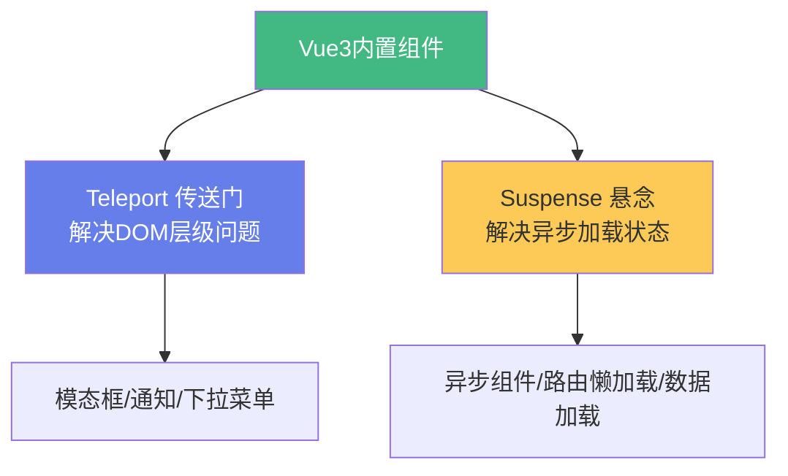

# 🚪 Vue3：Teleport 与 Suspense

> **文档说明**：系统讲解 Vue3 中两个强大的内置组件——Teleport（传送门）和 Suspense（悬念）的原理、用法与实战，涵盖 Teleport 的核心概念（将组件 DOM 渲染到指定位置，逻辑仍在当前组件）、Teleport 的使用（`to` 目标选择器/`disabled` 禁用/多实例/动态目标）、Teleport 应用场景（模态框 Modal/通知 Toast/下拉菜单/全屏覆盖层/工具提示）、Teleport 底层原理（DOM 节点移动但保持 Vue 响应式上下文/事件冒泡路径/样式作用域处理）、Suspense 的核心概念（管理异步依赖，在异步内容加载完成前展示 fallback）、Suspense 的使用（`#default` 默认插槽/`#fallback` 加载插槽/异步组件/`async setup`）、Suspense 事件（`@resolve`/`@pending`/`@fallback`）、Suspense 与 `defineAsyncComponent` 异步组件、Suspense 与路由懒加载（Vue Router）、Suspense 错误处理（`onErrorCaptured`/错误边界）、Suspense 嵌套与组合、Teleport 与 Suspense 结合实战（异步加载的模态框）、与 React Portal/Suspense 的对比、常见问题（Teleport 目标不存在/Suspense 不生效/样式丢失/SSR 兼容）与最佳实践。
>
> **适用人群**：Vue3 开发者、前端工程师、需要构建复杂交互和异步加载体验的开发者
>
> **前置知识**：[[Vue3-组合式API]] · [[Vue3-组件通信与插槽]] · [[异步编程-Promise与async-await]]

---

## 一、概述

### 1.1 两个内置组件的定位

Vue3 提供了两个强大的**内置组件**，解决前端开发中的经典难题：



| 组件 | 解决的问题 | 核心能力 |
|------|-----------|---------|
| **Teleport** | 组件 DOM 位置与逻辑位置不一致 | 将 DOM 「传送」到任意位置，逻辑保持不变 |
| **Suspense** | 异步内容加载时的状态管理 | 等待异步依赖完成，期间展示 fallback |

### 1.2 为什么需要这两个组件

**Teleport 的痛点**：
- 模态框嵌套在深层组件中，`z-index` 被父级截断
- 通知组件需要固定在 `body` 上，但逻辑在子组件
- 下拉菜单被 `overflow: hidden` 的父容器裁剪

**Suspense 的痛点**：
- 异步组件加载时白屏
- 每个组件都要写 `loading` 状态和 `v-if`
- 多个异步依赖的加载状态难以统一管理

---

## 二、Teleport 传送门

### 2.1 基本用法

`<Teleport>` 将其插槽内容渲染到 DOM 中的另一个位置：

```vue
<template>
  <button @click="showModal = true">打开模态框</button>

  <!-- 将模态框传送到 body 末尾 -->
  <Teleport to="body">
    <div v-if="showModal" class="modal">
      <div class="modal-content">
        <h2>模态框标题</h2>
        <p>模态框内容...</p>
        <button @click="showModal = false">关闭</button>
      </div>
    </div>
  </Teleport>
</template>

<script setup>
import { ref } from 'vue'
const showModal = ref(false)
</script>
```

**渲染结果**：
```html
<!-- 组件所在位置 -->
<button>打开模态框</button>

<!-- body 末尾（Teleport 目标位置） -->
<div class="modal">
  <div class="modal-content">...</div>
</div>
```

> 虽然 DOM 被传送到 `body`，但组件的**响应式数据、事件、生命周期**仍然在原组件中正常工作。

### 2.2 to 属性

`to` 属性指定传送目标，支持：

```vue
<!-- CSS 选择器 -->
<Teleport to="body">...</Teleport>
<Teleport to="#modal-container">...</Teleport>
<Teleport to=".my-app">...</Teleport>

<!-- 动态目标（响应式） -->
<Teleport :to="dynamicTarget">...</Teleport>

<!-- 传送到当前元素的父级 -->
<Teleport to="html">...</Teleport>
```

> `to` 必须是一个有效的 DOM 选择器，且目标元素在 Teleport 渲染时必须存在。

### 2.3 disabled 属性

`disabled` 为 `true` 时，内容不会被传送，保留在原位置：

```vue
<Teleport to="body" :disabled="!isMobile">
  <!-- 桌面端传送到 body，移动端保留原位 -->
  <Modal />
</Teleport>
```

### 2.4 多个 Teleport 共享目标

多个 Teleport 可以传送到同一个目标，按顺序追加：

```vue
<Teleport to="#modals">
  <ModalA />
</Teleport>
<Teleport to="#modals">
  <ModalB />
</Teleport>

<!-- 渲染结果 -->
<div id="modals">
  <!-- ModalA 的内容 -->
  <!-- ModalB 的内容 -->
</div>
```

### 2.5 Teleport 应用场景

#### 场景一：模态框（Modal）

```vue
<!-- Modal.vue -->
<template>
  <Teleport to="body">
    <Transition name="fade">
      <div v-if="visible" class="modal-mask" @click.self="close">
        <div class="modal-box">
          <slot />
        </div>
      </div>
    </Transition>
  </Teleport>
</template>
```

> 模态框传送到 `body` 避免被父级 `overflow`/`z-index` 影响。

#### 场景二：通知（Toast）

```vue
<!-- Toast.vue -->
<template>
  <Teleport to="body">
    <div class="toast-container">
      <TransitionGroup name="slide">
        <div v-for="toast in toasts" :key="toast.id" class="toast">
          {{ toast.message }}
        </div>
      </TransitionGroup>
    </div>
  </Teleport>
</template>
```

#### 场景三：下拉菜单（Dropdown）

```vue
<Teleport to="body">
  <div v-if="open" class="dropdown-menu" :style="menuStyle">
    <slot />
  </div>
</Teleport>
```

> 下拉菜单传送到 body 后，需要手动计算位置（基于触发按钮的 getBoundingClientRect）。

#### 场景四：全屏覆盖层

```vue
<Teleport to="body">
  <div v-if="fullscreen" class="fullscreen-overlay">
    <!-- 全屏内容 -->
  </div>
</Teleport>
```

### 2.6 Teleport 底层原理

**核心机制**：
1. Vue 在渲染时识别 `<Teleport>` 组件
2. 将插槽内容的 DOM 节点**移动**到 `to` 指定的目标元素
3. 但组件的**响应式上下文、事件监听、生命周期**仍绑定在原组件
4. 更新时，Vue 知道这些 DOM 属于 Teleport，正确地更新和移除

**事件冒泡**：
- DOM 事件按实际 DOM 结构冒泡（从 body 向上）
- 但 Vue 的组件事件（`$emit`）仍按组件层级传递

**样式作用域**：
- `<style scoped>` 的样式仍然生效（Vue 通过 data 属性匹配）
- 但如果目标在 scoped 样式的组件外，需要注意选择器

---

## 三、Suspense 悬念

### 3.1 基本用法

`<Suspense>` 等待异步内容加载完成，期间显示 fallback：

```vue
<template>
  <Suspense>
    <!-- 默认插槽：异步内容 -->
    <template #default>
      <AsyncComponent />
    </template>

    <!-- fallback 插槽：加载中显示 -->
    <template #fallback>
      <div class="loading">加载中...</div>
    </template>
  </Suspense>
</template>

<script setup>
import { defineAsyncComponent } from 'vue'

const AsyncComponent = defineAsyncComponent(() => import('./AsyncComponent.vue'))
</script>
```

**执行流程**：
1. Suspense 渲染时，检测到 `#default` 中有异步依赖
2. 显示 `#fallback` 内容
3. 异步依赖全部完成后，切换显示 `#default` 内容

### 3.2 异步依赖的两种方式

#### 方式一：异步组件（defineAsyncComponent）

```javascript
import { defineAsyncComponent } from 'vue'

// 基本用法
const AsyncComp = defineAsyncComponent(() => import('./Comp.vue'))

// 高级用法
const AsyncComp = defineAsyncComponent({
  loader: () => import('./Comp.vue'),
  loadingComponent: Loading,    // 加载中组件
  errorComponent: ErrorComp,    // 加载失败组件
  delay: 200,                   // 延迟显示 loading（ms）
  timeout: 3000,                // 超时时间（ms）
  suspensible: true,            // 支持 Suspense（默认 true）
})
```

#### 方式二：async setup

```vue
<!-- AsyncComponent.vue -->
<script setup>
// async setup 会被 Suspense 等待
const data = await fetch('/api/data').then(r => r.json())
</script>

<template>
  <div>{{ data }}</div>
</template>
```

> `async setup` 中的 `await` 会让组件成为异步依赖，被父级 Suspense 捕获。

### 3.3 Suspense 事件

```vue
<Suspense
  @pending="onPending"      <!-- 开始加载 -->
  @resolve="onResolve"      <!-- 加载完成 -->
  @fallback="onFallback"    <!-- 显示 fallback 时 -->
>
  <template #default>
    <AsyncComponent />
  </template>
  <template #fallback>
    <Loading />
  </template>
</Suspense>
```

| 事件 | 触发时机 |
|------|---------|
| `pending` | 进入加载状态时 |
| `resolve` | 所有异步依赖完成时 |
| `fallback` | fallback 显示时（延迟后） |

### 3.4 与路由懒加载结合

Vue Router 的懒加载组件天然支持 Suspense：

```vue
<!-- App.vue -->
<template>
  <Suspense>
    <template #default>
      <RouterView />
    </template>
    <template #fallback>
      <div class="page-loading">页面加载中...</div>
    </template>
  </Suspense>
</template>
```

```javascript
// router.js
const routes = [
  {
    path: '/dashboard',
    component: () => import('./views/Dashboard.vue')  // 懒加载
  }
]
```

> 路由切换时，Suspense 会等待新页面组件加载完成，期间显示 loading。

### 3.5 嵌套 Suspense

Suspense 可以嵌套，每层管理自己的异步依赖：

```vue
<Suspense>
  <template #default>
    <Layout>
      <Suspense>
        <template #default>
          <AsyncContent />
        </template>
        <template #fallback>
          <ContentSkeleton />
        </template>
      </Suspense>
    </Layout>
  </template>
  <template #fallback>
    <FullPageLoading />
  </template>
</Suspense>
```

### 3.6 错误处理

Suspense 本身不处理错误，用 `onErrorCaptured` 捕获子组件错误：

```vue
<template>
  <div v-if="error" class="error">
    加载失败：{{ error.message }}
    <button @click="retry">重试</button>
  </div>
  <Suspense v-else>
    <template #default>
      <AsyncComponent />
    </template>
    <template #fallback>
      <Loading />
    </template>
  </Suspense>
</template>

<script setup>
import { ref, onErrorCaptured } from 'vue'

const error = ref(null)

onErrorCaptured((err) => {
  error.value = err
  return false  // 阻止错误继续向上传播
})

function retry() {
  error.value = null
}
</script>
```

---

## 四、Teleport + Suspense 结合实战

### 4.1 异步加载的模态框

```vue
<!-- App.vue -->
<template>
  <button @click="openModal">打开设置</button>

  <Teleport to="body">
    <Suspense>
      <template #default>
        <SettingsModal v-if="showModal" @close="showModal = false" />
      </template>
      <template #fallback>
        <div v-if="showModal" class="modal-loading">
          加载中...
        </div>
      </template>
    </Suspense>
  </Teleport>
</template>

<script setup>
import { ref, defineAsyncComponent } from 'vue'

const showModal = ref(false)
const SettingsModal = defineAsyncComponent(() => import('./SettingsModal.vue'))

function openModal() {
  showModal.value = true
}
</script>
```

**效果**：
1. 点击按钮 → 显示模态框 loading
2. 异步组件加载完成 → 显示模态框内容
3. 模态框 DOM 在 body 上，不受父级样式影响

### 4.2 全局通知系统

```vue
<!-- ToastProvider.vue -->
<template>
  <Teleport to="body">
    <div class="toast-container">
      <TransitionGroup name="toast">
        <div v-for="toast in toasts" :key="toast.id" class="toast">
          {{ toast.message }}
        </div>
      </TransitionGroup>
    </div>
  </Teleport>
</template>
```

---

## 五、与 React 对比

| 特性 | Vue3 | React |
|------|------|-------|
| **传送门** | `<Teleport to="...">` | `<Portal to={...}>` / `createPortal` |
| **悬念** | `<Suspense>` | `<Suspense fallback={...}>` |
| **异步组件** | `defineAsyncComponent` | `React.lazy` |
| **async setup** | ✅ 原生支持 | ❌（需用 useEffect） |
| **错误边界** | `onErrorCaptured` | `componentDidCatch` / ErrorBoundary |
| **多目标共享** | ✅ 多个 Teleport 同目标 | ✅ 多个 Portal 同目标 |

---

## 六、常见问题

| 问题 | 解决方案 |
|------|---------|
| **Teleport 目标不存在** | 确保目标元素在 Teleport 渲染前已存在，或用 `onMounted` 后再渲染 |
| **Teleport 后样式丢失** | scoped 样式仍生效；CSS 变量和继承可能受影响，检查实际 DOM 结构 |
| **Suspense 不显示 fallback** | 确保子组件有异步依赖（async setup 或 defineAsyncComponent） |
| **async setup 不被等待** | 确保组件被 Suspense 的 `#default` 插槽包裹，且 `suspensible: true` |
| **Suspense 闪烁** | 设置 `delay`（defineAsyncComponent 的 delay 选项） |
| **Teleport 下拉菜单位置不对** | 手动计算 `getBoundingClientRect()`，监听滚动和 resize |
| **SSR 中 Teleport 不工作** | SSR 时 Teleport 内容会渲染在原位置，客户端激活后才传送 |
| **Suspense 中多个异步组件** | Suspense 等待所有异步依赖完成后才切换，适合统一加载状态 |

---

## 七、最佳实践

1. **模态框/通知必用 Teleport**：避免 z-index 和 overflow 问题
2. **Suspense 用于路由级加载**：配合 Vue Router 实现页面加载动画
3. **细粒度 Suspense**：不要全局一个 Suspense，按模块拆分，提升用户体验
4. **defineAsyncComponent 加 loading/error 组件**：提供更好的用户反馈
5. **Teleport 目标用 id 选择器**：比 class 更精确，避免误匹配
6. **Suspense 配合 onErrorCaptured**：处理异步加载失败
7. **避免过度使用 Teleport**：只有确实需要脱离 DOM 层级时才用
8. **SSR 注意**：Teleport 和 Suspense 在 SSR 中有特殊行为，需测试

---

## 八、关联笔记

### Vue3 生态
- [[Vue3-组合式API]] · [[Vue3-组件通信与插槽]] · [[Vue3-过渡与动画]]
- [[Vue3-响应式原理Proxy]] · [[VueUse-工具函数库]] · [[Vite构建工具原理]]

### 前端基础
- [[异步编程-Promise与async-await]] · [[前端性能优化实战]] · [[CSS层叠上下文与z-index]]

### 导航
- [[MOC-前端开发]] · [[MOC-Vue3生态]] · [[Home]] · [[学习路线总览]]

> 🔍 **知识点深度解析**
>
> **作用**：Teleport 与 Suspense 解决的是 Vue3 中两个经典的 UI 难题——「组件逻辑位置与 DOM 渲染位置不一致」和「异步内容加载时的状态管理」。Teleport 让模态框/通知等组件可以脱离父级 DOM 层级限制（z-index/overflow），同时保持组件逻辑和响应式不变；Suspense 让异步组件/数据加载时的 loading 状态管理从「每个组件手写 v-if loading」升级为「声明式的统一管理」。
>
> **底层原理**：①Teleport 的核心是「DOM 节点移动，组件上下文不变」——Vue 在渲染阶段识别 Teleport 组件，将其插槽内容的 DOM 节点通过 `appendChild`/`insertBefore` 移动到 `to` 指定的目标元素，但这些 DOM 节点的 Vue 实例、响应式依赖、事件监听仍然绑定在原组件中。更新时，Vue 的虚拟 DOM diff 知道这些节点属于 Teleport，会正确地更新和移除。这就是为什么「DOM 在 body 上，但数据和事件还在原组件」的原因。②Teleport 解决的根本问题是「CSS 层叠上下文（Stacking Context）」——当父元素设置了 `transform`、`opacity`、`filter`、`z-index` 等属性时，会创建新的层叠上下文，导致子元素的 `z-index` 被「困住」，无法覆盖到其他层级。Teleport 通过将 DOM 移到 body 等高层级元素，从根本上规避了这个问题。③Suspense 的核心是「异步依赖的统一等待机制」——当 Suspense 的默认插槽中包含异步组件（defineAsyncComponent）或 async setup 组件时，Suspense 会进入 pending 状态，显示 fallback；当所有异步依赖的 Promise 都 resolve 后，Suspense 切换到 resolve 状态，显示默认内容。这本质上是一个「Promise.all」的声明式封装。④Suspense 与 async setup 的配合是 Vue3 的创新——组件的 setup 函数可以是 async 的，其中的 await 会被 Suspense 捕获为异步依赖。这让「组件等待数据加载」变得非常自然：直接在 setup 中 await fetch，不需要写 loading 状态和 v-if。但这也意味着 async setup 组件必须被 Suspense 包裹，否则会有警告。⑤defineAsyncComponent 的 `delay` 选项是一个细节但重要的优化——如果异步加载很快（<200ms），不显示 loading 可以避免「闪烁」；只有加载超过 delay 时间才显示 fallback。这提升了用户体验，避免了快速加载时的 loading 闪烁。⑥Suspense 的错误处理需要配合 `onErrorCaptured`——Suspense 本身只处理「加载中」和「加载完成」两种状态，不处理「加载失败」。错误需要通过 `onErrorCaptured` 钩子捕获，或者在 defineAsyncComponent 中配置 `errorComponent`。
>
> **用法要点**：① Teleport：<Teleport to="body/#id/.class">包裹内容，DOM传送到目标但逻辑不变，disabled可禁用，多个可共享目标 ② Teleport场景：模态框/通知Toast/下拉菜单/全屏覆盖层，解决z-index和overflow问题 ③ Suspense：<Suspense><template #default>异步内容</template><template #fallback>加载中</template></Suspense> ④ 异步依赖两种方式：defineAsyncComponent(()=>import()) 或 async setup 中 await ⑤ Suspense事件：@pending开始加载/@resolve加载完成/@fallback显示fallback ⑥ 与路由：<Suspense><RouterView/></Suspense>实现路由懒加载的loading ⑦ 错误处理：onErrorCaptured捕获，defineAsyncComponent配置errorComponent ⑧ 结合实战：Teleport+Suspense实现异步加载的模态框 ⑨ 常见问题：Teleport目标需先存在/Suspense需有异步依赖/async setup需被Suspense包裹/SSR特殊处理 ⑩ 最佳实践：模态框必用Teleport/Suspense按模块拆分/defineAsyncComponent加loading和error/delay防闪烁。

> 💡 **深度讲解**：Teleport 与 Suspense 最核心的智慧是「将 UI 开发中的常见痛点从『命令式处理』升级为『声明式抽象』」——在没有 Teleport 的时代，实现一个模态框需要手动操作 DOM（`document.body.appendChild`）、手动管理事件绑定和销毁、手动处理响应式更新，代码繁琐且容易出错。Teleport 将这个过程封装为一个声明式组件：`<Teleport to="body">` 一句话搞定，Vue 帮你处理所有底层的 DOM 移动和上下文保持。同样，在没有 Suspense 的时代，每个异步组件都要写 `const loading = ref(false)`、`try { loading.value = true; await fetch() } finally { loading.value = false }`、模板里 `v-if="loading"`，重复且枯燥。Suspense 将「等待异步依赖」抽象为声明式的插槽机制，让 loading 状态管理变得优雅。这种「声明式抽象」是 Vue3 设计哲学的体现——框架处理复杂性，开发者专注于业务逻辑。Teleport 和 Suspense 虽然是两个独立的组件，但它们经常配合使用：异步加载的模态框（Suspense 等待组件加载，Teleport 将模态框送到 body）、异步加载的通知系统、懒加载的全屏覆盖层等等。理解了这两个组件，你就掌握了 Vue3 中「复杂交互」和「异步体验」的核心工具。在实际开发中，很多开发者对这两个组件「知道但不用」，导致代码中充满了手动 DOM 操作和重复的 loading 逻辑。建议从下一个模态框和下一个异步页面开始，尝试用 Teleport 和 Suspense 重构——你会发现代码更简洁、更可维护、更符合 Vue3 的声明式哲学。

> 📝 **精简总结**：Vue3 Teleport与Suspense=两个内置组件解决UI痛点。Teleport传送门：<Teleport to="body/#id">将DOM传送到目标位置但逻辑不变，解决z-index/overflow问题，用于模态框/通知/下拉菜单/全屏层，disabled可禁用。Suspense悬念：<Suspense>#default异步内容+#fallback加载中，等待异步依赖完成后切换。异步依赖：defineAsyncComponent(()=>import()) 或 async setup。事件@pending/@resolve/@fallback。配合路由懒加载。错误用onErrorCaptured。结合实战：Teleport+Suspense异步模态框。常见：Teleport目标需存在/Suspense需异步依赖/async setup需被包裹。最佳实践：模态框必用Teleport/Suspense按模块拆分/加loading和error/delay防闪烁。

> **学习路径建议**：先学习 [[Vue3-组合式API]] 和 [[Vue3-组件通信与插槽]] → 学习本文档的 Teleport 和 Suspense → 实践：用 Teleport 重构项目中的模态框组件 → 实践：用 Suspense + defineAsyncComponent 实现路由级加载动画 → 学习 [[Vue3-过渡与动画]] 配合 Teleport 实现动画模态框 → 学习 [[异步编程-Promise与async-await]] 深化异步理解 → 实践：实现一个完整的异步通知系统（Teleport + Suspense + Transition） → 进阶：研究 SSR 中 Teleport 和 Suspense 的行为。

---

> **Teleport 与 Suspense 的本质是「将前端开发中的重复性痛点抽象为声明式组件，让框架处理复杂性，让开发者专注于业务」——在前端开发中，有两个问题几乎每个项目都会遇到：一是模态框、通知等组件总是被父级的 z-index 和 overflow 「困住」，二是异步加载时每个组件都要重复写 loading 状态。在 Vue2 时代，这些问题需要手动处理：模态框要手动 appendChild 到 body，loading 要每个组件写 ref 和 v-if。Vue3 的 Teleport 和 Suspense 将这些痛点抽象为内置组件，用声明式的方式解决：`<Teleport to="body">` 一句话解决 DOM 层级问题，`<Suspense>` 两个插槽解决加载状态问题。这种「声明式抽象」是现代前端框架的核心价值——框架替你处理底层的复杂性（DOM 移动、上下文保持、Promise 等待、状态切换），你只需要描述「想要什么」而非「怎么做」。Teleport 和 Suspense 虽然简单，但它们代表了 Vue3 的设计哲学：**把常见的复杂模式内置到框架中，让最佳实践成为默认行为**。当你用 Teleport 写模态框时，你自动获得了正确的 DOM 层级、响应式保持、事件管理；当你用 Suspense 写异步页面时，你自动获得了统一的 loading 管理、错误处理、性能优化。这些「免费的好处」正是使用框架的意义。在 AI 时代，这种声明式抽象更加重要——AI 生成代码时，使用标准的内置组件（Teleport/Suspense）比手写自定义逻辑更可靠、更易维护。从今天开始，检查你的项目：还有多少模态框在手动操作 DOM？还有多少组件在手写 loading？用 Teleport 和 Suspense 重构它们，你会发现代码变得更简洁、更优雅、更 Vue3。**
