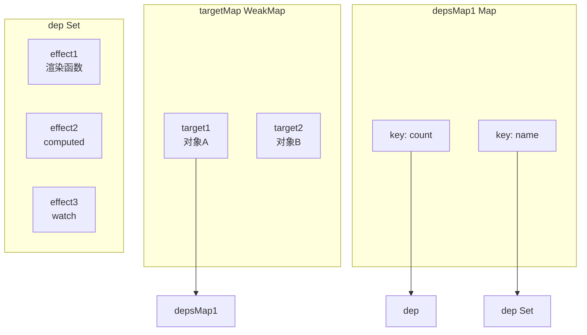

# Vue3 响应式原理 Proxy

> **文档说明**：深入讲解 Vue3 响应式系统的底层原理，包括 Proxy 代理、依赖收集、触发更新、ref/reactive 区别、computed/watch 实现，以及与 Vue2 Object.defineProperty 的对比。
>
> **适用人群**：前端开发工程师、需要深入理解 Vue3 原理的全栈工程师、面试准备者
>
> **前置知识**：[[Vue3-组合式API设计模式]]、[[JavaScript-ES6+新特性]]

---

## 一、概述

**响应式（Reactivity）** 是 Vue 的核心特性——数据变化时视图自动更新。Vue3 使用 **ES6 Proxy** 重写了响应式系统，相比 Vue2 的 `Object.defineProperty`，支持更多数据类型、更好的性能、更完整的拦截能力。

### 1. Vue2 vs Vue3 响应式对比

| 维度 | Vue2 (Object.defineProperty) | Vue3 (Proxy) |
|------|---------------------------|-------------|
| **实现方式** | 遍历对象属性，逐个定义 getter/setter | 代理整个对象，拦截所有操作 |
| **对象新增属性** | ❌ 无法检测（需 `$set`） | ✅ 自动检测 |
| **数组下标修改** | ❌ 无法检测（需 `$set`） | ✅ 自动检测 |
| **数组 length 修改** | ❌ 无法检测 | ✅ 自动检测 |
| **Map/Set/WeakMap** | ❌ 不支持 | ✅ 支持 |
| **初始化性能** | 递归遍历所有属性（慢） | 懒代理（快，访问时才代理） |
| **内存占用** | 每个属性绑定 watcher（高） | Proxy 代理（低） |
| **删除属性** | ❌ 无法检测（需 `$delete`） | ✅ 自动检测 |
| **浏览器兼容** | IE9+ | 不支持 IE（Proxy 无法 polyfill） |

### 2. 响应式核心流程

```mermaid
graph TB
    A[创建响应式对象<br/>reactive/ref] --> B[Proxy 代理对象]
    C[组件渲染函数执行] --> D[读取响应式数据]
    D --> E[触发 Proxy get 拦截]
    E --> F[依赖收集<br/>track(target, key)]
    F --> G[建立依赖关系<br/>targetMap → depsMap → dep]
    H[修改响应式数据] --> I[触发 Proxy set 拦截]
    I --> J[触发更新<br/>trigger(target, key)]
    J --> K[通知所有依赖该数据的 effect]
    K --> L[重新执行渲染函数]
    L --> M[更新虚拟DOM → 真实DOM]
```

**核心三步**：
1. **依赖收集（Track）**：读取数据时，记录哪些 effect 依赖了这个属性
2. **触发更新（Trigger）**：修改数据时，通知所有依赖该属性的 effect 重新执行
3. **重新渲染**：effect 重新执行渲染函数，更新视图

---

## 二、Proxy 基础

### 1. Proxy 语法

```javascript
// Proxy 用于创建对象的代理，拦截对对象的各种操作
const target = { name: 'Vue', version: 3 }
const handler = {
  // 读取属性时拦截
  get(target, key, receiver) {
    console.log(`读取属性: ${key}`)
    return Reflect.get(target, key, receiver)
  },
  // 设置属性时拦截
  set(target, key, value, receiver) {
    console.log(`设置属性: ${key} = ${value}`)
    return Reflect.set(target, key, value, receiver)
  },
  // 删除属性时拦截
  deleteProperty(target, key) {
    console.log(`删除属性: ${key}`)
    return Reflect.deleteProperty(target, key)
  },
  // 检查属性是否存在
  has(target, key) {
    console.log(`检查属性: ${key}`)
    return Reflect.has(target, key)
  },
  // 遍历属性
  ownKeys(target) {
    console.log('遍历属性')
    return Reflect.ownKeys(target)
  }
}

const proxy = new Proxy(target, handler)
proxy.name          // 读取属性: name → "Vue"
proxy.version = 4   // 设置属性: version = 4
delete proxy.name   // 删除属性: name
'version' in proxy  // 检查属性: version
Object.keys(proxy)  // 遍历属性
```

### 2. Proxy 可拦截的 13 种操作

| 拦截方法 | 触发场景 |
|---------|---------|
| `get` | 读取属性 |
| `set` | 设置属性 |
| `has` | `in` 操作符 |
| `deleteProperty` | `delete` 操作符 |
| `apply` | 函数调用 |
| `construct` | `new` 操作符 |
| `getPrototypeOf` | `Object.getPrototypeOf()` |
| `setPrototypeOf` | `Object.setPrototypeOf()` |
| `isExtensible` | `Object.isExtensible()` |
| `preventExtensions` | `Object.preventExtensions()` |
| `getOwnPropertyDescriptor` | `Object.getOwnPropertyDescriptor()` |
| `defineProperty` | `Object.defineProperty()` |
| `ownKeys` | `Object.keys()`, `for...in`, `Object.getOwnPropertyNames()` |

### 3. Reflect 的作用

`Reflect` 是一个内置对象，提供了与 Proxy handler 一一对应的方法，用于执行对象的默认操作。

```javascript
// 为什么用 Reflect 而不是直接操作 target？
const handler = {
  get(target, key, receiver) {
    // ❌ 直接访问：无法处理 getter 中的 this 指向
    // return target[key]

    // ✅ 使用 Reflect：receiver 确保 getter 中的 this 指向代理对象
    return Reflect.get(target, key, receiver)
  }
}

// 示例：receiver 的重要性
const user = {
  name: 'Vue',
  get greeting() {
    return `Hello, I am ${this.name}`  // this 应该指向代理对象
  }
}
const proxy = new Proxy(user, {
  get(target, key, receiver) {
    return Reflect.get(target, key, receiver)  // this = proxy
  }
})
proxy.greeting  // "Hello, I am Vue"（this.name 从 proxy 读取，触发响应式）
```

---

## 三、Vue3 响应式核心实现

### 1. 最简响应式实现

```javascript
// 存储当前正在执行的 effect
let activeEffect = null
// 依赖存储：targetMap → depsMap → dep(Set)
const targetMap = new WeakMap()

// 追踪依赖
function track(target, key) {
  if (!activeEffect) return
  let depsMap = targetMap.get(target)
  if (!depsMap) {
    depsMap = new Map()
    targetMap.set(target, depsMap)
  }
  let dep = depsMap.get(key)
  if (!dep) {
    dep = new Set()
    depsMap.set(key, dep)
  }
  dep.add(activeEffect)  // 收集当前 effect
}

// 触发更新
function trigger(target, key) {
  const depsMap = targetMap.get(target)
  if (!depsMap) return
  const dep = depsMap.get(key)
  if (dep) {
    dep.forEach(effect => effect())  // 通知所有依赖的 effect
  }
}

// 创建响应式对象
function reactive(target) {
  return new Proxy(target, {
    get(target, key, receiver) {
      track(target, key)  // 依赖收集
      return Reflect.get(target, key, receiver)
    },
    set(target, key, value, receiver) {
      const result = Reflect.set(target, key, value, receiver)
      trigger(target, key)  // 触发更新
      return result
    }
  })
}

// 定义 effect（副作用函数）
function effect(fn) {
  activeEffect = fn
  fn()  // 首次执行，触发依赖收集
  activeEffect = null
}

// 使用示例
const state = reactive({ count: 0 })
effect(() => {
  console.log(`count = ${state.count}`)  // 首次执行: count = 0
})
state.count++  // 触发更新: count = 1
state.count = 10  // 触发更新: count = 10
```

### 2. 依赖存储结构



| 层级 | 数据结构 | Key | Value | 作用 |
|------|---------|-----|-------|------|
| 第一层 | WeakMap | 目标对象 target | depsMap | 对象级别的依赖映射 |
| 第二层 | Map | 属性名 key | dep | 属性级别的依赖映射 |
| 第三层 | Set | effect 函数 | - | 依赖该属性的所有副作用 |

**为什么用 WeakMap？**
- WeakMap 的 key 是弱引用，对象被垃圾回收时，其依赖也自动回收
- 防止内存泄漏
- 只能用对象作为 key，正好符合 target 是对象的需求

### 3. 嵌套对象的响应式（懒代理）

Vue3 采用**懒代理**策略：只有在访问到嵌套对象时，才将其转为响应式代理，而不是初始化时递归代理所有层级。

```javascript
function reactive(target) {
  return new Proxy(target, {
    get(target, key, receiver) {
      track(target, key)
      const result = Reflect.get(target, key, receiver)
      // 懒代理：访问到对象时才递归代理
      if (isObject(result)) {
        return reactive(result)
      }
      return result
    },
    set(target, key, value, receiver) {
      const oldValue = target[key]
      const result = Reflect.set(target, key, value, receiver)
      // 只有值真正变化时才触发更新
      if (oldValue !== value) {
        trigger(target, key)
      }
      return result
    }
  })
}

function isObject(val) {
  return val !== null && typeof val === 'object'
}

// 示例：嵌套对象的懒代理
const state = reactive({
  user: {
    name: 'Vue',
    profile: { age: 3 }
  }
})
// 初始化时只有 state 是 Proxy，user 和 profile 还是普通对象
state.user           // 访问时才将 user 转为 Proxy
state.user.profile   // 访问时才将 profile 转为 Proxy
```

**懒代理的优势**：
- 初始化性能好（不需要递归遍历）
- 未访问的对象不占用代理开销
- 内存占用低

### 4. 数组的响应式

Proxy 可以完美拦截数组的所有操作，包括 Vue2 无法检测的下标修改和 length 修改。

```javascript
const arr = reactive([1, 2, 3])

// 以下操作 Vue3 都能检测到（Vue2 不能）
arr[0] = 10        // 下标修改 ✅
arr.length = 1     // length 修改 ✅
arr.push(4)        // push ✅（拦截 set，key='3'）
arr.pop()          // pop ✅
arr.splice(1, 1)   // splice ✅

// 数组的特殊处理：遍历方法需要收集 length 依赖
// 因为 for...of、forEach 等会读取 length
```

**数组方法的拦截优化**：
Vue3 对 `includes`、`indexOf`、`lastIndexOf` 等数组方法做了特殊处理——这些方法内部会遍历数组，需要确保遍历到的元素也是响应式的。

---

## 四、ref vs reactive

### 1. ref 的实现

`ref` 用于创建基本类型（和对象）的响应式引用，内部通过 `.value` 属性访问。

```javascript
// ref 的简化实现
function ref(value) {
  return {
    _isRef: true,
    get value() {
      track(this, 'value')  // 依赖收集
      return value
    },
    set value(newValue) {
      if (newValue !== value) {
        value = newValue
        trigger(this, 'value')  // 触发更新
      }
    }
  }
}

// 使用
const count = ref(0)
count.value  // 0（触发 track）
count.value++  // 触发 trigger
```

### 2. ref vs reactive 对比

| 维度 | ref | reactive |
|------|-----|----------|
| **适用类型** | 基本类型 + 对象 | 仅对象（Object/Array/Map/Set） |
| **访问方式** | `.value` | 直接访问属性 |
| **模板中** | 自动解包（无需 .value） | 直接使用 |
| **解构** | 解构后保持响应式 | 解构后丢失响应式（需 toRefs） |
| **重新赋值** | 可以直接替换整个值 | 不能直接替换（需 Object.assign） |
| **底层实现** | getter/setter（类 Vue2） | Proxy |
| **嵌套对象** | ref 对象时内部调用 reactive | 懒代理 |
| **类型推导** | `Ref<T>` | 直接推导 |

### 3. 为什么需要 ref

```javascript
// 问题：基本类型无法用 Proxy 代理
const count = reactive(0)  // ❌ Proxy 只能代理对象

// 解决方案：用 ref 包装成对象
const count = ref(0)  // ✅ { value: 0 }，通过 getter/setter 拦截

// ref 也可以包装对象
const user = ref({ name: 'Vue' })
user.value.name = 'Vue3'  // ✅ 内部对象是 reactive 的
```

### 4. toRef 和 toRefs

```javascript
// 问题：reactive 对象解构后丢失响应式
const state = reactive({ count: 0, name: 'Vue' })
let { count, name } = state  // ❌ 解构后是普通值，不再响应式

// 解决方案：toRefs 将每个属性转为 ref
import { toRefs, toRef } from 'vue'

const state = reactive({ count: 0, name: 'Vue' })
const { count, name } = toRefs(state)  // ✅ 解构后仍是 ref，保持响应式

// toRef：将单个属性转为 ref
const countRef = toRef(state, 'count')
countRef.value++  // ✅ 修改会同步到 state
```

```javascript
// toRefs 的简化实现
function toRefs(object) {
  const result = {}
  for (const key in object) {
    result[key] = toRef(object, key)
  }
  return result
}

function toRef(object, key) {
  return {
    _isRef: true,
    get value() {
      return object[key]  // 访问原对象属性，触发响应式
    },
    set value(newValue) {
      object[key] = newValue  // 修改原对象属性，触发更新
    }
  }
}
```

---

## 五、computed 与 watch

### 1. computed 的实现

`computed` 是计算属性，基于响应式数据派生新值，具有**缓存**特性——依赖不变时不重新计算。

```javascript
// computed 的简化实现
function computed(getter) {
  let value
  let dirty = true  // 脏标记：是否需要重新计算
  let computedEffect

  const runner = effect(getter, {
    lazy: true,  // 不立即执行
    scheduler() {
      dirty = true  // 依赖变化时标记为脏
      trigger(obj, 'value')  // 通知依赖 computed 的 effect
    }
  })

  const obj = {
    _isComputed: true,
    get value() {
      if (dirty) {
        value = runner()  // 重新计算
        dirty = false     // 标记为干净
      }
      track(obj, 'value')  // 收集依赖
      return value
    }
  }
  return obj
}

// 使用
const count = ref(0)
const double = computed(() => count.value * 2)

double.value  // 0（首次计算）
double.value  // 0（缓存，不重新计算）
count.value++  // 依赖变化，dirty = true
double.value  // 2（重新计算）
```

**computed 的核心特性**：
1. **懒执行**：首次访问 `.value` 时才计算
2. **缓存**：依赖不变时返回缓存值
3. **依赖追踪**：自动追踪计算函数中使用的响应式数据
4. **可写**：支持 `get`/`set` 双向绑定

### 2. watch 的实现

`watch` 用于监听响应式数据变化，执行副作用操作。

```javascript
// watch 的简化实现
function watch(source, callback, options = {}) {
  let getter
  if (isRef(source)) {
    getter = () => source.value
  } else if (isReactive(source)) {
    getter = () => source
    options.deep = true  // reactive 默认深度监听
  } else if (typeof source === 'function') {
    getter = source
  }

  let oldValue
  const runner = effect(getter, {
    lazy: true,
    scheduler() {
      const newValue = runner()
      if (options.deep || newValue !== oldValue) {
        callback(newValue, oldValue)
        oldValue = newValue
      }
    }
  })

  if (options.immediate) {
    callback(undefined, undefined)  // 立即执行
  } else {
    oldValue = runner()  // 首次执行，收集依赖
  }
}

// 使用
const count = ref(0)
watch(count, (newVal, oldVal) => {
  console.log(`count 变化: ${oldVal} → ${newVal}`)
}, { immediate: true, deep: true })
```

### 3. computed vs watch vs watchEffect

| 特性 | computed | watch | watchEffect |
|------|----------|-------|-------------|
| **用途** | 派生计算值 | 监听变化执行副作用 | 自动追踪依赖执行副作用 |
| **返回值** | 有（计算结果） | 无（停止函数） | 无（停止函数） |
| **缓存** | ✅ 有缓存 | ❌ 无 | ❌ 无 |
| **懒执行** | ✅ 访问时才计算 | ❌ 默认不立即执行 | ✅ 立即执行 |
| **依赖追踪** | 自动 | 手动指定 source | 自动 |
| **获取旧值** | - | ✅ 有 oldValue | ❌ 无 |
| **异步** | 不支持 | ✅ 支持 | ✅ 支持 |
| **适用场景** | 数据派生、模板展示 | 数据变化时执行操作 | 自动追踪多个依赖 |

---

## 六、调度器与异步更新

### 1. 为什么需要异步更新

```javascript
// 问题：同步更新会导致重复渲染
const count = ref(0)
effect(() => console.log('渲染', count.value))

count.value++  // 渲染 1
count.value++  // 渲染 2
count.value++  // 渲染 3
// 同步模式下渲染了 3 次，但最终只需要渲染 1 次（最终值为 3）
```

**解决方案**：异步更新队列——将多次修改合并为一次渲染。

### 2. 调度器实现

```javascript
// 任务队列
const queue = []
let isFlushing = false

// 将 effect 加入队列
function queueJob(job) {
  if (!queue.includes(job)) {
    queue.push(job)
    flushJobs()
  }
}

// 异步刷新队列
function flushJobs() {
  if (isFlushing) return
  isFlushing = true
  // 使用 Promise.then 微任务，确保同步代码执行完后再刷新
  Promise.resolve().then(() => {
    queue.sort((a, b) => a.id - b.id)  // 按 effect id 排序，保证执行顺序
    while (queue.length) {
      const job = queue.shift()
      job()  // 执行 effect
    }
    isFlushing = false
  })
}

// effect 支持 scheduler（调度器）
function effect(fn, options = {}) {
  const effectFn = () => {
    activeEffect = effectFn
    fn()
    activeEffect = null
  }
  effectFn.options = options
  effectFn()
  return effectFn
}

// trigger 时使用调度器
function trigger(target, key) {
  const depsMap = targetMap.get(target)
  if (!depsMap) return
  const dep = depsMap.get(key)
  if (dep) {
    dep.forEach(effect => {
      if (effect.options.scheduler) {
        effect.options.scheduler(effect)  // 使用调度器
      } else {
        effect()  // 同步执行
      }
    })
  }
}

// 组件渲染 effect 使用调度器
const renderEffect = effect(render, {
  scheduler() {
    queueJob(renderEffect)  // 加入异步队列
  }
})
```

### 3. nextTick

```javascript
// nextTick：在 DOM 更新后执行回调
function nextTick(fn) {
  return fn ? Promise.resolve().then(fn) : Promise.resolve()
}

// 使用
import { nextTick } from 'vue'

count.value++
console.log(div.textContent)  // 旧值（DOM 还未更新）

nextTick(() => {
  console.log(div.textContent)  // 新值（DOM 已更新）
})

// 或使用 async/await
count.value++
await nextTick()
console.log(div.textContent)  // 新值
```

---

## 七、集合类型的响应式（Map/Set）

Vue3 通过 Proxy 支持 Map、Set、WeakMap、WeakSet 的响应式，但需要特殊处理它们的方法。

```javascript
// Map/Set 的响应式需要重写原型方法
const mutableInstrumentations = {
  get(key) {
    const target = this[ReactiveFlags.RAW]
    const rawKey = toRaw(key)
    track(target, rawKey)  // 依赖收集
    const result = target.get(rawKey)
    return isObject(result) ? reactive(result) : result
  },
  set(key, value) {
    const target = this[ReactiveFlags.RAW]
    const rawKey = toRaw(key)
    const hadKey = target.has(rawKey)
    const result = target.set(rawKey, toRaw(value))
    if (!hadKey) {
      trigger(target, rawKey, 'add', value)  // 新增
    } else {
      trigger(target, rawKey, 'set', value)  // 修改
    }
    return result
  },
  // has, delete, clear, forEach, keys, values, entries...
}

function reactive(target) {
  return new Proxy(target, {
    get(target, key, receiver) {
      // Map/Set 方法调用时，返回重写后的方法
      if (key in mutableInstrumentations) {
        return mutableInstrumentations[key]
      }
      return Reflect.get(target, key, receiver)
    }
  })
}

// 使用
const map = reactive(new Map())
map.set('name', 'Vue')  // ✅ 触发响应式
map.get('name')          // ✅ 触发依赖收集
```

---

## 八、常见问题与最佳实践

### 1. 常见问题

| 问题 | 原因 | 解决方案 |
|------|------|---------|
| 解构后不响应式 | reactive 解构后是普通值 | 使用 `toRefs` 解构 |
| 替换整个对象不更新 | reactive 不能直接替换引用 | 使用 `Object.assign` 或改用 `ref` |
| 模板中 ref 需要 .value | 模板自动解包仅限顶层 | 确保 ref 是 setup 返回的顶层属性 |
| computed 不更新 | 依赖未被追踪（用了非响应式数据） | 确保计算函数中使用响应式数据 |
| 数组修改不更新 | 直接修改数组原型方法 | 使用响应式数组的方法（push/splice等） |
| watch 不触发 | 监听了普通对象而非响应式 | 确保 source 是 ref/reactive/函数 |
| 深度监听性能差 | deep: true 递归遍历 | 避免大对象深度监听，使用具体路径 |
| 内存泄漏 | effect 未停止 | 组件卸载时自动停止，手动 effect 需调用 stop |

### 2. 最佳实践

- [ ] **优先使用 ref**：基本类型用 ref，对象也可以用 ref（更灵活）
- [ ] **reactive 用于复杂对象**：表单数据、状态对象等用 reactive
- [ ] **解构用 toRefs**：从 composable 返回 reactive 时，用 toRefs 保持响应式
- [ ] **computed 用于派生值**：不要在 computed 中执行副作用
- [ ] **watch 用于副作用**：数据变化时执行异步操作、日志等
- [ ] **避免深度监听**：大对象用 `watch(() => obj.path, cb)` 而非 `deep: true`
- [ ] **合理使用 nextTick**：DOM 更新后操作才需要 nextTick
- [ ] **composable 函数返回 ref**：确保调用方解构后仍响应式
- [ ] **避免在循环中创建响应式**：大量数据用 shallowRef/shallowReactive

### 3. 性能优化 API

| API | 作用 | 适用场景 |
|-----|------|---------|
| `shallowRef` | 浅 ref，只追踪 .value 替换 | 大对象、不需要深层响应式 |
| `shallowReactive` | 浅 reactive，只追踪顶层属性 | 大对象、深层数据不需要响应式 |
| `shallowReadonly` | 浅只读 | 只需要顶层只读 |
| `markRaw` | 标记为不可转为响应式 | 第三方库实例、不需要响应式的对象 |
| `toRaw` | 获取原始对象 | 需要绕过响应式直接操作 |
| `customRef` | 自定义 ref 的依赖追踪和触发 | 防抖 ref、特殊逻辑 |
| `effectScope` | 批量管理 effect 生命周期 | composable 中统一管理 |

```javascript
// shallowRef 示例：大列表不需要每项都响应式
const bigList = shallowRef([])
bigList.value = await fetchData()  // 只有整体替换时触发更新
// bigList.value[0].name = 'new' 不会触发更新（浅响应式）

// customRef 示例：防抖 ref
function useDebouncedRef(value, delay = 200) {
  let timeout
  return customRef((track, trigger) => ({
    get() {
      track()
      return value
    },
    set(newValue) {
      clearTimeout(timeout)
      timeout = setTimeout(() => {
        value = newValue
        trigger()
      }, delay)
    }
  }))
}
```

---

## 九、关联笔记

### Vue3 生态
- [[Vue3-组合式API设计模式]] · [[Vue3-组件设计与通信]] · [[Vue3-性能优化实战]]
- [[Vite-构建原理与插件开发]] · [[Pinia-状态管理]] · [[VueRouter-路由设计]]

### JavaScript
- [[JavaScript-ES6+新特性]] · [[JavaScript-闭包与作用域]] · [[JavaScript-原型与继承]]
- [[JavaScript-事件循环与异步]]

### 前端框架
- [[React-Hooks核心原理]] · [[React-状态管理]] · [[前端框架对比-Vue-React]]

### 面试
- [[面试准备与求职指南]] · [[前端面试高频题]]

### 导航
- [[MOC-前端开发]] · [[全栈+AI工程双轨融合学习路线图]]

> **学习路径建议**：先掌握 [[JavaScript-ES6+新特性]] 理解 Proxy/Reflect → 学习 [[Vue3-组合式API设计模式]] 基础用法 → 深入本文响应式原理 → 实践 [[Vue3-性能优化实战]] 性能调优 → 研究 [[React-Hooks核心原理]] 对比理解。
