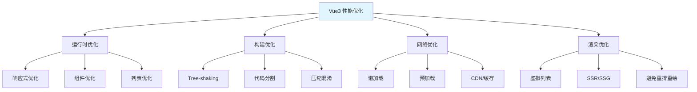

# Vue3-性能优化实战

> **文档说明**：系统讲解 Vue3 应用性能优化的完整体系，包括响应式优化、组件优化、列表渲染优化、异步加载、打包优化、渲染优化，以及性能监控分析和实战案例。
>
> **适用人群**：前端开发者、全栈开发者、需要优化 Vue3 应用性能的开发者
>
> **前置知识**：[[Vue3-组合式API设计模式]]、[[TypeScript-高级类型与泛型]]、[[前端工程化与构建工具]]

---

## 一、概述

### 1. Vue3 性能优势

```text
Vue3 相比 Vue2 的性能提升：
- 响应式系统：Object.defineProperty → Proxy（全属性拦截、数组原生支持）
- 编译优化：静态提升、补丁标记、缓存事件处理
- 虚拟 DOM：重写，更快的 diff 算法
- 打包体积：Tree-shaking，最小约 10KB
- 组合式 API：更好的逻辑复用和类型推导
- Suspense：异步组件原生支持
```

### 2. 性能优化维度



### 3. 性能指标

```text
核心 Web 指标（Core Web Vitals）：
- LCP（Largest Contentful Paint）：最大内容绘制，<2.5s 好
- FID（First Input Delay）：首次输入延迟，<100ms 好
- CLS（Cumulative Layout Shift）：累积布局偏移，<0.1 好
- INP（Interaction to Next Paint）：交互到下一次绘制，<200ms 好

Vue 特定指标：
- 组件渲染时间
- 响应式更新耗时
- 首次内容绘制（FCP）
- 可交互时间（TTI）
- 包体积
```

---

## 二、响应式优化

### 1. ref vs reactive

```vue
<script setup>
import { ref, reactive, shallowRef, shallowReactive, markRaw } from 'vue'

// ref：基本类型和对象都可以，访问需要 .value
const count = ref(0)
const user = ref({ name: '张三', age: 25 })

// reactive：只用于对象，直接访问属性
const state = reactive({
  list: [],
  loading: false
})

// 选择建议：
// - 基本类型用 ref
// - 复杂对象用 reactive
// - 大型对象考虑 shallowRef/shallowReactive
</script>
```

### 2. 浅层响应式（shallowRef / shallowReactive）

```vue
<script setup>
import { shallowRef, shallowReactive, triggerRef } from 'vue'

// shallowRef：只有 .value 整体替换是响应式的
// 内部属性变化不触发更新
const bigData = shallowRef({
  users: [],  // 大数组，不需要深度响应
  config: {}
})

// 修改内部属性不会触发更新
bigData.value.users.push(newUser)  // ❌ 不触发

// 整体替换才触发
bigData.value = { ...bigData.value, users: [...users] }  // ✅ 触发

// 手动触发
triggerRef(bigData)

// shallowReactive：只有第一层属性响应式
const state = shallowReactive({
  foo: 1,           // 响应式
  nested: { bar: 2 }  // nested.bar 不是响应式
})
</script>
```

### 3. markRaw（标记不可响应式）

```vue
<script setup>
import { markRaw, reactive } from 'vue'

// markRaw：标记对象永远不被转为响应式
// 用于第三方库实例、复杂类实例、不需要响应式的大对象
const state = reactive({
  // 第三方库实例不需要响应式
  chart: markRaw(new Chart()),
  // 大的静态数据
  constants: markRaw({ hugeData: [...] })
})

// 常见场景：
// - ECharts/Chart.js 实例
// - 第三方 SDK 实例
// - 不需要更新的大对象
// - 类实例（new MyClass()）
</script>
```

### 4. 计算属性优化

```vue
<script setup>
import { ref, computed } from 'vue'

const list = ref([...])
const filter = ref('all')

// ✅ computed 有缓存，依赖不变时不重新计算
const filteredList = computed(() => {
  return list.value.filter(item => item.status === filter.value)
})

// ❌ 不要在模板中调用方法（每次渲染都执行）
// <div>{{ getFilteredList() }}</div>

// ✅ 用 computed 替代
// <div>{{ filteredList }}</div>

// 可写 computed（高级）
const fullName = computed({
  get: () => `${firstName.value} ${lastName.value}`,
  set: (val) => {
    const [f, l] = val.split(' ')
    firstName.value = f
    lastName.value = l
  }
})
</script>
```

### 5. 侦听器优化

```vue
<script setup>
import { ref, watch, watchEffect } from 'vue'

const data = ref({})

// watch：指定依赖，惰性执行
watch(data, (newVal) => {
  // 只有 data 变化时执行
}, { deep: false })  // 避免不必要的 deep

// watchEffect：自动收集依赖，立即执行
watchEffect(() => {
  console.log(data.value.name)  // 自动追踪 data.value.name
})

// 优化建议：
// - 用 watch 而非 watchEffect（更明确）
// - 避免 deep: true（性能开销大）
// - 用具体属性监听代替整个对象
// - immediate 按需使用
</script>
```

---

## 三、组件优化

### 1. v-memo（记忆化模板）

```vue
<template>
  <!-- v-memo：依赖数组不变时跳过渲染 -->
  <!-- 适用于大型列表中的复杂项 -->
  <div v-memo="[item.id, item.selected]">
    <complex-component :item="item" />
  </div>

  <!-- 配合 v-for 使用 -->
  <div v-for="item in list" :key="item.id" v-memo="[item.selected]">
    {{ item.name }} - {{ item.selected }}
  </div>

  <!-- v-memo="[]" 相当于 v-once，只渲染一次 -->
  <div v-memo="[]">这个内容永远不更新</div>
</template>
```

### 2. v-once（只渲染一次）

```vue
<template>
  <!-- v-once：只渲染一次，后续不更新 -->
  <h1 v-once>{{ appTitle }}</h1>

  <!-- 大量静态内容用 v-once -->
  <div v-once>
    <p>这是一段很长的静态说明文字...</p>
    
  </div>

  <!-- Vue3 编译时会自动提升静态节点，v-once 用于明确标记 -->
</template>
```

### 3. 函数式组件

```vue
<!-- 函数式组件：无状态、无实例，渲染快 -->
<script setup>
// 简单展示组件用函数式
const props = defineProps(['items'])
</script>

<template functional>
  <ul>
    <li v-for="item in items" :key="item.id">{{ item.name }}</li>
  </ul>
</template>
```

### 4. 异步组件（defineAsyncComponent）

```vue
<script setup>
import { defineAsyncComponent, Suspense } from 'vue'

// 基本用法
const HeavyComponent = defineAsyncComponent(() =>
  import('./HeavyComponent.vue')
)

// 带加载状态和错误处理
const AsyncComponent = defineAsyncComponent({
  loader: () => import('./HeavyComponent.vue'),
  loadingComponent: LoadingSpinner,
  errorComponent: ErrorDisplay,
  delay: 200,        // 延迟显示 loading（避免闪烁）
  timeout: 3000,     // 超时显示错误
  suspensible: true, // 支持 Suspense
})
</script>

<template>
  <Suspense>
    <template #default>
      <HeavyComponent />
    </template>
    <template #fallback>
      <LoadingSpinner />
    </template>
  </Suspense>
</template>
```

### 5. KeepAlive（组件缓存）

```vue
<template>
  <!-- 缓存组件实例，避免重复创建 -->
  <KeepAlive :include="['TabA', 'TabB']" :max="5">
    <component :is="currentTab" />
  </KeepAlive>

  <!-- 路由缓存 -->
  <router-view v-slot="{ Component }">
    <KeepAlive :include="cachedViews">
      <component :is="Component" />
    </KeepAlive>
  </router-view>
</template>

<script setup>
// 缓存的组件有 activated/deactivated 生命周期
import { onActivated, onDeactivated } from 'vue'

onActivated(() => {
  // 组件被激活时（每次进入）
  refreshData()
})

onDeactivated(() => {
  // 组件被缓存时（离开）
})
</script>
```

---

## 四、列表渲染优化

### 1. v-for key 最佳实践

```vue
<template>
  <!-- ✅ 用唯一稳定的 id 作为 key -->
  <div v-for="item in list" :key="item.id">
    {{ item.name }}
  </div>

  <!-- ❌ 不要用 index 作为 key（列表变化时性能差） -->
  <div v-for="(item, index) in list" :key="index">
    {{ item.name }}
  </div>

  <!-- ❌ 不要用随机值（每次渲染都变） -->
  <div v-for="item in list" :key="Math.random()">
</template>
```

### 2. 虚拟列表（大数据量）

```vue
<script setup>
import { ref, computed } from 'vue'

// 简单虚拟列表实现
const props = defineProps({
  items: { type: Array, required: true },
  itemHeight: { type: Number, default: 50 },
  containerHeight: { type: Number, default: 500 }
})

const scrollTop = ref(0)
const startIndex = computed(() =>
  Math.floor(scrollTop.value / props.itemHeight)
)
const endIndex = computed(() =>
  Math.min(
    startIndex.value + Math.ceil(props.containerHeight / props.itemHeight) + 2,
    props.items.length
  )
)
const visibleItems = computed(() =>
  props.items.slice(startIndex.value, endIndex.value)
)
const offsetY = computed(() => startIndex.value * props.itemHeight)
const totalHeight = computed(() => props.items.length * props.itemHeight)

function onScroll(e) {
  scrollTop.value = e.target.scrollTop
}
</script>

<template>
  <div :style="{ height: containerHeight + 'px' }"
       class="overflow-auto"
       @scroll="onScroll">
    <div :style="{ height: totalHeight + 'px', position: 'relative' }">
      <div :style="{ transform: `translateY(${offsetY}px)` }">
        <div v-for="item in visibleItems" :key="item.id"
             :style="{ height: itemHeight + 'px' }">
          {{ item.name }}
        </div>
      </div>
    </div>
  </div>
</template>

<!-- 生产环境推荐用库：vue-virtual-scroller、vue-virt-list -->
```

### 3. 列表数据优化

```vue
<script setup>
import { ref, shallowRef } from 'vue'

// 大列表用 shallowRef（不深度代理）
const bigList = shallowRef([])

// 分页加载
const page = ref(1)
const pageSize = 20
const list = ref([])

async function loadMore() {
  const data = await fetchList(page.value, pageSize)
  list.value.push(...data)  // 批量追加
  page.value++
}

// 避免在 v-for 中调用方法
// ❌ <div>{{ formatDate(item.date) }}</div>
// ✅ 预处理数据
const formattedList = computed(() =>
  list.value.map(item => ({
    ...item,
    formattedDate: formatDate(item.date)
  }))
)
</script>
```

---

## 五、路由与代码分割

### 1. 路由懒加载

```javascript
// router/index.js
import { createRouter, createWebHistory } from 'vue-router'

const routes = [
  {
    path: '/',
    component: () => import('../views/Home.vue')  // 懒加载
  },
  {
    path: '/about',
    component: () => import('../views/About.vue')
  },
  {
    path: '/dashboard',
    component: () => import('../views/Dashboard.vue'),
    // 预加载（用户空闲时加载）
    meta: { prefetch: true }
  },
  {
    path: '/admin',
    component: () => import('../views/Admin.vue'),
    // 按组分块
    component: () => import(/* webpackChunkName: "admin" */ '../views/Admin.vue')
  }
]
```

### 2. 组件级懒加载

```vue
<script setup>
import { defineAsyncComponent } from 'vue'

// 重型组件按需加载
const ChartComponent = defineAsyncComponent(() =>
  import('./ChartComponent.vue')
)
const EditorComponent = defineAsyncComponent(() =>
  import('./EditorComponent.vue')
)

const showChart = ref(false)
</script>

<template>
  <button @click="showChart = true">显示图表</button>
  <ChartComponent v-if="showChart" />
</template>
```

### 3. 预加载策略

```javascript
// Vite 配置预加载
// vite.config.js
export default {
  build: {
    rollupOptions: {
      output: {
        manualChunks: {
          'vue-vendor': ['vue', 'vue-router', 'pinia'],
          'ui-vendor': ['element-plus'],
          'chart-vendor': ['echarts', 'vue-echarts']
        }
      }
    }
  }
}

// 路由预取（link rel="prefetch"）
// 用户可能访问的页面提前加载
```

---

## 六、打包优化

```text
### 1. Tree-shaking
```

```javascript
// ✅ 按需导入（支持 tree-shaking）
import { ref, computed, watch } from 'vue'
import { ElButton, ElInput } from 'element-plus'

// ❌ 全量导入
import Vue from 'vue'
import ElementPlus from 'element-plus'

// 工具函数按需导入
import { debounce, throttle } from 'lodash-es'
// 而不是 import _ from 'lodash'
```

### 2. 外部化依赖（CDN）

```javascript
// vite.config.js
export default {
  build: {
    rollupOptions: {
      external: ['vue', 'vue-router'],
      output: {
        globals: {
          vue: 'Vue',
          'vue-router': 'VueRouter'
        }
      }
    }
  }
}
// index.html 中引入 CDN
// <script src="https://cdn.jsdelivr.net/npm/vue@3/dist/vue.global.prod.js"></script>
```

### 3. 压缩与分析

```bash
# 打包分析
npm run build -- --report  # Vite: rollup-plugin-visualizer

# 检查包体积
npx vite-bundle-visualizer

# 压缩配置
// vite.config.js
import { defineConfig } from 'vite'
export default defineConfig({
  build: {
    minify: 'terser',  // 或 'esbuild'（更快）
    terserOptions: {
      compress: {
        drop_console: true,   // 移除 console
        drop_debugger: true   // 移除 debugger
      }
    },
    cssCodeSplit: true,       // CSS 分割
    sourcemap: false          // 生产不生成 sourcemap
  }
})
```

---

## 七、渲染优化

### 1. 避免不必要的重渲染

```vue
<script setup>
import { ref, computed, v-memo } from 'vue'

// ✅ 状态最小化：只把需要响应式的数据放 ref
const count = ref(0)
const staticConfig = { apiUrl: '/api' }  // 不需要响应式

// ✅ 用 computed 派生状态，而非额外的 ref
const double = computed(() => count.value * 2)

// ❌ 不要这样（多余的响应式）
// const double = ref(0)
// watch(count, v => double.value = v * 2)
</script>

<template>
  <!-- ✅ 把不变化的部分抽离 -->
  <StaticHeader />

  <!-- ✅ 只更新需要更新的部分 -->
  <div>{{ count }}</div>
  <div>{{ double }}</div>
</template>
```

### 2. CSS 优化

```css
/* 避免触发重排的属性动画 */
/* ❌ 用 top/left 做动画（触发重排） */
.box { animation: move 1s; }
@keyframes move {
  from { top: 0; left: 0; }
  to { top: 100px; left: 100px; }
}

/* ✅ 用 transform（只触发合成层） */
.box {
  animation: move 1s;
  will-change: transform;  /* 提示浏览器优化 */
}
@keyframes move {
  from { transform: translate(0, 0); }
  to { transform: translate(100px, 100px); }
}

/* 避免布局抖动 */
img { aspect-ratio: 16 / 9; }  /* 预留图片空间 */
```

### 3. SSR / SSG

```text
SSR（服务端渲染）：
- 首屏 HTML 由服务端生成
- 首屏快，SEO 友好
- 适合内容型网站
- 框架：Nuxt 3、Vite SSR

SSG（静态站点生成）：
- 构建时生成静态 HTML
- 最快，CDN 部署
- 适合内容不频繁变化的站点
- 框架：Nuxt 3 generate、VitePress

SPA（单页应用）：
- 客户端渲染
- 交互体验好
- 适合后台管理、应用类
```

---

## 八、性能监控与分析

### 1. Vue DevTools

```text
Vue DevTools 性能面板：
- 组件渲染时间
- 组件更新频率
- 响应式依赖追踪
- 事件触发
- Vuex/Pinia 状态变化

使用：
1. 安装 Vue DevTools 浏览器扩展
2. 打开 Performance 标签
3. 录制操作
4. 查看慢组件和频繁更新
```

### 2. 性能埋点

```javascript
// main.js
import { createApp } from 'vue'

const app = createApp(App)

// 全局错误和性能监控
app.config.errorHandler = (err, vm, info) => {
  console.error('Vue Error:', err, info)
  // 上报到监控系统
}

// 组件渲染性能（开发环境）
app.config.performance = true
// 浏览器 DevTools Performance 面板会显示组件渲染时间
```

### 3. Web Vitals 监控

```javascript
// 安装：npm install web-vitals
import { onLCP, onFID, onCLS, onINP } from 'web-vitals'

function sendToAnalytics(metric) {
  console.log(`${metric.name}: ${metric.value}`)
  // 上报到监控平台
}

onLCP(sendToAnalytics)
onFID(sendToAnalytics)
onCLS(sendToAnalytics)
onINP(sendToAnalytics)
```

---

## 九、最佳实践清单

### 响应式
- [ ] 基本类型用 ref，对象用 reactive
- [ ] 大对象用 shallowRef/shallowReactive
- [ ] 第三方实例用 markRaw
- [ ] 用 computed 代替模板方法调用
- [ ] 避免 deep watch，监听具体属性
- [ ] 状态最小化，减少不必要的响应式

### 组件
- [ ] 重型组件用 defineAsyncComponent 懒加载
- [ ] 频繁切换的组件用 KeepAlive 缓存
- [ ] 大列表用 v-memo 优化
- [ ] 静态内容用 v-once
- [ ] 简单展示用函数式组件
- [ ] 合理拆分组件，避免过大组件

### 列表
- [ ] v-for 用唯一 id 作 key，不用 index
- [ ] 超大数据用虚拟列表
- [ ] 列表数据预处理，不在 v-for 中调用方法
- [ ] 分页/无限滚动加载
- [ ] 大列表用 shallowRef

### 构建
- [ ] 路由懒加载
- [ ] 按需导入，支持 tree-shaking
- [ ] 第三方库分包（manualChunks）
- [ ] 生产环境移除 console/debugger
- [ ] 压缩图片和资源
- [ ] 启用 gzip/brotli 压缩

### 渲染
- [ ] 用 transform/opacity 做动画
- [ ] 预留图片/字体空间，避免 CLS
- [ ] 避免频繁操作 DOM
- [ ] 合理使用 SSR/SSG
- [ ] 监控 Core Web Vitals

---

## 十、常见问题与排查

| 问题 | 原因 | 解决方案 |
|------|------|---------|
| **页面卡顿** | 大列表全量渲染 | 虚拟列表、分页、v-memo |
| **更新慢** | 响应式数据过大/深度监听 | shallowRef、避免 deep watch |
| **首屏白屏** | 包体积大/未懒加载 | 路由懒加载、代码分割、CDN |
| **频繁重渲染** | 不必要的响应式/父组件更新 | 状态下传、v-memo、computed |
| **内存泄漏** | 定时器/事件监听未清理 | onUnmounted 清理、WeakRef |
| **CLS 高** | 图片/字体未预留空间 | aspect-ratio、font-display: swap |
| **LCP 慢** | 最大内容元素加载慢 | 预加载关键资源、SSR、优化图片 |
| **INP 高** | 主线程阻塞 | 拆分计算、Web Worker、防抖节流 |
| **打包体积大** | 全量导入/未分割 | 按需导入、tree-shaking、manualChunks |
| **KeepAlive 数据不更新** | 组件被缓存 | onActivated 中刷新数据 |
| **异步组件闪烁** | loading 延迟太短 | 调整 delay、骨架屏 |
| **虚拟列表滚动跳动** | 高度不固定/计算错误 | 固定高度、动态高度用 ResizeObserver |
| **computed 不更新** | 依赖未被追踪 | 检查是否在 computed 中访问了响应式 |
| **watch 不触发** | shallowRef 内部修改 | 整体替换或 triggerRef |
| **SSR 水合不匹配** | 服务端客户端渲染不一致 | 检查条件渲染、时间/随机数处理 |

---

## 十一、关联笔记

### Vue3 生态
- [[Vue3-组合式API设计模式]] · [[Vue3-响应式原理源码解析]] · [[Vue-i18n国际化方案]]
- [[Pinia-状态管理核心]] · [[Vite-构建原理与插件开发]]

### 前端性能
- [[首屏加载优化]] · [[前端安全-XSS-CSRF防护]] · [[浏览器开发者工具进阶]]

### TypeScript
- [[TypeScript-高级类型与泛型]] · [[TypeScript-类型声明文件编写实战]]

### 导航
- [[MOC-前端开发]] · [[全栈+AI工程双轨融合学习路线图]]

> **学习路径建议**：先掌握 [[Vue3-组合式API设计模式]] Vue3 基础 → 深入本文性能优化 → 学习 [[Vue3-响应式原理源码解析]] 底层原理 → 实践 [[Vite-构建原理与插件开发]] 构建优化 → 研究 [[首屏加载优化]] 前端性能 → 构建完整的 Vue3 高性能应用开发能力。
