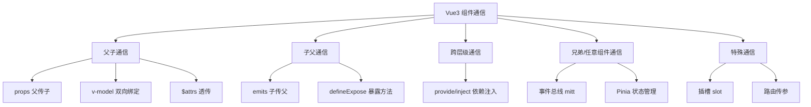

# Vue3 组件通信全方案

> **文档说明**：系统讲解 Vue3 组件通信的全部方案，包括父子通信（props/emits）、子父通信（emits）、v-model 语法糖、跨层级通信（provide/inject）、兄弟组件通信（事件总线/Pinia）、插槽通信、暴露方法（defineExpose）、透传 Attributes（$attrs）、Pinia 状态管理，以及各方案的适用场景和选型指南。
>
> **适用人群**：前端开发工程师、全栈开发者、使用 Vue3 构建复杂应用的工程师
>
> **前置知识**：[[Vue3-组合式API设计模式]]、[[Vue3-响应式原理Proxy]]、[[Vue3-自定义Hooks封装]]

---

## 一、概述

### 1. 组件通信的重要性

Vue 是组件化框架，组件是独立的功能单元，但组件之间需要共享数据和交互。组件通信是 Vue 开发中最基础也最重要的概念之一，合理选择通信方案直接影响代码的可维护性和可扩展性。

### 2. 通信方案总览



### 3. 通信方案选型

| 场景 | 推荐方案 | 原因 |
|------|---------|------|
| 父 → 子传数据 | props | 单向数据流，清晰明确 |
| 子 → 父通知事件 | emits | 事件驱动，父组件决定如何处理 |
| 表单双向绑定 | v-model | 语法糖，简化 props+emits |
| 跨层级传数据 | provide/inject | 不需逐层传递，祖先直接注入后代 |
| 兄弟组件通信 | Pinia / 事件总线 | 共享状态或事件通知 |
| 复杂全局状态 | Pinia | 集中式状态管理，响应式、可持久化 |
| 父调用子方法 | defineExpose | 子组件暴露方法/属性给父组件 |
| DOM 属性透传 | $attrs | 自动透传 class/style/事件等 |
| 内容分发 | 插槽 slot | 父组件向子组件传递模板内容 |
| 页面间传参 | 路由 query/params | 页面级数据传递 |

---

## 二、父子通信：props

### 1. 基本用法

```vue
<!-- 父组件 Parent.vue -->
<template>
  <Child
    :title="pageTitle"
    :count="count"
    :user-info="userInfo"
    :list="itemList"
    disabled
  />
</template>

<script setup lang="ts">
import { ref, reactive } from 'vue'
import Child from './Child.vue'

const pageTitle = ref('首页')
const count = ref(0)
const userInfo = reactive({ name: '张三', age: 25 })
const itemList = ref([1, 2, 3])
</script>
```

```vue
<!-- 子组件 Child.vue -->
<template>
  <div>
    <h2>{{ title }}</h2>
    <p>计数: {{ count }}</p>
    <p>用户: {{ userInfo?.name }} - {{ userInfo?.age }}</p>
    <ul>
      <li v-for="item in list" :key="item">{{ item }}</li>
    </ul>
    <p v-if="disabled">已禁用</p>
  </div>
</template>

<script setup lang="ts">
// 方式1：数组声明（简单）
// const props = defineProps(['title', 'count', 'userInfo', 'list', 'disabled'])

// 方式2：对象声明（带类型和默认值，推荐）
const props = defineProps({
  title: {
    type: String,
    required: true,           // 必填
    default: '默认标题'        // 默认值
  },
  count: {
    type: Number,
    default: 0
  },
  userInfo: {
    type: Object,
    // 对象/数组的默认值必须用函数返回
    default: () => ({ name: '未知', age: 0 })
  },
  list: {
    type: Array,
    default: () => []
  },
  disabled: {
    type: Boolean,
    default: false
  }
})

// 访问 props
console.log(props.title)
</script>
```

### 2. TypeScript 类型声明

```vue
<script setup lang="ts">
// 方式1：使用类型声明（推荐，类型安全）
interface UserInfo {
  name: string
  age: number
}

const props = defineProps<{
  title: string
  count?: number              // 可选属性
  userInfo: UserInfo
  list: number[]
  disabled?: boolean
}>()

// 方式2：使用 withDefaults 设置默认值
const props = withDefaults(defineProps<{
  title: string
  count?: number
  userInfo?: UserInfo
  list?: number[]
  disabled?: boolean
}>(), {
  count: 0,
  userInfo: () => ({ name: '未知', age: 0 }),
  list: () => [],
  disabled: false
})
</script>
```

### 3. 单向数据流

Vue 遵循**单向数据流**原则：父组件通过 props 传递数据给子组件，子组件不能直接修改 props，只能通过 emit 事件通知父组件修改。

```vue
<!-- 错误：子组件直接修改 props -->
<script setup>
const props = defineProps(['count'])
props.count++  // ❌ 报错：Cannot assign to 'count' because it is a read-only property
</script>

<!-- 正确：通过 emit 通知父组件修改 -->
<script setup>
const props = defineProps(['count'])
const emit = defineEmits(['update:count'])

function increment() {
  emit('update:count', props.count + 1)  // ✅ 通知父组件
}
</script>
```

### 4. props 校验

```vue
<script setup>
defineProps({
  // 基础类型
  name: String,
  age: [Number, String],  // 允许多种类型

  // 必填 + 类型
  email: {
    type: String,
    required: true
  },

  // 带默认值
  status: {
    type: String,
    default: 'active',
    validator: (value: string) => {  // 自定义校验
      return ['active', 'inactive', 'pending'].includes(value)
    }
  },

  // 对象默认值
  config: {
    type: Object,
    default: () => ({ theme: 'light', language: 'zh-CN' })
  }
})
</script>
```

---

## 三、子父通信：emits

### 1. 基本用法

```vue
<!-- 子组件 Child.vue -->
<template>
  <button @click="handleClick">点击我</button>
  <input :value="text" @input="handleInput" />
</template>

<script setup lang="ts">
// 方式1：数组声明
// const emit = defineEmits(['click', 'update:text', 'submit'])

// 方式2：对象声明（带类型，推荐）
const emit = defineEmits<{
  (e: 'click', value: string): void
  (e: 'update:text', value: string): void
  (e: 'submit', data: { name: string; age: number }): void
}>()

function handleClick() {
  emit('click', '按钮被点击了')
}

function handleInput(e: Event) {
  emit('update:text', (e.target as HTMLInputElement).value)
}
</script>
```

```vue
<!-- 父组件 Parent.vue -->
<template>
  <Child
    @click="handleChildClick"
    @update:text="text = $event"
    @submit="handleSubmit"
  />
</template>

<script setup lang="ts">
import { ref } from 'vue'
import Child from './Child.vue'

const text = ref('')

function handleChildClick(value: string) {
  console.log('子组件点击:', value)
}

function handleSubmit(data: { name: string; age: number }) {
  console.log('提交数据:', data)
}
</script>
```

### 2. 事件名规范

- Vue 推荐使用 **camelCase** 声明事件，模板中使用 **kebab-case** 监听
- 事件名应是动词或动词短语，如 `click`、`submit`、`update:modelValue`
- 对于更新类事件，使用 `update:propName` 命名（配合 v-model）

---

## 四、v-model 双向绑定

### 1. 基本用法

v-model 是 props + emits 的语法糖，默认对应 `modelValue` prop 和 `update:modelValue` 事件。

```vue
<!-- 子组件 MyInput.vue -->
<template>
  <input
    :value="modelValue"
    @input="emit('update:modelValue', ($event.target as HTMLInputElement).value)"
  />
</template>

<script setup lang="ts">
const props = defineProps<{
  modelValue: string
}>()
const emit = defineEmits<{
  (e: 'update:modelValue', value: string): void
}>()
</script>
```

```vue
<!-- 父组件使用 -->
<template>
  <MyInput v-model="username" />
  <!-- 等价于 -->
  <MyInput
    :modelValue="username"
    @update:modelValue="username = $event"
  />
</template>
```

```text
### 2. 多个 v-model
```

Vue3 支持一个组件上使用多个 v-model：

```vue
<!-- 子组件 UserForm.vue -->
<script setup lang="ts">
const props = defineProps<{
  name: string
  age: number
}>()
const emit = defineEmits<{
  (e: 'update:name', value: string): void
  (e: 'update:age', value: number): void
}>()
</script>

<template>
  <input :value="name" @input="emit('update:name', ($event.target as HTMLInputElement).value)" />
  <input
    type="number"
    :value="age"
    @input="emit('update:age', Number(($event.target as HTMLInputElement).value))"
  />
</template>
```

```vue
<!-- 父组件 -->
<template>
  <UserForm v-model:name="userName" v-model:age="userAge" />
</template>
```

### 3. 自定义 v-model 修饰符

```vue
<script setup lang="ts">
const props = defineProps<{
  modelValue: string
  modelModifiers?: { capitalize?: boolean }
}>()
const emit = defineEmits<{
  (e: 'update:modelValue', value: string): void
}>()

function handleInput(value: string) {
  if (props.modelModifiers?.capitalize) {
    value = value.charAt(0).toUpperCase() + value.slice(1)
  }
  emit('update:modelValue', value)
}
</script>

<!-- 使用 -->
<MyInput v-model.capitalize="text" />
```

---

## 五、跨层级通信：provide/inject

### 1. 基本用法

provide/inject 允许祖先组件向所有后代组件传递数据，不需逐层传递 props。

```vue
<!-- 祖先组件 GrandParent.vue -->
<script setup lang="ts">
import { provide, ref, reactive } from 'vue'

// 提供静态值
provide('theme', 'dark')

// 提供响应式数据
const user = reactive({ name: '张三', age: 25 })
provide('user', user)

// 提供方法
function updateUser(name: string) {
  user.name = name
}
provide('updateUser', updateUser)

// 提供 Symbol key（避免命名冲突，推荐）
const AppKey = Symbol('app')
provide(AppKey, { theme: 'dark', version: '1.0.0' })
</script>
```

```vue
<!-- 后代组件（可以是任意层级的子组件）Child.vue -->
<script setup lang="ts">
import { inject } from 'vue'

// 注入值
const theme = inject<string>('theme')
const user = inject<{ name: string; age: number }>('user')
const updateUser = inject<(name: string) => void>('updateUser')

// 注入带默认值
const fallback = inject<string>('not-exist', '默认值')

// 使用 Symbol key
const AppKey = Symbol('app')  // 需与 provide 时的 Symbol 相同（通常单独导出）
const app = inject(AppKey)

// 修改响应式数据（后代可直接修改，不推荐，应通过方法修改）
// user.name = '李四'  // ❌ 不推荐，数据流不清晰
updateUser?.('李四')  // ✅ 通过方法修改
</script>
```

### 2. 响应式 provide

```vue
<script setup lang="ts">
import { provide, ref, readonly } from 'vue'

const count = ref(0)

// 提供只读的响应式数据（防止后代直接修改）
provide('count', readonly(count))

// 提供修改方法
provide('increment', () => count.value++)
provide('decrement', () => count.value--)
</script>
```

### 3. provide/inject vs props

| 维度 | props | provide/inject |
|------|-------|----------------|
| **传递层级** | 只能父子直接传递 | 可跨任意层级 |
| **数据流** | 清晰，逐层传递 | 不清晰，难以追踪来源 |
| **响应式** | 自动响应式 | 需手动提供响应式数据 |
| **适用场景** | 父子组件数据传递 | 全局配置、主题、用户信息等 |
| **可维护性** | 高 | 中（过度使用难以追踪） |

> **注意**：provide/inject 应谨慎使用，过度使用会导致数据流难以追踪。全局状态优先使用 Pinia。

---

## 六、兄弟组件通信

### 1. 方案一：通过父组件中转

```vue
<!-- 父组件 Parent.vue -->
<template>
  <ChildA :data="sharedData" @update="handleUpdate" />
  <ChildB :data="sharedData" />
</template>

<script setup lang="ts">
import { ref } from 'vue'
import ChildA from './ChildA.vue'
import ChildB from './ChildB.vue'

const sharedData = ref('共享数据')

function handleUpdate(value: string) {
  sharedData.value = value
}
</script>
```

### 2. 方案二：事件总线（mitt）

```bash
# 安装 mitt
npm install mitt
```

```typescript
// eventBus.ts
import mitt from 'mitt'

// 定义事件类型
type Events = {
  'user:login': { userId: string; token: string }
  'user:logout': void
  'cart:update': { count: number }
  'message:show': { text: string; type: 'success' | 'error' }
}

export const eventBus = mitt<Events>()
```

```vue
<!-- 组件 A：发送事件 -->
<script setup lang="ts">
import { eventBus } from './eventBus'

function login() {
  eventBus.emit('user:login', { userId: '123', token: 'abc' })
}
</script>
```

```vue
<!-- 组件 B：监听事件 -->
<script setup lang="ts">
import { onMounted, onUnmounted } from 'vue'
import { eventBus } from './eventBus'

function handleLogin(data: { userId: string; token: string }) {
  console.log('用户登录:', data.userId)
}

onMounted(() => {
  eventBus.on('user:login', handleLogin)
})

onUnmounted(() => {
  // 组件卸载时移除监听，防止内存泄漏
  eventBus.off('user:login', handleLogin)
})
</script>
```

**事件总线优缺点**：
| 优点 | 缺点 |
|------|------|
| 简单轻量，任意组件通信 | 事件难以追踪，调试困难 |
| 解耦组件 | 命名冲突风险 |
| 适合简单事件通知 | 不适合复杂状态共享 |
| | 需手动管理监听/移除 |

### 3. 方案三：Pinia 状态管理（推荐）

```typescript
// stores/user.ts
import { defineStore } from 'pinia'
import { ref, computed } from 'vue'

export const useUserStore = defineStore('user', () => {
  // 状态
  const userInfo = ref({ name: '', age: 0 })
  const token = ref('')

  // 计算属性
  const isLoggedIn = computed(() => !!token.value)

  // 方法
  function login(data: { name: string; token: string }) {
    userInfo.value.name = data.name
    token.value = data.token
  }

  function logout() {
    userInfo.value = { name: '', age: 0 }
    token.value = ''
  }

  return { userInfo, token, isLoggedIn, login, logout }
})
```

```vue
<!-- 任意组件使用 -->
<script setup lang="ts">
import { useUserStore } from '@/stores/user'

const userStore = useUserStore()

// 读取状态
console.log(userStore.userInfo.name)
console.log(userStore.isLoggedIn)

// 调用方法
userStore.login({ name: '张三', token: 'abc123' })
</script>
```

---

## 七、特殊通信方式

### 1. defineExpose：父调用子方法

```vue
<!-- 子组件 Child.vue -->
<script setup lang="ts">
import { ref } from 'vue'

const count = ref(0)

function increment() {
  count.value++
}

function reset() {
  count.value = 0
}

// 暴露给父组件的属性和方法
defineExpose({
  count,
  increment,
  reset
})
</script>
```

```vue
<!-- 父组件 Parent.vue -->
<template>
  <Child ref="childRef" />
  <button @click="handleIncrement">调用子组件方法</button>
  <button @click="handleReset">重置</button>
</template>

<script setup lang="ts">
import { ref } from 'vue'
import Child from './Child.vue'

// 子组件实例类型
const childRef = ref<InstanceType<typeof Child>>()

function handleIncrement() {
  childRef.value?.increment()
  console.log(childRef.value?.count)  // 访问子组件暴露的属性
}

function handleReset() {
  childRef.value?.reset()
}
</script>
```

### 2. $attrs：透传 Attributes

$attrs 包含父组件传递的、未被 props 声明的属性和事件（class、style、事件监听器等）。

```vue
<!-- 子组件 Child.vue -->
<template>
  <!-- 自动透传所有 attrs 到根元素 -->
  <div class="child">
    <input v-bind="$attrs" />  <!-- 手动透传到指定元素 -->
  </div>
</template>

<script setup lang="ts">
// 禁用自动透传（默认根元素自动透传）
// defineOptions({ inheritAttrs: false })

// 访问 attrs
const attrs = useAttrs()
console.log(attrs.placeholder)
console.log(attrs.class)
</script>
```

```vue
<!-- 父组件 -->
<template>
  <Child
    placeholder="请输入"
    class="custom-input"
    @focus="handleFocus"
    @blur="handleBlur"
  />
</template>
```

### 3. 插槽（slot）：内容分发

```vue
<!-- 子组件 Card.vue -->
<template>
  <div class="card">
    <!-- 默认插槽 -->
    <div class="card-header">
      <slot name="header">默认标题</slot>
    </div>

    <!-- 具名插槽 -->
    <div class="card-body">
      <slot />  <!-- 默认插槽（等价于 <slot name="default" />） -->
    </div>

    <!-- 作用域插槽：子组件向父组件传递数据 -->
    <div class="card-footer">
      <slot name="footer" :item="item" :index="index">
        默认底部内容
      </slot>
    </div>
  </div>
</template>

<script setup lang="ts">
import { ref } from 'vue'
const item = ref({ id: 1, name: '测试' })
const index = ref(0)
</script>
```

```vue
<!-- 父组件使用 -->
<template>
  <Card>
    <!-- 具名插槽 -->
    <template #header>
      <h2>自定义标题</h2>
    </template>

    <!-- 默认插槽 -->
    <p>这是卡片内容</p>

    <!-- 作用域插槽：接收子组件传递的数据 -->
    <template #footer="{ item, index }">
      <span>第 {{ index }} 项: {{ item.name }}</span>
    </template>
  </Card>
</template>
```

### 4. 路由传参

```typescript
// 路由配置
const routes = [
  {
    path: '/user/:id',  // 动态路由参数
    component: () => import('@/views/User.vue')
  }
]

// 跳转并传参
import { useRouter } from 'vue-router'
const router = useRouter()

// 方式1：params（URL 路径参数，如 /user/123）
router.push({ name: 'user', params: { id: 123 } })

// 方式2：query（URL 查询参数，如 /user?id=123）
router.push({ path: '/user', query: { id: 123 } })

// 接收参数
import { useRoute } from 'vue-router'
const route = useRoute()
console.log(route.params.id)  // params
console.log(route.query.id)   // query
```

---

## 八、Pinia 深度使用

### 1. Store 定义方式

```typescript
// 方式1：选项式（Options API 风格）
export const useCounterStore = defineStore('counter', {
  state: () => ({
    count: 0
  }),
  getters: {
    doubleCount: (state) => state.count * 2
  },
  actions: {
    increment() {
      this.count++
    }
  }
})

// 方式2：组合式（Setup 风格，推荐）
export const useCounterStore = defineStore('counter', () => {
  const count = ref(0)
  const doubleCount = computed(() => count.value * 2)

  function increment() {
    count.value++
  }

  return { count, doubleCount, increment }
})
```

### 2. 组件中使用

```vue
<script setup lang="ts">
import { useCounterStore } from '@/stores/counter'
import { storeToRefs } from 'pinia'

const counterStore = useCounterStore()

// 方式1：直接使用（失去响应式，不推荐）
// const count = counterStore.count

// 方式2：使用 storeToRefs（保持响应式，推荐）
const { count, doubleCount } = storeToRefs(counterStore)
const { increment } = counterStore  // 方法直接解构
</script>

<template>
  <div>
    <p>计数: {{ count }}</p>
    <p>双倍: {{ doubleCount }}</p>
    <button @click="increment">+1</button>
  </div>
</template>
```

### 3. 持久化插件

```bash
npm install pinia-plugin-persistedstate
```

```typescript
// main.ts
import { createPinia } from 'pinia'
import piniaPluginPersistedstate from 'pinia-plugin-persistedstate'

const pinia = createPinia()
pinia.use(piniaPluginPersistedstate)
```

```typescript
// store 中启用持久化
export const useUserStore = defineStore('user', () => {
  const token = ref('')
  const userInfo = ref({ name: '' })
  return { token, userInfo }
}, {
  persist: {
    key: 'app-user',           // localStorage key
    storage: localStorage,      // 存储方式（localStorage/sessionStorage）
    paths: ['token']            // 只持久化指定字段
  }
})
```

---

## 九、最佳实践

### 1. 通信方案选择原则

- [ ] **优先 props/emits**：父子组件通信首选，数据流清晰
- [ ] **v-model 用于表单**：双向绑定场景使用 v-model
- [ ] **provide/inject 用于全局配置**：主题、语言、用户信息等跨层级数据
- [ ] **Pinia 用于全局状态**：复杂的、多组件共享的状态
- [ ] **事件总线用于简单事件**：解耦的、一次性的事件通知
- [ ] **defineExpose 用于方法调用**：父组件需要调用子组件方法时
- [ ] **避免过度使用 provide/inject**：会导致数据流难以追踪

### 2. 命名规范

- [ ] **props**：使用 camelCase，模板中使用 kebab-case
- [ ] **emits**：使用 camelCase，动词或动词短语
- [ ] **v-model**：`update:propName` 命名
- [ ] **provide/inject**：使用 Symbol 或唯一字符串，避免命名冲突
- [ ] **Pinia store**：`useXxxStore` 命名，id 使用小驼峰

### 3. 性能优化

- [ ] **props 解构保持响应式**：使用 `toRefs(props)` 或直接使用 `props.xxx`
- [ ] **避免大对象 props**：大对象传递会增加响应式开销，考虑拆分或使用 provide
- [ ] **事件监听及时清理**：事件总线在组件卸载时移除监听
- [ ] **Pinia 按需导入**：使用 `storeToRefs` 只解构需要的状态
- [ ] **合理使用 shallowRef**：大对象不需要深度响应式时使用 shallowRef

---

## 十、常见问题与排查

| 问题 | 原因 | 解决方案 |
|------|------|---------|
| **props 修改报错** | 子组件直接修改 props（只读） | 通过 emit 通知父组件修改，遵循单向数据流 |
| **props 默认值不生效** | 对象/数组默认值未用函数返回 | 对象/数组默认值必须用 `() => ({})` / `() => []` |
| **emit 事件不触发** | 事件名不匹配 / 未声明 emits | 检查事件名大小写、在 defineEmits 中声明 |
| **v-model 不生效** | prop 名不是 modelValue / 事件名不是 update:modelValue | 检查 prop 和事件命名，或使用 v-model:xxx |
| **provide/inject 取不到值** | 层级不对 / key 不匹配 / 未在祖先 provide | 检查组件层级、使用相同的 key、确保祖先已 provide |
| **provide 数据不响应式** | provide 的是非响应式数据 | provide ref/reactive 包装的响应式数据 |
| **事件总线内存泄漏** | 组件卸载未移除监听 | onUnmounted 中调用 eventBus.off 移除监听 |
| **Pinia 状态不更新** | 直接解构失去响应式 / 未在 actions 中修改 | 使用 storeToRefs 解构、在 actions 中修改状态 |
| **defineExpose 取不到方法** | 未暴露 / ref 类型错误 / 异步组件未加载 | 检查 defineExpose、使用 InstanceType、确保组件已加载 |
| **$attrs 不包含事件** | 事件已被 emits 声明 | emits 声明的事件不会出现在 $attrs 中 |
| **插槽内容不显示** | 插槽名不匹配 / 作用域插槽参数错误 | 检查插槽名、作用域插槽的参数解构 |
| **兄弟组件通信困难** | 没有合适的通信方案 | 简单场景用父组件中转，复杂场景用 Pinia |
| **跨组件状态混乱** | 滥用 provide/inject / 事件总线 | 统一使用 Pinia 管理全局状态，数据流清晰 |
| **TypeScript 类型错误** | props/emits 未声明类型 | 使用 TypeScript 类型声明 defineProps/defineEmits |

---

## 十一、关联笔记

### Vue3 生态
- [[Vue3-组合式API设计模式]] · [[Vue3-响应式原理Proxy]] · [[Vue3-自定义Hooks封装]]
- [[Vue3-性能优化实战]] · [[Vue3-组件库设计与发布]] · [[Vue3-路由与状态管理]]
- [[Pinia-状态管理核心]]

### 前端工程化
- [[前端工程化知识点系统梳理_优化版]] · [[Vite-构建原理与插件开发]] · [[TypeScript-类型系统进阶]]
- [[组件库设计与发布]]

### 前端框架
- [[React-Hooks核心原理与实战]] · [[React-状态管理方案对比]] · [[Svelte-响应式框架入门]]

### 导航
- [[MOC-前端开发]] · [[MOC-Vue3TS-四级展开]] · [[全栈+AI工程双轨融合学习路线图]]

> **学习路径建议**：先掌握 [[Vue3-组合式API设计模式]] 组合式 API 基础 → 学习 [[Vue3-响应式原理Proxy]] 响应式原理 → 深入本文组件通信全方案 → 实践 [[Vue3-自定义Hooks封装]] 逻辑复用 → 研究 [[Pinia-状态管理核心]] 状态管理 → 应用于复杂组件架构设计。
