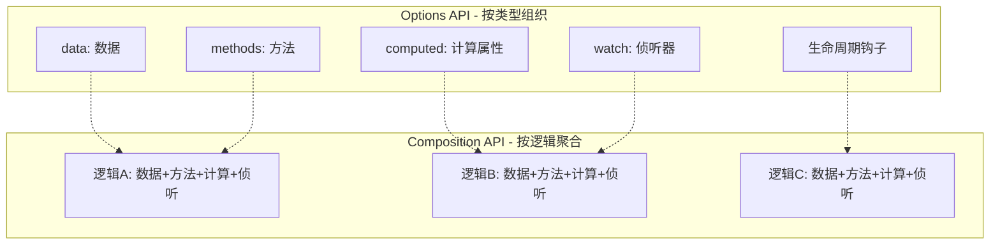

# Vue3 组合式 API 设计模式

> **文档说明**：系统讲解 Vue3 Composition API 的核心设计模式，包括 setup 语法、响应式 API、生命周期、自定义 Hooks 封装、以及与 Options API 的对比。
>
> **适用人群**：前端开发工程师、从 Vue2 迁移到 Vue3 的开发者
>
> **前置知识**：[[Vue3-响应式原理Proxy]]、[[TypeScript-类型系统进阶]]

---

## 一、概述

Vue3 的**组合式 API（Composition API）** 是一套全新的组件逻辑组织方式，通过 `setup` 函数将相关逻辑聚合在一起，解决了 Options API 在大型组件中逻辑分散、代码复用困难的问题。

### 1. Options API vs Composition API

| 维度 | Options API | Composition API |
|------|------------|----------------|
| 组织方式 | 按选项类型（data/methods/computed） | 按逻辑功能聚合 |
| 代码复用 | mixins（命名冲突、来源不清晰） | 自定义 Hooks（清晰、类型安全） |
| TypeScript | 支持较差（this 类型推断问题） | 原生支持，类型推断优秀 |
| 打包优化 | 难以 tree-shaking | 函数式 API，可 tree-shaking |
| 学习曲线 | 简单直观 | 初期需要理解响应式原理 |
| 适用场景 | 中小型组件 | 大型复杂组件、逻辑复用 |



### 2. 核心 API 速览

| API | 作用 | 返回值 |
|-----|------|--------|
| `ref()` | 创建响应式基本类型 | Ref 对象，通过 `.value` 访问 |
| `reactive()` | 创建响应式对象 | 响应式 Proxy 对象 |
| `computed()` | 创建计算属性 | 只读 Ref |
| `watch()` | 侦听数据变化 | 停止侦听函数 |
| `watchEffect()` | 自动追踪依赖的副作用 | 停止侦听函数 |
| `onMounted()` 等 | 生命周期钩子 | - |
| `provide()` / `inject()` | 跨层级传值 | - |

---

## 二、核心用法

### 1. setup 语法糖（推荐）

```vue
<script setup lang="ts">
import { ref, reactive, computed, onMounted } from 'vue'

// 1. 响应式数据
const count = ref(0)                    // 基本类型用 ref
const user = reactive({ name: '张三', age: 25 })  // 对象用 reactive

// 2. 计算属性
const doubleCount = computed(() => count.value * 2)
const isAdult = computed(() => user.age >= 18)

// 3. 方法
function increment() {
  count.value++
}
function updateAge(newAge: number) {
  user.age = newAge
}

// 4. 生命周期
onMounted(() => {
  console.log('组件已挂载', count.value)
})

// 5. defineProps / defineEmits（编译器宏，无需导入）
const props = defineProps<{
  title: string
  visible?: boolean
}>()
const emit = defineEmits<{
  (e: 'update', value: number): void
  (e: 'close'): void
}>()
</script>

<template>
  <div>
    <h1>{{ props.title }}</h1>
    <p>计数：{{ count }}（双倍：{{ doubleCount }}）</p>
    <p>用户：{{ user.name }}，{{ user.age }}岁，{{ isAdult ? '成年' : '未成年' }}</p>
    <button @click="increment">增加</button>
    <button @click="emit('update', count)">更新</button>
  </div>
</template>
```

### 2. ref vs reactive 选择指南

| 场景 | 推荐 | 原因 |
|------|------|------|
| 基本类型（string/number/boolean） | `ref` | reactive 不支持基本类型 |
| 对象/数组 | `reactive` 或 `ref` | reactive 更直观，ref 需要 `.value` |
| 需要替换整个对象 | `ref` | reactive 替换会丢失响应式 |
| 函数返回响应式数据 | `ref` | 更安全，避免解构丢失响应式 |

```typescript
// ref 的 .value 自动解包场景
// 1. 模板中自动解包（不需要 .value）
// <p>{{ count }}</p>  ✅ 自动解包

// 2. reactive 对象中的 ref 自动解包
const state = reactive({ count: ref(0) })
state.count  // ✅ 自动解包，无需 .value

// 3. 从 reactive 解构会丢失响应式 → 用 toRefs
const { count } = state  // ❌ count 不是响应式
const { count } = toRefs(state)  // ✅ count 是 Ref，保持响应式
```

### 3. watch vs watchEffect

```typescript
import { ref, watch, watchEffect } from 'vue'

const userId = ref(1)
const userData = ref(null)

// watch：明确指定侦听源，回调可获取新旧值
watch(userId, async (newId, oldId) => {
  console.log(`用户ID从 ${oldId} 变为 ${newId}`)
  userData.value = await fetchUser(newId)
}, { immediate: true, deep: false })

// watchEffect：自动追踪回调中使用的所有响应式依赖
watchEffect(async () => {
  // 自动追踪 userId.value 的变化
  userData.value = await fetchUser(userId.value)
})

// 侦听多个源
watch([userId, userData], ([newId, newData], [oldId, oldData]) => {
  console.log('ID或数据变化了')
})

// 深度侦听（对象/数组）
const form = reactive({ name: '', email: '' })
watch(() => form, (newForm) => {
  console.log('表单变化', newForm)
}, { deep: true })
```

| 特性 | watch | watchEffect |
|------|-------|-------------|
| 依赖追踪 | 手动指定 | 自动追踪 |
| 获取旧值 | ✅ | ❌ |
| 立即执行 | 需 `immediate: true` | 默认立即执行 |
| 适用场景 | 需要旧值、条件侦听 | 副作用自动执行 |

---

## 三、自定义 Hooks 设计模式

### 1. 什么是自定义 Hooks

自定义 Hooks 是将可复用逻辑封装为以 `use` 开头的函数，是 Composition API 最重要的代码复用方式。

```typescript
// useCounter.ts - 最简单的 Hook
import { ref, computed } from 'vue'

export function useCounter(initialValue = 0) {
  const count = ref(initialValue)
  const double = computed(() => count.value * 2)

  function increment() { count.value++ }
  function decrement() { count.value-- }
  function reset() { count.value = initialValue }

  return { count, double, increment, decrement, reset }
}

// 组件中使用
<script setup lang="ts">
import { useCounter } from './useCounter'
const { count, double, increment, decrement } = useCounter(10)
</script>
```

### 2. 常用 Hooks 模式

#### 2.1 useFetch：数据请求 Hook

```typescript
// useFetch.ts
import { ref, shallowRef } from 'vue'

interface UseFetchOptions<T> {
  immediate?: boolean
  initialData?: T
  onSuccess?: (data: T) => void
  onError?: (error: Error) => void
}

export function useFetch<T>(
  url: string | (() => string),
  options: UseFetchOptions<T> = {}
) {
  const { immediate = true, initialData, onSuccess, onError } = options
  const data = shallowRef<T | undefined>(initialData)
  const error = ref<Error | null>(null)
  const loading = ref(false)

  async function execute() {
    loading.value = true
    error.value = null
    try {
      const requestUrl = typeof url === 'function' ? url() : url
      const response = await fetch(requestUrl)
      if (!response.ok) throw new Error(`HTTP ${response.status}`)
      const result = await response.json()
      data.value = result
      onSuccess?.(result)
    } catch (e) {
      error.value = e as Error
      onError?.(e as Error)
    } finally {
      loading.value = false
    }
  }

  if (immediate) execute()
  return { data, error, loading, execute, refresh: execute }
}
```

#### 2.2 useDebounce：防抖 Hook

```typescript
// useDebounce.ts
import { ref, watch, type Ref } from 'vue'

export function useDebounce<T>(source: Ref<T>, delay = 300) {
  const debounced = ref(source.value) as Ref<T>
  let timer: ReturnType<typeof setTimeout>

  watch(source, (value) => {
    clearTimeout(timer)
    timer = setTimeout(() => {
      debounced.value = value
    }, delay)
  })

  return debounced
}

// 使用：搜索框防抖
const searchText = ref('')
const debouncedSearch = useDebounce(searchText, 500)
watch(debouncedSearch, (text) => {
  if (text) searchAPI(text)
})
```

#### 2.3 useMouse：鼠标位置 Hook

```typescript
// useMouse.ts
import { ref, onMounted, onUnmounted } from 'vue'

export function useMouse() {
  const x = ref(0)
  const y = ref(0)

  function update(event: MouseEvent) {
    x.value = event.pageX
    y.value = event.pageY
  }

  onMounted(() => window.addEventListener('mousemove', update))
  onUnmounted(() => window.removeEventListener('mousemove', update))

  return { x, y }
}
```

### 3. Hooks 设计最佳实践

| 原则 | 说明 | 反例 |
|------|------|------|
| 单一职责 | 一个 Hook 只做一件事 | `useUserAndAuthAndTheme` |
| 命名规范 | `use` + 名词/动词 | `fetchData`（应为 `useFetch`） |
| 返回对象 | 返回响应式引用和方法 | 返回普通值（丢失响应式） |
| 清理副作用 | onUnmounted 中清理事件监听/定时器 | 只添加不清理 → 内存泄漏 |
| 类型安全 | 完整的 TypeScript 类型定义 | `any` 满天飞 |
| 可配置 | 通过参数配置行为 | 硬编码 URL/延迟时间 |

---

## 四、高级模式

### 1. 依赖注入（Provide / Inject）

```typescript
// 父组件：提供依赖
<script setup lang="ts">
import { provide, ref, readonly } from 'vue'

const theme = ref('light')
function toggleTheme() {
  theme.value = theme.value === 'light' ? 'dark' : 'light'
}
// 使用 readonly 防止子组件直接修改
provide('theme', readonly(theme))
provide('toggleTheme', toggleTheme)
</script>

// 任意层级子组件：注入依赖
<script setup lang="ts">
import { inject } from 'vue'
const theme = inject('theme')  // Ref<string>
const toggleTheme = inject<() => void>('toggleTheme')
</script>
```

### 2. 自定义指令

```typescript
// directives/vFocus.ts
export const vFocus = {
  mounted(el: HTMLElement) {
    el.focus()
  }
}

// directives/vLazy.ts - 图片懒加载
export const vLazy = {
  mounted(el: HTMLImageElement, binding: { value: string }) {
    const observer = new IntersectionObserver(([entry]) => {
      if (entry.isIntersecting) {
        el.src = binding.value
        observer.unobserve(el)
      }
    })
    observer.observe(el)
  }
}

// 使用
<template>
  <input v-focus />
  
</template>
```

### 3. 插件封装

```typescript
// plugins/i18n.ts
import type { App } from 'vue'

const i18n = {
  locale: ref('zh'),
  messages: {
    zh: { hello: '你好' },
    en: { hello: 'Hello' },
  },
  t(key: string) {
    return this.messages[this.locale.value]?.[key] || key
  },
}

export default {
  install(app: App) {
    app.config.globalProperties.$t = i18n.t.bind(i18n)
    app.provide('i18n', i18n)
  },
}
```

---

## 五、常见问题与排查

| 问题 | 原因 | 解决方案 |
|------|------|---------|
| 数据修改后视图不更新 | 用 `let` 而非 `ref`/`reactive` | 确保使用响应式 API |
| `ref` 在模板中需要 `.value` | 非顶层 ref（如在对象中） | 顶层 ref 自动解包，嵌套的需要 `.value` |
| 解构 props 丢失响应式 | 直接解构 props 对象 | 使用 `toRefs(props)` 或直接 `props.xxx` |
| `reactive` 替换整个对象失效 | 重新赋值丢失 Proxy | 用 `Object.assign` 或改用 `ref` |
| `watch` 不触发 | 侦听的是 getter 返回的新对象 | 用 `() => obj.field` 或 `deep: true` |
| 内存泄漏 | 事件监听/定时器未清理 | 在 `onUnmounted` 中清理 |

---

## 六、关联笔记

### Vue3 核心
- [[Vue3-响应式原理Proxy]] · [[Vue3-自定义Hooks封装]] · [[Vue3-组件通信全方案]]
- [[Vue3-Teleport与Suspense]] · [[Vue3-编译优化与PatchFlags]] · [[Pinia-状态管理核心]]
- [[VueRouter-动态路由与权限]] · [[VueUse-工具函数库]]

### 前端工程化
- [[Vite-构建原理与插件开发]] · [[TypeScript-类型系统进阶]] · [[组件库设计与发布]]

### AI 前端集成
- [[SSE-流式响应对接LLM]] · [[对话式UI组件设计]] · [[Markdown渲染与代码高亮]]

### 导航
- [[MOC-前端开发]] · [[全栈+AI工程双轨融合学习路线图]]

> **学习路径建议**：先理解 [[Vue3-响应式原理Proxy]] → 掌握本文 Composition API 和 Hooks → 实践 [[Vue3-自定义Hooks封装]] 封装常用逻辑 → 学习 [[Pinia-状态管理核心]] 状态管理 → 研究 [[Vite-构建原理与插件开发]] 工程化。
