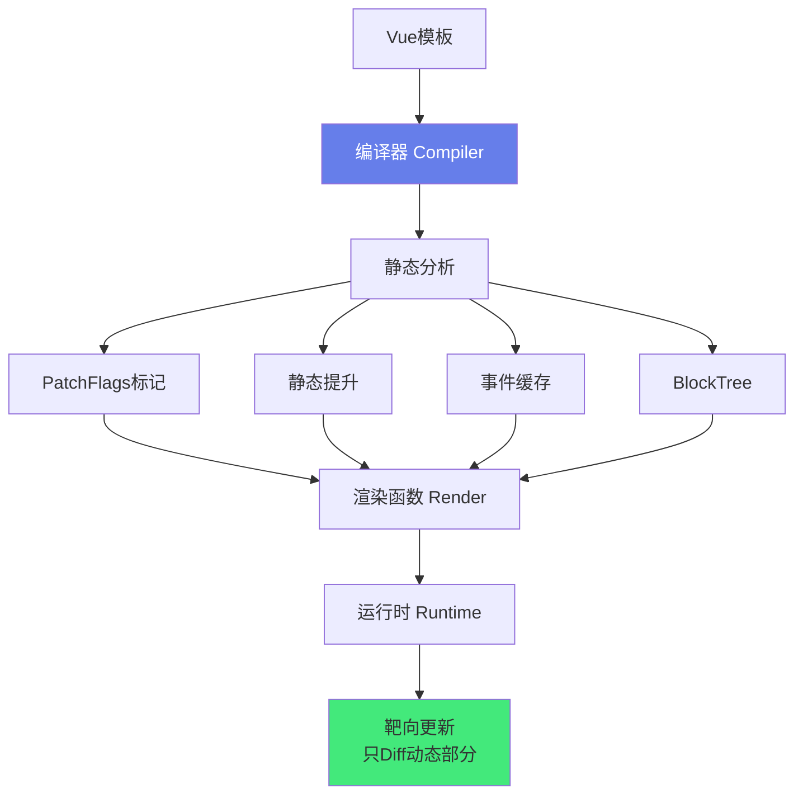
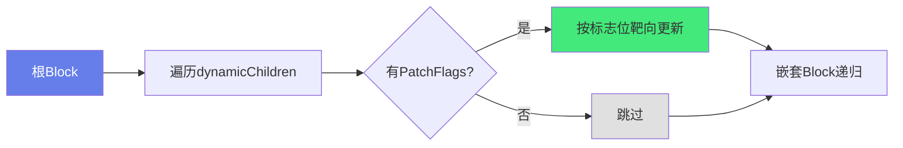

# ⚡ Vue3：编译优化与 PatchFlags

> **文档说明**：深入讲解 Vue3 编译器的核心优化策略与 PatchFlags 标志位系统，涵盖 Vue2 vs Vue3 Diff 算法差异（全量 Diff vs 靶向更新）、Vue3 编译时优化的整体设计思想（编译器与运行时协同/静态分析/动态标记）、PatchFlags 完整详解（TEXT/CLASS/STYLE/PROPS/FULL_PROPS/NEED_PATCH/EVENT/KEYED/DYNAMIC_SLOTS/HOISTED/BAIL 等标志位的含义与使用场景）、静态提升（Static Hoisting，将静态节点/静态属性提升到渲染函数外）、预字符串化（Stringify Static，连续静态节点合并为字符串）、事件处理函数缓存（Cache Event Handler，避免每次渲染创建新函数）、Block Tree（块树，将模板按动态结构切分为 Block，只收集动态子节点）、动态节点收集与靶向更新、运行时 Diff 如何利用 PatchFlags 实现快速路径、SSR 编译优化、v-once 与 v-memo 指令原理、Tree-shaking 与按需引入、如何在 Vue SFC Playground 查看编译结果、性能对比数据、常见问题与最佳实践。
>
> **适用人群**：中高级前端开发者、Vue3 源码学习者、性能优化工程师、框架爱好者
>
> **前置知识**：[[Vue3-响应式原理Proxy]] · [[Vue3-组合式API]]

---

## 一、概述

### 1.1 Vue3 编译优化的核心思想

Vue3 的核心性能突破在于**「编译时优化 + 运行时靶向更新」**——编译器在编译模板时静态分析模板，标记动态内容（PatchFlags），运行时根据标记只更新真正变化的部分，跳过静态内容的 Diff。



### 1.2 Vue2 vs Vue3 Diff 对比

| 维度 | Vue2 | Vue3 |
|------|------|------|
| **Diff 方式** | 全量 Diff 每个节点 | 靶向更新，只 Diff 动态节点 |
| **静态节点** | 每次渲染都参与 Diff | 静态提升，完全跳过 |
| **动态属性** | 全量比对属性 | PatchFlags 标记，只比对变化的属性 |
| **事件处理** | 每次创建新函数 | 事件缓存，复用同一函数 |
| **虚拟 DOM** | 完整 VNode 树 | Block Tree，只收集动态节点 |
| **性能** | O(n) 全量比对 | O(d) 动态节点数（d << n） |

> Vue3 的虚拟 DOM 更新速度比 Vue2 快 1.3-2 倍，内存占用减少约 50%。

---

## 二、PatchFlags 详解

### 2.1 什么是 PatchFlags

**PatchFlags** 是 Vue3 编译器在生成 VNode 时附加的**数字标志位**，告诉运行时这个节点有哪些动态内容，Diff 时只检查这些部分。

```typescript
// 源码：packages/shared/src/patchFlags.ts
export const enum PatchFlags {
  TEXT = 1,                    // 动态文本
  CLASS = 1 << 1,              // 2  动态 class
  STYLE = 1 << 2,              // 4  动态 style
  PROPS = 1 << 3,              // 8  动态属性（非 class/style）
  FULL_PROPS = 1 << 4,         // 16 完整属性（含动态 key）
  NEED_PATCH = 1 << 5,         // 32 需要更新（事件/指令）
  DYNAMIC_SLOTS = 1 << 6,      // 64 动态插槽
  HOISTED = -1,                // 静态提升节点
  BAIL = -2                    // 退出优化，全量 Diff
}
```

### 2.2 各标志位详解

#### TEXT（1）：动态文本

```vue
<template>
  <div>{{ count }}</div>
</template>
```

编译后：
```javascript
createVNode("div", null, ctx.count, PatchFlags.TEXT)
// 只更新文本内容，不检查属性
```

#### CLASS（2）：动态 class

```vue
<template>
  <div :class="{ active: isActive }">hello</div>
</template>
```

编译后：
```javascript
createVNode("div", { class: { active: ctx.isActive } }, "hello", PatchFlags.CLASS)
// 只比对 class，不检查 style 和其他属性
```

#### STYLE（4）：动态 style

```vue
<template>
  <div :style="{ color: textColor }">hello</div>
</template>
```

编译后：
```javascript
createVNode("div", { style: { color: ctx.textColor } }, "hello", PatchFlags.STYLE)
```

#### PROPS（8）：动态属性

```vue
<template>
  <input :value="text" :placeholder="placeholder" />
</template>
```

编译后：
```javascript
createVNode("input", {
  value: ctx.text,
  placeholder: ctx.placeholder
}, null, PatchFlags.PROPS, ["value", "placeholder"])
// 第四个参数是动态属性名数组，只比对这些属性
```

#### FULL_PROPS（16）：完整属性（动态 key）

```vue
<template>
  <div v-bind="dynamicProps">hello</div>
</template>
```

编译后：
```javascript
createVNode("div", ctx.dynamicProps, "hello", PatchFlags.FULL_PROPS)
// 属性 key 是动态的，无法预知，必须全量比对
```

#### NEED_PATCH（32）：需要更新（事件/指令）

```vue
<template>
  <div v-on="eventHandlers">hello</div>
</template>
```

编译后：
```javascript
createVNode("div", v-on="ctx.eventHandlers", "hello", PatchFlags.NEED_PATCH)
// 有事件绑定或自定义指令，需要更新
```

#### KEYED（可组合）：有 key 的 v-for

```vue
<template>
  <div v-for="item in list" :key="item.id">{{ item.name }}</div>
</template>
```

#### HOISTED（-1）：静态提升节点

```javascript
// 静态节点提升到渲染函数外
const _hoisted_1 = createVNode("div", null, "静态内容", PatchFlags.HOISTED)
// HOISTED 节点完全跳过 Diff
```

#### BAIL（-2）：退出优化

当编译器遇到无法静态分析的情况（如复杂的动态插槽、渲染函数），会设置 BAIL 标志，运行时退化为全量 Diff。

### 2.3 标志位组合

PatchFlags 是位标志，可以用按位或组合：

```typescript
// 同时有动态文本和动态 class
const flag = PatchFlags.TEXT | PatchFlags.CLASS  // 1 | 2 = 3

// 运行时检查
if (flag & PatchFlags.TEXT) {
  // 更新文本
}
if (flag & PatchFlags.CLASS) {
  // 更新 class
}
```

---

## 三、静态提升（Static Hoisting）

### 3.1 原理

将**完全静态的节点**（没有任何动态绑定）提升到渲染函数外部，只创建一次，后续渲染直接复用，不再参与 Diff。

### 3.2 示例

**优化前（Vue2 方式）**：
```javascript
function render() {
  return createVNode("div", null, [
    createVNode("span", null, "静态标题"),      // 每次都创建
    createVNode("p", null, "静态段落"),         // 每次都创建
    createVNode("div", null, ctx.count)        // 动态
  ])
}
```

**优化后（Vue3 静态提升）**：
```javascript
// 提升到渲染函数外，只创建一次
const _hoisted_1 = createVNode("span", null, "静态标题")
const _hoisted_2 = createVNode("p", null, "静态段落")

function render() {
  return createVNode("div", null, [
    _hoisted_1,    // 直接引用，不重新创建
    _hoisted_2,    // 直接引用
    createVNode("div", null, ctx.count, PatchFlags.TEXT)
  ])
}
```

### 3.3 静态属性提升

不仅静态节点可以提升，**静态属性**也可以提升：

```vue
<template>
  <div class="container" id="app" :title="dynamicTitle">hello</div>
</template>
```

编译后：
```javascript
const _hoisted_1 = { class: "container", id: "app" }  // 静态属性提升

function render() {
  return createVNode("div", 
    mergeProps(_hoisted_1, { title: ctx.dynamicTitle }),
    "hello",
    PatchFlags.PROPS, ["title"]
  )
}
```

---

## 四、预字符串化（Stringify Static）

### 4.1 原理

当有**连续的多个静态节点**时，Vue3 会将它们合并为一个静态字符串，用 `createStaticVNode` 创建，进一步减少 VNode 数量和 Diff 开销。

### 4.2 示例

```vue
<template>
  <div>
    <p>第一段静态文本</p>
    <p>第二段静态文本</p>
    <p>第三段静态文本</p>
    <div>{{ dynamicContent }}</div>
  </div>
</template>
```

编译后：
```javascript
// 连续静态节点合并为字符串
const _hoisted_1 = createStaticVNode(
  "<p>第一段静态文本</p><p>第二段静态文本</p><p>第三段静态文本</p>",
  3  // 包含的节点数
)

function render() {
  return createVNode("div", null, [
    _hoisted_1,
    createVNode("div", null, ctx.dynamicContent, PatchFlags.TEXT)
  ])
}
```

> 预字符串化的节点在运行时直接用 innerHTML 设置，完全不参与虚拟 DOM Diff。

---

## 五、事件处理函数缓存

### 5.1 原理

Vue2 中，每次渲染都会为事件绑定创建新的内联函数，导致子组件不必要的更新。Vue3 将事件处理函数**缓存**起来，复用同一函数引用。

### 5.2 示例

**优化前**：
```javascript
function render() {
  return createVNode("button", {
    onClick: () => ctx.handleClick()  // 每次渲染创建新函数
  })
}
```

**优化后（事件缓存）**：
```javascript
function render(_ctx, _cache) {
  return createVNode("button", {
    onClick: _cache[0] || (_cache[0] = (...args) => ctx.handleClick(...args))
    // 第一次创建后缓存，后续复用
  })
}
```

### 5.3 带参数的事件

```vue
<template>
  <button @click="handleClick(id)">点击</button>
</template>
```

编译后：
```javascript
function render(_ctx, _cache) {
  return createVNode("button", {
    onClick: _cache[0] || (_cache[0] = $event => ctx.handleClick(ctx.id, $event))
  })
}
```

> 事件缓存确保了即使父组件重新渲染，子组件的 props 引用不变，避免子组件不必要的更新。

---

## 六、Block Tree（块树）

### 6.1 原理

Vue3 将模板按**动态结构**（v-if/v-for/suspense 等）切分为多个 Block，每个 Block 维护一个**动态子节点数组（dynamicChildren）**，Diff 时只遍历这些动态节点，跳过静态节点。

### 6.2 示例

```vue
<template>
  <div>
    <header>静态头部</header>
    <main>
      <p v-if="show">条件内容</p>
      <ul>
        <li v-for="item in list" :key="item.id">{{ item.name }}</li>
      </ul>
    </main>
    <footer>静态底部</footer>
  </div>
</template>
```

编译后（简化）：
```javascript
function render() {
  return (openBlock(), createBlock("div", null, [
    createVNode("header", null, "静态头部"),  // 静态，不在 dynamicChildren
    createVNode("main", null, [
      ctx.show
        ? (openBlock(), createBlock("p", { key: 0 }, "条件内容"))
        : createCommentVNode("v-if", true),
      createVNode("ul", null, [
        (openBlock(true), createBlock(Fragment, null, 
          renderList(ctx.list, (item) => 
            createVNode("li", { key: item.id }, item.name, PatchFlags.TEXT)
          ),
          PatchFlags.KEYED
        ))
      ])
    ]),
    createVNode("footer", null, "静态底部")  // 静态，不在 dynamicChildren
  ]))
}
```

**关键点**：
- `openBlock()` 开启一个 Block，后续创建的动态节点会被收集
- `createBlock()` 创建 Block VNode，附带 `dynamicChildren` 数组
- 静态节点不在 `dynamicChildren` 中，Diff 时完全跳过
- v-if/v-for 会创建新的 Block（嵌套 Block）

### 6.3 Diff 流程



---

## 七、运行时 Diff 快速路径

### 7.1 利用 PatchFlags 的快速路径

```typescript
// 源码简化：packages/runtime-core/src/renderer.ts
function patchElement(n1, n2) {
  const el = n2.el = n1.el
  const oldProps = n1.props
  const newProps = n2.props
  const { patchFlag, dynamicProps } = n2

  if (patchFlag > 0) {
    // 有 PatchFlags，走快速路径
    if (patchFlag & PatchFlags.TEXT) {
      // 只更新文本
      if (n1.children !== n2.children) {
        el.textContent = n2.children as string
      }
    }
    if (patchFlag & PatchFlags.CLASS) {
      // 只更新 class
      patchClass(el, newProps.class, oldProps.class)
    }
    if (patchFlag & PatchFlags.STYLE) {
      // 只更新 style
      patchStyle(el, oldProps.style, newProps.style)
    }
    if (patchFlag & PatchFlags.PROPS) {
      // 只更新 dynamicProps 列出的属性
      patchProps(el, newProps, oldProps, dynamicProps)
    }
  } else if (dynamicProps === null) {
    // 没有 PatchFlags 也没有 dynamicProps，全量比对
    patchProps(el, newProps, oldProps)
  }
}
```

### 7.2 性能收益

| 场景 | Vue2 全量 Diff | Vue3 靶向更新 |
|------|---------------|--------------|
| 100 个节点，1 个动态文本 | 比对 100 个节点 | 只更新 1 个节点的文本 |
| 100 个节点，1 个动态 class | 比对 100 个节点的所有属性 | 只更新 1 个节点的 class |
| 100 个节点，全静态 | 比对 100 个节点 | 完全跳过（HOISTED） |
| v-for 100 项，1 项变化 | 比对 100 项 | 用 key 精准定位变化项 |

---

```text
## 八、v-once 与 v-memo
```

### 8.1 v-once：只渲染一次

```vue
<template>
  <div v-once>{{ message }}</div>
</template>
```

编译后：
```javascript
createVNode("div", null, ctx.message, PatchFlags.HOISTED)
// 标记为 HOISTED，后续更新完全跳过
```

> v-once 适用于**永远不会变化**的内容，如文章正文、静态说明。

### 8.2 v-memo：条件性缓存

```vue
<template>
  <div v-memo="[item.id, item.name]">
    {{ item.name }} - {{ item.age }}
  </div>
</template>
```

**原理**：v-memo 接收一个依赖数组，只有当数组中的值变化时才重新渲染，否则复用缓存的 VNode。

**适用场景**：大型列表的性能优化——只有真正变化的行才重新渲染。

```vue
<template>
  <div v-for="item in list" :key="item.id" v-memo="[item.selected]">
    <!-- 只有 selected 变化时才重新渲染这一行 -->
    <span>{{ item.name }}</span>
    <input type="checkbox" :checked="item.selected" />
  </div>
</template>
```

> 注意：v-memo 内不要使用 v-for 以外的依赖，否则可能导致更新不同步。

---

## 九、SSR 编译优化

### 9.1 SSR 特定优化

- **静态节点直接输出字符串**：SSR 时静态节点不创建 VNode，直接拼接 HTML 字符串
- **流式渲染**：边编译边输出，减少首字节时间
- **客户端激活（Hydration）**：SSR 输出的 HTML 带 `data-v-ssr` 标记，客户端激活时跳过静态部分

### 9.2 编译指令

```vue
<template>
  <!-- 仅客户端渲染 -->
  <client-only>
    <HeavyComponent />
  </client-only>
  
  <!-- 仅服务端渲染 -->
  <server-only>
    <div>仅服务端可见</div>
  </server-only>
</template>
```

---

## 十、查看编译结果

### 10.1 Vue SFC Playground

访问 [Vue SFC Playground](https://play.vuejs.org/)，在右侧切换「编译输出」查看渲染函数：

- **模板**：写 Vue 模板
- **编译输出**：查看编译后的 render 函数
- 勾选「优化」开关对比优化前后

### 10.2 关键观察点

查看编译输出时关注：
1. 哪些节点被提升为 `_hoisted_*`
2. 每个动态节点的 PatchFlags 是什么
3. 哪些地方用了 `openBlock()` / `createBlock()`
4. 事件处理是否用了 `_cache[*]`
5. 连续静态节点是否被 `createStaticVNode` 合并

---

## 十一、常见问题

| 问题 | 原因 | 解决方案 |
|------|------|---------|
| **PatchFlags 为 0** | 节点完全静态，被提升 | 正常，HOISTED 节点不参与 Diff |
| **FULL_PROPS 标志** | v-bind 动态对象，无法静态分析 | 尽量用具体属性绑定替代 v-bind |
| **BAIL 标志** | 复杂动态插槽/渲染函数 | 简化模板结构，或接受全量 Diff |
| **v-memo 不生效** | 依赖数组写错或包含不稳定值 | 确保依赖是基本类型且稳定 |
| **事件缓存失效** | 事件处理函数每次返回新引用 | 用稳定的函数引用，或用内联箭头函数 |
| **静态节点未提升** | 节点有动态绑定或在 v-for 内 | 检查是否有隐藏的动态绑定 |
| **SSR 激活不匹配** | 客户端和服务端渲染结果不一致 | 确保数据在两端一致，用 client-only 包裹客户端逻辑 |

---

## 十二、最佳实践

1. **优先用具体属性绑定**：`:class`/`:style`/`:title` 比 `v-bind="obj"` 更易优化
2. **合理使用 key**：v-for 必须加稳定的 key，帮助 Diff 精准定位
3. **大列表用 v-memo**：只在真正变化的字段上依赖，减少重渲染
4. **静态内容用 v-once**：永远不变的内容标记 v-once
5. **避免复杂动态 key**：`v-bind="obj"` 会触发 FULL_PROPS，退化为全量比对
6. **事件处理函数稳定**：用组合式 API 的稳定函数引用，或依赖事件缓存
7. **拆分大组件**：组件越小，Block Tree 越简单，Diff 越快
8. **用 SFC Playground 验证**：不确定优化效果时，看编译输出
9. **不要过度优化**：Vue3 默认优化已经很好，v-memo/v-once 只在性能瓶颈时用
10. **关注运行时而非编译时**：编译优化是自动的，开发者更应关注响应式粒度和组件拆分

---

## 十三、关联笔记

### Vue3 生态
- [[Vue3-响应式原理Proxy]] · [[Vue3-组合式API]] · [[Vue3-组件通信与插槽]]
- [[Vue3-Teleport与Suspense]] · [[VueUse-工具函数库]] · [[pnpm-monorepo架构]]

### 前端性能
- [[前端性能优化实战]] · [[Vite构建工具原理]] · [[组件库设计与发布]]

### 计算机基础
- [[虚拟DOM与Diff算法]] · [[浏览器渲染原理]]

### 导航
- [[MOC-前端开发]] · [[MOC-Vue3生态]] · [[Home]] · [[学习路线总览]]

> 🔍 **知识点深度解析**
>
> **作用**：Vue3 编译优化与 PatchFlags 解决的是「虚拟 DOM Diff 的性能瓶颈——如何在运行时只更新真正变化的部分，跳过静态内容的无意义比对，从而大幅提升渲染性能」的核心问题——Vue2 的全量 Diff 在大型应用中成为性能瓶颈，Vue3 通过「编译时静态分析 + 运行时靶向更新」的协同设计，将 Diff 复杂度从 O(n) 降到 O(d)（d 是动态节点数，远小于 n）。
>
> **底层原理**：①PatchFlags 的本质是「编译时给 VNode 贴标签，运行时按标签快速更新」——编译器在编译模板时静态分析每个节点有哪些动态内容（文本/class/style/属性/事件），用位标志（bit flag）标记在 VNode 上。运行时 Diff 时，通过位运算（`flag & PatchFlags.TEXT`）快速判断需要更新哪些部分，跳过不需要检查的部分。这种「编译时告知运行时」的设计是 Vue3 性能突破的核心——Vue2 的运行时不知道哪些是动态的，只能全量比对；Vue3 的运行时知道精确的更新目标。②静态提升（Static Hoisting）的本质是「将不变的东西移出变化的循环」——完全静态的节点在每次渲染时都不会变化，将其提升到渲染函数外部只创建一次，后续渲染直接引用，既减少了 VNode 创建开销，又完全跳过了 Diff。这和编程中的「循环外提」优化思想一致——把不变的计算移到循环外。③预字符串化（Stringify Static）是静态提升的进一步优化——当有连续多个静态节点时，将它们的 HTML 合并为一个字符串，运行时用 `innerHTML` 直接设置，连 VNode 都不创建。这对于大量静态内容（如文章、文档）的页面性能提升极大。④事件缓存（Cache Event Handler）解决的是「函数引用不稳定导致子组件不必要更新」的问题——Vue2 中每次渲染都创建新的内联函数作为事件处理，即使函数逻辑相同，引用不同也会导致子组件 props 变化而触发更新。Vue3 将事件处理函数缓存到 `_cache` 数组中，第一次创建后复用，确保引用稳定。⑤Block Tree 的本质是「按动态结构切分，只收集动态节点」——Vue3 用 `openBlock()`/`createBlock()` 将模板按 v-if/v-for 等动态结构切分为 Block，每个 Block 维护一个 `dynamicChildren` 数组，只包含该 Block 内的动态节点。Diff 时只遍历 `dynamicChildren`，静态节点完全不在遍历范围内。这是 Vue3 性能提升最大的优化——Vue2 要遍历整棵 VNode 树，Vue3 只遍历动态节点数组。⑥运行时 Diff 的快速路径是「按 PatchFlags 分支处理」——`patchElement` 函数根据 PatchFlags 的不同位走不同的更新逻辑：TEXT 只更新 `textContent`，CLASS 只更新 className，STYLE 只更新 style，PROPS 只更新 `dynamicProps` 列出的属性。每个分支都是针对性的最小更新，没有多余的比对。⑦v-memo 的本质是「手动控制更新粒度」——它允许开发者指定一个依赖数组，只有依赖变化时才重新渲染该子树，否则复用缓存的 VNode。这对于大型列表（如虚拟滚动、数据表格）特别有效——大部分行没有变化时完全跳过渲染。但 v-memo 是「手动优化」，使用不当会导致更新不同步，只应在性能瓶颈时使用。⑧BAIL（退出优化）是 Vue3 的「安全网」——当编译器遇到无法静态分析的情况（如复杂的动态插槽、JSX 中的动态属性），它不会强行优化，而是设置 BAIL 标志，运行时退化为全量 Diff。这保证了正确性优先——宁可慢一点，也不能出错。
>
> **用法要点**：① PatchFlags：TEXT(1动态文本)/CLASS(2)/STYLE(4)/PROPS(8动态属性)/FULL_PROPS(16动态key全量)/NEED_PATCH(32事件指令)/DYNAMIC_SLOTS(64)/HOISTED(-1静态提升)/BAIL(-2退出优化)，位标志可组合 ② 静态提升：完全静态节点提升到render外只创建一次，静态属性也可提升 ③ 预字符串化：连续静态节点合并为字符串，innerHTML直接设置 ④ 事件缓存：_cache数组缓存事件处理函数，稳定引用避免子组件更新 ⑤ Block Tree：openBlock/createBlock按动态结构切分，dynamicChildren只收集动态节点，Diff只遍历动态节点 ⑥ 运行时快速路径：按PatchFlags位运算分支，TEXT更新textContent/CLASS更新className/STYLE更新style/PROPS只更新dynamicProps列出的属性 ⑦ v-once：只渲染一次，标记HOISTED完全跳过 ⑧ v-memo：依赖数组控制更新，大列表优化，只在依赖变化时重渲染 ⑨ SSR优化：静态节点直接字符串输出/流式渲染/客户端激活跳过静态 ⑩ 查看编译：Vue SFC Playground看hoisted/PatchFlags/openBlock/cache ⑪ 常见问题：FULL_PROPS(v-bind动态对象)/BAIL(复杂动态插槽)/v-memo不生效(依赖不稳定)/事件缓存失效(函数引用不稳定) ⑫ 最佳实践：具体属性绑定优于v-bind/v-for加稳定key/大列表用v-memo/静态内容v-once/避免复杂动态key/稳定事件函数/拆分大组件/SFC Playground验证/不过度优化/关注响应式粒度。

> 💡 **深度讲解**：Vue3 编译优化最核心的智慧是「让编译器做它擅长的事——静态分析，让运行时做它擅长的事——精准更新，两者协同实现 1+1>2 的性能突破」——Vue2 的设计哲学是「运行时通用」——编译器不做太多优化，运行时处理所有情况，这导致运行时必须全量 Diff，因为它不知道哪些是动态的。Vue3 改变了这个思路：编译器在编译时做静态分析，把分析结果（PatchFlags、动态节点、静态提升）告诉运行时，运行时根据这些信息做靶向更新。这种「编译时 + 运行时协同」的设计是 Vue3 性能突破的关键。这个设计的精妙之处在于「渐进式优化」——能优化的地方尽量优化（静态提升、PatchFlags、事件缓存），不能优化的地方安全退化（BAIL 全量 Diff）。编译器不会为了优化而牺牲正确性，遇到不确定的情况就退化为全量比对，这保证了框架的稳定性。PatchFlags 的位标志设计也非常优雅——用一个数字的不同位表示不同的动态内容，通过位运算（&/|）高效判断和组合，这是系统编程中常见的技巧（如 Linux 文件权限、TCP 标志位），用在前端框架中同样高效。Block Tree 的设计是 Vue3 最具革命性的优化——它把虚拟 DOM 从「完整树」变成了「动态节点数组」，Diff 时不需要遍历整棵树，只需要遍历动态节点。这对于「大部分内容是静态的」的典型 Web 页面（如文章、商品页、文档）性能提升巨大——可能 100 个节点中只有 5 个是动态的，Diff 量减少 95%。但这些优化对普通开发者是「透明」的——你不需要手动做任何事情，编译器自动完成。开发者只需要遵循一些最佳实践（用具体属性绑定、加稳定 key、拆分大组件），就能享受这些优化。在 AI 时代，编译优化的思想有了新的延伸——AI 可以分析组件的使用模式，自动建议优化（如「这个列表可以加 v-memo」「这个组件可以拆分」），甚至自动生成优化后的代码。但底层的编译优化原理不变——静态分析 + 靶向更新。掌握 Vue3 编译优化，不仅是理解 Vue3 为什么快，更是理解「如何通过编译时和运行时的协同设计提升系统性能」的通用思想——这个思想在 React Server Components、Svelte 编译器、SolidJS 等现代框架中同样适用。

> 📝 **精简总结**：Vue3编译优化=编译时静态分析+运行时靶向更新。PatchFlags位标志：TEXT(1)/CLASS(2)/STYLE(4)/PROPS(8)/FULL_PROPS(16)/NEED_PATCH(32)/DYNAMIC_SLOTS(64)/HOISTED(-1)/BAIL(-2)。四大优化：静态提升(静态节点移到render外)/预字符串化(连续静态节点合并为innerHTML)/事件缓存(_cache稳定函数引用)/Block Tree(dynamicChildren只收集动态节点)。运行时Diff按PatchFlags位运算分支，只更新动态部分。v-once只渲染一次，v-memo依赖数组控制更新。SSR静态直接字符串输出。用Vue SFC Playground查看编译结果。最佳实践：具体属性绑定/稳定key/大列表v-memo/静态v-once/避免v-bind动态对象/拆分组件/不过度优化。

> **学习路径建议**：先学习 [[Vue3-响应式原理Proxy]] 和 [[Vue3-组合式API]] 打好基础 → 学习本文档的 PatchFlags 和四大编译优化 → 实践：在 Vue SFC Playground 写各种模板，观察编译输出的 hoisted/PatchFlags/openBlock → 学习 Block Tree 和运行时 Diff 快速路径 → 实践：对比 Vue2 和 Vue3 的 Diff 性能 → 学习 v-once/v-memo 的使用场景 → 实践：在大型列表中用 v-memo 优化 → 研究 Vue3 源码（packages/compiler-core 和 packages/runtime-core） → 了解 Svelte/SolidJS 的编译思路对比 → 形成「编译时优化」的系统思维。

---

> **Vue3 编译优化的本质是「让编译器做静态分析，让运行时做精准更新，两者协同实现性能突破——把虚拟 DOM 的 Diff 从全量比对降级为靶向更新」——Vue2 的运行时不知道模板中哪些是动态的，只能全量 Diff 每个节点的每个属性，这在大型应用中成为性能瓶颈。Vue3 改变了思路：编译器在编译时分析模板，用 PatchFlags 标记动态内容，用静态提升移走不变的节点，用 Block Tree 只收集动态节点，然后把这些信息告诉运行时。运行时根据这些信息，只更新真正变化的部分，跳过 90% 以上的无意义比对。这个设计的精妙在于「渐进式优化 + 安全退化」——能优化的地方尽量优化，不能优化的地方（BAIL）安全退化为全量 Diff，绝不牺牲正确性。PatchFlags 的位标志设计、静态提升的循环外提思想、Block Tree 的动态节点收集，都是经典的计算机科学思想在前端框架中的巧妙应用。最难得的是，这些优化对普通开发者完全透明——你不需要手动做任何事情，编译器自动完成，只需要遵循一些简单的最佳实践（用具体属性绑定、加稳定 key、拆分组件）。在 AI 时代，编译优化的思想有了新延伸——AI 可以分析组件使用模式，自动建议优化甚至生成优化代码，但底层原理不变。掌握 Vue3 编译优化，不仅是理解 Vue3 为什么快，更是理解「如何通过编译时和运行时协同设计提升系统性能」的通用思想——这个思想在 React Server Components、Svelte、SolidJS 等现代框架中同样适用。从今天开始，打开 Vue SFC Playground，写一个模板，看看编译输出——你会对「框架在背后为你做了什么」有全新的认识。**
