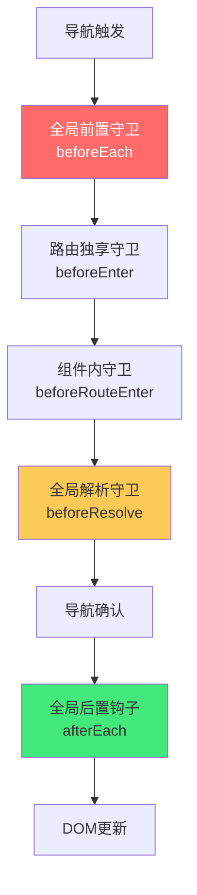

# 🛣️ Vue Router 4：动态路由与权限控制

> **文档说明**：系统讲解 Vue Router 4 的动态路由机制与权限控制完整方案，涵盖 Vue Router 4 概述（新特性 / 与 Vue 3 配合 / Composition API 支持 / 与 Vue Router 3 的区别）、路由基础（创建路由实例 / 路由配置 / history 与 hash 模式 / 路由视图）、动态路由 API（addRoute / removeRoute / hasRoute / getRoutes / 动态添加嵌套路由）、路由守卫体系（全局前置守卫 beforeEach / 全局解析守卫 beforeResolve / 全局后置钩子 afterEach / 路由独享守卫 beforeEnter / 组件内守卫 beforeRouteEnter/Update/Leave / 完整导航解析流程）、权限控制三种方案（静态路由 + meta 权限 / 动态路由后端返回 / 混合方案对比与选型）、动态路由完整实现（登录后获取菜单树 / 组件映射表 / addRoute 递归添加 / 404 兜底路由最后添加 / 刷新页面重新加载 / 退出登录重置路由 / 路由持久化方案）、路由 meta 元信息详解（权限标识 / 页面标题 / 图标 / 缓存 keepAlive / 布局类型 / 面包屑 / 隐藏菜单）、路由懒加载与代码分割（动态 import / 预加载 prefetch / 按组件分包 / 加载 Loading）、路由过渡动画（进入/离开过渡 / 基于路由的动画 / 滚动行为）、路由传参（params / query / props 解耦 / 路由参数校验）、嵌套路由与命名视图、常见问题排查（404 白屏 / 路由重复添加 / 刷新丢失 / 权限闪烁 / 动态路由不生效 / addRoute 后不匹配）与最佳实践。
>
> **适用人群**：中高级前端开发者、需要搭建后台管理系统权限体系的全栈工程师
>
> **前置知识**：[[Vue3-组合式API]] · [[路由守卫与鉴权流程]] · [[菜单与按钮级权限控制]]

---

## 一、Vue Router 4 概述

### 1.1 Vue Router 4 新特性

Vue Router 4 是为 Vue 3 设计的路由版本，与 Vue Router 3（Vue 2）相比有以下变化：

| 特性 | Vue Router 3 | Vue Router 4 |
|------|-------------|-------------|
| **创建方式** | `new VueRouter()` | `createRouter()` |
| **模式配置** | `mode: 'history'` | `history: createWebHistory()` |
| **Composition API** | 不支持 | `useRoute` / `useRouter` |
| **动态路由** | `addRoutes()`（已废弃） | `addRoute()`（单条添加） |
| **通配符** | `*` | `/:pathMatch(.*)*` |
| **滚动行为** | `scrollBehavior` | 同，但返回 Promise |
| **过渡** | 组件内 | 基于路由的动态过渡 |

### 1.2 基础创建

```typescript
// router/index.ts
import { createRouter, createWebHistory, createWebHashHistory } from 'vue-router'
import type { RouteRecordRaw } from 'vue-router'

// 静态路由（不需要权限的页面）
const constantRoutes: RouteRecordRaw[] = [
  {
    path: '/login',
    name: 'Login',
    component: () => import('@/views/login/index.vue'),
    meta: { title: '登录', hidden: true }
  },
  {
    path: '/404',
    name: 'NotFound',
    component: () => import('@/views/404/index.vue'),
    meta: { title: '404', hidden: true }
  }
]

const router = createRouter({
  history: createWebHistory(),  // history 模式（推荐）
  // history: createWebHashHistory(),  // hash 模式
  routes: constantRoutes,
  scrollBehavior(to, from, savedPosition) {
    if (savedPosition) return savedPosition
    return { top: 0 }
  }
})

export default router
```

### 1.3 Composition API 中使用

```typescript
import { useRoute, useRouter } from 'vue-router'

export default {
  setup() {
    const route = useRoute()    // 当前路由信息（等价于 this.$route）
    const router = useRouter()  // 路由实例（等价于 this.$router）
    
    // 路由参数
    console.log(route.params.id)
    console.log(route.query.keyword)
    
    // 编程式导航
    router.push('/home')
    router.push({ name: 'User', params: { id: 1 } })
    router.replace('/login')
    router.back()
    router.forward()
    
    return { route, router }
  }
}
```

---

## 二、动态路由 API

### 2.1 核心 API

```typescript
import { useRouter } from 'vue-router'

const router = useRouter()

// 添加一条路由
router.addRoute({
  path: '/about',
  name: 'About',
  component: () => import('@/views/about.vue')
})

// 添加嵌套路由（第一个参数是父路由 name）
router.addRoute('Parent', {
  path: 'child',
  name: 'Child',
  component: () => import('@/views/child.vue')
})

// 移除一条路由（按 name）
router.removeRoute('About')

// 检查路由是否存在
router.hasRoute('About')  // boolean

// 获取所有路由记录
const routes = router.getRoutes()  // RouteRecordNormalized[]
```

### 2.2 动态添加嵌套路由

```typescript
// 递归添加动态路由
function addDynamicRoutes(menus: MenuItem[]) {
  menus.forEach(menu => {
    const route: RouteRecordRaw = {
      path: menu.path,
      name: menu.name,
      component: componentMap[menu.component],  // 组件映射
      meta: {
        title: menu.title,
        icon: menu.icon,
        permission: menu.permission
      },
      children: []  // 子路由先空着
    }
    
    if (menu.children && menu.children.length > 0) {
      // 递归添加子路由
      menu.children.forEach(child => {
        route.children!.push({
          path: child.path,
          name: child.name,
          component: componentMap[child.component],
          meta: { title: child.title, permission: child.permission }
        })
      })
    }
    
    router.addRoute(route)
  })
  
  // 404 兜底路由必须最后添加
  router.addRoute({
    path: '/:pathMatch(.*)*',
    name: 'NotFound',
    component: () => import('@/views/404.vue')
  })
}
```

### 2.3 组件映射表

```typescript
// 后端返回的 component 字符串 → 实际组件
const componentMap: Record<string, () => Promise<any>> = {
  'dashboard': () => import('@/views/dashboard/index.vue'),
  'user/list': () => import('@/views/user/list.vue'),
  'user/role': () => import('@/views/user/role.vue'),
  'system/config': () => import('@/views/system/config.vue'),
  // ... 更多组件映射
}

// 通用：自动导入 views 目录下所有 .vue 文件
const modules = import.meta.glob('@/views/**/*.vue')
function getComponent(path: string) {
  return modules[`/src/views/${path}.vue`] || modules['/src/views/404.vue']
}
```

---

## 三、路由守卫体系

### 3.1 守卫类型



### 3.2 全局前置守卫（权限控制核心）

```typescript
// router/guard.ts
import router from './index'
import { useUserStore } from '@/stores/user'

// 白名单（不需要登录的页面）
const whiteList = ['/login', '/404', '/register']

router.beforeEach(async (to, from, next) => {
  const userStore = useUserStore()
  const hasToken = userStore.token
  
  // 1. 有 token
  if (hasToken) {
    if (to.path === '/login') {
      // 已登录访问登录页，跳首页
      next({ path: '/' })
    } else {
      // 检查是否已加载动态路由
      if (userStore.isLoaded) {
        // 已加载，直接放行
        next()
      } else {
        try {
          // 获取用户信息和动态路由
          await userStore.fetchUserInfo()
          // 关键：重新进入当前路由，触发动态路由匹配
          next({ ...to, replace: true })
        } catch (error) {
          // 获取失败，清除 token 跳登录
          userStore.logout()
          next(`/login?redirect=${to.path}`)
        }
      }
    }
  } else {
    // 2. 无 token
    if (whiteList.includes(to.path)) {
      // 白名单放行
      next()
    } else {
      // 其他页面跳登录，记录 redirect
      next(`/login?redirect=${to.path}`)
    }
  }
})
```

### 3.3 路由独享守卫

```typescript
const routes: RouteRecordRaw[] = [
  {
    path: '/admin',
    component: () => import('@/views/admin.vue'),
    beforeEnter: (to, from, next) => {
      // 只有管理员能访问
      const userStore = useUserStore()
      if (userStore.roles.includes('admin')) {
        next()
      } else {
        next('/403')
      }
    }
  }
]
```

### 3.4 组件内守卫

```typescript
export default {
  // 进入组件前（此时组件实例还没创建，不能用 this）
  beforeRouteEnter(to, from, next) {
    // 可以在 next 回调中访问组件实例
    next(vm => {
      console.log(vm.$route)
    })
  },
  
  // 路由更新（同一组件，参数变化）
  beforeRouteUpdate(to, from, next) {
    // 例如 /user/1 → /user/2
    this.loadUser(to.params.id)
    next()
  },
  
  // 离开组件前（可以阻止离开，如未保存表单）
  beforeRouteLeave(to, from, next) {
    if (this.isDirty) {
      if (confirm('有未保存的修改，确定离开吗？')) {
        next()
      } else {
        next(false)
      }
    } else {
      next()
    }
  }
}
```

### 3.5 完整导航解析流程

1. 导航被触发
2. 在失活的组件里调用 `beforeRouteLeave`
3. 调用全局的 `beforeEach`
4. 在重用的组件里调用 `beforeRouteUpdate`
5. 调用路由配置的 `beforeEnter`
6. 解析异步路由组件
7. 在被激活的组件里调用 `beforeRouteEnter`
8. 调用全局的 `beforeResolve`
9. 导航被确认
10. 调用全局的 `afterEach`
11. 触发 DOM 更新
12. 调用 `beforeRouteEnter` 中传给 `next` 的回调

---

## 四、权限控制三种方案

### 4.1 方案对比

| 方案 | 实现方式 | 优点 | 缺点 | 适用场景 |
|------|---------|------|------|---------|
| **静态路由 + meta 权限** | 路由全写死，meta 存权限标识，守卫检查 | 简单、路由固定 | 无权路由仍存在（可直接访问）、菜单需单独过滤 | 简单系统、权限角色少 |
| **动态路由（后端返回）** | 登录后后端返回菜单，前端 addRoute | 安全（无权路由不存在）、灵活 | 实现复杂、刷新需重新加载 | 中后台系统、多角色多权限 |
| **混合方案** | 基础路由静态 + 业务路由动态 | 兼顾安全和简单 | 需区分两类路由 | 大多数中后台系统 |

### 4.2 方案一：静态路由 + meta 权限

```typescript
const routes: RouteRecordRaw[] = [
  {
    path: '/user',
    component: Layout,
    children: [
      {
        path: 'list',
        name: 'UserList',
        component: () => import('@/views/user/list.vue'),
        meta: { title: '用户列表', permission: 'user:list' }
      },
      {
        path: 'role',
        name: 'UserRole',
        component: () => import('@/views/user/role.vue'),
        meta: { title: '角色管理', permission: 'user:role' }
      }
    ]
  }
]

// 守卫中检查权限
router.beforeEach((to, from, next) => {
  const userStore = useUserStore()
  if (to.meta.permission && !userStore.hasPermission(to.meta.permission as string)) {
    next('/403')
  } else {
    next()
  }
})
```

### 4.3 方案二：动态路由（推荐）

```typescript
// stores/user.ts
export const useUserStore = defineStore('user', () => {
  const token = ref('')
  const isLoaded = ref(false)
  const dynamicRoutes = ref<RouteRecordRaw[]>([])
  
  async function fetchUserInfo() {
    // 1. 获取用户信息和菜单
    const res = await api.getUserInfo()
    // 2. 菜单转路由
    const routes = menusToRoutes(res.menus)
    dynamicRoutes.value = routes
    // 3. 动态添加路由
    routes.forEach(route => router.addRoute(route))
    // 4. 添加 404 兜底
    router.addRoute({ path: '/:pathMatch(.*)*', name: 'NotFound', component: () => import('@/views/404.vue') })
    isLoaded.value = true
  }
  
  function logout() {
    token.value = ''
    isLoaded.value = false
    // 移除动态路由
    dynamicRoutes.value.forEach(route => {
      if (route.name) router.removeRoute(route.name)
    })
    dynamicRoutes.value = []
  }
  
  return { token, isLoaded, fetchUserInfo, logout }
})
```

---

## 五、动态路由完整实现

### 5.1 菜单转路由

```typescript
// router/helper.ts
import type { RouteRecordRaw } from 'vue-router'

interface MenuItem {
  path: string
  name: string
  component: string
  title: string
  icon?: string
  permission?: string
  hidden?: boolean
  children?: MenuItem[]
}

// 组件映射表
const componentMap: Record<string, () => Promise<any>> = {
  'Layout': () => import('@/layout/index.vue'),
  'dashboard': () => import('@/views/dashboard/index.vue'),
  'user/list': () => import('@/views/user/list.vue'),
  'user/role': () => import('@/views/user/role.vue'),
  'system/config': () => import('@/views/system/config.vue')
}

export function menusToRoutes(menus: MenuItem[]): RouteRecordRaw[] {
  return menus.map(menu => {
    const route: RouteRecordRaw = {
      path: menu.path,
      name: menu.name,
      component: componentMap[menu.component] || (() => import('@/views/404.vue')),
      meta: {
        title: menu.title,
        icon: menu.icon,
        permission: menu.permission,
        hidden: menu.hidden
      },
      children: menu.children ? menusToRoutes(menu.children) : undefined
    }
    return route
  })
}
```

### 5.2 刷新页面重新加载

```typescript
// 关键：在 beforeEach 中判断 isLoaded
router.beforeEach(async (to, from, next) => {
  const userStore = useUserStore()
  
  if (userStore.token && !userStore.isLoaded) {
    // 有 token 但路由未加载（刷新页面）
    await userStore.fetchUserInfo()
    // 重新进入当前路由（replace 不产生历史记录）
    next({ ...to, replace: true })
  } else {
    next()
  }
})
```

> **为什么需要 `next({ ...to, replace: true })`？**
> 因为 `addRoute` 是动态添加的，当前导航发生时新路由还没注册，匹配不到。重新进入一次就能匹配到新添加的路由了。

### 5.3 退出登录重置路由

```typescript
function logout() {
  // 1. 清除 token
  token.value = ''
  // 2. 移除动态路由
  const routes = router.getRoutes()
  routes.forEach(route => {
    // 只移除动态添加的路由（保留静态路由）
    if (!constantRouteNames.includes(route.name as string)) {
      router.removeRoute(route.name as string)
    }
  })
  isLoaded.value = false
  // 3. 跳登录
  router.push('/login')
}
```

### 5.4 404 兜底路由

```typescript
// ❌ 错误：404 路由放在静态路由中（会先匹配，动态路由永远匹配不到）
const constantRoutes = [
  // ...
  { path: '/:pathMatch(.*)*', component: NotFound }  // 不能放这里
]

// ✅ 正确：404 路由在动态路由添加完之后再 addRoute
function addDynamicRoutes() {
  // ... 添加业务路由
  // 最后添加 404
  router.addRoute({
    path: '/:pathMatch(.*)*',
    name: 'NotFound',
    component: () => import('@/views/404.vue')
  })
}
```

---

## 六、路由 meta 元信息

### 6.1 meta 常用字段

```typescript
interface RouteMeta {
  title?: string           // 页面标题（用于 document.title 和面包屑）
  icon?: string            // 菜单图标
  permission?: string      // 权限标识（如 'user:list'）
  roles?: string[]         // 允许的角色（如 ['admin', 'editor']）
  hidden?: boolean         // 是否在菜单中隐藏
  keepAlive?: boolean      // 是否缓存组件（配合 keep-alive）
  layout?: string          // 布局类型（如 'default' / 'blank'）
  breadcrumb?: boolean     // 是否显示面包屑
  affix?: boolean          // 是否固定在标签栏
  noCache?: boolean        // 是否不缓存
  activeMenu?: string      // 高亮的菜单路径
}
```

### 6.2 meta 使用示例

```typescript
const routes: RouteRecordRaw[] = [
  {
    path: '/user',
    component: Layout,
    meta: { title: '用户管理', icon: 'User' },
    children: [
      {
        path: 'list',
        name: 'UserList',
        component: () => import('@/views/user/list.vue'),
        meta: {
          title: '用户列表',
          icon: 'List',
          permission: 'user:list',
          keepAlive: true,
          affix: true
        }
      }
    ]
  }
]

// 全局后置钩子设置标题
router.afterEach((to) => {
  if (to.meta.title) {
    document.title = `${to.meta.title} - 管理系统`
  }
})
```

---

## 七、路由懒加载与代码分割

### 7.1 动态 import

```typescript
// 懒加载（访问时才加载）
component: () => import('@/views/user/list.vue')

// 预加载（浏览器空闲时预加载，提升后续访问速度）
component: () => import(/* webpackPrefetch: true */ '@/views/user/list.vue')

// 预获取（Vite 写法）
component: () => import('@/views/user/list.vue')
// vite.config.ts 中配置
// build: { rollupOptions: { output: { manualChunks: { ... } } } }
```

### 7.2 按组件分包

```typescript
// vite.config.ts
export default defineConfig({
  build: {
    rollupOptions: {
      output: {
        manualChunks: {
          'vue-vendor': ['vue', 'vue-router', 'pinia'],
          'element-plus': ['element-plus'],
          'echarts': ['echarts']
        }
      }
    }
  }
})
```

### 7.3 路由加载 Loading

```vue
<!-- 路由懒加载时的 Loading 组件 -->
<script setup>
import { ref, onMounted } from 'vue'

const Loading = {
  template: '<div class="route-loading">加载中...</div>'
}
</script>
```

---

## 八、路由过渡动画

### 8.1 基础过渡

```vue
<template>
  <router-view v-slot="{ Component }">
    <transition name="fade" mode="out-in">
      <component :is="Component" />
    </transition>
  </router-view>
</template>

<style>
.fade-enter-active,
.fade-leave-active {
  transition: opacity 0.3s ease;
}
.fade-enter-from,
.fade-leave-to {
  opacity: 0;
}
</style>
```

### 8.2 基于路由的动态过渡

```vue
<template>
  <router-view v-slot="{ Component, route }">
    <transition :name="route.meta.transition || 'fade'" mode="out-in">
      <component :is="Component" :key="route.path" />
    </transition>
  </router-view>
</template>
```

---

## 九、常见问题排查

| 问题 | 原因 | 解决方案 |
|------|------|---------|
| **动态路由添加后白屏/404** | addRoute 后当前导航匹配不到 | `next({ ...to, replace: true })` 重新进入 |
| **刷新页面路由丢失** | 动态路由存在内存中，刷新后丢失 | 在 beforeEach 中判断 isLoaded，重新获取并 addRoute |
| **404 路由匹配不到动态路由** | 404 通配符路由放在静态路由中，先匹配了 | 404 路由必须在动态路由添加完之后再 addRoute |
| **路由重复添加** | 多次调用 fetchUserInfo | 用 isLoaded 标志防止重复 |
| **退出后再登录路由不对** | 退出时没移除动态路由 | logout 中 removeRoute 移除所有动态路由 |
| **权限闪烁** | 动态路由加载前页面已渲染 | 加 loading，路由加载完再渲染菜单和内容 |
| **addRoute 嵌套路由不生效** | 父路由 name 不对或父路由不存在 | 确保父路由已添加，用 `addRoute(parentName, child)` |
| **params 传参刷新丢失** | params 不持久化 | 用 query 或 props 解耦，或存 store |
| **keepAlive 不生效** | 路由 name 和组件 name 不一致 | 确保路由 name 和组件 name 一致 |
| **history 模式刷新 404** | 服务器没有配置 fallback | Nginx 配置 `try_files $uri $uri/ /index.html` |

### Nginx history 模式配置

```nginx
server {
    listen 80;
    server_name example.com;
    root /usr/share/nginx/html;
    index index.html;

    location / {
        try_files $uri $uri/ /index.html;  # 关键：所有路径回退到 index.html
    }
}
```

---

## 十、最佳实践

1. **用 history 模式**：URL 更美观，SEO 更好，记得配置服务器 fallback
2. **动态路由用 name 标识**：removeRoute 需要 name，确保每条路由有唯一 name
3. **404 路由最后添加**：通配符路由必须在所有业务路由之后 addRoute
4. **刷新重新加载**：在 beforeEach 中判断 isLoaded，有 token 但未加载时重新获取
5. **用 replace 重新进入**：addRoute 后用 `next({ ...to, replace: true })` 触发重新匹配
6. **退出清理路由**：logout 时移除所有动态路由，防止残留
7. **meta 统一管理**：标题、权限、图标、缓存等都放 meta，统一处理
8. **路由懒加载**：所有页面组件用动态 import，首屏加载快
9. **权限用 meta + 守卫**：简单系统用静态路由+meta权限，复杂系统用动态路由
10. **白名单机制**：登录页、404 等不需要权限的页面放白名单
11. **redirect 参数**：未登录时记录目标路径，登录后跳回
12. **路由过渡动画**：提升用户体验，但不要过度影响性能
13. **滚动行为**：配置 scrollBehavior，页面切换回到顶部
14. **参数校验**：路由 params 可以加 validator，提前发现错误
15. **命名路由**：优先用 name 导航，路径变化时不需要改所有地方

---

## 十一、关联笔记

### Vue3 生态
- [[Vue3-组合式API]] · [[Vue3-组件通信与插槽]] · [[Pinia-状态管理核心]]
- [[Vue3-自定义Hooks封装_backup_skeleton]] · [[ElementPlus-二次封装]]

### 权限与安全
- [[路由守卫与鉴权流程]] · [[菜单与按钮级权限控制]] · [[JWT认证机制]]
- [[接口安全与签名]]

### 工程化
- [[Vite构建工具原理]] · [[环境变量与多环境构建]] · [[TypeScript-类型系统进阶]]

### 导航
- [[MOC-Vue3生态]] · [[MOC-前端开发]] · [[Home]] · [[学习路线总览]]

> 🔍 **知识点深度解析**
>
> **作用**：Vue Router 动态路由与权限控制解决的是「如何在前端实现基于用户角色/权限的动态路由加载和访问控制，让不同用户看到不同菜单、访问不同页面，同时保证系统安全和良好的用户体验」的核心问题——这是中后台管理系统的核心基础设施。
>
> **底层原理**：①Vue Router 4 的动态路由本质是「运行时修改路由配置表」——静态路由在创建 router 时就注册了，而动态路由通过 `router.addRoute()` 在运行时（通常是登录后获取用户信息后）动态添加到路由配置表中。这意味着未登录用户的路由表中根本没有业务路由（即使知道 URL 也访问不到，因为路由不存在），比「静态路由 + 守卫拦截」更安全。动态路由的核心挑战是「刷新页面后路由丢失」——因为动态路由存在内存中，刷新后 router 实例重新创建，动态路由消失，需要在路由守卫中检测「有 token 但路由未加载」的状态，重新获取并添加。②`next({ ...to, replace: true })` 是动态路由的「关键魔法」——`addRoute` 是异步生效的，当前导航发生时新路由还没注册到匹配器中，所以直接 `next()` 会匹配不到（404）。调用 `next({ ...to, replace: true })` 会中断当前导航，重新发起一次相同路径的导航，此时新路由已经注册，能正确匹配。`replace: true` 确保不产生新的历史记录（用户点后退不会回到这个中间状态）。这个模式是 Vue Router 动态路由的标准做法。③404 通配符路由的「顺序问题」是动态路由最常见的坑——Vue Router 的路由匹配是按注册顺序的，通配符路由 `/:pathMatch(.*)*` 会匹配所有路径。如果把 404 路由放在静态路由中（先注册），它会在动态路由（后注册）之前匹配，导致所有动态路由页面都显示 404。正确做法是 404 路由必须在所有动态路由添加完之后再 `addRoute`，这样业务路由先匹配，匹配不到才走 404。④路由守卫的「完整导航解析流程」是理解权限控制的基础——一次导航会依次触发：beforeRouteLeave（离开的组件）→ beforeEach（全局前置）→ beforeRouteUpdate（重用的组件）→ beforeEnter（路由独享）→ 解析异步组件 → beforeRouteEnter（进入的组件）→ beforeResolve（全局解析）→ 确认导航 → afterEach（全局后置）→ DOM 更新。权限控制通常放在 beforeEach（最早能拦截的地方），这样未授权的导航在最早期就被拦截，不会触发组件加载和数据请求。⑤meta 元信息是「路由的附加数据通道」——Vue Router 的路由配置除了 path/component/children 等核心字段外，还可以通过 meta 字段存储任意自定义数据（标题、权限、图标、缓存策略等）。meta 会被合并到 `route.meta` 中，可以在守卫、组件、后置钩子中访问。这是一种「声明式配置」——把权限、标题等信息声明在路由配置中，守卫统一读取和处理，不需要在每个组件中重复写权限判断。⑥keepAlive 与路由 name 的「对应关系」是常见的坑——Vue 的 `<keep-alive>` 通过组件的 name 来缓存组件，如果路由的 name 和组件内部定义的 name 不一致，keep-alive 会失效（认为是不同组件）。所以使用 keep-alive 时必须确保路由 name 和组件 name 一致，或者用 include/exclude 明确指定要缓存的组件名。⑦history 模式的「服务器 fallback」是部署时的常见问题——history 模式下 URL 没有 #，刷新页面时浏览器会向服务器请求 `/user/list` 这个路径，但服务器上没有这个文件（只有 index.html），所以会返回 404。解决方案是在服务器（Nginx/Apache）配置「所有路径都回退到 index.html」，让 Vue Router 接管前端路由。这是 history 模式部署的标准配置，几乎每个项目都会遇到。
>
> **用法要点**：① Vue Router4：createRouter创建/createWebHistory模式/useRoute+useRouter(Composition API)/addRoute单条添加(废弃addRoutes)/通配符/:pathMatch(.*)* ② 动态路由API：addRoute(单条)/addRoute(parentName, child)嵌套/removeRoute(name)/hasRoute(name)/getRoutes() ③ 组件映射表：componentMap字符串→组件/import.meta.glob自动导入views目录 ④ 路由守卫：beforeEach(全局前置，权限核心)/beforeResolve(全局解析)/afterEach(全局后置，设置标题)/beforeEnter(路由独享)/beforeRouteEnter+Update+Leave(组件内) ⑤ 权限三方案：静态路由+meta权限(简单)/动态路由后端返回(安全推荐)/混合(基础静态+业务动态) ⑥ 动态路由实现：登录后获取菜单→menusToRoutes转换→forEach addRoute→最后addRoute(404)→isLoaded=true ⑦ 刷新处理：beforeEach判断有token&&!isLoaded→fetchUserInfo→next({...to,replace:true})重新匹配 ⑧ 退出处理：清除token→removeRoute移除动态路由→isLoaded=false→跳登录 ⑨ 404坑：不能放静态路由(先匹配)，必须动态路由添加完后最后addRoute ⑩ meta元信息：title/icon/permission/roles/hidden/keepAlive/layout/breadcrumb/affix/activeMenu ⑪ 懒加载：()=>import()动态加载/webpackPrefetch预加载/vite manualChunks分包 ⑫ 过渡动画：router-view v-slot+transition/基于route.meta.transition动态过渡 ⑬ 常见问题：白屏(next replace)/刷新丢失(守卫重新加载)/404顺序(最后加)/重复添加(isLoaded)/退出残留(removeRoute)/权限闪烁(loading)/keepAlive不生效(name一致)/history刷新404(Nginx try_files) ⑭ 最佳实践：history模式+服务器fallback/路由有唯一name/404最后加/刷新重新加载/replace重新进入/退出清理路由/meta统一管理/懒加载/白名单机制/redirect记录目标路径/命名路由优先/参数校验/滚动行为配置。

> 💡 **深度讲解**：Vue Router 动态路由与权限控制最核心的智慧是「安全来自于『不存在』而非『被拦截』——动态路由让未授权用户的路由表中根本没有业务路由，即使知道 URL 也访问不到，这比静态路由+守卫拦截更安全、更彻底」——很多初学者用「静态路由全写死 + 守卫检查 meta.permission」的方案，觉得「守卫拦截了就安全了」，但实际上用户可以通过 DevTools 修改路由、直接调用 router.push、或者在守卫逻辑有漏洞时绕过。动态路由方案的安全边界更清晰——未登录用户的路由表只有登录页和 404，业务路由根本不存在，「不存在」比「被拦截」更安全。动态路由的实现有几个「魔法时刻」需要理解：第一个是 `next({ ...to, replace: true })`——很多人不理解为什么 addRoute 后要重新进入，原因是路由匹配器在导航开始时就确定了，addRoute 是在导航过程中修改配置，当前导航用的还是旧匹配器，重新进入一次才能用新匹配器匹配。第二个是 404 路由的顺序——通配符路由会匹配所有路径，如果先注册就会「截胡」所有路由，必须最后注册。第三个是刷新页面的状态恢复——动态路由存在内存中，刷新后 router 重新创建，动态路由消失，需要在守卫中检测并恢复。这些「坑」几乎每个做动态路由的人都会踩，理解了原理就能避免。路由守卫的设计体现了「拦截点越早越好」的原则——beforeEach 是最早能拦截导航的地方，在这里做权限判断可以避免后续所有不必要的操作（组件加载、数据请求、DOM 渲染）。如果把权限判断放在组件的 onMounted 中，组件已经加载了、数据已经请求了，才发现没权限，既浪费资源又可能泄露信息。meta 元信息是「声明式配置」的典范——把权限、标题、图标等信息声明在路由配置中，守卫统一读取处理，不需要在每个组件中重复写权限判断。这种「配置驱动」的思想在前端工程中很常见（ESLint 配置、Tailwind 配置、Vite 配置都是这个思路）。在 AI 时代，动态路由有了新的可能性——AI 可以根据用户的行为和需求动态推荐和生成路由（个性化菜单），但核心的安全机制（基于角色的动态路由加载）仍然是基础。掌握 Vue Router 动态路由与权限控制，就是掌握了中后台系统的「准入基础设施」——这是从「做页面」到「做系统」的关键一步。

> 📝 **精简总结**：VueRouter动态路由与权限=运行时修改路由表，基于角色动态加载。核心API：addRoute/removeRoute/hasRoute/getRoutes。权限三方案：静态+meta权限(简单)/动态路由后端返回(安全推荐)/混合。动态路由实现：登录获取菜单→menusToRoutes→forEach addRoute→最后加404→isLoaded=true。刷新：守卫判断有token&&!isLoaded→重新加载→next({...to,replace:true})。退出：removeRoute移除动态路由。关键坑：404必须最后加(否则截胡)/addRoute后replace重新进入/刷新重新加载/路由name唯一。守卫：beforeEach权限核心/afterEach设标题/beforeEnter路由独享/组件内三守卫。meta：title/permission/keepAlive/icon/hidden。最佳实践：history模式+Nginx fallback/路由有name/404最后加/刷新恢复/退出清理/meta统一/懒加载/白名单/redirect记录。

> **学习路径建议**：先学习 [[Vue3-组合式API]] 和 Vue Router 基础 → 学习路由守卫（beforeEach/afterEach） → 实践：做一个简单的登录鉴权（静态路由+meta权限） → 学习动态路由 API（addRoute/removeRoute） → 实践：实现登录后动态添加路由 → 学习刷新恢复和退出清理 → 实践：解决刷新 404、路由重复等问题 → 学习 [[菜单与按钮级权限控制]] 和 [[路由守卫与鉴权流程]] 深化 → 形成完整的前端权限体系。

---

> **Vue Router 动态路由与权限控制最核心的智慧是「安全来自于不存在而非被拦截——动态路由让未授权用户的路由表中根本没有业务路由，即使知道 URL 也访问不到，这比静态路由+守卫拦截更安全更彻底」——很多初学者用静态路由全写死+守卫检查 meta.permission，觉得守卫拦截了就安全了，但实际上用户可以通过 DevTools 修改路由、直接调用 router.push、或者守卫逻辑有漏洞时绕过。动态路由方案的安全边界更清晰——未登录用户路由表只有登录页和 404，业务路由根本不存在，不存在比被拦截更安全。动态路由实现有几个魔法时刻：第一个是 next({...to, replace:true})——addRoute 在导航过程中修改配置，当前导航用的还是旧匹配器，重新进入一次才能用新匹配器匹配；第二个是 404 路由顺序——通配符匹配所有路径，先注册就会截胡所有路由，必须最后注册；第三个是刷新状态恢复——动态路由存在内存中，刷新后 router 重新创建路由消失，需在守卫中检测并恢复。路由守卫体现了拦截点越早越好的原则——beforeEach 最早能拦截，避免后续不必要的组件加载和数据请求。meta 元信息是声明式配置的典范——把权限、标题、图标声明在路由配置中，守卫统一读取处理，不需要每个组件重复写权限判断。在 AI 时代动态路由有了新可能性——AI 可以根据用户行为动态推荐和生成路由（个性化菜单），但核心的基于角色动态加载仍是基础。掌握 Vue Router 动态路由与权限控制，就是掌握了中后台系统的准入基础设施——这是从做页面到做系统的关键一步。下次你做后台系统时，优先考虑动态路由方案——安全、灵活、可维护。**
