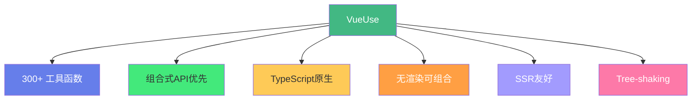

# 🛠️ VueUse 工具函数库

> **文档说明**：系统讲解 VueUse——Vue3 生态最流行的组合式 API 工具函数库的核心概念、分类、高频函数与自定义 Composable 编写，涵盖 VueUse 的概述与设计理念（Anthony Fu 创建/300+ 函数/组合式 API 优先/无渲染/可组合/TypeScript 原生/SSR 友好/Tree-shaking）、安装与使用（npm/pnpm 安装/按需导入/自动导入 unplugin-auto-import/CDN）、VueUse 的十大分类（状态 State/元素 Elements/浏览器 Browser/传感器 Sensors/动画 Animation/时间 Time/工具 Utilities/网络 Network/组件 Component/集成 Integrations）、高频函数详解（useToggle/useCounter/useDebounceFn/useThrottleFn/refDebounced/useStorage/useLocalStorage/useDark/useColorMode/useNow/useInterval/useTimeout/useEventListener/useResizeObserver/useIntersectionObserver/useClipboard/useMediaControls/useMouse/useGeolocation/useFetch/useWebSocket/useTitle/useFavicon/useFullscreen/usePermission）、自定义 Composable 的编写规范（命名 use 开头/返回响应式状态/自动清理副作用/参数设计/TypeScript 类型）、VueUse 源码设计模式（工厂函数/可组合性/响应式封装/副作用自动清理）、与 React Hooks 的对比、Nuxt 集成（@vueuse/nuxt）、常见问题（SSR 兼容/Tree-shaking/自动导入/与 Vue2 兼容）与最佳实践。
>
> **适用人群**：Vue3 开发者、前端工程师、希望提升开发效率的全栈开发者
>
> **前置知识**：[[Vue3-组合式API]] · [[Vue3-响应式原理Proxy]]

---

## 一、概述

### 1.1 什么是 VueUse

**VueUse** 是 Vue3 生态中最流行的**组合式 API（Composition API）工具函数库**，由 Anthony Fu（Vue/Vite 核心团队成员）创建，提供 300+ 个无渲染、可组合的工具函数。



**核心特点**：
- 📦 **300+ 函数**：覆盖状态、浏览器、传感器、动画、网络等
- 🎯 **组合式 API**：全部基于 `ref`/`reactive`/`computed`，天然适配 Vue3
- 🚫 **无渲染**：只提供逻辑，不干预 UI，完全灵活
- 🔗 **可组合**：函数之间可以自由组合
- 🦾 **TypeScript**：完整类型支持，IDE 智能提示
- 🌐 **SSR 友好**：服务端渲染兼容
- 🌲 **Tree-shaking**：只打包用到的函数
- 📱 **无依赖**：核心包不依赖任何第三方库

### 1.2 为什么用 VueUse

| 场景 | 手写代码 | VueUse |
|------|---------|--------|
| 防抖 | 自己写 debounce 逻辑 | `useDebounceFn(fn, 500)` |
| 本地存储 | 自己封装 localStorage | `useLocalStorage('key', default)` |
| 暗黑模式 | 自己管理 class 和状态 | `useDark()` |
| 事件监听 | 自己 add/removeEventListener | `useEventListener(target, 'click', handler)` |
| 鼠标位置 | 自己监听 mousemove | `useMouse()` |
| 页面标题 | 自己操作 document.title | `useTitle()` |
| 剪贴板 | 自己写 Clipboard API | `useClipboard()` |
| 交集观察 | 自己写 IntersectionObserver | `useIntersectionObserver()` |

> 核心理念：**不要重复造轮子**。VueUse 把前端开发中最常见的逻辑封装成可组合的函数，让你专注于业务逻辑。

---

## 二、安装与使用

### 2.1 安装

```bash
# npm
npm i @vueuse/core

# pnpm（推荐）
pnpm add @vueuse/core

# yarn
yarn add @vueuse/core
```

### 2.2 基本使用

```vue
<script setup>
import { useCounter, useDark, useToggle } from '@vueuse/core'

// 计数器
const { count, inc, dec, reset } = useCounter(0)

// 暗黑模式
const isDark = useDark()
const toggleDark = useToggle(isDark)
</script>

<template>
  <button @click="inc">计数：{{ count }}</button>
  <button @click="toggleDark">{{ isDark ? '🌙' : '☀️' }}</button>
</template>
```

### 2.3 自动导入（推荐）

配合 `unplugin-auto-import` 实现自动导入，无需手动 import：

```bash
pnpm add -D unplugin-auto-import
```

```typescript
// vite.config.ts
import AutoImport from 'unplugin-auto-import/vite'

export default defineConfig({
  plugins: [
    AutoImport({
      imports: ['vue', '@vueuse/core'],  // 自动导入 Vue 和 VueUse
      dts: 'src/auto-imports.d.ts',
    }),
  ],
})
```

```vue
<script setup>
// 无需 import，直接使用
const { count, inc } = useCounter(0)
const isDark = useDark()
</script>
```

### 2.4 附加包

| 包名 | 说明 |
|------|------|
| `@vueuse/core` | 核心包（必装） |
| `@vueuse/components` | 无渲染组件版本 |
| `@vueuse/nuxt` | Nuxt 集成 |
| `@vueuse/integrations` | 第三方库集成（Axios/Firebase/等） |
| `@vueuse/rxjs` | RxJS 集成 |
| `@vueuse/firebase` | Firebase 集成 |
| `@vueuse/electron` | Electron 集成 |
| `@vueuse/head` | 文档 head 管理 |

---

## 三、十大分类

### 3.1 分类总览

| 分类 | 说明 | 代表函数 |
|------|------|---------|
| **State 状态** | 状态管理与转换 | useToggle/useCounter/refDebounced |
| **Elements 元素** | DOM 元素相关 | useEventListener/useResizeObserver |
| **Browser 浏览器** | 浏览器 API 封装 | useLocalStorage/useDark/useClipboard |
| **Sensors 传感器** | 用户交互与设备 | useMouse/useGeolocation/useDeviceMotion |
| **Animation 动画** | 动画与过渡 | useIntervalFn/useRafFn/useTransition |
| **Time 时间** | 时间相关 | useNow/useInterval/useTimeout/useDateFormat |
| **Utilities 工具** | 通用工具 | useDebounceFn/useThrottleFn/useArrayFind |
| **Network 网络** | 网络相关 | useFetch/useWebSocket/useOnline |
| **Component 组件** | 组件相关 | useTemplateRefsList/useVModel |
| **Integrations 集成** | 第三方集成 | useAxios/useFirebase |

---

## 四、高频函数详解

### 4.1 状态类

#### useToggle：开关切换

```typescript
import { useToggle } from '@vueuse/core'

const [value, toggle] = useToggle(false)
// value: Ref<boolean>
// toggle: () => boolean

toggle()      // 切换
toggle(true)  // 设为 true
toggle(false) // 设为 false
```

#### useCounter：计数器

```typescript
import { useCounter } from '@vueuse/core'

const { count, inc, dec, reset, set } = useCounter(0, { min: 0, max: 10 })

inc()      // +1
inc(5)     // +5
dec()      // -1
reset()    // 重置为初始值
set(8)     // 设为 8
```

#### refDebounced / refThrottled：防抖/节流 ref

```typescript
import { refDebounced, refThrottled } from '@vueuse/core'

const input = ref('')
const debounced = refDebounced(input, 500)  // 500ms 防抖
const throttled = refThrottled(input, 1000) // 1000ms 节流

// 输入停止 500ms 后 debounced 才更新
watch(debounced, (val) => {
  console.log('搜索：', val)
})
```

#### useStorage / useLocalStorage：响应式存储

```typescript
import { useLocalStorage, useStorage } from '@vueuse/core'

// 本地存储（自动序列化/反序列化）
const settings = useLocalStorage('settings', {
  theme: 'dark',
  language: 'zh-CN'
})

// 自定义存储（sessionStorage）
const token = useStorage('token', '', sessionStorage)

// 直接修改即自动保存
settings.value.theme = 'light'  // 自动写入 localStorage
```

### 4.2 浏览器类

#### useDark：暗黑模式

```typescript
import { useDark, useToggle } from '@vueuse/core'

const isDark = useDark({
  selector: 'html',
  attribute: 'class',
  valueDark: 'dark',
  valueLight: 'light',
})

const toggleDark = useToggle(isDark)
```

#### useColorMode：颜色模式

```typescript
import { useColorMode } from '@vueuse/core'

const mode = useColorMode({
  modes: {
    dark: 'dark',
    light: 'light',
    auto: 'auto',
  }
})
// mode.value: 'dark' | 'light' | 'auto'
```

#### useClipboard：剪贴板

```typescript
import { useClipboard } from '@vueuse/core'

const { text, copy, copied, isSupported } = useClipboard()

async function copyText() {
  await copy('要复制的内容')
  if (copied.value) {
    console.log('复制成功')
  }
}
```

#### useTitle / useFavicon：页面标题/图标

```typescript
import { useTitle, useFavicon } from '@vueuse/core'

// 响应式标题
const title = useTitle('初始标题')
title.value = '新标题'  // 自动更新 document.title

// 响应式 favicon
const favicon = useFavicon('default.ico')
favicon.value = 'new.ico'
```

#### useFullscreen：全屏

```typescript
import { useFullscreen } from '@vueuse/core'

const { isFullscreen, enter, exit, toggle } = useFullscreen()

toggle()  // 切换全屏
```

#### usePermission：权限查询

```typescript
import { usePermission } from '@vueuse/core'

const microphone = usePermission('microphone')
// microphone.value: 'granted' | 'denied' | 'prompt'
```

### 4.3 传感器类

#### useMouse：鼠标位置

```typescript
import { useMouse } from '@vueuse/core'

const { x, y, sourceType } = useMouse()
// x, y: 鼠标位置（响应式）
// sourceType: 'mouse' | 'touch' | null
```

#### useGeolocation：地理位置

```typescript
import { useGeolocation } from '@vueuse/core'

const { coords, locatedAt, error, resume, pause } = useGeolocation()

// coords.value.latitude / coords.value.longitude
```

#### useDeviceMotion / useDeviceOrientation：设备运动/方向

```typescript
import { useDeviceMotion, useDeviceOrientation } from '@vueuse/core'

const motion = useDeviceMotion()
const orientation = useDeviceOrientation()
```

### 4.4 元素类

#### useEventListener：事件监听（自动清理）

```typescript
import { useEventListener } from '@vueuse/core'

// 组件卸载时自动 removeEventListener
useEventListener(window, 'resize', () => {
  console.log('窗口大小变化')
})

// 多个事件
useEventListener(document, ['click', 'keydown'], handler)

// 条件监听
const enabled = ref(true)
useEventListener(window, 'scroll', handler, { passive: true }, enabled)
```

#### useResizeObserver：元素尺寸观察

```typescript
import { useResizeObserver } from '@vueuse/core'

const el = ref<HTMLElement>()
const { width, height } = useResizeObserver(el, (entries) => {
  console.log('尺寸变化', entries)
})
```

#### useIntersectionObserver：交集观察（懒加载/曝光统计）

```typescript
import { useIntersectionObserver } from '@vueuse/core'

const target = ref<HTMLElement>()
const { isIntersecting, stop } = useIntersectionObserver(
  target,
  ([{ isIntersecting }]) => {
    if (isIntersecting) {
      console.log('元素进入视口')
      loadContent()
      stop()  // 加载后停止观察
    }
  },
  { threshold: 0.1 }
)
```

#### useElementVisibility：元素可见性

```typescript
import { useElementVisibility } from '@vueuse/core'

const target = ref<HTMLElement>()
const isVisible = useElementVisibility(target)
```

### 4.5 网络类

#### useFetch：响应式 fetch

```typescript
import { useFetch } from '@vueuse/core'

const { data, error, isFetching, execute, abort } = useFetch('https://api.example.com/users')
  .get()
  .json()

// data: 响应数据（ref）
// error: 错误信息
// isFetching: 加载中
// execute(): 重新请求
// abort(): 中止请求
```

#### useWebSocket：WebSocket

```typescript
import { useWebSocket } from '@vueuse/core'

const { status, data, send, open, close } = useWebSocket('wss://echo.websocket.org')

// status: 'OPEN' | 'CONNECTING' | 'CLOSED'
// data: 接收到的数据
send('Hello')  // 发送消息
```

#### useOnline：网络状态

```typescript
import { useOnline } from '@vueuse/core'

const online = useOnline()
// online.value: true / false
```

### 4.6 时间类

#### useNow：当前时间

```typescript
import { useNow } from '@vueuse/core'

const now = useNow({ interval: 1000 })  // 每秒更新
// now.value: Date
```

#### useInterval / useTimeout

```typescript
import { useIntervalFn, useTimeoutFn } from '@vueuse/core'

// 定时执行
const { pause, resume, isActive } = useIntervalFn(() => {
  console.log('每秒执行')
}, 1000)

// 延迟执行
const { start, stop, isPending } = useTimeoutFn(() => {
  console.log('3秒后执行')
}, 3000)
```

#### useDateFormat：日期格式化

```typescript
import { useDateFormat } from '@vueuse/core'

const formatted = useDateFormat(new Date(), 'YYYY-MM-DD HH:mm:ss')
// formatted.value: '2026-08-28 14:30:00'
```

### 4.7 工具类

#### useDebounceFn / useThrottleFn

```typescript
import { useDebounceFn, useThrottleFn } from '@vueuse/core'

// 防抖：停止触发 500ms 后执行
const debouncedSearch = useDebounceFn((query) => {
  searchAPI(query)
}, 500)

// 节流：1000ms 内最多执行一次
const throttledScroll = useThrottleFn(() => {
  updatePosition()
}, 1000)
```

#### useArrayFind / useArrayFilter：响应式数组方法

```typescript
import { useArrayFind, useArrayFilter } from '@vueuse/core'

const list = ref([1, 2, 3, 4, 5])
const result = useArrayFind(list, (i) => i > 3)  // 4
const filtered = useArrayFilter(list, (i) => i > 2)  // [3, 4, 5]
```

---

## 五、自定义 Composable

### 5.1 命名规范

- 以 `use` 开头：`useUser`、`useDarkMode`、`useFetchData`
- 驼峰命名
- 动词+名词结构

### 5.2 标准结构

```typescript
// composables/useUserData.ts
import { ref, onMounted, onUnmounted } from 'vue'

export function useUserData(userId: Ref<string> | string) {
  // 1. 响应式状态
  const user = ref<User | null>(null)
  const loading = ref(false)
  const error = ref<Error | null>(null)

  // 2. 核心逻辑
  async function fetchUser() {
    loading.value = true
    error.value = null
    try {
      const id = unref(userId)
      const res = await fetch(`/api/users/${id}`)
      user.value = await res.json()
    } catch (e) {
      error.value = e as Error
    } finally {
      loading.value = false
    }
  }

  // 3. 副作用（自动清理）
  let timer: number
  onMounted(() => {
    fetchUser()
    timer = window.setInterval(fetchUser, 60000)
  })
  onUnmounted(() => {
    clearInterval(timer)  // 必须清理！
  })

  // 4. 返回状态和方法
  return {
    user,
    loading,
    error,
    refresh: fetchUser,
  }
}
```

### 5.3 最佳实践

1. **自动清理副作用**：定时器、事件监听、订阅必须在 onUnmounted 中清理
2. **参数支持 ref**：用 `MaybeRef<T>` 类型，支持传 ref 或原始值
3. **返回对象而非数组**：对象解构更灵活，数组解构适合 useState 风格
4. **TypeScript 类型完整**：泛型、返回类型都要标注
5. **可组合**：函数内部可以调用其他 composable
6. **无副作用导入**：调用才产生副作用，不要在模块顶层执行

---

## 六、VueUse 设计模式

### 6.1 工厂函数模式

很多 VueUse 函数返回「控制对象」：

```typescript
const { 
  isActive, pause, resume  // 状态 + 控制方法
} = useIntervalFn(fn, 1000)
```

### 6.2 可组合性

函数之间可以自由组合：

```typescript
// 组合：防抖 + 本地存储 + 暗黑模式
const search = ref('')
const debouncedSearch = refDebounced(search, 500)
const history = useLocalStorage('search-history', [])

watch(debouncedSearch, (val) => {
  if (val) history.value.unshift(val)
})
```

### 6.3 响应式封装

将命令式 API 封装为响应式：

```typescript
// 原生（命令式）
const el = document.getElementById('app')
const observer = new ResizeObserver(callback)
observer.observe(el)
// 组件卸载时要 observer.disconnect()

// VueUse（响应式+自动清理）
const el = ref<HTMLElement>()
const { width, height } = useResizeObserver(el, callback)
// 自动清理，无需手动 disconnect
```

---

## 七、与 React Hooks 对比

| 维度 | VueUse (Composables) | React Hooks |
|------|---------------------|-------------|
| **调用规则** | 无限制，可在条件/循环中调用 | 必须在顶层调用，不能在条件/循环中 |
| **状态管理** | ref/reactive（Vue 响应式） | useState/useReducer |
| **副作用清理** | onUnmounted 自动清理 | useEffect 返回清理函数 |
| **依赖追踪** | 自动（Vue 响应式系统） | 手动指定 deps 数组 |
| **返回值** | 对象/数组 | 数组（约定俗成） |
| **共享状态** | 模块级 ref 即可共享 | 需要 Context/外部状态库 |

> VueUse 的 composable 比 React Hooks 更灵活——没有调用规则限制，依赖追踪自动，更接近普通函数。

---

## 八、Nuxt 集成

```bash
pnpm add @vueuse/nuxt
```

```typescript
// nuxt.config.ts
export default defineNuxtConfig({
  modules: ['@vueuse/nuxt'],
})
```

Nuxt 集成后：
- 自动导入所有 VueUse 函数
- 自动 SSR 兼容处理
- 自动导入 `@vueuse/core` 和 `@vueuse/head`

---

## 九、常见问题

| 问题 | 解决方案 |
|------|---------|
| **SSR 中 useMouse 报错** | 用 `useMouse` 的 `type` 选项，或用 `import.meta.client` 判断 |
| **Tree-shaking 不生效** | 确保用命名导入 `import { useX } from '@vueuse/core'`，不要 `import VueUse from` |
| **自动导入类型报错** | 运行 `npx vue-tsc` 生成 d.ts，或配置 auto-import 的 dts 选项 |
| **useStorage 不更新** | 检查是否在同一个 storage key，是否序列化正确 |
| **useFetch 不触发** | 检查 URL 是否是 ref（ref 变化会自动重新请求） |
| **事件监听器不清理** | 确保在 setup 中调用（onUnmounted 才能生效） |
| **Vue2 能用吗？** | 用 `@vueuse/core` 的 v8 版本（支持 Vue2.7），或用 `@vueuse/composition-api` |
| **函数太多记不住** | 查官方文档 vueuse.org，按分类浏览，常用的 20 个记住即可 |

---

## 十、最佳实践

1. **优先用 VueUse**：常见逻辑不要自己写，先查 VueUse 有没有
2. **自动导入**：配合 unplugin-auto-import，减少 import 样板代码
3. **组合使用**：多个 composable 组合解决复杂问题，而非写一个大函数
4. **学习源码**：VueUse 的源码是学习组合式 API 最佳实践的好材料
5. **自定义 composable**：项目中重复的逻辑封装成 useXxx，遵循 VueUse 规范
6. **按需导入**：用命名导入，确保 Tree-shaking
7. **注意 SSR**：浏览器 API 相关的函数在 SSR 中要特殊处理
8. **关注更新**：VueUse 活跃更新，定期查看新函数
9. **不要过度使用**：简单逻辑直接写，不需要为了用而用
10. **阅读文档**：vueuse.org 有每个函数的交互式演示，非常好用

---

## 十一、关联笔记

### Vue3 生态
- [[Vue3-组合式API]] · [[Vue3-响应式原理Proxy]] · [[Vue3-组件通信与插槽]]
- [[Vue3-Teleport与Suspense]] · [[Vite构建工具原理]] · [[pnpm-monorepo架构]]

### 前端工程化
- [[TypeScript基础语法]] · [[TypeScript-类型系统进阶]] · [[ESLint与代码规范]]

### 导航
- [[MOC-前端开发]] · [[MOC-Vue3生态]] · [[Home]] · [[学习路线总览]]

> 🔍 **知识点深度解析**
>
> **作用**：VueUse 工具函数库解决的是「Vue3 组合式 API 开发中大量重复的逻辑封装（事件监听、防抖节流、本地存储、响应式 API 封装等）如何标准化、可组合化，让开发者专注于业务逻辑」的问题——Vue3 的组合式 API 提供了强大的逻辑复用能力，但每个项目都要自己写 useDebounce/useStorage/useEventListener 等通用逻辑，重复造轮子。VueUse 提供了 300+ 个经过社区验证的高质量 composable，覆盖前端开发的大部分通用逻辑。
>
> **底层原理**：①VueUse 的核心是「组合式 API 的函数式封装」——每个函数内部使用 Vue 的 ref/reactive/computed/watch/onMounted/onUnmounted 等基础 API，将命令式的浏览器 API（addEventListener/setInterval/IntersectionObserver 等）封装为响应式的、自动清理的函数。这种封装的关键是「副作用自动清理」——在 onMounted 中创建副作用（定时器/监听器/观察者），在 onUnmounted 中清理，确保组件卸载时不会内存泄漏。②VueUse 的「无渲染」设计哲学——它只提供逻辑和状态，不提供任何 UI。这意味着你可以完全控制 UI 的呈现方式，VueUse 只负责「逻辑层」。这种设计让 VueUse 极其灵活——同一个 useMouse 可以用在任何 UI 框架和设计风格中。③响应式封装的核心是「将命令式 API 的回调转为响应式 ref」——例如 useResizeObserver 内部创建 ResizeObserver，在回调中更新 width/height 这两个 ref，外部使用时直接读取 ref 就能获得最新值，不需要手动注册回调。这种「命令式→响应式」的转换是 VueUse 最常见的模式。④可组合性（Composability）是 VueUse 的设计核心——每个函数都是独立的、单一职责的，可以像搭积木一样组合。例如 refDebounced(useLocalStorage('key', '')) 就是「本地存储 + 防抖」的组合。这种组合能力来自组合式 API 的灵活性——函数可以调用其他函数，返回的 ref 可以作为其他函数的输入。⑤VueUse 的 TypeScript 设计非常精细——大量使用泛型、条件类型、重载来提供精确的类型推断。例如 useFetch 的 .json() 返回的 data 类型会根据传入的泛型变化，useStorage 的默认值类型决定返回的 ref 类型。这种类型设计让 VueUse 在 TypeScript 项目中体验极佳。⑥与 React Hooks 相比，VueUse 的 composable 没有「调用规则」限制——React Hooks 必须在组件顶层调用，不能在条件/循环中调用，因为 React 依赖调用顺序来匹配 state；而 Vue 的响应式系统不依赖调用顺序，composable 就是普通函数，可以在任何地方调用。这是 Vue 组合式 API 比 React Hooks 更灵活的根本原因。
>
> **用法要点**：① 安装：pnpm add @vueuse/core，配合unplugin-auto-import自动导入 ② 十大分类：State状态/Elements元素/Browser浏览器/Sensors传感器/Animation动画/Time时间/Utilities工具/Network网络/Component组件/Integrations集成 ③ 高频函数：useToggle(开关)/useCounter(计数)/refDebounced(防抖ref)/useLocalStorage(本地存储)/useDark(暗黑模式)/useClipboard(剪贴板)/useTitle(标题)/useEventListener(事件监听自动清理)/useResizeObserver(尺寸观察)/useIntersectionObserver(交集观察懒加载)/useFetch(响应式请求)/useWebSocket/useMouse(鼠标)/useNow(当前时间)/useDebounceFn(防抖函数)/useThrottleFn(节流函数) ④ 自定义composable：use开头，返回响应式状态+方法，onUnmounted清理副作用，参数支持MaybeRef，TypeScript类型完整 ⑤ 设计模式：工厂函数(返回控制对象)/可组合(函数间自由组合)/响应式封装(命令式API转ref) ⑥ 与React Hooks对比：Vue composable无调用规则限制/依赖追踪自动/更灵活 ⑦ Nuxt集成：@vueuse/nuxt模块自动导入+SSR兼容 ⑧ 常见问题：SSR注意浏览器API/命名导入确保Tree-shaking/auto-import生成d.ts ⑨ 最佳实践：优先用VueUse不造轮子/自动导入/组合使用/学源码/自定义composable遵循规范/按需导入/简单逻辑直接写不过度使用 ⑩ 官方文档vueuse.org有交互式演示。

> 💡 **深度讲解**：VueUse 最核心的智慧是「将前端开发中最常见的逻辑封装为可组合的函数，让开发者从重复的样板代码中解放出来，专注于真正有价值的业务逻辑」——每个 Vue3 项目中，你都会反复写这些逻辑：防抖函数、本地存储封装、事件监听与清理、元素尺寸观察、暗黑模式切换、鼠标位置追踪……这些逻辑不复杂，但每次都要写一遍、测试一遍、确保内存泄漏清理一遍，非常繁琐。VueUse 的价值就是「把这些重复劳动标准化」——300+ 个函数经过社区验证、TypeScript 类型完整、SSR 兼容、自动清理副作用、Tree-shaking 友好。VueUse 的另一个深层价值是「教育意义」——它的源码是学习 Vue3 组合式 API 最佳实践的最好教材。每个函数都不长（几十行），但展示了如何正确地封装副作用、如何设计响应式 API、如何处理 TypeScript 类型、如何确保 SSR 兼容。阅读 VueUse 源码，你会对组合式 API 的理解提升一个层次。在 AI 时代，VueUse 这样的工具库更加重要——AI 生成代码时，使用 VueUse 等标准库比 AI 自己手写实现更可靠、更规范、更少 Bug。当你告诉 AI「用 useDebouncedRef 实现搜索防抖」，AI 生成的代码比「自己写一个防抖函数」质量高得多。掌握 VueUse，不仅是「提升开发效率」，更是「掌握 Vue3 生态的标准工具集」，让你的代码更规范、更可靠、更易维护。

> 📝 **精简总结**：VueUse=Vue3最流行的组合式API工具库，300+函数，Anthony Fu创建。核心特点：组合式API优先/无渲染/可组合/TypeScript原生/SSR友好/Tree-shaking。十大分类：State状态/Elements元素/Browser浏览器/Sensors传感器/Animation动画/Time时间/Utilities工具/Network网络/Component组件/Integrations集成。高频函数：useToggle/useCounter/refDebounced/useLocalStorage/useDark/useClipboard/useTitle/useEventListener(自动清理)/useResizeObserver/useIntersectionObserver(懒加载)/useFetch/useWebSocket/useMouse/useNow/useDebounceFn/useThrottleFn。自定义composable：use开头/返回状态+方法/onUnmounted清理副作用/参数支持ref/TypeScript完整。设计模式：工厂函数/可组合/响应式封装。与React Hooks比：无调用规则限制更灵活。Nuxt用@vueuse/nuxt自动导入。最佳实践：优先用VueUse/自动导入/组合使用/学源码/按需导入/不过度使用。

> **学习路径建议**：先学习 [[Vue3-组合式API]] 和 [[Vue3-响应式原理Proxy]] → 安装 VueUse，从最常用的 5-10 个函数开始（useToggle/useCounter/useLocalStorage/useDark/useEventListener） → 学习本文档的分类和高频函数 → 实践：在项目中用 VueUse 重构手写的工具函数 → 学习自定义 composable，将项目中重复逻辑封装为 useXxx → 阅读 VueUse 源码（github.com/vueuse/vueuse），学习组合式 API 最佳实践 → 探索高级函数（useFetch/useWebSocket/useIntersectionObserver） → 学习 Nuxt 集成 → 形成自己的「composable 工具箱」。

---

> **VueUse 工具函数库的本质是「将前端开发中的重复逻辑标准化、可组合化，让开发者从样板代码中解放出来，专注于业务价值」——在 Vue3 的组合式 API 出现之前，前端逻辑复用主要靠 mixins（Vue2）或 HOC（React），都有各自的问题（命名冲突、来源不清晰、嵌套地狱）。组合式 API 让逻辑复用变得像普通函数调用一样简单，但也带来了新问题：每个项目都要自己写 useDebounce、useStorage、useEventListener……这些逻辑不复杂，但每次都要写、要测、要确保内存泄漏清理。VueUse 的出现正好填补了这个空白——它提供了 300+ 个经过社区验证的高质量 composable，覆盖了前端开发的大部分通用逻辑。VueUse 的设计哲学非常优雅：无渲染（只提供逻辑不干预 UI）、可组合（函数间自由组合）、自动清理（组件卸载自动清理副作用）、TypeScript 原生（类型推断精确）。这些设计让 VueUse 不仅是「工具库」，更是「组合式 API 最佳实践的教科书」。阅读 VueUse 的源码，你会学到如何正确地封装副作用、如何设计响应式 API、如何处理 TypeScript 类型、如何确保 SSR 兼容——这些都是高级 Vue 开发者必备的能力。在 AI 时代，标准工具库的价值更加凸显——AI 生成代码时，使用 VueUse 等标准库比自己手写实现更可靠、更规范。当你告诉 AI「用 useIntersectionObserver 实现图片懒加载」，生成的代码质量远高于「自己写一个 IntersectionObserver」。掌握 VueUse，就是掌握 Vue3 生态的「标准工具集」，让你的代码更规范、更高效、更易维护。从今天开始，下次你要写防抖、本地存储、事件监听时，先查一下 VueUse——大概率已经有了，而且比你自己写的更好。**
