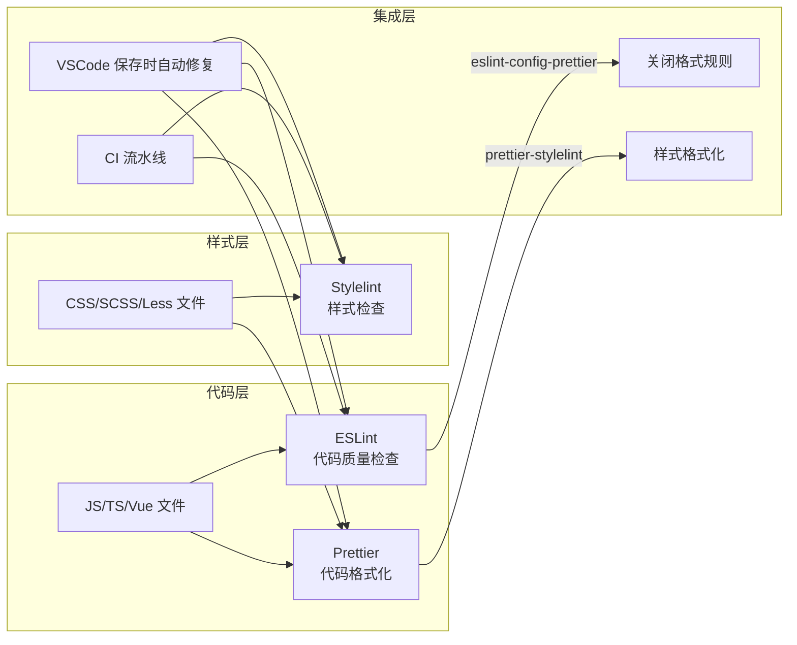
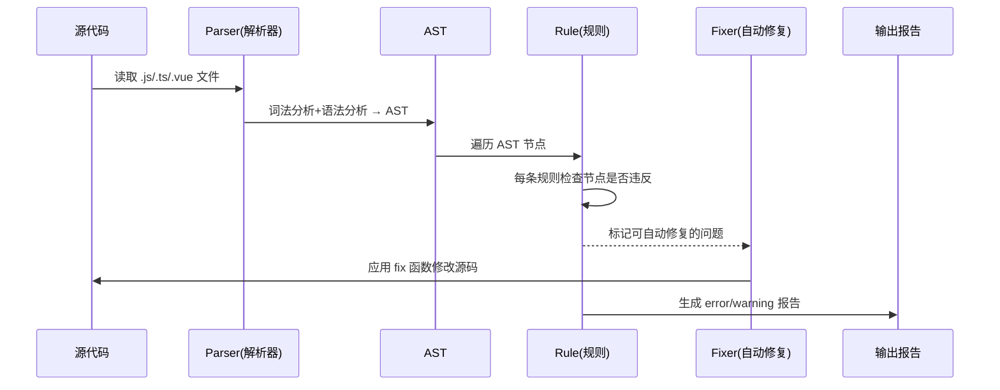
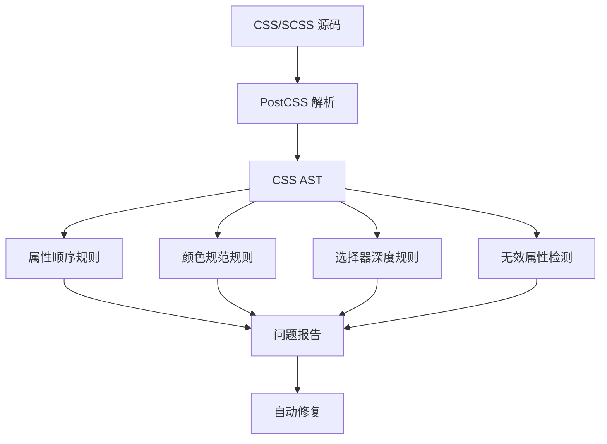

# ESLint + Prettier + Stylelint 规范

> **文档说明**：系统讲解前端代码规范三件套 ESLint（JS/TS 代码质量检查）、Prettier（代码格式化）、Stylelint（CSS/SCSS 样式检查）的职责边界、配置原理、集成方案与团队落地实践，含完整可运行配置、VSCode 集成、CI 流水线接入与常见冲突排查。
>
> **适用人群**：前端开发者、技术负责人、需要搭建团队代码规范体系的全栈工程师
>
> **前置知识**：[[Vue3-项目工程化搭建]]、[[TypeScript-类型系统进阶]]、npm 包管理基础

---

## 一、概述

### 1. 为什么需要三件套

前端项目中代码质量和格式问题通常分为三类，分别对应三个工具：

| 问题类型 | 典型表现 | 负责工具 | 检查维度 |
|---------|---------|---------|---------|
| **代码质量** | 未使用变量、`==` 比较、`console.log` 残留、潜在 bug | **ESLint** | 逻辑正确性、最佳实践、可维护性 |
| **代码格式** | 缩进不一致、引号不统一、行尾分号缺失、换行风格混乱 | **Prettier** | 纯格式，不涉及逻辑 |
| **样式质量** | CSS 属性顺序混乱、颜色值大小写、重复选择器、无效属性 | **Stylelint** | 样式规范、CSS 最佳实践 |

**核心原则：ESLint 管质量，Prettier 管格式，Stylelint 管样式。三者职责不重叠，通过 `eslint-config-prettier` 关闭 ESLint 中与格式相关的规则，避免冲突。**

### 2. 工具版本与生态



| 工具 | 当前稳定版 | 解析器 | 配置文件 |
|------|-----------|--------|---------|
| ESLint | 9.x（Flat Config） | `@typescript-eslint/parser` + `vue-eslint-parser` | `eslint.config.js` |
| Prettier | 3.x | 内置 | `.prettierrc` / `prettier.config.js` |
| Stylelint | 16.x | `postcss-scss`（SCSS） | `.stylelintrc` / `stylelint.config.js` |

> **注意**：ESLint 9.x 起默认使用 Flat Config（`eslint.config.js`），旧版 `.eslintrc.js` 已废弃。新项目强烈建议使用 Flat Config。

### 3. 与同类方案对比

| 方案 | 优点 | 缺点 | 适用场景 |
|------|------|------|---------|
| **ESLint + Prettier + Stylelint** | 生态最成熟、插件丰富、社区支持好 | 配置项多、需处理冲突 | 绝大多数前端项目 |
| Biome（Rome 继任者） | 单工具、Rust 编写速度极快、零配置 | 生态尚新、规则覆盖不全 | 新项目、追求速度 |
| StandardJS | 零配置、风格统一 | 不可定制、不支持 TS 原生 | 小型项目、个人开发 |
| oxlint | 极快（Rust） | 仅 lint 不格式化、规则少 | 大型 monorepo 加速 |

---

## 二、底层原理

### 1. ESLint 工作原理

ESLint 的核心是 **AST（抽象语法树）遍历 + 规则匹配**：



**关键组件**：

| 组件 | 作用 | 示例 |
|------|------|------|
| **Parser（解析器）** | 将源码转为 AST | `@typescript-eslint/parser`、`vue-eslint-parser` |
| **Rules（规则）** | 定义什么是违规 | `no-unused-vars`、`@typescript-eslint/no-explicit-any` |
| **Plugins（插件）** | 提供额外规则和解析器 | `@typescript-eslint/eslint-plugin`、`eslint-plugin-vue` |
| **Config（配置）** | 组合规则、插件、解析器 | Flat Config 数组 |
| **Fixer（修复器）** | 自动修复可修复的规则 | 每条规则可定义 `fix()` 函数 |
| **Formatter（格式化器）** | 输出报告的格式 | `stylish`、`json`、`unix` |

### 2. Prettier 工作原理

Prettier 与 ESLint 本质不同：**它不检查代码质量，而是重新打印（reprint）整个文件**。

```text
源代码 → 解析为 AST → 忽略原始格式 → 按 Prettier 规则重新打印 → 格式化后代码
```

**核心设计哲学**：
- **有主见（opinionated）**：格式选项极少，减少团队争论
- **确定性**：相同输入永远产生相同输出，与原始格式无关
- **全文件重打印**：不是局部修改，而是整个文件重新生成

**Prettier 不处理的事**（交给 ESLint）：
- 未使用变量
- `==` vs `===`
- 代码逻辑问题
- 最佳实践建议

### 3. Stylelint 工作原理

Stylelint 基于 **PostCSS** 解析 CSS/SCSS/Less，生成 CSS AST（包含 `root`、`rule`、`decl`、`atrule` 等节点），然后遍历检查。



### 4. 冲突消除原理

ESLint 和 Prettier 都可能修改代码格式，如果同时运行会产生冲突。解决方案是 **`eslint-config-prettier`**：

```text
eslint-config-prettier 的作用：关闭 ESLint 中所有与 Prettier 格式化功能重叠的规则
```

它不是添加规则，而是**关闭**以下类别的 ESLint 规则：
- 缩进类：`indent`
- 引号类：`quotes`
- 分号类：`semi`
- 逗号类：`comma-dangle`
- 空格类：`space-before-function-paren`
- 换行类：`object-curly-newline`

**运行顺序**：先 ESLint 修复质量问题 → 再 Prettier 格式化。或通过 `eslint-plugin-prettier` 将 Prettier 作为 ESLint 规则运行（不推荐，性能差）。

---

## 三、实操示例

### 1. 完整依赖安装

```bash
# ===== ESLint 9.x (Flat Config) =====
npm install -D eslint@^9 @eslint/js @typescript-eslint/parser @typescript-eslint/eslint-plugin

# Vue 支持
npm install -D eslint-plugin-vue vue-eslint-parser

# ===== Prettier =====
npm install -D prettier@^3 eslint-config-prettier

# ===== Stylelint =====
npm install -D stylelint@^16 stylelint-config-standard stylelint-config-recommended-scss stylelint-config-standard-scss postcss-scss

# ===== 工具集成 =====
npm install -D lint-staged @vue/eslint-config-prettier
```

### 2. ESLint Flat Config 完整配置

```javascript
// eslint.config.js
import js from '@eslint/js'
import tseslint from '@typescript-eslint/eslint-plugin'
import tsparser from '@typescript-eslint/parser'
import vue from 'eslint-plugin-vue'
import prettier from 'eslint-config-prettier'

export default [
  // 1. 全局忽略
  {
    ignores: [
      'dist/**',
      'node_modules/**',
      '*.config.js',
      'public/**',
      'src/assets/**',
    ],
  },

  // 2. JS 推荐规则
  js.configs.recommended,

  // 3. TypeScript 规则
  {
    files: ['**/*.{ts,tsx}'],
    languageOptions: {
      parser: tsparser,
      parserOptions: {
        ecmaVersion: 'latest',
        sourceType: 'module',
        project: './tsconfig.json',
      },
    },
    plugins: {
      '@typescript-eslint': tseslint,
    },
    rules: {
      ...tseslint.configs.recommended.rules,
      // 自定义规则
      '@typescript-eslint/no-explicit-any': 'warn',
      '@typescript-eslint/no-unused-vars': [
        'error',
        { argsIgnorePattern: '^_', varsIgnorePattern: '^_' },
      ],
      '@typescript-eslint/explicit-function-return-type': 'off',
      '@typescript-eslint/consistent-type-imports': [
        'error',
        { prefer: 'type-imports' },
      ],
      '@typescript-eslint/no-non-null-assertion': 'warn',
    },
  },

  // 4. Vue 规则
  ...vue.configs['flat/recommended'],
  {
    files: ['**/*.vue'],
    languageOptions: {
      parser: 'vue-eslint-parser',
      parserOptions: {
        parser: tsparser,
        ecmaVersion: 'latest',
        sourceType: 'module',
      },
    },
    rules: {
      'vue/multi-word-component-names': 'off',
      'vue/no-v-html': 'warn',
      'vue/require-default-prop': 'off',
      'vue/component-definition-name-casing': ['error', 'PascalCase'],
      'vue/attributes-order': 'error',
      'vue/no-multiple-template-root': 'off',
    },
  },

  // 5. 通用规则（所有文件）
  {
    rules: {
      'no-console': ['warn', { allow: ['warn', 'error'] }],
      'no-debugger': 'error',
      'no-alert': 'warn',
      'prefer-const': 'error',
      'no-var': 'error',
      'eqeqeq': ['error', 'always'],
      'curly': ['error', 'all'],
      'no-throw-literal': 'error',
      'prefer-promise-reject-errors': 'error',
    },
  },

  // 6. 必须放在最后：关闭与 Prettier 冲突的规则
  prettier,
]
```

### 3. Prettier 配置

```javascript
// prettier.config.js
export default {
  // 行宽
  printWidth: 100,
  // 缩进
  tabWidth: 2,
  useTabs: false,
  // 分号
  semi: false,
  // 单引号
  singleQuote: true,
  // 对象属性引号
  quoteProps: 'as-needed',
  // JSX 单引号
  jsxSingleQuote: false,
  // 尾随逗号
  trailingComma: 'all',
  // 对象大括号空格
  bracketSpacing: true,
  // 箭头函数参数括号
  arrowParens: 'always',
  // 换行符
  endOfLine: 'lf',
  // 嵌入语言格式化
  embeddedLanguageFormatting: 'auto',
  // Vue 文件中 <script> 和 <style> 缩进
  vueIndentScriptAndStyle: false,

  // 特定文件覆盖
  overrides: [
    {
      files: '*.md',
      options: {
        printWidth: 80,
        proseWrap: 'preserve',
      },
    },
    {
      files: '*.json',
      options: {
        printWidth: 120,
      },
    },
  ],
}
```

```ignore
# .prettierignore
dist
node_modules
public
*.min.js
*.min.css
package-lock.json
pnpm-lock.yaml
```

### 4. Stylelint 配置

```javascript
// stylelint.config.js
export default {
  extends: [
    'stylelint-config-standard',
    'stylelint-config-recommended-scss',
    'stylelint-config-standard-scss',
  ],
  plugins: ['stylelint-order'],
  rules: {
    // 颜色
    'color-hex-length': 'short',
    'color-no-invalid-hex': true,
    'color-function-notation': 'modern',

    // 字体
    'font-family-name-quotes': 'always-where-recommended',
    'font-weight-notation': 'numeric',

    // 选择器
    'selector-class-pattern': [
      '^([a-z][a-z0-9]*)(-[a-z0-9]+)*(__[a-z0-9]+(-[a-z0-9]+)*)?(--[a-z0-9]+(-[a-z0-9]+)*)?$',
      {
        message: '类名必须使用 BEM 命名法（block__element--modifier）',
      },
    ],
    'selector-max-id': 0,
    'selector-max-type': 2,
    'selector-max-compound-selectors': 4,
    'selector-no-qualifying-type': true,

    // 属性顺序（stylelint-order）
    'order/properties-order': [
      'position',
      'top',
      'right',
      'bottom',
      'left',
      'z-index',
      'display',
      'flex',
      'flex-direction',
      'flex-wrap',
      'justify-content',
      'align-items',
      'align-content',
      'grid',
      'grid-template',
      'width',
      'height',
      'margin',
      'padding',
      'border',
      'background',
      'color',
      'font',
      'text',
      'line-height',
      'opacity',
      'transition',
      'animation',
    ],

    // SCSS 特定
    'scss/at-rule-no-unknown': [
      true,
      {
        ignoreAtRules: ['tailwind', 'apply', 'variants', 'responsive', 'screen'],
      },
    ],
    'scss/dollar-variable-pattern': '^[a-z][a-z0-9-]*$',
    'scss/percent-placeholder-pattern': '^[a-z][a-z0-9-]*$',

    // 其他
    'declaration-block-no-duplicate-properties': true,
    'no-descending-specificity': null,
    'max-nesting-depth': 3,
    'declaration-block-single-line-max-declarations': 1,
  },
  ignoreFiles: ['dist/**', 'node_modules/**', 'src/assets/**/*.css'],
}
```

### 5. package.json 脚本

```json
{
  "scripts": {
    "lint": "eslint . --fix",
    "lint:check": "eslint .",
    "format": "prettier --write \"src/**/*.{js,ts,vue,json,css,scss,md}\"",
    "format:check": "prettier --check \"src/**/*.{js,ts,vue,json,css,scss,md}\"",
    "lint:style": "stylelint \"src/**/*.{css,scss,vue}\" --fix",
    "lint:style:check": "stylelint \"src/**/*.{css,scss,vue}\"",
    "lint:all": "npm run lint && npm run lint:style && npm run format:check"
  }
}
```

```text
### 6. lint-staged + Husky 集成
```

```bash
npm install -D husky lint-staged
npx husky init
```

```json
// package.json 中添加
{
  "lint-staged": {
    "*.{js,ts,vue}": ["eslint --fix", "prettier --write"],
    "*.{css,scss,vue}": ["stylelint --fix", "prettier --write"],
    "*.{json,md}": ["prettier --write"]
  }
}
```

```bash
# .husky/pre-commit
npx lint-staged
```

### 7. VSCode 配置

```json
// .vscode/settings.json
{
  // 默认格式化工具
  "editor.defaultFormatter": "esbenp.prettier-vscode",
  // 保存时自动格式化
  "editor.formatOnSave": true,
  // 保存时自动修复 ESLint
  "editor.codeActionsOnSave": {
    "source.fixAll.eslint": "explicit",
    "source.fixAll.stylelint": "explicit"
  },
  // ESLint 配置
  "eslint.validate": ["javascript", "typescript", "vue"],
  "eslint.workingDirectories": ["./"],
  // Stylelint 配置
  "stylelint.validate": ["css", "scss", "vue"],
  "stylelint.snippet": ["css", "scss", "vue"],
  // 特定语言格式化工具
  "[javascript]": {
    "editor.defaultFormatter": "esbenp.prettier-vscode"
  },
  "[typescript]": {
    "editor.defaultFormatter": "esbenp.prettier-vscode"
  },
  "[vue]": {
    "editor.defaultFormatter": "esbenp.prettier-vscode"
  },
  "[css]": {
    "editor.defaultFormatter": "esbenp.prettier-vscode"
  },
  "[scss]": {
    "editor.defaultFormatter": "esbenp.prettier-vscode"
  }
}
```

```json
// .vscode/extensions.json — 推荐插件
{
  "recommendations": [
    "dbaeumer.vscode-eslint",
    "esbenp.prettier-vscode",
    "stylelint.vscode-stylelint",
    "Vue.volar"
  ]
}
```

### 8. CI 流水线接入（GitHub Actions）

```yaml
# .github/workflows/lint.yml
name: Lint Check

on:
  pull_request:
    branches: [main, develop]
  push:
    branches: [main, develop]

jobs:
  lint:
    runs-on: ubuntu-latest
    steps:
      - uses: actions/checkout@v4

      - name: Setup Node.js
        uses: actions/setup-node@v4
        with:
          node-version: '20'
          cache: 'npm'

      - name: Install dependencies
        run: npm ci

      - name: ESLint Check
        run: npm run lint:check

      - name: Stylelint Check
        run: npm run lint:style:check

      - name: Prettier Check
        run: npm run format:check
```

---

## 四、常见问题与排查

### 1. ESLint 与 Prettier 冲突

| 现象 | 原因 | 解决方案 |
|------|------|---------|
| 保存后代码被反复修改 | ESLint 格式规则未关闭 | 确保 `eslint-config-prettier` 在配置数组**最后** |
| 引号/分号被改回 | VSCode 多个格式化工具冲突 | 明确设置 `editor.defaultFormatter` 为 Prettier |
| Vue 文件格式化异常 | 未配置 `vue-eslint-parser` | ESLint 配置中 Vue 文件使用 `vue-eslint-parser` |
| `--fix` 后仍有格式问题 | ESLint fix 与 Prettier 顺序问题 | 先跑 ESLint fix，再跑 Prettier write |

**排查命令**：
```bash
# 检查哪些 ESLint 规则与 Prettier 冲突
npx eslint-config-prettier-check src/main.ts

# 单独运行 ESLint（不修复）查看所有问题
npx eslint src/main.ts

# 单独运行 Prettier 检查格式
npx prettier --check src/main.ts

# 查看 Prettier 实际使用的配置
npx prettier --find-config-path src/main.ts
```

### 2. TypeScript 解析错误

| 现象 | 原因 | 解决方案 |
|------|------|---------|
| `Parsing error: "parserOptions.project"` | 未设置 `project` 或 tsconfig 路径错误 | 确保 `parserOptions.project: './tsconfig.json'` |
| 类型感知规则不生效 | 未使用 `@typescript-eslint/parser` | 配置正确的 parser |
| `.vue` 文件中 TS 报错 | Vue parser 未嵌套 TS parser | `parser: 'vue-eslint-parser'` + `parserOptions.parser: tsparser` |

### 3. Stylelint 常见问题

| 现象 | 原因 | 解决方案 |
|------|------|---------|
| SCSS `@include` 报未知 at-rule | 未配置 SCSS 忽略规则 | `scss/at-rule-no-unknown` 中 ignoreAtRules |
| Tailwind `@apply` 报错 | Stylelint 不认识 Tailwind 指令 | 在 `ignoreAtRules` 中添加 `tailwind`, `apply` 等 |
| 样式属性顺序报错 | 未配置 `stylelint-order` | 安装插件并配置 `order/properties-order` |
| Vue `<style scoped>` 报错 | 选择器深度限制 | 调整 `selector-max-compound-selectors` |

### 4. 性能优化

| 优化手段 | 说明 | 效果 |
|---------|------|------|
| `eslint --cache` | 缓存已检查文件，只检查变更文件 | 大型项目提速 5-10 倍 |
| 限制 `files` 范围 | 配置中明确 `files`，避免扫描无关文件 | 减少扫描量 |
| `lint-staged` | 只检查暂存区文件 | pre-commit 从分钟级降到秒级 |
| 关闭类型感知规则（可选） | `project` 配置会显著降低速度 | 对非关键规则关闭类型检查 |
| 使用 oxlint 替代（实验性） | Rust 编写，速度提升 50 倍 | 大型 monorepo |

```bash
# 启用 ESLint 缓存
npx eslint . --cache --cache-location .eslintcache

# 只检查特定目录
npx eslint src/components src/views

# 并行运行（ESLint 内置）
npx eslint . --cache
```

---

## 五、进阶与最佳实践

### 1. 团队规范落地流程


**关键步骤**：
1. **存量代码一次性格式化**：`npx prettier --write .` + `npx eslint . --fix`，单独提交，避免与业务代码混在一起
2. **渐进式启用规则**：先 `warn` 级别运行一周，修复存量问题后再升为 `error`
3. **规则文档化**：每条自定义规则在团队 Wiki 中说明原因和示例
4. **定期 review**：每季度 review 一次规则集，移除过时规则、添加新规则

### 2. Monorepo 配置

```javascript
// 根目录 eslint.config.js
import js from '@eslint/js'
import tseslint from '@typescript-eslint/eslint-plugin'
import prettier from 'eslint-config-prettier'

export default [
  { ignores: ['**/dist/**', '**/node_modules/**'] },
  js.configs.recommended,
  {
    files: ['**/*.ts'],
    languageOptions: {
      parser: '@typescript-eslint/parser',
      parserOptions: { project: ['./tsconfig.base.json'] },
    },
    plugins: { '@typescript-eslint': tseslint },
    rules: { ...tseslint.configs.recommended.rules },
  },
  prettier,
]
```

```json
// 各 package 可继承并覆盖
// packages/web/eslint.config.js
import baseConfig from '../../eslint.config.js'
import vue from 'eslint-plugin-vue'

export default [
  ...baseConfig,
  ...vue.configs['flat/recommended'],
  {
    files: ['**/*.vue'],
    rules: { 'vue/multi-word-component-names': 'off' },
  },
]
```

### 3. 自定义 ESLint 规则

当内置规则无法满足团队需求时，可以编写自定义规则：

```javascript
// eslint-plugin-custom/rules/no-api-url-in-code.js
module.exports = {
  meta: {
    type: 'problem',
    docs: { description: '禁止在代码中硬编码 API URL' },
    fixable: null,
    schema: [],
  },
  create(context) {
    return {
      Literal(node) {
        if (
          typeof node.value === 'string' &&
          /^https?:\/\/(?!localhost|127\.0\.0\.1)/.test(node.value) &&
          node.value.includes('/api/')
        ) {
          context.report({
            node,
            message: '禁止硬编码 API URL，请使用环境变量或 API 配置',
          })
        }
      },
    }
  },
}
```

### 4. 规则分级策略

| 级别 | 使用场景 | 示例 |
|------|---------|------|
| **error** | 必须修复，CI 不通过 | `no-debugger`、`no-unused-vars`、`eqeqeq` |
| **warn** | 建议修复，CI 可通过（存量过渡期） | `no-console`、`@typescript-eslint/no-explicit-any` |
| **off** | 不启用 | 团队不认同的规则、与 Prettier 冲突的规则 |

**渐进式启用模板**：
```javascript
// 第一周：全部 warn
'no-console': 'warn',
'@typescript-eslint/no-explicit-any': 'warn',

// 存量修复后：升为 error
'no-console': ['error', { allow: ['warn', 'error'] }],
'@typescript-eslint/no-explicit-any': 'error',
```

### 5. 与编辑器/IDE 集成清单

| IDE | ESLint 插件 | Prettier 插件 | Stylelint 插件 |
|-----|------------|--------------|---------------|
| VSCode | dbaeumer.vscode-eslint | esbenp.prettier-vscode | stylelint.vscode-stylelint |
| WebStorm | 内置 | 内置 | 内置 |
| Sublime Text | SublimeLinter-eslint | JsPrettier | SublimeLinter-stylelint |
| Vim/Neovim | null-ls / nvim-lint | null-ls / conform.nvim | null-ls / nvim-lint |

---

## 六、关联笔记

### 前端工程化
- [[Vue3-项目工程化搭建]] · [[Vite-构建工具原理与配置]] · [[Husky+Commitlint提交规范]]
- [[TypeScript-类型系统进阶]] · [[Monorepo架构与实践]] · [[前端性能优化]]

### 代码质量
- [[代码评审规范]] · [[架构设计原则-SOLID]] · [[性能优化方法论]]
- [[测试工程-Mock与Stub实战]]

### 工具链
- [[常用CLI工具速查]] · [[Git分支管理与工作流]] · [[CI-CD流水线设计]]

### 导航
- [[MOC-Vue3TS-四级展开]] · [[MOC-前端基础]] · [[MOC-工程化构建]]

> **学习路径建议**：先理解 [[Vue3-项目工程化搭建]] 整体架构 → 掌握本文三件套配置 → 结合 [[Husky+Commitlint提交规范]] 实现提交时自动检查 → 在 CI 流水线中强制运行 → 进阶学习自定义规则和 Monorepo 配置。
