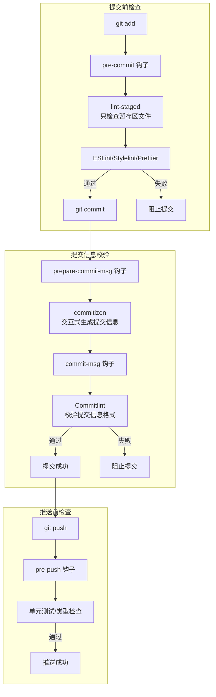
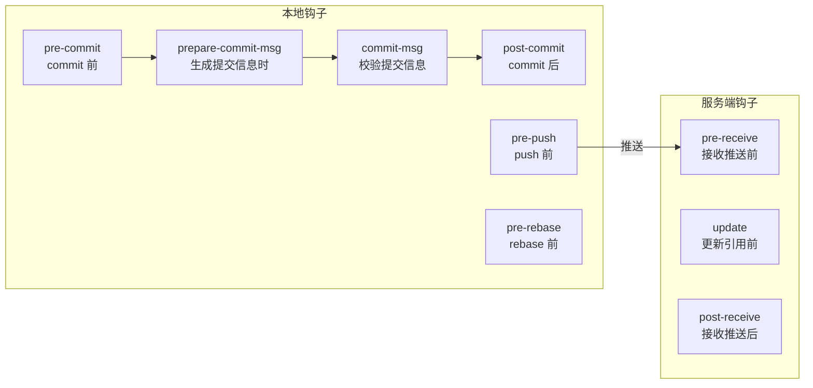
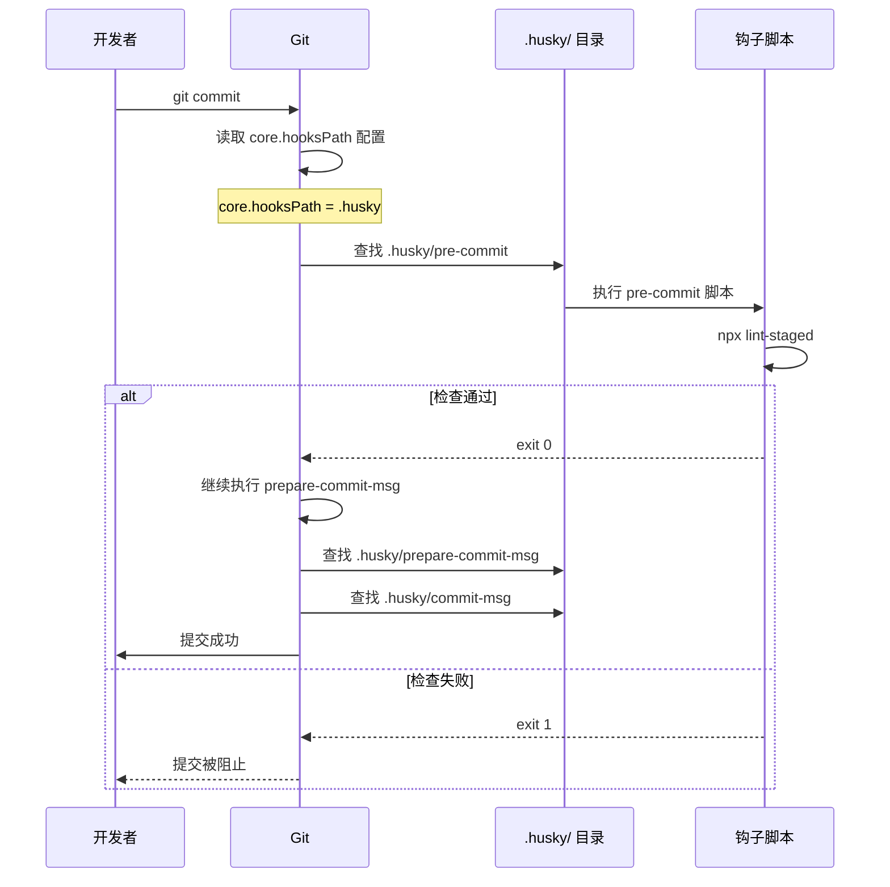
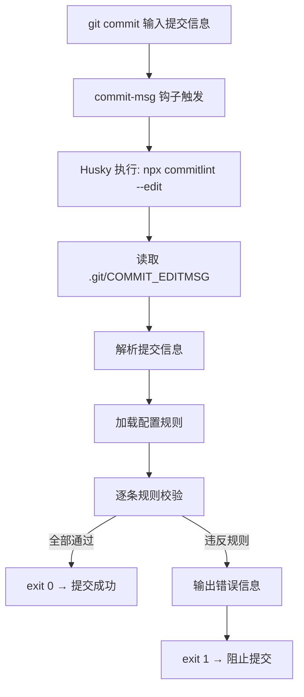
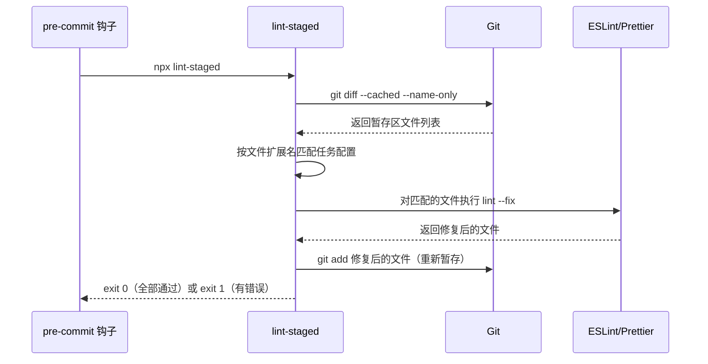
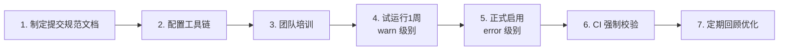

# Husky + Commitlint 提交规范

> **文档说明**：系统讲解 Git 提交规范体系，包括 Conventional Commits 规范、Husky Git 钩子管理、Commitlint 提交信息校验、commitizen 交互式提交、lint-staged 暂存区检查的完整集成方案，含配置文件、钩子脚本、团队落地流程与常见问题排查。
>
> **适用人群**：前端开发者、技术负责人、需要规范团队 Git 提交流程的全栈工程师
>
> **前置知识**：[[Git分支管理与工作流]]、[[ESLint+Prettier+Stylelint规范]]、npm 包管理基础

---

## 一、概述

### 1. 为什么需要提交规范

无规范的 Git 提交会导致以下问题：

| 问题 | 表现 | 影响 |
|------|------|------|
| **提交信息混乱** | `fix bug`、`update`、`asdf`、`修改了一些东西` | 无法从提交历史理解变更意图 |
| **大杂烩提交** | 一次提交包含功能开发+bug修复+格式调整 | 难以回滚、难以 Code Review |
| **无法自动生成 Changelog** | 提交信息无结构化格式 | 版本发布时需手动整理变更日志 |
| **无法触发自动化** | 提交信息不包含类型标识 | 无法根据提交类型自动打标签、发版 |
| **团队协作低效** | 每个人提交风格不同 | 审查历史时认知负担重 |

**提交规范体系的核心价值**：
1. **可读性**：一眼看出每次提交的类型和范围
2. **可自动化**：基于提交信息自动生成 Changelog、语义化版本
3. **可追溯**：提交信息与 Issue/PR 关联，形成完整追溯链
4. **团队一致性**：统一提交风格，降低协作成本

### 2. 工具链组成



| 工具 | 职责 | 版本 |
|------|------|------|
| **Husky** | 管理 Git 钩子（hooks），在特定 Git 事件时触发脚本 | 9.x |
| **Commitlint** | 校验 commit message 是否符合 Conventional Commits 规范 | 19.x |
| **commitizen** | 交互式命令行工具，引导生成规范的提交信息 | 4.x |
| **lint-staged** | 对暂存区（staged）文件运行 lint，只检查变更文件 | 15.x |
| **@commitlint/config-conventional** | Conventional Commits 规范的预设规则集 | 19.x |

### 3. Conventional Commits 规范

Conventional Commits 是提交信息的事实标准，格式如下：

```json
<type>[optional scope]: <description>

[optional body]

[optional footer(s)]
```

**type（类型）**：

| type | 说明 | 示例 |
|------|------|------|
| `feat` | 新功能 | `feat: 添加用户登录功能` |
| `fix` | Bug 修复 | `fix: 修复登录页验证码不刷新问题` |
| `docs` | 文档变更 | `docs: 更新 README 安装说明` |
| `style` | 代码格式（不影响功能） | `style: 统一使用单引号` |
| `refactor` | 重构（既不新增功能也不修 bug） | `refactor: 抽离用户服务为独立模块` |
| `perf` | 性能优化 | `perf: 优化列表渲染性能` |
| `test` | 测试相关 | `test: 添加用户服务单元测试` |
| `build` | 构建系统/依赖变更 | `build: 升级 Vite 到 5.0` |
| `ci` | CI 配置变更 | `ci: 添加 GitHub Actions  lint 工作流` |
| `chore` | 杂项（不修改 src 或测试） | `chore: 更新 .gitignore` |
| `revert` | 回滚提交 | `revert: 回滚 feat: 添加用户登录功能` |

**scope（范围，可选）**：说明变更影响的模块/范围，如 `auth`、`user`、`api`、`ui`。

**description（描述）**：简短说明，祈使句语气，不超过 50 字符，不加句号。

**body（正文，可选）**：详细说明变更的原因、内容、影响，每行不超过 72 字符。

**footer（页脚，可选）**：关联 Issue、BREAKING CHANGE 声明等。

**完整示例**：
```text
feat(auth): 添加 OAuth2 第三方登录

- 支持 GitHub 和 Google 登录
- 新增用户绑定/解绑功能
- 登录页添加第三方登录入口

Closes #123
BREAKING CHANGE: 用户表新增 oauth_provider 字段，需执行迁移
```

---

## 二、底层原理

### 1. Git 钩子机制

Git 钩子是存储在 `.git/hooks/` 目录下的可执行脚本，在 Git 操作的特定阶段自动触发。



**常用钩子**：

| 钩子 | 触发时机 | 常用场景 | 非零退出码 |
|------|---------|---------|-----------|
| `pre-commit` | `git commit` 执行前，还未生成提交对象 | lint-staged 代码检查 | 阻止提交 |
| `prepare-commit-msg` | 提交信息编辑器打开前 | commitizen 交互式生成信息 | 阻止提交 |
| `commit-msg` | 提交信息已输入，提交对象生成前 | Commitlint 校验格式 | 阻止提交 |
| `post-commit` | 提交完成后 | 通知、日志（不能阻止提交） | 无影响 |
| `pre-push` | `git push` 执行前 | 运行测试、类型检查 | 阻止推送 |
| `pre-rebase` | `git rebase` 执行前 | 禁止 rebase 特定分支 | 阻止 rebase |

**Git 钩子的问题**：
- `.git/hooks/` 目录**不被 Git 版本控制**，团队成员无法共享
- 手动管理钩子脚本繁琐，升级困难
- 跨平台兼容性问题（Windows 下 shell 脚本执行）

### 2. Husky 工作原理

Husky 解决了 Git 钩子不可共享的问题，核心机制是 **`core.hooksPath` 配置**：

```text
Husky 安装时执行：git config core.hooksPath .husky
```

这会将 Git 钩子的查找路径从默认的 `.git/hooks/` 改为项目根目录下的 `.husky/`，而 `.husky/` 目录**可以被 Git 版本控制**，从而实现钩子的团队共享。



**Husky 9.x 关键变化**：
- 不再需要 `husky install` 命令，使用 `husky` 命令自动初始化
- 钩子脚本使用 POSIX sh 语法，跨平台兼容
- 支持 `husky add` 命令添加钩子

### 3. Commitlint 工作原理

Commitlint 读取 `.git/COMMIT_EDITMSG` 文件中的提交信息，按照配置的规则集进行校验。



**Commitlint 规则结构**：
```javascript
// 规则格式：[level, applicable, value]
// level: 0=关闭, 1=警告, 2=错误
// applicable: 'always'=必须满足, 'never'=必须不满足
// value: 规则的具体值

rules: {
  'type-enum': [2, 'always', ['feat', 'fix', 'docs', 'style', 'refactor', 'perf', 'test', 'build', 'ci', 'chore', 'revert']],
  'subject-max-length': [2, 'always', 50],
  'header-max-length': [2, 'always', 72],
}
```

### 4. lint-staged 工作原理

lint-staged 的核心优化是 **只对暂存区（git staged）的文件运行 lint**，避免全量检查。



**关键特性**：
- 只检查变更文件，速度快
- 自动 `--fix` 并重新 `git add`
- 支持按文件类型并行执行不同任务
- 支持 glob 模式匹配

---

## 三、实操示例

### 1. 完整依赖安装

```bash
# ===== Husky =====
npm install -D husky@^9

# ===== Commitlint =====
npm install -D @commitlint/cli@^19 @commitlint/config-conventional@^19

# ===== commitizen（交互式提交）=====
npm install -D commitizen@^4 cz-git@^1

# ===== lint-staged =====
npm install -D lint-staged@^15
```

### 2. Husky 初始化与钩子配置

```bash
# 初始化 Husky（会创建 .husky 目录并配置 core.hooksPath）
npx husky init

# 添加 pre-commit 钩子
# 编辑 .husky/pre-commit
```

```bash
# .husky/pre-commit
npx lint-staged
```

```bash
# .husky/commit-msg
npx --no -- commitlint --edit "$1"
```

```bash
# .husky/pre-push（可选：推送前运行测试）
npm run test:unit
```

> **注意**：Husky 9.x 的钩子脚本第一行必须是 `npx ...` 或其他可执行命令，不需要 `#!/bin/sh` 声明（Husky 会自动处理）。

**package.json 中确保 prepare 脚本**：
```json
{
  "scripts": {
    "prepare": "husky"
  }
}
```
`prepare` 脚本会在 `npm install` 后自动执行，确保每个团队成员安装依赖后 Husky 钩子生效。

### 3. Commitlint 配置

```javascript
// commitlint.config.js
export default {
  extends: ['@commitlint/config-conventional'],
  rules: {
    // ===== type 规则 =====
    'type-enum': [
      2,
      'always',
      [
        'feat',     // 新功能
        'fix',      // 修复 bug
        'docs',     // 文档
        'style',    // 格式（不影响代码运行）
        'refactor', // 重构（既不是新增功能也不是修 bug）
        'perf',     // 性能优化
        'test',     // 测试
        'build',    // 构建系统/依赖
        'ci',       // CI 配置
        'chore',    // 杂项
        'revert',   // 回滚
        'wip',      // 开发中（可选）
      ],
    ],
    'type-case': [2, 'always', 'lowerCase'],
    'type-empty': [2, 'never'],

    // ===== scope 规则 =====
    'scope-case': [2, 'always', 'lowerCase'],
    'scope-empty': [0, 'never'], // scope 可选

    // ===== subject 规则 =====
    'subject-empty': [2, 'never'],
    'subject-full-stop': [2, 'never', '.'],
    'subject-max-length': [2, 'always', 50],
    'subject-case': [0, 'never'], // 不强制大小写（中文提交友好）

    // ===== header 规则 =====
    'header-max-length': [2, 'always', 72],

    // ===== body 规则 =====
    'body-leading-blank': [2, 'always'],
    'body-max-line-length': [2, 'always', 100],

    // ===== footer 规则 =====
    'footer-leading-blank': [2, 'always'],
    'footer-max-line-length': [2, 'always', 100],

    // ===== 特殊规则 =====
    'references-empty': [0, 'never'], // 不强制引用 Issue
  },

  // 忽略特定提交（如 merge commit、版本发布）
  ignores: [(commit) => commit.startsWith('Merge branch')],

  // 自定义解析器（支持中文 scope 等）
  parserPreset: {
    parserOpts: {
      headerPattern: /^(\w*)(?:\((.*)\))?!?:\s(.*)$/,
      headerCorrespondence: ['type', 'scope', 'subject'],
    },
  },
}
```

```text
### 4. lint-staged 配置
```

```javascript
// lint-staged.config.js
export default {
  // JS/TS/Vue 文件：ESLint 修复 + Prettier 格式化
  '*.{js,jsx,ts,tsx,vue}': ['eslint --fix', 'prettier --write'],

  // CSS/SCSS 文件：Stylelint 修复 + Prettier 格式化
  '*.{css,scss,less}': ['stylelint --fix', 'prettier --write'],

  // JSON/MD 文件：Prettier 格式化
  '*.{json,md,yml,yaml}': ['prettier --write'],

  // 图片文件：压缩（可选，需安装 lint-staged-imagemin）
  // '*.{png,jpeg,jpg,gif,svg}': ['imagemin-lint-staged'],
}
```

或在 package.json 中配置：
```json
{
  "lint-staged": {
    "*.{js,jsx,ts,tsx,vue}": ["eslint --fix", "prettier --write"],
    "*.{css,scss,less}": ["stylelint --fix", "prettier --write"],
    "*.{json,md,yml,yaml}": ["prettier --write"]
  }
}
```

### 5. commitizen + cz-git 交互式提交

```javascript
// cz.config.js — cz-git 配置
export default {
  types: [
    { value: 'feat', name: 'feat:     新功能', emoji: '✨' },
    { value: 'fix', name: 'fix:      修复 bug', emoji: '🐛' },
    { value: 'docs', name: 'docs:     文档变更', emoji: '📝' },
    { value: 'style', name: 'style:    代码格式', emoji: '💄' },
    { value: 'refactor', name: 'refactor: 代码重构', emoji: '♻️' },
    { value: 'perf', name: 'perf:     性能优化', emoji: '⚡' },
    { value: 'test', name: 'test:     测试相关', emoji: '✅' },
    { value: 'build', name: 'build:    构建系统', emoji: '📦' },
    { value: 'ci', name: 'ci:       CI 配置', emoji: '👷' },
    { value: 'chore', name: 'chore:    杂项更新', emoji: '🔧' },
    { value: 'revert', name: 'revert:   回滚提交', emoji: '⏪' },
  ],
  scopes: [
    { name: 'auth', description: '认证相关' },
    { name: 'user', description: '用户模块' },
    { name: 'api', description: 'API 接口' },
    { name: 'ui', description: 'UI 组件' },
    { name: 'router', description: '路由相关' },
    { name: 'store', description: '状态管理' },
    { name: 'build', description: '构建配置' },
    { name: 'deps', description: '依赖升级' },
  ],
  useEmoji: true,
  emojiAlign: 'center',
  allowCustomScopes: true,
  allowEmptyScopes: true,
  customScopesAlign: 'bottom',
  upperCaseSubject: false,
  breaklineNumber: 100,
  breaklineChar: '|',
  skipQuestions: ['body', 'footer'],
  issuePrefixs: [{ value: 'closes #', name: '关闭 Issue: closes #' }],
  customIssuePrefixsAlign: 'top',
  confirmColorize: true,
  maxHeaderLength: 72,
  maxSubjectLength: 50,
  minSubjectLength: 0,
  scopeOverrides: {
    fix: [{ name: 'merge', description: '合并分支' }],
  },
  defaultType: '',
  defaultScope: '',
  defaultSubject: '',
  defaultBody: '',
  defaultFooter: '',
  defaultIssues: '',
}
```

```json
// package.json
{
  "scripts": {
    "commit": "git-cz",
    "cz": "git-cz"
  },
  "config": {
    "commitizen": {
      "path": "node_modules/cz-git"
    }
  }
}
```

使用方式：
```bash
# 代替 git commit，进入交互式提交
npm run commit
# 或
npx git-cz
```

### 6. 自动生成 Changelog

```bash
npm install -D conventional-changelog-cli
```

```json
{
  "scripts": {
    "changelog": "conventional-changelog -p angular -i CHANGELOG.md -s -r 0",
    "changelog:update": "conventional-changelog -p angular -i CHANGELOG.md -s",
    "release": "npm run changelog:update && git add CHANGELOG.md && git commit -m 'docs: 更新 CHANGELOG' && npm version patch"
  }
}
```

```bash
# 生成完整 Changelog（所有版本）
npm run changelog

# 增量更新（只添加最新版本）
npm run changelog:update
```

### 7. 语义化版本自动发布（standard-version）

```bash
npm install -D standard-version
```

```json
{
  "scripts": {
    "release": "standard-version",
    "release:minor": "standard-version --release-as minor",
    "release:major": "standard-version --release-as major",
    "release:patch": "standard-version --release-as patch"
  }
}
```

`standard-version` 会自动：
1. 根据提交信息（feat→minor, fix→patch, BREAKING CHANGE→major）升级版本号
2. 更新 CHANGELOG.md
3. 提交变更并打 Git tag

### 8. 完整目录结构

```text
项目根目录/
├── .husky/
│   ├── pre-commit          # lint-staged 检查
│   ├── commit-msg          # Commitlint 校验
│   ├── pre-push            # 测试/类型检查（可选）
│   └── _/
│       └── husky.sh        # Husky 内部脚本
├── commitlint.config.js    # Commitlint 配置
├── cz.config.js            # commitizen/cz-git 配置
├── lint-staged.config.js   # lint-staged 配置
├── .czrc                   # commitizen 配置（可选）
├── CHANGELOG.md            # 自动生成的变更日志
└── package.json
```

---

## 四、常见问题与排查

### 1. Husky 钩子不生效

| 现象 | 原因 | 解决方案 |
|------|------|---------|
| 提交时钩子未触发 | `core.hooksPath` 未配置 | 运行 `npx husky` 或 `git config core.hooksPath .husky` |
| Windows 下钩子报错 | 脚本无执行权限 | Husky 9.x 自动处理，确保使用 `npx husky init` |
| 钩子脚本为空 | 手动创建文件未写内容 | 确保 `.husky/pre-commit` 中有 `npx lint-staged` |
| `prepare` 脚本未执行 | npm 版本过低或使用了 `--ignore-scripts` | 升级 npm，不要使用 `--ignore-scripts` |
| SourceTree 等 GUI 工具不触发 | GUI 工具的 Git 环境变量问题 | 在钩子脚本中添加 PATH 导出：`export PATH="/usr/local/bin:$PATH"` |

**排查命令**：
```bash
# 检查 hooksPath 配置
git config core.hooksPath
# 应输出: .husky

# 手动测试钩子
bash .husky/pre-commit

# 检查 Git 版本（Husky 9.x 需要 Git >= 2.13）
git --version

# 查看 Husky 调试信息
HUSKY_DEBUG=1 git commit -m "test"
```

### 2. Commitlint 校验问题

| 现象 | 原因 | 解决方案 |
|------|------|---------|
| 中文提交信息报错 | `subject-case` 规则强制小写 | 设置 `'subject-case': [0, 'never']` 关闭大小写检查 |
| `type-enum` 报错 | 使用了未定义的 type | 在 `type-enum` 列表中添加自定义 type |
| 长提交信息被拒 | `header-max-length` 限制 | 缩短 header，详细内容放 body |
| Merge commit 被拦截 | 未配置忽略 | 添加 `ignores: [(commit) => commit.startsWith('Merge')]` |
| `commitlint --edit` 找不到文件 | `$1` 未正确传递 | 确保钩子脚本为 `npx --no -- commitlint --edit "$1"` |

**测试 Commitlint**：
```bash
# 测试提交信息是否符合规范
echo "feat: 测试提交" | npx commitlint

# 测试不符合规范的提交信息
echo "fix bug" | npx commitlint
# 应报错：type may not be empty.

# 查看当前配置的所有规则
npx commitlint --print-config
```

```text
### 3. lint-staged 问题
```

| 现象 | 原因 | 解决方案 |
|------|------|---------|
| 修复后文件未暂存 | lint-staged 未自动 `git add` | 确保配置中使用 `--fix`，lint-staged 会自动重新暂存 |
| 全量文件被检查 | 配置错误，未正确匹配 staged 文件 | 检查 `git diff --cached --name-only` 输出 |
| ESLint 缓存导致旧问题 | ESLint 缓存了旧结果 | 删除 `.eslintcache`，或使用 `--no-cache` |
| 并行任务冲突 | 多个任务同时修改同一文件 | 确保同一文件类型的任务按顺序执行 |
| Windows 路径问题 | glob 模式不兼容 | 使用正斜杠 `/`，避免反斜杠 `\` |

**调试 lint-staged**：
```bash
# 调试模式：查看详细输出
npx lint-staged --debug

# 只检查不修复
npx lint-staged --no-stash

# 查看暂存区文件
git diff --cached --name-only
```

### 4. 绕过钩子（紧急情况）

```bash
# 跳过所有钩子（不推荐，仅紧急情况）
git commit --no-verify -m "紧急修复"
git push --no-verify

# 或使用环境变量（Husky 9.x）
HUSKY=0 git commit -m "跳过钩子"
```

> **警告**：`--no-verify` 会跳过所有检查，可能导致不规范代码进入仓库。建议仅在紧急修复时使用，事后补充规范提交。

### 5. 存量提交信息不规范

对于历史提交信息不规范的问题：
1. **不修改历史**：历史提交保持原样，从当前开始执行规范
2. **交互式 rebase（最近 N 条）**：
   ```bash
   git rebase -i HEAD~10
   # 将需要修改的提交标记为 reword，然后逐条修改
   ```
3. **filter-branch（全量历史，慎用）**：会改变所有 commit hash，不推荐在共享仓库使用

---

## 五、进阶与最佳实践

### 1. 团队落地流程



**关键步骤**：
1. **制定规范文档**：在团队 Wiki 中明确 type 定义、scope 列表、描述规范
2. **配置工具链**：Husky + Commitlint + lint-staged + commitizen
3. **团队培训**：演示交互式提交流程，说明常见错误
4. **试运行**：第一周 Commitlint 设为 warn 级别，只警告不阻止
5. **正式启用**：升级为 error，CI 中添加提交信息检查
6. **定期回顾**：每月回顾提交数据，优化 scope 列表和规则

### 2. Monorepo 中的 scope 管理

在 Monorepo 中，scope 可以对应具体的 package：

```javascript
// commitlint.config.js
export default {
  extends: ['@commitlint/config-conventional'],
  rules: {
    'scope-enum': [
      2,
      'always',
      [
        'web',        // packages/web
        'api',        // packages/api
        'ui',         // packages/ui
        'shared',     // packages/shared
        'config',     // 配置文件
        'deps',       // 依赖升级
        'release',    // 版本发布
      ],
    ],
  },
}
```

```bash
# 示例提交
feat(web): 添加用户中心页面
fix(api): 修复用户接口超时
chore(deps): 升级 vue 到 3.4
```

### 3. 与 Issue 系统集成

```javascript
// commitlint.config.js
export default {
  extends: ['@commitlint/config-conventional'],
  rules: {
    'references-empty': [2, 'never'], // 强制引用 Issue
  },
  parserPreset: {
    parserOpts: {
      issuePrefixes: ['#', 'PROJ-'],
    },
  },
}
```

提交示例：
```text
feat(auth): 添加 OAuth2 登录

Closes #123
Related to PROJ-456
```

**GitLab/GitHub 自动关联**：
- `Closes #123` / `Fixes #123` / `Resolves #123`：合并后自动关闭 Issue
- `Related to #123`：仅关联，不关闭

### 4. 提交信息度量与分析

```bash
# 统计各 type 的提交数量
git log --pretty=format:%s | grep -oE '^\w+' | sort | uniq -c | sort -rn

# 统计各作者的提交数量
git shortlog -sn --all

# 查看最近一个月的提交趋势
git log --since="1 month ago" --pretty=format:%ad --date=short | sort | uniq -c

# 导出提交数据用于分析
git log --pretty=format:'%h,%an,%ad,%s' --date=short > commits.csv
```

### 5. 高级：自定义 Commitlint 规则插件

```javascript
// commitlint-plugin-custom/rules/scope-package-exists.js
module.exports = {
  rules: {
    'scope-package-exists': (parsed, when, value) => {
      const { scope } = parsed
      if (!scope) return [true] // scope 可选

      const fs = require('fs')
      const path = require('path')
      const packagePath = path.join(process.cwd(), 'packages', scope)
      const exists = fs.existsSync(packagePath)

      return [
        exists,
        `scope "${scope}" 不在 packages/ 目录中，请使用有效的 package 名称`,
      ]
    },
  },
}
```

```javascript
// commitlint.config.js
import customPlugin from './commitlint-plugin-custom/index.js'

export default {
  extends: ['@commitlint/config-conventional'],
  plugins: [customPlugin],
  rules: {
    'scope-package-exists': [2, 'always'],
  },
}
```

### 6. 提交规范检查清单

| 检查项 | 标准 |
|--------|------|
| type 是否正确 | 必须在预定义列表中 |
| scope 是否合适 | 对应变更的模块/package |
| description 是否清晰 | 祈使句、简洁、说明"做了什么" |
| 是否包含无关变更 | 一次提交只做一件事 |
| 是否关联 Issue | footer 中包含 Closes/Fixes |
| 是否有 BREAKING CHANGE | 不兼容变更必须在 footer 声明 |
| 描述是否超过 50 字符 | 超长内容放 body |

---

## 六、关联笔记

### 前端工程化
- [[ESLint+Prettier+Stylelint规范]] · [[Vue3-项目工程化搭建]] · [[Vite-构建工具原理与配置]]
- [[Monorepo架构与实践]] · [[CI-CD流水线设计]]

```text
### Git 与协作
```
- [[Git分支管理与工作流]] · [[代码评审规范]] · [[Git版本控制核心命令]]
- [[Git进阶技巧与最佳实践]]

### 项目管理
- [[项目启动文档模板]] · [[项目复盘模板]] · [[开源项目README规范]]
- [[敏捷开发与Scrum]]

### 导航
- [[MOC-Vue3TS-四级展开]] · [[MOC-工程化构建]] · [[MOC-Git版本控制]]

> **学习路径建议**：先掌握 [[Git分支管理与工作流]] 理解 Git 工作流 → 学习本文 Husky+Commitlint 规范提交 → 结合 [[ESLint+Prettier+Stylelint规范]] 实现提交时代码检查 → 配置 [[CI-CD流水线设计]] 在服务端强制校验 → 进阶学习 Changelog 自动生成和语义化版本发布。
