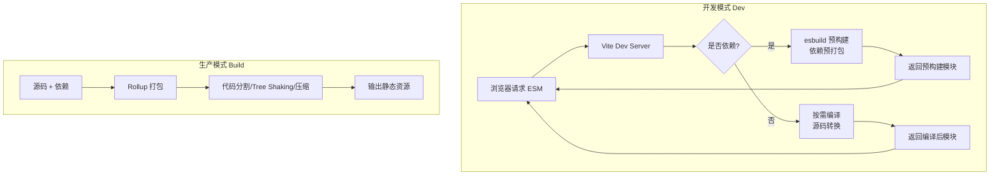
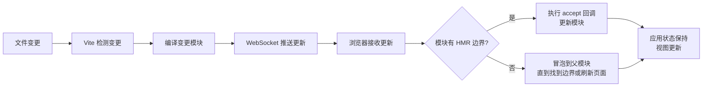

# Vite 构建原理与插件开发

> **文档说明**：系统讲解 Vite 构建工具的核心原理，包括开发服务器（原生 ESM）、依赖预构建（esbuild）、HMR 热更新、生产构建（Rollup）、插件 API 与开发实战、配置详解、性能优化，以及常见问题排查，含丰富的代码示例和插件开发实战。
>
> **适用人群**：前端开发工程师、全栈开发者、需要深入理解构建工具的工程师、插件开发者
>
> **前置知识**：[[前端工程化知识点系统梳理_优化版]]、[[pnpm-monorepo架构]]、[[JavaScript-ES6核心语法]]

---

## 一、概述

### 1. 什么是 Vite

**Vite**（法语意为"快速"，发音 /vit/）是由 Evan You（Vue.js 作者）创建的新一代前端构建工具，利用浏览器原生 ES 模块和 esbuild 预构建，实现极快的开发服务器启动和热更新。

### 2. Vite vs Webpack

| 维度 | Webpack | Vite |
|------|---------|------|
| **开发模式** | 打包整个应用后启动 | 利用原生 ESM，按需编译 |
| **启动速度** | 慢（随项目增大线性增长） | 快（几乎恒定，与项目大小无关） |
| **HMR** | 重新打包受影响模块 | 精确更新变更模块，极快 |
| **构建工具** | 自身（JavaScript） | 开发用 esbuild（Go），生产用 Rollup |
| **配置** | 复杂，loader/plugin 体系庞大 | 简单，开箱即用 |
| **生态成熟度** | 非常成熟 | 快速增长，主流框架支持 |
| **冷启动** | 几秒到几十秒 | 几百毫秒 |
| **按需加载** | 需配置 | 原生支持 |

### 3. Vite 核心特性

| 特性 | 说明 |
|------|------|
| **极速冷启动** | 利用原生 ESM，不需打包整个应用 |
| **即时 HMR** | 精确模块热更新，不随项目增大变慢 |
| **丰富功能** | TypeScript、JSX、CSS、CSS Modules、JSON 等开箱支持 |
| **优化构建** | 生产环境使用 Rollup 构建，预配置多格式输出 |
| **通用插件** | 开发和生产共用 Rollup 插件接口 |
| **完全类型化** | 灵活的 API 和完整的 TypeScript 类型 |
| **框架无关** | 支持 Vue、React、Svelte、Preact、Solid 等 |

### 4. Vite 架构



---

## 二、开发服务器原理

### 1. 原生 ESM 驱动

Vite 开发服务器的核心是利用浏览器原生 ES 模块支持，不需打包整个应用，而是按需编译和返回模块。

```html
<!-- 浏览器直接加载 ESM -->
<script type="module" src="/src/main.js"></script>
```

```javascript
// main.js
import { createApp } from 'vue'
import App from './App.vue'
import './style.css'

createApp(App).mount('#app')
```

**浏览器请求流程**：
1. 浏览器请求 `/src/main.js`
2. Vite 服务器接收请求，编译 main.js（处理 import 路径重写）
3. 浏览器解析 main.js，发现依赖 `vue`、`./App.vue`、`./style.css`
4. 浏览器分别请求这些依赖
5. Vite 按需编译每个依赖并返回
6. 递归直到所有依赖加载完成

### 2. Import 路径重写

Vite 需要重写 import 路径，将裸模块（bare import）转换为正确的路径：

```javascript
// 源码
import { createApp } from 'vue'
import App from './App.vue'

// Vite 重写后
import { createApp } from '/node_modules/.vite/deps/vue.js?v=xxx'
import App from '/src/App.vue'
```

**路径重写规则**：
| 原始路径 | 重写后 | 说明 |
|---------|--------|------|
| `vue` | `/node_modules/.vite/deps/vue.js` | 裸模块 → 预构建路径 |
| `./App.vue` | `/src/App.vue` | 相对路径 → 绝对路径 |
| `@/components/Button` | `/src/components/Button.vue` | 别名 → 解析后路径 |
| `./style.css` | `/src/style.css` | CSS → JS 注入 |

### 3. 中间件架构

Vite 开发服务器基于 Connect 中间件架构，请求经过一系列中间件处理：

```text
请求 → [重定向中间件] → [URL 规范化中间件] → [transformMiddleware] → [静态文件中间件] → 404
```

**核心中间件**：
| 中间件 | 说明 |
|--------|------|
| `redirectMiddleware` | 处理目录重定向（/path → /path/） |
| `transformMiddleware` | 核心：编译转换源码模块 |
| `serveStaticMiddleware` | 提供静态文件服务 |
| `indexHtmlMiddleware` | 处理 index.html |
| `hmrMiddleware` | WebSocket HMR 通信 |
| `proxyMiddleware` | 代理请求 |

---

## 三、依赖预构建

### 1. 为什么需要预构建

| 问题 | 说明 |
|------|------|
| **CommonJS 兼容** | 很多依赖是 CommonJS 格式，浏览器 ESM 无法直接加载 |
| **性能优化** | 一个依赖可能有上百个模块，逐个请求性能差，预构建合并为一个文件 |
| **缓存** | 预构建结果缓存，依赖不变时不需重新构建 |

### 2. esbuild 预构建

Vite 使用 **esbuild**（Go 编写的极速构建工具）进行依赖预构建，速度比 JavaScript 打包工具快 10-100 倍。

```text
node_modules/
  └── .vite/
       ├── deps/              # 预构建输出目录
       │    ├── vue.js        # 预构建后的 vue
       │    ├── vue.js.map    # sourcemap
       │    ├── react.js
       │    └── _metadata.json # 预构建元数据
       └── deps_temp/         # 临时目录（构建中）
```

### 3. 预构建触发时机

| 时机 | 说明 |
|------|------|
| **首次启动** | 没有缓存时，自动预构建所有依赖 |
| **依赖变化** | package.json 变化、lockfile 变化、vite.config 变化 |
| **缓存失效** | 手动删除 .vite 目录或 `--force` 强制重新构建 |
| **缺失依赖** | 运行时发现未预构建的依赖，自动触发按需预构建 |

### 4. 预构建配置

```typescript
// vite.config.ts
import { defineConfig } from 'vite'

export default defineConfig({
  optimizeDeps: {
    // 强制预构建的依赖（默认自动扫描）
    include: ['vue', 'vue-router', 'pinia', 'lodash-es'],

    // 排除预构建的依赖（如 ESM 原生支持的依赖）
    exclude: ['my-esm-package'],

    // esbuild 配置
    esbuildOptions: {
      target: 'es2020',
      jsx: 'automatic',
      jsxImportSource: 'react',
      define: {
        __VERSION__: '"1.0.0"'
      }
    },

    // 强制重新预构建（清除缓存）
    force: true,

    // 扫描入口文件（默认 index.html）
    entries: ['index.html', 'src/admin.html']
  }
})
```

```bash
# 命令行强制重新预构建
vite --force
vite --optimize-deps
```

---

## 四、HMR 热更新原理

### 1. HMR 概述

**HMR（Hot Module Replacement）** 允许在不刷新页面的情况下，更新、添加、删除模块，保持应用状态不丢失。



### 2. WebSocket 通信

Vite 使用 WebSocket 在开发服务器和浏览器之间建立长连接，推送 HMR 更新。

```javascript
// 浏览器端（Vite 自动注入）
const socket = new WebSocket(`ws://${location.host}/`, 'vite-hmr')

socket.addEventListener('message', ({ data }) => {
  const payload = JSON.parse(data)
  switch (payload.type) {
    case 'update':
      // 模块更新
      payload.updates.forEach(update => {
        fetchUpdate(update)
      })
      break
    case 'full-reload':
      // 全量刷新
      location.reload()
      break
    case 'custom':
      // 自定义事件（插件可发送）
      handleCustomEvent(payload)
      break
  }
})
```

### 3. HMR API

```javascript
// main.js - HMR 边界示例
import { createApp } from 'vue'
import App from './App.vue'

const app = createApp(App)
app.mount('#app')

// 接受 App.vue 的更新
if (import.meta.hot) {
  import.meta.hot.accept('./App.vue', (newApp) => {
    // 卸载旧应用，挂载新应用
    app.unmount()
    createApp(newApp.default).mount('#app')
  })
}
```

**HMR API 方法**：
| 方法 | 说明 |
|------|------|
| `import.meta.hot.accept()` | 接受自身模块更新 |
| `import.meta.hot.accept(dep, cb)` | 接受依赖模块更新 |
| `import.meta.hot.accept([deps], cb)` | 接受多个依赖模块更新 |
| `import.meta.hot.dispose(cb)` | 模块被替换前的清理回调 |
| `import.meta.hot.prune(cb)` | 模块不再需要时的回调 |
| `import.meta.hot.data` | 模块实例间共享的数据 |
| `import.meta.hot.invalidate()` | 使模块失效，触发全量刷新 |
| `import.meta.hot.on(event, cb)` | 监听自定义 HMR 事件 |
| `import.meta.hot.send(event, data)` | 向服务器发送自定义事件 |

### 4. 框架 HMR 支持

| 框架 | HMR 支持 | 插件 |
|------|---------|------|
| **Vue 3** | 组件级 HMR，状态保持 | `@vitejs/plugin-vue`（内置） |
| **React** | Fast Refresh，状态保持 | `@vitejs/plugin-react` |
| **Svelte** | 组件级 HMR | `@sveltejs/vite-plugin-svelte` |
| **Preact** | Fast Refresh | `@prefresh/vite` |
| **Solid** | 组件级 HMR | `vite-plugin-solid` |

---

## 五、生产构建

### 1. Rollup 构建

Vite 生产环境使用 **Rollup** 进行打包，因为 Rollup 基于原生 ESM，输出更干净、Tree Shaking 更彻底。

```bash
# 生产构建
vite build
vite build --mode production
vite build --outDir dist
vite build --emptyOutDir

# 预览构建结果
vite preview
vite preview --port 4173
```

### 2. 构建输出

```text
dist/
├── index.html
├── assets/
│   ├── index-abc123.js      # 主 chunk（hash 命名）
│   ├── index-def456.css     # CSS 文件
│   ├── vendor-ghi789.js     # 第三方依赖 chunk
│   ├── logo-jkl012.svg      # 静态资源
│   └── ...
└── favicon.ico
```

### 3. 代码分割

Vite 默认进行代码分割，优化加载性能：

| 分割策略 | 说明 |
|---------|------|
| **入口分割** | 每个入口文件一个 chunk |
| **动态导入分割** | `import()` 动态导入的模块单独分割 |
| **公共依赖提取** | 多个入口共享的依赖提取为公共 chunk |
| **CSS 代码分割** | 异步 chunk 的 CSS 单独提取 |

```typescript
// vite.config.ts - 手动配置代码分割
export default defineConfig({
  build: {
    rollupOptions: {
      output: {
        // 手动分包
        manualChunks: {
          'vue-vendor': ['vue', 'vue-router', 'pinia'],
          'react-vendor': ['react', 'react-dom'],
          'utils': ['lodash-es', 'dayjs']
        }
        // 或函数形式
        // manualChunks(id) {
        //   if (id.includes('node_modules')) {
        //     if (id.includes('vue')) return 'vue-vendor'
        //     if (id.includes('react')) return 'react-vendor'
        //     return 'vendor'
        //   }
        // }
      }
    }
  }
})
```

### 4. 构建配置

```typescript
// vite.config.ts - 完整构建配置
export default defineConfig({
  build: {
    // 输出目录
    outDir: 'dist',
    // 静态资源目录
    assetsDir: 'assets',
    // 构建前清空输出目录
    emptyOutDir: true,
    // sourcemap
    sourcemap: false,  // true / 'inline' / 'hidden'
    // 目标浏览器
    target: 'modules',  // 'modules' / 'es2020' / 'esnext' / ['chrome80', 'firefox75']
    // CSS 代码分割
    cssCodeSplit: true,
    // CSS 最小化
    cssMinify: true,
    // JS 最小化（esbuild / terser / false）
    minify: 'esbuild',
    // 小于此大小的资源内联为 base64（默认 4096 = 4KB）
    assetsInlineLimit: 4096,
    // chunk 大小警告阈值（默认 500KB）
    chunkSizeWarningLimit: 500,
    // 库模式
    lib: {
      entry: 'src/index.ts',
      name: 'MyLib',
      formats: ['es', 'umd', 'cjs'],
      fileName: (format) => `my-lib.${format}.js`
    },
    // Rollup 选项
    rollupOptions: {
      // 外部依赖（不打包）
      external: ['vue', 'react'],
      output: {
        globals: {
          vue: 'Vue',
          react: 'React'
        }
      }
    },
    // 报告构建结果
    reportCompressedSize: true,
    // 禁用 gzip 压缩大小报告（提升构建速度）
    // reportCompressedSize: false
  }
})
```

---

## 六、插件开发

### 1. 插件概述

Vite 插件基于 Rollup 插件接口扩展，支持开发和生产环境共用。

```typescript
// 插件类型定义
interface Plugin {
  name: string                    // 插件名称
  enforce?: 'pre' | 'post'       // 执行顺序
  apply?: 'serve' | 'build' | ((config, env) => boolean)  // 应用环境

  // 构建钩子（Rollup 兼容）
  options?(options): void
  buildStart?(options): void
  resolveId?(source, importer, options): ResolveIdResult
  load?(id, options): LoadResult
  transform?(code, id, options): TransformResult
  buildEnd?(error): void
  outputOptions?(options): void
  renderStart?(): void
  renderChunk?(code, chunk, options): RenderChunkResult
  generateBundle?(options, bundle, isWrite): void
  writeBundle?(options, bundle): void
  closeBundle?(): void

  // Vite 独有钩子
  config?(config, env): void | Promise<void>
  configResolved?(config): void
  configureServer?(server): void | (() => void)
  configurePreviewServer?(server): void | (() => void)
  transformIndexHtml?(html, ctx): TransformIndexHtmlResult
  handleHotUpdate?(ctx): void | ModuleNode[] | Promise<void | ModuleNode[]>
}
```

### 2. 插件执行顺序

```text
Alias → 插件(pre) → Vite 核心 → 插件(默认) → 插件(post) → 构建
```

| 顺序 | 说明 |
|------|------|
| **Alias** | 路径别名解析（最先） |
| **pre 插件** | `enforce: 'pre'`，在 Vite 核心转换前执行 |
| **Vite 核心** | Vite 内置转换（CSS、JSON、HTML 等） |
| **普通插件** | 默认顺序，在 Vite 核心后执行 |
| **post 插件** | `enforce: 'post'`，最后执行 |

### 3. 插件示例：Markdown 转换

```typescript
// vite-plugin-markdown.ts
import type { Plugin } from 'vite'
import { marked } from 'marked'

export default function markdownPlugin(): Plugin {
  return {
    name: 'vite-plugin-markdown',

    // 解析 .md 文件
    resolveId(id) {
      if (id.endsWith('.md')) {
        return id  // 返回 id 表示已解析
      }
    },

    // 加载 .md 文件，转换为 JS 模块
    load(id) {
      if (id.endsWith('.md')) {
        const fs = require('fs')
        const markdown = fs.readFileSync(id, 'utf-8')
        const html = marked.parse(markdown)

        // 返回 JS 模块，导出 HTML 和元数据
        return `
          export const html = ${JSON.stringify(html)}
          export const raw = ${JSON.stringify(markdown)}
          export default { html, raw }
        `
      }
    },

    // 处理 HMR：.md 文件变更时触发更新
    handleHotUpdate({ file, server }) {
      if (file.endsWith('.md')) {
        // 发送自定义事件
        server.ws.send({
          type: 'custom',
          event: 'markdown-update',
          data: { file }
        })
      }
    }
  }
}

// 使用
// vite.config.ts
import { defineConfig } from 'vite'
import markdownPlugin from './vite-plugin-markdown'

export default defineConfig({
  plugins: [markdownPlugin()]
})

// 代码中使用
import { html, raw } from './README.md'
console.log(html)  // 转换后的 HTML
```

### 4. 插件示例：虚拟模块

```typescript
// vite-plugin-virtual-config.ts
import type { Plugin } from 'vite'

export default function virtualConfigPlugin(config: Record<string, any>): Plugin {
  const virtualModuleId = 'virtual:app-config'
  const resolvedVirtualModuleId = '\0' + virtualModuleId

  return {
    name: 'vite-plugin-virtual-config',

    resolveId(id) {
      if (id === virtualModuleId) {
        return resolvedVirtualModuleId
      }
    },

    load(id) {
      if (id === resolvedVirtualModuleId) {
        return `export default ${JSON.stringify(config)}`
      }
    }
  }
}

// 使用
import appConfig from 'virtual:app-config'
console.log(appConfig)
```

### 5. 插件示例：开发服务器中间件

```typescript
// vite-plugin-api-mock.ts
import type { Plugin } from 'vite'

export default function apiMockPlugin(): Plugin {
  return {
    name: 'vite-plugin-api-mock',

    configureServer(server) {
      // 添加中间件
      server.middlewares.use('/api/mock', (req, res) => {
        // 模拟 API 响应
        res.setHeader('Content-Type', 'application/json')
        res.end(JSON.stringify({
          code: 0,
          message: 'success',
          data: { mock: true }
        }))
      })

      // 返回清理函数（可选）
      return () => {
        console.log('server closing')
      }
    },

    // 预览服务器也生效
    configurePreviewServer(server) {
      server.middlewares.use('/api/mock', (req, res) => {
        // 同样的 mock 逻辑
      })
    }
  }
}
```

### 6. 插件示例：transformIndexHtml

```typescript
// vite-plugin-html-inject.ts
import type { Plugin } from 'vite'

export default function htmlInjectPlugin(): Plugin {
  return {
    name: 'vite-plugin-html-inject',

    transformIndexHtml(html, ctx) {
      // 注入脚本
      return {
        html,
        tags: [
          {
            tag: 'script',
            attrs: { src: '/analytics.js', defer: true },
            injectTo: 'body'  // 'head' | 'body' | 'head-prepend' | 'body-prepend'
          },
          {
            tag: 'meta',
            attrs: { name: 'version', content: process.env.npm_package_version },
            injectTo: 'head'
          }
        ]
      }
    }
  }
}
```

---

## 七、配置详解

### 1. 完整配置示例

```typescript
// vite.config.ts
import { defineConfig, loadEnv } from 'vite'
import vue from '@vitejs/plugin-vue'
import { resolve } from 'path'

export default defineConfig(({ command, mode }) => {
  // 加载环境变量
  const env = loadEnv(mode, process.cwd(), '')

  return {
    // 项目根目录
    root: process.cwd(),
    // 基础公共路径
    base: '/app/',
    // 模式
    mode: 'development',
    // 插件
    plugins: [vue()],
    // 公共别名
    resolve: {
      alias: {
        '@': resolve(__dirname, 'src'),
        '@components': resolve(__dirname, 'src/components'),
        '@utils': resolve(__dirname, 'src/utils')
      },
      extensions: ['.mjs', '.js', '.ts', '.jsx', '.tsx', '.json', '.vue']
    },
    // CSS 配置
    css: {
      modules: {
        localsConvention: 'camelCaseOnly',
        generateScopedName: '[name]__[local]___[hash:base64:5]'
      },
      preprocessorOptions: {
        scss: {
          additionalData: `@use "@/styles/variables.scss" as *;`
        },
        less: {
          javascriptEnabled: true
        }
      },
      devSourcemap: true
    },
    // JSON 配置
    json: {
      namedExports: true,
      stringify: false
    },
    // 开发服务器
    server: {
      host: '0.0.0.0',
      port: 3000,
      strictPort: false,
      https: false,
      open: true,
      proxy: {
        '/api': {
          target: 'http://localhost:8080',
          changeOrigin: true,
          rewrite: (path) => path.replace(/^\/api/, '')
        }
      },
      cors: true,
      hmr: {
        protocol: 'ws',
        host: 'localhost',
        port: 3000
      },
      watch: {
        usePolling: true,
        interval: 1000
      }
    },
    // 构建配置
    build: {
      outDir: 'dist',
      assetsDir: 'assets',
      sourcemap: false,
      target: 'modules',
      minify: 'esbuild',
      chunkSizeWarningLimit: 500,
      rollupOptions: {
        output: {
          manualChunks: {
            vendor: ['vue', 'vue-router', 'pinia']
          }
        }
      }
    },
    // 预览服务器
    preview: {
      port: 4173,
      open: true
    },
    // 依赖优化
    optimizeDeps: {
      include: ['vue', 'vue-router', 'pinia'],
      exclude: []
    },
    // 环境变量前缀
    envPrefix: 'VITE_',
    // 日志级别
    logLevel: 'info',
    // 清除控制台
    clearScreen: true
  }
})
```

### 2. 环境变量

```bash
# .env                # 所有情况加载
# .env.local          # 所有情况加载，git 忽略
# .env.development    # development 模式加载
# .env.production     # production 模式加载
# .env.test           # test 模式加载

# 变量必须以 VITE_ 前缀才能暴露到客户端
VITE_API_URL=https://api.example.com
VITE_APP_TITLE=My App

# 非 VITE_ 前缀的变量只在构建时可用（Node 环境）
DB_PASSWORD=secret
```

```typescript
// 代码中使用
console.log(import.meta.env.VITE_API_URL)
console.log(import.meta.env.MODE)        // 'development' | 'production'
console.log(import.meta.env.DEV)         // 是否开发环境
console.log(import.meta.env.PROD)        // 是否生产环境
console.log(import.meta.env.SSR)         // 是否服务端渲染
```

---

## 八、性能优化

### 1. 开发性能优化

| 优化项 | 说明 |
|--------|------|
| **依赖预构建缓存** | 确保 .vite 缓存不被清除，避免重复预构建 |
| **减少扫描范围** | 配置 optimizeDeps.entries，减少入口扫描 |
| **排除不必要依赖** | optimizeDeps.exclude 排除 ESM 原生支持的依赖 |
| **关闭 sourcemap** | 开发环境不需要时关闭 CSS sourcemap |
| **使用更快的文件系统** | WSL2 用户避免跨文件系统访问 |
| **关闭不必要的插件** | 禁用开发环境不需要的插件 |

### 2. 构建性能优化

| 优化项 | 说明 |
|--------|------|
| **使用 esbuild 压缩** | minify: 'esbuild'（默认，比 terser 快） |
| **关闭 gzip 报告** | reportCompressedSize: false |
| **关闭 sourcemap** | 生产环境不需要时关闭 |
| **合理分包** | manualChunks 合理配置，避免过大 chunk |
| **Tree Shaking** | 使用 ESM 导入，避免 sideEffects |
| **图片优化** | 使用现代格式（WebP/AVIF），压缩图片 |
| **按需加载** | 路由级动态导入，组件懒加载 |

### 3. 运行时性能优化

```typescript
// 路由懒加载
const routes = [
  {
    path: '/home',
    component: () => import('@/views/Home.vue')
  },
  {
    path: '/about',
    component: () => import('@/views/About.vue')
  }
]

// 组件懒加载
const HeavyComponent = defineAsyncComponent(() => import('@/components/HeavyComponent.vue'))

// 预加载关键资源
// vite.config.ts
export default defineConfig({
  build: {
    rollupOptions: {
      output: {
        // 预加载关键 chunk
        manualChunks: {
          'core-vendor': ['vue', 'vue-router', 'pinia']
        }
      }
    }
  }
})
```

---

## 九、常见问题与排查

| 问题 | 原因 | 解决方案 |
|------|------|---------|
| **启动慢** | 依赖预构建 / 插件过多 / 扫描范围大 | 优化 optimizeDeps、禁用不必要插件、使用 --force 重建缓存 |
| **HMR 不生效** | 文件监听问题 / 插件未处理 HMR / 路径问题 | 检查 server.watch、确认插件支持 HMR、检查文件路径 |
| **依赖预构建失败** | CommonJS 兼容问题 / esbuild 不支持语法 | 配置 optimizeDeps.include/esbuildOptions、升级依赖 |
| **404 页面** | base 路径配置错误 / 路由模式问题 | 检查 base 配置、SPA 路由配置 history fallback |
| **跨域问题** | API 代理配置错误 | 配置 server.proxy、检查 target 和 rewrite |
| **CSS 不生效** | 预处理器配置错误 / CSS Modules 配置 | 检查 css.preprocessorOptions、CSS Modules 命名 |
| **TypeScript 报错** | tsconfig 配置 / 类型声明缺失 | 检查 tsconfig、添加类型声明文件 |
| **构建产物体积大** | 未分包 / 未 Tree Shaking / 图片未优化 | 配置 manualChunks、按需导入、压缩图片 |
| **window is not defined** | SSR 环境访问浏览器 API | 检查 import.meta.env.SSR、使用 onMounted |
| **路径别名不生效** | resolve.alias 配置错误 / tsconfig 未同步 | 检查别名配置、同步 tsconfig paths |
| **环境变量不生效** | 变量名未加 VITE_ 前缀 / env 文件位置错误 | 变量加 VITE_ 前缀、确认 env 文件在根目录 |
| **依赖循环引用** | 模块间循环依赖 | 重构代码消除循环依赖、使用动态导入 |
| **WSL2 性能差** | 跨文件系统访问 / 文件监听慢 | 项目放在 Linux 文件系统、配置 usePolling |
| **端口被占用** | 端口已被其他进程使用 | 更改端口或关闭占用进程、strictPort: false |
| **静态资源 404** | base 路径 / 资源路径配置 | 检查 base、使用 import 引入资源 |

---

## 十、关联笔记

### 前端工程化
- [[前端工程化知识点系统梳理_优化版]] · [[pnpm-monorepo架构]] · [[ESLint+Prettier+Stylelint规范]]
- [[Husky+Commitlint提交规范]] · [[Vitest-单元测试与组件测试]] · [[环境变量与多环境构建]]
- [[前端构建产物分析与优化]] · [[组件库设计与发布]]

### 前端框架
- [[Vue3-组合式API设计模式]] · [[Vue3-响应式原理Proxy]] · [[Vue3-性能优化实战]]
- [[Vue3-自定义Hooks封装]] · [[Vue3-组件通信全方案]]

### AI 前端集成
- [[SSE-流式响应对接LLM]] · [[useSSE自定义Hook封装]] · [[对话式UI组件设计]]
- [[AI生成内容Loading与错误态设计]] · [[Markdown渲染与代码高亮]]

### 云原生
- [[Docker-核心原理与镜像优化]] · [[Nginx-反向代理与负载均衡]] · [[CI-CD持续集成与部署]]

### 导航
- [[MOC-前端开发]] · [[MOC-Vue3TS-四级展开]] · [[全栈+AI工程双轨融合学习路线图]]

> **学习路径建议**：先掌握 [[JavaScript-ES6核心语法]] ES6 模块基础 → 学习 [[前端工程化知识点系统梳理_优化版]] 工程化基础 → 深入本文 Vite 构建原理与插件开发 → 实践 [[pnpm-monorepo架构]] Monorepo 工程化 → 研究 [[Vue3-响应式原理Proxy]] 框架原理 → 应用于 [[组件库设计与发布]] 组件库开发。
