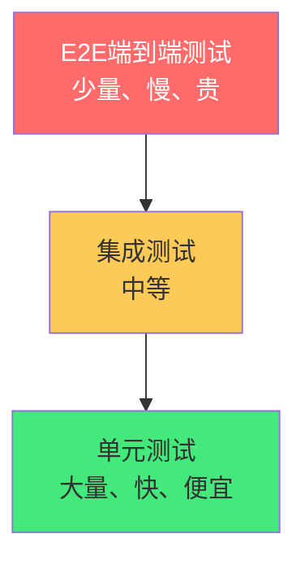

# 🧪 Vitest：单元测试与组件测试

> **文档说明**：系统讲解 Vitest 测试框架的完整用法，涵盖测试概述（为什么需要测试 / 测试金字塔 / Vitest 与 Jest 对比 / Vitest 的优势）、Vitest 基础（安装配置 / 第一个测试 / 运行方式 / 常用命令）、测试核心 API（describe/it/test/expect 断言库 / beforeEach/afterEach 钩子 / 测试分组）、Mock 与 Stub（vi.fn 模拟函数 / vi.mock 模拟模块 / vi.spyOn 间谍函数 / 模拟定时器 / 模拟日期）、异步测试（async/await / resolves/rejects / fake timers）、Vue 组件测试（@vue/test-utils / mount 与 shallowMount / 组件交互 / Props 测试 / Emits 测试 / Slots 测试 / 生命周期测试）、组合式函数测试（测试 Composables / 响应式状态 / 副作用清理）、Pinia 状态管理测试（store 测试 / actions/mutations/getters）、API 请求测试（Mock axios/fetch / 测试请求参数 / 测试错误处理）、测试覆盖率（coverage 配置 / 报告分析 / 覆盖率阈值）、测试最佳实践（AAA 模式 / 测试命名 / 避免过度 Mock / 测试隔离 / 确定性测试 / 测试反模式）、CI 集成（GitHub Actions 运行测试 / 预提交钩子）、常见问题与最佳实践。
>
> **适用人群**：前端开发者、全栈工程师、想提升代码质量的开发者
>
> **前置知识**：[[Vue3-组合式API]] · [[TypeScript-类型系统进阶]] · [[Vite构建工具原理]]

---

## 一、测试概述

### 1.1 为什么需要测试

| 没有测试的痛点 | 有测试的好处 |
|--------------|------------|
| 改代码怕弄坏其他功能 | 放心重构，测试会告诉你有没有破坏 |
| Bug 到线上才发现 | 测试在开发阶段就捕获 Bug |
| 新人不敢改老代码 | 测试是最好的文档，改完跑测试就行 |
| 手动测试耗时且不可靠 | 自动化测试快速、可重复、一致 |
| 代码质量无法保证 | 测试驱动出更好的代码设计 |

### 1.2 测试金字塔



| 层级 | 比例 | 速度 | 成本 | 示例 |
|------|------|------|------|------|
| **单元测试** | 70% | 快 | 低 | 工具函数、Composables |
| **集成测试** | 20% | 中 | 中 | 组件+Store、API+Store |
| **E2E 测试** | 10% | 慢 | 高 | 完整用户流程（Cypress/Playwright） |

### 1.3 Vitest 是什么

**Vitest** 是基于 Vite 的下一代测试框架，由 Vue 团队维护，与 Vite 无缝集成。

| 特性 | Vitest | Jest |
|------|--------|------|
| **构建工具** | Vite（原生 ESM） | Babel（CommonJS） |
| **速度** | 极快（HMR、原生 ESM） | 较快 |
| **Vue 支持** | 原生支持 | 需要配置 |
| **API 兼容** | Jest 兼容（可平滑迁移） | — |
| **配置复用** | 复用 vite.config.ts | 独立配置 |
| **TypeScript** | 原生支持 | 需要 ts-jest |
| **Watch 模式** | 智能、快速 | 标准 |

> **Vitest 的核心优势**：与 Vite 共享配置和转换管道，不需要为测试单独配置 Babel/TS，启动快、HMR 快、Vue 组件测试开箱即用。

---

## 二、Vitest 基础

### 2.1 安装与配置

```bash
pnpm add -D vitest @vue/test-utils @vitest/coverage-v8 jsdom
```

```typescript
// vite.config.ts
import { defineConfig } from 'vite'
import vue from '@vitejs/plugin-vue'

export default defineConfig({
  plugins: [vue()],
  test: {
    // 测试环境
    environment: 'jsdom',  // 浏览器环境（组件测试需要）
    // 全局 API（不需要 import describe/it/expect）
    globals: true,
    // 测试文件匹配
    include: ['src/**/*.{test,spec}.{js,ts,vue}'],
    // 覆盖率
    coverage: {
      provider: 'v8',
      reporter: ['text', 'json', 'html'],
      thresholds: {
        lines: 80,
        functions: 80,
        branches: 70
      }
    },
    // 路径别名（与 Vite 共享）
    alias: {
      '@': '/src'
    },
    // setup 文件（测试前执行）
    setupFiles: ['./src/test/setup.ts']
  }
})
```

```typescript
// src/test/setup.ts
import { config } from '@vue/test-utils'
// 全局配置，如 Element Plus 插件
```

### 2.2 package.json scripts

```json
{
  "scripts": {
    "test": "vitest",
    "test:run": "vitest run",
    "test:coverage": "vitest run --coverage",
    "test:ui": "vitest --ui"
  }
}
```

### 2.3 第一个测试

```typescript
// src/utils/math.test.ts
import { describe, it, expect } from 'vitest'
import { add, subtract } from './math'

describe('math utils', () => {
  it('adds two numbers correctly', () => {
    expect(add(1, 2)).toBe(3)
  })

  it('subtracts two numbers correctly', () => {
    expect(subtract(5, 3)).toBe(2)
  })
})
```

运行：
```bash
pnpm test          # watch 模式
pnpm test:run      # 单次运行
```

---

## 三、核心 API

### 3.1 断言（expect）

```typescript
// 基础断言
expect(value).toBe(expected)        // 严格相等（===）
expect(value).toEqual(expected)     // 深度相等（对象/数组）
expect(value).toBeTruthy()          // 真值
expect(value).toBeFalsy()           // 假值
expect(value).toBeNull()
expect(value).toBeUndefined()
expect(value).toBeDefined()

// 数字
expect(value).toBeGreaterThan(10)
expect(value).toBeLessThan(10)
expect(value).toBeCloseTo(0.1 + 0.2)  // 浮点数近似

// 字符串
expect(str).toContain('hello')
expect(str).toMatch(/regex/)

// 数组/对象
expect(arr).toContain(item)
expect(obj).toHaveProperty('name')
expect(obj).toMatchObject({ name: 'test' })

// 异常
expect(fn).toThrow()
expect(fn).toThrow('error message')

// 否定
expect(value).not.toBe(expected)
```

### 3.2 钩子函数

```typescript
describe('user service', () => {
  let userService: UserService

  // 每个测试前执行
  beforeEach(() => {
    userService = new UserService()
    userService.init()
  })

  // 每个测试后执行
  afterEach(() => {
    userService.cleanup()
  })

  // 所有测试前执行一次
  beforeAll(() => {
    console.log('开始测试')
  })

  // 所有测试后执行一次
  afterAll(() => {
    console.log('测试结束')
  })

  it('should create user', () => {
    const user = userService.create({ name: 'test' })
    expect(user).toBeDefined()
  })
})
```

### 3.3 测试分组与跳过

```typescript
// 只运行这个测试
it.only('focused test', () => {})

// 跳过这个测试
it.skip('skipped test', () => {})

// 待实现的测试
it.todo('will implement later')

// 条件跳过
it.skipIf(process.env.CI)('skip in CI', () => {})
```

---

## 四、Mock 与 Stub

### 4.1 vi.fn 模拟函数

```typescript
import { vi, describe, it, expect } from 'vitest'

describe('callback', () => {
  it('calls callback with correct args', () => {
    const callback = vi.fn()  // 创建 mock 函数
    
    processData([1, 2, 3], callback)
    
    // 验证调用次数
    expect(callback).toHaveBeenCalledTimes(3)
    // 验证调用参数
    expect(callback).toHaveBeenCalledWith(1)
    expect(callback).toHaveBeenNthCalledWith(2, 2)
    // 验证最后一次调用
    expect(callback).toHaveBeenLastCalledWith(3)
  })

  it('mock return value', () => {
    const fetchUser = vi.fn().mockResolvedValue({ id: 1, name: 'test' })
    // 或 vi.fn().mockReturnValue(value)
  })
})
```

### 4.2 vi.mock 模拟模块

```typescript
// 模拟整个模块
vi.mock('axios', () => ({
  default: {
    get: vi.fn().mockResolvedValue({ data: [] }),
    post: vi.fn().mockResolvedValue({ data: {} })
  }
}))

// 在测试中使用
import axios from 'axios'

it('fetches users', async () => {
  const users = await fetchUsers()
  expect(axios.get).toHaveBeenCalledWith('/api/users')
})
```

### 4.3 vi.spyOn 间谍函数

```typescript
import { vi } from 'vitest'

it('spies on console.log', () => {
  const spy = vi.spyOn(console, 'log')
  
  doSomething()
  
  expect(spy).toHaveBeenCalled()
  spy.mockRestore()  // 恢复原函数
})
```

### 4.4 模拟定时器

```typescript
import { vi, beforeEach, afterEach } from 'vitest'

beforeEach(() => {
  vi.useFakeTimers()  // 启用假定时器
})

afterEach(() => {
  vi.useRealTimers()  // 恢复真定时器
})

it('calls after 1 second', () => {
  const callback = vi.fn()
  setTimeout(callback, 1000)
  
  expect(callback).not.toHaveBeenCalled()
  vi.advanceTimersByTime(1000)  // 快进 1 秒
  expect(callback).toHaveBeenCalledTimes(1)
})
```

---

## 五、异步测试

### 5.1 async/await

```typescript
it('fetches data async', async () => {
  const data = await fetchData()
  expect(data).toBeDefined()
})

it('resolves with correct value', async () => {
  await expect(fetchUser(1)).resolves.toMatchObject({ id: 1 })
})

it('rejects on error', async () => {
  await expect(fetchUser(-1)).rejects.toThrow('User not found')
})
```

### 5.2 测试异步组件更新

```typescript
import { flushPromises } from '@vue/test-utils'

it('updates after async operation', async () => {
  const wrapper = mount(AsyncComponent)
  
  await flushPromises()  // 等待所有 Promise 完成
  // 或 await nextTick()
  
  expect(wrapper.text()).toContain('loaded')
})
```

---

## 六、Vue 组件测试

### 6.1 挂载组件

```typescript
import { mount, shallowMount } from '@vue/test-utils'
import MyComponent from './MyComponent.vue'

// mount：完整挂载（包括子组件）
const wrapper = mount(MyComponent, {
  props: { title: 'Hello' },
  global: {
    plugins: [ElementPlus],  // 全局插件
    stubs: { ChildComponent: true }  // 存根子组件
  }
})

// shallowMount：只挂载当前组件，子组件存根
const wrapper = shallowMount(MyComponent)
```

### 6.2 测试 Props

```typescript
it('renders props correctly', () => {
  const wrapper = mount(UserCard, {
    props: { user: { name: 'Alice', age: 25 } }
  })
  
  expect(wrapper.text()).toContain('Alice')
  expect(wrapper.find('.age').text()).toBe('25')
})

it('reacts to prop changes', async () => {
  const wrapper = mount(UserCard, {
    props: { user: { name: 'Alice' } }
  })
  
  await wrapper.setProps({ user: { name: 'Bob' } })
  expect(wrapper.text()).toContain('Bob')
})
```

### 6.3 测试 Emits

```typescript
it('emits event on button click', async () => {
  const wrapper = mount(ButtonComponent)
  
  await wrapper.find('button').trigger('click')
  
  expect(wrapper.emitted('submit')).toBeTruthy()
  expect(wrapper.emitted('submit')![0]).toEqual([{ id: 1 }])
})
```

### 6.4 测试用户交互

```typescript
it('updates input value', async () => {
  const wrapper = mount(SearchInput)
  const input = wrapper.find('input')
  
  await input.setValue('search term')
  expect(input.element.value).toBe('search term')
  
  await input.trigger('keyup.enter')
  expect(wrapper.emitted('search')).toBeTruthy()
})

it('toggles visibility', async () => {
  const wrapper = mount(Toggle)
  
  expect(wrapper.find('.content').exists()).toBe(false)
  
  await wrapper.find('.toggle-btn').trigger('click')
  expect(wrapper.find('.content').exists()).toBe(true)
})
```

### 6.5 测试 Slots

```typescript
it('renders default slot', () => {
  const wrapper = mount(Card, {
    slots: {
      default: '<p>Card content</p>',
      header: '<h2>Title</h2>'
    }
  })
  
  expect(wrapper.text()).toContain('Card content')
  expect(wrapper.find('h2').text()).toBe('Title')
})
```

---

## 七、组合式函数测试

### 7.1 测试 Composables

```typescript
// composables/useCounter.ts
import { ref } from 'vue'
export function useCounter(initial = 0) {
  const count = ref(initial)
  function increment() { count.value++ }
  function decrement() { count.value-- }
  return { count, increment, decrement }
}

// composables/useCounter.test.ts
import { describe, it, expect } from 'vitest'
import { useCounter } from './useCounter'

describe('useCounter', () => {
  it('initializes with default value', () => {
    const { count } = useCounter()
    expect(count.value).toBe(0)
  })

  it('initializes with custom value', () => {
    const { count } = useCounter(10)
    expect(count.value).toBe(10)
  })

  it('increments count', () => {
    const { count, increment } = useCounter()
    increment()
    expect(count.value).toBe(1)
  })

  it('decrements count', () => {
    const { count, decrement } = useCounter(5)
    decrement()
    expect(count.value).toBe(4)
  })
})
```

### 7.2 测试带副作用的 Composables

```typescript
// composables/useLocalStorage.ts
import { ref, watch } from 'vue'

export function useLocalStorage(key: string, initial: string) {
  const value = ref(localStorage.getItem(key) || initial)
  
  watch(value, (newVal) => {
    localStorage.setItem(key, newVal)
  })
  
  return { value }
}

// 测试
import { vi, beforeEach } from 'vitest'

beforeEach(() => {
  localStorage.clear()
})

it('reads from localStorage', () => {
  localStorage.setItem('test', 'stored')
  const { value } = useLocalStorage('test', 'default')
  expect(value.value).toBe('stored')
})

it('writes to localStorage on change', async () => {
  const { value } = useLocalStorage('test', 'default')
  value.value = 'updated'
  await nextTick()
  expect(localStorage.getItem('test')).toBe('updated')
})
```

---

## 八、Pinia Store 测试

```typescript
// stores/user.test.ts
import { setActivePinia, createPinia } from 'pinia'
import { useUserStore } from './user'

describe('user store', () => {
  beforeEach(() => {
    setActivePinia(createPinia())  // 每个测试创建新的 Pinia
  })

  it('initializes with empty users', () => {
    const store = useUserStore()
    expect(store.users).toEqual([])
  })

  it('adds a user', () => {
    const store = useUserStore()
    store.addUser({ id: 1, name: 'Alice' })
    expect(store.users).toHaveLength(1)
  })

  it('computes user count', () => {
    const store = useUserStore()
    store.addUser({ id: 1, name: 'Alice' })
    store.addUser({ id: 2, name: 'Bob' })
    expect(store.userCount).toBe(2)
  })

  it('fetches users from API', async () => {
    vi.mock('@/api/user', () => ({
      fetchUsers: vi.fn().mockResolvedValue([{ id: 1, name: 'Alice' }])
    }))
    
    const store = useUserStore()
    await store.loadUsers()
    expect(store.users).toHaveLength(1)
  })
})
```

---

## 九、API 请求测试

```typescript
// services/userService.test.ts
import axios from 'axios'
import { fetchUsers, createUser } from './userService'

vi.mock('axios')

describe('userService', () => {
  it('fetches users from API', async () => {
    axios.get.mockResolvedValue({ data: [{ id: 1, name: 'Alice' }] })
    
    const users = await fetchUsers()
    
    expect(axios.get).toHaveBeenCalledWith('/api/users')
    expect(users).toHaveLength(1)
  })

  it('handles API error', async () => {
    axios.get.mockRejectedValue(new Error('Network error'))
    
    await expect(fetchUsers()).rejects.toThrow('Network error')
  })

  it('creates user with correct data', async () => {
    axios.post.mockResolvedValue({ data: { id: 1 } })
    
    await createUser({ name: 'Alice' })
    
    expect(axios.post).toHaveBeenCalledWith('/api/users', { name: 'Alice' })
  })
})
```

---

## 十、测试覆盖率

### 10.1 运行覆盖率

```bash
pnpm test:coverage
```

### 10.2 覆盖率指标

| 指标 | 说明 |
|------|------|
| **Lines** | 代码行覆盖率 |
| **Functions** | 函数覆盖率 |
| **Branches** | 分支覆盖率（if/else） |
| **Statements** | 语句覆盖率 |

### 10.3 覆盖率阈值

```typescript
// vite.config.ts
test: {
  coverage: {
    thresholds: {
      lines: 80,      // 行覆盖率不低于 80%
      functions: 80,  // 函数覆盖率不低于 80%
      branches: 70,   // 分支覆盖率不低于 70%
      statements: 80
    }
  }
}
```

> 低于阈值时测试会失败，强制保持测试质量。

---

## 十一、最佳实践

### 11.1 AAA 模式

每个测试遵循 **Arrange-Act-Assert** 结构：

```typescript
it('creates a user', () => {
  // Arrange：准备数据
  const userData = { name: 'Alice', email: 'alice@test.com' }
  const service = new UserService()

  // Act：执行操作
  const user = service.create(userData)

  // Assert：验证结果
  expect(user).toBeDefined()
  expect(user.name).toBe('Alice')
})
```

### 11.2 测试命名

```typescript
// ❌ 不好的命名
it('test1', () => {})
it('works correctly', () => {})

// ✅ 好的命名：描述「应该做什么」
it('should return empty array when no users exist', () => {})
it('should throw error when email is invalid', () => {})
it('should increment count when increment is called', () => {})
```

### 11.3 测试原则

| 原则 | 说明 |
|------|------|
| **测试隔离** | 每个测试独立运行，不依赖其他测试的状态 |
| **确定性** | 相同输入永远得到相同结果，避免随机/时间依赖 |
| **快速** | 单元测试应该毫秒级完成 |
| **可读性** | 测试代码也是文档，要清晰易懂 |
| **避免过度 Mock** | 只 Mock 外部依赖（API、定时器），不要 Mock 被测对象本身 |
| **一个测试一个断言** | 每个测试只验证一个行为（可多个相关 expect） |
| **测试行为不测试实现** | 测试「做了什么」，不测试「怎么做的」 |

### 11.4 测试反模式

| 反模式 | 说明 | 改进 |
|--------|------|------|
| **巨型测试** | 一个测试测太多东西 | 拆分为多个小测试 |
| **Mock 一切** | 连被测对象都 Mock | 只 Mock 外部依赖 |
| **测试实现细节** | 测试私有方法/内部变量 | 测试公开行为 |
| **依赖顺序** | 测试 B 依赖测试 A 的结果 | 每个测试独立 setup |
| **没有清理** | 测试后不清理 Mock/状态 | beforeEach/afterEach 清理 |
| **忽略异步** | 不 await 异步操作 | 始终 await 或用 done() |
| **为覆盖率而测试** | 为了数字写无意义测试 | 测试有价值的行为 |

---

## 十二、CI 集成

### 12.1 GitHub Actions

```yaml
# .github/workflows/test.yml
name: Test
on: [push, pull_request]

jobs:
  test:
    runs-on: ubuntu-latest
    steps:
      - uses: actions/checkout@v4
      - uses: pnpm/action-setup@v2
        with:
          version: 8
      - uses: actions/setup-node@v4
        with:
          node-version: 20
          cache: 'pnpm'
      - run: pnpm install --frozen-lockfile
      - run: pnpm test:run
      - run: pnpm test:coverage
      - name: Upload coverage
        uses: codecov/codecov-action@v3
        with:
          files: ./coverage/coverage-final.json
```

### 12.2 预提交钩子

```bash
# .husky/pre-commit
#!/bin/sh
. "$(dirname "$0")/_/husky.sh"

pnpm vitest run --changed  # 只跑变更相关的测试
```

---

## 十三、常见问题

| 问题 | 原因 | 解决方案 |
|------|------|---------|
| **组件测试找不到元素** | 异步更新未等待 | `await nextTick()` 或 `await flushPromises()` |
| **Mock 不生效** | vi.mock 位置不对 | vi.mock 必须在 import 之前或顶层 |
| **定时器测试卡住** | 真定时器在测试中等待 | 用 `vi.useFakeTimers()` |
| **localStorage 未定义** | Node 环境没有 localStorage | environment: 'jsdom' |
| **Vue 组件样式不生效** | 测试不关注样式 | 测试行为和结构，不测试 CSS |
| **测试间状态污染** | 全局状态未清理 | beforeEach 重置 store/Mock |
| **覆盖率不达标** | 未测试的分支多 | 补充边界条件和错误处理测试 |
| **异步测试超时** | 忘记 await | 始终 await 异步操作 |

---

## 十四、关联笔记

### 工程化
- [[Vite构建工具原理]] · [[ESLint与代码规范]] · [[CI-CD持续集成与部署]]
- [[环境变量与多环境构建]] · [[pnpm-monorepo架构]]

### Vue3 生态
- [[Vue3-组合式API]] · [[Vue3-自定义Hooks封装_backup_skeleton]] · [[Pinia-状态管理核心]]
- [[Vue3-组件通信与插槽]] · [[ElementPlus-二次封装]]

### 质量保障
- [[TypeScript-类型系统进阶]] · [[TS-严格模式与类型体操]]
- [[代码审查最佳实践]] · [[技术债管理]]

### 导航
- [[MOC-工程化构建]] · [[MOC-前端开发]] · [[Home]] · [[学习路线总览]]

> 🔍 **知识点深度解析**
>
> **作用**：Vitest 单元测试与组件测试解决的是「如何通过自动化测试保证前端代码质量，让重构有安全网、Bug 提前发现、代码可维护」的核心问题——测试是专业开发者和业余爱好者的重要区别，也是工程化的核心组成部分。
>
> **底层原理**：①Vitest 的核心优势是「与 Vite 共享转换管道」——Jest 需要独立配置 Babel/TypeScript 转换，而 Vitest 直接复用 Vite 的 dev server 和转换逻辑，测试文件和源码用同一套转换规则，配置零重复，启动速度极快。Vitest 还支持 HMR（热模块替换），修改测试或源码后只重新运行受影响的测试，watch 模式体验远超 Jest。②测试金字塔的本质是「成本与收益的平衡」——单元测试快、便宜、稳定，但只能验证孤立模块；E2E 测试慢、贵、不稳定，但能验证完整用户流程。合理的比例是 70% 单元 + 20% 集成 + 10% E2E，用大量快速的单元测试覆盖核心逻辑，用少量 E2E 测试关键流程。很多团队搞反了——写了大量 E2E 测试，又慢又不稳定，单元测试却很少。③Mock 的本质是「隔离外部依赖」——测试一个函数时，如果它依赖 API、定时器、随机数，测试就会不稳定（网络波动、时间变化）。Mock 把这些外部依赖替换为可控的模拟对象，让测试只关注被测对象本身的逻辑。但 Mock 不能过度——如果连被测对象的内部方法都 Mock 了，测试就失去了意义（测试的是 Mock 而不是真实代码）。④Vue 组件测试的核心是「@vue/test-utils 的 mount」——mount 将组件挂载到虚拟 DOM（jsdom），返回 wrapper 对象，通过 wrapper 可以查询元素、触发事件、检查 props/emits。shallowMount 只挂载当前组件，子组件用存根（stub）替代，避免子组件的逻辑干扰当前组件的测试——这是「单元测试组件」的标准做法。⑤测试 Composables 的关键是「在 Vue 响应式上下文中调用」——Composables 使用 ref/reactive 等响应式 API，需要在 Vue 的组件上下文或 effect 作用域中调用。Vitest 配合 @vue/test-utils 提供了这个上下文，直接调用 composable 函数就能获得响应式返回值，修改后通过 `.value` 检查。⑥AAA 模式（Arrange-Act-Assert）是测试代码的「结构化思维」——Arrange 准备测试数据和环境，Act 执行被测操作，Assert 验证结果。这种结构让测试代码清晰易读，每个部分职责明确，就像文章的「开头-中间-结尾」。遵循 AAA 模式的测试自然就是「一个测试一个行为」。⑦测试覆盖率的意义不是「数字越高越好」——100% 覆盖率不代表没有 Bug（可能测了但没测对），低覆盖率也不代表质量差（可能核心逻辑都测了，简单的 getter/setter 没测）。覆盖率的真正价值是「发现未测试的代码」——看覆盖率报告，找到没被测试的分支，判断是否需要补充测试。阈值设置要合理（80% 左右），不要为了凑数字写无意义的测试。
>
> **用法要点**：① Vitest优势：Vite原生ESM/复用vite.config/极快HMR/Jest API兼容/Vue组件开箱即用/TS原生支持 ② 安装：vitest+@vue/test-utils+@vitest/coverage-v8+jsdom，vite.config.ts中test配置(environment/jsdom/globals/coverage/alias/setupFiles) ③ 核心API：describe分组/it测试/expect断言(toBe/toEqual/toContain/toThrow/not)/beforeEach-afterEach-beforeAll-afterAll钩子/it.only-skip-todo ④ Mock：vi.fn()模拟函数(mockReturnValue/mockResolvedValue)/vi.mock()模拟模块/vi.spyOn()间谍(mockRestore恢复)/vi.useFakeTimers()假定时器(advanceTimersByTime) ⑤ 异步：async/await/resolves/rejects/flushPromises/nextTick ⑥ Vue组件测试：mount(完整)/shallowMount(存根子)/props测试(setProps)/emits测试(wrapper.emitted)/交互(trigger/setValue)/slots测试 ⑦ Composables测试：直接调用+检查.value/副作用测试(localStorage/watch)/beforeEach清理 ⑧ Pinia测试：setActivePinia(createPinia())每个测试新实例/测试state+actions+getters ⑨ API测试：vi.mock axios/检查调用参数/测试成功和错误 ⑩ 覆盖率：--coverage/v8 provider/thresholds阈值(80%行/函数/70%分支)/看报告找未测试分支 ⑪ 最佳实践：AAA模式(Arrange-Act-Assert)/描述性命名(should...)/测试隔离/确定性/快速/可读/避免过度Mock/一个测试一个行为/测试行为不测试实现 ⑫ 反模式：巨型测试/Mock一切/测试实现细节/依赖顺序/不清理/忽略异步/为覆盖率而测试 ⑬ CI：GitHub Actions跑测试+覆盖率上传codecov/husky预提交跑变更测试 ⑭ 常见问题：找不到元素(await nextTick)/Mock不生效(顶层vi.mock)/定时器卡住(fakeTimers)/localStorage未定义(jsdom)/状态污染(beforeEach重置)/异步超时(await)。

> 💡 **深度讲解**：Vitest 与测试最核心的智慧是「测试不是负担，是安全网——有了测试你才敢重构，才敢快速迭代，才敢在凌晨三点上线」——很多开发者觉得写测试浪费时间，但真正的时间浪费是「改一个 Bug 引入三个新 Bug」「重构时不敢动老代码」「线上出问题才发现」。测试前期投入时间，后期节省 10 倍时间。Vitest 让写测试的体验变得很好——和 Vite 无缝集成、启动快、HMR 流畅、Vue 组件测试开箱即用，这些降低了写测试的门槛。但工具只是工具，更重要的是「测试思维」——写代码时就想着「这个函数怎么测」「这个逻辑有没有边界情况」「这个错误路径有没有处理」。这种思维会倒逼出更好的代码设计——难测试的代码通常是设计不好的代码（耦合高、副作用多、依赖隐藏）。AAA 模式是测试代码的「黄金结构」——Arrange 准备、Act 执行、Assert 验证，每个测试都遵循这个结构，代码清晰、意图明确、易于维护。很多初学者写测试像写面条代码——准备、执行、断言混在一起，读起来很痛苦。遵循 AAA 模式，测试代码就会像文档一样清晰。Mock 是测试中最容易用错的工具——正确的 Mock 是「隔离外部依赖」（API、定时器、数据库），错误的 Mock 是「Mock 被测对象本身」。如果你 Mock 了被测对象的方法，那测试的就不是真实代码了，测试通过也不代表代码正确。原则是：只 Mock 你「不希望在测试中真实执行」的东西（如网络请求），其他都用真实实现。测试覆盖率是「工具不是目标」——不要为了 100% 覆盖率写无意义的测试（如测试 getter/setter），也不要忽视覆盖率报告。覆盖率的价值在于「发现盲区」——看哪些代码没被测试到，判断是「不需要测」还是「应该测但漏了」。合理的阈值是 70-80%，核心逻辑应该 100% 覆盖，简单的 UI 渲染可以低一些。在 AI 时代，测试更加重要——AI 生成的代码需要测试来验证正确性，AI 辅助重构需要测试来保证不破坏功能，AI 甚至可以帮你写测试（「为这个函数写单元测试」）。但 AI 写的测试也需要你审查——AI 可能写「假测试」（测试通过但没验证任何东西）。掌握 Vitest 和测试思维，就是掌握了「代码质量的安全网」——这是从「能写代码」到「能维护代码」的关键一步。

> 📝 **精简总结**：Vitest=基于Vite的测试框架，Jest兼容，Vue开箱即用。核心：describe/it/expect断言/beforeEach钩子。Mock：vi.fn/vi.mock/vi.spyOn/fakeTimers。Vue组件：mount/shallowMount/props/emits/交互/slots。Composables：直接调用+.value检查。Pinia：createPinia每个测试新实例。API：vi.mock axios。覆盖率：--coverage+阈值80%。最佳实践：AAA模式/描述性命名/测试隔离/确定性/避免过度Mock/一个测试一个行为/测试行为不测试实现。CI：GitHub Actions+codecov。反模式：巨型测试/Mock一切/测试实现/依赖顺序/为覆盖率而测。

> **学习路径建议**：先学习 Vitest 基础（安装/配置/第一个测试/断言） → 实践：为工具函数写单元测试 → 学习 Mock（vi.fn/vi.mock/fakeTimers） → 实践：测试依赖 API 的服务函数 → 学习 Vue 组件测试（@vue/test-utils） → 实践：为一个组件写交互测试 → 学习 Composables 和 Pinia 测试 → 实践：测试自定义 Hooks 和 Store → 学习覆盖率和 CI 集成 → 实践：在项目中配置覆盖率阈值和 GitHub Actions → 学习测试最佳实践和反模式 → 形成「写代码就写测试」的习惯。

---

> **Vitest 与测试最核心的智慧是「测试不是负担，是安全网——有了测试你才敢重构，才敢快速迭代，才敢在凌晨三点上线」——很多开发者觉得写测试浪费时间，但真正的时间浪费是改一个 Bug 引入三个新 Bug、重构时不敢动老代码、线上出问题才发现。测试前期投入时间，后期节省 10 倍时间。Vitest 让写测试体验很好——Vite 无缝集成、启动快、HMR 流畅、Vue 组件测试开箱即用，降低了写测试门槛。但工具只是工具，更重要的是测试思维——写代码时就想着这个函数怎么测、这个逻辑有没有边界情况、这个错误路径有没有处理，这种思维会倒逼出更好的代码设计——难测试的代码通常设计不好（耦合高、副作用多、依赖隐藏）。AAA 模式是测试代码的黄金结构——Arrange 准备、Act 执行、Assert 验证，每个测试遵循这个结构，代码清晰意图明确，像文档一样清晰。Mock 最容易用错——正确的 Mock 是隔离外部依赖（API、定时器），错误的 Mock 是 Mock 被测对象本身，如果你 Mock 了被测对象的方法，测试的就不是真实代码了。原则是只 Mock 不希望在测试中真实执行的东西，其他都用真实实现。测试覆盖率是工具不是目标——不要为了 100% 写无意义测试，也不要忽视报告，覆盖率价值在于发现盲区，合理阈值 70-80%，核心逻辑 100%。AI 时代测试更重要——AI 生成代码需要测试验证，AI 辅助重构需要测试保证不破坏，AI 甚至可以帮写测试，但 AI 写的测试也需要审查，可能写假测试。掌握 Vitest 和测试思维，就是掌握了代码质量的安全网——这是从能写代码到能维护代码的关键一步。下次你写一个函数时，同时写它的测试——你会发现代码质量立刻提升了。**
