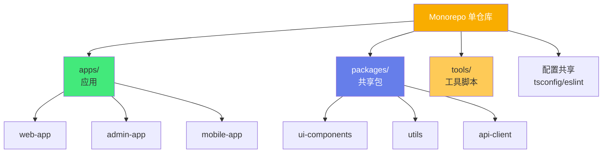

# 📦 pnpm Monorepo 架构

> **文档说明**：系统讲解 pnpm 包管理器与 Monorepo（单仓多包）架构的核心原理、配置方法与最佳实践，涵盖 Monorepo 的概念与优缺点（代码共享/统一依赖/原子提交 vs 仓库膨胀/CI 复杂度）、pnpm 的核心原理（内容寻址存储/硬链接/符号链接/虚拟存储目录 node_modules/.pnpm/非扁平 node_modules）、pnpm vs npm vs yarn 深度对比（安装速度/磁盘占用/依赖严格性/Monorepo 支持）、pnpm workspace 配置（pnpm-workspace.yaml 语法/包匹配规则/目录排除）、Monorepo 标准目录结构设计（apps/packages/tools/内部包命名）、依赖管理（内部包引用 workspace:协议/共享依赖提升/peerDependencies/版本统一）、脚本执行（pnpm -r 递归/--filter 过滤/--parallel 并行/--if-present）、Changesets 版本管理与发布（版本号管理/CHANGELOG 生成/发布流程）、Turborepo/Nx 构建加速（任务编排/缓存/远程缓存）、CI/CD 集成（缓存策略/受影响包检测/并行构建）、常见问题（幽灵依赖 phantom dependency/依赖提升 do not hoist/peer 依赖冲突/循环依赖）、pnpm 配置项详解（.npmrc/hoist-pattern/public-hoist-pattern/shamefully-hoist）、Lerna 与 pnpm 的关系、实战案例（前端组件库 Monorepo/全栈应用 Monorepo）、最佳实践与常见问题。
>
> **适用人群**：前端架构师、高级前端开发者、需要搭建 Monorepo 工程体系的技术负责人、全栈开发者
>
> **前置知识**：[[npm与包管理基础]] · [[Vite构建工具原理]] · [[TypeScript-模块与声明文件]]

---

## 一、概述

### 1.1 什么是 Monorepo

**Monorepo（Monolithic Repository）** 是将多个项目/包放在同一个 Git 仓库中管理的策略：



**Monorepo vs Polyrepo（多仓库）**：

| 维度 | Monorepo | Polyrepo |
|------|----------|----------|
| **代码共享** | ✅ 直接引用内部包 | ❌ 需发布 npm 包 |
| **依赖统一** | ✅ 统一版本管理 | ❌ 各仓库独立，易冲突 |
| **原子提交** | ✅ 跨包修改一次提交 | ❌ 需多仓库协调 |
| **代码可见性** | ✅ 全仓可见，方便重构 | ❌ 跨仓库修改困难 |
| **CI 复杂度** | ⚠️ 需要受影响包检测 | ✅ 每个仓库独立 CI |
| **仓库体积** | ⚠️ 可能膨胀 | ✅ 各仓库精简 |
| **权限控制** | ⚠️ 粗粒度 | ✅ 细粒度 |
| **适合规模** | 中大型团队/多包项目 | 小型团队/独立项目 |

### 1.2 为什么用 pnpm 做 Monorepo

**pnpm** 是目前最适合 Monorepo 的包管理器，核心优势：

| 优势 | 说明 |
|------|------|
| **极速安装** | 内容寻址存储 + 硬链接，安装速度是 npm 的 2-3 倍 |
| **节省磁盘** | 全局存储一份，所有项目硬链接共享，节省 50%+ 磁盘 |
| **严格依赖** | 非扁平 node_modules，避免「幽灵依赖」 |
| **原生 Monorepo** | workspace 功能开箱即用，无需 Lerna |
| **高效脚本** | `pnpm -r` / `--filter` 强大的递归和过滤执行 |

---

## 二、pnpm 核心原理

### 2.1 内容寻址存储

pnpm 使用**内容寻址存储（Content-Addressable Store）**：

```text
~/.local/share/pnpm/store/v3/   ← 全局存储（Windows: %LOCALAPPDATA%\pnpm\store）
├── files/
│   ├── 00/                     ← 按内容哈希的前两位分目录
│   │   ├── 01a2b3c4...         ← 文件内容的 SHA-512 哈希
│   │   └── ...
│   └── ...
```

- 每个文件的内容计算 SHA-512 哈希，以哈希命名存储
- 相同内容的文件只存一份（即使版本不同，内容相同就共享）
- 项目通过**硬链接**引用全局存储中的文件

### 2.2 非扁平 node_modules

npm/yarn（默认）使用**扁平 node_modules**，pnpm 使用**符号链接结构**：

```bash
npm 的 node_modules（扁平）：        pnpm 的 node_modules（非扁平）：
node_modules/                       node_modules/
├── react/                          ├── react → .pnpm/react@18.2.0/node_modules/react
├── react-dom/                      ├── react-dom → .pnpm/react-dom@18.2.0/node_modules/react-dom
├── lodash/                         └── .pnpm/
├── axios/                              ├── react@18.2.0/
└── ...（所有依赖平铺）                    │   └── node_modules/
                                            │       ├── react
                                            │       └── loose-envify → ../../loose-envify@1.4.0/...
                                            ├── react-dom@18.2.0/
                                            └── ...
```

**非扁平的好处**：
- 项目只能访问 `package.json` 中声明的依赖（避免幽灵依赖）
- 依赖树结构清晰，便于排查冲突
- 安装更快（不需要提升 hoist）

### 2.3 幽灵依赖（Phantom Dependency）

**幽灵依赖**：代码中使用了未在 `package.json` 中声明的依赖（因为 npm 扁平提升而碰巧可用）。

```javascript
// package.json 只声明了 react，没声明 loose-envify
import looseEnvify from 'loose-envify';  // ❌ 幽灵依赖！

// npm 下可能可用（因为被提升到根 node_modules）
// pnpm 下会直接报错（非扁平结构，访问不到）
```

pnpm 的非扁平结构从根本上**杜绝了幽灵依赖**，这是它最大的优势之一。

---

## 三、pnpm vs npm vs yarn

| 维度 | pnpm | npm (v9+) | yarn (v1) | yarn berry (v2+) |
|------|------|-----------|-----------|-----------------|
| **安装速度** | ⭐⭐⭐⭐⭐ 最快 | ⭐⭐⭐ | ⭐⭐⭐⭐ | ⭐⭐⭐⭐ |
| **磁盘占用** | ⭐⭐⭐⭐⭐ 最省 | ⭐⭐ | ⭐⭐⭐ | ⭐⭐⭐⭐ (Zip) |
| **依赖严格性** | ⭐⭐⭐⭐⭐ 非扁平 | ⭐⭐ 扁平 | ⭐⭐ 扁平 | ⭐⭐⭐⭐⭐ PnP |
| **Monorepo 支持** | ⭐⭐⭐⭐⭐ 原生 | ⭐⭐⭐ workspaces | ⭐⭐⭐⭐ workspaces | ⭐⭐⭐⭐ workspaces |
| **锁文件** | pnpm-lock.yaml | package-lock.json | yarn.lock | yarn.lock |
| **生态成熟度** | ⭐⭐⭐⭐ | ⭐⭐⭐⭐⭐ | ⭐⭐⭐⭐ | ⭐⭐⭐ |
| **兼容性** | ⭐⭐⭐⭐ | ⭐⭐⭐⭐⭐ | ⭐⭐⭐⭐ | ⭐⭐ (PnP 兼容问题) |

> **结论**：Monorepo 场景优先选 pnpm；简单项目 npm 足够；yarn berry 的 PnP 有兼容风险。

---

## 四、pnpm Workspace 配置

```text
### 4.1 pnpm-workspace.yaml
```

在仓库根目录创建 `pnpm-workspace.yaml`：

```yaml
# pnpm-workspace.yaml
packages:
  # 所有 apps 目录下的包
  - 'apps/*'
  # 所有 packages 目录下的包
  - 'packages/*'
  # 所有 tools 目录下的包
  - 'tools/*'
  # 排除特定目录
  - '!**/test-fixtures'
  - '!**/node_modules'
```

### 4.2 标准目录结构

```text
my-monorepo/
├── apps/                          # 应用层（可独立部署）
│   ├── web/                       # 主站应用
│   │   ├── package.json
│   │   └── src/
│   ├── admin/                     # 管理后台
│   │   └── package.json
│   └── docs/                      # 文档站
│       └── package.json
├── packages/                      # 共享包层
│   ├── ui/                        # UI 组件库
│   │   ├── package.json           # name: @myorg/ui
│   │   └── src/
│   ├── utils/                     # 工具函数
│   │   ├── package.json           # name: @myorg/utils
│   │   └── src/
│   ├── api-client/                # API 客户端
│   │   └── package.json
│   └── config/                    # 共享配置
│       ├── tsconfig.base.json
│       └── eslint.base.js
├── tools/                         # 工具脚本层
│   ├── eslint-config/             # 共享 ESLint 配置
│   └── scripts/                   # 构建/发布脚本
├── pnpm-workspace.yaml            # Workspace 配置
├── package.json                   # 根 package.json
├── pnpm-lock.yaml                 # 锁文件
├── tsconfig.base.json             # 根 TS 配置
├── .npmrc                         # pnpm 配置
└── turbo.json                     # Turborepo 配置（可选）
```

### 4.3 根 package.json

```json
{
  "name": "my-monorepo",
  "private": true,
  "version": "0.0.0",
  "packageManager": "pnpm@9.0.0",
  "scripts": {
    "build": "pnpm -r --filter=./packages/* run build",
    "dev": "pnpm -r --parallel --filter=./apps/* run dev",
    "lint": "pnpm -r run lint",
    "test": "pnpm -r run test",
    "clean": "pnpm -r exec rm -rf dist node_modules"
  },
  "devDependencies": {
    "typescript": "^5.4.0",
    "eslint": "^8.57.0",
    "prettier": "^3.2.0",
    "turbo": "^1.13.0"
  }
}
```

---

## 五、依赖管理

### 5.1 内部包引用

使用 `workspace:` 协议引用内部包：

```json
// apps/web/package.json
{
  "name": "@myorg/web",
  "dependencies": {
    "@myorg/ui": "workspace:*",        // 使用 workspace 最新版本
    "@myorg/utils": "workspace:^1.2.0", // 使用特定版本范围
    "@myorg/api-client": "workspace:~"  // 使用兼容版本
  }
}
```

| 协议 | 说明 |
|------|------|
| `workspace:*` | 始终使用本地 workspace 版本（发布时替换为实际版本） |
| `workspace:^` | 等价于 `workspace:*` |
| `workspace:~` | 发布时替换为 `~版本号` |
| `workspace:1.2.0` | 指定精确版本 |

### 5.2 安装依赖

```bash
# 安装所有包的依赖（在根目录执行）
pnpm install

# 给指定包添加依赖
pnpm add axios --filter @myorg/web

# 给所有包添加依赖
pnpm add -w typescript -D    # -w = --workspace-root，添加到根

# 给 packages 下所有包添加依赖
pnpm add lodash --filter "./packages/*"

# 添加内部包依赖
pnpm add @myorg/utils --filter @myorg/web
```

### 5.3 共享依赖与版本统一

在根 `package.json` 中用 `pnpm.overrides` 统一版本：

```json
{
  "pnpm": {
    "overrides": {
      "react": "^18.2.0",
      "typescript": "^5.4.0",
      "eslint": "^8.57.0"
    },
    "peerDependencyRules": {
      "allowedVersions": {
        "react": "18"
      }
    }
  }
}
```

### 5.4 peerDependencies

Monorepo 中 peer 依赖容易冲突，用 `.npmrc` 配置：

```ini
# .npmrc
auto-install-peers=true        # 自动安装 peer 依赖
strict-peer-dependencies=false # 不严格校验 peer 依赖
resolve-peers-from-workspace-root=true  # 从根解析 peer
```

---

## 六、脚本执行

### 6.1 递归执行

```bash
# 所有包执行 build
pnpm -r run build
pnpm --recursive run build

# 并行执行（注意：可能导致输出混乱）
pnpm -r --parallel run dev

# 仅当脚本存在时执行（不报错）
pnpm -r --if-present run build
```

```text
### 6.2 --filter 过滤
```

```bash
# 按包名过滤
pnpm --filter @myorg/web run build

# 按目录过滤
pnpm --filter "./apps/*" run dev

# 排除某个包
pnpm --filter "!@myorg/docs" run build

# 按依赖关系过滤（构建 web 及其依赖的包）
pnpm --filter @myorg/web... run build

# 按被依赖关系过滤（构建依赖 ui 的所有包）
pnpm --filter ...@myorg/ui run build

# 按 git 变更过滤（只构建变更的包）
pnpm --filter "[origin/main]" run build
```

### 6.3 常用脚本组合

```json
{
  "scripts": {
    "dev": "pnpm --parallel --filter ./apps/* dev",
    "build": "pnpm --filter ./packages/* build && pnpm --filter ./apps/* build",
    "build:changed": "pnpm --filter \"[origin/main]\" build",
    "lint": "pnpm -r --if-present lint",
    "test": "pnpm -r --if-present test",
    "release": "pnpm -r --filter ./packages/* publish"
  }
}
```

---

## 七、版本管理与发布：Changesets

### 7.1 为什么用 Changesets

Monorepo 中多个包版本管理复杂，**Changesets** 是标准解决方案：

```bash
# 安装
pnpm add -Dw @changesets/cli

# 初始化
pnpm changeset init
```

### 7.2 工作流


```bash
# 1. 开发者创建 changeset
pnpm changeset
# 交互式选择：哪些包变更？patch/minor/major？变更说明？

# 2. 合并后，CI 或手动执行版本更新
pnpm changeset version
# 自动：更新 package.json 版本号 + 生成 CHANGELOG.md

# 3. 发布
pnpm -r publish --access public
```

### 7.3 Changeset 文件示例

```markdown
---
"@myorg/ui": minor
"@myorg/utils": patch
---

feat: 新增 Button 组件的 loading 状态

- Button 新增 loading prop
- 修复 utils 中的日期格式化 bug
```

---

## 八、构建加速：Turborepo / Nx

### 8.1 Turborepo

Turborepo 是 Monorepo 的构建编排工具，提供**任务缓存**和**并行执行**：

```json
// turbo.json
{
  "$schema": "https://turbo.build/schema.json",
  "pipeline": {
    "build": {
      "dependsOn": ["^build"],
      "outputs": ["dist/**"]
    },
    "dev": {
      "cache": false,
      "persistent": true
    },
    "lint": {
      "outputs": []
    },
    "test": {
      "dependsOn": ["^build"],
      "outputs": ["coverage/**"]
    }
  }
}
```

```bash
# 构建（自动缓存+并行）
pnpm turbo build

# 只构建变更的包
pnpm turbo build --filter=...[origin/main]

# 远程缓存（团队共享）
pnpm turbo build --api="https://your-cache-server"
```

**Turborepo 核心优势**：
- 构建缓存（相同输入跳过构建）
- 任务拓扑排序（依赖包先构建）
- 远程缓存（CI 和本地共享缓存）
- 增量构建（只构建变更的包）

### 8.2 Nx vs Turborepo

| 维度 | Turborepo | Nx |
|------|-----------|-----|
| **定位** | 轻量构建编排 | 全功能 Monorepo 框架 |
| **学习曲线** | 低（配置简单） | 中高（功能多） |
| **缓存** | ✅ 本地+远程 | ✅ 本地+远程 |
| **代码生成** | ❌ | ✅ 强大的 schematics |
| **依赖图可视化** | 基础 | ✅ 强大 |
| **适合** | 已有项目加速 | 新项目从零搭建 |

---

## 九、CI/CD 集成

### 9.1 GitHub Actions 示例

```yaml
name: CI
on: [push, pull_request]
jobs:
  build:
    runs-on: ubuntu-latest
    steps:
      - uses: actions/checkout@v4
        with:
          fetch-depth: 0  # 需要完整 git 历史用于变更检测
      
      - uses: pnpm/action-setup@v3
        with:
          version: 9
      
      - uses: actions/setup-node@v4
        with:
          node-version: 20
          cache: 'pnpm'
      
      - run: pnpm install --frozen-lockfile
      
      - name: Build
        run: pnpm turbo build
        env:
          TURBO_TOKEN: ${{ secrets.TURBO_TOKEN }}
          TURBO_TEAM: ${{ vars.TURBO_TEAM }}
      
      - name: Test
        run: pnpm turbo test
      
      - name: Lint
        run: pnpm turbo lint
```

### 9.2 关键 CI 优化

1. **pnpm 缓存**：`actions/setup-node` 的 `cache: 'pnpm'` 缓存全局存储
2. **Turborepo 远程缓存**：CI 和本地共享构建缓存
3. **受影响包检测**：`--filter=[origin/main]` 只构建变更包
4. **并行 Job**：按应用拆分 CI Job
5. **`--frozen-lockfile`**：确保 CI 使用锁定的依赖版本

---

## 十、常见问题

### 10.1 幽灵依赖

**问题**：代码引用了未声明的依赖。
**解决**：pnpm 默认非扁平，会直接报错。如果某些库依赖扁平结构，用 `pnpm.hoist-pattern` 提升：

```json
{
  "pnpm": {
    "hoist-pattern": ["*eslint*", "*prettier*"],
    "public-hoist-pattern": ["*typescript*", "*react*"]
  }
}
```

### 10.2 依赖提升配置

| 配置 | 说明 |
|------|------|
| `hoist-pattern` | 提升到包自己的 node_modules |
| `public-hoist-pattern` | 提升到根 node_modules（所有包可见） |
| `shamefully-hoist=true` | 完全扁平（类似 npm，不推荐） |

### 10.3 peer 依赖冲突

**问题**：多个包要求不同版本的 peer 依赖。
**解决**：
```ini
# .npmrc
auto-install-peers=true
strict-peer-dependencies=false
```

### 10.4 循环依赖

**问题**：A 依赖 B，B 依赖 A。
**解决**：
- 重构：将共享部分提取到第三个包
- 检查：`pnpm -r list --depth 0` 查看依赖关系
- 工具：`pnpm why <package>` 排查依赖路径

### 10.5 发布内部包

```bash
# 只发布 packages 下的包
pnpm -r --filter ./packages/* publish --access public

# 发布前构建
pnpm turbo build --filter ./packages/*
pnpm -r --filter ./packages/* publish
```

---

## 十一、最佳实践

1. **统一包命名**：内部包用 `@org/` 前缀（如 `@myorg/ui`）
2. **根目录只放工具**：根 `package.json` 只放 devDependencies（TS/ESLint/Turbo），不放业务依赖
3. **共享配置**：tsconfig/eslint/prettier 配置放在 `packages/config` 中共享
4. **Changesets 管理版本**：不要手动改版本号
5. **Turborepo 加速构建**：利用缓存和并行
6. **`--filter` 精准执行**：避免全量构建
7. **`private: true`**：根 package.json 设为私有，防止误发布
8. **`packageManager` 字段**：锁定 pnpm 版本，避免团队版本不一致
9. **定期清理**：`pnpm store prune` 清理未引用的缓存
10. **文档先行**：Monorepo 的 CONTRIBUTING.md 要写清楚开发流程

---

## 十二、关联笔记

### 前端工程化
- [[Vite构建工具原理]] · [[npm与包管理基础]] · [[TypeScript-模块与声明文件]]
- [[ESLint与代码规范]] · [[CI-CD流水线设计]] · [[GitHub-Actions流水线设计]]

### 架构与项目
- [[微前端架构设计]] · [[软件架构设计原则]] · [[技术债务管理]]

### 导航
- [[MOC-前端开发]] · [[MOC-工程化构建]] · [[Home]] · [[学习路线总览]]

> 🔍 **知识点深度解析**
>
> **作用**：pnpm Monorepo 架构解决的是「如何在一个 Git 仓库中高效管理多个包/应用，实现代码共享、依赖统一、原子提交，同时保持安装速度快、磁盘占用省、依赖严格」的核心工程问题——随着项目复杂度增长，多仓库（Polyrepo）的代码共享和版本协调成本越来越高，Monorepo 成为中大型前端项目的标准架构。pnpm 凭借内容寻址存储和非扁平 node_modules，成为 Monorepo 的最佳包管理器。
>
> **底层原理**：①pnpm 的核心创新是「内容寻址存储 + 硬链接 + 符号链接」的三层结构——全局存储（`~/.pnpm/store`）按文件内容的 SHA-512 哈希存储，相同内容只存一份；项目的 `node_modules/.pnpm/` 目录通过硬链接引用全局存储（不复制文件，节省磁盘）；项目的 `node_modules/` 根目录通过符号链接指向 `.pnpm/` 中的包（非扁平结构）。这种设计让 pnpm 的安装速度比 npm 快 2-3 倍，磁盘占用省 50%+。②非扁平 node_modules 是 pnpm 杜绝「幽灵依赖」的关键——npm/yarn 的扁平结构会把所有依赖提升到根 `node_modules`，导致代码可以访问到未声明的依赖（碰巧被其他包依赖），这就是「幽灵依赖」。pnpm 的符号链接结构让项目只能访问 `package.json` 中声明的依赖，从结构上保证了依赖的严格性。③Monorepo 的核心价值是「原子提交」和「代码共享」——跨多个包的修改可以在一次提交中完成（原子提交），不会出现多仓库中「A 仓库改了但 B 仓库没跟上」的版本不一致问题；内部包通过 `workspace:*` 协议直接引用，不需要发布到 npm 就能使用，大大提升了共享代码的效率。④Turborepo 的核心是「任务编排 + 构建缓存」——它根据包之间的依赖关系构建任务拓扑图（依赖包先构建），并对每个任务的输入（源码+依赖+配置）计算哈希，相同输入的任务直接复用缓存输出，避免重复构建。远程缓存让 CI 和开发者共享构建结果，大幅提升 CI 速度。⑤Changesets 的核心是「版本变更的意图记录」——开发者在修改代码时用 `pnpm changeset` 记录「哪些包变更了、是什么类型的变更（patch/minor/major）、变更说明是什么」，这些 changeset 文件随 PR 一起提交。合并后，`changeset version` 自动更新版本号和 CHANGELOG，实现了版本管理的自动化和可追溯性。⑥`--filter` 是 pnpm Monorepo 最高效的工具——它支持按包名、目录、依赖关系、git 变更等多种方式过滤，让你只对需要的包执行操作，避免全量构建。特别是 `--filter "[origin/main]"` 可以只构建相对于主分支变更的包，是 CI 增量构建的核心。
>
> **用法要点**：① Monorepo结构：apps/(应用)/packages/(共享包)/tools/(工具)，pnpm-workspace.yaml配置包路径 ② pnpm原理：内容寻址存储(全局一份)+硬链接(省磁盘)+符号链接(非扁平node_modules)，杜绝幽灵依赖 ③ 内部包引用：workspace:*协议，pnpm add @org/pkg --filter app ④ 依赖统一：根package.json的pnpm.overrides统一版本，.npmrc配置auto-install-peers ⑤ 脚本执行：pnpm -r递归/--filter过滤(包名/目录/依赖关系/git变更)/--parallel并行/--if-present ⑥ 版本发布：Changesets(pnpm changeset→changeset version→pnpm -r publish) ⑦ 构建加速：Turborepo(任务拓扑+本地+远程缓存+增量构建)或Nx ⑧ CI集成：pnpm install --frozen-lockfile，turbo build，缓存全局存储和构建结果 ⑨ 常见问题：幽灵依赖(hoist-pattern提升)/peer冲突(auto-install-peers)/循环依赖(重构提取)/发布(--filter packages) ⑩ 最佳实践：@org/命名/根只放工具/共享配置/Changesets/Turborepo/--filter精准执行/private:true/packageManager锁定版本 ⑪ 对比：pnpm(最快最省最严格，Monorepo首选)/npm(通用)/yarn berry(PnP有兼容问题)。

> 💡 **深度讲解**：pnpm Monorepo 最核心的智慧是「用严格的依赖结构和高效的存储机制，解决多包项目的协作和效率问题」——很多团队对 Monorepo 又爱又恨：爱的是代码共享和原子提交，恨的是安装慢、依赖乱、构建久。pnpm 从根本上解决了这些痛点：内容寻址存储让安装快、磁盘省，非扁平结构让依赖严格、无幽灵依赖，workspace 和 --filter 让 Monorepo 操作高效。更重要的是，pnpm + Changesets + Turborepo 构成了一套完整的 Monorepo 工程体系：pnpm 管依赖和安装，Changesets 管版本和发布，Turborepo 管构建和缓存。这套组合已经成为现代前端 Monorepo 的事实标准。Monorepo 的深层价值不只是「代码共享」，更是「工程一致性」——统一的 TypeScript 配置、统一的 ESLint 规则、统一的构建流程、统一的发布规范，让整个团队的代码质量和开发效率保持在同一水平。在 AI 时代，Monorepo 的价值进一步凸显：AI 代码生成需要理解整个项目的上下文，Monorepo 提供了完整的代码上下文；AI 辅助重构需要跨包修改，Monorepo 的原子提交让 AI 重构更安全；AI 生成的测试和文档可以统一管理。理解了 pnpm Monorepo，你就掌握了现代前端工程化的「基础设施层」——这是从「会写代码」到「能搭体系」的关键一步。

> 📝 **精简总结**：pnpm Monorepo=单仓多包架构，pnpm是最佳包管理器。核心：内容寻址存储(全局一份)+硬链接(省磁盘)+符号链接(非扁平node_modules，杜绝幽灵依赖)。结构：apps/(应用)/packages/(共享包)/tools/(工具)，pnpm-workspace.yaml配置。内部包用workspace:*引用。脚本：pnpm -r递归/--filter过滤(包名/目录/依赖/git变更)/--parallel并行。版本：Changesets(changeset→version→publish)。构建：Turborepo(任务拓扑+缓存+增量)。CI：--frozen-lockfile+turbo缓存。常见问题：幽灵依赖(hoist-pattern)/peer冲突/循环依赖。最佳实践：@org命名/根只放工具/共享配置/Changesets/Turborepo/--filter精准执行。对比：pnpm最快最省最严格，Monorepo首选。

> **学习路径建议**：先学习 [[npm与包管理基础]] 理解包管理原理 → 学习本文档的 pnpm 原理和 Monorepo 配置 → 实践：用 pnpm 创建一个简单的 Monorepo（apps/web + packages/ui） → 学习 Changesets 版本管理 → 学习 Turborepo 构建加速 → 实践：为你的项目搭建完整的 Monorepo 工程体系 → 学习 [[Vite构建工具原理]] 和 [[TypeScript-模块与声明文件]] 深化工程化能力 → 学习 [[CI-CD流水线设计]] 集成 CI/CD → 进阶：研究 Nx、微前端 Monorepo、大型 Monorepo 治理。

---

> **pnpm Monorepo 的本质是「用严格的工程规范和高效的工具链，让多包项目像单包项目一样简单高效」——在前端工程化的早期，每个项目都是独立的仓库，共享代码需要发布 npm 包，版本协调靠口头约定，跨项目重构几乎不可能。随着项目复杂度增长，这种「多仓库」模式的协作成本越来越高，Monorepo 应运而生。但早期的 Monorepo 工具（如 Lerna + npm/yarn）有很多痛点：安装慢、依赖乱、幽灵依赖、构建久。pnpm 的出现彻底改变了这一局面——它用内容寻址存储和非扁平 node_modules，从根本上解决了安装速度和依赖严格性问题。再配合 Changesets（版本管理）和 Turborepo（构建加速），形成了一套完整的现代 Monorepo 工程体系。今天，pnpm Monorepo 已经成为中大型前端项目的标准架构——Vue、React、Vite、Next.js 等顶级开源项目都在使用。掌握 pnpm Monorepo，不只是学会了一个工具，更是掌握了「如何组织和管理复杂代码库」的工程思维——这种思维在 AI 时代更加重要：AI 代码生成需要完整的项目上下文，Monorepo 提供了这种上下文；AI 辅助重构需要跨包修改，Monorepo 的原子提交让重构更安全；AI 生成的代码需要统一的规范和质量保障，Monorepo 的共享配置确保了一致性。从今天开始，如果你还在维护多个相关的前端仓库，考虑把它们合并成一个 pnpm Monorepo——你会发现，代码共享、版本协调、跨包重构都变得前所未有的简单。工程化的终极目标不是「用最酷的工具」，而是「让团队专注于创造价值，而非被工具和流程拖累」——pnpm Monorepo 正是朝着这个方向迈出的重要一步。**
