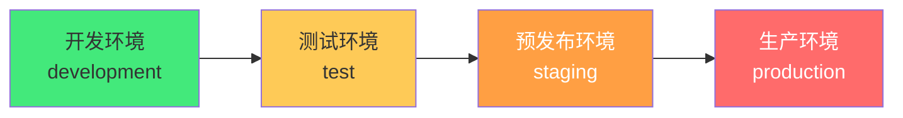
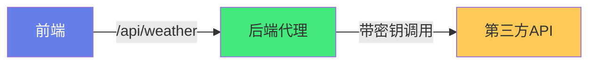

# 🌍 环境变量与多环境构建

> **文档说明**：系统讲解前端项目中环境变量与多环境构建的完整方案，涵盖概述与环境分类（development / test / staging / production）、Vite 环境变量机制（import.meta.env / .env 文件 / mode 模式 / VITE_ 前缀）、.env 文件体系详解（.env / .env.development / .env.production / .env.local / .env.[mode].local 的加载优先级与覆盖规则）、环境变量类型安全（vite-env.d.ts 类型声明 / import.meta.env 智能提示）、构建模式与命令（--mode 参数 / package.json scripts 配置）、多环境 API 地址配置与切换、开发代理配置（dev server proxy / 生产环境 Nginx 反向代理）、环境变量安全（敏感信息不进前端包 / 后端代理 / SSR 服务端变量）、CI/CD 中的环境变量（GitHub Actions / GitLab CI / 构建时注入）、Docker 与环境变量（运行时注入 / public/env.js 动态替换）、运行时环境变量方案（构建后可修改 / 不重新构建）、Vite 与 Webpack 环境变量差异对比、常见问题排查（变量未定义 / 类型错误 / 生产环境变量不生效 / 代理不生效）、最佳实践。
>
> **适用人群**：前端开发者、全栈工程师、DevOps、需要搭建多环境项目的技术负责人
>
> **前置知识**：[[Vite构建工具原理]] · [[TypeScript-类型系统进阶]]

---

## 一、概述

### 1.1 为什么需要多环境

一个项目从开发到上线通常经过多个环境，每个环境的配置不同：



| 环境 | 用途 | API 地址 | 调试信息 | 性能优化 |
|------|------|---------|---------|---------|
| **development** | 本地开发 | localhost / 测试服 | 完整 | 关闭 |
| **test** | 测试验证 | 测试服 | 部分 | 部分 |
| **staging** | 预发布验证 | 预发布服 | 关闭 | 开启 |
| **production** | 线上 | 正式服 | 关闭 | 完全开启 |

### 1.2 环境变量的作用

- 🔌 **API 地址切换**：不同环境连接不同后端
- 🔑 **第三方密钥**：不同环境使用不同的 API Key
- 🚩 **功能开关**：灰度发布、A/B 测试
- 🐛 **调试控制**：开发环境开启日志，生产关闭
- 📊 **埋点配置**：不同环境上报到不同统计平台

---

## 二、Vite 环境变量机制

### 2.1 import.meta.env

Vite 在客户端代码中通过 `import.meta.env` 暴露环境变量：

```typescript
// 内置变量
import.meta.env.MODE        // 当前模式（development/production/自定义）
import.meta.env.BASE_URL    // 部署基础路径
import.meta.env.PROD        // 是否生产环境（boolean）
import.meta.env.DEV         // 是否开发环境（boolean）
import.meta.env.SSR         // 是否服务端渲染

// 自定义变量（必须以 VITE_ 开头）
import.meta.env.VITE_API_URL
import.meta.env.VITE_APP_TITLE
```

### 2.2 VITE_ 前缀规则

**只有以 `VITE_` 开头的变量才会暴露到客户端代码**，这是安全机制：

```bash
# ✅ 会暴露到客户端
VITE_API_URL=https://api.example.com
VITE_APP_TITLE=MyApp

# ❌ 不会暴露到客户端（仅在构建脚本中可用）
DB_PASSWORD=secret123
SECRET_KEY=xxx
```

> 原理：Vite 在构建时将 `import.meta.env.VITE_XXX` 静态替换为实际值，非 VITE_ 前缀的变量不会被替换，避免敏感信息泄露到前端包中。

---

## 三、.env 文件体系

### 3.1 文件类型与加载顺序

Vite 支持以下 .env 文件，按优先级从低到高加载（高优先级覆盖低优先级）：

```mermaid
graph TB
    A[.env<br/>所有环境通用] --> B[.env.local<br/>所有环境本地覆盖]
    B --> C[.env.[mode]<br/>指定模式]
    C --> D[.env.[mode].local<br/>指定模式本地覆盖]
    
    style A fill:#a8a8a8,color:#fff
    style B fill:#feca57,color:#333
    style C fill:#48dbfb,color:#333
    style D fill:#ff6b6b,color:#fff
```

| 文件 | 加载时机 | 是否被 Git 跟踪 | 用途 |
|------|---------|----------------|------|
| `.env` | 所有环境 | ✅ 是 | 通用默认值 |
| `.env.local` | 所有环境 | ❌ 否（.gitignore） | 本地通用覆盖 |
| `.env.development` | development 模式 | ✅ 是 | 开发环境配置 |
| `.env.production` | production 模式 | ✅ 是 | 生产环境配置 |
| `.env.test` | test 模式 | ✅ 是 | 测试环境配置 |
| `.env.development.local` | development 模式 | ❌ 否 | 开发环境本地覆盖 |

### 3.2 文件示例

```bash
# .env — 所有环境通用
VITE_APP_TITLE=全栈知识库
VITE_APP_VERSION=1.0.0

# .env.development — 开发环境
VITE_API_URL=http://localhost:3000/api
VITE_ENABLE_MOCK=true
VITE_LOG_LEVEL=debug

# .env.production — 生产环境
VITE_API_URL=https://api.example.com/api
VITE_ENABLE_MOCK=false
VITE_LOG_LEVEL=error

# .env.staging — 预发布环境（自定义模式）
VITE_API_URL=https://staging-api.example.com/api
VITE_ENABLE_MOCK=false
VITE_LOG_LEVEL=warn
```

### 3.3 .gitignore 配置

```gitignore
# 环境变量本地覆盖文件（不提交）
.env.local
.env.*.local
```

---

## 四、环境变量类型安全

### 4.1 vite-env.d.ts 类型声明

```typescript
// src/vite-env.d.ts
/// <reference types="vite/client" />

interface ImportMetaEnv {
  readonly VITE_API_URL: string
  readonly VITE_APP_TITLE: string
  readonly VITE_ENABLE_MOCK: string
  readonly VITE_LOG_LEVEL: 'debug' | 'info' | 'warn' | 'error'
}

interface ImportMeta {
  readonly env: ImportMetaEnv
}
```

配置后，`import.meta.env.VITE_API_URL` 会有智能提示和类型检查。

### 4.2 运行时类型校验

环境变量是字符串，需要在运行时转换和校验：

```typescript
// config/index.ts
export const config = {
  apiUrl: import.meta.env.VITE_API_URL,
  appTitle: import.meta.env.VITE_APP_TITLE,
  enableMock: import.meta.env.VITE_ENABLE_MOCK === 'true',
  logLevel: import.meta.env.VITE_LOG_LEVEL || 'info'
} as const

// 使用时
import { config } from '@/config'
console.log(config.apiUrl)
```

---

## 五、构建模式与命令

```text
### 5.1 --mode 参数
```

Vite 通过 `--mode` 指定构建模式：

```bash
# 开发服务器默认 mode=development
vite

# 构建默认 mode=production
vite build

# 指定模式构建
vite build --mode staging     # 加载 .env.staging
vite build --mode test        # 加载 .env.test
```

### 5.2 package.json scripts

```json
{
  "scripts": {
    "dev": "vite",
    "dev:test": "vite --mode test",
    "build": "vite build",
    "build:staging": "vite build --mode staging",
    "build:prod": "vite build --mode production",
    "preview": "vite preview",
    "preview:staging": "vite preview --mode staging"
  }
}
```

### 5.3 模式与环境变量的关系


```typescript
// 代码中根据模式做不同处理
if (import.meta.env.MODE === 'staging') {
  // 预发布环境特殊逻辑
}
```

---

## 六、多环境 API 配置

### 6.1 基础配置

```typescript
// src/config/index.ts
export const API_CONFIG = {
  baseURL: import.meta.env.VITE_API_URL,
  timeout: 10000,
  headers: { 'Content-Type': 'application/json' }
}

// src/utils/request.ts
import axios from 'axios'
import { API_CONFIG } from '@/config'

const request = axios.create(API_CONFIG)
```

### 6.2 开发代理配置

开发环境用 Vite 代理解决跨域：

```typescript
// vite.config.ts
export default defineConfig({
  server: {
    proxy: {
      '/api': {
        target: 'http://localhost:3000',
        changeOrigin: true,
        rewrite: (path) => path.replace(/^\/api/, '')
      }
    }
  }
})
```

```bash
# .env.development — 开发环境用相对路径走代理
VITE_API_URL=/api

# .env.production — 生产环境用绝对地址
VITE_API_URL=https://api.example.com
```

### 6.3 生产环境 Nginx 反向代理

```nginx
server {
    listen 80;
    server_name example.com;

    # 前端静态资源
    location / {
        root /usr/share/nginx/html;
        try_files $uri $uri/ /index.html;
    }

    # API 反向代理
    location /api/ {
        proxy_pass http://backend:3000/;
        proxy_set_header Host $host;
        proxy_set_header X-Real-IP $remote_addr;
    }
}
```

---

## 七、环境变量安全

### 7.1 敏感信息不进前端

**前端代码中的一切都是公开的**——任何打包进 JS 的变量都能被用户看到。

```bash
# ❌ 危险：密钥暴露到前端包
VITE_SECRET_KEY=sk-xxxxxxxxx

# ✅ 正确：密钥只在后端使用
# 前端调用后端接口，后端用密钥调用第三方服务
```

### 7.2 后端代理方案



前端只调用自己的后端，后端持有密钥调用第三方服务，密钥永远不暴露到前端。

---

## 八、CI/CD 中的环境变量

### 8.1 GitHub Actions

```yaml
# .github/workflows/deploy.yml
name: Deploy
on:
  push:
    branches: [main]

jobs:
  build:
    runs-on: ubuntu-latest
    steps:
      - uses: actions/checkout@v4
      
      - name: Setup Node
        uses: actions/setup-node@v4
        with:
          node-version: 20
          
      - name: Create env file
        run: |
          echo "VITE_API_URL=${{ secrets.PROD_API_URL }}" >> .env.production
          echo "VITE_APP_TITLE=${{ secrets.APP_TITLE }}" >> .env.production
          
      - name: Install & Build
        run: |
          npm ci
          npm run build
          
      - name: Deploy
        uses: peaceiris/actions-gh-pages@v3
        with:
          github_token: ${{ secrets.GITHUB_TOKEN }}
          publish_dir: ./dist
```

### 8.2 GitLab CI

```yaml
# .gitlab-ci.yml
variables:
  VITE_API_URL: "$PROD_API_URL"

build:
  stage: build
  script:
    - npm ci
    - npm run build
  artifacts:
    paths:
      - dist/
```

> CI 中通过 Secrets 管理敏感信息，构建时注入到 .env 文件，不写入代码仓库。

---

## 九、Docker 与运行时环境变量

### 9.1 构建时注入（传统方案）

```dockerfile
FROM node:20-alpine AS builder
WORKDIR /app
COPY . .
# 构建参数注入环境变量
ARG VITE_API_URL
ENV VITE_API_URL=$VITE_API_URL
RUN npm ci && npm run build

FROM nginx:alpine
COPY --from=builder /app/dist /usr/share/nginx/html
```

```bash
# 构建时传入
docker build --build-arg VITE_API_URL=https://api.example.com -t myapp .
```

**缺点**：每个环境需要重新构建镜像。

### 9.2 运行时注入（推荐方案）

构建一次，运行时通过 `public/env.js` 动态替换环境变量：

```html
<!-- index.html -->
<script src="/env.js"></script>  <!-- 在应用代码前加载 -->
```

```javascript
// public/env.js（构建时是占位，运行时替换）
window.__ENV__ = {
  VITE_API_URL: '__VITE_API_URL__',
  VITE_APP_TITLE: '__VITE_APP_TITLE__'
}
```

```typescript
// src/config/index.ts
const env = (window as any).__ENV__ || import.meta.env

export const config = {
  apiUrl: env.VITE_API_URL,
  appTitle: env.VITE_APP_TITLE
}
```

```dockerfile
# Dockerfile — 构建一次，运行时替换
FROM nginx:alpine
COPY dist /usr/share/nginx/html
COPY docker-entrypoint.sh /docker-entrypoint.sh
RUN chmod +x /docker-entrypoint.sh
ENTRYPOINT ["/docker-entrypoint.sh"]
```

```bash
#!/bin/sh
# docker-entrypoint.sh — 启动时替换 env.js 中的占位符
sed -i "s|__VITE_API_URL__|${VITE_API_URL}|g" /usr/share/nginx/html/env.js
sed -i "s|__VITE_APP_TITLE__|${VITE_APP_TITLE}|g" /usr/share/nginx/html/env.js
nginx -g "daemon off;"
```

```bash
# 运行时传入环境变量，无需重新构建
docker run -e VITE_API_URL=https://api.example.com -p 80:80 myapp
```

---

## 十、Vite vs Webpack 环境变量差异

| 特性 | Vite | Webpack (vue-cli) |
|------|------|-------------------|
| **访问方式** | `import.meta.env` | `process.env` |
| **前缀** | `VITE_` | `VUE_APP_` |
| **模式参数** | `--mode` | `--mode` |
| **.env 文件** | 支持 | 支持 |
| **类型声明** | `vite-env.d.ts` | `env.d.ts` |
| **静态替换** | 构建时替换 | 构建时替换 |
| **SSR 变量** | `import.meta.env.SSR` | `process.env.VUE_ENV` |

---

## 十一、常见问题

| 问题 | 原因 | 解决方案 |
|------|------|---------|
| **变量 undefined** | 没有 VITE_ 前缀 | 变量名必须以 `VITE_` 开头 |
| **修改 .env 不生效** | Vite 未重启 | 修改 .env 后需要重启 dev server |
| **类型报错** | 未声明类型 | 在 `vite-env.d.ts` 中声明 ImportMetaEnv |
| **生产环境变量不对** | 构建模式不对 | 确认 `--mode` 参数和 .env 文件名匹配 |
| **代理不生效** | API 地址用了绝对路径 | 开发环境用相对路径 `/api` 走代理 |
| **敏感信息泄露** | 密钥写进了 VITE_ 变量 | 密钥只放后端，前端用后端代理 |
| **Docker 环境不生效** | 构建时注入，运行时无法修改 | 用 env.js 运行时替换方案 |
| **CI 构建变量缺失** | Secrets 未配置 | 在 CI 平台配置 Secrets |

---

## 十二、最佳实践

1. **所有自定义变量以 VITE_ 开头**：这是 Vite 的安全机制，必须遵守
2. **.env.local 不提交 Git**：本地覆盖文件加入 .gitignore
3. **类型声明必须写**：vite-env.d.ts 中声明所有自定义变量，获得类型安全
4. **配置集中管理**：创建 `src/config/index.ts` 统一导出，不要到处直接用 import.meta.env
5. **字符串转布尔值**：环境变量都是字符串，`=== 'true'` 转换
6. **开发用代理，生产用 Nginx**：开发环境 Vite proxy，生产环境 Nginx 反向代理
7. **敏感信息不进前端**：密钥放后端，前端通过后端代理调用第三方
8. **CI 用 Secrets**：不要把生产环境变量写进代码仓库
9. **Docker 用运行时注入**：env.js 方案，构建一次到处运行
10. **修改 .env 后重启**：Vite 不会热更新 .env 文件，必须重启 dev server
11. **合理划分环境**：至少 development / production，复杂项目加 staging / test
12. **文档化环境变量**：在 README 或 .env.example 中说明每个变量的用途

---

## 十三、关联笔记

### 工程化构建
- [[Vite构建工具原理]] · [[pnpm-monorepo架构]] · [[ESLint与代码规范]]
- [[CI-CD持续集成与部署]] · [[Docker容器化]]

### 前端基础
- [[TypeScript-类型系统进阶]] · [[Vue3-组合式API]] · [[Axios网络请求封装]]

### 部署与运维
- [[Nginx配置与优化]] · [[Kubernetes入门与实践]] · [[全栈项目部署]]

### 导航
- [[MOC-工程化构建]] · [[MOC-前端开发]] · [[Home]] · [[学习路线总览]]

> 🔍 **知识点深度解析**
>
> **作用**：环境变量与多环境构建解决的是「如何让同一份代码在不同环境（开发/测试/预发布/生产）中使用不同的配置（API 地址、密钥、功能开关），同时保证敏感信息安全、构建可复现、部署灵活」的核心问题——环境变量是「代码与环境的解耦层」，让代码不需要修改就能适配不同环境。
>
> **底层原理**：①Vite 环境变量的本质是「构建时静态替换」——Vite 在构建时扫描代码中的 `import.meta.env.VITE_XXX`，将其替换为 .env 文件中对应的字符串值，打包进 JS 文件。这意味着环境变量在构建时就确定了，运行时无法修改（除非用 env.js 等运行时注入方案）。`VITE_` 前缀是安全过滤机制——Vite 只替换以 VITE_ 开头的变量，其他变量（如 DB_PASSWORD）不会被替换，避免敏感信息意外泄露到前端包中。②.env 文件的加载顺序体现了「分层覆盖」的设计思想——通用配置在 .env，环境特定配置在 .env.[mode]，本地个人配置在 .env.local，优先级依次升高。这种设计让团队协作更顺畅：通用配置提交 Git，个人本地配置不提交，避免冲突。`.local` 后缀的文件默认被 .gitignore 忽略，是 Vite 的约定。③模式（mode）是 Vite 连接「构建命令」和「环境变量」的桥梁——`vite build --mode staging` 会设置 `import.meta.env.MODE = 'staging'`，并加载 `.env.staging` 文件。mode 不仅决定加载哪个 .env 文件，还影响 Vite 的内置行为（如 PROD/DEV 标志、是否压缩、是否开启 sourcemap）。默认 dev 命令 mode=development，build 命令 mode=production。④运行时注入（env.js 方案）解决了「构建时注入不灵活」的痛点——传统方案每个环境需要重新构建镜像（因为环境变量在构建时就打包进了 JS），而 env.js 方案在 index.html 中加载一个外部 JS 文件（window.__ENV__），Docker 启动时用 sed 替换其中的占位符，实现「构建一次，运行时配置」。这在 Docker/K8s 环境中特别重要——一个镜像可以在任何环境运行，只需要传入不同的环境变量。⑤开发代理（Vite proxy）解决的是「跨域」问题——浏览器的同源策略禁止前端直接请求不同域名的后端，开发环境用 Vite dev server 做反向代理，前端请求 `/api` 被代理到 `http://localhost:3000`，浏览器看到的是同源请求。生产环境没有 dev server，需要用 Nginx 做反向代理。这就是为什么开发环境 API 地址用相对路径 `/api`，生产环境用绝对地址或 Nginx 代理。⑥环境变量安全的核心原则是「前端没有秘密」——任何打包进前端 JS 的变量都可以被用户在浏览器 DevTools 中看到，所以 API 密钥、数据库密码等敏感信息绝对不能用 VITE_ 前缀暴露。正确的做法是前端调用自己的后端，后端持有密钥调用第三方服务，密钥只存在于服务端。这是前后端分离架构的基本安全原则。
>
> **用法要点**：① 环境分类：development(本地开发)/test(测试)/staging(预发布)/production(生产) ② Vite机制：import.meta.env访问/VITE_前缀才暴露/MODE模式/PROD/DEV/SSR内置变量 ③ .env文件：.env(通用)/.env.local(本地通用)/.env.[mode](指定模式)/.env.[mode].local(本地模式覆盖)，优先级从低到高覆盖 ④ 类型安全：vite-env.d.ts声明ImportMetaEnv/运行时字符串转布尔(==='true')/config集中导出 ⑤ 构建命令：vite --mode test/vite build --mode staging/package.json scripts配置 ⑥ API配置：开发用相对路径/api走Vite proxy/生产用绝对地址或Nginx反向代理 ⑦ 安全：VITE_前缀才暴露/敏感信息不进前端/后端代理第三方调用 ⑧ CI/CD：GitHub Actions用secrets注入.env/GitLab CI variables ⑨ Docker：构建时注入(--build-arg，每环境重构建)/运行时注入(public/env.js+sed替换，构建一次) ⑩ Vite vs Webpack：import.meta.env vs process.env/VITE_ vs VUE_APP_ ⑪ 常见问题：变量undefined(缺VITE_前缀)/改.env不生效(需重启)/类型错(未声明)/生产变量不对(mode不匹配)/代理不生效(绝对路径)/密钥泄露(放后端)/Docker不生效(用运行时注入) ⑫ 最佳实践：VITE_前缀/.env.local不提交/类型声明/config集中管理/字符串转布尔/开发代理生产Nginx/敏感信息后端/CI用Secrets/Docker运行时注入/改.env重启/合理划分环境/文档化变量。

> 💡 **深度讲解**：环境变量与多环境构建最核心的智慧是「代码与环境解耦——同一份代码通过环境变量适配不同环境，让构建可复现、部署可灵活、安全有保障」——很多初学者在多环境配置上踩坑，根本原因是没有理解「环境变量是构建时静态替换」这个本质。Vite 在构建时把 `import.meta.env.VITE_API_URL` 替换成字符串打包进 JS，所以运行时改不了——这就是为什么 Docker 中用 `-e VITE_API_URL=xxx` 不生效（因为构建时已经替换了）。理解了这个本质，就能理解为什么需要 env.js 运行时注入方案。`VITE_` 前缀是另一个容易踩坑的点——它不是约定，而是安全机制。Vite 只替换 VITE_ 开头的变量，其他变量不会出现在前端包中。很多人写了 `API_URL=xxx` 然后发现 `import.meta.env.API_URL` 是 undefined，就是因为没有加前缀。这个设计是为了防止开发者不小心把密钥暴露到前端——但它只是「第一道防线」，真正的安全原则是「前端没有秘密」，任何 VITE_ 变量都可以被用户看到，所以密钥绝对不能用 VITE_ 前缀。.env 文件的分层覆盖设计（.env → .env.[mode] → .env.local → .env.[mode].local）是团队协作的最佳实践——通用配置提交 Git，环境配置提交 Git，个人本地配置不提交。这样新人 clone 项目后就能直接跑，个人的本地修改不会影响别人。在 CI/CD 和 Docker 场景中，环境变量的管理更加重要——不能把生产环境的密钥写进代码仓库，要用 CI 平台的 Secrets 功能；Docker 镜像应该「构建一次，到处运行」，用 env.js 运行时注入而不是每个环境重新构建。在 AI 应用中，环境变量还有特殊的重要性——API Key（OpenAI/Anthropic 等）绝对不能暴露到前端，必须通过后端代理调用；不同环境用不同的 API Key（开发用测试 Key，生产用正式 Key）；模型版本也可以通过环境变量控制（开发用便宜的模型，生产用好的模型）。掌握环境变量与多环境构建，就是掌握了「从本地开发到生产部署」的完整配置管理能力——这是工程化的基本功，也是从「能跑」到「可维护」的关键一步。

> 📝 **精简总结**：环境变量与多环境构建=代码与环境解耦。Vite机制：import.meta.env访问/VITE_前缀才暴露/构建时静态替换。.env文件：.env(通用)/.env.[mode](环境)/.env.local(本地覆盖)，分层覆盖。类型安全：vite-env.d.ts声明/config集中导出/字符串转布尔。构建命令：--mode指定模式/package.json scripts。API配置：开发Vite proxy相对路径/api/生产Nginx反向代理。安全：前端无秘密/密钥放后端/VITE_只是第一道防线。CI/CD：Secrets注入不进仓库。Docker：构建时注入(每环境重构建)/运行时注入(env.js+sed，构建一次推荐)。常见问题：undefined(缺VITE_)/改.env需重启/类型错(未声明)/代理不生效(绝对路径)/Docker不生效(用运行时注入)。最佳实践：VITE_前缀/.local不提交/类型声明/config集中/开发代理生产Nginx/CI用Secrets/Docker运行时注入。

> **学习路径建议**：先学习 Vite 环境变量基础（import.meta.env / VITE_ 前缀 / .env 文件） → 实践：在项目中配置 .env.development 和 .env.production → 学习类型安全（vite-env.d.ts / config 集中管理） → 实践：添加类型声明和配置导出 → 学习开发代理（Vite proxy） → 实践：配置 API 代理解决跨域 → 学习 CI/CD 环境变量（GitHub Actions Secrets） → 实践：配置自动构建部署 → 学习 Docker 运行时注入（env.js 方案） → 实践：Docker 化部署，运行时传环境变量 → 学习安全最佳实践（密钥不进前端 / 后端代理） → 形成完整的多环境构建与部署方案。

---

> **环境变量与多环境构建最核心的智慧是「代码与环境解耦——同一份代码通过环境变量适配不同环境，让构建可复现、部署可灵活、安全有保障」——很多初学者在多环境配置上踩坑，根本原因是没有理解环境变量是构建时静态替换这个本质。Vite 在构建时把 import.meta.env.VITE_API_URL 替换成字符串打包进 JS，所以运行时改不了——这就是为什么 Docker 中用 -e VITE_API_URL=xxx 不生效，因为构建时已经替换了。理解了这个本质，就能理解为什么需要 env.js 运行时注入方案。VITE_ 前缀是另一个容易踩坑的点——它不是约定，而是安全机制，Vite 只替换 VITE_ 开头的变量，其他变量不会出现在前端包中。但它只是第一道防线，真正的安全原则是前端没有秘密，任何 VITE_ 变量都可以被用户看到，所以密钥绝对不能用 VITE_ 前缀。.env 文件的分层覆盖设计是团队协作的最佳实践——通用配置提交 Git，环境配置提交 Git，个人本地配置不提交，新人 clone 后直接跑，个人修改不影响别人。在 CI/CD 和 Docker 场景中，不能把生产密钥写进代码仓库，要用 CI 平台的 Secrets；Docker 镜像应该构建一次到处运行，用 env.js 运行时注入而不是每个环境重新构建。在 AI 应用中环境变量更重要——API Key 绝对不能暴露到前端，必须后端代理；不同环境用不同 Key；模型版本也可通过环境变量控制（开发用便宜模型，生产用好模型）。掌握环境变量与多环境构建，就是掌握了从本地开发到生产部署的完整配置管理能力——这是工程化的基本功，也是从能跑到可维护的关键一步。下次你配置新项目时，先把 .env 文件体系搭好——这是项目工程化的第一步。**
