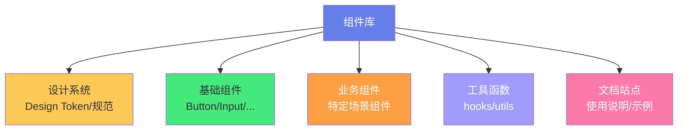
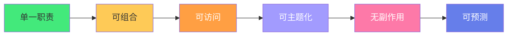
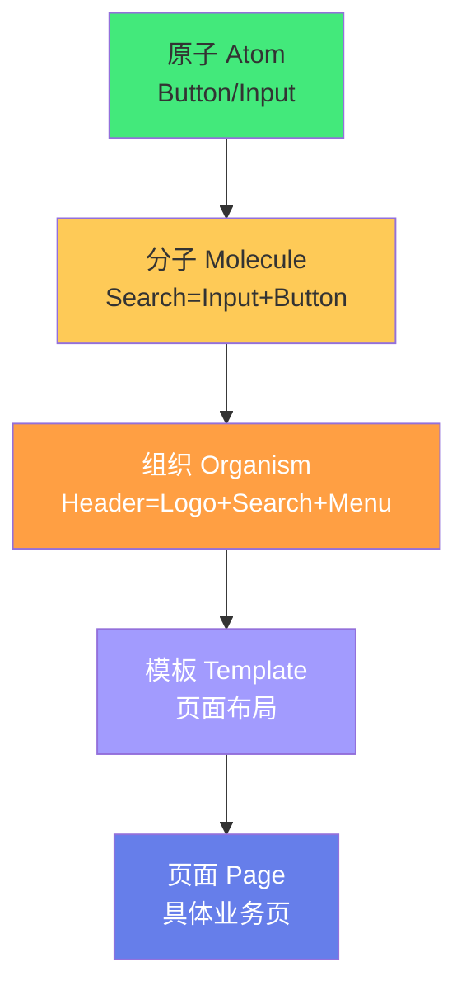
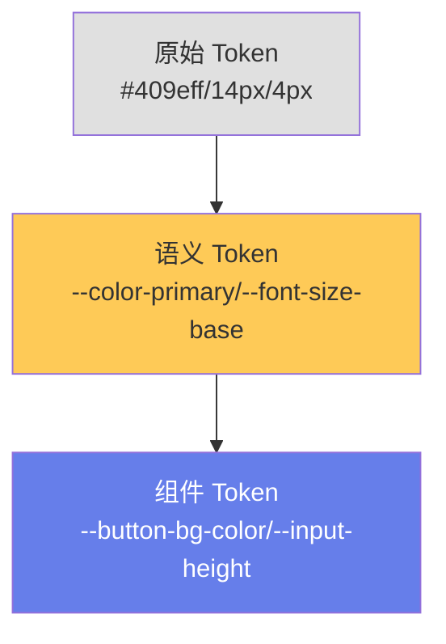
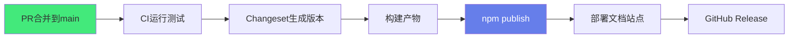

# 📦 组件库设计与发布

> **文档说明**：系统讲解从 0 到 1 设计、开发、构建、发布一个高质量 Vue3 组件库的完整方法论，涵盖组件库的概念与价值、组件设计原则（单一职责/可组合/可访问/可主题化/无副作用）、组件分类体系（基础/布局/数据录入/数据展示/反馈/导航/业务组件）、组件 API 设计（Props/Events/Slots/Expose/v-model/透传 Attributes）、设计系统与 Design Token（颜色/字体/间距/圆角/阴影/层级 CSS 变量）、组件开发规范（目录结构/命名规范/类型定义/文档注释/单元测试）、构建与打包（Vite 库模式/Rollup/ESM+CJS+UMD/Tree-shaking/样式提取/CSS 变量注入）、Monorepo 架构（pnpm workspace/Turborepo/版本管理/依赖管理）、文档站点（VitePress/Storybook/交互式 Playground/自动生成 API 文档）、版本管理与发布（SemVer/Changesets/npm 发布/CI/CD 自动化/变更日志）、主题定制与暗黑模式（CSS 变量/主题切换/深度定制）、国际化（i18n/多语言/RTL）、无障碍（a11y/WAI-ARIA/键盘导航/焦点管理）、性能优化（按需加载/Tree-shaking/虚拟滚动/分包）、知名组件库分析（Element Plus/Ant Design Vue/Naive UI/Vant）、常见问题与最佳实践。
>
> **适用人群**：中高级前端开发者、需要搭建团队组件库的技术负责人、开源组件库作者、全栈工程师
>
> **前置知识**：[[Vue3-组件通信与插槽]] · [[pnpm-monorepo架构]] · [[Vite构建工具原理]]

---

## 一、概述

### 1.1 什么是组件库

**组件库（Component Library）** 是一组可复用、可组合的 UI 组件集合，配合设计系统（Design System）提供统一的视觉语言和交互规范，帮助团队快速构建一致、高质量的用户界面。



### 1.2 为什么需要组件库

| 痛点 | 组件库解决方案 |
|------|--------------|
| 每个项目重复写 Button/Input | 一次开发，多处复用 |
| 团队成员写的组件风格不一 | 统一设计语言和交互 |
| 修改样式要改 N 个项目 | 一处修改，全局生效 |
| 新人上手慢，没有参考 | 文档+示例，即学即用 |
| 质量参差不齐 | 统一测试、审查、规范 |
| 重复造轮子 | 聚焦业务，不重复基础组件 |

### 1.3 知名组件库

| 组件库 | 框架 | 特点 |
|--------|------|------|
| **Element Plus** | Vue3 | 国内最流行，生态完善 |
| **Ant Design Vue** | Vue3 | 企业级，设计严谨 |
| **Naive UI** | Vue3 | TypeScript 优先，主题灵活 |
| **Vant** | Vue3 | 移动端，轻量 |
| **Headless UI** | Vue/React | 无样式，完全可定制 |
| **Radix UI** | React | 无障碍优先，Headless |
| **Shadcn UI** | React | 复制源码，非 npm 包 |

---

## 二、组件设计原则

### 2.1 六大原则



| 原则 | 说明 | 反例 |
|------|------|------|
| **单一职责** | 一个组件只做一件事 | 一个组件既处理表单又处理列表又处理弹窗 |
| **可组合** | 组件可以自由组合 | 组件内部写死布局，无法灵活使用 |
| **可访问** | 支持键盘、读屏器 |  div 模拟按钮，无焦点、无键盘事件 |
| **可主题化** | 样式可定制 | 颜色写死，无法换肤 |
| **无副作用** | 不修改外部状态 | 组件内部直接修改全局变量 |
| **可预测** | 相同输入相同输出 | 组件行为依赖外部不可控状态 |

### 2.2 受控 vs 非受控

```typescript
// 受控组件：值由父组件控制
<input :value="text" @input="text = $event.target.value" />

// 非受控组件：值由组件内部管理
<input v-model="text" />  // v-model 是受控的语法糖

// 最佳实践：支持两种模式
// 有 value  prop → 受控
// 无 value prop → 非受控（内部 defaultValue）
```

---

## 三、组件分类体系

### 3.1 通用分类

| 分类 | 说明 | 代表组件 |
|------|------|---------|
| **基础组件** | 最基础的 UI 元素 | Button, Icon, Typography |
| **布局组件** | 页面布局和容器 | Container, Row, Col, Space |
| **数据录入** | 表单输入类 | Input, Select, DatePicker, Form |
| **数据展示** | 展示数据类 | Table, List, Card, Tag, Badge |
| **反馈组件** | 用户操作反馈 | Modal, Drawer, Message, Notification, Progress |
| **导航组件** | 页面导航类 | Menu, Tabs, Breadcrumb, Pagination, Steps |
| **业务组件** | 特定业务场景 | 地址选择器、文件上传、富文本 |

### 3.2 组件粒度



> 组件库通常提供「原子」和「分子」级别的组件，「组织」以上由业务方组合。

---

## 四、组件 API 设计

### 4.1 Vue3 组件的 API 四要素

| API | 用途 | 示例 |
|-----|------|------|
| **Props** | 父→子传参 | `type`, `size`, `disabled` |
| **Events** | 子→父通知 | `@click`, `@change`, `@update:modelValue` |
| **Slots** | 内容分发 | `default`, `header`, `footer` |
| **Expose** | 暴露方法/属性 | `focus()`, `blur()`, `clear()` |

### 4.2 Props 设计规范

```typescript
// 良好的 Props 定义
interface ButtonProps {
  /** 按钮类型 */
  type?: 'primary' | 'success' | 'warning' | 'danger' | 'default'
  /** 按钮尺寸 */
  size?: 'large' | 'default' | 'small'
  /** 是否禁用 */
  disabled?: boolean
  /** 是否加载中 */
  loading?: boolean
  /** 点击事件 */
  onClick?: (e: MouseEvent) => void
}

// 用 withDefaults 提供默认值
const props = withDefaults(defineProps<ButtonProps>(), {
  type: 'default',
  size: 'default',
  disabled: false,
  loading: false
})
```

**Props 设计原则**：
1. 布尔属性用 `is/has/should` 前缀（`isDisabled`）
2. 枚举属性用联合类型，不用 string
3. 每个属性加 JSDoc 注释
4. 提供合理的默认值
5. 避免过多属性（超过 15 个考虑拆分）

```text
### 4.3 v-model 设计
```

```typescript
// 单个 v-model
const props = defineProps<{ modelValue: string }>()
const emit = defineEmits<{ 'update:modelValue': [value: string] }>()

// 多个 v-model（Vue3 支持）
const props = defineProps<{
  modelValue: string
  'update:visible': boolean
}>()

// 使用：<Component v-model="text" v-model:visible="show" />
```

### 4.4 透传 Attributes

Vue3 自动将未声明的属性透传到根元素：

```vue
<template>
  <!-- class/style/事件监听器自动透传到 button -->
  <button class="my-button">
    <slot />
  </button>
</template>

<!-- 使用时 -->
<MyButton class="extra" @click="handleClick" />
<!-- class 和 @click 自动透传到内部 button -->
```

> 需要关闭透传时用 `defineOptions({ inheritAttrs: false })`。

---

## 五、设计系统与 Design Token

### 5.1 什么是 Design Token

**Design Token** 是设计系统的「原子变量」——颜色、字体、间距、圆角、阴影等的命名变量，确保设计和代码的一致性。

```css
/* CSS 变量形式的 Design Token */
:root {
  /* 颜色 */
  --color-primary: #409eff;
  --color-success: #67c23a;
  --color-warning: #e6a23c;
  --color-danger: #f56c6c;
  --color-text-primary: #303133;
  --color-text-regular: #606266;
  --color-bg-page: #ffffff;
  
  /* 字体 */
  --font-size-base: 14px;
  --font-size-small: 12px;
  --font-size-large: 16px;
  --font-family: -apple-system, BlinkMacSystemFont, 'Segoe UI', sans-serif;
  
  /* 间距（4px 基准） */
  --spacing-xs: 4px;
  --spacing-sm: 8px;
  --spacing-md: 16px;
  --spacing-lg: 24px;
  --spacing-xl: 32px;
  
  /* 圆角 */
  --border-radius-sm: 2px;
  --border-radius-base: 4px;
  --border-radius-lg: 8px;
  --border-radius-round: 20px;
  
  /* 阴影 */
  --box-shadow-sm: 0 1px 2px rgba(0,0,0,0.05);
  --box-shadow-base: 0 2px 8px rgba(0,0,0,0.1);
  --box-shadow-lg: 0 4px 16px rgba(0,0,0,0.15);
  
  /* 层级 */
  --z-index-normal: 1;
  --z-index-dropdown: 1000;
  --z-index-modal: 2000;
  --z-index-message: 3000;
}
```

### 5.2 Token 分层



| 层级 | 说明 | 示例 |
|------|------|------|
| **原始 Token** | 具体值 | `#409eff`, `14px` |
| **语义 Token** | 有意义的命名 | `--color-primary`, `--font-size-base` |
| **组件 Token** | 组件级覆盖 | `--button-primary-bg`, `--input-height` |

### 5.3 暗黑模式

```css
/* 暗黑模式只需覆盖变量 */
.dark {
  --color-bg-page: #1d1e1f;
  --color-text-primary: #e5eaf3;
  --color-text-regular: #cfd3dc;
  --color-primary: #409eff;  /* 主色可能需要调整亮度 */
}
```

---

## 六、组件开发规范

### 6.1 目录结构

```css
packages/
  components/
    src/
      button/
        __tests__/
          button.test.ts      # 单元测试
        index.ts              # 导出入口
        Button.vue            # 组件
        Button.types.ts       # 类型定义
        Button.utils.ts       # 工具函数
        style.css             # 样式
      input/
        ...
      index.ts                # 总入口
    package.json
    vite.config.ts
```

### 6.2 命名规范

| 类型 | 规范 | 示例 |
|------|------|------|
| 组件名 | PascalCase，前缀 | `ElButton`, `MyInput` |
| 文件名 | PascalCase | `Button.vue`, `DatePicker.vue` |
| 类型文件 | `*.types.ts` | `Button.types.ts` |
| 测试文件 | `*.test.ts` | `button.test.ts` |
| 事件名 | kebab-case | `@update:model-value`, `@visible-change` |
| CSS 类名 | BEM | `.el-button`, `.el-button--primary`, `.el-button__icon` |

### 6.3 类型定义

```typescript
// Button.types.ts
export type ButtonType = 'primary' | 'success' | 'warning' | 'danger' | 'info' | 'default'
export type ButtonSize = 'large' | 'default' | 'small'

export interface ButtonProps {
  type?: ButtonType
  size?: ButtonSize
  disabled?: boolean
  loading?: boolean
  icon?: string
  nativeType?: 'button' | 'submit' | 'reset'
}

export interface ButtonEmits {
  (e: 'click', value: MouseEvent): void
}

export interface ButtonExpose {
  focus: () => void
  blur: () => void
}
```

---

## 七、构建与打包

### 7.1 Vite 库模式

```typescript
// vite.config.ts
import { defineConfig } from 'vite'
import vue from '@vitejs/plugin-vue'
import { resolve } from 'path'

export default defineConfig({
  plugins: [vue()],
  build: {
    lib: {
      entry: resolve(__dirname, 'src/index.ts'),
      name: 'MyUI',
      fileName: (format) => `my-ui.${format}.js`,
      formats: ['es', 'cjs', 'umd']  // 三种格式
    },
    rollupOptions: {
      // 外部化 Vue，不打包进库
      external: ['vue'],
      output: {
        globals: { vue: 'Vue' },
        // 按需加载：每个组件单独打包
        manualChunks: {
          'button': ['./src/button/index.ts'],
          'input': ['./src/input/index.ts'],
        }
      }
    }
  }
})
```

### 7.2 package.json 配置

```json
{
  "name": "my-ui",
  "version": "1.0.0",
  "type": "module",
  "main": "./dist/my-ui.cjs.js",
  "module": "./dist/my-ui.es.js",
  "types": "./dist/index.d.ts",
  "exports": {
    ".": {
      "import": "./dist/my-ui.es.js",
      "require": "./dist/my-ui.cjs.js",
      "types": "./dist/index.d.ts"
    },
    "./button": {
      "import": "./dist/button.es.js",
      "require": "./dist/button.cjs.js"
    },
    "./style.css": "./dist/style.css"
  },
  "files": ["dist"],
  "peerDependencies": {
    "vue": "^3.3.0"
  },
  "sideEffects": ["*.css"]
}
```

### 7.3 按需加载

```typescript
// 全量引入
import MyUI from 'my-ui'
import 'my-ui/style.css'
app.use(MyUI)

// 按需引入（推荐）
import { Button, Input } from 'my-ui'
import 'my-ui/button/style.css'
import 'my-ui/input/style.css'

// 配合 unplugin-vue-components 自动引入
// vite.config.ts
import Components from 'unplugin-vue-components/vite'
import { MyUIResolver } from 'my-ui/resolver'

export default {
  plugins: [
    Components({ resolvers: [MyUIResolver()] })
  ]
}
```

---

## 八、Monorepo 架构

### 8.1 pnpm workspace

```text
my-ui/
  packages/
    components/       # 组件库
    hooks/            # 组合式函数库
    utils/            # 工具函数库
    docs/             # 文档站点
    playground/       # 开发预览
  package.json
  pnpm-workspace.yaml
  turbo.json
```

```yaml
# pnpm-workspace.yaml
packages:
  - 'packages/*'
```

### 8.2 Turborepo

```json
// turbo.json
{
  "$schema": "https://turbo.build/schema.json",
  "pipeline": {
    "build": {
      "dependsOn": ["^build"],
      "outputs": ["dist/**"]
    },
    "test": {
      "dependsOn": ["build"]
    },
    "dev": {
      "cache": false
    }
  }
}
```

---

## 九、文档站点

### 9.1 VitePress

```css
docs/
  .vitepress/
    config.ts        # 站点配置
    theme/           # 自定义主题
  guide/
    introduction.md
    installation.md
  components/
    button.md        # 每个组件一个文档
    input.md
  examples/
  index.md
```

### 9.2 组件文档结构

```markdown
# Button 按钮

## 基础用法

<demo src="./demos/button-basic.vue" />

## 不同类型

<demo src="./demos/button-type.vue" />

## API

### Props

| 参数 | 说明 | 类型 | 默认值 |
|------|------|------|--------|
| type | 类型 | `primary \| success \| ...` | default |

### Events

| 事件名 | 说明 | 参数 |
|--------|------|------|
| click | 点击 | `MouseEvent` |

### Slots

| 插槽名 | 说明 |
|--------|------|
| default | 按钮内容 |

### Expose

| 方法 | 说明 |
|------|------|
| focus | 聚焦 |
```

---

## 十、版本管理与发布

### 10.1 SemVer 语义化版本

```text
主版本号.次版本号.修订号
  │        │        │
  │        │        └─ 修订号：bug 修复，不影响 API
  │        └─ 次版本号：新增功能，向后兼容
  └─ 主版本号：不兼容的 API 变更
```

| 版本 | 说明 | 示例 |
|------|------|------|
| **1.0.0** | 首个稳定版 | - |
| **1.0.1** | 修复 bug | 修复按钮点击失效 |
| **1.1.0** | 新增功能 | 新增 loading 状态 |
| **2.0.0** | 破坏性变更 | 修改 API，移除旧属性 |

### 10.2 Changesets

```bash
# 安装
pnpm add -D @changesets/cli
pnpm changeset init

# 添加变更记录
pnpm changeset

# 生成版本和变更日志
pnpm changeset version

# 发布
pnpm changeset publish
```

### 10.3 CI/CD 发布流程



---

## 十一、主题定制

### 11.1 CSS 变量覆盖

```css
/* 用户项目中覆盖主题 */
:root {
  --my-color-primary: #1890ff;  /* 改主色 */
  --my-border-radius-base: 8px;  /* 改圆角 */
}
```

### 11.2 深度定制（SCSS）

```scss
// 用户项目中覆盖 SCSS 变量
@use 'my-ui/styles' with (
  $primary-color: #1890ff,
  $border-radius-base: 8px
);
```

### 11.3 暗黑模式

```typescript
// 组件库支持暗黑模式
const isDark = useDark()
// 切换 html class
useToggle(isDark)
```

```css
/* 组件库内部 */
.my-button {
  background: var(--my-color-primary);
  color: var(--my-color-white);
}

/* 暗黑模式变量覆盖 */
html.dark {
  --my-color-bg: #1d1e1f;
  --my-color-text: #e5eaf3;
}
```

---

## 十二、无障碍（a11y）

### 12.1 关键原则

| 原则 | 实现 |
|------|------|
| **语义化** | 用 `<button>` 而非 `<div @click>` |
| **键盘导航** | Tab 可聚焦，Enter/Space 可触发 |
| **焦点管理** | 弹窗打开聚焦，关闭返回 |
| **ARIA 标签** | `aria-label`, `aria-expanded`, `role` |
| **颜色对比** | 文字与背景对比度 ≥ 4.5:1 |
| **读屏器** | 动态内容用 `aria-live` 通知 |

### 12.2 示例

```vue
<template>
  <!-- 语义化按钮 -->
  <button
    class="my-button"
    :disabled="disabled"
    :aria-disabled="disabled"
    @click="handleClick"
  >
    <slot />
  </button>
  
  <!-- 弹窗焦点管理 -->
  <div
    v-if="visible"
    class="my-modal"
    role="dialog"
    aria-modal="true"
    :aria-label="title"
    tabindex="-1"
    @keydown.esc="handleClose"
  >
    <!-- 内容 -->
  </div>
</template>
```

---

## 十三、性能优化

| 优化点 | 方法 |
|--------|------|
| **按需加载** | 每个组件单独打包，支持 Tree-shaking |
| **Tree-shaking** | 用 ESM 格式，`sideEffects` 正确配置 |
| **虚拟滚动** | 大数据列表用虚拟滚动（vue-virtual-scroller） |
| **懒加载** | 弹窗/抽屉等组件异步加载 |
| **CSS 优化** | CSS 变量替代运行时计算，避免重排 |
| **防抖节流** | 高频事件（resize/scroll/input）防抖 |
| **缓存** | 复杂计算用 computed 缓存 |
| **分包** | 大组件（富文本/图表）单独分包 |

---

## 十四、常见问题

| 问题 | 解决方案 |
|------|---------|
| **样式冲突** | CSS 类名加前缀（BEM），CSS Modules 或 Scoped |
| **按需加载不生效** | 检查 ESM 格式、sideEffects 配置、resolver |
| **类型报错** | 确保 types 字段正确，生成 .d.ts 文件 |
| **SSR 不兼容** | 避免直接访问 window/document，用 import.meta.client |
| **版本冲突** | peerDependencies 声明 Vue 版本范围 |
| **暗黑模式闪烁** | 在 head 中提前执行主题检测脚本 |
| **组件太大** | 拆分组件，异步加载大依赖 |
| **全局污染** | 用 CSS 变量，不写全局样式 |

---

## 十五、最佳实践

1. **先设计 API，再写代码**：Props/Events/Slots 设计好再实现
2. **从简单组件开始**：Button → Input → Form，逐步积累
3. **TypeScript 优先**：完整的类型定义是组件库的核心资产
4. **每个组件有文档和示例**：没有文档的组件等于不存在
5. **测试覆盖核心逻辑**：交互、状态、边界条件
6. **用 Design Token**：不写死颜色/尺寸，全部用变量
7. **支持受控和非受控**：给用户最大灵活性
8. **无障碍从第一天开始**：不要事后补 a11y
9. **语义化版本**：严格遵循 SemVer，不随意发 breaking change
10. **Changelog 详细**：每个版本的变更清晰记录
11. **Monorepo 管理**：组件、hooks、utils、文档放一个仓库
12. **CI/CD 自动化**：测试、构建、发布全自动化

---

## 十六、关联笔记

### 前端工程化
- [[Vue3-组件通信与插槽]] · [[pnpm-monorepo架构]] · [[Vite构建工具原理]]
- [[TypeScript-类型系统进阶]] · [[ESLint与代码规范]]

### Vue3 生态
- [[Vue3-组合式API]] · [[Vue3-响应式原理Proxy]] · [[VueUse-工具函数库]]
- [[Vue3-Teleport与Suspense]]

### 项目实战
- [[产品原型设计方法]] · [[MVP最小可行产品]] · [[全栈项目实战]]

### 导航
- [[MOC-前端开发]] · [[MOC-工程化构建]] · [[Home]] · [[学习路线总览]]

> 🔍 **知识点深度解析**
>
> **作用**：组件库设计与发布解决的是「如何构建一套可复用、可维护、可扩展、高质量的 UI 组件体系，让团队在多个项目中保持一致的视觉和交互，同时降低重复开发成本」的核心问题——组件库是前端工程化的集大成者，涉及组件设计、设计系统、构建打包、Monorepo、文档、测试、发布、主题化、无障碍等多个维度。
>
> **底层原理**：①组件库的核心价值是「一致性 + 复用性」——一致性通过 Design Token（颜色/字体/间距等变量）和统一的交互规范保证，复用性通过组件的单一职责和可组合性保证。一个好的组件库不是「组件的集合」，而是「设计系统的代码实现」——设计系统定义了「应该长什么样、应该怎么交互」，组件库把这些定义变成可直接使用的代码。②组件 API 设计的核心是「受控与非受控的统一」——Vue3 的 v-model 本质是 `modelValue` prop + `update:modelValue` 事件的语法糖。好的组件应该同时支持两种模式：传入 value 时是受控（父组件管理状态），不传时是非受控（组件内部管理状态）。这种设计给了用户最大的灵活性——简单场景用非受控（省心），复杂场景用受控（精确控制）。③Design Token 的本质是「设计决策的命名化」——把 `#409eff` 这种「原始值」命名为 `--color-primary` 这种「语义值」，有三个好处：一是一致性（所有地方用同一个变量），二是可维护性（改一个变量全局生效），三是可主题化（暗黑模式只需覆盖变量）。Token 分层（原始→语义→组件）让定制更加灵活——用户可以改语义变量（换主色），也可以改组件变量（只改某个组件的颜色）。④构建打包的核心是「多种格式 + 按需加载」——一个组件库需要同时提供 ESM（支持 Tree-shaking）、CJS（Node.js/旧工具）、UMD（CDN/浏览器直接用）三种格式。按需加载通过「每个组件单独打包 + exports 字段映射 + unplugin 自动导入 resolver」实现，确保用户只打包用到的组件，减小产物体积。`sideEffects` 字段告诉打包工具哪些文件有副作用（通常是 CSS），避免被误删。⑤Monorepo 的核心是「依赖管理 + 任务编排」——pnpm workspace 管理包之间的依赖（软链接，节省空间），Turborepo/Nx 管理构建任务的依赖关系和缓存（先构建依赖的包，缓存构建结果加速）。Monorepo 让组件库、hooks 库、utils 库、文档站点在一个仓库中协同开发，版本同步发布。⑥无障碍（a11y）的核心是「语义化 + 键盘 + 焦点 + ARIA」——很多组件库用 div 模拟按钮、用 div 模拟弹窗，导致读屏器无法识别、键盘无法操作。好的组件库从第一天就考虑无障碍：用语义化标签（button/dialog/nav）、支持 Tab 聚焦和 Enter/Space 触发、弹窗打开时管理焦点、用 aria-label 描述无文字的图标按钮。无障碍不是「锦上添花」，而是「基本要求」——它不仅帮助残障用户，也让所有用户的体验更好（键盘快捷键、焦点反馈）。
>
> **用法要点**：① 组件设计原则：单一职责/可组合/可访问/可主题化/无副作用/可预测 ② 受控vs非受控：有value prop受控，无则非受控，v-model是语法糖 ③ 组件分类：基础/布局/数据录入/数据展示/反馈/导航/业务 ④ API四要素：Props(带JSDoc+默认值+联合类型)/Events/Slots/Expose ⑤ Design Token：CSS变量，三层(原始/语义/组件)，暗黑模式覆盖变量 ⑥ 开发规范：目录结构(PascalCase组件+types+tests)/BEM类名/完整类型定义 ⑦ 构建：Vite库模式/ESM+CJS+UMD/Tree-shaking/每个组件单独打包/sideEffects ⑧ Monorepo：pnpm workspace + Turborepo任务编排缓存 ⑨ 文档：VitePress/每个组件文档含示例+API表/自动生成类型 ⑩ 版本：Semver(主.次.修订)/Changesets管理变更/CI自动发布 ⑪ 主题：CSS变量覆盖/SCSS变量/暗黑模式 ⑫ 无障碍：语义化标签/键盘导航/焦点管理/ARIA/颜色对比 ⑬ 性能：按需加载/Tree-shaking/虚拟滚动/懒加载/防抖/computed缓存 ⑭ 常见问题：样式冲突(前缀+BEM)/按需不生效(检查ESM+sideEffects)/SSR兼容(避免window)/类型报错(生成.d.ts) ⑮ 最佳实践：先设计API/TS优先/每个组件有文档/测试覆盖/Design Token/支持受控非受控/a11y从第一天/SemVer/Monorepo/CI自动化。

> 💡 **深度讲解**：组件库设计与发布最核心的智慧是「组件库不是组件的集合，而是设计系统的代码实现——真正有价值的不是某个 Button 组件，而是背后统一的设计语言、交互规范和工程体系」——很多团队做组件库的误区是「先写组件」：今天写个 Button，明天写个 Input，东拼西凑，结果每个组件风格不一、API 不统一、文档缺失、无法维护。正确的做法是「先设计系统，再写组件」：先定义 Design Token（颜色、字体、间距、圆角），再定义组件规范（API 设计原则、交互模式、无障碍要求），最后才是逐个实现组件。这样写出来的组件库才有「灵魂」——一致性不是靠后期统一，而是从设计阶段就保证的。组件库的另一个深层智慧是「API 设计比实现更重要」——一个组件的实现可以随时重构，但 API 一旦发布就很难改（breaking change 会影响所有用户）。所以在写第一行代码之前，要花时间设计 Props/Events/Slots：属性命名是否一致？默认值是否合理？是否支持受控和非受控？事件命名是否规范？这些决策比「组件内部怎么实现」重要得多。组件库还是前端工程化的「终极试炼」——它涉及构建打包（多种格式、按需加载、Tree-shaking）、Monorepo（依赖管理、任务编排）、文档站点（交互式示例、自动生成 API）、测试（单元测试、视觉回归）、发布（SemVer、Changesets、CI/CD）、主题化（CSS 变量、暗黑模式）、无障碍（WAI-ARIA、键盘导航）。能把一个组件库做好的团队，前端工程化能力一定很强。在 AI 时代，组件库的价值更加凸显——AI 生成代码时，如果有团队的组件库，AI 会优先使用组件库的组件，生成的代码自然符合团队规范；如果没有组件库，AI 会自己写「野生组件」，风格和质量都不可控。组件库就是团队的「设计和代码标准」，AI 会遵循这个标准。掌握组件库设计与发布，就是掌握了前端工程化的「集大成」——从组件设计到发布上线的完整能力。

> 📝 **精简总结**：组件库设计与发布=从0到1构建高质量Vue3组件库的完整方法论。设计原则：单一职责/可组合/可访问/可主题化/无副作用/可预测。受控vs非受控：v-model是语法糖，支持两种模式。组件分类：基础/布局/录入/展示/反馈/导航/业务。API：Props(JSDoc+默认值+联合类型)/Events/Slots/Expose。Design Token：CSS变量三层(原始/语义/组件)，暗黑模式覆盖。开发规范：PascalCase/BEM类名/完整类型/测试。构建：Vite库模式/ESM+CJS+UMD/按需加载/sideEffects。Monorepo：pnpm workspace+Turborepo。文档：VitePress+示例+API表。版本：SemVer+Changesets+CI发布。主题：CSS变量覆盖+暗黑模式。无障碍：语义化+键盘+焦点+ARIA。性能：按需加载/Tree-shaking/虚拟滚动/懒加载。最佳实践：先设计API/TS优先/有文档/测试/Design Token/a11y从第一天/Monorepo/自动化。

> **学习路径建议**：先学习 [[Vue3-组件通信与插槽]] 和 [[Vue3-组合式API]] 打好组件基础 → 学习本文档的组件设计原则和 API 设计 → 实践：写一个 Button 组件（含类型/样式/文档/测试） → 学习 [[Vite构建工具原理]] 和 [[pnpm-monorepo架构]] → 实践：用 Vite 库模式打包，配置按需加载 → 学习 Design Token 和主题定制 → 实践：搭建组件库的 CSS 变量体系，支持暗黑模式 → 学习文档站点（VitePress）和发布流程（Changesets + CI） → 实践：发布第一个版本到 npm → 研究 Element Plus / Naive UI 的源码 → 逐步扩展到更多组件，形成完整的组件库体系。

---

> **组件库设计与发布的本质是「将设计系统转化为可复用的代码资产——组件库不是组件的集合，而是设计语言、交互规范和工程体系的代码实现」——很多团队做组件库的误区是「先写组件」：今天写个 Button，明天写个 Input，东拼西凑，结果风格不一、API 混乱、文档缺失。正确的做法是「先设计系统，再写组件」：先定义 Design Token（颜色、字体、间距、圆角），再定义组件规范（API 原则、交互模式、无障碍要求），最后才逐个实现。一致性不是靠后期统一，而是从设计阶段就保证的。组件库的另一个关键是「API 设计比实现更重要」——实现可以随时重构，但 API 一旦发布就很难改（breaking change 影响所有用户）。所以写代码前要花时间设计 Props/Events/Slots：命名是否一致？默认值是否合理？是否支持受控和非受控？这些决策比内部实现重要得多。组件库还是前端工程化的「终极试炼」——它涉及构建打包（多格式、按需加载、Tree-shaking）、Monorepo（依赖管理、任务编排）、文档站点（交互式示例、自动 API）、测试（单元、视觉回归）、发布（SemVer、Changesets、CI/CD）、主题化（CSS 变量、暗黑模式）、无障碍（WAI-ARIA、键盘导航）。能把组件库做好的团队，工程化能力一定很强。在 AI 时代，组件库的价值更加凸显——AI 生成代码时，如果有团队组件库，AI 会优先使用，生成的代码自然符合规范；没有组件库，AI 会写「野生组件」，质量不可控。组件库就是团队的「设计和代码标准」，AI 会遵循这个标准。掌握组件库设计，就是掌握前端工程化的「集大成」——从组件设计到发布上线的完整能力。从今天开始，不要只满足于「用组件库」，试着理解它为什么这样设计、怎样构建发布——你会对前端工程有全新的认识。**
