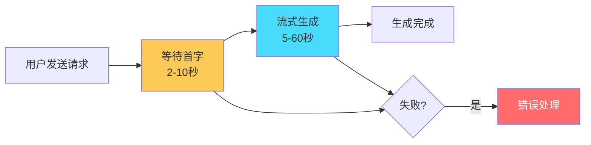
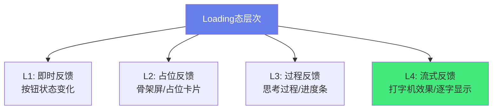
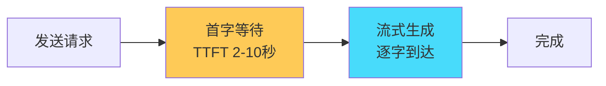
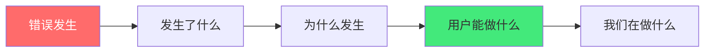

# ⏳ AI 生成内容的 Loading 与错误态设计

> **文档说明**：系统讲解 AI 应用中内容生成的 Loading 态与错误态设计完整方案，涵盖 AI 内容生成的特殊性（延迟不确定 / 流式输出 / 可能失败 / 成本高 / 用户焦虑）、Loading 态设计（骨架屏 / 打字机效果 / 进度提示 / 思考过程展示 / 加载动画 / 预估时间 / 占位内容）、流式输出的 Loading（首字延迟 / 流式渲染 / 加载中状态 / 取消按钮 / 光标闪烁）、错误态设计（错误分类 / 友好提示 / 重试机制 / 降级方案 / 错误边界 / 错误日志）、常见错误类型全解（网络错误 / API 限流 429 / 超时 / 内容违规 / 模型过载 503 / 鉴权失败 401 / 上下文过长 413 / 服务不可用）、重试策略（自动重试 / 手动重试 / 指数退避 / 重试次数限制 / 重试时的用户提示）、降级方案（切换模型 / 切换到简单模式 / 显示缓存结果 / 人工接管提示）、用户体验核心原则（即时反馈 / 透明告知 / 可取消 / 可恢复 / 减少焦虑 / 不阻塞用户）、Vue3 完整实现（useAIGeneration composable / 状态机设计 / 错误边界组件 / Loading 组件库 / 全局错误处理）、与 SSE 流式输出配合（流式中断处理 / 重连机制 / 部分结果保存）、成本控制（取消时停止计费 / 超时自动取消 / 限流提示 / 用量提醒）、A/B 测试与优化（Loading 文案测试 / 错误提示测试 / 转化率优化）、常见问题与最佳实践。
>
> **适用人群**：前端开发者、AI 应用开发者、UI/UX 设计师、全栈工程师
>
> **前置知识**：[[流式响应与SSE]] · [[对话式UI组件设计]] · [[Markdown渲染与代码高亮]]

---

## 一、AI 内容生成的特殊性

### 1.1 为什么 AI 的 Loading 和错误态更重要

| 传统应用 | AI 应用 |
|---------|---------|
| 请求通常 < 1 秒 | 生成可能需要 5-60 秒 |
| 延迟相对稳定 | 延迟不确定（取决于模型、内容长度、负载） |
| 失败率低 | 失败率较高（限流、超时、内容审核） |
| 失败后重试通常成功 | 失败可能需要换模型/简化请求 |
| 成本低 | 每次生成都有 Token 成本 |
| 用户预期低 | 用户预期高（以为 AI 无所不能） |



### 1.2 用户焦虑点

AI 生成过程中用户最焦虑的是：
- 😰 **「是不是卡住了？」**——长时间没有反馈
- 😰 **「还要等多久？」**——没有进度提示
- 😰 **「会不会失败？」**——之前失败过，有心理阴影
- 😰 **「花了多少钱？」**——担心 Token 用量超支
- 😰 **「能不能取消？」**——发现问错了，想重来

> **好的 Loading 和错误态设计，就是解决这些焦虑，让用户在等待时感到「一切尽在掌控」。**

---

## 二、Loading 态设计

### 2.1 Loading 态的层次



| 层次 | 时机 | 示例 |
|------|------|------|
| **L1 即时反馈** | 点击后 0ms | 按钮变 loading、禁用、显示「生成中...」 |
| **L2 占位反馈** | 点击后 100ms | 骨架屏、占位卡片、消息气泡占位 |
| **L3 过程反馈** | 等待 2 秒后 | 「正在思考...」「正在分析文档...」、思考过程展示 |
| **L4 流式反馈** | 首字到达后 | 打字机效果、光标闪烁、逐字渲染 Markdown |

### 2.2 L1：即时反馈

```vue
<template>
  <button 
    :disabled="loading" 
    :class="{ 'is-loading': loading }"
    @click="generate"
  >
    <span v-if="loading" class="loading-spinner" />
    {{ loading ? '生成中...' : '生成' }}
  </button>
</template>

<style scoped>
.is-loading { opacity: 0.7; cursor: not-allowed; }
.loading-spinner {
  display: inline-block;
  width: 16px;
  height: 16px;
  border: 2px solid #ccc;
  border-top-color: #667eea;
  border-radius: 50%;
  animation: spin 0.8s linear infinite;
  margin-right: 8px;
}
@keyframes spin { to { transform: rotate(360deg); } }
</style>
```

### 2.3 L2：骨架屏与占位

```vue
<template>
  <!-- 消息气泡骨架屏 -->
  <div class="message-skeleton" v-if="loading">
    <div class="avatar-skeleton" />
    <div class="content-skeleton">
      <div class="line line-1" />
      <div class="line line-2" />
      <div class="line line-3" />
    </div>
  </div>
  
  <!-- 实际内容 -->
  <div class="message" v-else>
    <div class="avatar">AI</div>
    <div class="content" v-html="renderedContent" />
  </div>
</template>

<style scoped>
.skeleton-line {
  background: linear-gradient(90deg, #f0f0f0 25%, #e0e0e0 50%, #f0f0f0 75%);
  background-size: 200% 100%;
  animation: shimmer 1.5s infinite;
  border-radius: 4px;
  height: 12px;
  margin-bottom: 8px;
}
@keyframes shimmer {
  0% { background-position: 200% 0; }
  100% { background-position: -200% 0; }
}
</style>
```

### 2.4 L3：过程反馈与思考过程

**动态状态文案**（根据等待时间变化，减少焦虑）：

```typescript
function getLoadingText(elapsedSeconds: number): string {
  if (elapsedSeconds < 3) return '正在思考...'
  if (elapsedSeconds < 8) return '正在分析你的问题...'
  if (elapsedSeconds < 15) return '正在组织语言...'
  if (elapsedSeconds < 30) return '内容较长，正在生成中...'
  return '还在生成中，请稍候...（可随时取消）'
}
```

**思考过程展示**（DeepSeek-R1 / o1 等推理模型）：

```vue
<template>
  <div class="ai-message">
    <!-- 思考过程（可折叠） -->
    <details v-if="thinkingContent" class="thinking-block">
      <summary>
        <span class="thinking-icon">💭</span>
        思考过程（{{ thinkingDuration }}秒）
      </summary>
      <div class="thinking-content">{{ thinkingContent }}</div>
    </details>
    
    <!-- 最终答案 -->
    <div class="answer" v-if="answerContent">
      <MarkdownRenderer :content="answerContent" />
    </div>
    
    <!-- 生成中 -->
    <div v-else class="generating">
      <span class="typing-cursor" />
    </div>
  </div>
</template>
```

### 2.5 L4：流式输出的打字机效果

```typescript
// composables/useTypewriter.ts
import { ref, onUnmounted } from 'vue'

export function useTypewriter(speed = 20) {
  const displayedText = ref('')
  let fullText = ''
  let currentIndex = 0
  let timer: number | null = null

  function start(text: string) {
    fullText = text
    currentIndex = 0
    displayedText.value = ''
    type()
  }

  function type() {
    if (currentIndex < fullText.length) {
      displayedText.value += fullText[currentIndex]
      currentIndex++
      timer = window.setTimeout(type, speed)
    }
  }

  function append(text: string) {
    // 流式追加（SSE 场景）
    displayedText.value += text
  }

  function stop() {
    if (timer) clearTimeout(timer)
  }

  onUnmounted(stop)

  return { displayedText, start, append, stop }
}
```

**光标闪烁效果**：

```css
.typing-cursor {
  display: inline-block;
  width: 2px;
  height: 1em;
  background: #667eea;
  margin-left: 2px;
  animation: blink 1s step-end infinite;
  vertical-align: text-bottom;
}
@keyframes blink {
  0%, 100% { opacity: 1; }
  50% { opacity: 0; }
}
```

---

## 三、流式输出的 Loading

### 3.1 流式输出的两个阶段



| 阶段 | 用户感受 | 设计要点 |
|------|---------|---------|
| **首字等待（TTFT）** | 焦虑、不知道是否卡住 | 骨架屏 + 状态文案 + 取消按钮 |
| **流式生成** | 期待、看着内容逐字出现 | 打字机效果 + 光标 + 实时渲染 Markdown |

### 3.2 SSE 流式 Loading 实现

```typescript
// composables/useAIGeneration.ts
import { ref, onUnmounted } from 'vue'

type GenerationStatus = 'idle' | 'loading' | 'streaming' | 'success' | 'error'

export function useAIGeneration() {
  const status = ref<GenerationStatus>('idle')
  const content = ref('')
  const error = ref<Error | null>(null)
  const elapsedTime = ref(0)
  let abortController: AbortController | null = null
  let timer: number | null = null

  async function generate(prompt: string) {
    status.value = 'loading'
    content.value = ''
    error.value = null
    elapsedTime.value = 0
    
    // 计时
    timer = window.setInterval(() => elapsedTime.value++, 1000)
    
    abortController = new AbortController()
    
    try {
      const response = await fetch('/api/ai/generate', {
        method: 'POST',
        headers: { 'Content-Type': 'application/json' },
        body: JSON.stringify({ prompt }),
        signal: abortController.signal
      })
      
      if (!response.ok) {
        throw new Error(`HTTP ${response.status}: ${response.statusText}`)
      }
      
      const reader = response.body!.getReader()
      const decoder = new TextDecoder()
      status.value = 'streaming'
      
      while (true) {
        const { done, value } = await reader.read()
        if (done) break
        
        const chunk = decoder.decode(value, { stream: true })
        // 解析 SSE 格式（data: {...}\n\n）
        const lines = chunk.split('\n')
        for (const line of lines) {
          if (line.startsWith('data: ')) {
            const data = JSON.parse(line.slice(6))
            content.value += data.content  // 追加内容
          }
        }
      }
      
      status.value = 'success'
    } catch (err) {
      if ((err as Error).name === 'AbortError') {
        status.value = 'idle'  // 用户取消
      } else {
        status.value = 'error'
        error.value = err as Error
      }
    } finally {
      if (timer) clearInterval(timer)
    }
  }

  function cancel() {
    abortController?.abort()
  }

  function retry() {
    // 重新生成（需要保存上次的 prompt）
  }

  onUnmounted(() => {
    abortController?.abort()
    if (timer) clearInterval(timer)
  })

  return { status, content, error, elapsedTime, generate, cancel, retry }
}
```

### 3.3 流式中断处理

```typescript
// SSE 连接中断时的重连机制
async function generateWithReconnect(prompt: string, maxRetries = 2) {
  for (let attempt = 0; attempt <= maxRetries; attempt++) {
    try {
      await generate(prompt)
      return  // 成功
    } catch (error) {
      if (attempt === maxRetries) throw error
      // 等待后重试（指数退避）
      await new Promise(r => setTimeout(r, 1000 * Math.pow(2, attempt)))
      // 保留已生成的内容，从中断处继续
      // （需要后端支持 resume）
    }
  }
}
```

---

## 四、错误态设计

### 4.1 错误分类

| 错误类型 | HTTP 状态码 | 原因 | 用户可操作 |
|---------|------------|------|-----------|
| **网络错误** | — | 断网、CORS、DNS | 检查网络、重试 |
| **请求超时** | 408 / 504 | 生成时间过长、网络慢 | 重试、简化请求 |
| **限流** | 429 | 请求太频繁、超过配额 | 等待、升级套餐 |
| **鉴权失败** | 401 / 403 | API Key 失效、无权限 | 重新登录、检查 Key |
| **内容违规** | 400 / 内容审核 | 输入或输出违反政策 | 修改内容、换个问法 |
| **上下文过长** | 413 / 400 | 输入 Token 超限 | 缩短输入、精简上下文 |
| **模型过载** | 503 / 529 | 服务端负载高 | 稍后重试、切换模型 |
| **服务不可用** | 500 / 502 | 服务端故障 | 稍后重试、查看状态页 |

### 4.2 友好错误提示原则



**好的错误提示包含**：
1. **发生了什么**：简洁描述错误
2. **为什么发生**：可能的原因（用用户能理解的语言）
3. **用户能做什么**：具体的操作建议（重试、修改、联系客服）
4. **我们在做什么**：如果是服务端问题，说明正在处理

**错误提示对比**：

| ❌ 不好的提示 | ✅ 好的提示 |
|-------------|------------|
| `Error` | `生成失败：网络连接中断` |
| `Something went wrong` | `AI 服务暂时不可用（503），我们正在恢复，请稍后重试` |
| `429 Too Many Requests` | `请求过于频繁，请等待 30 秒后再试，或升级套餐增加配额` |
| `Invalid request` | `输入内容过长（超过 8000 字），请精简后重试` |

### 4.3 错误态组件

```vue
<template>
  <div class="error-state" v-if="error">
    <div class="error-icon">⚠️</div>
    <h3 class="error-title">{{ errorTitle }}</h3>
    <p class="error-message">{{ errorMessage }}</p>
    <div class="error-actions">
      <button @click="retry" class="btn-primary">
        重试
      </button>
      <button v-if="canCopy" @click="copyContent" class="btn-secondary">
        复制已生成内容
      </button>
      <button @click="contactSupport" class="btn-text">
        联系客服
      </button>
    </div>
    <p class="error-code" v-if="errorCode">错误代码：{{ errorCode }}</p>
  </div>
</template>

<script setup lang="ts">
import { computed } from 'vue'

const props = defineProps<{
  error: Error & { status?: number }
  partialContent?: string  // 流式生成中断时已生成的内容
}>()

const errorTitle = computed(() => {
  const status = props.error.status
  if (status === 429) return '请求过于频繁'
  if (status === 401 || status === 403) return '认证失败'
  if (status === 413) return '内容过长'
  if (status >= 500) return '服务暂时不可用'
  return '生成失败'
})

const errorMessage = computed(() => {
  const status = props.error.status
  if (status === 429) return '您的请求过于频繁，请等待 30 秒后再试，或升级套餐增加配额。'
  if (status === 401) return '登录状态已失效，请重新登录后再试。'
  if (status === 413) return '输入内容超过限制，请精简后重试。'
  if (status >= 500) return 'AI 服务暂时不可用，我们正在紧急恢复，请稍后重试。'
  return props.error.message || '生成过程中出现错误，请重试。'
})

const canCopy = computed(() => props.partialContent && props.partialContent.length > 0)
const errorCode = computed(() => props.error.status)
</script>
```

---

## 五、重试策略

### 5.1 重试决策矩阵

| 错误类型 | 自动重试 | 手动重试 | 切换模型 | 简化请求 |
|---------|---------|---------|---------|---------|
| 网络错误 | ✅ 1-2次 | ✅ | ❌ | ❌ |
| 超时 | ✅ 1次 | ✅ | ✅ | ✅ |
| 限流 429 | ❌（等冷却） | ✅（等待后） | ✅ | ❌ |
| 鉴权失败 | ❌ | ❌（需重新登录） | ❌ | ❌ |
| 内容违规 | ❌ | ❌ | ❌ | ✅（修改内容） |
| 上下文过长 | ❌ | ❌ | ❌ | ✅（精简输入） |
| 模型过载 503 | ✅ 2-3次（退避） | ✅ | ✅ | ❌ |
| 服务不可用 500 | ✅ 1-2次 | ✅ | ✅ | ❌ |

### 5.2 指数退避重试

```typescript
async function retryWithBackoff<T>(
  fn: () => Promise<T>,
  maxRetries = 3,
  baseDelay = 1000
): Promise<T> {
  let lastError: Error
  
  for (let attempt = 0; attempt <= maxRetries; attempt++) {
    try {
      return await fn()
    } catch (error) {
      lastError = error as Error
      
      // 不重试的错误类型
      if (isNonRetryableError(lastError)) {
        throw lastError
      }
      
      if (attempt < maxRetries) {
        const delay = baseDelay * Math.pow(2, attempt)  // 1s, 2s, 4s
        await new Promise(r => setTimeout(r, delay))
      }
    }
  }
  
  throw lastError!
}

function isNonRetryableError(error: Error & { status?: number }): boolean {
  return [400, 401, 403, 413, 422].includes(error.status || 0)
}
```

### 5.3 重试时的用户提示

```typescript
// 自动重试时告知用户
async function generateWithRetry(prompt: string) {
  const maxRetries = 2
  
  for (let attempt = 0; attempt <= maxRetries; attempt++) {
    try {
      if (attempt > 0) {
        statusMessage.value = `第 ${attempt} 次重试中...`
      }
      return await generate(prompt)
    } catch (error) {
      if (attempt === maxRetries) throw error
      const waitTime = Math.pow(2, attempt)
      statusMessage.value = `生成失败，${waitTime} 秒后自动重试...`
      await new Promise(r => setTimeout(r, waitTime * 1000))
    }
  }
}
```

---

## 六、降级方案

### 6.1 降级策略

| 降级方式 | 适用场景 | 实现 |
|---------|---------|------|
| **切换模型** | 主模型过载/不可用 | 备用模型列表，自动切换 |
| **简化模式** | 上下文过长/超时 | 减少上下文、用更短的输出 |
| **缓存结果** | 相同问题重复问 | 缓存最近的问答，直接返回 |
| **人工接管** | AI 无法解决 | 提示用户联系人工客服 |
| **离线模式** | 完全不可用 | 显示历史记录、提示稍后再试 |

### 6.2 模型自动切换

```typescript
const modelList = [
  { name: 'gpt-4o', priority: 1 },
  { name: 'claude-3.5-sonnet', priority: 2 },
  { name: 'qwen-plus', priority: 3 }  // 国内备用
]

async function generateWithFallback(prompt: string) {
  for (const model of modelList) {
    try {
      const result = await callLLM(model.name, prompt)
      return { result, model: model.name }
    } catch (error) {
      console.warn(`Model ${model.name} failed, trying next...`)
      continue  // 尝试下一个模型
    }
  }
  throw new Error('所有模型均不可用')
}
```

---

## 七、用户体验核心原则

### 7.1 六大原则

| 原则 | 说明 | 反例 |
|------|------|------|
| **即时反馈** | 点击后 0ms 就有视觉反馈 | 点击后按钮没变化，用户以为没点到 |
| **透明告知** | 告诉用户正在做什么、还要多久 | 只显示一个转圈，用户不知道在干嘛 |
| **可取消** | 任何时候都能取消，取消不收费 | 取消按钮藏起来，或者取消了还在计费 |
| **可恢复** | 失败后能重试，已生成内容不丢失 | 失败后所有内容清空，要重来 |
| **减少焦虑** | 用文案和动画让等待不那么难熬 | 「请稍候...」然后什么都没有 |
| **不阻塞用户** | 生成时用户可以做其他事 | 全屏 Loading，用户什么都做不了 |

### 7.2 成本透明

AI 生成是有成本的，用户有权知道：

- **生成前**：预估 Token 用量和费用（可选）
- **生成中**：显示已用 Token 数
- **生成后**：显示本次用量和费用
- **超限时**：提前提醒，不要直接报错

```vue
<template>
  <div class="usage-info">
    <span>本次生成约 {{ estimatedTokens }} Tokens</span>
    <span>本月已用 {{ monthlyUsage }} / {{ monthlyLimit }}</span>
    <el-progress :percentage="usagePercentage" :status="usageStatus" />
  </div>
</template>
```

---

## 八、Vue3 完整实现

### 8.1 useAIGeneration 状态机

```typescript
// composables/useAIGeneration.ts
import { ref, computed, onUnmounted } from 'vue'

type Status = 'idle' | 'loading' | 'streaming' | 'success' | 'error' | 'cancelled'

export function useAIGeneration() {
  const status = ref<Status>('idle')
  const content = ref('')
  const partialContent = ref('')  // 中断时已生成的内容
  const error = ref<Error | null>(null)
  const elapsedSeconds = ref(0)
  const tokensUsed = ref(0)
  
  let abortController: AbortController | null = null
  let timer: number | null = null
  let lastPrompt = ''

  const isLoading = computed(() => status.value === 'loading' || status.value === 'streaming')
  const canCancel = computed(() => isLoading.value)
  const canRetry = computed(() => status.value === 'error')
  const loadingText = computed(() => getLoadingText(elapsedSeconds.value))

  async function generate(prompt: string) {
    lastPrompt = prompt
    status.value = 'loading'
    content.value = ''
    error.value = null
    elapsedSeconds.value = 0
    
    timer = window.setInterval(() => elapsedSeconds.value++, 1000)
    abortController = new AbortController()
    
    try {
      const response = await fetch('/api/ai/generate', {
        method: 'POST',
        headers: { 'Content-Type': 'application/json' },
        body: JSON.stringify({ prompt }),
        signal: abortController.signal
      })
      
      if (!response.ok) {
        throw Object.assign(new Error(response.statusText), { status: response.status })
      }
      
      const reader = response.body!.getReader()
      const decoder = new TextDecoder()
      status.value = 'streaming'
      
      while (true) {
        const { done, value } = await reader.read()
        if (done) break
        const chunk = decoder.decode(value, { stream: true })
        // 解析 SSE...
        content.value += parseSSEChunk(chunk)
        partialContent.value = content.value
      }
      
      status.value = 'success'
    } catch (err) {
      if ((err as Error).name === 'AbortError') {
        status.value = 'cancelled'
      } else {
        status.value = 'error'
        error.value = err as Error
      }
    } finally {
      if (timer) clearInterval(timer)
    }
  }

  function cancel() {
    abortController?.abort()
  }

  function retry() {
    if (lastPrompt) generate(lastPrompt)
  }

  onUnmounted(() => {
    abortController?.abort()
    if (timer) clearInterval(timer)
  })

  return {
    status, content, partialContent, error, elapsedSeconds, tokensUsed,
    isLoading, canCancel, canRetry, loadingText,
    generate, cancel, retry
  }
}
```

### 8.2 全局错误边界

```vue
<!-- components/ErrorBoundary.vue -->
<script setup lang="ts">
import { ref, onErrorCaptured } from 'vue'

const hasError = ref(false)
const error = ref<Error | null>(null)

onErrorCaptured((err) => {
  hasError.value = true
  error.value = err as Error
  return false  // 阻止错误继续传播
})

function reset() {
  hasError.value = false
  error.value = null
}
</script>

<template>
  <slot v-if="!hasError" />
  <div v-else class="error-boundary">
    <h2>出错了</h2>
    <p>{{ error?.message }}</p>
    <button @click="reset">重试</button>
  </div>
</template>
```

---

## 九、常见问题

| 问题 | 原因 | 解决方案 |
|------|------|---------|
| **点击按钮没反应** | 没有即时反馈 | 点击后立刻改变按钮状态（loading/disabled） |
| **用户以为卡住了** | 长时间只有转圈 | 动态状态文案（2秒后变「正在分析...」） |
| **取消后还在计费** | 后端没收到取消信号 | AbortController + 后端检测连接断开停止生成 |
| **失败后内容全丢** | 错误时清空了 content | 保存 partialContent，错误时显示已生成内容 |
| **重试又失败** | 相同错误重复出现 | 指数退避 + 最大重试次数 + 切换模型 |
| **429 限流** | 请求太频繁 | 客户端限流 + 冷却时间提示 + 用量提醒 |
| **流式中断** | 网络波动 | SSE 重连机制 + 从中断处继续 |
| **Markdown 渲染闪烁** | 流式内容频繁重渲染 | 防抖渲染 + 增量更新 |
| **移动端体验差** | Loading 占满屏幕 | 非阻塞式 Loading，允许用户滚动历史 |

---

## 十、最佳实践

1. **即时反馈是第一原则**：点击后 0ms 就有视觉变化，不要让用户怀疑「点到了吗」
2. **分层次 Loading**：即时反馈（按钮）→ 占位反馈（骨架屏）→ 过程反馈（状态文案）→ 流式反馈（打字机）
3. **动态状态文案**：根据等待时间变化文案，减少「是不是卡住了」的焦虑
4. **任何时候都能取消**：取消按钮始终可见，取消后停止计费
5. **失败不丢内容**：保存已生成的部分内容，允许复制和重试
6. **错误提示要友好**：告诉用户「发生了什么、为什么、能做什么」，不要只显示错误码
7. **智能重试**：指数退避 + 最大次数 + 可重试错误才重试 + 重试时告知用户
8. **降级方案**：主模型不可用时自动切换备用模型，不要直接报错
9. **成本透明**：显示 Token 用量，超限时提前提醒
10. **不阻塞用户**：生成时用户可以查看历史、输入新问题，不要全屏 Loading
11. **A/B 测试**：测试不同的 Loading 文案和动画，找到用户体验最好的方案
12. **错误日志**：记录错误类型和频率，持续优化稳定性
13. **思考过程展示**：推理模型（R1/o1）展示思考过程，让用户知道 AI 在「思考」
14. **光标闪烁**：流式输出时显示光标，模拟「正在打字」的感觉
15. **预估时间**：如果能预估生成时间，告诉用户「大约需要 10 秒」

---

## 十一、关联笔记

### AI 前端集成
- [[流式响应与SSE]] · [[对话式UI组件设计]] · [[Markdown渲染与代码高亮]]
- [[文件上传与多模态交互]] · [[语音输入与TTS输出]] · [[AI前端集成入门]]

### 前端基础
- [[Vue3-组合式API]] · [[Vue3-自定义Hooks封装_backup_skeleton]] · [[TypeScript-类型系统进阶]]
- [[前端性能优化实战]]

### 产品与体验
- [[产品原型设计方法]] · [[用户增长策略]] · [[独立开发者IndieHacker思路]]
- [[从0到1产品落地路径]]

### 导航
- [[MOC-AI前端集成]] · [[MOC-前端开发]] · [[Home]] · [[学习路线总览]]

> 🔍 **核心认知深度解析**
>
> **作用**：AI 生成内容的 Loading 与错误态设计解决的是「如何在 AI 生成内容的长延迟和高失败率下，保持良好的用户体验，减少用户焦虑，提高成功率和满意度」的核心问题——AI 应用的用户体验差异，很大程度上体现在 Loading 和错误态的设计上。
>
> **底层原理**：①AI 生成内容的「延迟不确定性」是 Loading 设计的核心挑战——传统应用的请求延迟通常在 1 秒以内且相对稳定，而 AI 生成的延迟从 2 秒到 60 秒不等，取决于模型类型、内容长度、服务端负载。用户对「不确定的等待」焦虑感远高于「确定的等待」（等 10 秒但知道还要等 10 秒，比等 10 秒但不知道还要等多久焦虑少得多）。所以好的 Loading 设计要尽可能「减少不确定性」——动态状态文案告诉用户「正在做什么」，进度条或预估时间告诉用户「还要多久」。②「分层次 Loading」的本质是「渐进式反馈」——用户的焦虑随等待时间增长，所以反馈也要随时间升级：0ms 时按钮状态变化（确认点击生效），100ms 时骨架屏出现（确认系统在处理），2 秒时状态文案变化（确认没卡住，正在分析），首字到达后打字机效果（确认在生成，内容在增加）。每一层反馈都在回答用户的焦虑问题「是不是卡住了？」「还要多久？」「会不会失败？」。③「错误态设计」的本质是「恢复用户的控制感」——错误发生时用户最焦虑的是「失控感」（不知道发生了什么、不知道怎么办、不知道能不能恢复）。好的错误提示要恢复用户的控制感：告诉用户「发生了什么」（透明）、「为什么发生」（理解）、「你能做什么」（行动方案）、「我们在做什么」（如果是服务端问题）。当用户知道发生了什么且知道能做什么时，焦虑感会大幅降低。④「可取消和可恢复」是 AI 应用特有的重要设计——AI 生成耗时长且有成本，用户可能在生成过程中发现「问错了」「不需要了」「想换个问法」，这时必须能随时取消，且取消后不应该计费（后端要检测连接断开停止生成）。同时，生成失败时已生成的部分内容不应该丢失——用户可能花了 30 秒等了一半内容，失败后如果全部清空，用户会非常沮丧。保存 partialContent，允许复制和重试，是「可恢复」设计的关键。⑤「指数退避重试」的本质是「避免雪崩」——当服务端过载（503）时，如果所有客户端都立即重试，会让服务端负载更高，导致更多失败，形成雪崩。指数退避（1s、2s、4s、8s...）让重试请求随时间分散，给服务端恢复的时间。同时要区分「可重试错误」（网络错误、503、超时）和「不可重试错误」（401 鉴权失败、413 内容过长、内容违规），不可重试的错误不要自动重试，直接提示用户。⑥「降级方案」的本质是「保证基本可用」——当主模型不可用时，自动切换到备用模型；当上下文过长时，自动精简；当完全不可用时，显示历史记录和「稍后再试」。降级的目标是「在不理想的情况下仍能提供基本服务」，而不是「要么完美可用要么完全不可用」。这在 AI 应用中尤其重要，因为 AI 服务的可用性通常低于传统 Web 服务（模型过载、内容审核等都可能导致失败）。⑦「成本透明」是 AI 应用的特殊需求——AI 生成是有成本的（Token 计费），用户有权知道本次生成花了多少钱、本月还剩多少额度。如果用户在不知情的情况下超额使用，会产生强烈的不信任感。好的设计是在生成前预估用量、生成中显示已用、生成后显示费用、超限时提前提醒（而不是直接报错）。这不仅是用户体验问题，也是信任问题。
>
> **用法要点**：① AI生成特殊性：延迟2-60秒不确定/失败率较高/每次有Token成本/用户预期高/焦虑点多(卡住/多久/失败/花钱/取消) ② Loading四层次：L1即时反馈(按钮loading禁用 0ms)/L2占位反馈(骨架屏 100ms)/L3过程反馈(动态状态文案 2s+)/L4流式反馈(打字机+光标 首字到达后) ③ 动态状态文案：<3秒「正在思考」/<8秒「正在分析」/<15秒「正在组织语言」/<30秒「内容较长生成中」/>30秒「还在生成中可随时取消」 ④ 流式两阶段：首字等待TTFT(2-10秒，骨架屏+状态文案+取消按钮)/流式生成(打字机+光标+实时Markdown渲染) ⑤ SSE实现：fetch+ReadableStream+TextDecoder解析data:/AbortController取消/部分内容保存/重连机制 ⑥ 错误分类：网络错误/超时408/限流429/鉴权401/内容违规/上下文过长413/模型过载503/服务不可用500 ⑦ 友好错误四要素：发生了什么/为什么/用户能做什么/我们在做什么 ⑧ 重试策略：可重试错误(网络/503/超时)自动重试1-3次/指数退避1s-2s-4s/不可重试错误(401/413/违规)不重试/重试时告知用户/最大次数限制 ⑨ 降级方案：模型自动切换(主模型→备用)/简化模式(精简上下文)/缓存结果(相同问题)/人工接管/离线模式(历史记录) ⑩ UX六原则：即时反馈/透明告知/可取消/可恢复(partialContent不丢)/减少焦虑/不阻塞用户 ⑪ 成本透明：生成前预估/生成中显示已用/生成后显示费用/超限提前提醒 ⑫ Vue3实现：useAIGeneration composable(状态机idle/loading/streaming/success/error/cancelled)/AbortController/partialContent/ErrorBoundary组件 ⑬ 常见问题：点击没反应(即时反馈)/以为卡住(动态文案)/取消还计费(后端检测断开)/失败丢内容(保存partialContent)/重试又失败(退避+切模型)/429(客户端限流)/流式中断(重连)/Markdown闪烁(防抖渲染) ⑭ 最佳实践：即时反馈第一/分层Loading/动态文案/随时可取消/失败不丢内容/友好错误提示/智能重试/降级方案/成本透明/不阻塞用户/AB测试/错误日志/思考过程展示/光标闪烁/预估时间。

> 💡 **深度讲解**：AI 生成内容的 Loading 与错误态设计最核心的智慧是「减少不确定性，恢复控制感——用户不怕等待，怕的是不知道还要等多久；用户不怕失败，怕的是不知道为什么失败、不知道怎么办」——传统应用的 Loading 设计相对简单（一个转圈就够了），因为延迟短且稳定；但 AI 应用的延迟长且不确定，失败率高，用户焦虑感强，简单的 Loading 远远不够。好的 AI 应用和差的 AI 应用，功能可能一样，但用户体验天差地别——差别就在 Loading 和错误态的细节。「分层次 Loading」是减少焦虑的核心方法——用户的焦虑随等待时间增长，反馈也要随时间升级。0ms 时按钮变 loading（确认点到了），100ms 时骨架屏出现（确认在处理），2 秒时文案变成「正在分析你的问题」（确认没卡住），5 秒时变成「正在组织语言」（确认在推进），首字到达后打字机效果开始（确认在生成）。每一层都在回答用户心里的疑问「是不是卡住了？」「还要多久？」。「动态状态文案」是一个简单但极其有效的技巧——同样是等待，「请稍候...」让用户焦虑，「正在分析你的问题...」让用户觉得系统在做事，「正在组织语言，马上就好...」让用户觉得快完成了。根据等待时间变化文案，能显著降低用户的「卡住感」。错误态设计的核心是「恢复控制感」——错误发生时用户最焦虑的是「失控」。好的错误提示要告诉用户「发生了什么、为什么、你能做什么」，让用户重新获得控制感。比如「生成失败：AI 服务暂时不可用（503），我们正在紧急恢复，请 30 秒后重试，或切换到备用模型」——用户知道发生了什么（503）、为什么（服务不可用）、能做什么（等 30 秒重试或切换模型）、我们在做什么（紧急恢复），控制感就恢复了。「可取消和可恢复」是 AI 应用特有的重要设计——AI 生成耗时长有成本，用户可能想中途取消，取消按钮必须始终可见，且取消后停止计费（后端检测连接断开）。生成失败时已生成的部分内容不应该丢失——用户花了 30 秒等了一半内容，全部清空会非常沮丧。保存 partialContent，允许复制和重试，是「可恢复」的关键。在 AI 时代，Loading 和错误态不再是「边角料」，而是产品体验的核心——AI 的能力是基础设施（大家都能用 GPT-4），差异化在于用户体验。谁能让用户在等待时不焦虑、在失败时不沮丧，谁就能做出更好的 AI 产品。

> 📝 **精简总结**：AI生成Loading与错误态=减少不确定性+恢复控制感。Loading四层次：即时反馈(按钮)/占位(骨架屏)/过程(动态文案)/流式(打字机光标)。动态状态文案随时间变化减少卡住感。流式两阶段：首字等待TTFT/流式生成。SSE实现：fetch+ReadableStream+AbortController+partialContent。错误八类：网络/超时/限流429/鉴权401/内容违规/上下文过长413/模型过载503/服务不可用500。友好错误四要素：什么/为什么/能做什么/我们在做什么。重试：可重试错误指数退避1-3次/不可重试不重试。降级：模型切换/简化/缓存/人工/离线。UX六原则：即时反馈/透明/可取消/可恢复/减焦虑/不阻塞。成本透明：预估/已用/费用/超限提醒。最佳实践：分层Loading/动态文案/随时取消/失败不丢内容/友好错误/智能重试/降级方案/成本透明。

> **学习路径建议**：先学习 [[流式响应与SSE]] 理解流式输出原理 → 学习 [[对话式UI组件设计]] 理解 AI 对话界面 → 实践：实现一个简单的 Loading 状态机（idle/loading/success/error） → 学习骨架屏和打字机效果 → 实践：实现流式输出的 Loading（首字等待 + 打字机） → 学习错误分类和重试策略 → 实践：实现错误态组件和指数退避重试 → 学习降级方案（模型切换、缓存） → 实践：实现完整的 useAIGeneration composable → 研究优秀 AI 产品（ChatGPT、Claude、Cursor）的 Loading 和错误态设计 → 形成自己的 AI 前端体验设计规范。

---

> **AI 生成内容的 Loading 与错误态设计最核心的智慧是「减少不确定性，恢复控制感——用户不怕等待，怕的是不知道还要等多久；用户不怕失败，怕的是不知道为什么失败、不知道怎么办」——传统应用 Loading 简单（一个转圈够了），因为延迟短且稳定；但 AI 应用延迟长且不确定，失败率高，用户焦虑感强，简单 Loading 远远不够。好的 AI 应用和差的 AI 应用功能可能一样，但用户体验天差地别——差别就在 Loading 和错误态的细节。分层次 Loading 是减少焦虑的核心方法——用户焦虑随等待时间增长，反馈也要随时间升级：0ms 按钮变 loading（确认点到了），100ms 骨架屏出现（确认在处理），2 秒文案变「正在分析你的问题」（确认没卡住），5 秒变「正在组织语言」（确认在推进），首字到达后打字机效果（确认在生成），每一层都在回答用户心里的疑问「是不是卡住了？还要多久？」。动态状态文案是简单但极其有效的技巧——同样等待，「请稍候」让用户焦虑，「正在分析你的问题」让用户觉得系统在做事，「正在组织语言马上就好」让用户觉得快完成了，根据等待时间变化文案能显著降低卡住感。错误态设计核心是恢复控制感——错误发生时用户最焦虑的是失控，好的错误提示告诉用户发生了什么、为什么、能做什么，让用户重新获得控制感。可取消和可恢复是 AI 应用特有重要设计——AI 生成耗时长有成本，用户可能想中途取消，取消按钮必须始终可见且取消后停止计费；生成失败时已生成部分内容不应该丢失，保存 partialContent 允许复制和重试。在 AI 时代 Loading 和错误态不再是边角料，而是产品体验核心——AI 能力是基础设施（大家都能用 GPT-4），差异化在于用户体验，谁能让用户等待时不焦虑、失败时不沮丧，谁就能做出更好的 AI 产品。下次你做 AI 应用时，花 50% 的时间在 Loading 和错误态上——用户会感受到的。**
