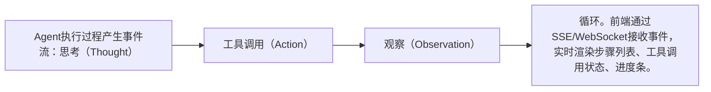

# Agent 思考链与任务进度展示

> **文档说明**：本文档系统讲解Agent 思考链与任务进度展示的核心概念、底层原理、实操用法、常见问题与最佳实践，帮助读者从入门到精通。
>
> **适用人群**：Vue3TS前端方向开发者、需要系统掌握该技术的工程师
>
> **前置知识**：具备相关领域基础概念即可阅读

---

## 一、概述

AI Agent执行多步任务时，展示思考过程和任务进度能提升用户信任和体验，是AI产品前端的核心交互模式。
### 1. 核心应用场景

- **异步处理**：将耗时操作从主流程剥离，提升响应速度
- **系统解耦**：通过消息中间件实现模块间松耦合
- **流量削峰**：高并发场景下缓冲请求，保护后端服务
- **定时任务**：支持周期性任务调度，替代传统cron

### 2. 核心优势

| 优势 | 说明 |
|------|------|
| 高性能 | 基于高效的并发模型，支持大规模任务处理 |
| 高可用 | 支持任务重试、失败转移，确保任务不丢失 |
| 易扩展 | Worker水平扩展，应对增长的任务量 |
| 可观测 | 提供监控面板，实时追踪任务状态 |

## 二、底层原理

Agent执行过程产生事件流：思考（Thought）→ 工具调用（Action）→ 观察（Observation）→ 循环。前端通过SSE/WebSocket接收事件，实时渲染步骤列表、工具调用状态、进度条。
### 1. 核心流程



<div style="background:linear-gradient(135deg,#43e97b,#38f9d7);border-radius:16px;padding:20px;margin:16px 0;font-family:-apple-system,'Segoe UI','PingFang SC','Microsoft YaHei',sans-serif;color:#fff;overflow:hidden;box-shadow:0 8px 28px rgba(0,0,0,.14),0 3px 10px rgba(0,0,0,.08)">
<style>@keyframes flow{0%{transform:translateX(-10px);opacity:0}15%{transform:translateX(0);opacity:1}85%{transform:translateX(0);opacity:1}100%{transform:translateX(10px);opacity:0}}.flow-step{display:inline-block;background:rgba(255,255,255,.2);border:2px solid rgba(255,255,255,.5);border-radius:8px;padding:10px 14px;margin:4px;text-align:center;font-weight:600;font-size:13px;animation:flow 4s ease-in-out infinite;min-width:80px}.flow-arrow{display:inline-block;font-size:20px;animation:flow 4s ease-in-out infinite;vertical-align:middle}</style>
<div style="text-align:center;font-size:15px;font-weight:700;margin-bottom:14px;padding-bottom:10px;border-bottom:1.5px solid rgba(255,255,255,.22);letter-spacing:1px;text-shadow:0 1px 3px rgba(0,0,0,.12)">Agent 思考链与任务进度展示核心流程</div>
<div style="text-align:center;white-space:nowrap;overflow-x:auto"><span class="flow-step" style="animation-delay:0.0s">Agent执行过程产生事件流：思考（Thought）</span><span class="flow-arrow">→</span><span class="flow-step" style="animation-delay:0.4s">工具调用（Action）</span><span class="flow-arrow">→</span><span class="flow-step" style="animation-delay:0.8s">观察（Observation）</span><span class="flow-arrow">→</span><span class="flow-step" style="animation-delay:1.2000000000000002s">循环。前端通过SSE/WebSocket接收事件，实时渲染步骤列表、工具调用状态、进度条。</span></div>
</div>

## 三、实操示例

```vue
<script setup>
const steps = ref([])
const currentStep = ref(0)

function handleEvent(event) {
  if (event.type === 'thought') {
    steps.value.push({ type: 'thought', content: event.content, status: 'active' })
  } else if (event.type === 'tool_start') {
    steps.value.push({ type: 'tool', name: event.tool, status: 'running' })
  } else if (event.type === 'tool_end') {
    const step = steps.value.find(s => s.status === 'running')
    step.status = 'done'
    step.result = event.result
  }
  currentStep.value = steps.value.length
}
</script>

<template>
  <div class="agent-steps">
    <div v-for="(step, i) in steps" :key="i" :class="['step', step.status]">
      <span class="icon">{{ step.type === 'thought' ? '💭' : '🔧' }}</span>
      <span class="content">{{ step.content || step.name }}</span>
      <span class="status">{{ step.status }}</span>
    </div>
    <div v-if="steps.length" class="progress">
      进度：{{ currentStep }} 步
    </div>
  </div>
</template>
```

<script setup>
const steps = ref([])
const currentStep = ref(0)

function...
>
> **原理**：通过核心机制实现关键功能
>
> **用法要点**：① 掌握基础用法 ② 理解核心配置 ③ 注意常见陷阱 ④ 结合实际场景应用

---

## 四、常见问题与排查

- 事件顺序错乱 → 用序号/时间戳排序，幂等处理
- 思考内容敏感 → 可折叠/隐藏详细思考，只展示步骤
- 长任务焦虑 → 进度条+预计时间+可取消
### 常见问题排查表

| 问题现象 | 可能原因 | 解决方案 |
|---------|---------|---------|
| 事件顺序错乱 | 配置/环境/依赖问题 | 用序号/时间戳排序，幂等处理 |
| 思考内容敏感 | 配置/环境/依赖问题 | 可折叠/隐藏详细思考，只展示步骤 |
| 长任务焦虑 | 配置/环境/依赖问题 | 进度条+预计时间+可取消 |

- 思考内容敏感 → 可折叠/隐藏详细思考，只展示步骤
- 长任务焦虑 → 进度条+预计时间+可取消
###...
>
> **原理**：通过核心机制实现关键功能
>
> **用法要点**：① 掌握基础用法 ② 理解核心配置 ③ 注意常见陷阱 ④ 结合实际场景应用

---

## 五、进阶与最佳实践

- 步骤可展开/折叠：默认显示摘要，点击看详情
- 工具调用展示输入输出
- 失败步骤高亮+重试按钮
- 流式思考：逐字显示思考内容
- 与SSE错误处理配合：断线重连+状态恢复
### 生产环境最佳实践

1. **配置管理**：使用配置中心管理敏感信息，避免硬编码
2. **监控告警**：接入APM监控，设置关键指标告警阈值
3. **日志规范**：结构化日志输出，包含traceId便于链路追踪
4. **资源限制**：设置合理的超时、重试、熔断策略
5. **版本管理**：API版本化，平滑升级避免破坏性变更

- 工具调用展示输入输出
- 失败步骤高亮+重试按钮
- 流式思考：逐字显示思考内容
- 与SSE错误处理配合：...
>
> **原理**：通过核心机制实现关键功能
>
> **用法要点**：① - 步骤可展开/折叠：默认显示摘要，点击看详情
- 工具调用展示输入输出
- 失败步骤高亮+重试按钮

---

## 六、关联笔记

[[对话式UI组件设计]] · [[SSE-流式响应对接LLM]] · [[AI生成内容的Loading与错误态]]