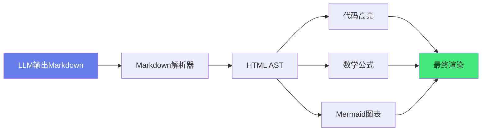

# 📝 Markdown 渲染与代码高亮

> **文档说明**：系统讲解前端 Markdown 渲染与代码高亮的完整方案，特别聚焦 AI 应用场景（LLM 流式输出的 Markdown 渲染），涵盖概述与 AI 场景需求、主流 Markdown 渲染库对比（markdown-it / marked / remark+rehype）、Vue3 集成方案（vue-markdown-it / 自定义组件 / v-md-editor）、代码高亮方案全解（highlight.js / Prism.js / Shiki / starry-night）与选型对比、Shiki 深度使用（VSCode 语法引擎 / TextMate 主题 / 双端渲染 / 暗黑主题）、流式 Markdown 渲染（LLM SSE 增量输出的实时渲染 / 防抖 / 不完整代码块处理）、数学公式支持（KaTeX / MathJax）、Mermaid 图表渲染、GFM 扩展（表格 / 任务列表 / 删除线 / 脚注）、自定义渲染规则（自定义组件 / 链接新窗口 / 图片懒加载 / 代码复制按钮）、安全与 XSS 防护（DOMPurify / sanitize / iframe 沙箱）、性能优化（虚拟滚动 / 懒加载 / 防抖渲染 / Web Worker）、暗黑模式主题切换、AI 场景特殊处理（代码块语言自动识别 / 流式代码高亮 / 思考过程折叠 / 引用来源展示）、常见问题与最佳实践。
>
> **适用人群**：前端开发者、AI 应用开发者、需要构建文档/聊天界面的全栈工程师
>
> **前置知识**：[[Vue3-组合式API]] · [[TypeScript-类型系统进阶]]

---

## 一、概述

### 1.1 为什么需要 Markdown 渲染

Markdown 是 AI 应用中最常见的输出格式——LLM 生成的回答、文档、代码示例通常都是 Markdown。前端需要将 Markdown 文本渲染为美观、可交互的 HTML。



**核心需求**：
- 📝 **标准 Markdown**：标题、列表、链接、图片、引用
- 🎨 **代码高亮**：多语言语法高亮、行号、复制按钮
- 📐 **数学公式**：LaTeX 公式渲染（KaTeX）
- 📊 **图表**：Mermaid 流程图、时序图
- 🔄 **流式渲染**：LLM 逐字输出时实时渲染
- 🛡️ **安全**：XSS 防护、用户输入过滤
- 🌙 **暗黑模式**：主题切换

### 1.2 AI 场景的特殊挑战

| 挑战 | 说明 |
|------|------|
| **流式输出** | Markdown 不完整（代码块未闭合、表格未完成） |
| **代码块多** | LLM 输出大量代码，需要高质量高亮 |
| **数学公式** | 推理场景需要 LaTeX 渲染 |
| **引用来源** | RAG 场景需要展示引用来源 |
| **思考过程** | 部分模型输出思考过程，需要折叠展示 |
| **工具调用** | Agent 场景需要渲染工具调用状态 |

---

## 二、主流 Markdown 渲染库对比

### 2.1 库对比

| 库 | 大小 | 速度 | 扩展性 | 生态 | 推荐场景 |
|----|------|------|--------|------|---------|
| **markdown-it** | 中 | 快 | 强（插件丰富） | 好 | 通用首选 |
| **marked** | 小 | 最快 | 中 | 一般 | 简单渲染 |
| **remark+rehype** | 大 | 中 | 最强（AST 操作） | 好 | 复杂需求/内容平台 |
| **showdown** | 中 | 中 | 弱 | 一般 | 不推荐 |

### 2.2 markdown-it 基础使用

```bash
pnpm add markdown-it
pnpm add -D @types/markdown-it
```

```typescript
import MarkdownIt from 'markdown-it'

const md = new MarkdownIt({
  html: false,           // 不允许原始 HTML（安全）
  linkify: true,         // 自动识别链接
  typographer: true,     // 智能引号
  breaks: true           // 换行转 <br>
})

const html = md.render('# Hello\n\nThis is **bold** text.')
```

### 2.3 常用插件

```typescript
import MarkdownIt from 'markdown-it'
import markdownItAnchor from 'markdown-it-anchor'      // 标题锚点
import markdownItToc from 'markdown-it-toc-done-right' // 目录
import markdownItTaskLists from 'markdown-it-task-lists' // 任务列表
import markdownItFootnote from 'markdown-it-footnote'  // 脚注

const md = new MarkdownIt()
  .use(markdownItAnchor, { permalink: true })
  .use(markdownItToc, { containerClass: 'toc' })
  .use(markdownItTaskLists)
  .use(markdownItFootnote)
```

---

## 三、代码高亮方案

### 3.1 高亮库对比

| 库 | 原理 | 质量 | 速度 | 体积 | 主题 |
|----|------|------|------|------|------|
| **highlight.js** | 正则匹配 | 中 | 快 | 中 | 多 |
| **Prism.js** | 正则匹配 | 中 | 快 | 小 | 多 |
| **Shiki** | VSCode TextMate 语法 | 高 | 中 | 大 | VSCode 主题 |
| **starry-night** | Tree-sitter 语法 | 最高 | 慢 | 大 | 少 |

> **AI 应用推荐 Shiki**：代码质量高，与 VSCode 一致，支持几乎所有编程语言。

### 3.2 Shiki 深度使用

```bash
pnpm add shiki
```

```typescript
import { getHighlighter } from 'shiki'

// 初始化高亮器（加载语法和主题）
const highlighter = await getHighlighter({
  themes: ['github-dark', 'github-light'],
  langs: ['javascript', 'typescript', 'python', 'java', 'bash', 'json']
})

// 高亮代码
const html = highlighter.codeToHtml(code, {
  lang: 'typescript',
  theme: 'github-dark'
})
```

**与 markdown-it 集成**：
```typescript
import MarkdownIt from 'markdown-it'
import { getHighlighter } from 'shiki'

const highlighter = await getHighlighter({
  themes: ['github-dark', 'github-light'],
  langs: ['typescript', 'javascript', 'python', 'bash']
})

const md = new MarkdownIt({
  highlight: (code, lang) => {
    if (highlighter.getLoadedLanguages().includes(lang)) {
      return highlighter.codeToHtml(code, { lang, theme: 'github-dark' })
    }
    return md.utils.escapeHtml(code)  // 未知语言转义
  }
})
```

**双主题（暗黑/亮色）**：
```typescript
// Shiki 支持双主题，通过 CSS 变量切换
const html = highlighter.codeToHtml(code, {
  lang: 'typescript',
  themes: { dark: 'github-dark', light: 'github-light' },
  defaultColor: 'dark'
})
// 生成的 HTML 包含两套颜色，通过 html.dark / html.light 切换
```

### 3.3 highlight.js 使用

```bash
pnpm add highlight.js
```

```typescript
import hljs from 'highlight.js'
import 'highlight.js/styles/github-dark.css'

// 自动检测语言
const html = hljs.highlightAuto(code).value

// 指定语言
const html = hljs.highlight(code, { language: 'typescript' }).value

// 与 markdown-it 集成
const md = new MarkdownIt({
  highlight: (str, lang) => {
    if (lang && hljs.getLanguage(lang)) {
      return `<pre class="hljs"><code>${hljs.highlight(str, { language: lang }).value}</code></pre>`
    }
    return `<pre class="hljs"><code>${md.utils.escapeHtml(str)}</code></pre>`
  }
})
```

---

## 四、Vue3 集成方案

### 4.1 自定义 Markdown 组件

```vue
<!-- components/MarkdownRenderer.vue -->
<script setup lang="ts">
import { ref, computed, onMounted, watch } from 'vue'
import MarkdownIt from 'markdown-it'
import { getHighlighter, type Highlighter } from 'shiki'
import DOMPurify from 'dompurify'

const props = defineProps<{
  content: string
  theme?: 'dark' | 'light'
}>()

const html = ref('')
let highlighter: Highlighter | null = null
let md: MarkdownIt | null = null

async function init() {
  highlighter = await getHighlighter({
    themes: ['github-dark', 'github-light'],
    langs: ['typescript', 'javascript', 'python', 'java', 'bash', 'json', 'html', 'css', 'vue']
  })
  
  md = new MarkdownIt({
    html: false,
    linkify: true,
    typographer: true,
    highlight: (code, lang) => {
      if (highlighter?.getLoadedLanguages().includes(lang)) {
        return highlighter.codeToHtml(code, {
          lang,
          themes: { dark: 'github-dark', light: 'github-light' },
          defaultColor: props.theme || 'dark'
        })
      }
      return `<pre><code>${md!.utils.escapeHtml(code)}</code></pre>`
    }
  })
  
  render()
}

function render() {
  if (!md) return
  const raw = md.render(props.content)
  html.value = DOMPurify.sanitize(raw)  // XSS 防护
}

watch(() => props.content, render, { flush: 'post' })
onMounted(init)
</script>

<template>
  <div class="markdown-body" v-html="html" />
</template>

<style>
.markdown-body { line-height: 1.7; }
.markdown-body pre { padding: 16px; border-radius: 8px; overflow-x: auto; }
.markdown-body code { font-family: 'Fira Code', monospace; }
</style>
```

### 4.2 使用组件

```vue
<MarkdownRenderer :content="llmResponse" theme="dark" />
```

---

## 五、流式 Markdown 渲染

### 5.1 LLM 流式输出的挑战

LLM 通过 SSE 逐字输出 Markdown，直接渲染会遇到：
- 代码块未闭合（``` 只有开头）
- 表格不完整
- 数学公式未闭合（$...$）
- 频繁渲染导致性能问题

### 5.2 防抖渲染

```typescript
import { ref, watch } from 'vue'

const content = ref('')  // LLM 流式累积的内容
let renderTimer: number | null = null

watch(content, () => {
  if (renderTimer) clearTimeout(renderTimer)
  renderTimer = window.setTimeout(() => {
    renderMarkdown(content.value)
  }, 100)  // 100ms 防抖
})
```

### 5.3 不完整代码块处理

```typescript
function fixIncompleteCodeBlock(text: string): string {
  const codeBlockCount = (text.match(/```/g) || []).length
  if (codeBlockCount % 2 === 1) {
    // 代码块未闭合，补充闭合标记
    return text + '\n```'
  }
  return text
}

function renderStream(text: string) {
  const fixed = fixIncompleteCodeBlock(text)
  renderMarkdown(fixed)
}
```

### 5.4 增量渲染优化

对于大段文本，全量重新渲染开销大。可以：
- 按段落分割，只渲染新增部分
- 使用 `requestIdleCallback` 在空闲时渲染
- 代码块单独高亮（最耗时的部分）

---

## 六、数学公式支持

### 6.1 KaTeX 集成

```bash
pnpm add katex markdown-it-katex
pnpm add -D @types/katex
```

```typescript
import katex from 'markdown-it-katex'
import 'katex/dist/katex.min.css'

const md = new MarkdownIt().use(katex, {
  throwOnError: false,
  errorColor: '#cc0000'
})

// 行内公式：$E=mc^2$
// 块级公式：$$\int_0^\infty e^{-x^2}dx$$
```

### 6.2 MathJax（更完整的 LaTeX 支持）

```typescript
// MathJax 功能更全但体积更大，适合学术场景
// 通过 script 标签加载或动态 import
```

---

## 七、Mermaid 图表渲染

```bash
pnpm add mermaid
```

```typescript
import mermaid from 'mermaid'

mermaid.initialize({
  startOnLoad: false,
  theme: 'dark',
  securityLevel: 'strict'
})

// 自定义代码块渲染：```mermaid
const md = new MarkdownIt({
  highlight: (code, lang) => {
    if (lang === 'mermaid') {
      return `<div class="mermaid">${code}</div>`
    }
    // ... 其他语言高亮
  }
})

// 渲染后初始化 mermaid
function renderMermaid() {
  mermaid.run({ querySelector: '.mermaid' })
}
```

---

## 八、安全与 XSS 防护

### 8.1 DOMPurify 消毒

```bash
pnpm add dompurify
pnpm add -D @types/dompurify
```

```typescript
import DOMPurify from 'dompurify'

const rawHtml = md.render(content)
const safeHtml = DOMPurify.sanitize(rawHtml, {
  ADD_ATTR: ['target', 'rel'],  // 允许链接 target
  FORBID_TAGS: ['script', 'iframe', 'object'],
  FORBID_ATTR: ['onerror', 'onload', 'onclick']
})
```

### 8.2 markdown-it 安全配置

```typescript
const md = new MarkdownIt({
  html: false,        // 禁止原始 HTML（最重要）
  linkify: true,
  typographer: true
})

// 自定义链接渲染，强制 target=_blank 和 rel=noopener
const defaultRender = md.renderer.rules.link_open || function(tokens, idx, options, env, self) {
  return self.renderToken(tokens, idx, options)
}

md.renderer.rules.link_open = function(tokens, idx, options, env, self) {
  tokens[idx].attrSet('target', '_blank')
  tokens[idx].attrSet('rel', 'noopener noreferrer')
  return defaultRender(tokens, idx, options, env, self)
}
```

---

## 九、AI 场景特殊处理

### 9.1 代码复制按钮

```typescript
// 渲染后为每个代码块添加复制按钮
function addCopyButtons() {
  document.querySelectorAll('.markdown-body pre').forEach(pre => {
    if (pre.querySelector('.copy-btn')) return
    const btn = document.createElement('button')
    btn.className = 'copy-btn'
    btn.textContent = '复制'
    btn.onclick = () => {
      const code = pre.querySelector('code')?.textContent || ''
      navigator.clipboard.writeText(code)
      btn.textContent = '已复制'
      setTimeout(() => btn.textContent = '复制', 2000)
    }
    pre.appendChild(btn)
  })
}
```

### 9.2 思考过程折叠

部分模型（如 DeepSeek-R1、o1）输出思考过程，需要折叠：

```typescript
// 识别 <think>...</think> 标签，渲染为可折叠区域
function renderThinking(content: string): string {
  return content.replace(
    /<think>([\s\S]*?)<\/think>/g,
    '<details class="thinking"><summary>思考过程</summary><pre>$1</pre></details>'
  )
}
```

### 9.3 引用来源展示

RAG 场景下，LLM 回答中包含引用标记 `[1]`，需要展示来源：

```typescript
// 将 [1] 转换为可点击的引用标记
function renderCitations(content: string, sources: Source[]): string {
  return content.replace(/\[(\d+)\]/g, (_, num) => {
    const source = sources[parseInt(num) - 1]
    return source 
      ? `<sup class="citation"><a href="${source.url}" target="_blank">${num}</a></sup>`
      : `[${num}]`
  })
}
```

---

## 十、性能优化

| 优化点 | 方法 | 适用场景 |
|--------|------|---------|
| **防抖渲染** | 流式输出时 100ms 防抖 | LLM 流式输出 |
| **虚拟滚动** | 超长文档只渲染可见区域 | 长文档 |
| **懒加载** | Mermaid/图片进入视口再渲染 | 多图表页面 |
| **Web Worker** | Markdown 解析在 Worker 中 | 大文档 |
| **代码缓存** | 相同代码块缓存高亮结果 | 重复代码 |
| **按需加载语言** | Shiki 只加载需要的语言 | 减少初始化时间 |
| **CSS 隐藏** | 渲染中用 opacity:0 避免闪烁 | 首次渲染 |

---

## 十一、常见问题

| 问题 | 原因 | 解决方案 |
|------|------|---------|
| **代码块不闭合** | 流式输出未完成 | 检测 ``` 数量，奇数则补充 |
| **XSS 漏洞** | 允许原始 HTML | html:false + DOMPurify |
| **Shiki 加载慢** | 语法文件大 | 按需加载语言 / Web Worker |
| **数学公式不渲染** | 缺少插件 | 集成 markdown-it-katex |
| **表格样式乱** | CSS 缺失 | 添加表格样式（边框/斑马纹） |
| **暗黑模式切换闪烁** | 主题切换重渲染 | Shiki 双主题 CSS 变量 |
| **长文档卡顿** | 全量渲染 | 虚拟滚动 / 分段渲染 |
| **复制按钮不显示** | 渲染后未执行 | 在 v-html 更新后调用 addCopyButtons |

---

## 十二、最佳实践

1. **AI 应用首选 Shiki**：代码高亮质量与 VSCode 一致，用户体验好
2. **必须做 XSS 防护**：`html: false` + DOMPurify，用户输入不可信
3. **流式输出要防抖**：100ms 防抖 + 不完整代码块补全
4. **代码块加复制按钮**：AI 输出的代码用户经常需要复制
5. **支持暗黑模式**：Shiki 双主题，CSS 变量切换
6. **数学公式用 KaTeX**：比 MathJax 快，满足绝大多数场景
7. **Mermaid 懒加载**：图表渲染耗时，进入视口再渲染
8. **链接新窗口打开**：`target="_blank" rel="noopener noreferrer"`
9. **自定义渲染规则**：引用来源、思考过程、工具调用等 AI 特殊元素
10. **性能监控**：大文档监控渲染时间，必要时虚拟滚动

---

## 十三、关联笔记

### AI 前端集成
- [[对话式UI组件设计]] · [[流式响应与SSE]] · [[AI前端集成入门]]
- [[文件上传与多模态交互]] · [[语音输入与TTS输出]]

### 前端基础
- [[Vue3-组合式API]] · [[TypeScript-类型系统进阶]] · [[前端性能优化实战]]

### 项目实战
- [[AI聊天机器人开发]] · [[RAG知识库系统]] · [[全栈项目实战]]

### 导航
- [[MOC-AI前端集成]] · [[MOC-前端开发]] · [[Home]] · [[学习路线总览]]

> 🔍 **知识点深度解析**
>
> **作用**：Markdown 渲染与代码高亮解决的是「如何将 LLM 输出的 Markdown 文本（含代码、公式、图表）在前端渲染为美观、安全、可交互的 HTML，特别是在流式输出场景下实现实时、流畅的渲染体验」的核心问题——Markdown 是 AI 应用的「输出标准格式」，高质量的渲染直接决定 AI 产品的用户体验。
>
> **底层原理**：①Markdown 渲染的本质是「文本→AST→HTML」的转换 pipeline——Markdown 解析器（markdown-it/marked）将 Markdown 文本解析为 token 流（AST），再根据规则将 token 渲染为 HTML。这个 pipeline 可以在多个环节扩展：解析阶段添加自定义语法（如数学公式）、AST 阶段操作节点（如添加锚点）、渲染阶段自定义输出（如代码高亮）。markdown-it 的插件机制就是在这些环节注入自定义逻辑。②代码高亮的本质是「源代码→语法树→带样式的 HTML」——highlight.js/Prism 用正则表达式匹配语法元素（关键字、字符串、注释），Shiki 用 VSCode 的 TextMate 语法引擎（基于语法规则文件 .tmLanguage），starry-night 用 Tree-sitter（基于语法分析器）。正则方案快但不够精确（嵌套语法容易出错），TextMate/Tree-sitter 方案精确但更重。Shiki 的优势在于它直接使用 VSCode 的语法文件和主题，高亮效果与编辑器完全一致，这对 AI 应用（输出大量代码）尤其重要。③流式渲染的核心挑战是「不完整的 Markdown」——LLM 逐字输出时，代码块可能只有开头的 ``` 没有结尾，表格可能只有表头没有数据，数学公式可能只有 $ 没有闭合。直接渲染会导致解析错误或样式错乱。解决方案是「检测并补全」——统计 ``` 数量，奇数则补充闭合；检测 $ 配对，不完整则暂不渲染公式。配合防抖（避免每字都渲染），实现流畅的流式体验。④XSS 防护是 Markdown 渲染的「安全底线」——Markdown 本身允许嵌入原始 HTML，如果不过滤，用户输入的 `<script>` 标签会执行恶意代码。防护有两层：第一层是解析器配置 `html: false`（不解析原始 HTML），第二层是 DOMPurify 消毒（过滤危险标签和属性）。两层都做才能确保安全，特别是在 AI 应用中，LLM 的输出也可能被提示注入攻击包含恶意 HTML。⑤Shiki 的双主题机制是暗黑模式的优雅解决方案——传统方案是切换 CSS 类名，但 Shiki 可以同时生成暗黑和亮色两套颜色，通过 CSS 变量（`--shiki-dark` / `--shiki-light`）和 `html.dark` 选择器切换，不需要重新高亮代码，切换瞬间完成无闪烁。这在 AI 聊天界面中很重要——用户切换主题时，历史消息的代码高亮不需要重新计算。⑥虚拟滚动是长文档渲染的性能关键——当 Markdown 渲染后包含数千个 DOM 节点（长文档、大量代码块），浏览器渲染和滚动会卡顿。虚拟滚动只渲染可见区域的内容，通过监听滚动位置动态替换内容，将 DOM 节点数控制在常量级别。这和虚拟列表的原理一致，但 Markdown 渲染的难点在于「内容高度不固定」（代码块、表格高度不一），需要用预估高度+实际测量修正。
>
> **用法要点**：① 渲染库：markdown-it(通用首选，插件丰富)/marked(轻量快速)/remark+rehype(AST操作强) ② 高亮库：Shiki(VSCode质量，AI推荐)/highlight.js(快)/Prism.js(轻量)/starry-night(Tree-sitter最高质量) ③ Vue3集成：自定义MarkdownRenderer组件(onMounted初始化Shiki+markdown-it/watch内容重渲染/v-html+DOMPurify) ④ 流式渲染：100ms防抖/检测```数量补全闭合/不完整公式暂不渲染/requestIdleCallback空闲渲染 ⑤ 数学公式：KaTeX(快，推荐)/MathJax(全但重)，markdown-it-katex插件 ⑥ Mermaid：mermaid.initialize+自定义代码块渲染+mermaid.run ⑦ XSS防护：html:false+DOMPurify.sanitize+链接强制target=_blank rel=noopener ⑧ AI特殊处理：代码复制按钮(渲染后添加)/思考过程折叠(<think>→details)/引用来源展示([1]→可点击sup)/工具调用状态渲染 ⑨ 性能优化：防抖/虚拟滚动/懒加载Mermaid/Web Worker解析/Shiki按需加载语言/代码缓存 ⑩ 暗黑模式：Shiki双主题CSS变量切换，无闪烁 ⑪ 常见问题：代码块不闭合(补全)/XSS(html:false+DOMPurify)/Shiki慢(按需加载)/公式不渲染(加插件)/表格样式乱(加CSS)/长文档卡顿(虚拟滚动) ⑫ 最佳实践：AI首选Shiki/必须XSS防护/流式防抖/复制按钮/暗黑双主题/KaTeX公式/Mermaid懒加载/链接新窗口/自定义AI元素/性能监控。

> 💡 **深度讲解**：Markdown 渲染与代码高亮最核心的智慧是「AI 应用的输出体验取决于渲染质量——LLM 生成的内容再好，如果渲染出来代码没高亮、公式错乱、表格错位，用户体验就大打折扣」——很多 AI 应用开发者把精力放在模型和 Prompt 上，忽视了前端渲染，结果是「内容很好但看起来很糙」。高质量的 Markdown 渲染是 AI 产品的「最后一公里」，直接影响用户对产品专业度的感知。Shiki 是 AI 时代代码高亮的最佳选择——它使用 VSCode 的 TextMate 语法引擎，高亮效果和你在编辑器里看到的完全一致，支持几乎所有编程语言，主题也是 VSCode 主题。虽然初始化比 highlight.js 慢，但对于 AI 应用（输出大量代码）来说，高亮质量的提升远大于加载时间的代价。流式渲染是 AI 应用特有的挑战——传统 Markdown 渲染是「一次性渲染完整文本」，但 LLM 是逐字输出的，文本永远在「不完整」的状态。好的流式渲染需要处理：不完整的代码块（补全闭合）、不完整的表格（暂不渲染或渲染半成品）、不完整的公式（暂不渲染）、频繁渲染的性能问题（防抖）。这些细节决定了流式输出是「流畅自然」还是「闪烁错乱」。XSS 防护在 AI 应用中更加重要——不仅用户输入可能包含恶意代码，LLM 的输出也可能被「提示注入」攻击包含恶意 HTML。必须两层防护：解析器禁止原始 HTML + DOMPurify 消毒。安全是 AI 应用的底线。在 AI 时代，Markdown 渲染还有了新的扩展需求：思考过程折叠（DeepSeek-R1/o1）、引用来源展示（RAG）、工具调用状态（Agent）、代码执行结果（Code Interpreter）。这些都需要自定义渲染规则，将 AI 特有的元素转化为美观的 UI。掌握 Markdown 渲染与代码高亮，就是掌握了 AI 应用「输出层」的核心能力——这是从「能跑」到「好用」的关键一步。

> 📝 **精简总结**：Markdown渲染与代码高亮=AI应用输出层核心。渲染库：markdown-it(首选)/marked(轻量)/remark(AST强)。高亮：Shiki(VSCode质量，AI推荐)/highlight.js(快)/Prism(轻量)。Vue3集成：自定义组件(Shiki+markdown-it+DOMPurify+v-html)。流式渲染：100ms防抖+补全不完整代码块+不完整公式暂不渲染。数学：KaTeX(快)/MathJax(全)。Mermaid：mermaid.run懒加载。XSS：html:false+DOMPurify+链接noopener。AI特殊：复制按钮/思考折叠/引用来源/工具调用。性能：防抖/虚拟滚动/懒加载/Web Worker/按需加载。暗黑：Shiki双主题CSS变量。最佳实践：AI首选Shiki/必须XSS防护/流式防抖/复制按钮/暗黑双主题/KaTeX/Mermaid懒加载。

> **学习路径建议**：先学习 markdown-it 基础用法 → 实践：渲染一个简单的 Markdown 文档 → 集成 highlight.js 代码高亮 → 学习 Shiki，替换为更高质量的高亮 → 实践：在 Vue3 中封装 MarkdownRenderer 组件 → 学习流式渲染（防抖+不完整处理） → 实践：对接 LLM SSE 流式输出 → 集成 KaTeX 数学公式和 Mermaid 图表 → 学习 XSS 防护（DOMPurify） → 实践：添加复制按钮、暗黑模式、引用来源等 AI 特殊功能 → 学习性能优化（虚拟滚动/Web Worker） → 形成完整的 AI Markdown 渲染方案。

---

> **Markdown 渲染与代码高亮最核心的智慧是「AI 应用的输出体验取决于渲染质量——LLM 生成的内容再好，如果渲染出来代码没高亮、公式错乱、表格错位，用户体验就大打折扣」——很多 AI 应用开发者把精力放在模型和 Prompt 上，忽视了前端渲染，结果是内容很好但看起来很糙。高质量的 Markdown 渲染是 AI 产品的最后一公里，直接影响用户对产品专业度的感知。Shiki 是 AI 时代代码高亮的最佳选择——使用 VSCode 的 TextMate 语法引擎，高亮效果和编辑器完全一致，支持几乎所有编程语言。虽然初始化比 highlight.js 慢，但对于输出大量代码的 AI 应用，高亮质量的提升远大于加载时间的代价。流式渲染是 AI 应用特有的挑战——传统渲染是一次性渲染完整文本，但 LLM 逐字输出，文本永远在不完整状态。好的流式渲染需要处理：不完整代码块（补全闭合）、不完整表格（暂不渲染）、不完整公式（暂不渲染）、频繁渲染性能问题（防抖）。这些细节决定了流式输出是流畅自然还是闪烁错乱。XSS 防护在 AI 应用中更重要——不仅用户输入可能含恶意代码，LLM 输出也可能被提示注入攻击包含恶意 HTML，必须两层防护：解析器禁止原始 HTML + DOMPurify 消毒。AI 时代 Markdown 渲染还有新扩展：思考过程折叠（R1/o1）、引用来源展示（RAG）、工具调用状态（Agent）、代码执行结果（Code Interpreter），都需要自定义渲染规则将 AI 特有元素转化为美观 UI。掌握 Markdown 渲染与代码高亮，就是掌握了 AI 应用输出层的核心能力——这是从能跑到好用的关键一步。下次你做 AI 应用时，花点时间在渲染上——用户会感受到的。**
