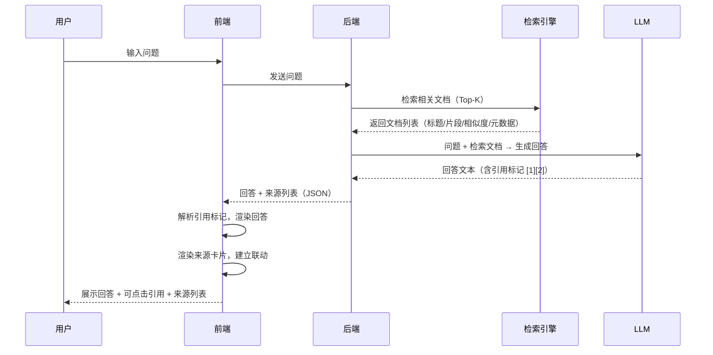

# 📚 RAG 检索来源与引用展示

> **文档说明**：系统讲解 RAG（检索增强生成）系统中检索来源与引用展示的完整前端实现方案，涵盖引用标记格式设计、来源卡片组件、引用与来源联动交互、PDF 原文定位高亮、流式输出中的引用渲染、相似度展示、权限控制、无来源提示、Vue3+TypeScript 组件封装、Markdown 引用解析和生产级最佳实践。来源引用是 RAG 产品的标配功能，直接决定用户对 AI 回答的信任度和可验证性。
>
> **适用人群**：前端工程师、全栈开发者、AI 应用产品经理
>
> **前置知识**：[[对话式UI组件设计]] · [[Markdown渲染与代码高亮]] · [[RAG架构设计与流程]]

---

## 一、概述

### 1.1 为什么需要来源引用

RAG 系统的回答基于检索到的外部文档生成，但 LLM 可能产生**幻觉**（编造不存在的信息）。展示来源引用的核心价值：

| 价值 | 说明 |
|------|------|
| **可信度** | 用户可以溯源验证回答的准确性，减少对幻觉的担忧 |
| **可追溯** | 每个结论都有依据，用户知道信息来自哪里 |
| **深入阅读** | 引用链接引导用户阅读原始文档，获取更多细节 |
| **透明度** | 展示 AI 的「思考依据」，提升产品专业感 |
| **纠错机制** | 用户发现引用不支持回答时，可以反馈纠正 |

> **一句话**：没有来源引用的 RAG 回答 = 黑盒，用户无法判断对错；有来源引用的 RAG 回答 = 可验证，用户信任度大幅提升。

### 1.2 引用展示的核心要素

一个完整的来源引用展示系统包含以下要素：

```mermaid
flowchart TB
    A[回答文本] -->|包含引用标记| B[引用标记<br/>[1] [2] [3]]
    B -->|点击联动| C[来源列表]
    C --> D[来源卡片]
    D --> D1[标题]
    D --> D2[摘要/片段]
    D --> D3[相似度/参考度]
    D --> D4[元数据<br/>日期/作者/来源]
    D --> D5[原文链接]
    D --> D6[PDF定位<br/>页码+高亮]

    style A fill:#667eea,color:#fff
    style B fill:#f093fb,color:#fff
    style C fill:#4facfe,color:#fff
    style D fill:#43e97b,color:#333
```

### 1.3 核心应用场景

| 场景 | 引用展示需求 |
|------|------------|
| **知识库问答** | 展示引用的文档片段，支持跳转原文 |
| **法律/医疗问答** | 必须展示来源，确保可追溯和合规 |
| **学术研究助手** | 引用论文，支持跳转原文和引用格式导出 |
| **企业内部问答** | 引用内部文档，权限控制可见性 |
| **客服机器人** | 引用帮助文档，用户可查看完整说明 |
| **代码助手** | 引用文档/Stack Overflow，展示代码来源 |

---

## 二、底层原理

### 2.1 RAG 引用数据流



**后端返回数据结构**：

```typescript
// 后端返回的标准格式
interface RagResponse {
  answer: string;              // 回答文本，含引用标记如 [1] [2]
  sources: Source[];           // 来源列表
  metadata: {
    total_tokens: number;
    retrieval_time: number;
    generation_time: number;
  };
}

interface Source {
  id: number;                  // 引用编号（从 1 开始）
  title: string;               // 文档标题
  content: string;             // 匹配的片段内容
  url?: string;                // 原文链接
  score: number;               // 相似度分数（0-1）
  metadata: {
    author?: string;           // 作者
    date?: string;             // 日期
    source_type?: string;      // 来源类型（doc/pdf/web）
    page_number?: number;      // 页码（PDF）
    highlight?: {              // 高亮位置
      start: number;
      end: number;
    };
  };
}
```

### 2.2 引用标记格式

常见的引用标记格式有以下几种，需要前后端约定统一：

| 格式 | 示例 | 优点 | 缺点 |
|------|------|------|------|
| **方括号数字** | `[1]` `[2]` | 简洁，Perplexity/ Bing 风格 | 可能与 Markdown 链接冲突 |
| **上标数字** | `¹` `²` | 不占空间，学术风格 | 渲染复杂，移动端点击区域小 |
| **角标图标** | `🔗1` | 视觉明确 | 图标可能不统一 |
| **HTML 标签** | `<cite data-id="1">` | 语义化，易解析 | 需要后端生成 HTML |
| **Markdown 链接** | `[文本](source:1)` | 复用 Markdown 链接 | 与普通链接混淆 |

> **推荐**：使用 `[1]` 方括号数字格式，简洁通用，前端用正则解析。Perplexity、Bing Chat、百度文心一言都采用类似格式。

### 2.3 引用与来源联动原理

引用标记和来源卡片的联动通过以下机制实现：

1. **解析阶段**：前端用正则 `/\[(\d+)\]/g` 解析回答文本中的引用标记
2. **渲染阶段**：将 `[1]` 替换为可点击的 `<span class="citation" data-id="1">1</span>`
3. **联动阶段**：
   - 点击引用标记 → 高亮对应来源卡片 + 滚动到视图
   - 悬停引用标记 → 弹出来源预览（tooltip/popover）
   - 点击来源卡片 → 高亮回答中对应的引用标记

---

## 三、实操示例

### 3.1 引用解析与渲染工具函数

```typescript
// utils/citation.ts
/**
 * 引用解析工具函数
 */

export interface Source {
  id: number;
  title: string;
  content: string;
  url?: string;
  score: number;
  metadata?: Record<string, any>;
}

/**
 * 解析回答文本中的引用标记 [1] [2]，返回带引用信息的片段
 */
export function parseCitations(text: string): Array<{
  type: 'text' | 'citation';
  content: string;
  citationId?: number;
}> {
  const result: Array<{ type: 'text' | 'citation'; content: string; citationId?: number }> = [];
  // 匹配 [数字] 格式，排除 Markdown 链接 [text](url)
  const regex = /\[(\d+)\](?!\()/g;
  let lastIndex = 0;
  let match: RegExpExecArray | null;

  while ((match = regex.exec(text)) !== null) {
    // 添加引用前的文本
    if (match.index > lastIndex) {
      result.push({ type: 'text', content: text.slice(lastIndex, match.index) });
    }
    // 添加引用标记
    result.push({ type: 'citation', content: match[0], citationId: parseInt(match[1], 10) });
    lastIndex = regex.lastIndex;
  }
  // 添加剩余文本
  if (lastIndex < text.length) {
    result.push({ type: 'text', content: text.slice(lastIndex) });
  }
  return result;
}

/**
 * 将回答文本中的引用标记替换为可点击的 HTML
 */
export function renderCitations(text: string, sources: Source[]): string {
  return text.replace(/\[(\d+)\](?!\()/g, (match, id) => {
    const sourceId = parseInt(id, 10);
    const source = sources.find(s => s.id === sourceId);
    if (!source) return match;  // 无对应来源，原样显示
    return `<span class="citation-badge" data-citation-id="${sourceId}" title="${escapeHtml(source.title)}">${sourceId}</span>`;
  });
}

/**
 * 格式化相似度分数为百分比
 */
export function formatScore(score: number): string {
  return `${(score * 100).toFixed(0)}%`;
}

/**
 * 获取相似度等级描述
 */
export function getScoreLevel(score: number): { label: string; color: string } {
  if (score >= 0.9) return { label: '高度相关', color: '#10b981' };
  if (score >= 0.7) return { label: '相关', color: '#3b82f6' };
  if (score >= 0.5) return { label: '部分相关', color: '#f59e0b' };
  return { label: '参考', color: '#6b7280' };
}

function escapeHtml(text: string): string {
  const div = document.createElement('div');
  div.textContent = text;
  return div.innerHTML;
}
```

### 3.2 Vue3 引用标记组件

```vue
<!-- components/CitationBadge.vue -->
<script setup lang="ts">
import { ref } from 'vue';
import type { Source } from '@/utils/citation';

interface Props {
  id: number;
  source?: Source;
}

const props = defineProps<Props>();
const emit = defineEmits<{
  (e: 'click', id: number): void;
}>();

const showTooltip = ref(false);

function handleClick() {
  emit('click', props.id);
}
</script>

<template>
  <span
    class="citation-badge"
    :class="{ 'citation-badge--active': showTooltip }"
    @click="handleClick"
    @mouseenter="showTooltip = true"
    @mouseleave="showTooltip = false"
  >
    {{ id }}

    <!-- 悬停预览来源 -->
    <div v-if="source && showTooltip" class="citation-tooltip">
      <div class="citation-tooltip__title">{{ source.title }}</div>
      <div class="citation-tooltip__content">{{ source.content }}</div>
      <div class="citation-tooltip__meta">
        <span class="score" :style="{ color: getScoreLevel(source.score).color }">
          {{ getScoreLevel(source.score).label }} {{ formatScore(source.score) }}
        </span>
      </div>
    </div>
  </span>
</template>

<style scoped>
.citation-badge {
  display: inline-flex;
  align-items: center;
  justify-content: center;
  min-width: 20px;
  height: 20px;
  padding: 0 5px;
  margin: 0 2px;
  font-size: 11px;
  font-weight: 600;
  color: #2563eb;
  background: #eff6ff;
  border: 1px solid #bfdbfe;
  border-radius: 4px;
  cursor: pointer;
  transition: all 0.2s;
  position: relative;
  vertical-align: super;
}

.citation-badge:hover,
.citation-badge--active {
  background: #2563eb;
  color: #fff;
  border-color: #2563eb;
}

.citation-tooltip {
  position: absolute;
  bottom: calc(100% + 8px);
  left: 50%;
  transform: translateX(-50%);
  width: 280px;
  padding: 12px;
  background: #fff;
  border: 1px solid #e5e7eb;
  border-radius: 8px;
  box-shadow: 0 10px 25px rgba(0, 0, 0, 0.15);
  z-index: 100;
  font-size: 13px;
  line-height: 1.5;
  color: #374151;
  text-align: left;
  vertical-align: baseline;
}

.citation-tooltip__title {
  font-weight: 600;
  color: #111827;
  margin-bottom: 6px;
  overflow: hidden;
  text-overflow: ellipsis;
  white-space: nowrap;
}

.citation-tooltip__content {
  color: #6b7280;
  display: -webkit-box;
  -webkit-line-clamp: 3;
  -webkit-box-orient: vertical;
  overflow: hidden;
  margin-bottom: 8px;
}

.citation-tooltip__meta {
  font-size: 12px;
}
</style>
```

### 3.3 来源卡片列表组件

```vue
<!-- components/SourceList.vue -->
<script setup lang="ts">
import { ref, computed } from 'vue';
import type { Source } from '@/utils/citation';
import { formatScore, getScoreLevel } from '@/utils/citation';

interface Props {
  sources: Source[];
  activeId?: number | null;
}

const props = defineProps<Props>();
const emit = defineEmits<{
  (e: 'source-click', id: number): void;
}>();

const expandedId = ref<number | null>(null);

function toggleExpand(id: number) {
  expandedId.value = expandedId.value === id ? null : id;
}

const sortedSources = computed(() =>
  [...props.sources].sort((a, b) => a.id - b.id)
);
</script>

<template>
  <div class="source-list" v-if="sources.length > 0">
    <div class="source-list__header">
      <h4 class="source-list__title">
        <span class="icon">📚</span>
        参考来源
        <span class="count">{{ sources.length }}</span>
      </h4>
    </div>

    <div class="source-list__items">
      <div
        v-for="source in sortedSources"
        :key="source.id"
        :id="`source-${source.id}`"
        class="source-card"
        :class="{ 'source-card--active': activeId === source.id }"
        @click="toggleExpand(source.id); emit('source-click', source.id)"
      >
        <div class="source-card__header">
          <span class="source-card__id">{{ source.id }}</span>
          <span class="source-card__title">{{ source.title }}</span>
          <span
            class="source-card__score"
            :style="{ color: getScoreLevel(source.score).color }"
          >
            {{ formatScore(source.score) }}
          </span>
        </div>

        <div class="source-card__content" :class="{ 'source-card__content--expanded': expandedId === source.id }">
          {{ source.content }}
        </div>

        <div class="source-card__meta" v-if="source.metadata">
          <span v-if="source.metadata.author" class="meta-item">👤 {{ source.metadata.author }}</span>
          <span v-if="source.metadata.date" class="meta-item">📅 {{ source.metadata.date }}</span>
          <span v-if="source.metadata.page_number" class="meta-item">📄 第 {{ source.metadata.page_number }} 页</span>
          <span v-if="source.metadata.source_type" class="meta-item">📁 {{ source.metadata.source_type }}</span>
        </div>

        <div class="source-card__actions" v-if="source.url">
          <a :href="source.url" target="_blank" rel="noopener" @click.stop>
            查看原文 →
          </a>
        </div>
      </div>
    </div>
  </div>

  <!-- 无来源提示 -->
  <div class="no-sources" v-else>
    <div class="no-sources__icon">💡</div>
    <div class="no-sources__text">
      本回答未引用外部来源，内容可能基于模型固有知识生成，仅供参考。
    </div>
  </div>
</template>

<style scoped>
.source-list {
  margin-top: 16px;
  padding-top: 16px;
  border-top: 1px solid #e5e7eb;
}

.source-list__header {
  margin-bottom: 12px;
}

.source-list__title {
  font-size: 14px;
  font-weight: 600;
  color: #374151;
  display: flex;
  align-items: center;
  gap: 6px;
}

.source-list__title .count {
  background: #f3f4f6;
  color: #6b7280;
  font-size: 12px;
  padding: 2px 8px;
  border-radius: 10px;
}

.source-card {
  padding: 12px;
  margin-bottom: 8px;
  background: #f9fafb;
  border: 1px solid #e5e7eb;
  border-radius: 8px;
  cursor: pointer;
  transition: all 0.2s;
}

.source-card:hover {
  background: #f3f4f6;
  border-color: #d1d5db;
}

.source-card--active {
  background: #eff6ff;
  border-color: #93c5fd;
  box-shadow: 0 0 0 2px rgba(59, 130, 246, 0.2);
}

.source-card__header {
  display: flex;
  align-items: center;
  gap: 8px;
  margin-bottom: 8px;
}

.source-card__id {
  display: inline-flex;
  align-items: center;
  justify-content: center;
  min-width: 20px;
  height: 20px;
  padding: 0 5px;
  font-size: 11px;
  font-weight: 600;
  color: #2563eb;
  background: #dbeafe;
  border-radius: 4px;
}

.source-card__title {
  flex: 1;
  font-size: 13px;
  font-weight: 500;
  color: #111827;
  overflow: hidden;
  text-overflow: ellipsis;
  white-space: nowrap;
}

.source-card__score {
  font-size: 12px;
  font-weight: 600;
  flex-shrink: 0;
}

.source-card__content {
  font-size: 12px;
  color: #6b7280;
  line-height: 1.6;
  display: -webkit-box;
  -webkit-line-clamp: 2;
  -webkit-box-orient: vertical;
  overflow: hidden;
  transition: all 0.3s;
}

.source-card__content--expanded {
  -webkit-line-clamp: unset;
}

.source-card__meta {
  display: flex;
  flex-wrap: wrap;
  gap: 12px;
  margin-top: 8px;
  font-size: 11px;
  color: #9ca3af;
}

.source-card__actions {
  margin-top: 8px;
}

.source-card__actions a {
  font-size: 12px;
  color: #2563eb;
  text-decoration: none;
}

.source-card__actions a:hover {
  text-decoration: underline;
}

.no-sources {
  margin-top: 16px;
  padding: 16px;
  background: #fffbeb;
  border: 1px solid #fde68a;
  border-radius: 8px;
  text-align: center;
}

.no-sources__icon {
  font-size: 24px;
  margin-bottom: 8px;
}

.no-sources__text {
  font-size: 13px;
  color: #92400e;
  line-height: 1.6;
}
</style>
```

### 3.4 完整 RAG 回答组件（整合引用 + 来源）

```vue
<!-- components/RagAnswer.vue -->
<script setup lang="ts">
import { ref, computed, nextTick } from 'vue';
import CitationBadge from './CitationBadge.vue';
import SourceList from './SourceList.vue';
import { parseCitations, type Source } from '@/utils/citation';

interface Props {
  answer: string;
  sources: Source[];
  loading?: boolean;
}

const props = defineProps<Props>();

const activeCitationId = ref<number | null>(null);

// 解析回答为片段列表
const answerSegments = computed(() => parseCitations(props.answer));

// 点击引用标记：高亮来源并滚动
async function handleCitationClick(id: number) {
  activeCitationId.value = id;
  await nextTick();
  const element = document.getElementById(`source-${id}`);
  if (element) {
    element.scrollIntoView({ behavior: 'smooth', block: 'center' });
    element.classList.add('source-card--flash');
    setTimeout(() => element.classList.remove('source-card--flash'), 2000);
  }
}

// 点击来源卡片：高亮回答中的引用
function handleSourceClick(id: number) {
  activeCitationId.value = id;
}

// 根据来源 ID 查找来源
function findSource(id: number): Source | undefined {
  return props.sources.find(s => s.id === id);
}
</script>

<template>
  <div class="rag-answer">
    <!-- 回答文本（含引用标记） -->
    <div class="rag-answer__content" :class="{ 'rag-answer__content--loading': loading }">
      <template v-for="(segment, index) in answerSegments" :key="index">
        <!-- 普通文本 -->
        <span v-if="segment.type === 'text'">{{ segment.content }}</span>
        <!-- 引用标记 -->
        <CitationBadge
          v-else
          :id="segment.citationId!"
          :source="findSource(segment.citationId!)"
          @click="handleCitationClick"
        />
      </template>
      <span v-if="loading" class="typing-cursor">▋</span>
    </div>

    <!-- 来源列表 -->
    <SourceList
      :sources="sources"
      :active-id="activeCitationId"
      @source-click="handleSourceClick"
    />
  </div>
</template>

<style scoped>
.rag-answer {
  font-size: 15px;
  line-height: 1.8;
  color: #1f2937;
}

.rag-answer__content {
  white-space: pre-wrap;
  word-break: break-word;
}

.rag-answer__content--loading {
  opacity: 0.8;
}

.typing-cursor {
  display: inline-block;
  animation: blink 1s infinite;
  color: #2563eb;
}

@keyframes blink {
  0%, 50% { opacity: 1; }
  51%, 100% { opacity: 0; }
}

/* 来源卡片闪烁动画（全局样式，需放在非 scoped 中） */
:deep(.source-card--flash) {
  animation: flash 2s ease;
}

@keyframes flash {
  0% { background: #fef3c7; border-color: #fbbf24; }
  100% { background: #f9fafb; border-color: #e5e7eb; }
}
</style>
```

### 3.5 流式输出中的引用渲染

```typescript
// composables/useRagStream.ts
/**
 * 流式输出中处理引用标记
 * 挑战：流式输出时引用标记可能不完整（如只输出了 "[" 还没输出 "]"）
 */
import { ref } from 'vue';
import type { Source } from '@/utils/citation';

export function useRagStream() {
  const answer = ref('');
  const sources = ref<Source[]>([]);
  const loading = ref(false);

  async function streamRag(question: string) {
    loading.value = true;
    answer.value = '';
    sources.value = [];

    const response = await fetch('/api/rag/stream', {
      method: 'POST',
      headers: { 'Content-Type': 'application/json' },
      body: JSON.stringify({ question }),
    });

    const reader = response.body!.getReader();
    const decoder = new TextDecoder();
    let buffer = '';

    while (true) {
      const { done, value } = await reader.read();
      if (done) break;

      buffer += decoder.decode(value, { stream: true });
      const lines = buffer.split('\n');
      buffer = lines.pop() || '';  // 保留不完整的行

      for (const line of lines) {
        if (!line.startsWith('data: ')) continue;
        const data = JSON.parse(line.slice(6));

        if (data.type === 'token') {
          answer.value += data.content;
        } else if (data.type === 'sources') {
          sources.value = data.sources;
        } else if (data.type === 'done') {
          loading.value = false;
        }
      }
    }
    loading.value = false;
  }

  return { answer, sources, loading, streamRag };
}
```

### 3.6 PDF 原文定位与高亮

```vue
<!-- components/PdfViewer.vue -->
<script setup lang="ts">
import { ref, watch, onMounted } from 'vue';
import * as pdfjsLib from 'pdfjs-dist';

interface Props {
  url: string;
  pageNumber?: number;
  highlight?: { start: number; end: number };
}

const props = defineProps<Props>();
const canvasRef = ref<HTMLCanvasElement | null>(null);
const currentPage = ref(1);

onMounted(async () => {
  pdfjsLib.GlobalWorkerOptions.workerSrc = 'pdfjs-dist/build/pdf.worker.min.js';
  await renderPage(props.pageNumber || 1);
});

async function renderPage(pageNum: number) {
  if (!canvasRef.value) return;
  const pdf = await pdfjsLib.getDocument(props.url).promise;
  const page = await pdf.getPage(pageNum);
  const viewport = page.getViewport({ scale: 1.5 });
  const context = canvasRef.value.getContext('2d')!;
  canvasRef.value.width = viewport.width;
  canvasRef.value.height = viewport.height;
  await page.render({ canvasContext: context, viewport }).promise;
  currentPage.value = pageNum;

  // 高亮匹配片段
  if (props.highlight) {
    highlightText(props.highlight.start, props.highlight.end);
  }
}

function highlightText(start: number, end: number) {
  // 使用 PDF.js 的 textLayer 获取文本位置，然后绘制高亮层
  // 简化实现：在 canvas 上绘制黄色矩形
  const context = canvasRef.value!.getContext('2d')!;
  context.fillStyle = 'rgba(255, 235, 59, 0.4)';
  // 实际需要根据文本坐标计算，这里简化
  context.fillRect(50, 100, 400, 20);
}

watch(() => props.pageNumber, (newPage) => {
  if (newPage) renderPage(newPage);
});
</script>

<template>
  <div class="pdf-viewer">
    <canvas ref="canvasRef" class="pdf-canvas"></canvas>
    <div class="pdf-controls">
      <span>第 {{ currentPage }} 页</span>
    </div>
  </div>
</template>
```

---

## 四、常见问题与排查

| 问题现象 | 可能原因 | 解决方案 |
|---------|---------|---------|
| **引用标记不匹配来源** | 后端引用编号和来源列表 ID 不一致；流式输出中引用不完整 | 前后端约定统一编号规则（从 1 开始）；流式输出时等待完整 `[n]` 再渲染 |
| **引用标记与 Markdown 链接冲突** | `[text](url)` 被误解析为引用 | 正则排除 `]` 后紧跟 `(` 的情况：`/\[(\d+)\](?!\()/g` |
| **来源文档无法访问** | 权限不足；链接失效；内部文档需登录 | 无权限时只显示标题和摘要，不显示链接；检查 URL 有效性；SSO 自动登录 |
| **相似度分数误导用户** | 相似度高不代表回答正确；分数计算方式不透明 | 标注为「参考度」而非「准确率」；展示分数等级（高度相关/相关/参考） |
| **引用点击无反应** | 来源列表未渲染；元素 ID 不匹配；滚动容器错误 | 确保来源卡片有 `id="source-{id}"`；检查滚动容器（可能是父元素而非 window） |
| **流式输出中引用闪烁** | 引用标记不完整时被当文本渲染，完整后重新渲染 | 缓冲输出，检测到完整 `[n]` 后再替换为引用组件 |
| **来源卡片内容过长** | 检索片段太长，占用大量空间 | 默认折叠显示 2 行，点击展开；摘要截断加省略号 |
| **大量来源时页面过长** | Top-K 设置太大（如 20 个来源） | 限制展示数量（如最多 5 个）；「展开更多」按钮；按相似度排序 |
| **移动端引用点击区域小** | 引用标记字号太小，手指点不准 | 增大最小点击区域（44px）；引用标记 padding 加大；支持长按预览 |
| **PDF 高亮位置不准** | 文本坐标计算错误；PDF 渲染缩放不一致 | 使用 PDF.js textLayer 获取精确坐标；统一缩放比例；考虑分页偏移 |
| **回答中引用编号重复/跳号** | 后端生成引用时逻辑错误；多个片段来自同一文档 | 后端统一编号逻辑；同一文档可合并为一个引用；前端容错（找不到的来源原样显示） |
| **来源标题乱码** | 编码问题；特殊字符未转义 | 后端统一 UTF-8；前端 `textContent` 而非 `innerHTML` 渲染标题 |
| **引用 tooltip 被截断** | 父容器有 `overflow: hidden`；z-index 不够 | tooltip 使用 `position: fixed` 或调整父容器 overflow；提高 z-index |
| **深色模式下引用看不清** | 颜色未适配深色模式 | 使用 CSS 变量定义颜色；`@media (prefers-color-scheme: dark)` 适配 |

---

## 五、进阶与最佳实践

### 5.1 引用展示设计模式

| 模式 | 说明 | 代表产品 |
|------|------|---------|
| **内联编号 + 底部列表** | 回答中 `[1]`，底部列出来源卡片 | Perplexity、Bing Chat |
| **悬浮脚注** | 引用标记点击后在侧边/底部弹出原文 | Notion AI、飞书智能问答 |
| **行内来源** | 回答每句话后直接跟来源链接 | 学术论文风格 |
| **时间线引用** | 按回答生成顺序展示引用来源 | 部分研究助手 |
| **可折叠面板** | 来源列表可折叠，节省空间 | 移动端常用 |

> **推荐**：Web 端用「内联编号 + 底部列表」（Perplexity 风格），移动端用「内联编号 + 可折叠面板」。

### 5.2 相似度展示最佳实践

```typescript
// 相似度展示不要只给数字，要给用户可理解的等级
const scoreConfig = [
  { min: 0.9, label: '高度相关', color: '#10b981', icon: '🎯' },
  { min: 0.7, label: '相关', color: '#3b82f6', icon: '✅' },
  { min: 0.5, label: '部分相关', color: '#f59e0b', icon: '⚠️' },
  { min: 0, label: '仅供参考', color: '#6b7280', icon: '📖' },
];

function getScoreInfo(score: number) {
  return scoreConfig.find(s => score >= s.min) || scoreConfig[scoreConfig.length - 1];
}

// 展示方式：
// 🎯 高度相关 92%  →  直观易懂
// 而不是：
// 0.9234  →  用户不知道什么意思
```

### 5.3 权限控制

```typescript
/**
 * 来源权限过滤：根据用户权限过滤可见来源
 */
function filterSourcesByPermission(sources: Source[], userPermissions: string[]): Source[] {
  return sources.map(source => {
    const hasAccess = checkPermission(source.metadata?.doc_id, userPermissions);
    if (hasAccess) {
      return source;
    }
    // 无权限：隐藏内容和链接，只显示标题和「无权限」提示
    return {
      ...source,
      content: '您没有权限查看此文档的详细内容',
      url: undefined,
      metadata: { ...source.metadata, restricted: true },
    };
  });
}

function checkPermission(docId: string, permissions: string[]): boolean {
  // 调用权限服务检查
  return permissions.includes(docId) || permissions.includes('*');
}
```

### 5.4 引用分析与反馈

```vue
<!-- 引用反馈组件：用户可以标记引用是否有用 -->
<script setup lang="ts">
import { ref } from 'vue';

interface Props {
  citationId: number;
}

const props = defineProps<Props>();
const feedback = ref<'useful' | 'not-useful' | null>(null);

function submitFeedback(type: 'useful' | 'not-useful') {
  feedback.value = type;
  // 上报到后端，用于优化检索和排序
  fetch('/api/rag/feedback', {
    method: 'POST',
    body: JSON.stringify({ citationId: props.citationId, type }),
  });
}
</script>

<template>
  <div class="citation-feedback">
    <span class="feedback-label">这个引用有用吗？</span>
    <button
      class="feedback-btn"
      :class="{ 'feedback-btn--active': feedback === 'useful' }"
      @click="submitFeedback('useful')"
    >👍 有用</button>
    <button
      class="feedback-btn"
      :class="{ 'feedback-btn--active': feedback === 'not-useful' }"
      @click="submitFeedback('not-useful')"
    >👎 没用</button>
  </div>
</template>
```

### 5.5 生产环境最佳实践 Checklist

| 类别 | 最佳实践 | 说明 |
|------|---------|------|
| **格式** | 统一引用标记格式 `[n]` | 前后端约定，避免解析混乱 |
| **格式** | 引用编号从 1 开始连续 | 不要跳号或重复 |
| **解析** | 正则排除 Markdown 链接 | `\[(\d+)\](?!\()` 避免误解析 |
| **解析** | 流式输出缓冲完整引用 | 不完整的 `[n` 不当引用渲染 |
| **展示** | 引用标记可点击 | 点击联动来源卡片 |
| **展示** | 悬停显示来源预览 | tooltip/popover 展示标题和摘要 |
| **展示** | 来源卡片默认折叠 | 显示 2 行，点击展开全文 |
| **展示** | 相似度用等级而非纯数字 | 高度相关/相关/参考，更易懂 |
| **展示** | 限制来源数量 | 最多展示 5-8 个，多余的「展开更多」 |
| **交互** | 引用↔来源双向联动 | 点引用高亮来源，点来源高亮引用 |
| **交互** | 平滑滚动到来源 | `scrollIntoView({ behavior: 'smooth' })` |
| **交互** | 来源卡片闪烁提示 | 点击引用后来源卡片高亮闪烁 |
| **权限** | 无权限来源脱敏 | 只显示标题，隐藏内容和链接 |
| **权限** | 链接跳转检查登录 | 内部文档需 SSO 登录 |
| **PDF** | 支持页码定位 | 点击跳转到 PDF 指定页 |
| **PDF** | 原文高亮匹配片段 | 黄色高亮显示引用的原文位置 |
| **无来源** | 无来源时明确提示 | 告知用户回答基于模型知识，仅供参考 |
| **反馈** | 引用有用/没用反馈 | 收集用户反馈优化检索 |
| **性能** | 来源懒加载 | 大量来源时虚拟滚动 |
| **性能** | 引用解析缓存 | 相同回答不重复解析 |
| **无障碍** | 引用标记有 aria-label | 屏幕阅读器可读 |
| **无障碍** | 键盘可操作 | Tab 导航，Enter 触发 |
| **响应式** | 移动端适配 | 引用点击区域 ≥44px，来源面板可折叠 |
| **深色模式** | CSS 变量适配 | 颜色随主题切换 |
| **安全** | 来源内容 XSS 过滤 | 用 textContent 或 DOMPurify 消毒 |
| **监控** | 引用点击率监控 | 分析用户是否使用引用功能 |
| **监控** | 无来源比例监控 | 比例过高说明检索效果差 |

---

## 六、关联笔记

### AI 前端集成
- [[对话式UI组件设计]] · [[Markdown渲染与代码高亮]] · [[流式输出与打字机效果]]
- [[AI对话界面设计]] · [[多模态前端展示]]

### RAG 后端
- [[RAG架构设计与流程]] · [[Elasticsearch向量检索]] · [[RAG检索优化策略]]
- [[文档切片与向量化]] · [[RAG评估与优化]]

### 前端基础
- [[Vue3-组合式API设计模式_backup_skeleton]] · [[TypeScript高级类型]] · [[CSS动画与过渡]]

### 导航
- [[MOC-前端开发]] · [[MOC-AI前端集成]] · [[MOC-综合导航]] · [[Home]]

> 🔍 **知识点深度解析**
>
> **作用**：RAG 检索来源与引用展示解决的是「AI 回答的可信度和可验证性」问题，让用户知道回答的依据来自哪里，能够溯源验证，是 RAG 产品区别于纯 LLM 对话的核心功能。
>
> **底层原理**：后端检索文档后，LLM 生成回答时在引用处插入 `[n]` 标记，同时返回来源列表（标题/片段/相似度/元数据）。前端用正则解析引用标记，替换为可点击的引用徽章，与底部来源卡片建立联动（点击引用滚动到来源，悬停显示预览）。核心挑战是流式输出中引用标记可能不完整，需要缓冲处理；以及引用标记与 Markdown 链接的解析冲突。
>
> **用法要点**：① 统一引用格式 `[n]`，编号从 1 开始连续 ② 正则排除 Markdown 链接 `\[(\d+)\](?!\()` ③ 流式输出缓冲完整引用再渲染 ④ 引用徽章可点击 + 悬停预览 ⑤ 来源卡片默认折叠 2 行，点击展开 ⑥ 相似度用等级（高度相关/相关/参考）而非纯数字 ⑦ 引用↔来源双向联动 + 平滑滚动 ⑧ 无权限来源脱敏 ⑨ PDF 支持页码定位和原文高亮 ⑩ 无来源时明确提示用户。

> 💡 **深度讲解**：引用展示看似简单，实则是 RAG 产品体验的关键。最常见的坑是「引用标记和来源不匹配」——后端返回的回答里有 `[3]`，但来源列表只有 2 个，或者编号对不上。这通常是因为 LLM 生成引用时编号混乱，解决方法是后端在生成后做一次引用校验和修正。另一个坑是「流式输出中引用闪烁」——流式输出时 `[1]` 是逐字输出的，`[` 出来时被当文本，`1]` 出来后才变成引用，导致视觉闪烁，解决方法是缓冲输出，检测到完整的 `[n]` 后再替换。设计上，不要只给相似度数字（用户不知道 0.87 是好是坏），要给等级和颜色（🎯 高度相关 87%）。来源卡片不要全部展开，默认折叠 2 行，否则页面会非常长。记住：**引用展示的目标不是「展示所有来源」，而是「让用户快速验证回答的可信度」**。

> 📝 **精简总结**：RAG 引用展示 = 回答中 `[n]` 标记 + 底部来源卡片 + 双向联动。核心：统一格式、正则解析（排除Markdown链接）、流式缓冲、可点击徽章、悬停预览、折叠卡片、相似度等级、权限脱敏、PDF定位、无来源提示。设计参考 Perplexity/Bing Chat 风格。生产必备：引用校验、XSS过滤、移动端适配、深色模式、用户反馈、点击率监控。

> **学习路径建议**：先学习 [[对话式UI组件设计]] 理解 AI 对话界面 → 学习本文档掌握引用展示实现 → 参考 [[Markdown渲染与代码高亮]] 处理回答中的 Markdown → 学习 [[流式输出与打字机效果]] 处理流式渲染 → 了解 [[RAG架构设计与流程]] 理解后端数据流 → 在真实项目中实践完整的 RAG 问答界面。

---

> **来源引用是 RAG 产品的「信任锚点」。没有引用的 AI 回答是黑盒，有引用的回答是可验证的知识。把引用展示做好，用户才会真正相信你的 AI。**
