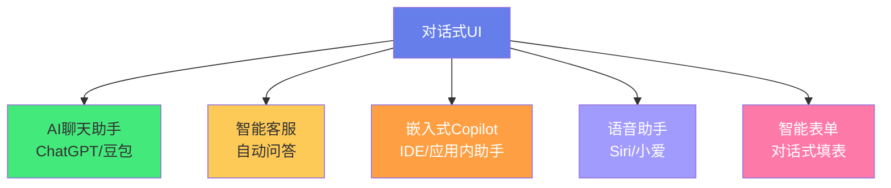
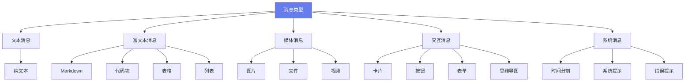
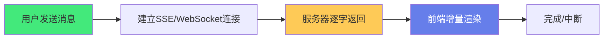

# 💬 对话式 UI 组件设计

> **文档说明**：系统讲解 AI 时代对话式 UI（Conversational UI）的组件设计与实现，涵盖对话式 UI 的概念与应用场景（AI 聊天助手/智能客服/语音交互/Copilot 嵌入式助手）、核心设计原则（自然语言交互/上下文感知/渐进式披露/即时反馈/容错与可恢复/人格一致性）、消息类型体系（文本/Markdown/图片/卡片/列表/表单/按钮/代码块/表格/文件/思维导图）、消息气泡组件设计（用户消息/AI 消息/系统消息/时间分割线/头像/状态/错误重试）、流式输出（Streaming）完整实现（SSE/WebSocket/fetch ReadableStream/打字机效果/光标动画/中断停止/流式 Markdown 增量渲染）、输入框组件设计（多行自适应/快捷键/语音输入/附件上传/提示词模板/历史记录/字数统计）、对话状态管理（消息列表/会话管理/上下文窗口/Token 计数/历史持久化 localStorage/IndexedDB）、Markdown 渲染与代码高亮（marked + Shiki/复制按钮/语言标签/行号/深色主题）、AI 特有交互（思考过程展示/工具调用可视化/函数调用状态/引用来源/重新生成/编辑消息/分支对话/点赞点踩）、响应式与移动端适配、可访问性（a11y）、性能优化（虚拟滚动/懒加载/消息压缩/防抖）、知名对话 UI 分析（ChatGPT/Claude/豆包/文心一言/Cursor）、常见问题与最佳实践。
>
> **适用人群**：前端开发者、AI 应用开发者、需要构建 AI 对话界面的全栈工程师、产品设计师
>
> **前置知识**：[[Vue3-组合式API]] · [[WebSocket-实时通信]] · [[组件库设计与发布]]

---

## 一、概述

### 1.1 什么是对话式 UI

**对话式 UI（Conversational UI）** 是一种以「对话」为核心交互模式的用户界面，用户通过自然语言（文本或语音）与系统交互，系统以消息流的形式回复。在 AI 时代，对话式 UI 已成为 AI 产品的标准交互范式。



### 1.2 对话式 UI vs 传统 UI

| 维度 | 传统 UI | 对话式 UI |
|------|---------|----------|
| **交互方式** | 点击、表单、菜单 | 自然语言输入 |
| **信息呈现** | 页面、卡片、表格 | 消息流、气泡 |
| **状态管理** | 路由、页面状态 | 会话、上下文、消息历史 |
| **反馈模式** | 即时渲染 | 流式输出、逐步生成 |
| **错误处理** | 表单校验、错误提示 | 澄清问题、多轮确认 |
| **个性化** | 固定界面 | 基于上下文动态响应 |

### 1.3 核心挑战

| 挑战 | 说明 |
|------|------|
| **流式输出** | AI 回复是逐字生成的，需要实时渲染 |
| **Markdown 渲染** | AI 回复包含 Markdown/代码/表格，需要高质量渲染 |
| **上下文管理** | 长对话的上下文窗口、Token 限制 |
| **延迟感知** | 首字延迟、生成速度、加载状态 |
| **错误恢复** | 网络中断、生成失败、重试机制 |
| **移动端体验** | 小屏、软键盘、手势操作 |

---

## 二、核心设计原则

### 2.1 六大原则


| 原则 | 说明 | 实践 |
|------|------|------|
| **自然语言** | 用用户的语言交流，避免技术术语 | AI 回复口语化，不用「错误码 500」 |
| **上下文感知** | 记住之前的对话，引用历史 | 「刚才说的那个功能」能被理解 |
| **渐进式披露** | 先给摘要，需要时展开细节 | 长回答先显示要点，点击展开 |
| **即时反馈** | 用户操作后立即有响应 | 发送后立即显示气泡，不等回复 |
| **容错可恢复** | 允许撤销、编辑、重试 | 消息可编辑、可重新生成 |
| **人格一致** | 语气、风格、称呼保持一致 | 全程用「我」，不突然变「本助手」 |

---

## 三、消息类型体系

### 3.1 消息分类



### 3.2 消息数据结构

```typescript
interface Message {
  id: string
  role: 'user' | 'assistant' | 'system' | 'tool'
  content: string
  type: 'text' | 'markdown' | 'image' | 'card' | 'code' | 'error'
  createdAt: number
  status: 'sending' | 'streaming' | 'done' | 'error'
  // AI 特有
  thinking?: string        // 思考过程
  toolCalls?: ToolCall[]   // 工具调用
  citations?: Citation[]   // 引用来源
  // 元数据
  metadata?: Record<string, any>
}

interface ToolCall {
  id: string
  name: string
  args: Record<string, any>
  status: 'pending' | 'running' | 'done' | 'error'
  result?: any
}

interface Citation {
  id: string
  title: string
  url: string
  snippet: string
}
```

---

## 四、消息气泡组件

### 4.1 气泡布局

```text
┌─────────────────────────────────────┐
│  [系统消息] 今天 14:30               │
├─────────────────────────────────────┤
│  ┌──────┐                           │
│  │ 用户 │ 你好，请介绍一下 Vue3      │
│  └──────┘                           │
│                           ┌──────┐  │
│  Vue3 是一个渐进式...     │ AI   │  │
│                           └──────┘  │
│  [重新生成] [复制] [点赞] [点踩]     │
└─────────────────────────────────────┘
```

### 4.2 气泡组件设计

```vue
<script setup lang="ts">
interface Props {
  message: Message
  showAvatar?: boolean
  showActions?: boolean
}

const props = withDefaults(defineProps<Props>(), {
  showAvatar: true,
  showActions: true
})

const emit = defineEmits<{
  (e: 'regenerate', id: string): void
  (e: 'copy', content: string): void
  (e: 'edit', id: string): void
}>()
</script>

<template>
  <div class="message-bubble" :class="`message-${message.role}`">
    <!-- 头像 -->
    <div v-if="showAvatar" class="avatar">
      
      <div v-else class="ai-avatar">AI</div>
    </div>
    
    <!-- 消息内容 -->
    <div class="bubble-content">
      <!-- 思考过程 -->
      <div v-if="message.thinking" class="thinking-block">
        <details>
          <summary>思考过程</summary>
          <div class="thinking-content">{{ message.thinking }}</div>
        </details>
      </div>
      
      <!-- 工具调用 -->
      <div v-if="message.toolCalls?.length" class="tool-calls">
        <div v-for="call in message.toolCalls" :key="call.id" class="tool-call">
          <span class="tool-icon">🔧</span>
          <span class="tool-name">{{ call.name }}</span>
          <span class="tool-status" :class="call.status">{{ call.status }}</span>
        </div>
      </div>
      
      <!-- 主内容 -->
      <div class="message-content" :class="message.type">
        <MarkdownRenderer v-if="message.type === 'markdown'" :content="message.content" />
        <CodeBlock v-else-if="message.type === 'code'" :code="message.content" />
        <ImageMessage v-else-if="message.type === 'image'" :src="message.content" />
        <p v-else>{{ message.content }}</p>
        
        <!-- 流式光标 -->
        <span v-if="message.status === 'streaming'" class="cursor">▋</span>
      </div>
      
      <!-- 引用来源 -->
      <div v-if="message.citations?.length" class="citations">
        <span v-for="(cite, i) in message.citations" :key="cite.id" class="citation">
          [{{ i + 1 }}] {{ cite.title }}
        </span>
      </div>
      
      <!-- 操作按钮 -->
      <div v-if="showActions && message.role === 'assistant' && message.status === 'done'" class="actions">
        <button @click="emit('copy', message.content)">复制</button>
        <button @click="emit('regenerate', message.id)">重新生成</button>
        <button>👍</button>
        <button>👎</button>
      </div>
      
      <!-- 错误状态 -->
      <div v-if="message.status === 'error'" class="error-state">
        <span>生成失败</span>
        <button @click="emit('regenerate', message.id)">重试</button>
      </div>
    </div>
  </div>
</template>
```

---

## 五、流式输出（Streaming）

### 5.1 流式输出原理



### 5.2 SSE 流式实现

```typescript
// 使用 fetch + ReadableStream（最常用）
async function streamChat(
  messages: Message[],
  onChunk: (chunk: string) => void,
  onDone: () => void,
  onError: (error: Error) => void
) {
  try {
    const response = await fetch('/api/chat', {
      method: 'POST',
      headers: { 'Content-Type': 'application/json' },
      body: JSON.stringify({ messages })
    })

    if (!response.ok) {
      throw new Error(`HTTP ${response.status}`)
    }

    const reader = response.body!.getReader()
    const decoder = new TextDecoder()
    let buffer = ''

    while (true) {
      const { done, value } = await reader.read()
      if (done) break

      buffer += decoder.decode(value, { stream: true })
      const lines = buffer.split('\n')
      buffer = lines.pop() || ''

      for (const line of lines) {
        if (line.startsWith('data: ')) {
          const data = line.slice(6)
          if (data === '[DONE]') {
            onDone()
            return
          }
          try {
            const parsed = JSON.parse(data)
            onChunk(parsed.content || '')
          } catch {
            onChunk(data)
          }
        }
      }
    }
    onDone()
  } catch (error) {
    onError(error as Error)
  }
}
```

### 5.3 流式 Markdown 增量渲染

```typescript
// 流式渲染的关键：增量更新，不重渲染已有内容
const currentContent = ref('')

function handleChunk(chunk: string) {
  currentContent.value += chunk
  // Markdown 组件会自动重新渲染
  // 优化：只重新渲染新增部分（虚拟 DOM diff）
}

// 中断流式输出
let abortController: AbortController | null = null

async function sendMessage() {
  abortController = new AbortController()
  try {
    const response = await fetch('/api/chat', {
      signal: abortController.signal,
      // ...
    })
    // ... 流式处理
  } catch (error) {
    if (error.name === 'AbortError') {
      console.log('用户中断')
    }
  }
}

function stopGeneration() {
  abortController?.abort()
}
```

### 5.4 打字机效果与光标

```css
/* 流式光标动画 */
.cursor {
  display: inline-block;
  width: 8px;
  height: 1em;
  background: currentColor;
  margin-left: 2px;
  animation: blink 1s infinite;
  vertical-align: text-bottom;
}

@keyframes blink {
  0%, 50% { opacity: 1; }
  51%, 100% { opacity: 0; }
}

/* 流式内容平滑过渡 */
.message-content {
  transition: opacity 0.2s ease;
}
```

---

## 六、输入框组件

### 6.1 输入框功能清单

| 功能 | 说明 |
|------|------|
| **多行自适应** | 内容增多时自动增高，达到最大高度后滚动 |
| **快捷键** | Enter 发送，Shift+Enter 换行，↑ 编辑上一条 |
| **语音输入** | 麦克风按钮，语音转文字 |
| **附件上传** | 图片、文件、拖拽上传 |
| **提示词模板** | 常用提示词快速插入 |
| **历史记录** | ↑/↓ 浏览历史输入 |
| **字数/Token 统计** | 实时显示输入长度和 Token 估算 |
| **发送状态** | 发送中禁用，停止按钮 |

### 6.2 输入框实现

```vue
<script setup lang="ts">
import { ref, watch, nextTick } from 'vue'

const props = defineProps<{
  disabled?: boolean
  placeholder?: string
  maxLength?: number
}>()

const emit = defineEmits<{
  (e: 'send', content: string): void
  (e: 'stop'): void
  (e: 'upload', files: FileList): void
}>()

const textareaRef = ref<HTMLTextAreaElement>()
const input = ref('')
const isComposing = ref(false)  // 中文输入法组合中

// 多行自适应高度
function autoResize() {
  const el = textareaRef.value
  if (!el) return
  el.style.height = 'auto'
  el.style.height = Math.min(el.scrollHeight, 200) + 'px'
}

watch(input, () => nextTick(autoResize))

// 快捷键处理
function handleKeydown(e: KeyboardEvent) {
  if (e.key === 'Enter' && !e.shiftKey && !isComposing.value) {
    e.preventDefault()
    if (input.value.trim() && !props.disabled) {
      emit('send', input.value.trim())
      input.value = ''
      nextTick(autoResize)
    }
  }
}

// 拖拽上传
function handleDrop(e: DragEvent) {
  e.preventDefault()
  if (e.dataTransfer?.files.length) {
    emit('upload', e.dataTransfer.files)
  }
}
</script>

<template>
  <div class="chat-input" @drop="handleDrop" @dragover.prevent>
    <textarea
      ref="textareaRef"
      v-model="input"
      :placeholder="placeholder || '输入消息...'"
      :disabled="disabled"
      :maxlength="maxLength"
      rows="1"
      @keydown="handleKeydown"
      @compositionstart="isComposing = true"
      @compositionend="isComposing = false"
    />
    
    <div class="input-actions">
      <button class="attach-btn" title="附件">📎</button>
      <button class="voice-btn" title="语音">🎤</button>
      <button 
        v-if="!disabled" 
        class="send-btn" 
        :disabled="!input.trim()"
        @click="emit('send', input.trim())"
      >
        发送
      </button>
      <button v-else class="stop-btn" @click="emit('stop')">停止</button>
    </div>
    
    <div class="input-footer">
      <span>{{ input.length }} / {{ maxLength || '∞' }}</span>
      <span class="hint">Enter 发送，Shift+Enter 换行</span>
    </div>
  </div>
</template>
```

---

## 七、Markdown 渲染与代码高亮

### 7.1 技术选型

| 功能 | 推荐库 | 说明 |
|------|--------|------|
| **Markdown 解析** | marked / markdown-it | 解析 Markdown 为 HTML |
| **代码高亮** | Shiki / Prism / highlight.js | Shiki 质量最高（VSCode 同款） |
| **数学公式** | KaTeX | 渲染 LaTeX 公式 |
| **Mermaid 图** | mermaid | 渲染流程图/时序图 |
| **XSS 防护** | DOMPurify | 清理 HTML 防止 XSS |

### 7.2 Markdown 渲染组件

```vue
<script setup lang="ts">
import { computed } from 'vue'
import { marked } from 'marked'
import DOMPurify from 'dompurify'
import { codeHighlight } from './shiki'

const props = defineProps<{ content: string }>()

// 配置 marked
marked.setOptions({
  breaks: true,        // 换行转 <br>
  gfm: true,           // GitHub 风格
  highlight: function(code, lang) {
    return codeHighlight(code, lang)
  }
})

const html = computed(() => {
  const raw = marked.parse(props.content) as string
  return DOMPurify.sanitize(raw, {
    ADD_ATTR: ['target', 'rel']  // 允许链接新窗口打开
  })
})
</script>

<template>
  <div class="markdown-body" v-html="html" />
</template>
```

### 7.3 代码块增强

```typescript
// 代码块：复制按钮 + 语言标签 + 行号
function enhanceCodeBlocks() {
  document.querySelectorAll('pre code').forEach((block) => {
    const pre = block.parentElement
    if (!pre || pre.classList.contains('enhanced')) return
    
    pre.classList.add('enhanced')
    
    // 语言标签
    const lang = block.className.replace('language-', '') || 'text'
    const langLabel = document.createElement('span')
    langLabel.className = 'code-lang'
    langLabel.textContent = lang
    pre.appendChild(langLabel)
    
    // 复制按钮
    const copyBtn = document.createElement('button')
    copyBtn.className = 'code-copy'
    copyBtn.textContent = '复制'
    copyBtn.onclick = () => {
      navigator.clipboard.writeText(block.textContent || '')
      copyBtn.textContent = '已复制'
      setTimeout(() => copyBtn.textContent = '复制', 2000)
    }
    pre.appendChild(copyBtn)
  })
}
```

---

## 八、AI 特有交互

### 8.1 思考过程展示

```vue
<!-- 可折叠的思考过程 -->
<details class="thinking-block">
  <summary>
    <span class="thinking-icon">💭</span>
    思考过程
    <span class="thinking-time">{{ thinkingTime }}s</span>
  </summary>
  <div class="thinking-content">
    <MarkdownRenderer :content="message.thinking" />
  </div>
</details>
```

### 8.2 工具调用可视化

```text
┌─────────────────────────────────┐
│ 🔧 调用工具：搜索网页            │
│    查询：Vue3 最新特性           │
│    ✓ 完成，找到 5 条结果         │
├─────────────────────────────────┤
│ 🔧 调用工具：读取文件            │
│    文件：README.md              │
│    ⏳ 正在执行...                │
└─────────────────────────────────┘
```

### 8.3 消息操作

| 操作 | 说明 |
|------|------|
| **复制** | 复制 AI 回复内容 |
| **重新生成** | 重新生成 AI 回复 |
| **编辑消息** | 编辑用户消息并重新发送 |
| **分支对话** | 从某条消息创建分支（类似 Git） |
| **点赞/点踩** | 反馈回复质量 |
| **引用来源** | 点击查看 AI 引用的网页/文档 |

---

## 九、对话状态管理

### 9.1 会话管理

```typescript
interface Conversation {
  id: string
  title: string
  messages: Message[]
  createdAt: number
  updatedAt: number
  model: string
  systemPrompt?: string
}

// 会话列表 + 当前会话
const conversations = ref<Conversation[]>([])
const currentId = ref<string>('')

// 持久化到 IndexedDB（长对话）
async function saveConversation(conv: Conversation) {
  await db.conversations.put(conv)
}

// Token 计数（估算）
function countTokens(text: string): number {
  // 中文约 1 字 = 1.5 token，英文约 4 字符 = 1 token
  const chinese = (text.match(/[\u4e00-\u9fa5]/g) || []).length
  const english = text.length - chinese
  return Math.ceil(chinese * 1.5 + english / 4)
}
```

### 9.2 上下文窗口管理

```typescript
// 当对话超过模型上下文限制时，截断早期消息
function trimMessages(messages: Message[], maxTokens: number): Message[] {
  let total = 0
  const result: Message[] = []
  
  // 保留 system prompt
  const systemMsg = messages.find(m => m.role === 'system')
  if (systemMsg) {
    result.push(systemMsg)
    total += countTokens(systemMsg.content)
  }
  
  // 从最新消息往前加
  for (let i = messages.length - 1; i >= 0; i--) {
    const msg = messages[i]
    if (msg.role === 'system') continue
    const tokens = countTokens(msg.content)
    if (total + tokens > maxTokens) break
    result.unshift(msg)
    total += tokens
  }
  
  return result
}
```

---

## 十、性能优化

| 优化点 | 方法 |
|--------|------|
| **虚拟滚动** | 长对话用虚拟列表（vue-virtual-scroller） |
| **懒加载** | 历史消息滚动到顶部时加载更早的消息 |
| **Markdown 缓存** | 相同内容缓存解析结果，避免重复解析 |
| **防抖渲染** | 流式输出时防抖更新（如每 50ms 批量更新） |
| **代码高亮懒加载** | Shiki 按需加载语言包和主题 |
| **图片懒加载** | 消息中的图片用 IntersectionObserver 懒加载 |
| **消息压缩** | 历史消息存储时压缩（LZString） |
| **Web Worker** | Markdown 解析放 Worker，不阻塞主线程 |

---

## 十一、知名对话 UI 分析

| 产品 | 特点 | 可借鉴 |
|------|------|--------|
| **ChatGPT** | 简洁、流式输出、侧边栏会话 | 极简设计、消息操作、重新生成 |
| **Claude** | 长文档、项目级对话、Artifacts | 附件处理、代码预览、分支对话 |
| **豆包** | 中文优化、语音、插件 | 语音交互、卡片消息、插件市场 |
| **Cursor** | IDE 内嵌、代码上下文 | 嵌入式对话、代码 diff、Agent 模式 |
| **文心一言** | 多模态、插件、智能体 | 图片生成、插件调用、智能体创建 |

---

## 十二、常见问题

| 问题 | 解决方案 |
|------|---------|
| **流式输出闪烁** | 用 key 稳定 DOM，避免重渲染已有节点 |
| **Markdown 流式渲染乱码** | 等待完整标签再渲染，或用增量解析器 |
| **中文输入法误发送** | compositionstart/end 标记，组合中不发送 |
| **移动端软键盘遮挡** | 监听 visualViewport，调整输入框位置 |
| **长对话卡顿** | 虚拟滚动 + 消息分页加载 |
| **代码高亮慢** | Shiki 用 Worker，或预加载常用语言 |
| **XSS 风险** | DOMPurify 清理，禁止危险标签和属性 |
| **复制格式丢失** | 复制纯文本，或用 Clipboard API 复制富文本 |

---

## 十三、最佳实践

1. **流式输出是核心体验**：首字延迟 < 500ms，生成速度自然
2. **Markdown 渲染要高质量**：代码高亮、表格、公式、Mermaid 都要支持
3. **输入框要智能**：多行自适应、快捷键、语音、附件
4. **状态反馈要即时**：发送中、生成中、错误、停止都要有视觉反馈
5. **支持编辑和重试**：用户可以编辑消息、重新生成、创建分支
6. **移动端优先设计**：很多用户在手机上使用 AI 对话
7. **无障碍不能忘**：消息可读屏、键盘可操作、颜色有对比度
8. **上下文要管理**：长对话自动截断，Token 计数可见
9. **错误可恢复**：网络失败可重试，生成中断可继续
10. **人格要一致**：AI 的语气、称呼、风格保持统一

---

## 十四、关联笔记

### AI 前端集成
- [[AI应用开发入门]] · [[RAG检索增强生成]] · [[LLM服务架构]]
- [[AIGC内容生成]] · [[Java AI Agent开发知识点系统梳理_优化版]]

### 前端与实时
- [[WebSocket-实时通信]] · [[Vue3-组合式API]] · [[组件库设计与发布]]
- [[VueUse-工具函数库]] · [[前端性能优化实战]]

### 项目实战
- [[实时协作系统设计]] · [[全栈项目实战]] · [[MVP最小可行产品]]

### 导航
- [[MOC-前端开发]] · [[MOC-AI前端集成]] · [[Home]] · [[学习路线总览]]

> 🔍 **知识点深度解析**
>
> **作用**：对话式 UI 组件设计解决的是「如何构建一个高质量、流畅、易用的 AI 对话界面——涵盖流式输出、Markdown 渲染、消息管理、输入交互、状态反馈等 AI 时代特有的前端挑战」的核心问题——对话式 UI 是 AI 产品的标准交互范式，与传统 UI 在交互模式、信息呈现、反馈机制上有本质区别，需要专门的设计方法和组件体系。
>
> **底层原理**：①对话式 UI 的核心交互模式是「消息流（Message Stream）」——与传统 UI 的「页面+路由」模式不同，对话式 UI 的信息以时间顺序的消息流呈现，用户和 AI 的消息交替出现。这种模式的核心是「上下文连续性」——AI 需要理解之前的对话，用户需要看到完整的对话历史。这要求前端维护一个完整的消息列表状态，并支持滚动浏览、搜索、分支等操作。②流式输出（Streaming）的本质是「服务器推送 + 增量渲染」——AI 模型生成回复是逐字（逐 token）的，服务器通过 SSE（Server-Sent Events）或 WebSocket 逐块推送，前端收到一块就渲染一块，形成「打字机」效果。技术上用 `fetch` + `ReadableStream` 的 `getReader()` 读取流，用 `TextDecoder` 解码，按行解析 SSE 的 `data:` 格式。流式输出的关键优化是「增量渲染而非全量重渲染」——每次收到新 token 只追加内容，不重新渲染已有内容，避免闪烁和性能问题。③Markdown 渲染的挑战是「流式 + 安全 + 高质量」——AI 回复通常是 Markdown 格式，包含代码块、表格、列表、公式等。流式渲染时，Markdown 可能不完整（如代码块还没闭合），需要处理「半标签」状态。安全上必须用 DOMPurify 清理 HTML 防止 XSS。高质量上需要代码高亮（Shiki/Prism）、数学公式（KaTeX）、Mermaid 图表等。代码块还需要增强：复制按钮、语言标签、行号、深色主题。④输入框的核心是「自然 + 高效」——多行自适应高度（内容增多时自动增高）、快捷键（Enter 发送/Shift+Enter 换行）、中文输入法处理（compositionstart/end 防止误发送）、语音输入、附件上传、提示词模板、历史记录浏览。这些细节决定了输入体验的流畅度。⑤AI 特有交互包括「思考过程、工具调用、引用来源、重新生成、编辑消息、分支对话」——思考过程用可折叠的 details 展示，工具调用用状态卡片展示（pending/running/done/error），引用来源用角标链接展示，重新生成和编辑让用户有控制权，分支对话类似 Git 的分支概念。这些交互是 AI 产品区别于传统聊天的关键。⑥状态管理的核心是「会话 + 消息 + 上下文窗口」——会话（Conversation）包含多条消息，消息有 role/content/status/thinking/toolCalls 等字段，上下文窗口管理处理长对话的 Token 限制（超过限制时截断早期消息，保留 system prompt 和最新消息）。持久化用 IndexedDB（长对话）或 localStorage（短对话）。
>
> **用法要点**：① 对话式UI应用：AI聊天助手/智能客服/嵌入式Copilot/语音助手/智能表单 ② 设计原则：自然语言/上下文感知/渐进式披露/即时反馈/容错可恢复/人格一致 ③ 消息类型：文本/Markdown/图片/卡片/代码块/表格/文件/思维导图，数据结构含role/content/status/thinking/toolCalls/citations ④ 消息气泡：用户左/AI右布局，头像+内容+操作按钮(复制/重新生成/点赞)+错误重试+流式光标 ⑤ 流式输出：fetch+ReadableStream+SSE解析(data:格式)，增量渲染不重闪，AbortController中断，打字机光标动画 ⑥ 输入框：多行自适应(textarea scrollHeight)/Enter发送Shift+Enter换行/中文composition处理/语音/附件/提示词模板/历史记录 ⑦ Markdown渲染：marked解析+DOMPurify防XSS+Shiki代码高亮+KaTeX公式+Mermaid图表，代码块增强(复制按钮+语言标签) ⑧ AI特有交互：思考过程(details折叠)/工具调用(状态卡片)/引用来源/重新生成/编辑消息/分支对话/点赞点踩 ⑨ 状态管理：Conversation会话+Message消息+Token计数+上下文截断(保留system+最新消息)+IndexedDB持久化 ⑩ 性能：虚拟滚动(长对话)/懒加载(历史消息)/Markdown缓存/防抖渲染/Worker解析/图片懒加载 ⑪ 移动端：visualViewport监听软键盘/手势操作/小屏适配 ⑫ 常见问题：流式闪烁(稳定key)/Markdown乱码(等完整标签)/中文误发送(composition)/XSS(DOMPurify) ⑬ 最佳实践：首字延迟<500ms/高质量Markdown/智能输入框/即时状态反馈/支持编辑重试/移动端优先/无障碍/上下文管理/错误可恢复/人格一致。

> 💡 **深度讲解**：对话式 UI 最核心的智慧是「让机器与人的交互回归自然——用对话这种人类最本能的交流方式，降低使用门槛，同时通过流式输出、Markdown 渲染、上下文管理等技术细节，让 AI 回复既快又好又可控」——在传统 UI 时代，用户需要学习界面操作（哪个按钮在哪、菜单怎么展开）；在对话式 UI 时代，用户只需要「说话」——自然语言是人类最本能的交流方式，零学习成本。但对话式 UI 的技术实现远比传统 UI 复杂：传统 UI 的内容是「静态的、一次性渲染的」，对话式 UI 的内容是「动态的、逐字生成的」；传统 UI 的错误是「表单校验、页面报错」，对话式 UI 的错误是「生成中断、网络波动、理解偏差」；传统 UI 的状态是「页面级的」，对话式 UI 的状态是「会话级的、上下文相关的」。流式输出是对话式 UI 最关键的体验——如果等 AI 全部生成完再显示，用户会盯着空白等 10 秒，体验极差；流式输出让用户看到 AI「正在思考、正在打字」，首字延迟从 10 秒降到 1 秒内，感知速度提升 10 倍。这背后是 SSE/WebSocket + ReadableStream + 增量渲染的技术组合。Markdown 渲染是对话式 UI 最容易被忽视但最影响质量的环节——AI 回复的代码块、表格、公式如果渲染得乱七八糟，用户会觉得「这个 AI 不专业」；高质量的代码高亮、复制按钮、公式渲染、Mermaid 图表，能极大提升用户对 AI 能力的感知。在 AI 时代，对话式 UI 已经从「聊天机器人」进化为「AI 工作界面」——Claude 的 Artifacts、Cursor 的 Agent 模式、豆包的插件调用，都在把对话式 UI 从「问答」扩展为「创作和执行」。掌握对话式 UI 组件设计，就是掌握了 AI 时代最核心的前端交互范式。

> 📝 **精简总结**：对话式UI组件设计=AI时代核心交互范式的组件体系。应用：AI聊天/客服/Copilot/语音助手。原则：自然语言/上下文感知/渐进披露/即时反馈/容错/人格一致。消息类型：文本/Markdown/图片/卡片/代码/表格，结构含role/content/status/thinking/toolCalls/citations。气泡：用户左AI右+头像+操作按钮+流式光标。流式输出：fetch+ReadableStream+SSE+增量渲染+AbortController中断+打字机动画。输入框：多行自适应/Enter发送/中文composition/语音/附件/模板。Markdown：marked+DOMPurify+Shiki+KaTeX+Mermaid，代码块复制+语言标签。AI交互：思考过程/工具调用/引用/重新生成/编辑/分支。状态：Conversation+Message+Token计数+上下文截断+IndexedDB。性能：虚拟滚动/懒加载/缓存/Worker。最佳实践：首字<500ms/高质量Markdown/智能输入/即时反馈/编辑重试/移动端优先/无障碍。

> **学习路径建议**：先学习 [[Vue3-组合式API]] 和 [[WebSocket-实时通信]] 打好基础 → 学习本文档的消息类型和气泡组件 → 实践：做一个简单的静态对话界面 → 学习流式输出（SSE + ReadableStream） → 实践：接入一个 AI API，实现流式对话 → 学习 Markdown 渲染（marked + Shiki + DOMPurify） → 实践：实现高质量的 Markdown 和代码块渲染 → 学习输入框组件和状态管理 → 实践：完善输入框（多行/快捷键/附件）和会话管理 → 学习 AI 特有交互（思考过程/工具调用/重新生成） → 实践：添加这些高级交互 → 学习性能优化和移动端适配 → 形成完整的对话式 UI 组件库。

---

> **对话式 UI 的本质是「让机器与人的交互回归自然——用对话这种人类最本能的交流方式，降低使用门槛，同时通过流式输出、Markdown 渲染、上下文管理等技术细节，让 AI 回复既快又好又可控」——在传统 UI 时代，用户需要学习界面操作（哪个按钮在哪、菜单怎么展开）；在对话式 UI 时代，用户只需要「说话」。自然语言是人类最本能的交流方式，零学习成本——这就是为什么 AI 产品几乎都选择对话式 UI 作为主界面。但对话式 UI 的技术实现远比传统 UI 复杂：传统 UI 的内容是「静态的、一次性渲染的」，对话式 UI 的内容是「动态的、逐字生成的」；传统 UI 的错误是「表单校验、页面报错」，对话式 UI 的错误是「生成中断、网络波动、理解偏差」；传统 UI 的状态是「页面级的」，对话式 UI 的状态是「会话级的、上下文相关的」。流式输出是对话式 UI 最关键的体验——如果等 AI 全部生成完再显示，用户会盯着空白等 10 秒；流式输出让用户看到 AI「正在打字」，首字延迟从 10 秒降到 1 秒内，感知速度提升 10 倍。Markdown 渲染是最容易被忽视但最影响质量的环节——代码块、表格、公式如果渲染得乱七八糟，用户会觉得「这个 AI 不专业」；高质量的代码高亮、复制按钮、公式渲染，能极大提升用户对 AI 能力的感知。在 AI 时代，对话式 UI 已经从「聊天机器人」进化为「AI 工作界面」——Claude 的 Artifacts、Cursor 的 Agent 模式、豆包的插件调用，都在把对话式 UI 从「问答」扩展为「创作和执行」。掌握对话式 UI 组件设计，就是掌握了 AI 时代最核心的前端交互范式。从今天开始，不要只满足于「用别人的聊天界面」，试着理解流式输出怎么实现、Markdown 怎么高质量渲染、输入框怎么做到流畅——你会对 AI 前端有全新的认识。**
