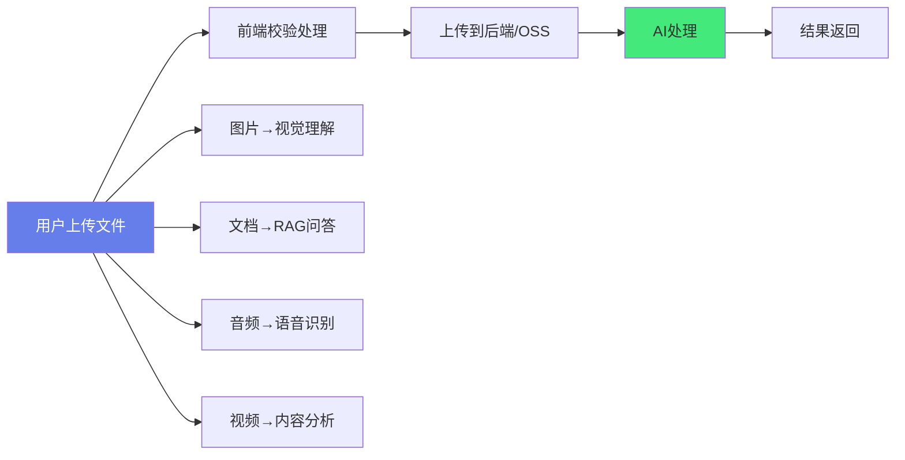

# 📁 文件上传与多模态交互

> **文档说明**：系统讲解前端文件上传与 AI 多模态交互的完整方案，涵盖文件上传基础（input type=file / File API / FormData / axios 上传）、上传组件设计（拖拽上传 / 点击上传 / 粘贴上传 / 多文件上传 / 上传队列）、上传进度与取消（XMLHttpRequest progress 事件 / AbortController / 断点续传 / 暂停恢复）、文件校验（类型白名单 / 大小限制 / 数量限制 / 图片尺寸 / 病毒扫描提示）、图片处理（预览 / 压缩 / 裁剪 / 格式转换 WebP / EXIF 方向修正 / 缩略图）、大文件上传（分片上传 slice / 并发控制 / 断点续传 / 秒传 hash / 上传合并）、AI 多模态交互（图片理解 GPT-4V / 文档解析 OCR / 语音输入 ASR / 视频分析 / 文件问答 RAG）、与 LLM 多模态 API 集成（OpenAI Vision / 国内大模型视觉接口 / 文件上传到 AI 服务 / 流式多模态响应）、流式上传与处理（边传边处理 / WebSocket 上传 / 实时进度）、安全考虑（文件类型验证 / 恶意文件 / 大小限制 / 存储隔离 / CORS）、与 Vue3 集成（useFileUpload composable / Element Plus Upload 二次封装 / 上传状态管理）、常见问题与最佳实践。
>
> **适用人群**：前端开发者、AI 应用开发者、需要构建文件处理功能的全栈工程师
>
> **前置知识**：[[Vue3-组合式API]] · [[Axios网络请求封装]] · [[流式响应与SSE]]

---

## 一、概述

### 1.1 AI 时代的文件上传需求

AI 应用中，文件上传是核心交互之一——用户上传文档、图片、音频、视频，AI 进行理解、分析、生成。



| 文件类型 | AI 处理能力 | 应用场景 |
|---------|-----------|---------|
| **图片** | 视觉理解、OCR、图像生成 | 图片问答、截图解析、AI 修图 |
| **文档** | 文本提取、RAG 检索 | 文档问答、合同分析、知识库 |
| **音频** | 语音识别、语音合成 | 语音输入、会议纪要 |
| **视频** | 帧提取、内容理解 | 视频摘要、行为分析 |
| **代码** | 代码理解、生成 | 代码审查、AI 编程 |
| **CSV/Excel** | 数据分析、图表生成 | 数据问答、可视化 |

### 1.2 多模态交互概念

**多模态（Multimodal）** 指 AI 能同时理解和生成多种类型的数据（文本、图像、音频、视频）。前端需要支持：
- 📤 **多模态输入**：用户可以同时发送文本 + 图片 + 文件
- 📥 **多模态输出**：AI 返回文本 + 图片 + 表格 + 代码
- 🔄 **流式交互**：边上传边处理，边生成边展示

---

## 二、文件上传基础

### 2.1 File API

```typescript
// 获取文件
const input = document.querySelector('input[type=file]')
input.addEventListener('change', (e) => {
  const files = e.target.files  // FileList
  const file = files[0]         // File 对象
  
  console.log(file.name)       // 文件名
  console.log(file.size)       // 大小（字节）
  console.log(file.type)       // MIME 类型
  console.log(file.lastModified) // 最后修改时间
})

// 读取文件内容
const reader = new FileReader()
reader.onload = (e) => {
  console.log(e.target.result)  // base64 或文本
}
reader.readAsDataURL(file)   // base64（图片预览）
reader.readAsText(file)      // 文本
reader.readAsArrayBuffer(file) // 二进制
```

### 2.2 FormData 上传

```typescript
// 基础上传
const formData = new FormData()
formData.append('file', file)           // 文件
formData.append('filename', file.name)  // 额外字段

const res = await axios.post('/api/upload', formData, {
  headers: { 'Content-Type': 'multipart/form-data' }
})
```

### 2.3 axios 上传进度

```typescript
const res = await axios.post('/api/upload', formData, {
  onUploadProgress: (progressEvent) => {
    const percent = Math.round(
      (progressEvent.loaded * 100) / (progressEvent.total || 1)
    )
    console.log(`上传进度: ${percent}%`)
  }
})
```

---

## 三、上传组件设计

### 3.1 三种上传触发方式

```vue
<script setup lang="ts">
import { ref } from 'vue'

const fileInput = ref<HTMLInputElement>()
const dragOver = ref(false)

// 点击上传
function handleClick() {
  fileInput.value?.click()
}

// 文件选择
function handleFileChange(e: Event) {
  const files = (e.target as HTMLInputElement).files
  if (files) uploadFiles(Array.from(files))
}

// 拖拽上传
function handleDrop(e: DragEvent) {
  e.preventDefault()
  dragOver.value = false
  const files = e.dataTransfer?.files
  if (files) uploadFiles(Array.from(files))
}

// 粘贴上传
function handlePaste(e: ClipboardEvent) {
  const items = e.clipboardData?.items
  if (!items) return
  for (const item of items) {
    if (item.type.startsWith('image/')) {
      const file = item.getAsFile()
      if (file) uploadFiles([file])
    }
  }
}
</script>

<template>
  <!-- 点击 + 拖拽区域 -->
  <div
    class="upload-area"
    :class="{ 'drag-over': dragOver }"
    @click="handleClick"
    @dragover.prevent="dragOver = true"
    @dragleave="dragOver = false"
    @drop="handleDrop"
    @paste="handlePaste"
    tabindex="0"
  >
    <p>点击、拖拽或粘贴文件到此处</p>
    <input ref="fileInput" type="file" multiple hidden @change="handleFileChange" />
  </div>
</template>
```

### 3.2 上传队列管理

```typescript
interface UploadItem {
  id: string
  file: File
  status: 'pending' | 'uploading' | 'success' | 'error'
  progress: number
  url?: string
  error?: string
}

const uploadQueue = ref<UploadItem[]>([])

async function uploadFiles(files: File[]) {
  for (const file of files) {
    const item: UploadItem = {
      id: crypto.randomUUID(),
      file,
      status: 'pending',
      progress: 0
    }
    uploadQueue.value.push(item)
    await uploadSingle(item)
  }
}

async function uploadSingle(item: UploadItem) {
  item.status = 'uploading'
  const formData = new FormData()
  formData.append('file', item.file)
  
  try {
    const res = await axios.post('/api/upload', formData, {
      onUploadProgress: (e) => {
        item.progress = Math.round((e.loaded * 100) / (e.total || 1))
      }
    })
    item.status = 'success'
    item.url = res.data.url
  } catch (error) {
    item.status = 'error'
    item.error = '上传失败'
  }
}
```

---

## 四、上传进度与取消

### 4.1 AbortController 取消上传

```typescript
const controller = new AbortController()

async function uploadWithCancel(file: File) {
  const formData = new FormData()
  formData.append('file', file)
  
  try {
    const res = await axios.post('/api/upload', formData, {
      signal: controller.signal,
      onUploadProgress: (e) => console.log(e.loaded)
    })
    return res.data
  } catch (error) {
    if (axios.isCancel(error)) {
      console.log('上传已取消')
    }
    throw error
  }
}

// 取消上传
function cancelUpload() {
  controller.abort()
}
```

### 4.2 暂停与恢复（断点续传）

```typescript
// 记录已上传的分片
const uploadedChunks = ref<Set<number>>(new Set())

async function uploadWithPause(file: File) {
  const chunkSize = 5 * 1024 * 1024  // 5MB 一片
  const chunks = Math.ceil(file.size / chunkSize)
  
  for (let i = 0; i < chunks; i++) {
    if (uploadedChunks.value.has(i)) continue  // 已上传跳过
    
    if (isPaused.value) {
      await waitForResume()  // 等待恢复
    }
    
    const start = i * chunkSize
    const end = Math.min(start + chunkSize, file.size)
    const chunk = file.slice(start, end)
    
    const formData = new FormData()
    formData.append('chunk', chunk)
    formData.append('chunkIndex', i.toString())
    formData.append('fileId', fileId)
    
    await axios.post('/api/upload/chunk', formData)
    uploadedChunks.value.add(i)
  }
  
  // 所有分片上传完成，通知后端合并
  await axios.post('/api/upload/merge', { fileId, fileName: file.name })
}
```

---

## 五、文件校验

### 5.1 完整校验函数

```typescript
interface ValidateOptions {
  maxSize?: number       // MB
  accept?: string[]      // MIME 类型白名单
  maxCount?: number      // 最大文件数
  imageMaxWidth?: number // 图片最大宽度
}

function validateFile(file: File, options: ValidateOptions): string | null {
  // 大小校验
  if (options.maxSize && file.size > options.maxSize * 1024 * 1024) {
    return `文件大小不能超过 ${options.maxSize}MB`
  }
  
  // 类型校验（双重校验：扩展名 + MIME）
  if (options.accept) {
    const ext = file.name.split('.').pop()?.toLowerCase()
    const mimeOk = options.accept.some(type => 
      file.type === type || file.type.startsWith(type.split('/')[0] + '/')
    )
    const extOk = options.accept.some(type => type.includes(ext || ''))
    if (!mimeOk && !extOk) {
      return `不支持的文件类型: ${file.type}`
    }
  }
  
  return null  // 校验通过
}

// 图片尺寸校验
async function validateImageSize(file: File, maxWidth: number): Promise<string | null> {
  return new Promise((resolve) => {
    const img = new Image()
    img.onload = () => {
      if (img.width > maxWidth) {
        resolve(`图片宽度不能超过 ${maxWidth}px`)
      } else {
        resolve(null)
      }
    }
    img.onerror = () => resolve('图片加载失败')
    img.src = URL.createObjectURL(file)
  })
}
```

---

## 六、图片处理

### 6.1 图片压缩

```typescript
async function compressImage(file: File, quality = 0.8, maxWidth = 1920): Promise<Blob> {
  return new Promise((resolve, reject) => {
    const img = new Image()
    img.onload = () => {
      // 计算缩放比例
      let { width, height } = img
      if (width > maxWidth) {
        height = (height * maxWidth) / width
        width = maxWidth
      }
      
      const canvas = document.createElement('canvas')
      canvas.width = width
      canvas.height = height
      const ctx = canvas.getContext('2d')!
      ctx.drawImage(img, 0, 0, width, height)
      
      // 转换为 WebP（体积更小）
      canvas.toBlob(
        (blob) => blob ? resolve(blob) : reject(new Error('压缩失败')),
        'image/webp',
        quality
      )
      URL.revokeObjectURL(img.src)
    }
    img.onerror = reject
    img.src = URL.createObjectURL(file)
  })
}
```

### 6.2 EXIF 方向修正

手机拍照的图片可能有 EXIF 方向信息，canvas 绘制时需要修正：

```typescript
import EXIF from 'exif-js'

async function fixImageOrientation(file: File): Promise<Blob> {
  return new Promise((resolve) => {
    EXIF.getData(file, function() {
      const orientation = EXIF.getTag(this, 'Orientation') || 1
      const img = new Image()
      img.onload = () => {
        const canvas = document.createElement('canvas')
        const ctx = canvas.getContext('2d')!
        
        // 根据 orientation 旋转
        if (orientation > 4) {
          canvas.width = img.height
          canvas.height = img.width
        } else {
          canvas.width = img.width
          canvas.height = img.height
        }
        
        switch (orientation) {
          case 2: ctx.transform(-1, 0, 0, 1, img.width, 0); break
          case 3: ctx.transform(-1, 0, 0, -1, img.width, img.height); break
          case 4: ctx.transform(1, 0, 0, -1, 0, img.height); break
          case 5: ctx.transform(0, 1, 1, 0, 0, 0); break
          case 6: ctx.transform(0, 1, -1, 0, img.height, 0); break
          case 7: ctx.transform(0, -1, -1, 0, img.height, img.width); break
          case 8: ctx.transform(0, -1, 1, 0, 0, img.width); break
        }
        
        ctx.drawImage(img, 0, 0)
        canvas.toBlob((blob) => resolve(blob!), 'image/jpeg', 0.9)
      }
      img.src = URL.createObjectURL(file)
    })
  })
}
```

---

## 七、大文件分片上传

### 7.1 完整分片上传流程

```mermaid
graph LR
    A[文件切片] --> B[计算hash(秒传)]
    B --> C{已存在?}
    C -->|是| D[秒传完成]
    C -->|否| E[并发上传分片]
    E --> F[全部完成?]
    F -->|否| E
    F -->|是| G[通知后端合并]
    
    style A fill:#feca57,color:#333
    style D fill:#43e97b,color:#333
    style G fill:#667eea,color:#fff
```

### 7.2 实现代码

```typescript
import SparkMD5 from 'spark-md5'

const CHUNK_SIZE = 5 * 1024 * 1024  // 5MB
const CONCURRENCY = 3  // 并发数

// 计算文件 hash（用于秒传）
async function calculateHash(file: File): Promise<string> {
  return new Promise((resolve) => {
    const chunkSize = 2 * 1024 * 1024
    const chunks = Math.ceil(file.size / chunkSize)
    const spark = new SparkMD5.ArrayBuffer()
    let current = 0
    
    const reader = new FileReader()
    reader.onload = (e) => {
      spark.append(e.target?.result as ArrayBuffer)
      current++
      if (current < chunks) {
        loadNext()
      } else {
        resolve(spark.end())
      }
    }
    
    function loadNext() {
      const start = current * chunkSize
      const end = Math.min(start + chunkSize, file.size)
      reader.readAsArrayBuffer(file.slice(start, end))
    }
    loadNext()
  })
}

// 分片上传
async function chunkedUpload(file: File, onProgress: (p: number) => void) {
  const hash = await calculateHash(file)
  
  // 1. 检查秒传
  const checkRes = await axios.post('/api/upload/check', { hash, fileName: file.name })
  if (checkRes.data.exists) {
    onProgress(100)
    return checkRes.data.url  // 秒传
  }
  
  // 2. 切片
  const chunks: Blob[] = []
  for (let i = 0; i < Math.ceil(file.size / CHUNK_SIZE); i++) {
    chunks.push(file.slice(i * CHUNK_SIZE, (i + 1) * CHUNK_SIZE))
  }
  
  // 3. 并发上传
  const uploaded = ref(0)
  const pool: Promise<void>[] = []
  let index = 0
  
  async function uploadNext() {
    while (index < chunks.length) {
      const currentIndex = index++
      const formData = new FormData()
      formData.append('chunk', chunks[currentIndex])
      formData.append('hash', hash)
      formData.append('index', currentIndex.toString())
      
      await axios.post('/api/upload/chunk', formData)
      uploaded.value++
      onProgress(Math.round((uploaded.value / chunks.length) * 100))
    }
  }
  
  // 启动并发
  for (let i = 0; i < Math.min(CONCURRENCY, chunks.length); i++) {
    pool.push(uploadNext())
  }
  await Promise.all(pool)
  
  // 4. 合并
  const mergeRes = await axios.post('/api/upload/merge', { hash, fileName: file.name })
  return mergeRes.data.url
}
```

---

## 八、AI 多模态交互

### 8.1 图片理解（GPT-4V）

```typescript
// 图片转 base64
function fileToBase64(file: File): Promise<string> {
  return new Promise((resolve, reject) => {
    const reader = new FileReader()
    reader.onload = () => resolve(reader.result as string)
    reader.onerror = reject
    reader.readAsDataURL(file)
  })
}

// 调用多模态 API
async function analyzeImage(file: File, prompt: string) {
  const base64 = await fileToBase64(file)
  
  const res = await axios.post('/api/ai/vision', {
    model: 'gpt-4o',
    messages: [{
      role: 'user',
      content: [
        { type: 'text', text: prompt },
        { type: 'image_url', image_url: { url: base64 } }
      ]
    }]
  }, {
    responseType: 'stream'  // 流式响应
  })
  
  return res.data
}
```

### 8.2 文档问答（RAG）

```typescript
// 上传文档到 RAG 系统
async function uploadDocument(file: File) {
  const formData = new FormData()
  formData.append('file', file)
  
  const res = await axios.post('/api/rag/upload', formData, {
    onUploadProgress: (e) => {
      console.log(`上传: ${Math.round(e.loaded / e.total! * 100)}%`)
    }
  })
  
  // 后端会自动解析文档、分块、向量化、存入向量数据库
  return res.data.documentId
}

// 基于文档问答
async function askDocument(documentId: string, question: string) {
  const res = await axios.post('/api/rag/ask', { documentId, question }, {
    responseType: 'stream'
  })
  return res.data
}
```

### 8.3 语音输入（ASR）

```typescript
// 录音并上传识别
async function recordAndTranscribe() {
  const stream = await navigator.mediaDevices.getUserMedia({ audio: true })
  const recorder = new MediaRecorder(stream)
  const chunks: Blob[] = []
  
  recorder.ondataavailable = (e) => chunks.push(e.data)
  recorder.onstop = async () => {
    const audioBlob = new Blob(chunks, { type: 'audio/webm' })
    const formData = new FormData()
    formData.append('file', audioBlob, 'recording.webm')
    
    const res = await axios.post('/api/ai/transcribe', formData)
    console.log('识别结果:', res.data.text)
    stream.getTracks().forEach(t => t.stop())
  }
  
  recorder.start()
  // 3秒后停止
  setTimeout(() => recorder.stop(), 3000)
}
```

---

## 九、Vue3 集成

### 9.1 useFileUpload Composable

```typescript
// composables/useFileUpload.ts
import { ref, computed } from 'vue'
import axios from 'axios'

interface UploadFile {
  id: string
  file: File
  status: 'pending' | 'uploading' | 'success' | 'error'
  progress: number
  url?: string
  error?: string
}

export function useFileUpload(options: {
  url: string
  maxSize?: number
  accept?: string[]
  maxCount?: number
}) {
  const files = ref<UploadFile[]>([])
  const isDragging = ref(false)
  
  const totalProgress = computed(() => {
    if (files.value.length === 0) return 0
    const sum = files.value.reduce((acc, f) => acc + f.progress, 0)
    return Math.round(sum / files.value.length)
  })
  
  function validate(file: File): string | null {
    if (options.maxSize && file.size > options.maxSize * 1024 * 1024) {
      return `文件超过 ${options.maxSize}MB`
    }
    if (options.accept && !options.accept.some(t => file.type.match(t))) {
      return `不支持的类型: ${file.type}`
    }
    return null
  }
  
  async function upload(file: File): Promise<UploadFile> {
    const error = validate(file)
    const item: UploadFile = {
      id: crypto.randomUUID(),
      file,
      status: error ? 'error' : 'pending',
      progress: 0,
      error
    }
    files.value.push(item)
    
    if (error) return item
    
    item.status = 'uploading'
    const formData = new FormData()
    formData.append('file', file)
    
    try {
      const res = await axios.post(options.url, formData, {
        onUploadProgress: (e) => {
          item.progress = Math.round((e.loaded * 100) / (e.total || 1))
        }
      })
      item.status = 'success'
      item.url = res.data.url
    } catch (err) {
      item.status = 'error'
      item.error = '上传失败'
    }
    return item
  }
  
  function remove(id: string) {
    files.value = files.value.filter(f => f.id !== id)
  }
  
  function clear() {
    files.value = []
  }
  
  return { files, isDragging, totalProgress, upload, remove, clear }
}
```

### 9.2 Element Plus Upload 封装

```vue
<!-- components/ProUpload.vue -->
<script setup lang="ts">
import { ref } from 'vue'
import { ElMessage } from 'element-plus'
import type { UploadProps, UploadFile } from 'element-plus'

const props = defineProps<{
  action: string
  maxSize?: number
  accept?: string
  limit?: number
}>()

const emit = defineEmits<{ success: [url: string] }>()

const fileList = ref<UploadFile[]>([])

const beforeUpload: UploadProps['beforeUpload'] = (file) => {
  if (props.maxSize && file.size / 1024 / 1024 > props.maxSize) {
    ElMessage.error(`文件大小不能超过 ${props.maxSize}MB`)
    return false
  }
  return true
}

const onSuccess: UploadProps['onSuccess'] = (response) => {
  emit('success', response.url)
  ElMessage.success('上传成功')
}

const onError: UploadProps['onError'] = () => {
  ElMessage.error('上传失败')
}
</script>

<template>
  <el-upload
    :action="action"
    :accept="accept"
    :limit="limit"
    :before-upload="beforeUpload"
    :on-success="onSuccess"
    :on-error="onError"
    v-model:file-list="fileList"
    drag
  >
    <el-icon class="el-icon--upload"><upload-filled /></el-icon>
    <div class="el-upload__text">拖拽文件到此处，或<em>点击上传</em></div>
    <template #tip>
      <div class="el-upload__tip">
        支持 {{ accept }} 格式，单个文件不超过 {{ maxSize }}MB
      </div>
    </template>
  </el-upload>
</template>
```

---

## 十、安全考虑

| 风险 | 说明 | 防护措施 |
|------|------|---------|
| **恶意文件** | 上传可执行文件、病毒 | 类型白名单 + 后端杀毒扫描 |
| **文件大小** | 超大文件耗尽存储 | 前端限制 + 后端限制 |
| **路径遍历** | 文件名包含 `../` | 后端重命名文件，不用原始文件名 |
| **XSS** | SVG/HTML 文件包含脚本 | 存储隔离 + Content-Disposition |
| **CORS** | 跨域上传 | 后端配置 CORS 白名单 |
| **未授权上传** | 未登录用户上传 | 接口鉴权 + 频率限制 |
| **存储耗尽** | 大量上传占满磁盘 | 配额限制 + 定期清理 |

> **核心原则**：前端校验只是用户体验，后端必须做完整校验——前端可以被绕过。

---

## 十一、常见问题

| 问题 | 原因 | 解决方案 |
|------|------|---------|
| **上传进度不显示** | axios 版本或配置问题 | 确认 onUploadProgress 回调，检查 Content-Type |
| **大文件上传超时** | 服务器超时时间短 | 分片上传 + 增加超时时间 |
| **图片预览旋转** | EXIF 方向信息 | 上传前修正 EXIF 方向 |
| **拖拽不触发** | 没有 preventDefault | dragover 和 drop 都要 preventDefault |
| **iOS 拍照旋转** | 手机拍照 EXIF | 同 EXIF 修正 |
| **中文文件名乱码** | 编码问题 | 后端用 UTF-8 解码，或前端转码 |
| **分片上传顺序乱** | 并发上传无序 | 每个分片带 index，后端按序合并 |
| **秒传不准确** | hash 碰撞 | 用 MD5/SHA256，不要用文件名+大小 |
| **内存溢出** | 大文件全量读入内存 | 分片读取，不要 readAsArrayBuffer 整个文件 |

---

## 十二、最佳实践

1. **三种上传方式都支持**：点击 + 拖拽 + 粘贴，提升用户体验
2. **上传前压缩图片**：前端压缩图片再上传，减少带宽和存储
3. **大文件必须分片**：超过 50MB 的文件用分片上传 + 断点续传
4. **显示上传进度**：进度条 + 百分比，让用户有预期
5. **支持取消和重试**：上传可取消，失败可重试
6. **前端校验 + 后端校验**：前端提升体验，后端保证安全
7. **文件重命名存储**：后端用 UUID 重命名，避免冲突和路径遍历
8. **图片用 CDN/OSS**：不要存在应用服务器，用对象存储 + CDN
9. **多模态输入统一处理**：文本 + 图片 + 文件统一为消息列表发送给 AI
10. **流式处理**：AI 响应用流式，上传用进度流，提升体验
11. **上传队列管理**：多文件上传用队列，控制并发数
12. **错误友好提示**：上传失败给出明确原因和重试按钮

---

## 十三、关联笔记

### AI 前端集成
- [[对话式UI组件设计]] · [[流式响应与SSE]] · [[Markdown渲染与代码高亮]]
- [[语音输入与TTS输出]] · [[AI前端集成入门]]

### 前端基础
- [[Vue3-组合式API]] · [[Axios网络请求封装]] · [[TypeScript-类型系统进阶]]
- [[ElementPlus-二次封装]]

### 后端与存储
- [[文件存储与OSS]] · [[RAG检索增强生成]] · [[SpringBoot文件上传]]
- [[Redis缓存与队列]]

### 导航
- [[MOC-AI前端集成]] · [[MOC-前端开发]] · [[Home]] · [[学习路线总览]]

> 🔍 **知识点深度解析**
>
> **作用**：文件上传与多模态交互解决的是「如何在前端实现安全、高效、友好的文件上传功能，并支持 AI 多模态交互（图片理解、文档问答、语音识别等），让用户可以通过文件与 AI 自然交互」的核心问题——文件上传是 AI 应用的核心入口，多模态是 AI 时代的交互标准。
>
> **底层原理**：①文件上传的本质是「multipart/form-data 编码的 HTTP POST 请求」——浏览器将文件内容和表单字段按照 multipart 格式编码，通过 HTTP POST 发送到服务器。FormData API 是前端构造这种请求的标准方式，axios/fetch 会自动设置正确的 Content-Type（包含 boundary 分隔符）。上传进度通过 XMLHttpRequest 的 progress 事件获取（axios 封装为 onUploadProgress），fetch API 原生不支持上传进度，需要用 XMLHttpRequest 或 ReadableStream。②大文件分片上传的本质是「分而治之 + 并发 + 断点续传」——将大文件切成固定大小的片（如 5MB），并发上传多个片（控制并发数避免连接数过多），每个片带索引，全部上传完成后通知后端合并。断点续传通过记录已上传的片索引实现（刷新页面后跳过已上传的片）。秒传通过文件 hash（MD5/SHA256）实现——上传前计算 hash，询问后端是否已存在相同 hash 的文件，存在则直接返回 URL，不需要重新上传。③图片压缩的本质是「Canvas 重绘 + toBlob 导出」——将图片绘制到 Canvas 上（可缩放尺寸），然后用 canvas.toBlob() 导出为压缩后的图片（支持 JPEG/WebP，可设置质量）。这个过程在浏览器端完成，不需要服务器。EXIF 方向修正是因为手机拍照时图片可能带有方向信息（Orientation tag），直接用 Canvas 绘制会导致旋转，需要根据 EXIF 的 Orientation 值对 Canvas 做变换（旋转/翻转）后再绘制。④AI 多模态交互的本质是「多种数据类型统一为消息格式发送给 LLM」——GPT-4V 等多模态模型接受的消息格式是 content 数组，包含 text（文本）和 image_url（图片，支持 URL 或 base64）。前端需要将用户上传的图片转为 base64（或上传到 OSS 获取 URL），与文本组合为多模态消息发送给 AI。文档问答（RAG）则是先上传文档到后端，后端解析（提取文本/分块/向量化/存入向量数据库），然后用户提问时检索相关文档片段作为上下文发送给 LLM。⑤拖拽上传的原理是 HTML5 Drag and Drop API——通过 dragover（阻止默认行为才能触发 drop）、dragleave、drop 事件监听拖拽状态，从 e.dataTransfer.files 获取拖拽的文件。粘贴上传通过 paste 事件，从 e.clipboardData.items 获取剪贴板中的文件（主要是图片）。这两种方式大大提升了上传体验，是现代 AI 应用的标配。⑥AbortController 取消上传的原理是「信号机制」——创建 AbortController，将 signal 传给 fetch/axios，调用 controller.abort() 时，正在进行的请求会被中止，触发 abort 事件。这和 Promise 的取消不同——Promise 本身不可取消，AbortController 是 Web 标准的取消机制。
>
> **用法要点**：① File API：File对象(name/size/type)/FileReader(readAsDataURL/readAsText/readAsArrayBuffer) ② 基础上传：FormData.append('file', file)+axios.post+multipart/form-data ③ 上传进度：axios onUploadProgress(loaded/total*100) ④ 三种触发：点击(input.click)/拖拽(dragover+drop, preventDefault)/粘贴(paste+clipboardData) ⑤ 上传队列：UploadItem(id/file/status/progress/url)+状态机(pending→uploading→success/error) ⑥ 取消上传：AbortController+signal+controller.abort() ⑦ 断点续传：file.slice分片+记录已上传index+暂停等待恢复+完成后合并 ⑧ 文件校验：大小(maxSize)/类型(MIME+扩展名双重)/数量/图片尺寸(Image onload) ⑨ 图片处理：Canvas压缩(toBlob WebP quality)/EXIF方向修正(orientation旋转) ⑩ 大文件分片：calculateHash(秒传)+slice分片+并发控制(CONCURRENCY)+上传进度+后端合并 ⑪ AI多模态：图片理解(fileToBase64+GPT-4V content数组)/文档RAG(上传→解析→向量化→问答)/语音ASR(MediaRecorder录音+上传识别) ⑫ Vue3集成：useFileUpload composable(files/isDragging/totalProgress/upload/remove/clear)/Element Plus Upload封装 ⑬ 安全：类型白名单+后端杀毒/大小限制/文件重命名UUID/存储隔离/CORS/鉴权/配额 ⑭ 常见问题：进度不显示(检查onUploadProgress)/大文件超时(分片)/图片旋转(EXIF)/拖拽不触发(preventDefault)/分片乱序(带index)/内存溢出(分片读取) ⑮ 最佳实践：三种上传方式都支持/上传前压缩图片/大文件分片/显示进度/支持取消重试/前后端双重校验/文件重命名/OSS+CDN/多模态统一消息/流式处理/队列管理并发/错误友好提示。

> 💡 **深度讲解**：文件上传与多模态交互最核心的智慧是「上传不是终点，交互才是——文件上传只是手段，让用户通过文件与 AI 自然交互才是目的」——很多开发者把文件上传当成一个简单的功能（一个 input + 一个 POST），但在 AI 应用中，文件上传是核心交互入口。用户上传一张图片，期望的不是「上传成功」，而是「AI 看懂了这张图并回答了我的问题」；用户上传一个文档，期望的不是「文件已保存」，而是「我可以问关于这个文档的任何问题」。所以文件上传的设计必须围绕「AI 交互」来做——上传后立刻触发 AI 处理、显示处理进度、流式展示结果，而不是上传完就结束。大文件分片上传是另一个重点——很多人觉得分片上传很复杂，但核心思想很简单：「大文件切小片，并发上传，传完合并」。难点在于工程细节：hash 计算不能阻塞 UI（用 Web Worker 或分片计算）、并发数要控制（太多连接数超限，太慢体验差）、断点续传要持久化（localStorage 记录已上传的片）、失败要重试（指数退避）。这些细节决定了上传功能是「能用」还是「好用」。图片处理是 AI 应用的常见需求——用户上传的手机照片可能有几 MB，直接上传到 AI API 既慢又贵（Token 费用与图片大小相关）。前端压缩图片（缩放到合理尺寸 + WebP 格式 + 质量压缩）可以将图片从 5MB 压缩到 200KB，上传速度快 25 倍，AI 处理成本也大幅降低。EXIF 方向修正也是必须的——手机拍照的图片可能带有方向信息，不修正的话显示出来是旋转的。在 AI 时代，多模态交互是标配——用户期望可以同时发送「这张图里有什么？」+ 图片，或者「总结这个文档」+ PDF 文件。前端需要统一处理多种输入类型，组合为 LLM 能理解的消息格式。流式响应（SSE）让 AI 的回答可以逐字显示，大大提升体验。安全是文件上传的底线——前端校验可以被绕过（用 Postman 直接调接口），所以后端必须做完整校验：类型白名单、大小限制、杀毒扫描、文件重命名、存储隔离。一个文件上传漏洞可能导致服务器被入侵（上传 webshell），绝对不能掉以轻心。掌握文件上传与多模态交互，就是掌握了 AI 应用的「输入层」核心能力——这是从「做网页」到「做 AI 产品」的关键一步。

> 📝 **精简总结**：文件上传与多模态交互=AI应用核心输入层。基础：File API/FormData/axios上传/onUploadProgress进度。组件：点击+拖拽+粘贴三种触发/上传队列状态机。高级：AbortController取消/断点续传/分片上传(5MB片+并发+hash秒传+合并)。校验：大小/类型(MIME+扩展名)/数量/图片尺寸。图片处理：Canvas压缩(WebP)/EXIF方向修正。AI多模态：图片理解(GPT-4V base64+content数组)/文档RAG(上传→解析→向量化→问答)/语音ASR(MediaRecorder)。Vue3：useFileUpload composable/Element Plus Upload封装。安全：前后端双重校验/文件重命名UUID/OSS+CDN/存储隔离。最佳实践：三种上传方式/上传前压缩/大文件分片/显示进度/取消重试/流式AI响应。

> **学习路径建议**：先学习 File API 和 FormData 基础上传 → 实践：做一个简单的文件上传组件 → 学习上传进度和取消（AbortController） → 学习拖拽和粘贴上传 → 实践：做一个支持三种方式的上传组件 → 学习图片处理（压缩 + EXIF 修正） → 实践：上传前自动压缩图片 → 学习大文件分片上传 → 实践：实现分片上传 + 断点续传 + 秒传 → 学习 AI 多模态交互（GPT-4V / RAG / ASR） → 实践：做一个支持图片问答的 AI 聊天界面 → 学习安全最佳实践 → 形成完整的文件上传与多模态交互方案。

---

> **文件上传与多模态交互最核心的智慧是「上传不是终点，交互才是——文件上传只是手段，让用户通过文件与 AI 自然交互才是目的」——很多开发者把文件上传当成简单功能（一个 input + 一个 POST），但在 AI 应用中文件上传是核心交互入口。用户上传一张图片，期望的不是上传成功，而是 AI 看懂了这张图并回答了问题；用户上传一个文档，期望的不是文件已保存，而是可以问关于这个文档的任何问题。所以文件上传的设计必须围绕 AI 交互来做——上传后立刻触发 AI 处理、显示处理进度、流式展示结果，而不是上传完就结束。大文件分片上传的核心思想很简单：大文件切小片，并发上传，传完合并。难点在工程细节：hash 计算不阻塞 UI、并发数控制、断点续传持久化、失败重试指数退避，这些决定了上传是能用还是好用。图片处理是 AI 应用常见需求——手机照片几 MB，直接上传到 AI API 既慢又贵，前端压缩（缩放+WebP+质量压缩）可从 5MB 压到 200KB，上传快 25 倍，AI 成本也大幅降低。EXIF 方向修正也是必须的——手机拍照图片可能带方向信息，不修正显示是旋转的。AI 时代多模态交互是标配——用户期望同时发「这张图里有什么」+ 图片，或「总结这个文档」+ PDF，前端需要统一处理多种输入类型，组合为 LLM 能理解的消息格式，流式响应让回答逐字显示提升体验。安全是文件上传的底线——前端校验可被绕过，后端必须做完整校验：类型白名单、大小限制、杀毒扫描、文件重命名、存储隔离，一个上传漏洞可能导致服务器被入侵。掌握文件上传与多模态交互，就是掌握了 AI 应用输入层的核心能力——这是从做网页到做 AI 产品的关键一步。下次你做 AI 应用时，把文件上传当成核心交互来设计——用户会感受到的。**
