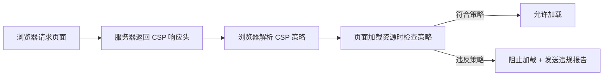

# CSP内容安全策略

> **文档说明**：系统讲解内容安全策略（CSP）的核心原理、指令体系（default-src/script-src/style-src等）、配置方式（HTTP头/meta标签）、报告机制（report-uri/report-to）、CSP 等级与部署策略、常见配置示例、与 XSS 防护的关系，以及调试排错和最佳实践。
>
> **适用人群**：前端开发工程师、全栈开发者、安全工程师、Web 应用架构师
>
> **前置知识**：[[前端安全-XSS-CSRF防护]]、[[API安全最佳实践]]、[[Web安全-XSS-CSRF-SQL注入]]、[[前端敏感数据保护]]

---

## 一、概述

### 1. 什么是 CSP

**CSP（Content Security Policy，内容安全策略）** 是一种额外的安全层，用于检测和缓解某些类型的攻击，包括跨站脚本（XSS）和数据注入攻击。CSP 通过指定浏览器可以加载哪些资源（脚本、样式、图片、字体等），从根源上阻止恶意代码执行。

### 2. CSP 的作用

| 防护目标 | 说明 |
|---------|------|
| **XSS 防护** | 限制脚本来源，阻止内联脚本和 eval，防止恶意脚本执行 |
| **点击劫持防护** | 通过 frame-ancestors 限制页面被嵌入 |
| **数据外泄防护** | 限制请求目标，防止数据发送到恶意服务器 |
| **混合内容防护** | 阻止 HTTPS 页面加载 HTTP 资源 |
| **资源来源控制** | 精确控制脚本、样式、图片等资源的加载来源 |

### 3. CSP 工作原理



CSP 是**白名单机制**：只有明确允许的资源才能加载，未明确允许的一律阻止。

---

## 二、CSP 指令

### 1. 资源获取指令

| 指令 | 说明 | 示例 |
|------|------|------|
| **default-src** | 默认策略，其他指令未设置时回退 | `default-src 'self'` |
| **script-src** | JavaScript 来源 | `script-src 'self' cdn.example.com` |
| **style-src** | CSS 样式来源 | `style-src 'self' 'unsafe-inline'` |
| **img-src** | 图片来源 | `img-src 'self' data: https:` |
| **font-src** | 字体来源 | `font-src 'self' fonts.gstatic.com` |
| **connect-src** | XHR/Fetch/WebSocket 来源 | `connect-src 'self' api.example.com` |
| **media-src** | 音频/视频来源 | `media-src 'self'` |
| **object-src** | Flash/插件来源 | `object-src 'none'` |
| **frame-src** | iframe 来源 | `frame-src 'self' youtube.com` |
| **worker-src** | Worker 来源 | `worker-src 'self'` |
| **manifest-src** | PWA manifest 来源 | `manifest-src 'self'` |
| **prefetch-src** | 预加载资源来源 | `prefetch-src 'self'` |

### 2. 文档指令

| 指令 | 说明 | 示例 |
|------|------|------|
| **base-uri** | `<base>` 标签的 URL 限制 | `base-uri 'self'` |
| **form-action** | 表单提交目标限制 | `form-action 'self'` |
| **frame-ancestors** | 可嵌入当前页面的父页面（替代 X-Frame-Options） | `frame-ancestors 'self'` |
| **sandbox** | 沙箱模式，限制页面能力 | `sandbox allow-scripts allow-forms` |

### 3. 导航指令

| 指令 | 说明 | 示例 |
|------|------|------|
| **navigate-to** | 限制页面可导航到的 URL | `navigate-to 'self'` |

### 4. 报告指令

| 指令 | 说明 | 示例 |
|------|------|------|
| **report-uri** | 违规报告发送地址（旧） | `report-uri /csp-report` |
| **report-to** | 违规报告发送地址（新） | `report-to groupname` |

### 5. 源值（Source Values）

| 值 | 说明 |
|----|------|
| `'self'` | 同源（同协议、域名、端口） |
| `'none'` | 不允许任何来源 |
| `'unsafe-inline'` | 允许内联脚本/样式（不推荐） |
| `'unsafe-eval'` | 允许 eval() 等动态代码执行（不推荐） |
| `'unsafe-hashes'` | 允许内联事件处理器（不推荐） |
| `'nonce-xxx'` | 允许带特定 nonce 的内联脚本 |
| `'sha256-xxx'` | 允许特定哈希的内联脚本 |
| `https:` | 允许任意 HTTPS 来源 |
| `data:` | 允许 data: URI（如 base64 图片） |
| `blob:` | 允许 blob: URI |
| `*.example.com` | 允许 example.com 的所有子域 |
| `https://cdn.example.com` | 允许特定来源 |

---

## 三、CSP 配置方式

### 1. HTTP 响应头（推荐）

```nginx
# Nginx 配置
add_header Content-Security-Policy "default-src 'self'; script-src 'self' 'nonce-{random}' cdn.example.com; style-src 'self' 'unsafe-inline'; img-src 'self' data: https:; font-src 'self' fonts.gstatic.com; connect-src 'self' api.example.com; frame-ancestors 'self'; base-uri 'self'; form-action 'self'; object-src 'none'; report-uri /csp-report;" always;
```

```java
// Spring Boot 配置 CSP 响应头
@Configuration
public class SecurityConfig {
    @Bean
    public SecurityFilterChain filterChain(HttpSecurity http) throws Exception {
        http.headers(headers -> headers
            .contentSecurityPolicy(csp -> csp
                .policyDirectives("default-src 'self'; " +
                    "script-src 'self' cdn.example.com; " +
                    "style-src 'self' 'unsafe-inline'; " +
                    "img-src 'self' data: https:; " +
                    "frame-ancestors 'self'; " +
                    "object-src 'none'; " +
                    "report-uri /csp-report")
            )
        );
        return http.build();
    }
}
```

### 2. meta 标签（不推荐）

```html
<!-- meta 标签方式（有限制：不能用 frame-ancestors、report-uri、sandbox） -->
<meta http-equiv="Content-Security-Policy"
      content="default-src 'self'; script-src 'self' cdn.example.com">
```

> **注意**：meta 标签方式不支持 `frame-ancestors`、`report-uri`、`sandbox` 指令，推荐使用 HTTP 响应头。

### 3. CSP 等级

| 响应头 | 说明 |
|--------|------|
| `Content-Security-Policy` | 强制模式，违反策略则阻止资源加载 |
| `Content-Security-Policy-Report-Only` | 报告模式，违反策略只发送报告，不阻止 |

**部署策略**：先用 Report-Only 模式收集违规报告，确认无误后再切换到强制模式。

---

## 四、Nonce 与 Hash

### 1. Nonce（随机数）

Nonce 是每次请求生成的随机数，用于允许特定内联脚本执行，是替代 `'unsafe-inline'` 的安全方式。

```html
<!-- 服务端生成随机 nonce，注入到 CSP 头和 script 标签 -->
<!-- CSP 头：script-src 'nonce-abc123' -->
<script nonce="abc123">
  // 这个内联脚本被允许执行
  console.log('安全的内联脚本');
</script>

<script>
  // 这个内联脚本没有 nonce，会被阻止
  alert('恶意脚本');
</script>
```

```java
// Spring Boot 生成 nonce
@GetMapping("/")
public String index(Model model) {
    String nonce = UUID.randomUUID().toString().replace("-", "");
    model.addAttribute("nonce", nonce);
    // CSP 头中使用 'nonce-' + nonce
    return "index";
}
```

### 2. Hash（哈希）

Hash 允许特定内容的内联脚本，通过脚本内容的 SHA 哈希值匹配。

```html
<!-- 内联脚本内容：console.log('hello') -->
<!-- 计算 SHA-256 哈希：sha256-abc123... -->
<!-- CSP 头：script-src 'sha256-abc123...' -->
<script>console.log('hello')</script>
```

```bash
# 计算脚本哈希
echo -n "console.log('hello')" | openssl dgst -sha256 -binary | base64
# 输出：sha256-xxxx...
```

### 3. Nonce vs Hash

| 方式 | 优点 | 缺点 | 适用场景 |
|------|------|------|---------|
| **Nonce** | 灵活，脚本内容可变 | 每次请求生成，需服务端支持 | 动态内容、服务端渲染 |
| **Hash** | 不需服务端生成，静态 | 脚本内容固定，变更需更新哈希 | 静态内联脚本 |
| **unsafe-inline** | 简单 | 不安全，XSS 风险高 | 不推荐，仅过渡使用 |

---

## 五、CSP 报告机制

```text
### 1. report-uri（旧）
```

```http
Content-Security-Policy: default-src 'self'; report-uri /csp-report
```

```java
// 接收 CSP 违规报告
@PostMapping("/csp-report")
public void report(@RequestBody String report) {
    // 报告格式：
    // {
    //   "csp-report": {
    //     "document-uri": "https://example.com/page",
    //     "referrer": "",
    //     "violated-directive": "script-src",
    //     "effective-directive": "script-src",
    //     "original-policy": "default-src 'self'",
    //     "blocked-uri": "https://evil.com/script.js",
    //     "status-code": 0
    //   }
    // }
    log.info("CSP violation: {}", report);
}
```

```text
### 2. report-to（新）
```

```http
Report-To: {"group":"csp-endpoint","max_age":10886400,"endpoints":[{"url":"https://example.com/csp-report"}]}
Content-Security-Policy: default-src 'self'; report-to csp-endpoint
```

### 3. 报告分析

CSP 违规报告是调试和优化 CSP 的关键：

- [ ] **收集报告**：部署报告接收端点，存储违规记录
- [ ] **分析报告**：识别误报（合法资源被阻止）和真实威胁
- [ ] **优化策略**：根据报告调整白名单
- [ ] **监控告警**：异常违规突增可能意味着攻击

---

## 六、常见配置示例

### 1. 严格策略（推荐）

```http
Content-Security-Policy:
  default-src 'self';
  script-src 'self' 'nonce-{random}' cdn.example.com;
  style-src 'self' 'nonce-{random}' fonts.googleapis.com;
  img-src 'self' data: https: blob:;
  font-src 'self' fonts.gstatic.com data:;
  connect-src 'self' api.example.com wss://example.com;
  media-src 'self';
  object-src 'none';
  frame-src 'self' youtube.com;
  frame-ancestors 'self';
  base-uri 'self';
  form-action 'self';
  manifest-src 'self';
  worker-src 'self' blob:;
  upgrade-insecure-requests;
  block-all-mixed-content;
  report-uri /csp-report;
```

### 2. 宽松策略（过渡用）

```http
Content-Security-Policy:
  default-src 'self' https:;
  script-src 'self' 'unsafe-inline' 'unsafe-eval' https:;
  style-src 'self' 'unsafe-inline' https:;
  img-src 'self' data: https:;
  connect-src 'self' https:;
  frame-ancestors 'self';
  report-uri /csp-report;
```

### 3. 仅报告模式（上线前）

```http
Content-Security-Policy-Report-Only:
  default-src 'self';
  script-src 'self' cdn.example.com;
  style-src 'self' 'unsafe-inline';
  img-src 'self' data: https:;
  frame-ancestors 'self';
  report-uri /csp-report;
```

### 4. 特殊指令

| 指令 | 说明 |
|------|------|
| `upgrade-insecure-requests` | 自动将 HTTP 请求升级为 HTTPS |
| `block-all-mixed-content` | 阻止 HTTPS 页面加载 HTTP 资源（已被 upgrade-insecure-requests 取代） |

---

## 七、CSP 与 XSS 防护

### 1. CSP 如何防护 XSS

| XSS 类型 | CSP 防护机制 |
|---------|-------------|
| **反射型 XSS** | 阻止恶意脚本加载（script-src 白名单） |
| **存储型 XSS** | 阻止内联脚本执行（禁用 unsafe-inline） |
| **DOM 型 XSS** | 阻止 eval 和动态代码执行（禁用 unsafe-eval） |
| **内联事件** | 阻止 onclick 等内联事件（禁用 unsafe-inline） |
| **javascript: URI** | 阻止 javascript: 协议执行 |

### 2. CSP 不能替代输入验证

> **重要**：CSP 是纵深防御的一层，不能替代输入验证和输出转义。CSP 应与 XSS 防护的其他措施配合使用：
> - 输入验证（白名单）
> - 输出转义（根据上下文）
> - HttpOnly Cookie
> - CSP（最后一道防线）

### 3. CSP 绕过手法

| 绕过手法 | 说明 | 防护 |
|---------|------|------|
| **JSONP 劫持** | 利用允许的 JSONP 端点执行任意代码 | 限制 JSONP 回调、使用 CORS |
| **AngularJS 沙箱逃逸** | 利用前端框架的表达式执行 | 升级框架、限制 script-src |
| **DOM Clobbering** | 利用 DOM 覆盖全局变量 | 限制 form-action、HTML  sanitize |
| **文件上传** | 上传 SVG/HTML 执行脚本 | 隔离上传域名、object-src 'none' |

---

## 八、调试与排错

### 1. 浏览器开发者工具

```text
Chrome DevTools → Console 面板：
- CSP 违规会显示红色错误
- 包含被阻止的资源 URL、违反的指令

Chrome DevTools → Network 面板：
- 被 CSP 阻止的请求显示 (blocked:csp)
- Status 列显示 blocked

Chrome DevTools → Application → Frames → CSP：
- 查看当前页面的 CSP 策略
```

### 2. 常见错误

| 错误信息 | 原因 | 解决方案 |
|---------|------|---------|
| `Refused to load the script` | script-src 不允许该来源 | 将来源加入 script-src 白名单 |
| `Refused to execute inline script` | 内联脚本被阻止 | 使用 nonce/hash，或移到外部文件 |
| `Refused to apply inline style` | 内联样式被阻止 | 使用 nonce，或移到外部 CSS |
| `Refused to connect to` | connect-src 不允许该目标 | 将 API 域名加入 connect-src |
| `Refused to frame` | frame-ancestors 阻止嵌入 | 调整 frame-ancestors 策略 |
| `Refused to load the image` | img-src 不允许该来源 | 将来源加入 img-src |
| `EvalError` | unsafe-eval 被禁用 | 避免使用 eval，改用其他方式 |

### 3. 部署步骤

```text
CSP 部署最佳实践：
1. 启用 Report-Only 模式，收集违规报告
2. 分析报告，识别误报（合法资源被阻止）
3. 调整策略，将合法来源加入白名单
4. 再次观察报告，确认无新误报
5. 切换到强制模式（Content-Security-Policy）
6. 持续监控违规报告，及时响应
```

---

## 九、最佳实践

### 1. 策略设计

- [ ] **default-src 严格**：设置 `default-src 'self'`，按需开放其他指令
- [ ] **禁用 unsafe-inline**：用 nonce/hash 替代内联脚本
- [ ] **禁用 unsafe-eval**：避免 eval、new Function、setTimeout(string)
- [ ] **object-src 'none'**：禁用 Flash 等插件
- [ ] **frame-ancestors 'self'**：防止点击劫持
- [ ] **base-uri 'self'**：防止 base 标签劫持
- [ ] **form-action 'self'**：防止表单提交到恶意站点
- [ ] **upgrade-insecure-requests**：自动升级 HTTP 为 HTTPS

### 2. 部署实践

- [ ] **先报告后强制**：先用 Report-Only 收集数据，再启用强制模式
- [ ] **nonce 每次生成**：nonce 必须每次请求随机生成，不可预测
- [ ] **nonce 不重用**：nonce 只能使用一次，防止重放
- [ ] **定期审查报告**：分析 CSP 违规报告，优化策略
- [ ] **版本管理**：CSP 策略纳入版本控制，变更需评审
- [ ] **灰度发布**：新策略先对部分用户生效，观察后全量

### 3. 与其他安全头配合

```http
# 完整安全响应头组合
Content-Security-Policy: default-src 'self'; ...
Strict-Transport-Security: max-age=31536000; includeSubDomains
X-Content-Type-Options: nosniff
X-Frame-Options: DENY  # 被 frame-ancestors 取代，可保留兼容
Referrer-Policy: strict-origin-when-cross-origin
Permissions-Policy: camera=(), microphone=(), geolocation=()
```

---

## 十、常见问题与排查

| 问题 | 原因 | 解决方案 |
|------|------|---------|
| **CSP 阻止了合法脚本** | 白名单未包含该来源 | 分析报告，将合法来源加入 script-src |
| **内联脚本无法执行** | 禁用了 unsafe-inline | 使用 nonce 或 hash，或移到外部 JS 文件 |
| **第三方库不兼容** | 库使用 eval 或内联脚本 | 升级库、使用 nonce、或临时加 unsafe-eval（评估风险） |
| **CSP 报告太多** | 策略过严 / 误报多 | 分析报告、调整白名单、过滤已知误报 |
| **nonce 不生效** | nonce 不匹配 / 未正确生成 | 检查 CSP 头和 script 标签的 nonce 一致 |
| **CDN 资源被阻止** | CDN 域名未加入白名单 | 将 CDN 域名加入对应指令 |
| **WebSocket 连接被阻止** | connect-src 未包含 ws/wss | 将 wss:// 域名加入 connect-src |
| **图片上传后不显示** | img-src 未包含 data: 或上传域名 | 加入 data: 或上传服务域名 |
| **字体加载失败** | font-src 未包含字体来源 | 将字体 CDN 加入 font-src |
| **iframe 无法嵌入** | frame-ancestors 限制 | 调整 frame-ancestors 允许嵌入来源 |
| **CSP 头被覆盖** | 代理/CDN 修改了响应头 | 检查代理配置，确保 CSP 头正确传递 |
| **meta 标签 CSP 不生效** | meta 不支持某些指令 / 位置不对 | 改用 HTTP 头，meta 放在 head 最前 |
| **CSP 影响性能** | 报告端点慢 / 策略复杂 | 异步报告、简化策略、使用 report-to |
| **XSS 仍发生** | 策略过松（unsafe-inline/eval） | 收紧策略、禁用 unsafe-inline/eval |

---

## 十一、关联笔记

### 前端安全
- [[前端安全-XSS-CSRF防护]] · [[前端敏感数据保护]] · [[CSP内容安全策略]]
- [[Web安全-XSS-CSRF-SQL注入]] · [[API安全最佳实践]] · [[密码学基础与应用]]

### 前端工程化
- [[前端工程化知识点系统梳理_优化版]] · [[Vite-构建原理与插件开发]] · [[前端性能优化实战]]
- [[ESLint+Prettier+Stylelint规范]]

### 后端安全
- [[SpringSecurity-认证授权]] · [[JWT与OAuth2认证授权]] · [[Java-数据加密与脱敏]]
- [[Java-SQL注入与XSS防护]] · [[零信任安全架构]]

### 导航
- [[MOC-前端开发]] · [[MOC-计算机基础]] · [[全栈+AI工程双轨融合学习路线图]]

> **学习路径建议**：先掌握 [[Web安全-XSS-CSRF-SQL注入]] Web 安全基础 → 学习 [[前端安全-XSS-CSRF防护]] 前端防护 → 深入本文 CSP 内容安全策略 → 实践 CSP 部署（先报告后强制）→ 研究 [[API安全最佳实践]] 后端安全 → 建立完整的 Web 安全防护体系。
