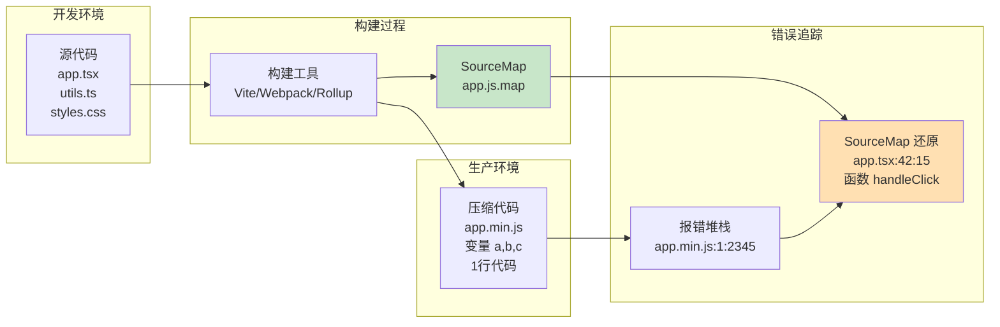

# SourceMap管理与错误追踪

> **文档说明**：系统讲解前端 SourceMap 原理与管理、构建工具配置（Vite/Webpack/Rollup/esbuild）、SourceMap 类型与安全策略、生产环境私有化部署、前端错误捕获与堆栈还原、Sentry 等错误追踪系统集成，以及最佳实践和常见问题。
>
> **适用人群**：前端开发者、全栈开发者、前端工程化负责人、需要线上排障的工程师
>
> **前置知识**：[[前端工程化与构建工具]]、[[前端构建产物分析与优化]]、[[Web性能指标与监控-LCP-FID-CLS]]

---

## 一、概述

### 1. 为什么需要 SourceMap

```text
前端代码部署到生产环境时，通常会经过：
- 压缩（Minification）：删除空格、注释，缩短变量名
- 打包（Bundling）：合并多个文件为一个
- 转译（Transpilation）：TypeScript/JSX/ES6+ → ES5
- 代码分割（Code Splitting）：按需加载
- Tree Shaking：删除未使用代码

问题：
- 生产环境运行的代码与源代码完全不同
- 报错堆栈指向压缩后的代码，变量名是 a、b、c，行号是压缩后的
- 无法定位到源代码的具体位置
- 线上排障极其困难

解决方案：SourceMap（源码映射）
- 一个 JSON 文件，记录压缩代码与源代码的映射关系
- 浏览器/调试工具根据 SourceMap 还原源代码
- 报错堆栈可以定位到源代码的文件名、行号、列号
- 不影响代码运行，只用于调试
```



### 2. SourceMap 历史与标准

```text
SourceMap 发展：
- 2009 年：Google 提出 Closure Inspector，为 Closure Compiler 生成映射
- 2011 年：SourceMap v1 规范发布，JSON 格式
- 2012 年：SourceMap v2，改进 VLQ 编码
- 2013 年：SourceMap v3（当前标准），更紧凑高效
- 目前：所有主流浏览器和构建工具都支持 v3

SourceMap v3 规范要点：
- JSON 格式
- VLQ（Variable-Length Quantity）变长编码存储映射
- 支持多源文件、多段映射
- 支持名称映射（变量名、函数名）
- 文件扩展名 .map
- MIME 类型 application/json

相关规范：
- Source Map Revision 3 Proposal（Google/Mozilla）
- TC39 Source Map 规范
- W3C CSS Source Map（CSS 也支持 SourceMap）
```

---

## 二、SourceMap 原理

### 1. SourceMap 文件结构

```json
{
  "version": 3,
  "file": "app.min.js",
  "sourceRoot": "",
  "sources": [
    "webpack:///src/app.tsx",
    "webpack:///src/utils.ts",
    "webpack:///src/components/Button.tsx"
  ],
  "sourcesContent": [
    "import React from 'react';\nexport default function App() {...}",
    "export function formatDate(date) {...}",
    "export default function Button({children}) {...}"
  ],
  "names": [
    "App",
    "handleClick",
    "setState",
    "formatDate",
    "Button"
  ],
  "mappings": "AAAA,SAASA,EAAT,CAAeC,EAAf,CAAmBC,EAAnB,CAAqCC,EAArC,CAA0CC,EAAlD,CAAmDC,EAAnD,CAAoDC..."
}
```

```text
字段说明：

1. version：版本号，固定为 3

2. file：编译后的文件名（如 app.min.js）

3. sourceRoot：源文件的根路径前缀（可选，通常为空）

4. sources：源文件路径数组
   - 相对路径或带协议的路径（如 webpack:///）
   - 数组索引对应 mappings 中的源文件编号

5. sourcesContent：源文件内容数组（可选）
   - 与 sources 一一对应
   - 包含源代码的完整内容
   - 有了它，不需要源文件也能还原代码
   - 会增大 SourceMap 文件体积

6. names：原始名称数组（变量名、函数名、属性名）
   - 压缩代码中变量名被改为 a、b、c
   - names 数组保存原始名称
   - mappings 中引用数组索引

7. mappings：核心映射字符串（VLQ 编码）
   - 用分号 ; 分隔行（对应压缩代码的每一行）
   - 用逗号 , 分隔同一行的多个映射段
   - 每个映射段是一组 VLQ 编码的数字
   - 记录：压缩代码列号、源文件索引、源文件行号、源文件列号、名称索引
```

### 2. VLQ 编码

```text
VLQ（Variable-Length Quantity，变长编码）：
- 用可变数量的字节表示整数
- 每个字节用 6 位存数据，1 位存连续标志，1 位存符号
- Base64 编码输出（A-Z, a-z, 0-9, +, /）
- 紧凑高效，适合存储大量映射数据

VLQ 编码规则：
- 最低位（第 1 位）：符号位（0=正，1=负）
- 中间 4 位：数据位
- 最高位（第 6 位）：连续位（0=最后一个字节，1=还有后续字节）
- 多个字节时，后续字节用 5 位数据 + 1 位连续位

示例：
- 数字 0 → 二进制 00000 → Base64 A
- 数字 1 → 二进制 00010 → Base64 C
- 数字 -1 → 二进制 00011 → Base64 D
- 数字 16 → 需要 2 个字节：100000 010000 → gB

映射段解析：
每个映射段（逗号分隔）包含 1、4 或 5 个 VLQ 数字：
1. 压缩代码列号（相对前一段的偏移）
2. 源文件索引（相对偏移）
3. 源文件行号（相对偏移）
4. 源文件列号（相对偏移）
5. 名称索引（相对偏移，可选）

示例映射段：AAAA
- A=0, A=0, A=0, A=0
- 表示：压缩代码列 0，源文件 0，源文件行 0，源文件列 0

实际开发中不需要手动解析，有库可以用：
- source-map（Mozilla，最常用）
- @jridgewell/sourcemap-codec（VLQ 编解码）
- source-map-js（纯 JS 实现）
```

### 3. SourceMap 关联方式

```text
SourceMap 与压缩代码的关联方式：

1. //# sourceMappingURL 注释（最常用）
   在压缩代码末尾添加：
   //# sourceMappingURL=app.min.js.map
   浏览器看到这个注释，会自动加载 SourceMap

   CSS 中用：
   /*# sourceMappingURL=style.min.css.map */

2. X-SourceMap HTTP 响应头
   服务器在响应头中指定：
   X-SourceMap: /path/to/app.min.js.map
   不修改代码文件，通过服务器配置

3. inline SourceMap
   SourceMap 内容直接嵌入代码文件：
   //# sourceMappingURL=data:application/json;base64,eyJ2ZXJzaW9uIjoz...
   用 Base64 编码的 Data URL
   不需要额外的 .map 文件，但会增大 JS 文件体积
   适合开发环境或简单项目

4. 浏览器开发者工具手动加载
   Chrome DevTools → Sources → 右键 → Add source map
   手动指定 SourceMap 文件路径
   临时调试用
```

---

## 三、构建工具配置

### 1. Vite 配置

```typescript
// vite.config.ts
import { defineConfig } from 'vite'
import react from '@vitejs/plugin-react'

export default defineConfig({
  plugins: [react()],

  build: {
    // SourceMap 配置
    // false：不生成（生产环境推荐）
    // true：生成独立 .map 文件（推荐用于错误追踪）
    // 'inline'：嵌入到 JS 文件中
    // 'hidden'：生成 .map 文件，但不在代码中加 sourceMappingURL 注释
    //           （用于私有化 SourceMap，不暴露给浏览器）
    sourcemap: true,

    // 其他构建配置
    target: 'es2015',
    minify: 'terser',
    rollupOptions: {
      output: {
        // 手动配置 SourceMap 路径
        // sourcemapPathTransform: (relativeSourcePath, sourcemapPath) => {
        //   return relativeSourcePath.replace('../src/', 'src/')
        // },
      },
    },
  },
})

// 按环境配置
export default defineConfig(({ mode }) => ({
  plugins: [react()],
  build: {
    // 开发环境用 inline，生产环境用 hidden（私有化）
    sourcemap: mode === 'development' ? 'inline' : 'hidden',
  },
}))
```

### 2. Webpack 配置

```javascript
// webpack.config.js
module.exports = {
  // devtool 配置 SourceMap 类型
  // 开发环境推荐：
  // - eval-cheap-module-source-map：最快，列级映射
  // - eval-source-map：完整映射，稍慢
  // 生产环境推荐：
  // - source-map：完整独立 .map 文件（最慢，最完整）
  // - hidden-source-map：不暴露 sourceMappingURL（私有化）
  // - nosources-source-map：不含源代码内容（安全）
  // 不推荐生产环境用 eval-* 系列（不安全、体积大）

  devtool: process.env.NODE_ENV === 'development'
    ? 'eval-cheap-module-source-map'
    : 'hidden-source-map',  // 生产环境用 hidden

  output: {
    path: path.resolve(__dirname, 'dist'),
    filename: '[name].[contenthash].js',
    // SourceMap 文件名
    sourceMapFilename: '[name].[contenthash].js.map',
    // SourceMap 中源文件路径前缀
    devtoolModuleFilenameTemplate: (info) => {
      return `webpack:///${info.absoluteResourcePath.replace(__dirname, '')}`
    },
  },

  plugins: [
    // Terser 插件配置 SourceMap
    new TerserPlugin({
      sourceMap: true,  // 必须开启，否则 SourceMap 不对应
      terserOptions: {
        compress: { drop_console: true },
      },
    }),

    // 可选：SourceMap 上传插件（上传到 Sentry 等）
    // new SentryWebpackPlugin({
    //   authToken: process.env.SENTRY_AUTH_TOKEN,
    //   org: 'your-org',
    //   project: 'your-project',
    //   include: './dist',
    //   release: process.env.RELEASE_VERSION,
    // }),
  ],
}

// devtool 类型对比表：
// | devtool | 构建速度 | 运行速度 | 质量 | 生产推荐 |
// |---------|---------|---------|------|---------|
// | eval | 最快 | 快 | 映射到打包后代码 | 否 |
// | eval-source-map | 慢 | 慢 | 原始代码，列级 | 否 |
// | eval-cheap-source-map | 较快 | 快 | 原始代码，行级 | 否 |
// | eval-cheap-module-source-map | 较快 | 快 | 原始代码（loader），行级 | 开发推荐 |
// | source-map | 最慢 | 慢 | 原始代码，列级 | 是（完整） |
// | hidden-source-map | 最慢 | 慢 | 原始代码，列级，不暴露URL | 生产推荐 |
// | nosources-source-map | 慢 | 慢 | 不含源代码 | 是（安全） |
// | cheap-source-map | 较快 | 快 | 原始代码，行级，无loader | 否 |
// | cheap-module-source-map | 较慢 | 快 | 原始代码（loader），行级 | 否 |
// | inline-source-map | 慢 | 慢 | 嵌入到JS | 否（体积大） |
```

### 3. Rollup 配置

```javascript
// rollup.config.js
import { defineConfig } from 'rollup'
import terser from '@rollup/plugin-terser'

export default defineConfig({
  input: 'src/index.js',
  output: {
    file: 'dist/bundle.min.js',
    format: 'es',
    sourcemap: true,           // 生成 SourceMap
    // sourcemap: 'inline',    // 内联
    // sourcemap: 'hidden',    // 不暴露 URL
    sourcemapPathTransform: (relativePath) => {
      // 转换源文件路径
      return relativePath.replace('../src/', 'src/')
    },
  },
  plugins: [
    terser({
      sourceMap: true,  // Terser 必须开启 sourceMap
    }),
  ],
})
```

### 4. esbuild 配置

```javascript
// esbuild.config.js
require('esbuild').build({
  entryPoints: ['src/index.ts'],
  bundle: true,
  minify: true,
  sourcemap: true,           // 生成 SourceMap
  // sourcemap: 'inline',    // 内联
  // sourcemap: 'external',  // 外部文件（默认）
  // sourcemap: 'both',      // 同时生成外部和内联
  sourcesContent: false,     // 是否在 SourceMap 中包含源代码内容
  outfile: 'dist/bundle.min.js',
}).catch(() => process.exit(1))
```

### 5. TypeScript 配置

```json
// tsconfig.json
{
  "compilerOptions": {
    "sourceMap": true,              // 生成 SourceMap
    // "inlineSourceMap": true,     // 内联 SourceMap
    // "inlineSources": true,       // 将源代码嵌入 SourceMap
    "declaration": true,            // 生成 .d.ts 类型声明
    "declarationMap": true,         // 生成 .d.ts 的 SourceMap（跳转到源码）
    "outDir": "./dist",
    "rootDir": "./src"
  }
}
```

---

## 四、SourceMap 类型与安全策略

### 1. SourceMap 类型对比

| 类型 | 说明 | 优点 | 缺点 | 适用场景 |
|------|------|------|------|---------|
| **external** | 独立 .map 文件，代码末尾加 sourceMappingURL | 不增大 JS 体积，浏览器自动加载 | .map 文件可被访问，源代码暴露 | 开发环境、内部系统 |
| **inline** | SourceMap 以 Data URL 嵌入 JS | 单文件，无需额外请求 | JS 体积增大 50-100%，源代码暴露 | 开发环境、简单项目 |
| **hidden** | 生成 .map 文件，但不加 sourceMappingURL | 浏览器不自动加载，源代码不暴露 | 需要手动关联或错误系统上传 | **生产环境推荐** |
| **nosources** | SourceMap 不含源代码内容 | 有映射但无源码，相对安全 | 无法查看完整源代码，只能看行号 | 对安全要求高的生产环境 |
| **eval** | 每个模块用 eval 执行，SourceMap 内联 | 构建极快 | 体积大，不安全，性能差 | 仅开发环境 |
| **cheap** | 只有行级映射，无列级 | 构建快，体积小 | 无法精确定位到列 | 开发环境快速调试 |

### 2. 生产环境安全策略

```text
生产环境 SourceMap 安全风险：
- 源代码暴露：任何人都可以下载 .map 文件，还原完整源代码
- 业务逻辑泄露：算法、密钥、API 地址等敏感信息
- 安全漏洞：攻击者可以分析代码找漏洞
- 知识产权：源代码是公司资产

安全策略（按安全等级）：

1. 不生成 SourceMap（最安全）
   - sourcemap: false
   - 优点：完全不暴露
   - 缺点：线上错误无法定位源代码，排障困难
   - 适用：对安全要求极高，有其他排障手段

2. hidden-source-map（推荐）
   - 生成 .map 文件，但不在 JS 中加 sourceMappingURL
   - 浏览器不会自动加载，普通用户无法获取
   - .map 文件不部署到 CDN/静态服务器，或部署到内网
   - 错误追踪系统（Sentry）在构建时上传 .map 文件
   - 优点：安全 + 可排障
   - 适用：大多数生产环境

3. nosources-source-map
   - SourceMap 有映射关系，但不含源代码内容
   - 即使 .map 被下载，也只能看到行号，看不到代码
   - 错误堆栈可以定位到文件和行号
   - 适用：对安全有要求，但需要基本排障能力

4. 私有化部署 SourceMap
   - .map 文件部署到内网服务器，不对外暴露
   - 错误追踪系统在内网解析
   - 开发者通过 VPN 访问
   - 适用：企业内网系统、金融/政务

5. SourceMap 访问控制
   - .map 文件部署到服务器，但通过 Nginx 限制访问
   - 只允许公司 IP / 内网访问
   - 需要认证（Basic Auth / Token）
   - 适用：需要远程调试，但限制访问范围

6. 加密 SourceMap
   - .map 文件加密存储，错误追踪系统解密使用
   - 复杂度高，较少用
```

```nginx
# Nginx 配置：限制 .map 文件访问（私有化策略）

# 方式1：完全禁止访问
location ~* \.map$ {
    deny all;
    return 404;
}

# 方式2：只允许内网 IP 访问
location ~* \.map$ {
    allow 192.168.0.0/16;
    allow 10.0.0.0/8;
    allow 172.16.0.0/12;
    deny all;
}

# 方式3：需要 Basic Auth
location ~* \.map$ {
    auth_basic "Restricted";
    auth_basic_user_file /etc/nginx/.htpasswd;
}

# 方式4：.map 文件不部署到 CDN，只在构建时上传到 Sentry
# 构建流程：
# 1. 构建生成 .js 和 .js.map
# 2. .js 部署到 CDN
# 3. .js.map 上传到 Sentry（不部署到 CDN）
# 4. 删除本地 .js.map
```

### 3. 构建流程最佳实践

```bash
#!/bin/bash
# build.sh - 生产环境构建脚本

set -e

# 1. 设置版本号
RELEASE_VERSION=$(git rev-parse --short HEAD)
echo "构建版本: $RELEASE_VERSION"

# 2. 构建（生成 .js 和 .js.map）
npm run build

# 3. 上传 SourceMap 到 Sentry（或其他错误追踪系统）
sentry-cli releases files $RELEASE_VERSION upload-sourcemaps ./dist --rewrite

# 4. 删除 .map 文件（不部署到生产环境）
find ./dist -name "*.map" -delete

# 5. 部署 .js 文件到 CDN/服务器
# aws s3 sync ./dist s3://your-bucket/ --exclude "*.map"

# 6. 标记发布
sentry-cli releases finalize $RELEASE_VERSION

echo "构建完成，版本 $RELEASE_VERSION"
```

```javascript
// package.json scripts
{
  "scripts": {
    "build:dev": "vite build --mode development",
    "build:prod": "vite build --mode production",
    "build:sourcemap": "vite build --mode production --sourcemap hidden",
    "sentry:upload": "sentry-cli releases files $npm_package_version upload-sourcemaps ./dist --rewrite",
    "deploy": "npm run build:sourcemap && npm run sentry:upload && find ./dist -name '*.map' -delete && ./deploy.sh"
  }
}
```

---

## 五、前端错误捕获

### 1. JavaScript 错误类型

```text
前端错误类型：

1. 语法错误（SyntaxError）
   - 代码不符合语法规范
   - 通常在构建阶段被发现
   - 生产环境较少（构建工具会检查）

2. 运行时错误（RuntimeError）
   - TypeError：类型错误（调用 undefined 的方法）
   - ReferenceError：引用错误（使用未定义变量）
   - RangeError：范围错误（数组越界、递归过深）
   - URIError：URI 处理错误
   - EvalError：eval 错误

3. 资源加载错误
   - 图片加载失败（404、网络错误）
   - JS/CSS 加载失败
   - 字体加载失败
   - 视频/音频加载失败

4. Promise 错误（未捕获的 Promise rejection）
   - async/await 未 try-catch
   - .then() 没有 .catch()
   - Promise.reject() 未处理

5. 框架错误
   - React：错误边界（Error Boundary）
   - Vue：errorHandler、errorCaptured
   - Angular：ErrorHandler

6. 跨域脚本错误（Script error）
   - 跨域 JS 报错时，浏览器只返回 "Script error."
   - 出于安全考虑，不暴露详细信息
   - 解决：CORS 配置 + crossorigin 属性
```

### 2. window.onerror

```javascript
// window.onerror：捕获 JS 运行时错误
// 注意：不能捕获 Promise 错误、资源加载错误

window.onerror = function(message, source, lineno, colno, error) {
  // message：错误信息
  // source：出错的 JS 文件 URL
  // lineno：行号（压缩代码的行号）
  // colno：列号
  // error：Error 对象，包含堆栈

  console.error('捕获到错误:', {
    message,
    source,
    lineno,
    colno,
    stack: error?.stack,
  })

  // 上报到错误追踪系统
  reportError({
    message,
    source,
    lineno,
    colno,
    stack: error?.stack,
    userAgent: navigator.userAgent,
    url: location.href,
    timestamp: Date.now(),
  })

  // 返回 true 表示阻止浏览器默认行为（不在控制台显示）
  return true
}

// 注意事项：
// - window.onerror 只能捕获同步错误
// - 不能捕获 Promise 错误（用 unhandledrejection）
// - 不能捕获资源加载错误（用 addEventListener('error')）
// - 跨域脚本需要 CORS 配置才能拿到详细信息
```

### 3. unhandledrejection

```javascript
// window.addEventListener('unhandledrejection')：捕获未处理的 Promise 错误

window.addEventListener('unhandledrejection', function(event) {
  // event.reason：拒绝原因（Error 对象或其他值）
  // event.promise：被拒绝的 Promise 对象

  console.error('未处理的 Promise 拒绝:', event.reason)

  // 上报
  reportError({
    type: 'unhandledrejection',
    message: event.reason?.message || String(event.reason),
    stack: event.reason?.stack,
    url: location.href,
    timestamp: Date.now(),
  })

  // 阻止浏览器默认行为（不在控制台显示警告）
  event.preventDefault()
})

// 常见场景：
// async function fetchData() {
//   const res = await fetch('/api')  // 如果 fetch 失败，未 try-catch
//   return res.json()
// }
// → 触发 unhandledrejection

// 最佳实践：
// - async 函数都用 try-catch
// - Promise 链都加 .catch()
// - 全局 unhandledrejection 作为兜底
```

### 4. 资源加载错误

```javascript
// 资源加载错误（图片、JS、CSS、字体等）
// 注意：必须用 addEventListener('error', handler, true) 捕获
// window.onerror 不能捕获资源错误

window.addEventListener('error', function(event) {
  // event.target：出错的 DOM 元素（img、script、link 等）
  // event.type：'error'

  const target = event.target

  // 判断是否是资源加载错误（不是 JS 运行时错误）
  if (target !== window && target.tagName) {
    const tagName = target.tagName.toLowerCase()
    const src = target.src || target.href

    console.error(`资源加载失败: <${tagName}> ${src}`)

    // 上报
    reportError({
      type: 'resource_error',
      tagName,
      src,
      outerHTML: target.outerHTML?.substring(0, 200),
      url: location.href,
      timestamp: Date.now(),
    })

    // 图片加载失败的兜底：替换为默认图
    if (tagName === 'img') {
      target.src = '/images/default-placeholder.png'
      target.onerror = null  // 防止默认图也失败导致循环
    }
  }
}, true)  // 第三个参数 true 表示在捕获阶段处理（必须！）

// 为什么要用捕获阶段？
// - 资源加载错误不会冒泡（bubble）
// - 只能在捕获阶段（capture）捕获
// - addEventListener 的第三个参数设为 true
```

### 5. 框架错误处理

```javascript
// React：错误边界（Error Boundary）
import React from 'react'

class ErrorBoundary extends React.Component {
  constructor(props) {
    super(props)
    this.state = { hasError: false, error: null }
  }

  static getDerivedStateFromError(error) {
    return { hasError: true, error }
  }

  componentDidCatch(error, errorInfo) {
    // 上报错误
    reportError({
      message: error.message,
      stack: error.stack,
      componentStack: errorInfo.componentStack,
    })
  }

  render() {
    if (this.state.hasError) {
      return <h1>出错了，请刷新页面</h1>
    }
    return this.props.children
  }
}

// 使用：
// <ErrorBoundary>
//   <MyComponent />
// </ErrorBoundary>

// Vue：全局错误处理
// main.js
import { createApp } from 'vue'

const app = createApp(App)

// 全局错误处理
app.config.errorHandler = (err, instance, info) => {
  // err：错误对象
  // instance：出错的组件实例
  // info：错误类型信息（如 lifecycle hook、render function）
  console.error('Vue 错误:', err, info)
  reportError({
    message: err.message,
    stack: err.stack,
    component: instance?.$options?.name,
    info,
  })
}

// 组件级错误捕获（errorCaptured 钩子）
export default {
  errorCaptured(err, instance, info) {
    console.error('组件错误:', err)
    // 返回 false 阻止错误继续向上传播
    return false
  },
}
```

### 6. 跨域脚本错误（Script error）

```html
问题：
- 加载跨域 JS 文件时，如果该 JS 报错
- window.onerror 只能拿到 message: "Script error."，没有 source、lineno、colno、error
- 浏览器出于安全考虑，不暴露跨域脚本的详细错误信息

解决方案（必须同时满足两个条件）：

1. 脚本标签加 crossorigin 属性
   <script src="https://cdn.example.com/app.js" crossorigin="anonymous"></script>
   - crossorigin="anonymous"：不带凭证的 CORS 请求
   - crossorigin="use-credentials"：带凭证（Cookie）的 CORS 请求

2. 服务器返回 CORS 响应头
   Access-Control-Allow-Origin: *
   或
   Access-Control-Allow-Origin: https://your-domain.com

两者缺一不可：
- 只有 crossorigin，服务器没 CORS 头 → 脚本加载失败
- 只有 CORS 头，没 crossorigin → 还是 "Script error."

CSS、图片等资源也有类似问题，同样需要 crossorigin + CORS。
```

---

## 六、SourceMap 解析与堆栈还原

### 1. 使用 source-map 库解析

```javascript
// 使用 Mozilla source-map 库解析 SourceMap
import { SourceMapConsumer } from 'source-map'

// 原始错误堆栈（压缩代码）
const rawStack = `
TypeError: Cannot read properties of undefined (reading 'map')
    at a (https://cdn.example.com/app.min.js:1:23456)
    at b (https://cdn.example.com/app.min.js:1:23789)
    at c (https://cdn.example.com/app.min.js:1:24100)
    at https://cdn.example.com/app.min.js:1:25000
`

// 解析并还原堆栈
async function restoreStack(rawStack, sourceMapContent) {
  // 创建 SourceMapConsumer
  const consumer = await new SourceMapConsumer(sourceMapContent)

  // 解析堆栈每一行
  const lines = rawStack.trim().split('\n')
  const restored = lines.map(line => {
    // 匹配 "at function (url:line:column)" 格式
    const match = line.match(/at\s+(.+?)\s+\((.+?):(\d+):(\d+)\)/)
    if (!match) return line

    const [, funcName, url, lineNum, colNum] = match

    // 用 SourceMap 还原原始位置
    const originalPosition = consumer.originalPositionFor({
      line: parseInt(lineNum),
      column: parseInt(colNum),
    })

    if (originalPosition.source) {
      return `    at ${originalPosition.name || funcName} (${originalPosition.source}:${originalPosition.line}:${originalPosition.column})`
    }
    return line
  })

  // 释放资源
  consumer.destroy()

  return restored.join('\n')
}

// 使用
const sourceMapContent = await fetch('/sourcemaps/app.min.js.map').then(r => r.json())
const restoredStack = await restoreStack(rawStack, sourceMapContent)
console.log('还原后的堆栈:')
console.log(restoredStack)

// 输出示例：
// TypeError: Cannot read properties of undefined (reading 'map')
//     at handleClick (webpack:///src/components/UserList.tsx:42:15)
//     at onClick (webpack:///src/components/UserList.tsx:28:8)
//     at render (webpack:///src/App.tsx:15:20)
```

### 2. 自建错误追踪系统

```javascript
// 简化版错误追踪系统（前端 + 后端）

// 前端：error-tracker.js
class ErrorTracker {
  constructor({ endpoint, appId, release }) {
    this.endpoint = endpoint
    this.appId = appId
    this.release = release
    this.init()
  }

  init() {
    // 1. JS 运行时错误
    window.onerror = (message, source, lineno, colno, error) => {
      this.report({
        type: 'js_error',
        message,
        source,
        lineno,
        colno,
        stack: error?.stack,
      })
      return false
    }

    // 2. Promise 错误
    window.addEventListener('unhandledrejection', (event) => {
      this.report({
        type: 'promise_error',
        message: event.reason?.message || String(event.reason),
        stack: event.reason?.stack,
      })
    })

    // 3. 资源加载错误
    window.addEventListener('error', (event) => {
      if (event.target !== window && event.target.tagName) {
        this.report({
          type: 'resource_error',
          tagName: event.target.tagName,
          src: event.target.src || event.target.href,
        })
      }
    }, true)
  }

  report(data) {
    const payload = {
      appId: this.appId,
      release: this.release,
      timestamp: Date.now(),
      url: location.href,
      userAgent: navigator.userAgent,
      ...data,
    }

    // 用 sendBeacon 上报（页面卸载时也能发送）
    if (navigator.sendBeacon) {
      navigator.sendBeacon(this.endpoint, JSON.stringify(payload))
    } else {
      // 降级：用 fetch（keepalive）
      fetch(this.endpoint, {
        method: 'POST',
        headers: { 'Content-Type': 'application/json' },
        body: JSON.stringify(payload),
        keepalive: true,
      })
    }
  }
}

// 使用
// const tracker = new ErrorTracker({
//   endpoint: 'https://api.example.com/errors',
//   appId: 'my-web-app',
//   release: 'v1.2.3',
// })
```

```python
# 后端：错误接收与 SourceMap 还原（Python FastAPI 示例）
from fastapi import FastAPI, HTTPException
from pydantic import BaseModel
import json
import sourcemap  # 或用 PyMiniRacer 调用 JS source-map 库

app = FastAPI()

# 内存存储（生产用数据库）
error_store = []
sourcemap_store = {}  # release -> sourcemap content

class ErrorReport(BaseModel):
    appId: str
    release: str
    type: str
    message: str
    stack: str = None
    source: str = None
    lineno: int = None
    colno: int = None
    url: str = None
    userAgent: str = None
    timestamp: int

@app.post("/errors")
async def report_error(report: ErrorReport):
    # 1. 如果有 SourceMap，还原堆栈
    restored_stack = None
    if report.stack and report.release in sourcemap_store:
        restored_stack = restore_stack(report.stack, sourcemap_store[report.release])

    # 2. 存储错误
    error_data = report.dict()
    error_data['restored_stack'] = restored_stack
    error_store.append(error_data)

    # 3. 告警（错误率超阈值时）
    check_alert(error_data)

    return {"status": "ok"}

@app.post("/sourcemaps/{release}")
async def upload_sourcemap(release: str, sourcemap: dict):
    """上传 SourceMap（构建时调用）"""
    sourcemap_store[release] = sourcemap
    return {"status": "ok", "release": release}

def restore_stack(raw_stack: str, sourcemap_content: dict) -> str:
    """用 SourceMap 还原堆栈"""
    # 实现 SourceMap 解析（Python 可以用 sourcemap 库或调用 Node.js）
    # 这里简化处理
    return raw_stack  # 实际应还原

def check_alert(error: dict):
    """检查是否需要告警"""
    # 同一错误 5 分钟内超过 10 次 → 告警
    # 生产环境用 Prometheus + AlertManager
    pass
```

---

## 七、Sentry 集成

### 1. Sentry 简介

```text
Sentry：
- 开源的错误追踪和性能监控平台
- 支持前端、后端、移动端、桌面端
- 自动收集错误、异常、性能数据
- 自动用 SourceMap 还原堆栈
- 提供告警、issue 管理、发布追踪、用户追踪
- 有 SaaS 版和自托管版

核心功能：
1. 错误追踪：自动捕获异常，聚合重复错误
2. SourceMap 还原：自动上传和使用 SourceMap
3. 性能监控：APM，追踪请求耗时
4. 发布管理：关联版本，追踪每个版本的错误
5. 用户追踪：知道哪个用户遇到了错误
6. 告警：邮件、Slack、飞书、钉钉等
7. Issue 管理：分配、标记、解决错误
8. 面包屑（Breadcrumbs）：记录错误发生前的用户操作
```

### 2. 前端集成

```bash
# 安装
npm install @sentry/browser @sentry/tracing
# 或 React
npm install @sentry/react
# 或 Vue
npm install @sentry/vue
```

```javascript
// main.js - Sentry 初始化
import * as Sentry from '@sentry/browser'
import { BrowserTracing } from '@sentry/tracing'

Sentry.init({
  dsn: 'https://your-public-key@o123456.ingest.sentry.io/123456',
  // 环境
  environment: process.env.NODE_ENV,
  // 版本号（关联 SourceMap）
  release: process.env.RELEASE_VERSION || 'dev',
  // 采样率
  tracesSampleRate: 0.1,  // 性能监控采样率（生产建议 0.1）
  // 错误采样率（默认 1.0，全部采集）
  sampleRate: 1.0,
  // 集成
  integrations: [
    new BrowserTracing({
      // 路由追踪
      tracingOrigins: ['localhost', 'example.com'],
    }),
  ],
  // 忽略特定错误
  ignoreErrors: [
    'Script error.',
    'ResizeObserver loop limit exceeded',
    'Non-Error promise rejection captured',
  ],
  // 忽略特定 URL
  denyUrls: [
    // 第三方脚本错误
    /google-analytics\.com/i,
    /doubleclick\.net/i,
  ],
  // 允许的 URL（只采集这些域名的错误）
  allowUrls: [
    /https:\/\/example\.com/i,
  ],
  // 附加用户信息
  beforeSend(event) {
    // 在发送前修改事件
    // 可以过滤敏感信息
    if (event.request?.cookies) {
      delete event.request.cookies  // 不发送 Cookie
    }
    return event
  },
})

// 设置用户信息（登录后）
Sentry.setUser({
  id: '12345',
  username: 'zhangsan',
  email: 'zhangsan@example.com',
})

// 手动上报错误
try {
  // 可能出错的代码
} catch (error) {
  Sentry.captureException(error)
}

// 手动上报消息
Sentry.captureMessage('Something went wrong', 'warning')

// 添加面包屑（错误发生前的操作记录）
Sentry.addBreadcrumb({
  category: 'user.action',
  message: 'User clicked submit button',
  level: 'info',
})
```

```javascript
// React 集成
import * as Sentry from '@sentry/react'
import { BrowserTracing } from '@sentry/tracing'

Sentry.init({
  dsn: 'your-dsn',
  release: process.env.RELEASE_VERSION,
  integrations: [new BrowserTracing()],
  tracesSampleRate: 0.1,
})

// React 错误边界（Sentry 提供）
<Sentry.ErrorBoundary fallback={<p>出错了</p>}>
  <App />
</Sentry.ErrorBoundary>
```

```javascript
// Vue 集成
import * as Sentry from '@sentry/vue'

Sentry.init({
  app,  // Vue 应用实例
  dsn: 'your-dsn',
  release: process.env.RELEASE_VERSION,
  tracesSampleRate: 0.1,
  // Vue 特定配置
  logErrors: true,  // 同时在控制台打印错误
  attachProps: true,  // 附加组件 props
  trackComponents: true,  // 追踪组件渲染
})
```

### 3. SourceMap 上传

```bash
# 方式1：sentry-cli（推荐）

# 安装 sentry-cli
npm install -g @sentry/cli
# 或
curl -sL https://sentry.io/get-cli/ | bash

# 配置认证
export SENTRY_AUTH_TOKEN=your-auth-token
export SENTRY_ORG=your-org
export SENTRY_PROJECT=your-project

# 创建版本
sentry-cli releases new $RELEASE_VERSION

# 上传 SourceMap（关键步骤）
sentry-cli releases files $RELEASE_VERSION upload-sourcemaps ./dist \
  --rewrite \          # 重写源文件路径（推荐）
  --strip-prefix /app  # 去掉路径前缀

# 关联 commit（可选）
sentry-cli releases set-commits $RELEASE_VERSION --auto

# 完成版本
sentry-cli releases finalize $RELEASE_VERSION

# 部署后标记
sentry-cli releases deploys $RELEASE_VERSION new -e production
```

```javascript
// 方式2：Vite 插件（@sentry/vite-plugin）
import { defineConfig } from 'vite'
import { sentryVitePlugin } from '@sentry/vite-plugin'

export default defineConfig({
  build: {
    sourcemap: true,  // 必须开启 SourceMap
  },
  plugins: [
    sentryVitePlugin({
      org: 'your-org',
      project: 'your-project',
      authToken: process.env.SENTRY_AUTH_TOKEN,
      release: {
        name: process.env.RELEASE_VERSION,
        // 上传后自动删除 SourceMap（不部署到生产）
        cleanArtifacts: true,
      },
      sourcemaps: {
        assets: './dist/**/*.map',
      },
    }),
  ],
})
```

```javascript
// 方式3：Webpack 插件
const SentryWebpackPlugin = require('@sentry/webpack-plugin')

module.exports = {
  plugins: [
    new SentryWebpackPlugin({
      authToken: process.env.SENTRY_AUTH_TOKEN,
      org: 'your-org',
      project: 'your-project',
      release: process.env.RELEASE_VERSION,
      include: './dist',
      ignore: ['node_modules'],
      // 上传后删除 .map 文件
      // cleanArtifacts: true,
    }),
  ],
}
```

### 4. Sentry 最佳实践

- [ ] **设置 release 版本**：每次发布都有唯一版本号，关联 SourceMap 和 commit
- [ ] **上传 SourceMap**：构建后自动上传，生产环境不部署 .map 文件
- [ ] **设置 environment**：区分 development/staging/production
- [ ] **设置用户信息**：登录后 setUser，便于追踪哪个用户出错
- [ ] **添加面包屑**：记录用户操作、路由变化、API 请求，便于复现
- [ ] **配置 ignoreErrors**：忽略已知的无害错误（Script error、ResizeObserver 等）
- [ ] **配置 denyUrls**：忽略第三方脚本错误
- [ ] **合理采样率**：错误全采集，性能监控采样 0.1-0.3
- [ ] **配置告警规则**：新错误、错误率突增、关键错误立即告警
- [ ] **敏感信息过滤**：beforeSend 中删除 Cookie、Token、密码等
- [ ] **定期清理 issue**：已修复的错误标记 resolved，避免干扰
- [ ] **关联代码仓库**：Sentry 关联 GitHub/GitLab，错误直接跳转到代码

---

## 八、最佳实践

### 1. SourceMap 管理

- [ ] **开发环境用 inline/eval**：构建快，调试方便，不需要额外文件
- [ ] **生产环境用 hidden**：不暴露 sourceMappingURL，.map 文件不部署或私有化
- [ ] **构建后上传 SourceMap**：CI/CD 流程中自动上传到 Sentry/错误系统
- [ ] **上传后删除 .map**：不部署到 CDN，避免源代码泄露
- [ ] **版本关联**：SourceMap 与 release 版本一一对应
- [ ] **定期清理旧 SourceMap**：错误系统中清理过期版本的 SourceMap
- [ ] **SourceMap 大小控制**：sourcesContent 可选，不需要可以关闭减小体积
- [ ] **验证 SourceMap**：构建后验证 .map 文件是否正确，能否还原堆栈
- [ ] **CDN 配置**：如果部署 .map，配置 Nginx 限制访问或不缓存

### 2. 错误追踪

- [ ] **全局错误捕获**：onerror + unhandledrejection + 资源错误，三者都要有
- [ ] **框架错误处理**：React ErrorBoundary / Vue errorHandler，组件级兜底
- [ ] **跨域 CORS**：CDN 脚本加 crossorigin + 服务器 CORS 头
- [ ] **上报机制**：用 sendBeacon/fetch keepalive，页面卸载也能上报
- [ ] **去重聚合**：同一错误聚合，避免重复上报（Sentry 自动做）
- [ ] **采样策略**：错误全采集，性能数据采样，避免数据量过大
- [ ] **用户信息**：记录用户 ID，便于定位和复现
- [ ] **环境信息**：记录 URL、UserAgent、屏幕尺寸、网络状态
- [ ] **面包屑**：记录错误前的操作路径（点击、路由、API）
- [ ] **敏感信息过滤**：上报前过滤密码、Token、身份证等
- [ ] **告警规则**：新错误、错误率突增、关键路径错误立即告警
- [ ] **错误分级**：按影响范围和严重程度分级（critical/error/warning/info）
- [ ] **定期复盘**：每周/每月回顾 top 错误，制定修复计划

### 3. 线上排障流程

```text
线上错误排障流程：

1. 发现错误
   - 告警通知（邮件/Slack/飞书）
   - 错误系统仪表盘发现异常

2. 评估影响
   - 影响多少用户
   - 影响哪些功能
   - 错误频率和趋势
   - 是否阻塞核心流程

3. 定位原因
   - 查看还原后的堆栈（SourceMap）
   - 查看面包屑（用户操作路径）
   - 查看关联的 release 版本
   - 查看用户信息和环境信息
   - 复现错误（本地/测试环境）

4. 修复
   - 紧急修复（hotfix）：影响大的错误优先
   - 常规修复：纳入迭代
   - 修复后标记 Sentry issue 为 resolved

5. 验证
   - 部署后监控错误是否消失
   - 确认没有引入新错误
   - 回归测试相关功能

6. 复盘
   - 错误根因分析
   - 如何避免类似错误
   - 是否需要补充测试/监控/告警
   - 更新知识库
```

---

## 九、常见问题与排查

| 问题 | 原因 | 解决方案 |
|------|------|---------|
| **SourceMap 不生效** | 未开启 sourcemap/路径错/浏览器禁用 | 检查构建配置 sourcemap:true；确认 .map 文件存在且路径正确；Chrome DevTools 设置中启用 SourceMap |
| **浏览器不加载 SourceMap** | sourceMappingURL 注释缺失/404 | 检查 JS 末尾是否有 //# sourceMappingURL；确认 .map 文件可访问；用 hidden 类型时浏览器不会自动加载 |
| **堆栈还是压缩代码** | SourceMap 未上传到错误系统/版本不匹配 | 确认 Sentry 已上传对应版本的 SourceMap；release 版本一致；检查 SourceMap 是否正确对应该 JS 文件 |
| **Script error.** | 跨域脚本无 CORS/crossorigin | 脚本加 crossorigin="anonymous"；CDN 返回 Access-Control-Allow-Origin；两者必须同时配置 |
| **Promise 错误未捕获** | 未监听 unhandledrejection/async 未 try-catch | 添加 window.addEventListener('unhandledrejection')；async 函数加 try-catch；Promise 链加 .catch() |
| **图片加载错误未捕获** | 用了 window.onerror（不捕获资源错误） | 用 addEventListener('error', handler, true) 捕获阶段；检查 event.target 判断资源类型 |
| **SourceMap 泄露源代码** | .map 文件部署到了公网 CDN | 用 hidden-source-map；.map 文件不部署或部署到内网；Nginx 限制 .map 访问 |
| **Sentry 看不到源代码** | SourceMap 未上传/sourcesContent 缺失/版本不对 | 确认 sentry-cli upload-sourcemaps 成功；SourceMap 含 sourcesContent；release 版本匹配 |
| **构建后 SourceMap 对不上** | 多次构建版本号相同/缓存/插件顺序 | 每次构建唯一 release；清除构建缓存；Terser 插件开启 sourceMap；检查插件顺序 |
| **SourceMap 文件太大** | sourcesContent 包含所有源代码/未压缩 | 关闭 sourcesContent（sourcesContent:false）；用 hidden 不部署到客户端；gzip 压缩 |
| **线上错误无法复现** | 环境差异/用户特定操作/数据特定 | 查看面包屑和用户信息；用相同数据复现；查看浏览器和设备信息；添加更多日志 |
| **错误上报丢失** | 页面卸载时上报失败/网络问题 | 用 navigator.sendBeacon；fetch 加 keepalive:true；错误队列本地存储，下次打开补发 |
| **Sentry 数据量太大** | 采样率太高/重复错误/第三方错误 | 降低 tracesSampleRate；配置 ignoreErrors；配置 denyUrls 忽略第三方；错误聚合 |
| **敏感信息泄露** | 错误堆栈包含 Cookie/Token/密码 | beforeSend 中过滤敏感字段；Sentry 配置 sendDefaultPii:false；前端不上报敏感数据 |
| **CSS SourceMap 不生效** | 未开启 CSS sourcemap/构建工具配置 | Vite: build.cssSourceMap:true；Webpack: devtool 也适用于 CSS；确认 .css.map 文件存在 |
| **TypeScript 跳转到 .d.ts** | 未开启 declarationMap | tsconfig 开启 declarationMap:true；生成 .d.ts.map 文件；编辑器支持跳转 |
| **SourceMap 行号不对** | 列级映射缺失/cheap 模式/压缩工具问题 | 用完整 source-map（非 cheap）；确认 Terser 开启 sourceMap；检查 VLQ 映射是否正确 |
| **多入口 SourceMap 混乱** | 多个 chunk 共用一个 map/命名冲突 | 每个 chunk 独立 .map 文件；文件名用 contenthash；确认 sourceMappingURL 对应正确 |
| **Web Worker 错误未捕获** | Worker 是独立线程，window.onerror 不生效 | Worker 内部用 self.onerror；主线程用 worker.onerror；Worker 也集成 Sentry |
| **iframe 错误未捕获** | iframe 是独立上下文 | iframe 内部自己捕获错误；用 postMessage 上报到父页面；同源 iframe 可以访问 contentWindow.onerror |
| **SourceMap 被 CDN 缓存** | CDN 缓存了旧版 .map | .map 文件名加 hash；配置 CDN 不缓存 .map 或短缓存；版本更新后清除 CDN 缓存 |
| **错误率监控异常** | 发布新版本后错误突增/采样变化 | 检查新版本是否有 bug；确认采样率配置；区分新错误和旧错误；用 release 维度对比 |

---

## 十、关联笔记

### 前端工程
- [[前端工程化与构建工具]] · [[前端构建产物分析与优化]] · [[Vite-构建原理与插件开发]]
- [[Web性能指标与监控-LCP-FID-CLS]] · [[TypeScript-类型声明文件编写实战]]

### 前端框架
- [[Vue3-组合式API设计模式]] · [[Vue3-性能优化实战]] · [[Pinia-状态管理核心]]
- [[Vue-i18n国际化方案]]

### 云原生与运维
- [[APM应用性能监控-SkyWalking]] · [[Jenkins流水线实战]] · [[Sentry错误监控与追踪]]
- [[K8s-核心概念与架构]]

### 导航
- [[MOC-前端开发]] · [[MOC-云原生与运维]] · [[全栈+AI工程双轨融合学习路线图]]

> **学习路径建议**：先掌握 [[前端工程化与构建工具]] 构建基础 → 深入本文 SourceMap 与错误追踪 → 学习 [[前端构建产物分析与优化]] 产物优化 → 实践 [[Web性能指标与监控-LCP-FID-CLS]] 性能监控 → 研究 [[APM应用性能监控-SkyWalking]] 全链路监控 → 构建完整的前端工程化与可观测性体系。
