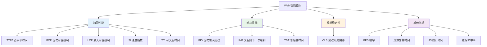

# Web性能指标与监控-LCP-FID-CLS

> **文档说明**：系统讲解 Web 性能指标与监控，包括 Core Web Vitals（LCP、FID/INP、CLS）、其他关键指标（TTFB、FCP、TTI、TBT）、测量方法、监控工具、真实用户监控（RUM）、性能预算，以及优化方向和常见问题。
>
> **适用人群**：前端开发者、全栈开发者、性能优化工程师、关注用户体验的开发者
>
> **前置知识**：[[首屏加载优化]]、[[懒加载与预加载策略]]、[[前端构建产物分析与优化]]

---

## 一、概述

### 1. 为什么需要性能指标

```text
性能的重要性：
- 用户体验：加载快、响应快、不跳动 = 好体验
- 业务影响：性能差导致用户流失、转化率下降
- SEO：Google 将 Core Web Vitals 纳入排名因素
- 留存：页面每慢 1 秒，转化率下降 7%（Amazon 数据）

没有度量就没有优化：
- 主观感受不可靠（"我觉得挺快"）
- 需要客观、可量化的指标
- 需要持续监控，发现回归
- 需要用户真实数据（RUM），而非仅实验室数据

性能指标分类：
1. 加载性能：页面多快显示内容（LCP、FCP、TTFB）
2. 响应性能：用户交互多快得到响应（FID、INP）
3. 视觉稳定性：页面是否跳动（CLS）
4. 流畅度：动画和滚动是否流畅（FPS）
```

### 2. Core Web Vitals

```text
Core Web Vitals（核心 Web 指标）：
Google 定义的三个关键用户体验指标，2021 年纳入 SEO 排名因素。

1. LCP（Largest Contentful Paint）- 最大内容绘制
   - 衡量加载性能
   - 视口中最大内容元素的渲染时间
   - 良好：< 2.5s
   - 需要改进：2.5s - 4s
   - 差：> 4s

2. FID（First Input Delay）- 首次输入延迟（已被 INP 取代）
   - 衡量响应性能
   - 用户首次交互到浏览器开始处理的时间
   - 良好：< 100ms
   - 需要改进：100ms - 300ms
   - 差：> 300ms
   - 2024 年 3 月起被 INP 取代

3. CLS（Cumulative Layout Shift）- 累积布局偏移
   - 衡量视觉稳定性
   - 页面生命周期内所有意外布局偏移的总和
   - 良好：< 0.1
   - 需要改进：0.1 - 0.25
   - 差：> 0.25

INP（Interaction to Next Paint）- 交互到下一次绘制
   - FID 的继任者，2024 年 3 月正式取代 FID
   - 衡量页面所有交互的响应性（不只是首次）
   - 取所有交互延迟的第 98 百分位
   - 良好：< 200ms
   - 需要改进：200ms - 500ms
   - 差：> 500ms
```

### 3. 指标全景图



---

## 二、加载性能指标

### 1. TTFB（Time to First Byte）

```text
TTFB（首字节时间）：
- 从用户发起请求到收到第一个字节的时间
- 包括：DNS 查询 + TCP 连接 + TLS 握手 + 服务端处理 + 第一个字节返回
- 衡量：网络和服务端性能

TTFB 组成：
1. 重定向时间（Redirect）
2. DNS 查询时间（DNS Lookup）
3. TCP 连接时间（Connect）
4. TLS 握手时间（SSL）
5. 请求发送时间（Request）
6. 服务端处理时间（Response / Waiting）
7. 响应开始（TTFB = 以上总和）

良好标准：< 800ms
优化方向：
- CDN 加速
- 服务端缓存
- 数据库优化
- 减少重定向
- HTTP/2 / HTTP/3
- 预连接（preconnect）
```

### 2. FCP（First Contentful Paint）

```text
FCP（首次内容绘制）：
- 从页面加载到浏览器渲染第一个内容片段的时间
- 内容片段：文本、图片（含背景图）、非白色 canvas、SVG
- 不包括：iframe 内容、浏览器默认背景

良好标准：< 1.8s
优化方向：
- 关键 CSS 内联
- 消除渲染阻塞资源
- 预加载关键资源
- 减少 TTFB
- 使用 CDN
- 压缩资源（Gzip/Brotli）
```

### 3. LCP（Largest Contentful Paint）

```text
LCP（最大内容绘制）：
- 视口中最大内容元素的渲染时间
- 考虑的元素：
  -  元素
  - <image> 元素（SVG 内）
  - 带 poster 的 <video> 元素
  - 通过 url() 加载背景图的元素
  - 包含文本节点的块级元素
- LCP 会随页面加载更新（直到用户交互）

良好标准：< 2.5s
优化方向：
1. 优化 TTFB（服务端和网络）
2. 优化资源加载：
   - 关键图片 preload
   - 使用现代图片格式（WebP/AVIF）
   - 压缩图片
   - 响应式图片（srcset）
   - CDN 加速
3. 优化渲染：
   - 内联关键 CSS
   - 延迟非关键 CSS
   - 延迟非关键 JS
   - 减少 JS 执行时间
4. 服务端渲染（SSR）/ 静态生成（SSG）

LCP 元素识别：
- Chrome DevTools → Performance → 查看 LCP 标记
- LCP API：new PerformanceObserver((list) => { ... })
- Web Vitals 库
```

```javascript
// 测量 LCP
try {
  const observer = new PerformanceObserver((list) => {
    const entries = list.getEntries();
    const lastEntry = entries[entries.length - 1];
    console.log('LCP:', lastEntry.startTime);
    console.log('LCP element:', lastEntry.element);
  });
  observer.observe({ type: 'largest-contentful-paint', buffered: true });
} catch (e) {
  console.log('LCP not supported');
}
```

### 4. SI（Speed Index）

```text
SI（速度指数）：
- 衡量页面内容可视化显示的速度
- 计算：页面加载过程中，视觉上未完成部分的平均时间
- 越低越好

良好标准：< 3.4s
优化方向：
- 渐进式渲染
- 首屏内容优先
- 骨架屏
- 避免大面积空白
```

### 5. TTI（Time to Interactive）

```text
TTI（可交互时间）：
- 页面达到完全可交互状态的时间
- 定义：
  1. FCP 之后
  2. 存在长任务（>50ms）的静默窗口（至少 5 秒）
  3. 静默窗口结束时间 = TTI
- 注意：TTI 是实验室指标，不用于 RUM

良好标准：< 3.8s
优化方向：
- 减少 JS 体积
- 代码分割
- 懒加载非关键 JS
- 优化长任务
- Web Workers 卸载计算
```

---

## 三、响应性能指标

### 1. FID（First Input Delay）

```text
FID（首次输入延迟）：
- 用户首次与页面交互（点击/触摸/按键）到浏览器开始处理事件的时间
- 不包括事件处理本身的时间和渲染时间
- 衡量主线程繁忙程度

为什么只测首次：
- 首次交互通常是用户最关注的
- 首次交互延迟最影响用户体验
- 已被 INP 取代（INP 测所有交互）

良好标准：< 100ms
优化方向：
- 减少主线程阻塞
- 拆分长任务（>50ms）
- 延迟非关键 JS
- 代码分割
- Web Workers
- 减少第三方脚本影响
```

### 2. INP（Interaction to Next Paint）

```text
INP（交互到下一次绘制）：
- 2024 年 3 月正式取代 FID 成为 Core Web Vitals
- 衡量页面整个生命周期内所有交互的响应性
- 取所有交互延迟的第 98 百分位（P98）
- 交互包括：点击、触摸、按键（不包括 hover/scroll）

INP 组成：
1. 输入延迟（Input Delay）：交互发生到事件处理开始
2. 处理时间（Processing Delay）：事件处理函数执行时间
3. 呈现延迟（Presentation Delay）：处理完成到下一帧绘制

良好标准：< 200ms
需要改进：200ms - 500ms
差：> 500ms

优化方向：
- 减少事件处理函数执行时间
- 避免在事件处理中做大量计算
- 防抖/节流高频事件（scroll/resize/input）
- 用 requestAnimationFrame 分批更新 DOM
- 用 Web Workers 处理计算密集型任务
- 减少布局抖动（Layout Thrashing）
- 优化 CSS 选择器和动画
```

```javascript
// 测量 INP（使用 web-vitals 库）
import { onINP } from 'web-vitals';

onINP((metric) => {
  console.log('INP:', metric.value);
  console.log('INP rating:', metric.rating);
  // 上报到分析平台
  // navigator.sendBeacon('/analytics', JSON.stringify(metric));
});
```

### 3. TBT（Total Blocking Time）

```text
TBT（总阻塞时间）：
- FCP 到 TTI 之间，所有长任务（>50ms）的阻塞时间总和
- 阻塞时间 = 任务时长 - 50ms
- 实验室指标，与 FID/INP 高度相关

示例：
- 任务1：30ms（不阻塞）
- 任务2：80ms（阻塞 30ms）
- 任务3：60ms（阻塞 10ms）
- TBT = 30 + 10 = 40ms

良好标准：< 200ms
优化方向：
- 拆分长任务
- 减少 JS 执行
- 延迟非关键脚本
- 代码分割
```

---

## 四、视觉稳定性指标

### 1. CLS（Cumulative Layout Shift）

```text
CLS（累积布局偏移）：
- 衡量页面视觉稳定性
- 页面生命周期内所有意外布局偏移的总和
- 意外偏移：不是由用户交互导致的偏移

布局偏移分数计算：
- 影响分数（Impact Fraction）：受影响元素占视口的比例
- 距离分数（Distance Fraction）：元素移动距离占视口的比例
- 布局偏移分数 = 影响分数 × 距离分数

CLS = 所有会话窗口（session window）内布局偏移分数的总和
- 会话窗口：布局偏移之间间隔 < 1s，总时长 < 5s
- 取最大的会话窗口的分数（不是所有偏移的简单总和）

良好标准：< 0.1
需要改进：0.1 - 0.25
差：> 0.25

常见原因：
1. 图片无尺寸（加载后撑开布局）
2. 广告/动态内容插入
3. 字体切换（FOIT/FOUT）
4. 第三方组件注入
5. Web 字体加载
```

```javascript
// 测量 CLS
let clsValue = 0;
let clsEntries = [];

let sessionValue = 0;
let sessionEntries = [];

const observer = new PerformanceObserver((list) => {
  for (const entry of list.getEntries()) {
    // 只计非用户交互导致的偏移
    if (!entry.hadRecentInput) {
      const firstSessionEntry = sessionEntries[0];
      const lastSessionEntry = sessionEntries[sessionEntries.length - 1];

      // 如果与上一次偏移间隔 < 1s 且会话总时长 < 5s
      if (sessionValue &&
          entry.startTime - lastSessionEntry.startTime < 1000 &&
          entry.startTime - firstSessionEntry.startTime < 5000) {
        sessionValue += entry.value;
        sessionEntries.push(entry);
      } else {
        sessionValue = entry.value;
        sessionEntries = [entry];
      }

      // 更新最大会话窗口
      if (sessionValue > clsValue) {
        clsValue = sessionValue;
        clsEntries = sessionEntries;
      }
    }
  }
});

observer.observe({ type: 'layout-shift', buffered: true });
```

### 2. CLS 优化

```css
CLS 优化方法：

1. 图片和视频设置尺寸
   - 设置 width 和 height 属性
   - 或用 aspect-ratio CSS
   - 响应式图片用 srcset + sizes

   
   .image { aspect-ratio: 4 / 3; }

2. 广告位预留空间
   - 广告容器设置最小高度
   - 无广告时显示占位内容
   .ad-container { min-height: 250px; }

3. 字体优化
   - font-display: swap（先用系统字体）
   - 预加载关键字体
   - 减少字体变体数量
   - size-adjust 调整字体大小（减少切换偏移）

4. 动态内容
   - 在已有空间内插入，不推动其他内容
   - 用 transform 动画（不影响布局）
   - 骨架屏占位

5. 第三方脚本
   - 延迟加载非关键第三方脚本
   - 预留嵌入内容空间
   - 用 iframe 沙箱隔离

6. 避免布局抖动
   - 批量读取样式，批量写入
   - 用 requestAnimationFrame
   - 避免在动画中读取布局属性
```

---

## 五、其他重要指标

### 1. FPS（Frames Per Second）

```text
FPS（帧率）：
- 每秒渲染的帧数
- 浏览器目标：60fps（每帧 16.67ms）
- 低于 60fps 用户会感觉到卡顿
- 动画和滚动时尤其重要

帧率分级：
- 60fps：流畅
- 30-60fps：基本流畅，偶尔卡顿
- < 30fps：明显卡顿

优化方向：
- 用 transform/opacity 动画（GPU 加速，不触发重排重绘）
- 避免 layout thrashing
- will-change 提示浏览器优化
- 减少复杂的 CSS 选择器
- 虚拟列表（长列表）
- requestAnimationFrame 分批更新
```

### 2. 资源加载指标

```text
关键资源加载指标：

1. DNS 查询时间（DNS Lookup）
   - 域名解析为 IP 的时间
   - 优化：DNS 预解析（dns-prefetch）、CDN

2. TCP 连接时间（Connect）
   - 建立 TCP 连接的时间
   - 优化：预连接（preconnect）、HTTP/2 连接复用

3. TLS 握手时间（SSL）
   - HTTPS 加密握手时间
   - 优化：TLS 1.3、会话恢复、OCSP Stapling

4. 等待时间（Waiting / TTFB）
   - 请求发送到收到第一个字节
   - 优化：服务端性能、缓存、CDN

5. 内容下载时间（Content Download）
   - 下载响应体的时间
   - 优化：压缩（Gzip/Brotli）、CDN、减少体积

6. DOMContentLoaded
   - HTML 解析完成，DOM 树构建完成
   - 不等待图片、CSS 加载完成

7. Load
   - 所有资源加载完成（图片、CSS、JS）
   - 注意：Load 事件不等于用户可交互
```

---

## 六、测量方法

### 1. 实验室测量

```text
实验室测量工具：

1. Chrome DevTools
   - Performance 面板：录制和分析性能
   - Lighthouse：自动化审计，生成报告
   - Network 面板：资源加载分析
   - Coverage 面板：代码覆盖率

2. Lighthouse
   - Chrome 内置，或 npm 包
   - 审计：性能、可访问性、最佳实践、SEO、PWA
   - 输出：分数、指标、优化建议
   - 命令行：lighthouse https://example.com --view

3. WebPageTest
   - 在线工具（webpagetest.org）
   - 多地点、多浏览器测试
   - 详细瀑布图、视频回放
   - 可配置网络条件

4. 其他工具
   - SpeedCurve
   - Calibre
   - Pingdom
   - GTmetrix
```

```bash
# Lighthouse CLI
npm install -g lighthouse
lighthouse https://example.com --view --output=json --output-path=report.json

# 模拟移动设备
lighthouse https://example.com --preset=desktop --view

# CI 中使用
lighthouse https://example.com --thresholds.performance=90 --quiet
```

### 2. 真实用户监控（RUM）

```text
RUM（Real User Monitoring）：
- 收集真实用户的性能数据
- 反映真实网络条件、设备、地理位置
- 比实验室数据更准确

RUM 数据特点：
- P50（中位数）：典型用户体验
- P75：较好的用户体验
- P95/P99：较差的用户体验（长尾）
- Core Web Vitals 用 P75 评估（75% 用户达到良好）

RUM 实现方式：
1. web-vitals 库（Google 官方）
2. 自建 RUM（Performance API + 上报）
3. 第三方服务（Google Analytics、Sentry、Datadog、New Relic）
```

```javascript
// 使用 web-vitals 库
import { onCLS, onINP, onLCP, onFCP, onTTFB } from 'web-vitals';

function sendToAnalytics(metric) {
  const body = JSON.stringify({
    name: metric.name,
    value: metric.value,
    rating: metric.rating,
    id: metric.id,
    delta: metric.delta,
    navigationType: metric.navigationType,
    url: location.href,
    // 自定义维度
    userAgent: navigator.userAgent,
    connection: navigator.connection?.effectiveType,
  });

  // 用 sendBeacon 上报（不阻塞页面卸载）
  navigator.sendBeacon('/analytics', body);
}

// 监听所有 Core Web Vitals
onCLS(sendToAnalytics);
onINP(sendToAnalytics);
onLCP(sendToAnalytics);
onFCP(sendToAnalytics);
onTTFB(sendToAnalytics);
```

```javascript
// 自建 RUM（使用 Performance API）
// 测量导航时序
const navigation = performance.getEntriesByType('navigation')[0];
const metrics = {
  domContentLoaded: navigation.domContentLoadedEventEnd,
  load: navigation.loadEventEnd,
  ttfb: navigation.responseStart,
  dns: navigation.domainLookupEnd - navigation.domainLookupStart,
  tcp: navigation.connectEnd - navigation.connectStart,
  tls: navigation.secureConnectionStart
    ? navigation.connectEnd - navigation.secureConnectionStart
    : 0,
};

// 上报
navigator.sendBeacon('/rum', JSON.stringify(metrics));
```

### 3. Performance API

```javascript
// Performance API 常用方法

// 1. 导航时序
performance.getEntriesByType('navigation');

// 2. 资源时序
performance.getEntriesByType('resource');
// 每个资源包含：name, startTime, duration, transferSize, initiatorType

// 3. 绘制时序
performance.getEntriesByType('paint');
// first-paint, first-contentful-paint

// 4. 最大内容绘制
const observer = new PerformanceObserver((list) => {
  const entries = list.getEntries();
  console.log(entries[entries.length - 1]);
});
observer.observe({ type: 'largest-contentful-paint', buffered: true });

// 5. 布局偏移
const clsObserver = new PerformanceObserver((list) => {
  for (const entry of list.getEntries()) {
    console.log('Layout shift:', entry.value, entry.hadRecentInput);
  }
});
clsObserver.observe({ type: 'layout-shift', buffered: true });

// 6. 长任务
const longTaskObserver = new PerformanceObserver((list) => {
  for (const entry of list.getEntries()) {
    console.log('Long task:', entry.duration, entry.name);
  }
});
longTaskObserver.observe({ type: 'longtask', buffered: true });

// 7. 自定义标记
performance.mark('start-loading');
// ... 加载操作 ...
performance.mark('end-loading');
performance.measure('loading', 'start-loading', 'end-loading');

// 8. 测量交互（INP 相关）
// Event Timing API
const eventObserver = new PerformanceObserver((list) => {
  for (const entry of list.getEntries()) {
    console.log('Event:', entry.name, 'duration:', entry.duration);
  }
});
eventObserver.observe({ type: 'event', buffered: true, durationThreshold: 16 });
```

---

## 七、性能监控与告警

### 1. 性能预算

```text
性能预算（Performance Budget）：
- 为性能指标设定阈值
- 超过阈值时阻断构建或告警
- 防止性能回归

常见预算类型：
1. 资源大小预算
   - JS 总量：< 200KB（gzip）
   - CSS 总量：< 50KB（gzip）
   - 图片总量：< 500KB（首屏）
   - 字体总量：< 100KB

2. 指标预算
   - LCP < 2.5s
   - INP < 200ms
   - CLS < 0.1
   - TTFB < 800ms

3. 请求数量预算
   - 首屏请求数 < 30
   - JS 文件数 < 10

实施方式：
- CI 中检查（Lighthouse CI、bundlesize）
- 构建时检查（webpack-bundle-analyzer）
- 监控告警（RUM 数据超阈值告警）
```

```javascript
// Lighthouse CI 配置
// .lighthouserc.js
module.exports = {
  ci: {
    collect: {
      url: ['https://example.com'],
      numberOfRuns: 3,
    },
    assert: {
      assertions: {
        'categories:performance': ['error', { minScore: 0.9 }],
        'categories:accessibility': ['error', { minScore: 0.9 }],
        'largest-contentful-paint': ['error', { maxNumericValue: 2500 }],
        'cumulative-layout-shift': ['error', { maxNumericValue: 0.1 }],
        'total-blocking-time': ['error', { maxNumericValue: 200 }],
      },
    },
    upload: {
      target: 'temporary-public-storage',
    },
  },
};
```

```yaml
# GitHub Actions 性能预算
name: Performance Budget

on: [pull_request]

jobs:
  lighthouse:
    runs-on: ubuntu-latest
    steps:
      - uses: actions/checkout@v4
      - run: npm install && npm run build
      - run: npm install -g @lhci/cli
      - run: lhci autorun
        env:
          LHCI_GITHUB_APP_TOKEN: ${{ secrets.LHCI_GITHUB_APP_TOKEN }}
```

### 2. 监控仪表盘

```text
性能监控仪表盘关键指标：

1. Core Web Vitals 趋势
   - LCP P75 趋势图
   - INP P75 趋势图
   - CLS P75 趋势图
   - 良好率（% 用户达到良好标准）

2. 页面级性能
   - 各页面 LCP/INP/CLS 对比
   - 慢页面排行榜
   - 页面性能热力图

3. 资源分析
   - JS/CSS/图片大小趋势
   - 第三方资源占比
   - 缓存命中率
   - 资源加载瀑布图

4. 用户细分
   - 按设备（桌面/移动）
   - 按网络（4G/3G/2G）
   - 按地理位置
   - 按浏览器

5. 告警
   - 指标突增（环比 > 20%）
   - 良好率下降
   - 慢页面数量增加
   - 错误率上升
```

---

## 八、优化方向总结

```text
性能优化全景图：

┌─────────────────────────────────────────────────────────┐
│                    性能优化方向                            │
├──────────────┬──────────────────────────────────────────┤
│   加载优化    │  TTFB、FCP、LCP                          │
├──────────────┼──────────────────────────────────────────┤
│ 网络层        │ CDN、HTTP/2/3、预连接、DNS预解析          │
│ 服务端        │ 缓存、数据库优化、SSR/SSG、边缘计算        │
│ 资源加载      │ 压缩、代码分割、懒加载、预加载、缓存策略    │
│ 渲染优化      │ 关键CSS内联、减少渲染阻塞、字体优化        │
├──────────────┼──────────────────────────────────────────┤
│   响应优化    │  FID、INP、TBT                            │
├──────────────┼──────────────────────────────────────────┤
│ JS 优化       │ 减少体积、代码分割、懒加载、Tree Shaking   │
│ 长任务        │ 拆分任务、Web Workers、requestIdleCallback │
│ 事件处理      │ 防抖节流、减少计算、批量DOM更新            │
│ 第三方脚本    │ 延迟加载、异步加载、精简第三方              │
├──────────────┼──────────────────────────────────────────┤
│  视觉稳定     │  CLS                                       │
├──────────────┼──────────────────────────────────────────┤
│ 图片视频      │ 设置尺寸、aspect-ratio、响应式图片         │
│ 广告动态内容  │ 预留空间、骨架屏、transform动画            │
│ 字体          │ font-display:swap、size-adjust、预加载    │
│ 布局抖动      │ 批量读写、requestAnimationFrame、虚拟列表  │
├──────────────┼──────────────────────────────────────────┤
│  流畅度       │  FPS                                       │
├──────────────┼──────────────────────────────────────────┤
│ 动画          │ transform/opacity、will-change、GPU加速    │
│ 滚动          │ 虚拟列表、被动事件监听、防抖节流            │
│ 渲染          │ 减少重排重绘、CSS containment、图层管理     │
└──────────────┴──────────────────────────────────────────┘
```

---

## 九、最佳实践

### 1. 测量优先

- [ ] **先测量再优化**：不要盲目优化，先用工具定位瓶颈
- [ ] **实验室 + RUM 结合**：实验室发现问题，RUM 验证效果
- [ ] **关注 P75**：Core Web Vitals 用 P75 评估，不只看平均值
- [ ] **持续监控**：建立性能仪表盘，设置告警
- [ ] **性能预算**：CI 中设置预算，防止回归

### 2. 加载优化

- [ ] **TTFB < 800ms**：CDN、缓存、服务端优化
- [ ] **关键 CSS 内联**：首屏样式内联到 HTML
- [ ] **延迟非关键资源**：JS 用 defer/async，非首屏图片懒加载
- [ ] **预加载关键资源**：首屏图片、字体用 preload
- [ ] **压缩所有资源**：Gzip/Brotli、图片压缩、WebP/AVIF
- [ ] **代码分割**：按路由/组件分割，按需加载
- [ ] **Tree Shaking**：移除未使用的代码
- [ ] **HTTP/2 或 HTTP/3**：多路复用、头部压缩

### 3. 响应优化

- [ ] **INP < 200ms**：减少主线程阻塞
- [ ] **拆分长任务**：>50ms 的任务拆分为小任务
- [ ] **Web Workers**：计算密集型任务移到 Worker
- [ ] **防抖节流**：scroll/resize/input 等高频事件
- [ ] **批量 DOM 更新**：用 requestAnimationFrame 批量更新
- [ ] **减少第三方脚本**：审计第三方脚本，延迟非关键的
- [ ] **虚拟列表**：长列表用虚拟滚动

### 4. 视觉稳定

- [ ] **CLS < 0.1**：避免意外布局偏移
- [ ] **图片设置尺寸**：width/height 或 aspect-ratio
- [ ] **广告位预留**：min-height 或占位内容
- [ ] **字体优化**：font-display: swap、size-adjust
- [ ] **动态内容插入**：在已有空间内插入，不推动布局
- [ ] **transform 动画**：用 transform/opacity，不触发重排

### 5. 监控与维护

- [ ] **Lighthouse CI**：每次 PR 运行性能审计
- [ ] **RUM 上报**：web-vitals 库 + 分析平台
- [ ] **性能仪表盘**：Grafana/Datadog/New Relic
- [ ] **告警规则**：指标突增、良好率下降时告警
- [ ] **定期审计**：每月/每季度全面性能审计
- [ ] **性能文化**：团队重视性能，代码审查关注性能

---

## 十、常见问题与排查

| 问题 | 原因 | 解决方案 |
|------|------|---------|
| **LCP 慢** | 首屏图片大/未优化、JS 阻塞渲染、TTFB 高 | 压缩图片、preload、延迟JS、优化服务端、SSR |
| **LCP 元素是文本而非图片** | 图片加载慢，文本先渲染 | 优化图片加载、preload 图片、检查图片尺寸 |
| **INP 高** | 事件处理函数执行慢、主线程繁忙 | 拆分长任务、Web Workers、防抖节流、优化事件处理 |
| **CLS 高** | 图片无尺寸、广告插入、字体切换、动态内容 | 设置图片尺寸、预留广告位、font-display:swap、骨架屏 |
| **TTFB 高** | 服务端慢、网络延迟、未用 CDN | 服务端缓存、数据库优化、CDN、减少重定向 |
| **FCP 慢** | 渲染阻塞资源多、TTFB 高 | 内联关键CSS、延迟非关键CSS/JS、优化TTFB |
| **TBT 高** | JS 执行时间长、长任务多 | 代码分割、懒加载、拆分长任务、Web Workers |
| **实验室数据和 RUM 差异大** | 实验室用固定条件，RUM 是真实用户 | 两者结合看、关注RUM的P75、实验室用于定位问题 |
| **Lighthouse 分数波动** | 网络波动、机器负载、多次运行取平均 | 多次运行取中位数、用相同条件、关注趋势而非单次 |
| **第三方脚本拖慢性能** | 第三方JS阻塞主线程、加载慢 | 延迟加载、异步加载、审计第三方、用Web Worker |
| **移动端性能差** | 移动设备CPU弱、网络慢、屏幕小 | 移动优先设计、减少JS、优化图片、考虑低端设备 |
| **动画卡顿** | 触发重排重绘、主线程繁忙 | 用transform/opacity、will-change、减少复杂选择器 |
| **滚动卡顿** | 滚动事件处理重、长列表渲染 | 虚拟列表、被动事件监听、防抖、减少滚动处理 |
| **字体加载导致闪烁** | FOIT/FOUT、字体切换导致布局偏移 | font-display:swap、预加载字体、size-adjust、font-display:optional |
| **SPA 首屏慢** | JS 体积大、客户端渲染 | 代码分割、SSR/SSG、预渲染、骨架屏 |
| **缓存命中率低** | 缓存策略不当、文件名无hash | 合理设置Cache-Control、文件名带hash、CDN缓存 |
| **图片加载慢** | 图片大、格式旧、未用CDN | WebP/AVIF、压缩、响应式图片、CDN、懒加载 |
| **JS 体积大** | 依赖多、未Tree Shaking、未分割 | 审计依赖、Tree Shaking、代码分割、按需加载、换轻量库 |
| **性能优化后指标没改善** | 优化方向不对、未测量、缓存问题 | 重新测量定位瓶颈、清除缓存、用隐身模式测试、验证效果 |
| **Core Web Vitals 不达标但体验好** | 指标计算方式、特定场景 | 理解指标定义、检查是否有异常数据、关注用户真实反馈 |

---

## 十一、关联笔记

### 前端性能
- [[首屏加载优化]] · [[懒加载与预加载策略]] · [[前端构建产物分析与优化]]
- [[Vue3-性能优化实战]] · [[Vite-构建原理与插件开发]]

### 前端工程
- [[前端工程化与构建工具]] · [[TypeScript-类型声明文件编写实战]] · [[Vue-i18n国际化方案]]
- [[Vue主题切换与暗黑模式]]

### 前端安全
- [[前端安全-XSS-CSRF防护]] · [[SourceMap管理与错误追踪]] · [[API安全最佳实践]]

### 导航
- [[MOC-前端开发]] · [[全栈+AI工程双轨融合学习路线图]]

> **学习路径建议**：先掌握 [[首屏加载优化]] 加载性能 → 深入本文性能指标与监控 → 学习 [[懒加载与预加载策略]] 资源优化 → 实践 [[前端构建产物分析与优化]] 构建优化 → 研究 [[Vue3-性能优化实战]] 框架优化 → 构建完整的前端性能优化与监控体系。
