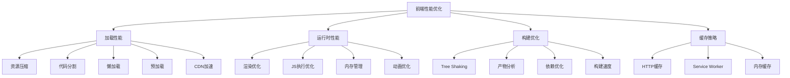

# 前端性能优化实战

> **文档说明**：系统讲解前端性能优化的完整体系，包括性能指标（Core Web Vitals）、加载性能优化（资源压缩/代码分割/懒加载/预加载/CDN/缓存）、运行时性能优化（渲染优化/JS 执行优化/内存管理）、构建优化（Vite/Rollup 配置/Tree Shaking/产物分析）、性能监控与分析（Lighthouse/Performance API/真实用户监控），以及生产级最佳实践和常见问题排查。
>
> **适用人群**：前端开发工程师、全栈开发者、需要构建高性能 Web 应用的工程师
>
> **前置知识**：[[Vite-构建原理与插件开发]]、[[前端工程化知识点系统梳理_优化版]]、[[Vue3-性能优化实战]]

---

## 一、概述

### 1. 为什么需要性能优化

| 影响 | 说明 |
|------|------|
| **用户体验** | 页面加载快、交互流畅，用户满意度高 |
| **转化率** | 每延迟 1 秒，转化率下降 7%（Amazon 数据） |
| **SEO 排名** | Google 将 Core Web Vitals 纳入搜索排名因素 |
| **用户留存** | 加载超过 3 秒，53% 的移动用户会离开 |
| **成本节约** | 减少带宽消耗、降低服务器压力 |

### 2. 性能指标体系

#### Core Web Vitals（核心 Web 指标）

| 指标 | 全称 | 说明 | 良好阈值 |
|------|------|------|---------|
| **LCP** | Largest Contentful Paint | 最大内容绘制，衡量加载性能 | < 2.5 秒 |
| **FID** | First Input Delay | 首次输入延迟，衡量交互响应性 | < 100 毫秒 |
| **CLS** | Cumulative Layout Shift | 累积布局偏移，衡量视觉稳定性 | < 0.1 |

> **注意**：FID 已被 INP（Interaction to Next Paint）替代，INP 良好阈值 < 200 毫秒。

#### 其他重要指标

| 指标 | 说明 |
|------|------|
| **FP** | First Paint，首次绘制，第一个像素渲染时间 |
| **FCP** | First Contentful Paint，首次内容绘制，第一个文本/图片渲染 |
| **TTI** | Time to Interactive，可交互时间，页面完全可交互 |
| **TTFB** | Time to First Byte，首字节时间，服务器响应时间 |
| **TBT** | Total Blocking Time，总阻塞时间，FCP 到 TTI 之间的长任务总和 |
| **INP** | Interaction to Next Paint，交互到下一次绘制，替代 FID |

### 3. 性能优化分类



---

## 二、加载性能优化

### 1. 资源压缩

| 优化项 | 说明 | 工具/方法 |
|--------|------|----------|
| **HTML 压缩** | 移除空格、注释、换行 | html-minifier-terser |
| **CSS 压缩** | 移除空格、注释、缩短属性 | cssnano、Lightning CSS |
| **JS 压缩** | 移除空格、混淆变量名、死代码消除 | Terser、esbuild、swc |
| **图片优化** | 压缩、格式转换（WebP/AVIF）、响应式图片 | sharp、imagemin、squoosh |
| **字体优化** | 字体子集化、woff2 格式、font-display | fontmin、unicode-range |
| **Gzip/Brotli** | 文本资源压缩，Brotli 比 Gzip 小 15-25% | Nginx gzip、Brotli 模块 |

```typescript
// Vite 构建压缩配置
export default defineConfig({
  build: {
    minify: 'esbuild',  // esbuild 压缩（默认，快）
    // minify: 'terser',  // terser 压缩（压缩率更高，慢）
    cssMinify: true,     // CSS 压缩
    // 图片内联阈值
    assetsInlineLimit: 4096,  // 小于 4KB 的图片内联为 base64
  }
})
```

```nginx
# Nginx Gzip 配置
gzip on;
gzip_vary on;
gzip_min_length 1024;
gzip_comp_level 6;
gzip_types
  text/plain
  text/css
  text/xml
  text/javascript
  application/javascript
  application/json
  application/xml
  image/svg+xml;

# Nginx Brotli 配置（需编译 brotli 模块）
brotli on;
brotli_comp_level 6;
brotli_types text/plain text/css application/javascript application/json image/svg+xml;
```

### 2. 代码分割

```typescript
// Vite 手动分包配置
export default defineConfig({
  build: {
    rollupOptions: {
      output: {
        manualChunks: {
          // Vue 生态单独打包
          'vue-vendor': ['vue', 'vue-router', 'pinia'],
          // React 生态单独打包
          'react-vendor': ['react', 'react-dom'],
          // 工具库
          'utils': ['lodash-es', 'dayjs', 'axios'],
          // UI 库
          'ui-vendor': ['element-plus']
        }
      }
    }
  }
})
```

**代码分割策略**：
| 策略 | 说明 |
|------|------|
| **入口分割** | 每个页面/入口一个 chunk |
| **第三方依赖分割** | node_modules 依赖单独打包，利用浏览器缓存 |
| **动态导入分割** | `import()` 动态导入的模块单独 chunk，按需加载 |
| **公共模块提取** | 多入口共享的模块提取为公共 chunk |
| **CSS 分割** | 异步 chunk 的 CSS 单独提取 |

### 3. 懒加载

```vue
<!-- 路由懒加载 -->
<script setup lang="ts">
import { createRouter, createWebHistory } from 'vue-router'

const routes = [
  {
    path: '/home',
    component: () => import('@/views/Home.vue')  // 动态导入，按需加载
  },
  {
    path: '/about',
    component: () => import('@/views/About.vue')
  },
  {
    path: '/heavy',
    component: () => import('@/views/HeavyPage.vue')
  }
]
</script>
```

```vue
<!-- 组件懒加载 -->
<script setup lang="ts">
import { defineAsyncComponent } from 'vue'

// 异步组件
const HeavyChart = defineAsyncComponent(() => import('@/components/HeavyChart.vue'))

// 带加载状态和错误状态
const HeavyTable = defineAsyncComponent({
  loader: () => import('@/components/HeavyTable.vue'),
  loadingComponent: LoadingSpinner,
  errorComponent: ErrorPlaceholder,
  delay: 200,        // 延迟显示 loading（毫秒）
  timeout: 10000     // 超时时间（毫秒）
})
</script>

<template>
  <HeavyChart v-if="showChart" />
  <HeavyTable />
</template>
```

```vue
<!-- 图片懒加载 -->
<template>
  <!-- 原生 loading="lazy" -->
  

  <!-- Intersection Observer 自定义懒加载 -->
  
</template>

<script setup lang="ts">
import { ref, onMounted } from 'vue'

const imgRef = ref<HTMLImageElement>()

onMounted(() => {
  const observer = new IntersectionObserver((entries) => {
    entries.forEach(entry => {
      if (entry.isIntersecting) {
        const img = entry.target as HTMLImageElement
        img.src = img.dataset.src!
        observer.unobserve(img)
      }
    })
  }, { rootMargin: '200px' })  // 提前 200px 加载

  if (imgRef.value) observer.observe(imgRef.value)
})
</script>
```

### 4. 预加载

```html
<!-- DNS 预解析：提前解析域名 DNS -->
<link rel="dns-prefetch" href="//api.example.com" />

<!-- 预连接：提前建立 TCP 连接 + TLS 握手 -->
<link rel="preconnect" href="https://api.example.com" crossorigin />

<!-- 预加载：提前加载关键资源 -->
<link rel="preload" href="/fonts/iconfont.woff2" as="font" type="font/woff2" crossorigin />
<link rel="preload" href="/images/hero.jpg" as="image" />
<link rel="preload" href="/js/critical.js" as="script" />

<!-- 预获取：提前获取下一页可能需要的资源（空闲时） -->
<link rel="prefetch" href="/js/about-page.js" as="script" />

<!-- 预渲染：提前渲染下一页（开销大，谨慎使用） -->
<link rel="prerender" href="/about.html" />
```

**预加载策略对比**：
| 特性 | preload | prefetch | preconnect | dns-prefetch |
|------|---------|----------|------------|--------------|
| **优先级** | 高（当前页面必需） | 低（未来页面可能用） | 中 | 低 |
| **时机** | 立即加载 | 浏览器空闲时 | 立即连接 | 立即解析 |
| **用途** | 当前页关键资源 | 下一页资源 | 跨域 API 连接 | 跨域域名 |
| **缓存** | 内存缓存 | 内存缓存 | 连接复用 | DNS 缓存 |

### 5. CDN 加速

| 优化项 | 说明 |
|--------|------|
| **静态资源 CDN** | JS/CSS/图片/字体等静态资源部署到 CDN |
| **多区域节点** | CDN 节点遍布全球，用户就近访问 |
| **缓存策略** | 静态资源长期缓存（hash 文件名），HTML 不缓存 |
| **动态加速** | API 请求通过 CDN 动态加速（TCP 优化、路由优化） |
| **图片处理** | CDN 实时图片压缩、格式转换、裁剪（如阿里云 OSS、七牛云） |

```html
<!-- 静态资源使用 CDN -->
<script src="https://cdn.example.com/js/index-abc123.js"></script>
<link rel="stylesheet" href="https://cdn.example.com/css/index-def456.css" />

```

---

## 三、运行时性能优化

### 1. 渲染优化

| 优化项 | 说明 |
|--------|------|
| **减少重排重绘** | 避免频繁修改 DOM 样式，使用 class 批量修改 |
| **虚拟列表** | 长列表只渲染可视区域的 DOM |
| **防抖节流** | 滚动、resize、input 等高频事件使用防抖/节流 |
| **will-change** | 提前告知浏览器哪些元素会变化，优化渲染 |
| **transform/opacity** | 使用 transform 和 opacity 做动画，不触发重排 |
| **避免布局抖动** | 批量读取 DOM 样式，再批量写入 |

```typescript
// 虚拟列表（只渲染可视区域）
<script setup lang="ts">
import { ref, computed, onMounted, onUnmounted } from 'vue'

const list = ref<Array<{ id: number; text: string }>>([])
const scrollTop = ref(0)
const containerHeight = 600
const itemHeight = 50

// 生成 10000 条数据
onMounted(() => {
  list.value = Array.from({ length: 10000 }, (_, i) => ({
    id: i,
    text: `Item ${i}`
  }))
})

// 计算可视区域的起始和结束索引
const startIndex = computed(() => Math.floor(scrollTop.value / itemHeight))
const endIndex = computed(() => startIndex.value + Math.ceil(containerHeight / itemHeight))

// 可视区域数据
const visibleList = computed(() => list.value.slice(startIndex.value, endIndex.value))

// 偏移量（用 padding 模拟滚动位置）
const offsetY = computed(() => startIndex.value * itemHeight)

function handleScroll(e: Event) {
  scrollTop.value = (e.target as HTMLElement).scrollTop
}
</script>

<template>
  <div class="virtual-list" :style="{ height: containerHeight + 'px' }" @scroll="handleScroll">
    <!-- 占位元素，撑开总高度 -->
    <div :style="{ height: list.length * itemHeight + 'px', position: 'relative' }">
      <!-- 可视区域列表 -->
      <div :style="{ transform: `translateY(${offsetY}px)` }">
        <div v-for="item in visibleList" :key="item.id"
             :style="{ height: itemHeight + 'px' }" class="list-item">
          {{ item.text }}
        </div>
      </div>
    </div>
  </div>
</template>
```

```typescript
// 防抖（debounce）：事件触发后等待 n 秒才执行，期间再次触发则重新计时
function debounce<T extends (...args: any[]) => void>(fn: T, delay: number) {
  let timer: ReturnType<typeof setTimeout> | null = null
  return function(this: any, ...args: Parameters<T>) {
    if (timer) clearTimeout(timer)
    timer = setTimeout(() => fn.apply(this, args), delay)
  }
}

// 节流（throttle）：n 秒内只执行一次
function throttle<T extends (...args: any[]) => void>(fn: T, delay: number) {
  let lastTime = 0
  return function(this: any, ...args: Parameters<T>) {
    const now = Date.now()
    if (now - lastTime >= delay) {
      lastTime = now
      fn.apply(this, args)
    }
  }
}

// 使用
const handleSearch = debounce((keyword: string) => {
  searchAPI(keyword)
}, 300)

const handleScroll = throttle(() => {
  updateScrollPosition()
}, 100)
```

### 2. JS 执行优化

| 优化项 | 说明 |
|--------|------|
| **避免长任务** | 单个 JS 任务不超过 50ms，避免阻塞主线程 |
| **Web Worker** | 密集计算放到 Web Worker，不阻塞主线程 |
| **requestIdleCallback** | 非关键任务在浏览器空闲时执行 |
| **异步更新** | Vue/React 批量更新 DOM，减少渲染次数 |
| **避免同步计算** | 大数据计算、复杂解析使用异步或分片 |
| **事件委托** | 父元素监听事件，减少事件监听器数量 |

```typescript
// Web Worker：密集计算不阻塞主线程
// worker.ts
self.onmessage = (e) => {
  const { type, data } = e.data
  if (type === 'calculate') {
    const result = heavyCalculation(data)
    self.postMessage({ type: 'result', result })
  }
}

function heavyCalculation(data: number[]): number {
  // 密集计算
  return data.reduce((sum, n) => sum + n * n, 0)
}

// 主线程使用
const worker = new Worker(new URL('./worker.ts', import.meta.url), { type: 'module' })

worker.postMessage({ type: 'calculate', data: [1, 2, 3, 4, 5] })
worker.onmessage = (e) => {
  console.log('计算结果:', e.data.result)
}
```

```typescript
// requestIdleCallback：空闲时执行非关键任务
function scheduleIdleTask(task: () => void) {
  if ('requestIdleCallback' in window) {
    requestIdleCallback((deadline) => {
      if (deadline.timeRemaining() > 0) {
        task()
      } else {
        scheduleIdleTask(task)  // 时间不够，下次空闲再执行
      }
    })
  } else {
    setTimeout(task, 1000)  // 降级方案
  }
}

// 使用：非关键的埋点上报、预加载、缓存清理
scheduleIdleTask(() => {
  reportAnalytics()
  prefetchNextPage()
})
```

### 3. 内存管理

| 优化项 | 说明 |
|--------|------|
| **及时清理定时器** | 组件卸载时清除 setInterval/setTimeout |
| **移除事件监听** | 组件卸载时 removeEventListener |
| **取消请求** | 组件卸载时取消未完成的 HTTP 请求（AbortController） |
| **避免内存泄漏** | 闭包引用、全局变量、DOM 引用及时释放 |
| **WeakMap/WeakSet** | 使用弱引用，允许 GC 回收 |
| **虚拟列表** | 长列表使用虚拟滚动，减少 DOM 节点 |

```typescript
// Vue 组件内存清理
<script setup lang="ts">
import { onMounted, onUnmounted, ref } from 'vue'

const timer = ref<ReturnType<typeof setInterval>>()
const abortController = new AbortController()

onMounted(() => {
  // 定时器
  timer.value = setInterval(() => {
    refreshData()
  }, 5000)

  // 事件监听
  window.addEventListener('resize', handleResize)

  // HTTP 请求（可取消）
  fetchData()
})

onUnmounted(() => {
  // 清除定时器
  if (timer.value) clearInterval(timer.value)

  // 移除事件监听
  window.removeEventListener('resize', handleResize)

  // 取消请求
  abortController.abort()
})

async function fetchData() {
  const response = await fetch('/api/data', {
    signal: abortController.signal
  })
  // ...
}

function handleResize() { /* ... */ }
</script>
```

### 4. 动画优化

| 优化项 | 说明 |
|--------|------|
| **使用 transform/opacity** | 只触发合成层，不触发重排重绘 |
| **will-change** | 提前创建合成层，但不要滥用 |
| **CSS 动画优先** | CSS 动画比 JS 动画性能更好 |
| **requestAnimationFrame** | JS 动画使用 rAF，与浏览器刷新同步 |
| **避免 layout thrashing** | 不要在循环中交替读写 DOM 样式 |
| **GPU 加速** | transform: translateZ(0) 开启 GPU 加速 |

```css
/* 高性能动画：只使用 transform 和 opacity */
.element {
  transition: transform 0.3s ease, opacity 0.3s ease;
  will-change: transform, opacity;  /* 提前告知浏览器 */
}

.element:hover {
  transform: translateX(100px) scale(1.1);
  opacity: 0.8;
}

/* 避免：触发重排的属性 */
.bad-animation {
  transition: width 0.3s, height 0.3s, margin 0.3s;  /* 这些会触发重排 */
}
```

---

## 四、构建优化

### 1. Tree Shaking

Tree Shaking 移除未使用的代码，依赖 ES Module 的静态分析。

```typescript
// 正确：使用命名导出，支持 Tree Shaking
// utils.ts
export function formatDate(date: Date) { /* ... */ }
export function formatMoney(amount: number) { /* ... */ }
export function debounce(fn: Function, delay: number) { /* ... */ }

// 使用时只导入需要的函数
import { formatDate } from './utils'
// formatMoney 和 debounce 会被 Tree Shaking 移除

// 错误：默认导出整个对象，无法 Tree Shaking
export default {
  formatDate,
  formatMoney,
  debounce
}
// 导入后整个对象都会被打包
```

**确保 Tree Shaking 生效**：
- 使用 ES Module（`import`/`export`），不要用 CommonJS（`require`）
- package.json 中设置 `"sideEffects": false` 或列出有副作用的文件
- 避免在模块顶层执行有副作用的代码
- 使用 `import type` 导入类型（TypeScript）

### 2. 产物分析

```bash
# 安装分析工具
npm install -D rollup-plugin-visualizer

# Vite 配置
// vite.config.ts
import { visualizer } from 'rollup-plugin-visualizer'

export default defineConfig({
  plugins: [
    visualizer({
      open: true,           // 构建后自动打开
      filename: 'stats.html',
      gzipSize: true,       // 显示 gzip 大小
      brotliSize: true      // 显示 brotli 大小
    })
  ]
})

# 构建并分析
npm run build
# 自动打开 stats.html，查看各模块占比
```

**常见大体积依赖优化**：
| 依赖 | 问题 | 优化方案 |
|------|------|---------|
| lodash | 全量引入体积大 | 改用 lodash-es + 按需导入，或用更小的替代（如 dayjs） |
| moment.js | 体积大（含所有语言包） | 改用 dayjs（2KB） |
| element-plus | 全量引入体积大 | 按需导入（unplugin-vue-components） |
| echarts | 全量引入体积大 | 按需导入只需要的图表类型 |
| xlsx | 体积大 | 按需导入功能模块，或使用更轻的库 |

### 3. 依赖优化

```typescript
// 按需导入 Element Plus
// vite.config.ts
import AutoImport from 'unplugin-auto-import/vite'
import Components from 'unplugin-vue-components/vite'
import { ElementPlusResolver } from 'unplugin-vue-components/resolvers'

export default defineConfig({
  plugins: [
    AutoImport({
      resolvers: [ElementPlusResolver()]
    }),
    Components({
      resolvers: [ElementPlusResolver()]
    })
  ]
})

// 按需导入 ECharts
import * as echarts from 'echarts/core'
import { BarChart, LineChart } from 'echarts/charts'
import {
  TitleComponent, TooltipComponent, GridComponent, LegendComponent
} from 'echarts/components'
import { CanvasRenderer } from 'echarts/renderers'

echarts.use([
  BarChart, LineChart,
  TitleComponent, TooltipComponent, GridComponent, LegendComponent,
  CanvasRenderer
])
```

### 4. 构建速度优化

| 优化项 | 说明 |
|--------|------|
| **使用 esbuild** | Vite 默认使用 esbuild，比 terser 快 10-100 倍 |
| **并行构建** | 多核 CPU 并行处理（rollup 原生支持） |
| **缓存** | 构建缓存，未变更的模块跳过编译 |
| **减少扫描范围** | optimizeDeps.entries 限制入口扫描 |
| **排除大依赖** | 外部化不常变更的依赖（如 Vue、React） |
| **增量构建** | 开发模式下只重新编译变更的文件 |

---

## 五、缓存策略

### 1. HTTP 缓存

| 缓存头 | 说明 | 适用场景 |
|--------|------|---------|
| **Cache-Control: max-age=31536000, immutable** | 强缓存 1 年，不可变 | 带 hash 的静态资源（JS/CSS/图片） |
| **Cache-Control: no-cache** | 协商缓存，每次验证 | HTML、API 响应 |
| **Cache-Control: no-store** | 不缓存 | 敏感数据、实时数据 |
| **ETag** | 资源指纹，协商缓存 | 任意资源 |
| **Last-Modified** | 最后修改时间，协商缓存 | 静态资源 |

```nginx
# Nginx 缓存配置
# 静态资源（带 hash）：强缓存 1 年
location ~* \.(js|css|png|jpg|jpeg|gif|ico|svg|woff2?)$ {
  expires 1y;
  add_header Cache-Control "public, immutable";
}

# HTML：不缓存，每次协商
location ~* \.html$ {
  add_header Cache-Control "no-cache";
}

# API：协商缓存
location /api/ {
  add_header Cache-Control "no-cache";
  # 或根据业务设置短缓存
  # add_header Cache-Control "max-age=60";
}
```

### 2. Service Worker（PWA 离线缓存）

```typescript
// service-worker.ts
const CACHE_NAME = 'my-app-v1'
const STATIC_ASSETS = [
  '/',
  '/index.html',
  '/css/style.css',
  '/js/app.js',
  '/images/logo.png'
]

// 安装：缓存静态资源
self.addEventListener('install', (event) => {
  event.waitUntil(
    caches.open(CACHE_NAME).then(cache => cache.addAll(STATIC_ASSETS))
  )
})

// 激活：清理旧缓存
self.addEventListener('activate', (event) => {
  event.waitUntil(
    caches.keys().then(keys =>
      Promise.all(keys.filter(key => key !== CACHE_NAME).map(key => caches.delete(key)))
    )
  )
})

// 拦截请求：缓存优先，网络回退
self.addEventListener('fetch', (event) => {
  event.respondWith(
    caches.match(event.request).then(cached => {
      // 缓存命中则返回缓存，否则请求网络并缓存
      return cached || fetch(event.request).then(response => {
        const clone = response.clone()
        caches.open(CACHE_NAME).then(cache => cache.put(event.request, clone))
        return response
      })
    })
  )
})
```

### 3. 内存缓存（运行时）

```typescript
// 简单的内存缓存工具
class MemoryCache<T> {
  private cache = new Map<string, { value: T; expire: number }>()

  set(key: string, value: T, ttl: number = 60000) {
    this.cache.set(key, { value, expire: Date.now() + ttl })
  }

  get(key: string): T | null {
    const item = this.cache.get(key)
    if (!item) return null
    if (Date.now() > item.expire) {
      this.cache.delete(key)
      return null
    }
    return item.value
  }

  clear() {
    this.cache.clear()
  }
}

// 使用：API 请求缓存
const apiCache = new MemoryCache<any>()

async function fetchWithCache(url: string) {
  const cached = apiCache.get(url)
  if (cached) return cached

  const response = await fetch(url)
  const data = await response.json()
  apiCache.set(url, data, 30000)  // 缓存 30 秒
  return data
}
```

---

## 六、性能监控与分析

### 1. Lighthouse

Chrome DevTools 内置的性能审计工具，从性能、可访问性、最佳实践、SEO 四个维度评分。

```bash
# 命令行使用
npm install -g lighthouse
lighthouse https://example.com --view --output html --output-path report.html
```

### 2. Performance API

```typescript
// 测量自定义性能指标
const startTime = performance.now()
// ... 执行代码
const endTime = performance.now()
console.log(`执行耗时: ${endTime - startTime}ms`)

// 测量页面加载指标
window.addEventListener('load', () => {
  const timing = performance.timing
  const loadTime = timing.loadEventEnd - timing.navigationStart
  const domReady = timing.domContentLoadedEventEnd - timing.navigationStart
  const ttfb = timing.responseStart - timing.requestStart
  console.log(`页面加载: ${loadTime}ms, DOM 就绪: ${domReady}ms, TTFB: ${ttfb}ms`)
})

// PerformanceObserver：监听性能指标
const observer = new PerformanceObserver((list) => {
  for (const entry of list.getEntries()) {
    console.log(`${entry.name}: ${entry.startTime}ms, duration: ${entry.duration}ms`)
  }
})

// 监听 LCP
observer.observe({ type: 'largest-contentful-paint', buffered: true })
// 监听 FID/INP
observer.observe({ type: 'first-input', buffered: true })
// 监听 CLS
observer.observe({ type: 'layout-shift', buffered: true })
// 监听长任务
observer.observe({ type: 'longtask', buffered: true })
```

### 3. 真实用户监控（RUM）

```typescript
// 采集 Core Web Vitals 并上报
import { onLCP, onFID, onCLS, onINP, onFCP, onTTFB } from 'web-vitals'

function reportToAnalytics(metric: { name: string; value: number; id: string }) {
  // 上报到监控平台（如 Google Analytics、自建监控）
  navigator.sendBeacon('/api/metrics', JSON.stringify({
    name: metric.name,
    value: metric.value,
    id: metric.id,
    page: location.pathname,
    timestamp: Date.now()
  }))
}

// 采集各项指标
onLCP(reportToAnalytics)   // 最大内容绘制
onFID(reportToAnalytics)   // 首次输入延迟
onCLS(reportToAnalytics)   // 累积布局偏移
onINP(reportToAnalytics)   // 交互到下一次绘制
onFCP(reportToAnalytics)   // 首次内容绘制
onTTFB(reportToAnalytics)  // 首字节时间
```

### 4. Chrome DevTools Performance 面板

| 功能 | 说明 |
|------|------|
| **录制** | 录制页面加载或交互过程，分析性能瓶颈 |
| **Network** | 查看资源加载时序、瀑布图 |
| **Main** | 主线程活动，查看长任务、JS 执行、渲染 |
| **Frames** | 逐帧分析，查看渲染耗时 |
| **Timings** | LCP/FCP/TTI 等指标标记 |
| **Memory** | 内存快照，分析内存泄漏 |
| **Coverage** | 代码覆盖率，查看未使用的 JS/CSS |

---

## 七、生产最佳实践

### 1. 性能优化检查清单

- [ ] **资源压缩**：HTML/CSS/JS/图片全部压缩，启用 Gzip/Brotli
- [ ] **代码分割**：路由级懒加载，第三方依赖单独打包
- [ ] **图片优化**：WebP/AVIF 格式，响应式图片，懒加载
- [ ] **字体优化**：woff2 格式，字体子集化，font-display: swap
- [ ] **预加载**：关键资源 preload，跨域 API preconnect
- [ ] **CDN 加速**：静态资源部署 CDN，合理设置缓存
- [ ] **HTTP 缓存**：静态资源强缓存（hash 文件名），HTML 协商缓存
- [ ] **虚拟列表**：长列表使用虚拟滚动
- [ ] **防抖节流**：高频事件使用防抖/节流
- [ ] **Web Worker**：密集计算放到 Worker
- [ ] **内存管理**：组件卸载时清理定时器、事件监听、取消请求
- [ ] **动画优化**：使用 transform/opacity，避免重排
- [ ] **Tree Shaking**：使用 ES Module，按需导入依赖
- [ ] **产物分析**：定期分析构建产物，优化大依赖
- [ ] **性能监控**：接入 RUM，监控 Core Web Vitals

### 2. 性能预算

为项目设定性能预算，超过预算时报警或阻止部署：

| 指标 | 预算阈值 |
|------|---------|
| 首屏 JS（gzip） | < 100KB |
| 首屏 CSS（gzip） | < 30KB |
| 首屏图片 | < 500KB |
| LCP | < 2.5s |
| INP | < 200ms |
| CLS | < 0.1 |
| 单包大小 | < 500KB（警告） |

```typescript
// Vite 构建时检查体积预算
export default defineConfig({
  build: {
    rollupOptions: {
      output: {
        manualChunks: { /* ... */ }
      }
    }
  },
  // 插件中检查体积
  plugins: [
    {
      name: 'size-check',
      generateBundle(options, bundle) {
        for (const [name, chunk] of Object.entries(bundle)) {
          if (chunk.type === 'chunk' && chunk.code.length > 500 * 1024) {
            console.warn(`警告: ${name} 超过 500KB`)
          }
        }
      }
    }
  ]
})
```

---

## 八、常见问题与排查

| 问题 | 原因 | 解决方案 |
|------|------|---------|
| **LCP 过大** | 首屏图片过大 / 服务器响应慢 / 渲染阻塞 | 优化图片、CDN 加速、预加载关键资源、优化 TTFB |
| **FID/INP 过大** | JS 长任务阻塞主线程 / 事件处理复杂 | 拆分长任务、Web Worker、防抖节流、优化事件处理 |
| **CLS 过大** | 图片/广告/字体无固定尺寸 / 动态插入内容 | 设置图片宽高、字体 font-display、预留空间、避免动态插入 |
| **白屏时间长** | JS 体积大 / 同步加载 / 服务器响应慢 | 代码分割、懒加载、CDN、SSR/SSG、优化 TTFB |
| **滚动卡顿** | 滚动事件处理重 / 图片懒加载抖动 / 复杂动画 | 防抖节流、Intersection Observer、transform 动画、虚拟列表 |
| **内存泄漏** | 定时器未清理 / 事件监听未移除 / 闭包引用 | 组件卸载时清理、使用 WeakMap、Chrome Memory 面板分析 |
| **构建产物体积大** | 全量引入依赖 / 未 Tree Shaking / 未压缩 | 按需导入、Tree Shaking、压缩、产物分析优化 |
| **首屏请求过多** | 未合并请求 / 图片未雪碧图 / 小文件多 | 合并请求、图片内联（base64）、HTTP/2 多路复用 |
| **TTFB 过大** | 服务器处理慢 / 数据库查询慢 / 网络延迟 | 优化后端、数据库索引、CDN、缓存 |
| **动画卡顿** | 使用触发重排的属性 / JS 动画 / 主线程阻塞 | 使用 transform/opacity、CSS 动画、will-change |
| **缓存不生效** | Cache-Control 配置错误 / 文件名无 hash / 协商缓存验证失败 | 检查响应头、使用 hash 文件名、正确配置 ETag/Last-Modified |
| **图片加载慢** | 图片过大 / 格式不优 / 未 CDN / 未懒加载 | 压缩图片、WebP/AVIF、CDN、懒加载、响应式图片 |
| **第三方脚本阻塞** | 统计/广告脚本同步加载 / 脚本体积大 | 异步加载（async/defer）、延迟加载、精简第三方脚本 |

---

## 九、关联笔记

### 前端工程化
- [[Vite-构建原理与插件开发]] · [[前端工程化知识点系统梳理_优化版]] · [[pnpm-monorepo架构]]
- [[前端构建产物分析与优化]] · [[环境变量与多环境构建]] · [[ESLint+Prettier+Stylelint规范]]

### Vue3 生态
- [[Vue3-性能优化实战]] · [[Vue3-组合式API设计模式]] · [[Vue3-响应式原理Proxy]]
- [[Vue3-自定义Hooks封装]] · [[Vue3-组件通信全方案]]

### 前端安全
- [[前端安全-XSS-CSRF防护]] · [[CSP内容安全策略]] · [[前端敏感数据保护]]

### 云原生
- [[Docker-核心原理与镜像优化]] · [[Nginx-反向代理与负载均衡]] · [[CI-CD持续集成与部署]]
- [[K8s-核心概念与架构]]

### 导航
- [[MOC-前端开发]] · [[MOC-Vue3TS-四级展开]] · [[全栈+AI工程双轨融合学习路线图]]

> **学习路径建议**：先掌握 [[前端工程化知识点系统梳理_优化版]] 工程化基础 → 学习 [[Vite-构建原理与插件开发]] 构建工具 → 深入本文前端性能优化实战 → 实践 [[Vue3-性能优化实战]] 框架级优化 → 研究 [[前端构建产物分析与优化]] 产物分析 → 应用于实际项目的性能监控与优化。
