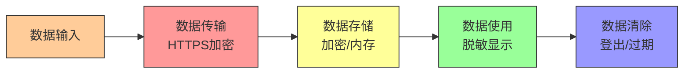

# 前端敏感数据保护

> **文档说明**：系统讲解前端应用中敏感数据的全生命周期保护，包括存储安全、传输安全、显示安全、内存安全、Token 管理、密码输入安全、第三方依赖安全，以及生产级最佳实践和常见问题排查。
>
> **适用人群**：前端开发工程师、全栈开发者、安全工程师、需要处理敏感数据的前端开发者
>
> **前置知识**：[[CSP内容安全策略]]、[[Web安全-XSS-CSRF-SQL注入]]、[[Axios网络请求封装]]、[[Vue3-组合式API设计模式]]

---

## 一、概述

### 1. 前端敏感数据类型

| 类型 | 示例 | 风险等级 |
|------|------|---------|
| **身份凭证** | Token、Session ID、Cookie | 🔴 高 |
| **个人隐私** | 身份证号、手机号、邮箱、地址 | 🔴 高 |
| **支付信息** | 银行卡号、CVV、支付密码 | 🔴 高 |
| **密码** | 登录密码、支付密码 | 🔴 高 |
| **业务数据** | 订单信息、财务数据、医疗记录 | 🟡 中 |
| **API 密钥** | 第三方服务密钥（不应出现在前端） | 🔴 高 |
| **设备信息** | IMEI、MAC 地址、精确位置 | 🟡 中 |

### 2. 前端安全原则

> **核心原则：前端是不可信的环境，任何前端存储的数据都可能被窃取。**

- [ ] **最小存储**：只存储必要的数据，敏感数据尽量不存前端
- [ ] **最短时效**：敏感数据尽快使用后清除，缩短暴露窗口
- [ ] **加密存储**：必须存储的敏感数据进行加密
- [ ] **传输加密**：所有通信使用 HTTPS
- [ ] **防 XSS**：XSS 是前端数据泄露的最大威胁
- [ ] **显示脱敏**：敏感信息展示时脱敏处理
- [ ] **不留痕**：避免敏感数据进入日志、缓存、历史记录

### 3. 前端数据生命周期



---

## 二、存储安全

### 1. 存储方式对比

| 存储方式 | 容量 | 生命周期 | 安全性 | 适用场景 |
|---------|------|---------|--------|---------|
| **Cookie** | 4KB | 可设置过期 | HttpOnly 防 XSS | Session ID（HttpOnly） |
| **localStorage** | 5-10MB | 永久 | 可被 JS 读取（XSS 风险） | 非敏感偏好设置 |
| **sessionStorage** | 5-10MB | 标签页关闭 | 可被 JS 读取 | 临时会话数据 |
| **IndexedDB** | 数百 MB | 永久 | 可被 JS 读取 | 大量非敏感数据 |
| **内存变量** | 不限 | 页面刷新清除 | 相对安全 | 运行时敏感数据 |
| **Service Worker** | - | 受控 | 相对安全 | 缓存策略 |

### 2. Token 存储方案对比

| 方案 | 优点 | 缺点 | 推荐度 |
|------|------|------|--------|
| **HttpOnly Cookie** | 防 XSS 窃取、自动携带 | CSRF 风险、跨域复杂 | ⭐⭐⭐⭐⭐ |
| **localStorage** | 简单、跨标签页 | XSS 可窃取 | ⭐⭐ |
| **sessionStorage** | 关闭即清除 | XSS 可窃取、单标签页 | ⭐⭐⭐ |
| **内存变量** | 最安全 | 刷新丢失、需刷新机制 | ⭐⭐⭐⭐ |
| **Web Worker** | 隔离主线程 | 复杂、兼容性 | ⭐⭐⭐ |

### 3. 推荐方案：HttpOnly Cookie + CSRF Token

```javascript
// 后端设置 HttpOnly Cookie（前端无法读取）
// Set-Cookie: access_token=xxx; HttpOnly; Secure; SameSite=Strict; Path=/

// 前端只需携带 CSRF Token
import axios from 'axios'

const api = axios.create({
  withCredentials: true,  // 携带 Cookie
  xsrfCookieName: 'XSRF-TOKEN',
  xsrfHeaderName: 'X-XSRF-TOKEN'
})

// 请求拦截器：从 Cookie 读取 CSRF Token 并放入请求头
api.interceptors.request.use(config => {
  const csrfToken = getCookie('XSRF-TOKEN')
  if (csrfToken) {
    config.headers['X-XSRF-TOKEN'] = csrfToken
  }
  return config
})
```

### 4. 内存存储方案（高安全场景）

```typescript
// 使用内存变量存储 Token，刷新页面需重新获取
class TokenManager {
  private accessToken: string | null = null
  private refreshToken: string | null = null

  setTokens(access: string, refresh: string) {
    this.accessToken = access
    this.refreshToken = refresh
  }

  getAccessToken(): string | null {
    return this.accessToken
  }

  clear() {
    this.accessToken = null
    this.refreshToken = null
  }

  // 页面刷新时，通过 Refresh Token 重新获取 Access Token
  async restoreSession(): Promise<boolean> {
    // 从 HttpOnly Cookie 获取 Refresh Token（或其他安全方式）
    // 调用刷新接口
    const newTokens = await refreshAccessToken()
    if (newTokens) {
      this.setTokens(newTokens.access, newTokens.refresh)
      return true
    }
    return false
  }
}

export const tokenManager = new TokenManager()
```

### 5. 敏感数据加密存储

```typescript
// 使用 Web Crypto API 加密存储
class SecureStorage {
  private async getKey(): Promise<CryptoKey> {
    // 从密码或服务器派生密钥
    const keyMaterial = await crypto.subtle.importKey(
      'raw',
      new TextEncoder().encode('user-derived-key'),
      'PBKDF2',
      false,
      ['deriveKey']
    )
    return crypto.subtle.deriveKey(
      { name: 'PBKDF2', salt: new Uint8Array(16), iterations: 100000, hash: 'SHA-256' },
      keyMaterial,
      { name: 'AES-GCM', length: 256 },
      false,
      ['encrypt', 'decrypt']
    )
  }

  async encrypt(data: string): Promise<string> {
    const key = await this.getKey()
    const iv = crypto.getRandomValues(new Uint8Array(12))
    const encrypted = await crypto.subtle.encrypt(
      { name: 'AES-GCM', iv },
      key,
      new TextEncoder().encode(data)
    )
    return btoa(JSON.stringify({
      iv: Array.from(iv),
      data: Array.from(new Uint8Array(encrypted))
    }))
  }

  async decrypt(encrypted: string): Promise<string> {
    const key = await this.getKey()
    const { iv, data } = JSON.parse(atob(encrypted))
    const decrypted = await crypto.subtle.decrypt(
      { name: 'AES-GCM', iv: new Uint8Array(iv) },
      key,
      new Uint8Array(data)
    )
    return new TextDecoder().decode(decrypted)
  }

  async setSecureItem(key: string, value: string) {
    const encrypted = await this.encrypt(value)
    localStorage.setItem(key, encrypted)
  }

  async getSecureItem(key: string): Promise<string | null> {
    const encrypted = localStorage.getItem(key)
    if (!encrypted) return null
    return this.decrypt(encrypted)
  }
}
```

---

## 三、传输安全

### 1. HTTPS 强制

```javascript
// 强制 HTTPS 跳转
if (location.protocol !== 'https:' && location.hostname !== 'localhost') {
  location.replace(`https:${location.href.substring(location.protocol.length)}`)
}

// HSTS（服务端配置）
// Strict-Transport-Security: max-age=31536000; includeSubDomains
```

### 2. 请求头安全

```typescript
// Axios 安全配置
const api = axios.create({
  baseURL: 'https://api.example.com',
  timeout: 10000,
  withCredentials: true,
  headers: {
    'Content-Type': 'application/json',
    'X-Requested-With': 'XMLHttpRequest'  // 防 CSRF
  }
})

// 禁止缓存敏感响应
// 服务端响应头：
// Cache-Control: no-store, no-cache, must-revalidate
// Pragma: no-cache
```

### 3. 敏感数据不在 URL 中传递

```javascript
// ❌ 错误：敏感数据在 URL 中（会被日志/历史记录保存）
fetch(`/api/user?token=${token}&password=${password}`)

// ✅ 正确：使用请求体
fetch('/api/user', {
  method: 'POST',
  headers: { 'Content-Type': 'application/json' },
  body: JSON.stringify({ token, password })
})
```

---

## 四、显示安全

### 1. 数据脱敏

```typescript
// 脱敏工具函数
export const mask = {
  // 手机号脱敏：138****8888
  phone(phone: string): string {
    if (!phone || phone.length < 7) return '***'
    return phone.slice(0, 3) + '****' + phone.slice(-4)
  },

  // 身份证脱敏：110***********1234
  idCard(id: string): string {
    if (!id || id.length < 10) return '***'
    return id.slice(0, 3) + '*'.repeat(id.length - 7) + id.slice(-4)
  },

  // 邮箱脱敏：z***@example.com
  email(email: string): string {
    if (!email || !email.includes('@')) return '***'
    const [name, domain] = email.split('@')
    return name[0] + '***@' + domain
  },

  // 银行卡号脱敏：**** **** **** 1234
  bankCard(card: string): string {
    if (!card || card.length < 4) return '***'
    return '**** **** **** ' + card.slice(-4)
  },

  // 姓名脱敏：张*
  name(name: string): string {
    if (!name) return '***'
    if (name.length <= 1) return name
    return name[0] + '*'.repeat(name.length - 1)
  },

  // 地址脱敏：北京市朝阳区***
  address(addr: string): string {
    if (!addr) return '***'
    return addr.slice(0, 6) + '***'
  }
}
```

### 2. 防复制/防截屏

```typescript
// 敏感内容防复制
<div
  oncopy={(e) => e.preventDefault()}
  oncut={(e) => e.preventDefault()}
  oncontextmenu={(e) => e.preventDefault()}
  style={{ userSelect: 'none' }}
>
  {mask.idCard(user.idCard)}
</div>

// 页面隐藏时模糊敏感内容（防截屏）
import { useEffect, useState } from 'react'

function usePageVisibility() {
  const [visible, setVisible] = useState(true)
  useEffect(() => {
    const handler = () => setVisible(document.visibilityState === 'visible')
    document.addEventListener('visibilitychange', handler)
    return () => document.removeEventListener('visibilitychange', handler)
  }, [])
  return visible
}

// 使用：页面不可见时显示占位符
function SensitiveData({ data }) {
  const visible = usePageVisibility()
  return visible ? <span>{data}</span> : <span>******</span>
}
```

### 3. 密码输入安全

```vue
<template>
  <!-- 密码输入框 -->
  <div class="password-input">
    <input
      :type="showPassword ? 'text' : 'password'"
      v-model="password"
      autocomplete="new-password"  <!-- 禁止自动填充 -->
      :placeholder="placeholder"
      @input="onInput"
    />
    <button @click="showPassword = !showPassword" type="button">
      {{ showPassword ? '隐藏' : '显示' }}
    </button>
  </div>
</template>

<script setup>
import { ref } from 'vue'

const props = defineProps(['placeholder'])
const password = ref('')
const showPassword = ref(false)

const emit = defineEmits(['update:modelValue'])

const onInput = () => {
  // 不在控制台打印密码
  emit('update:modelValue', password.value)
}

// 组件卸载时清除密码
import { onUnmounted } from 'vue'
onUnmounted(() => {
  password.value = ''
})
</script>
```

---

## 五、内存安全与 XSS 防护

### 1. XSS 是前端数据泄露的最大威胁

XSS 攻击可以读取 localStorage、Cookie（非 HttpOnly）、内存变量，窃取所有前端数据。

详细参考 [[CSP内容安全策略]] 和 [[Web安全-XSS-CSRF-SQL注入]]。

### 2. 输出编码

```typescript
// HTML 转义
function escapeHtml(text: string): string {
  const div = document.createElement('div')
  div.textContent = text
  return div.innerHTML
}

// Vue 默认自动转义（{{ }}），但 v-html 不会
// ❌ 危险：v-html 可能导致 XSS
<div v-html="userInput"></div>

// ✅ 安全：使用文本插值
<div>{{ userInput }}</div>

// ✅ 必须使用 v-html 时，先净化
import DOMPurify from 'dompurify'
<div v-html="DOMPurify.sanitize(userInput)"></div>
```

### 3. CSP（内容安全策略）

```html
<!-- 服务端设置 CSP 头 -->
<!-- Content-Security-Policy: default-src 'self'; script-src 'self'; style-src 'self' 'unsafe-inline'; img-src 'self' data:; connect-src 'self' https://api.example.com; frame-ancestors 'none' -->

<meta http-equiv="Content-Security-Policy"
      content="default-src 'self'; script-src 'self'; object-src 'none'; base-uri 'self'">
```

### 4. 敏感数据不进入 Vue 响应式

```typescript
// 敏感数据使用普通变量，不放入响应式状态
// 响应式数据会被 Vue 内部存储，可能被 devtools 查看

// ❌ 不推荐：敏感数据放入响应式
const password = ref('')  // 会被 Vue devtools 捕获

// ✅ 推荐：使用普通变量
let password = ''
const onPasswordInput = (e: Event) => {
  password = (e.target as HTMLInputElement).value
}
```

---

## 六、登出与数据清除

### 1. 完整登出流程

```typescript
async function logout() {
  try {
    // 1. 调用后端登出接口（使服务端 Token 失效）
    await api.post('/auth/logout')
  } finally {
    // 2. 清除前端存储
    localStorage.clear()
    sessionStorage.clear()

    // 3. 清除 Cookie
    document.cookie.split(';').forEach(cookie => {
      const name = cookie.split('=')[0].trim()
      document.cookie = `${name}=; expires=Thu, 01 Jan 1970 00:00:00 UTC; path=/;`
    })

    // 4. 清除 IndexedDB
    const databases = await indexedDB.databases()
    databases.forEach(db => indexedDB.deleteDatabase(db.name!))

    // 5. 清除内存中的敏感数据
    tokenManager.clear()

    // 6. 跳转登录页
    window.location.href = '/login'
  }
}
```

### 2. 页面卸载时清除

```typescript
// 页面关闭/刷新时清除敏感数据
window.addEventListener('beforeunload', () => {
  // 清除 sessionStorage（自动）
  // 清除内存变量
  sensitiveData = null
})

// 页面隐藏时清除（可选，高安全场景）
document.addEventListener('visibilitychange', () => {
  if (document.visibilityState === 'hidden') {
    // 清除敏感内存数据
  }
})
```

---

## 七、第三方依赖安全

### 1. 依赖漏洞扫描

```bash
# 扫描依赖漏洞
npm audit
npm audit fix

# 使用工具定期扫描
# Snyk、Dependabot、npm audit
```

### 2. 第三方脚本隔离

```html
<!-- 第三方脚本使用 iframe 隔离 -->
<iframe
  src="https://third-party.com/widget"
  sandbox="allow-scripts allow-same-origin"
  referrerpolicy="no-referrer"
></iframe>

<!-- 限制第三方脚本权限 -->
<script
  src="https://third-party.com/analytics.js"
  integrity="sha256-abc123..."
  crossorigin="anonymous"
></script>
```

### 3. 不在前端存储 API 密钥

```javascript
// ❌ 绝对禁止：前端代码中硬编码 API 密钥
const API_KEY = 'sk-abc123secretkey'  // 任何人都能看到

// ✅ 正确：通过后端代理调用第三方服务
// 前端 → 后端（携带用户 Token）→ 第三方服务（使用服务端 API Key）
```

---

## 八、日志与错误上报

### 1. 日志脱敏

```typescript
// 错误上报前脱敏
function sanitizeForLog(data: any): any {
  const sensitiveKeys = ['password', 'token', 'secret', 'key', 'card', 'cvv', 'ssn']

  if (typeof data !== 'object' || data === null) return data

  const sanitized = Array.isArray(data) ? [] : {}
  for (const [key, value] of Object.entries(data)) {
    if (sensitiveKeys.some(k => key.toLowerCase().includes(k))) {
      sanitized[key] = '***REDACTED***'
    } else if (typeof value === 'object') {
      sanitized[key] = sanitizeForLog(value)
    } else {
      sanitized[key] = value
    }
  }
  return sanitized
}

// Sentry 配置：脱敏
import * as Sentry from '@sentry/vue'

Sentry.init({
  dsn: 'your-dsn',
  beforeSend(event) {
    // 脱敏请求数据
    if (event.request?.data) {
      event.request.data = sanitizeForLog(event.request.data)
    }
    // 脱敏用户信息
    if (event.user) {
      event.user = { id: event.user.id }  // 只保留 ID
    }
    return event
  }
})
```

### 2. 禁止 console.log 敏感数据

```typescript
// 生产环境移除 console
// vite.config.ts
export default defineConfig({
  esbuild: {
    drop: ['console', 'debugger']  // 生产构建移除 console 和 debugger
  }
})

// 或自定义安全日志
const safeLog = {
  info: (...args) => {
    if (import.meta.env.DEV) console.log(...args)
  },
  // 永远不记录敏感数据
  sensitive: () => { /* 不记录 */ }
}
```

---

## 九、最佳实践

### 1. 安全检查清单

- [ ] **存储**：Token 使用 HttpOnly Cookie，不使用 localStorage
- [ ] **传输**：全站 HTTPS，HSTS 启用
- [ ] **XSS**：输出编码、CSP、DOMPurify 净化 HTML
- [ ] **CSRF**：SameSite Cookie + CSRF Token
- [ ] **脱敏**：敏感信息显示脱敏
- [ ] **密码**：password 类型输入、禁止自动填充、不记录日志
- [ ] **登出**：完整清除所有存储
- [ ] **依赖**：定期扫描漏洞
- [ ] **密钥**：不在前端存储任何 API 密钥
- [ ] **日志**：错误上报脱敏
- [ ] **缓存**：敏感页面禁止缓存
- [ ] **剪贴板**：敏感内容防复制

### 2. 安全等级分级

| 安全等级 | 适用场景 | 措施 |
|---------|---------|------|
| **标准** | 普通业务系统 | HTTPS + HttpOnly Cookie + XSS 防护 + 脱敏 |
| **增强** | 金融/支付系统 | 标准 + mTLS + 内存存储 + 防截屏 + 二次验证 |
| **最高** | 政府/军工/医疗 | 增强 + 硬件加密 + 生物识别 + 完整审计 |

---

## 十、常见问题与排查

| 问题 | 原因 | 解决方案 |
|------|------|---------|
| **Token 被 XSS 窃取** | Token 存在 localStorage | 改用 HttpOnly Cookie |
| **CSRF 攻击** | Cookie 未设 SameSite / 无 CSRF Token | SameSite=Strict + CSRF Token |
| **敏感信息显示明文** | 未做脱敏处理 | 使用脱敏工具函数 |
| **密码被自动填充** | 未设置 autocomplete | autocomplete="new-password" |
| **控制台泄露数据** | console.log 敏感数据 | 生产移除 console、代码审查 |
| **错误上报泄露数据** | 未脱敏上报数据 | beforeSend 钩子脱敏 |
| **登出后数据残留** | 未清除所有存储 | 完整登出流程（localStorage/Cookie/IndexedDB） |
| **API 密钥泄露** | 前端硬编码密钥 | 后端代理调用，密钥存服务端 |
| **第三方脚本窃取数据** | 未隔离第三方脚本 | iframe 隔离、CSP 限制、SRI 校验 |
| **页面缓存敏感数据** | 未设置禁止缓存 | Cache-Control: no-store |
| **后退按钮看到敏感页** | 页面缓存 | no-store + 页面加载时校验登录态 |
| **Vue devtools 泄露数据** | 敏感数据放入响应式 | 敏感数据用普通变量 |
| **剪贴板泄露** | 用户复制敏感数据 | 防复制、复制时脱敏 |
| **截屏泄露** | 无防截屏措施 | 页面隐藏时模糊、水印 |
| **依赖漏洞** | 未定期更新 | npm audit、Snyk、Dependabot |

---

## 十一、关联笔记

### 前端安全
- [[CSP内容安全策略]] · [[Web安全-XSS-CSRF-SQL注入]] · [[API安全最佳实践]]
- [[Axios网络请求封装]] · [[前端性能优化实战]]

### 后端安全
- [[SpringSecurity-认证授权]] · [[JWT与OAuth2认证授权]] · [[Java-微服务安全架构]]
- [[Java-SQL注入与XSS防护]]

### 前端基础
- [[Vue3-组合式API设计模式]] · [[Vue3-自定义Hooks封装]] · [[前端工程化知识点系统梳理_优化版]]

### 导航
- [[MOC-前端开发]] · [[MOC-计算机基础]] · [[全栈+AI工程双轨融合学习路线图]]

> **学习路径建议**：先掌握 [[Web安全-XSS-CSRF-SQL注入]] 安全基础 → 学习 [[CSP内容安全策略]] CSP 防护 → 深入本文前端敏感数据保护 → 实践 [[Axios网络请求封装]] 请求安全 → 研究 [[Java-微服务安全架构]] 后端安全 → 应用于前端应用的全链路数据保护。
