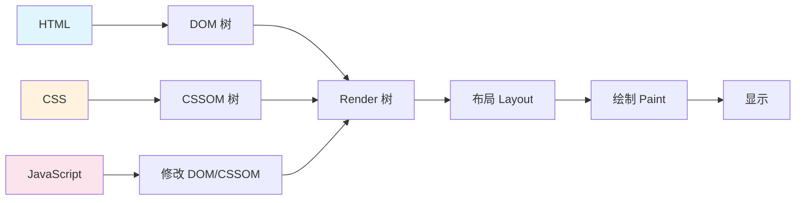

# 首屏加载优化

> **文档说明**：系统讲解 Web 首屏加载优化的完整体系，包括性能指标、分析工具、资源加载优化、渲染优化、网络优化、图片/字体/第三方脚本优化，以及 SSR/SSG 和性能监控。
>
> **适用人群**：前端开发者、全栈开发者、需要优化 Web 应用加载性能的开发者
>
> **前置知识**：[[Vue3-性能优化实战]]、[[Web性能指标与监控-LCP-FID-CLS]]、[[前端构建产物分析与优化]]

---

## 一、概述

### 1. 首屏加载的关键指标

```text
首屏加载核心指标：
- FCP（First Contentful Paint）：首次内容绘制，<1.8s 好
- LCP（Largest Contentful Paint）：最大内容绘制，<2.5s 好
- TTFB（Time To First Byte）：首字节时间，<800ms 好
- TTI（Time To Interactive）：可交互时间
- CLS（Cumulative Layout Shift）：累积布局偏移，<0.1 好

首屏加载的三个阶段：
1. 网络阶段：请求 → 响应 → 下载 HTML/CSS/JS
2. 渲染阶段：解析 → 构建 DOM/CSSOM → 布局 → 绘制
3. 交互阶段：JS 执行 → 事件绑定 → 可交互
```

### 2. 关键渲染路径



```text
关键渲染路径优化核心：
1. 减少关键资源数量（CSS/JS 是渲染阻塞资源）
2. 减少关键资源大小（压缩、代码分割）
3. 减少关键路径长度（减少请求往返）
4. 延迟非关键资源（懒加载、异步加载）
5. 预加载关键资源（preload、preconnect）
```

---

## 二、性能分析工具

### 1. Chrome DevTools

```text
Performance 面板：
- 录制页面加载过程
- 查看 Main 线程活动（脚本、样式、布局、绘制）
- 识别长任务（Long Task > 50ms）
- 查看帧速率、内存使用

Network 面板：
- 查看资源加载瀑布图
- 识别慢资源、大资源
- 查看请求时序、缓存命中
- 禁用缓存测试、模拟慢网络

Lighthouse 面板：
- 自动化审计
- 性能、可访问性、最佳实践、SEO 评分
- 具体优化建议
- 模拟移动端/桌面端
```

### 2. 常用分析命令

```bash
# Lighthouse CLI
npm install -g lighthouse
lighthouse https://example.com --view
lighthouse https://example.com --preset=desktop --output=json

# WebPageTest（在线工具）
# https://www.webpagetest.org/
# 多地点测试、影片回放、瀑布图

# Bundle 分析
# Vite
npx vite-bundle-visualizer
# Webpack
npx webpack-bundle-analyzer dist/stats.json
```

---

## 三、资源加载优化

### 1. 代码分割（Code Splitting）

```javascript
// Vite 自动代码分割配置
// vite.config.js
export default {
  build: {
    rollupOptions: {
      output: {
        manualChunks: {
          // 框架单独打包
          'vue-vendor': ['vue', 'vue-router', 'pinia'],
          // UI 库单独打包
          'ui-vendor': ['element-plus'],
          // 工具库单独打包
          'utils-vendor': ['lodash-es', 'dayjs'],
          // 图表库单独打包（大体积）
          'chart-vendor': ['echarts'],
        }
      }
    }
  }
}
```

### 2. 路由懒加载

```javascript
// Vue Router 懒加载
const routes = [
  {
    path: '/',
    component: () => import('../views/Home.vue')  // 懒加载
  },
  {
    path: '/dashboard',
    component: () => import('../views/Dashboard.vue')
  },
  {
    path: '/admin',
    component: () => import(/* webpackChunkName: "admin" */ '../views/Admin.vue')
  }
]

// React 懒加载
import { lazy, Suspense } from 'react';
const Dashboard = lazy(() => import('./Dashboard'));

function App() {
  return (
    <Suspense fallback={<Loading />}>
      <Dashboard />
    </Suspense>
  );
}
```

### 3. 组件级懒加载

```vue
<script setup>
import { defineAsyncComponent, ref } from 'vue'

// 异步组件
const HeavyChart = defineAsyncComponent(() =>
  import('../components/HeavyChart.vue')
)

const showChart = ref(false)
</script>

<template>
  <button @click="showChart = true">显示图表</button>
  <HeavyChart v-if="showChart" />
</template>
```

### 4. 预加载策略

```html
<!-- preconnect：提前建立连接（DNS+TCP+TLS） -->
<link rel="preconnect" href="https://api.example.com">
<link rel="preconnect" href="https://cdn.example.com" crossorigin>

<!-- dns-prefetch：只做 DNS 解析 -->
<link rel="dns-prefetch" href="https://api.example.com">

<!-- preload：预加载关键资源（当前页面必需） -->
<link rel="preload" href="/fonts/main.woff2" as="font" type="font/woff2" crossorigin>
<link rel="preload" href="/css/critical.css" as="style">
<link rel="preload" href="/js/app.js" as="script">

<!-- prefetch：预加载未来可能需要的资源（空闲时加载） -->
<link rel="prefetch" href="/js/dashboard.js" as="script">

<!-- 图片预加载 -->
<link rel="preload" as="image" href="/images/hero.jpg">
```

```javascript
// Vite 资源预加载
// 路由组件自动 prefetch
// 手动预加载
function prefetchRoute() {
  const link = document.createElement('link');
  link.rel = 'prefetch';
  link.href = '/assets/dashboard.js';
  document.head.appendChild(link);
}
```

---

## 四、渲染优化

### 1. CSS 优化

```css
/* 关键 CSS 内联（首屏必需的 CSS） */
<style>
  /* 首屏关键样式 */
  body { font-family: sans-serif; margin: 0; }
  .hero { height: 100vh; display: flex; align-items: center; }
</style>

/* 非关键 CSS 异步加载 */
<link rel="preload" href="/css/non-critical.css" as="style" onload="this.rel='stylesheet'">
<noscript><link rel="stylesheet" href="/css/non-critical.css"></noscript>

/* 避免阻塞渲染的 CSS */
/* 媒体查询特定 CSS */
<link rel="stylesheet" href="print.css" media="print">
<link rel="stylesheet" href="mobile.css" media="(max-width: 768px)">

/* 减少重排重绘 */
/* 用 transform/opacity 做动画 */
.animate {
  transform: translateX(100px);  /* 只触发合成层 */
  transition: transform 0.3s;
}

/* 避免布局抖动 */
img { aspect-ratio: 16 / 9; }  /* 预留图片空间 */
```

### 2. JavaScript 优化

```javascript
// 1. 延迟非关键 JS
<script src="analytics.js" defer></script>  <!-- defer：HTML 解析完后执行 -->
<script src="ads.js" async></script>         <!-- async：下载完立即执行 -->

// 2. 避免长任务（>50ms 会阻塞主线程）
// 拆分大任务
async function processLargeData(data) {
  const chunks = chunk(data, 1000);
  for (const chunk of chunks) {
    processChunk(chunk);
    await new Promise(resolve => setTimeout(resolve, 0));  // 让出主线程
  }
}

// 3. requestIdleCallback：空闲时执行
if ('requestIdleCallback' in window) {
  requestIdleCallback(() => {
    loadNonCriticalFeatures();
  });
}

// 4. Web Worker：计算密集型任务放后台线程
const worker = new Worker('/worker.js');
worker.postMessage(largeData);
worker.onmessage = (e) => {
  console.log('计算完成:', e.data);
};
```

### 3. 避免布局偏移（CLS）

```html
<!-- 图片预留空间 -->


<!-- 或用 aspect-ratio -->
<div style="aspect-ratio: 16/9;">
  
</div>

<!-- 字体：font-display: swap 避免 FOIT -->
@font-face {
  font-family: 'MyFont';
  src: url('/fonts/myfont.woff2') format('woff2');
  font-display: swap;  /* 先用系统字体，加载完后替换 */
}

<!-- 广告位预留空间 -->
<div style="min-height: 250px;">
  <!-- 广告内容动态加载 -->
</div>
```

---

## 五、网络优化

### 1. HTTP/2 和 HTTP/3

```text
HTTP/2 优势：
- 多路复用：一个连接并行多个请求
- 头部压缩：HPACK 减少头部开销
- 服务器推送：主动推送资源
- 二进制协议：更高效解析

HTTP/3 优势：
- 基于 QUIC（UDP）
- 0-RTT 连接建立
- 连接迁移（网络切换不断连）
- 队头阻塞问题解决

启用方式：
- Nginx：listen 443 ssl http2;
- CDN：大多数 CDN 默认支持 HTTP/2
- HTTP/3：需要服务端支持（Nginx 1.25+、Caddy、Cloudflare）
```

### 2. 压缩

```nginx
# Gzip 压缩
gzip on;
gzip_vary on;
gzip_min_length 1024;
gzip_types text/plain text/css text/xml text/javascript
           application/json application/javascript application/xml+rss
           application/rss+xml font/truetype font/opentype
           application/vnd.ms-fontobject image/svg+xml;
gzip_comp_level 6;  # 1-9，6 是压缩率和速度的平衡

# Brotli 压缩（比 Gzip 更好）
# 需要 ngx_brotli 模块
brotli on;
brotli_comp_level 6;
brotli_types text/plain text/css application/json application/javascript;
```

```javascript
// Vite 构建时生成压缩文件
// vite.config.js
import viteCompression from 'vite-plugin-compression';

export default {
  plugins: [
    viteCompression({ algorithm: 'gzip' }),
    viteCompression({ algorithm: 'brotliCompress', ext: '.br' }),
  ]
}
```

### 3. 缓存策略

```nginx
# HTML：不缓存（内容经常变）
location ~* \.html$ {
  add_header Cache-Control "no-cache";
}

# 带 hash 的静态资源：长期缓存
location ~* \.(js|css|png|jpg|jpeg|gif|ico|svg|woff2?)$ {
  add_header Cache-Control "public, max-age=31536000, immutable";
}

# API 响应：短期缓存
location /api/ {
  add_header Cache-Control "public, max-age=60";
}

# Service Worker 缓存（离线可用）
// sw.js
const CACHE_NAME = 'v1';
self.addEventListener('install', (e) => {
  e.waitUntil(
    caches.open(CACHE_NAME).then(cache =>
      cache.addAll(['/', '/index.html', '/css/app.css', '/js/app.js'])
    )
  );
});
```

### 4. CDN

```text
CDN（内容分发网络）优化：
1. 静态资源全部走 CDN（JS/CSS/图片/字体/视频）
2. 选择覆盖广的 CDN（Cloudflare、阿里云、腾讯云）
3. 配置缓存规则和过期时间
4. 启用 CDN 压缩（Gzip/Brotli）
5. 启用 CDN 图片优化（自动格式转换、压缩、裁剪）
6. 配置 CDN 预热（热门资源提前缓存）
7. 启用 HTTP/2/HTTP/3
```

---

## 六、图片优化

### 1. 现代图片格式

```text
图片格式选择：
- WebP：比 JPEG 小 25-35%，支持透明和动画
- AVIF：比 WebP 小 20-50%，压缩率更高，解码稍慢
- JPEG XL：下一代格式，目前支持有限
- SVG：矢量图，适合图标、插图
- 传统：JPEG（照片）、PNG（透明）、GIF（简单动画）

使用方式：
<picture>
  <source srcset="image.avif" type="image/avif">
  <source srcset="image.webp" type="image/webp">
  
</picture>
```

### 2. 图片压缩和响应式

```html
<!-- 响应式图片：不同屏幕加载不同尺寸 -->


<!-- 懒加载 -->

<iframe src="video.html" loading="lazy"></iframe>

<!-- 首屏图片：eager + preload -->
<link rel="preload" as="image" href="/images/hero.jpg">

```

### 3. 图片优化工具

```bash
# 批量压缩图片
# squoosh-cli（Google）
npm install -g @squoosh/cli
squoosh-cli --webp '{"quality":75}' *.jpg

# sharp（Node.js）
npm install sharp
# 脚本批量转换

# 在线工具
# https://squoosh.app/
# https://tinypng.com/

# Vite 图片优化插件
// vite.config.js
import { ViteImageOptimizer } from 'vite-plugin-image-optimizer';
export default {
  plugins: [
    ViteImageOptimizer({
      jpg: { quality: 80 },
      png: { quality: 80 },
      webp: { quality: 75 },
    })
  ]
}
```

---

## 七、字体优化

### 1. 字体加载策略

```css
/* font-display 策略 */
@font-face {
  font-family: 'MyFont';
  src: url('/fonts/myfont.woff2') format('woff2');
  font-display: swap;  /* 推荐：先用系统字体，加载完替换 */
}

/* font-display 可选值：
   auto：浏览器默认（通常 block）
   block：短暂阻塞，然后 FOIT（不可见文字）
   swap：立即用系统字体，加载完替换（FOUT）
   fallback：极短阻塞+短暂交换期，之后永久使用系统字体
   optional：极短阻塞，浏览器决定是否使用
*/
```

### 2. 字体子集化和预加载

```bash
# 字体子集化（只保留用到的字符，大幅减小体积）
# fonttools
pip install fonttools
pyftsubset font.woff2 --text="你好世界ABC123" --flavor=woff2

# 中文网站常用子集：常用 3500 字
# 工具：https://github.com/awmleer/hanzi
# 或在线：https://www.fontke.com/tool/subfont/
```

```html
<!-- 关键字体预加载 -->
<link rel="preload" href="/fonts/main.woff2" as="font" type="font/woff2" crossorigin>

<!-- 系统字体栈（避免加载自定义字体） -->
font-family: -apple-system, BlinkMacSystemFont, 'Segoe UI', Roboto,
             'Helvetica Neue', Arial, 'PingFang SC', 'Microsoft YaHei', sans-serif;
```

---

## 八、第三方脚本优化

```text
第三方脚本问题：
- 广告、分析、社交分享、客服等脚本
- 通常是性能杀手（阻塞渲染、长任务、大量请求）
- 不可控（第三方服务器慢、脚本更新）

优化策略：
1. 延迟加载：defer/async，或空闲时加载
2. 按需加载：用户交互时才加载
3. 自建代理：通过自己的 CDN 代理第三方脚本
4. 评估必要性：移除不需要的第三方脚本
5. 限时加载：setTimeout 延迟加载
6. iframe 隔离：第三方内容放 iframe
```

```javascript
// 延迟加载第三方脚本
function loadScript(src, callback) {
  const script = document.createElement('script');
  script.src = src;
  script.async = true;
  script.onload = callback;
  document.head.appendChild(script);
}

// 页面加载完成后再加载
window.addEventListener('load', () => {
  setTimeout(() => {
    loadScript('https://analytics.example.com/script.js');
  }, 2000);
});

// 交互时加载
document.getElementById('chat-btn').addEventListener('click', () => {
  loadScript('https://chat.example.com/widget.js');
});

// requestIdleCallback 空闲加载
if ('requestIdleCallback' in window) {
  requestIdleCallback(() => loadScript('https://analytics.example.com/script.js'));
}
```

---

## 九、SSR/SSG/预渲染

```text
渲染模式对比：

1. CSR（客户端渲染）：
   - 空 HTML + JS 渲染
   - 首屏慢，但后续导航快
   - SEO 差

2. SSR（服务端渲染）：
   - 每次请求服务端渲染 HTML
   - 首屏快，SEO 好
   - 服务器压力大
   - 框架：Nuxt.js、Next.js

3. SSG（静态站点生成）：
   - 构建时生成静态 HTML
   - 最快，CDN 部署
   - 适合内容不频繁变化
   - 框架：Nuxt generate、Next.js static、VitePress

4. ISR（增量静态再生）：
   - 静态页面 + 后台增量更新
   - 结合 SSG 和 SSR
   - Next.js 特色

5. 预渲染（Prerendering）：
   - 构建时预渲染关键页面
   - 其他页面 CSR
   - 折中方案
```

```javascript
// Nuxt 3 SSR 配置
// nuxt.config.ts
export default defineNuxtConfig({
  ssr: true,  // 启用 SSR
  nitro: {
    prerender: {
      routes: ['/', '/about']  // 预渲染特定页面
    }
  }
})

// 客户端组件（只在客户端渲染）
// <ClientOnly>
//   <HeavyComponent />
// </ClientOnly>
```

---

## 十、性能监控

### 1. Web Vitals 监控

```javascript
// 安装：npm install web-vitals
import { onLCP, onFID, onCLS, onINP, onFCP, onTTFB } from 'web-vitals';

function sendToAnalytics(metric) {
  const body = JSON.stringify({
    name: metric.name,
    value: metric.value,
    id: metric.id,
    rating: metric.rating,
    page: location.pathname,
  });
  // 发送到监控平台（Google Analytics、自建）
  navigator.sendBeacon('/analytics', body);
}

onLCP(sendToAnalytics);
onFID(sendToAnalytics);
onCLS(sendToAnalytics);
onINP(sendToAnalytics);
onFCP(sendToAnalytics);
onTTFB(sendToAnalytics);
```

### 2. 自定义性能指标

```javascript
// Performance API
const perfData = window.performance.timing;
const pageLoadTime = perfData.loadEventEnd - perfData.navigationStart;
const domReadyTime = perfData.domContentLoadedEventEnd - perfData.navigationStart;
const ttfb = perfData.responseStart - perfData.requestStart;

// User Timing API
performance.mark('start-render');
// ... 渲染逻辑
performance.mark('end-render');
performance.measure('render-time', 'start-render', 'end-render');

// 资源加载统计
const resources = performance.getEntriesByType('resource');
const slowResources = resources.filter(r => r.duration > 1000);
```

---

## 十一、最佳实践清单

### 资源加载
- [ ] **代码分割**：路由级、组件级懒加载
- [ ] **第三方库分包**：大体积库单独 chunk
- [ ] **Tree-shaking**：只打包用到的代码
- [ ] **预加载关键资源**：preload 首屏必需资源
- [ ] **prefetch 未来资源**：空闲时预加载
- [ ] **压缩资源**：Gzip/Brotli
- [ ] **CDN 加速**：静态资源走 CDN
- [ ] **缓存策略**：带 hash 资源长期缓存

### 渲染优化
- [ ] **关键 CSS 内联**：首屏样式内联到 HTML
- [ ] **非关键 CSS 异步加载**：preload + onload
- [ ] **JS defer/async**：非关键脚本延迟
- [ ] **避免长任务**：>50ms 任务拆分
- [ ] **避免布局偏移**：图片/字体/广告预留空间
- [ ] **用 transform 动画**：避免触发重排
- [ ] **减少重排重绘**：批量 DOM 操作

### 图片字体
- [ ] **现代图片格式**：WebP/AVIF
- [ ] **响应式图片**：srcset/sizes
- [ ] **图片懒加载**：loading="lazy"
- [ ] **图片压缩**：控制质量和尺寸
- [ ] **字体子集化**：只保留用到的字符
- [ ] **font-display: swap**：避免 FOIT
- [ ] **关键字体预加载**：preload woff2

### 架构选择
- [ ] **内容型用 SSG**：博客、文档、营销页
- [ ] **动态型用 SSR**：电商、社交、个性化
- [ ] **应用型用 CSR**：后台管理、工具应用
- [ ] **混合模式**：首屏 SSR，后续 CSR
- [ ] **边缘渲染**：Edge Functions/Workers

### 监控优化
- [ ] **Web Vitals 监控**：LCP/FID/CLS/INP
- [ ] **真实用户监控（RUM）**：收集真实用户数据
- [ ] **合成监控**：定期 Lighthouse 审计
- [ ] **告警阈值**：指标异常告警
- [ ] **A/B 测试**：优化效果验证
- [ ] **性能预算**：设定包体积/加载时间预算

---

## 十二、常见问题与排查

| 问题 | 原因 | 解决方案 |
|------|------|---------|
| **LCP 慢** | 最大内容元素加载慢 | 预加载 LCP 元素、优化图片、CDN、SSR |
| **FCP 慢** | HTML/CSS/JS 阻塞渲染 | 内联关键 CSS、延迟非关键 JS、减少 TTFB |
| **TTFB 慢** | 服务器响应慢 | 优化后端、CDN 缓存、SSR 优化、升级服务器 |
| **CLS 高** | 布局偏移 | 图片/字体/广告预留空间、font-display: swap |
| **INP 高** | 交互响应慢 | 减少长任务、Web Worker、防抖节流、优化事件处理 |
| **白屏时间长** | JS 体积大/加载慢 | 代码分割、压缩、CDN、SSR/SSG |
| **Bundle 太大** | 依赖过多/未分割 | 分析 bundle、按需引入、Tree-shaking、分包 |
| **图片加载慢** | 图片太大/未优化 | WebP/AVIF、压缩、响应式、懒加载、CDN |
| **字体闪烁** | 字体加载策略不对 | font-display: swap、预加载、子集化 |
| **第三方脚本阻塞** | 同步加载第三方脚本 | defer/async、延迟加载、按需加载、移除不必要 |
| **缓存失效** | 缓存策略不对 | 带 hash 长期缓存、HTML no-cache、正确配置 Cache-Control |
| **移动端慢** | 移动端网络/CPU 差 | 移动端专用优化、更小包、更低图片质量、SSR |
| **重复请求** | 未配置缓存/CDN | 配置 HTTP 缓存、CDN 缓存、Service Worker |
| **重定向多** | URL 重定向链 | 减少重定向、直接用最终 URL |
| **DNS 慢** | DNS 解析慢 | preconnect/dns-prefetch、使用快的 DNS |
| **TLS 握手慢** | 首次连接开销 | preconnect、会话复用、HTTP/2、HTTP/3 |

---

## 十三、关联笔记

### 前端性能
- [[Vue3-性能优化实战]] · [[Web性能指标与监控-LCP-FID-CLS]] · [[前端构建产物分析与优化]]
- [[懒加载与预加载策略]] · [[浏览器开发者工具进阶]]

### 前端安全
- [[前端安全-XSS-CSRF防护]] · [[API安全最佳实践]]

### 工程化
- [[前端工程化与构建工具]] · [[Vite-构建原理与插件开发]] · [[TypeScript-类型声明文件编写实战]]

### 导航
- [[MOC-前端开发]] · [[全栈+AI工程双轨融合学习路线图]]

> **学习路径建议**：先掌握 [[Vue3-性能优化实战]] 框架级优化 → 深入本文首屏加载优化 → 学习 [[Web性能指标与监控-LCP-FID-CLS]] 指标监控 → 实践 [[前端构建产物分析与优化]] 构建优化 → 研究 [[Vite-构建原理与插件开发]] 底层原理 → 构建完整的前端性能优化能力。
