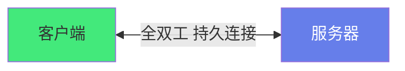
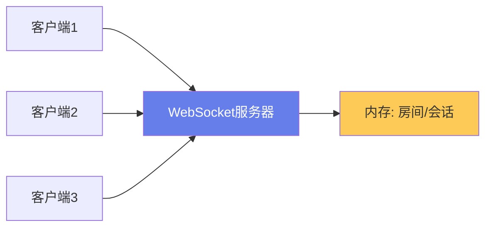
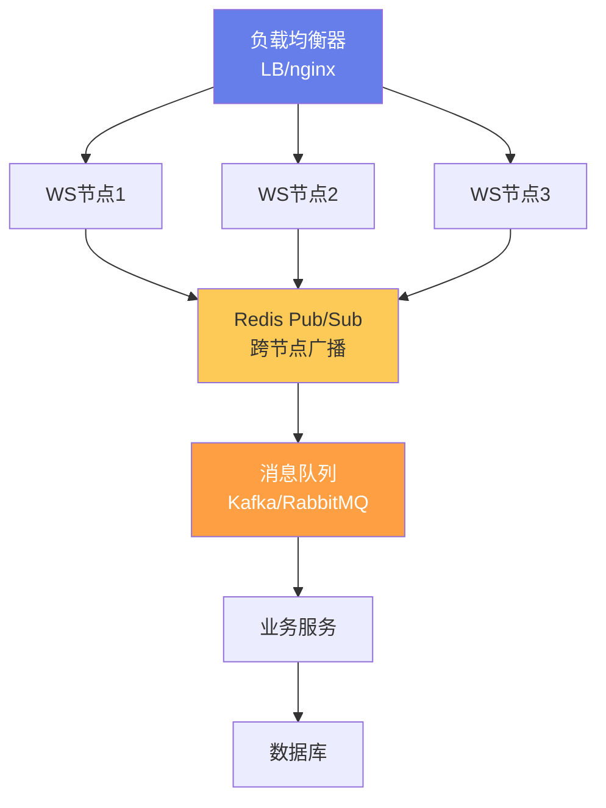

# 🔌 WebSocket 实时通信

> **文档说明**：系统讲解 WebSocket 实时通信的原理、API、架构与最佳实践，涵盖 WebSocket 的概念与底层原理（全双工通信/持久连接/HTTP 升级握手/TCP 长连接）、WebSocket 与 HTTP 短轮询/长轮询/SSE/Server-Sent Events 的对比、WebSocket 协议详解（握手请求/响应/数据帧格式/掩码 Masking/心跳 Ping-Pong/关闭帧/状态码）、前端 WebSocket API 完整指南（new WebSocket/事件 open/message/close/error/send 方法/readyState 状态/bufferedAmount/二进制类型）、后端 WebSocket 实现（Node.js ws 库/Socket.IO/Java Spring WebSocket/Go gorilla/websocket）、Socket.IO 深度解析（房间 Room/命名空间 Namespace/自动重连/降级到长轮询/消息确认 ACK/中间件）、实时通信系统架构（WebSocket 网关/会话管理/房间广播/水平扩展 Redis Pub-Sub/粘性会话）、心跳与断线重连机制（心跳间隔/Ping-Pong/指数退避重连/断线消息缓存/状态恢复）、消息协议设计（JSON vs 二进制 ProtocolBuf/消息类型字段/序列号/确认机制/消息压缩）、安全设计（鉴权 Token/Origin 校验/消息大小限制/频率限制/WSS 加密/CORS）、性能优化（连接复用/消息合并/二进制帧/背压处理/连接池/负载均衡）、典型应用场景（实时聊天/协同编辑/实时通知/在线游戏/股票行情/实时协作白板）、常见问题排查与最佳实践。
>
> **适用人群**：前端/后端/全栈开发者、需要构建实时应用的工程师、架构师
>
> **前置知识**：[[HTTP协议完整指南]] · [[JavaScript核心语法与ES6+]]

---

## 一、概述

### 1.1 什么是 WebSocket

**WebSocket** 是一种在单个 TCP 连接上进行**全双工（Full-Duplex）通信**的协议，允许客户端和服务器之间进行持久的、双向的实时数据传输。



**核心特点**：
- 🔄 **全双工**：客户端和服务器可以同时发送数据
- 🔌 **持久连接**：一次握手，连接保持，无需重复建立
- 🚀 **低延迟**：没有 HTTP 请求的头部开销
- 📦 **轻量帧**：数据帧最小只有 2 字节头部
- 🔒 **基于 TCP**：可靠传输，有序到达

### 1.2 WebSocket vs 其他实时方案

| 方案 | 双向 | 延迟 | 开销 | 复杂度 | 适用场景 |
|------|------|------|------|--------|---------|
| **HTTP 短轮询** | ❌ 单向 | 高 | 高（每次完整HTTP） | 低 | 简单、低频更新 |
| **HTTP 长轮询** | ❌ 单向 | 中 | 中 | 中 | 兼容旧浏览器 |
| **SSE** | ❌ 服务器→客户端 | 低 | 低 | 低 | 服务器推送、通知 |
| **WebSocket** | ✅ 全双工 | 极低 | 极低 | 中 | 实时聊天、游戏、协作 |
| **WebRTC** | ✅ P2P | 极低 | 低 | 高 | 音视频、P2P 文件 |

### 1.3 WebSocket 的诞生背景

HTTP 协议是「请求-响应」模式，服务器无法主动推送数据。在 WebSocket 出现之前，实现实时通信的方案都有缺陷：
- **短轮询**：客户端每隔几秒发一次请求，大部分请求是空的，浪费带宽
- **长轮询**：客户端发请求，服务器挂起直到有数据再返回，然后立即重新请求
- **SSE**：只能服务器推客户端，不能客户端推服务器

WebSocket 通过「HTTP 升级握手」建立持久连接，彻底解决了这些问题。

---

## 二、WebSocket 协议详解

### 2.1 握手过程

WebSocket 连接通过 HTTP 升级握手建立：

```http
// 客户端请求
GET /ws HTTP/1.1
Host: example.com
Upgrade: websocket
Connection: Upgrade
Sec-WebSocket-Key: dGhlIHNhbXBsZSBub25jZQ==
Sec-WebSocket-Version: 13
Origin: https://example.com

// 服务器响应
HTTP/1.1 101 Switching Protocols
Upgrade: websocket
Connection: Upgrade
Sec-WebSocket-Accept: s3pPLMBiTxaQ9kYGzzhZRbK+xOo=
```

**握手要点**：
- 客户端发送 `Upgrade: websocket` 和 `Connection: Upgrade` 请求升级
- `Sec-WebSocket-Key` 是客户端生成的随机 Base64 字符串
- 服务器用 `Key + 258EAFA5-E914-47DA-95CA-C5AB0DC85B11` 做 SHA-1 再 Base64，生成 `Sec-WebSocket-Accept`
- 服务器返回 `101 Switching Protocols` 表示升级成功
- 握手完成后，连接从 HTTP 切换为 WebSocket 协议

### 2.2 数据帧格式

```text
 0                   1                   2                   3
 0 1 2 3 4 5 6 7 8 9 0 1 2 3 4 5 6 7 8 9 0 1 2 3 4 5 6 7 8 9 0 1
+-+-+-+-+-------+-+-------------+-------------------------------+
|F|R|R|R| opcode|M| Payload len |    Extended payload length    |
|I|S|S|S|  (4)  |A|     (7)     |             (16/64)           |
|N|V|V|V|       |S|             |   (if payload len==126/127)   |
| |1|2|3|       |K|             |                               |
+-+-+-+-+-------+-+-------------+ - - - - - - - - - - - - - - - +
|     Extended payload length continued, if payload len == 127  |
+ - - - - - - - - - - - - - - - +-------------------------------+
|                               |Masking-key, if MASK set to 1  |
+-------------------------------+-------------------------------+
| Masking-key (continued)       |          Payload Data         |
+-------------------------------- - - - - - - - - - - - - - - - +
:                     Payload Data continued ...                :
+ - - - - - - - - - - - - - - - - - - - - - - - - - - - - - - - +
|                     Payload Data continued ...                |
+---------------------------------------------------------------+
```

**字段说明**：

| 字段 | 位 | 说明 |
|------|-----|------|
| **FIN** | 1 | 是否最后一帧（1=是，0=还有后续帧） |
| **RSV1-3** | 3 | 扩展用，通常为 0 |
| **Opcode** | 4 | 帧类型（见下表） |
| **MASK** | 1 | 是否掩码（客户端发服务器必须掩码） |
| **Payload len** | 7 | 数据长度（0-125，126=后续16位，127=后续64位） |
| **Masking-key** | 0/32 | 掩码密钥（MASK=1 时存在） |
| **Payload Data** | 变长 | 实际数据 |

**Opcode 类型**：

| Opcode | 含义 |
|--------|------|
| 0x0 | 连续帧（分片消息的后续帧） |
| 0x1 | 文本帧（UTF-8） |
| 0x2 | 二进制帧 |
| 0x8 | 关闭连接帧 |
| 0x9 | Ping（心跳） |
| 0xA | Pong（心跳响应） |

### 2.3 掩码（Masking）

客户端发送给服务器的所有帧**必须掩码**，防止代理服务器缓存攻击。掩码算法：
```text
masked[i] = original[i] XOR masking_key[i % 4]
```

服务器发送给客户端的帧**不需要掩码**。

```text
### 2.4 心跳 Ping-Pong
```

- 客户端或服务器可以发送 **Ping 帧（0x9）**
- 接收方必须回复 **Pong 帧（0xA）**（携带相同的 Payload）
- 用于检测连接是否存活、防止中间设备超时断开

### 2.5 关闭帧与状态码

关闭帧（0x8）携带 2 字节状态码和可选的关闭原因：

| 状态码 | 含义 |
|--------|------|
| 1000 | 正常关闭 |
| 1001 | 端点离开（服务器下线/浏览器跳转） |
| 1002 | 协议错误 |
| 1003 | 不支持的数据类型 |
| 1006 | 连接异常关闭（无关闭帧） |
| 1007 | 数据格式错误（非 UTF-8） |
| 1008 | 策略违规 |
| 1009 | 消息过大 |
| 1011 | 服务器内部错误 |

---

## 三、前端 WebSocket API

### 3.1 创建连接

```typescript
// 创建 WebSocket 连接
const ws = new WebSocket('wss://example.com/ws')

// 带查询参数（常用于传 token）
const ws = new WebSocket(`wss://example.com/ws?token=${authToken}`)

// 子协议
const ws = new WebSocket('wss://example.com/ws', ['chat', 'superchat'])
```

> 生产环境必须用 `wss://`（WebSocket Secure，基于 TLS），不要用 `ws://`。

### 3.2 事件处理

```typescript
const ws = new WebSocket('wss://example.com/ws')

// 连接打开
ws.addEventListener('open', (event) => {
  console.log('WebSocket 连接已建立')
  ws.send(JSON.stringify({ type: 'join', room: 'chat-123' }))
})

// 收到消息
ws.addEventListener('message', (event) => {
  // 文本消息
  if (typeof event.data === 'string') {
    const data = JSON.parse(event.data)
    console.log('收到消息：', data)
  }
  // 二进制消息
  else if (event.data instanceof Blob) {
    console.log('收到二进制数据：', event.data)
  }
  // ArrayBuffer
  else if (event.data instanceof ArrayBuffer) {
    console.log('收到 ArrayBuffer：', event.data)
  }
})

// 连接关闭
ws.addEventListener('close', (event) => {
  console.log(`连接关闭，状态码：${event.code}，原因：${event.reason}`)
})

// 连接错误
ws.addEventListener('error', (event) => {
  console.error('WebSocket 错误：', event)
})
```

### 3.3 发送消息

```typescript
// 发送文本
ws.send('Hello, server!')

// 发送 JSON
ws.send(JSON.stringify({ type: 'message', content: '你好' }))

// 发送二进制
const buffer = new ArrayBuffer(8)
const view = new DataView(buffer)
view.setFloat64(0, 3.14)
ws.send(buffer)

// 发送 Blob
ws.send(new Blob(['file content'], { type: 'text/plain' }))
```

### 3.4 连接状态

```typescript
// readyState 状态
switch (ws.readyState) {
  case WebSocket.CONNECTING:  // 0
    console.log('正在连接')
    break
  case WebSocket.OPEN:        // 1
    console.log('已连接')
    break
  case WebSocket.CLOSING:     // 2
    console.log('正在关闭')
    break
  case WebSocket.CLOSED:      // 3
    console.log('已关闭')
    break
}

// 缓冲区大小（发送队列中未发送的数据量）
console.log(`缓冲区：${ws.bufferedAmount} 字节`)

// 二进制类型设置
ws.binaryType = 'blob'         // 默认
ws.binaryType = 'arraybuffer'  // 推荐，性能更好
```

### 3.5 关闭连接

```typescript
// 正常关闭
ws.close(1000, '用户主动断开')

// 强制关闭（不发关闭帧）
// ws.close() 不带参数也是正常关闭
```

---

## 四、封装一个健壮的 WebSocket 类

### 4.1 带心跳和重连的封装

```typescript
interface ReconnectOptions {
  maxRetries?: number
  initialDelay?: number
  maxDelay?: number
  heartbeatInterval?: number
}

class RobustWebSocket {
  private ws: WebSocket | null = null
  private url: string
  private retries = 0
  private heartbeatTimer: number | null = null
  private reconnectTimer: number | null = null
  private options: Required<ReconnectOptions>
  private listeners: Map<string, Set<Function>> = new Map()

  constructor(url: string, options: ReconnectOptions = {}) {
    this.url = url
    this.options = {
      maxRetries: options.maxRetries ?? Infinity,
      initialDelay: options.initialDelay ?? 1000,
      maxDelay: options.maxDelay ?? 30000,
      heartbeatInterval: options.heartbeatInterval ?? 30000
    }
    this.connect()
  }

  private connect() {
    this.ws = new WebSocket(this.url)
    this.ws.binaryType = 'arraybuffer'

    this.ws.onopen = () => {
      this.retries = 0
      this.emit('open')
      this.startHeartbeat()
    }

    this.ws.onmessage = (event) => {
      this.emit('message', event.data)
    }

    this.ws.onclose = (event) => {
      this.stopHeartbeat()
      this.emit('close', event)
      if (event.code !== 1000) {
        this.scheduleReconnect()
      }
    }

    this.ws.onerror = (event) => {
      this.emit('error', event)
    }
  }

  private startHeartbeat() {
    this.heartbeatTimer = window.setInterval(() => {
      if (this.ws?.readyState === WebSocket.OPEN) {
        this.ws.send(JSON.stringify({ type: 'ping' }))
      }
    }, this.options.heartbeatInterval)
  }

  private stopHeartbeat() {
    if (this.heartbeatTimer) {
      clearInterval(this.heartbeatTimer)
      this.heartbeatTimer = null
    }
  }

  private scheduleReconnect() {
    if (this.retries >= this.options.maxRetries) {
      this.emit('maxRetriesReached')
      return
    }
    // 指数退避 + 随机抖动
    const delay = Math.min(
      this.options.initialDelay * Math.pow(2, this.retries),
      this.options.maxDelay
    )
    const jitter = delay * 0.3 * Math.random()
    const totalDelay = delay + jitter

    this.retries++
    this.emit('reconnecting', { attempt: this.retries, delay: totalDelay })

    this.reconnectTimer = window.setTimeout(() => {
      this.connect()
    }, totalDelay)
  }

  send(data: string | ArrayBuffer | Blob) {
    if (this.ws?.readyState === WebSocket.OPEN) {
      this.ws.send(data)
    } else {
      this.emit('sendFailed', data)
    }
  }

  close(code = 1000, reason = '') {
    if (this.reconnectTimer) clearTimeout(this.reconnectTimer)
    this.stopHeartbeat()
    this.ws?.close(code, reason)
  }

  on(event: string, callback: Function) {
    if (!this.listeners.has(event)) {
      this.listeners.set(event, new Set())
    }
    this.listeners.get(event)!.add(callback)
    return () => this.listeners.get(event)!.delete(callback)
  }

  private emit(event: string, ...args: any[]) {
    this.listeners.get(event)?.forEach(cb => cb(...args))
  }
}

// 使用
const ws = new RobustWebSocket('wss://example.com/ws', {
  heartbeatInterval: 25000,
  maxDelay: 15000
})

ws.on('open', () => console.log('已连接'))
ws.on('message', (data) => console.log('收到：', data))
ws.on('reconnecting', ({ attempt, delay }) => 
  console.log(`第 ${attempt} 次重连，${delay}ms 后`)
)
```

---

## 五、后端 WebSocket 实现

### 5.1 Node.js：ws 库

```bash
npm install ws
```

```typescript
import { WebSocketServer, WebSocket } from 'ws'

const wss = new WebSocketServer({ port: 8080 })

// 房间管理
const rooms = new Map<string, Set<WebSocket>>()

wss.on('connection', (ws, req) => {
  console.log('新客户端连接', req.socket.remoteAddress)

  ws.on('message', (data) => {
    const message = JSON.parse(data.toString())
    
    switch (message.type) {
      case 'join':
        // 加入房间
        if (!rooms.has(message.room)) rooms.set(message.room, new Set())
        rooms.get(message.room)!.add(ws)
        break
      case 'chat':
        // 广播到房间
        rooms.get(message.room)?.forEach(client => {
          if (client.readyState === WebSocket.OPEN) {
            client.send(JSON.stringify({
              type: 'chat',
              user: message.user,
              content: message.content
            }))
          }
        })
        break
      case 'ping':
        ws.send(JSON.stringify({ type: 'pong' }))
        break
    }
  })

  ws.on('close', () => {
    // 从所有房间移除
    rooms.forEach(room => room.delete(ws))
    console.log('客户端断开')
  })
})
```

### 5.2 Socket.IO

Socket.IO 是 WebSocket 的高级封装，提供：
- 自动重连（指数退避）
- 降级到长轮询（WebSocket 不可用时）
- 房间和命名空间
- 消息确认（ACK）
- 二进制支持
- 中间件

```typescript
// 服务器
import { createServer } from 'http'
import { Server } from 'socket.io'

const httpServer = createServer()
const io = new Server(httpServer, {
  cors: { origin: '*' }
})

// 命名空间
const chatNamespace = io.of('/chat')

chatNamespace.on('connection', (socket) => {
  console.log('用户连接', socket.id)

  // 加入房间
  socket.join('room-123')

  // 监听消息
  socket.on('chat message', (msg, ack) => {
    // 广播到房间（除了自己）
    socket.to('room-123').emit('chat message', msg)
    // 确认回调
    ack({ status: 'ok' })
  })

  // 断开
  socket.on('disconnect', () => {
    console.log('用户断开', socket.id)
  })
})

httpServer.listen(3000)
```

```typescript
// 客户端
import { io } from 'socket.io-client'

const socket = io('https://example.com/chat', {
  transports: ['websocket', 'polling'],  // 优先 WebSocket，降级轮询
  reconnection: true,
  reconnectionAttempts: 5,
  reconnectionDelay: 1000
})

socket.on('connect', () => {
  console.log('已连接', socket.id)
})

socket.emit('chat message', '你好', (ack) => {
  console.log('服务器确认：', ack)
})

socket.on('chat message', (msg) => {
  console.log('收到：', msg)
})
```

### 5.3 其他后端

| 语言/框架 | 库 |
|----------|-----|
| **Node.js** | ws, Socket.IO, uWebSockets.js（高性能） |
| **Java** | Spring WebSocket, Netty, Tyrus |
| **Go** | gorilla/websocket, nhooyr/websocket |
| **Python** | websockets, Django Channels, FastAPI |
| **PHP** | Ratchet, Workerman |
| **.NET** | SignalR, ASP.NET Core WebSockets |

---

## 六、实时通信系统架构

### 6.1 单机架构



适用于：用户量小、单机房、开发测试。

### 6.2 分布式架构



**关键设计**：
- **粘性会话（Sticky Session）**：同一用户的 WebSocket 连接路由到同一节点
- **Redis Pub/Sub**：跨节点广播消息（节点1收到消息，发布到 Redis，其他节点订阅后转发给本地连接）
- **消息队列**：异步处理业务逻辑，不阻塞 WebSocket 节点
- **会话存储**：用户连接信息存在 Redis，支持节点间共享

### 6.3 水平扩展方案

| 方案 | 说明 | 适用 |
|------|------|------|
| **Redis Pub/Sub** | 最简单，发布订阅 | 中小规模 |
| **消息队列** | Kafka/RabbitMQ，持久化、可回溯 | 大规模、需要消息持久化 |
| **专用网关** | 如 Centrifugo、Socket.IO Redis Adapter | 不想自己造轮子 |
| **P2P + 信令** | WebRTC，服务器只做信令 | 音视频、P2P 文件 |

---

## 七、消息协议设计

### 7.1 JSON 协议（简单场景）

```json
{
  "type": "chat.message",
  "id": "msg_001",
  "timestamp": 1693267200000,
  "payload": {
    "roomId": "room_123",
    "userId": "user_456",
    "content": "你好"
  }
}
```

**优点**：人类可读、调试方便、前后端通用
**缺点**：体积大、解析慢

### 7.2 二进制协议（高性能场景）

用 Protocol Buffers / MessagePack / FlatBuffers：

```protobuf
// message.proto
syntax = "proto3";

message ChatMessage {
  string type = 1;
  string id = 2;
  int64 timestamp = 3;
  string room_id = 4;
  string user_id = 5;
  string content = 6;
}
```

**优点**：体积小（比 JSON 小 30-50%）、解析快、强类型
**缺点**：不可读、需要 schema、调试复杂

### 7.3 消息可靠性

| 机制 | 说明 |
|------|------|
| **消息 ID** | 每条消息唯一 ID，客户端去重 |
| **序列号** | 单调递增，检测消息丢失/乱序 |
| **ACK 确认** | 接收方回复确认，发送方超时重传 |
| **心跳** | 定期 Ping-Pong，检测连接存活 |
| **断线缓存** | 断线期间的消息存在服务器，重连后补发 |

---

## 八、安全设计

### 8.1 鉴权

```typescript
// 方式1：URL 参数传 token（简单但 token 会出现在日志中）
const ws = new WebSocket(`wss://example.com/ws?token=${jwt}`)

// 方式2：连接后第一条消息鉴权（推荐）
const ws = new WebSocket('wss://example.com/ws')
ws.onopen = () => {
  ws.send(JSON.stringify({ type: 'auth', token: jwt }))
}

// 方式3：Cookie（同源场景）
// 浏览器自动携带 Cookie，服务器验证
```

### 8.2 安全检查清单

| 检查项 | 说明 |
|--------|------|
| **WSS 加密** | 生产环境必须用 wss://，不要用 ws:// |
| **Origin 校验** | 服务器校验请求 Origin，防止跨站 WebSocket 劫持 |
| **Token 鉴权** | 连接时验证用户身份，不要信任客户端 |
| **消息大小限制** | 限制单条消息最大大小（如 1MB），防止 DoS |
| **频率限制** | 限制单连接消息频率，防止刷屏攻击 |
| **输入校验** | 所有消息内容做校验，防止注入 |
| **CORS** | 配置允许的 Origin 白名单 |
| **心跳超时** | 长时间无心跳的连接主动断开 |

---

## 九、性能优化

| 优化点 | 方法 |
|--------|------|
| **连接复用** | 一个页面只用一个 WebSocket 连接，多路复用 |
| **消息合并** | 高频小消息合并为批量发送（如每 100ms 合并一次） |
| **二进制协议** | 用 Protobuf/MessagePack 替代 JSON |
| **压缩** | permessage-deflate 扩展（WebSocket 压缩扩展） |
| **背压处理** | 监控 bufferedAmount，发送过快时暂停发送 |
| **连接池** | 服务器端复用连接资源 |
| **负载均衡** | 多节点水平扩展，粘性会话 |
| **心跳优化** | 合理设置心跳间隔（通常 20-30 秒） |
| **断线重连** | 指数退避 + 随机抖动，避免重连风暴 |

---

## 十、典型应用场景

| 场景 | 核心需求 | 技术要点 |
|------|---------|---------|
| **实时聊天** | 消息即时送达、已读回执、在线状态 | 房间广播、消息 ACK、Presence |
| **协同编辑** | 多人同时编辑、冲突合并、光标同步 | OT/CRDT、操作广播、光标感知 |
| **实时通知** | 服务器推送通知、未读数 | SSE 或 WebSocket、消息计数 |
| **在线游戏** | 低延迟、状态同步、帧同步 | UDP/WebRTC、状态插值、预测回滚 |
| **股票行情** | 高频数据推送、低延迟 | 二进制协议、消息合并、增量更新 |
| **实时白板** | 图形同步、多人绘制 | 操作广播、Canvas 同步、CRDT |
| **直播弹幕** | 高并发、消息广播 | 消息队列、批量推送、限流 |
| **AI 对话** | 流式输出、中断控制 | SSE 或 WebSocket、流式帧、Abort |

---

## 十一、常见问题排查

| 问题 | 可能原因 | 解决方案 |
|------|---------|---------|
| **连接失败** | URL 错误、证书问题、防火墙 | 检查 wss://、证书有效性、端口开放 |
| **频繁断开** | 心跳超时、代理超时、网络波动 | 缩短心跳间隔、检查 Nginx proxy_read_timeout |
| **消息丢失** | 网络抖动、无 ACK 机制 | 加消息 ID + ACK + 重传 |
| **消息乱序** | 多路径传输、TCP 不保证？ | TCP 保证有序，检查是否多连接 |
| **内存泄漏** | 未清理事件监听、房间未移除 | close 时移除所有监听和房间成员 |
| **跨域问题** | Origin 未授权 | 服务器配置 CORS/Origin 白名单 |
| **Nginx 504** | 代理超时 | `proxy_read_timeout 3600s`、`proxy_send_timeout` |
| **移动端后台断开** | 系统限制 | 后台时关闭连接，前台重连，服务器缓存消息 |
| **发送缓冲堆积** | 发送过快、网络慢 | 检查 bufferedAmount，实现背压 |

### Nginx 反向代理配置

```nginx
location /ws {
    proxy_pass http://backend;
    proxy_http_version 1.1;
    proxy_set_header Upgrade $http_upgrade;
    proxy_set_header Connection "upgrade";
    proxy_set_header Host $host;
    proxy_set_header X-Real-IP $remote_addr;
    proxy_read_timeout 3600s;
    proxy_send_timeout 3600s;
}
```

---

## 十二、最佳实践

1. **生产环境用 wss://**：TLS 加密，不要用 ws://
2. **封装健壮的 WebSocket 类**：心跳、重连、错误处理统一封装
3. **指数退避重连**：1s → 2s → 4s → 8s，加随机抖动，避免重连风暴
4. **心跳保活**：20-30 秒一次 Ping，超时未收到 Pong 则断开重连
5. **消息加唯一 ID**：用于去重、ACK 确认、断线补发
6. **连接状态对外暴露**：让 UI 能显示「连接中/已连接/已断开/重连中」
7. **断线消息缓存**：服务器缓存断线期间消息，重连后按序列号补发
8. **一个页面一个连接**：不要为每个功能建一个连接，用消息 type 多路复用
9. **二进制协议用于高频场景**：JSON 够用就用 JSON，高频大数据用 Protobuf
10. **监控连接指标**：连接数、消息量、断开率、重连率，及时发现问题
11. **优雅关闭**：页面卸载时主动 close(1000)，不要等超时
12. **测试异常场景**：断网、弱网、服务器重启、消息乱序都要测试

---

## 十三、关联笔记

### 前端与实时
- [[对话式UI组件设计]] · [[实时协作系统设计]] · [[VueUse-工具函数库]]
- [[HTTP协议完整指南]] · [[JavaScript核心语法与ES6+]]

### 后端与架构
- [[分布式系统设计]] · [[高并发系统设计案例_backup_skeleton]] · [[消息队列与异步通信]]
- [[NestJS框架入门]] · [[微服务架构设计]]

### AI 工程
- [[LLM服务架构]] · [[Java AI Agent开发知识点系统梳理_优化版]] · [[RAG检索增强生成]]

### 导航
- [[MOC-前端开发]] · [[MOC-组件与UI]] · [[Home]] · [[学习路线总览]]

> 🔍 **知识点深度解析**
>
> **作用**：WebSocket 实时通信解决的是「如何在浏览器和服务器之间建立持久的、全双工的、低延迟的双向通信通道，满足实时聊天、协同编辑、游戏、行情推送等需要即时数据传输的应用场景」的核心问题——HTTP 的请求-响应模式无法实现服务器主动推送，轮询方案效率低、延迟高，WebSocket 通过 HTTP 升级握手建立持久 TCP 连接，彻底解决了 Web 实时通信的难题。
>
> **底层原理**：①WebSocket 的本质是「基于 TCP 的应用层全双工协议」——它在 HTTP 握手之后，将 TCP 连接从 HTTP 协议「升级」为 WebSocket 协议，之后双方可以在同一个 TCP 连接上自由地双向发送数据帧，不再需要 HTTP 的请求-响应模式。这种升级设计的巧妙之处在于：它复用了 HTTP 的基础设施（端口 80/443、代理、防火墙），同时获得了全双工通信的能力。②握手过程的核心是「HTTP Upgrade 机制」——客户端发送带有 `Upgrade: websocket` 和 `Sec-WebSocket-Key` 的 HTTP 请求，服务器返回 `101 Switching Protocols` 和 `Sec-WebSocket-Accept`（Key + 固定 GUID 做 SHA-1 再 Base64），双方确认后切换协议。这个 GUID（258EAFA5-E914-47DA-95CA-C5AB0DC85B11）是 RFC 6455 规定的固定值，用于防止客户端误将非 WebSocket 响应当作 WebSocket 握手。③数据帧的设计体现了「极简 + 可扩展」的哲学——最小帧只有 2 字节头部（FIN+Opcode+MASK+Payload len），支持文本和二进制两种数据类型，支持分片（FIN=0 表示后续还有帧），支持扩展（RSV 位）。掩码（Masking）是一个特殊设计：客户端发服务器的帧必须掩码，用 4 字节密钥对数据做 XOR，这是为了防止「代理服务器缓存中毒攻击」——某些旧代理会把 WebSocket 数据误认为 HTTP 响应并缓存，掩码让数据看起来是随机的，无法被缓存。④心跳（Ping-Pong）是长连接的「生命体征」——中间设备（Nginx、防火墙、负载均衡）通常有空闲连接超时（如 60 秒无数据就断开），定期发送 Ping 帧可以保持连接活跃。收到 Ping 的一方必须回复 Pong（携带相同的 Payload），这也可以用来检测连接是否真的存活（半开连接检测）。⑤分布式 WebSocket 的核心挑战是「跨节点广播」——当用户 A 连在节点 1，用户 B 连在节点 2，A 发消息给 B 时，节点 1 需要把消息转发给节点 2。标准方案是 Redis Pub/Sub：每个节点订阅一个频道，收到消息时发布到频道，所有节点收到后转发给本地连接。粘性会话（Sticky Session）确保同一用户的连接始终在同一节点，减少状态同步的复杂度。⑥断线重连的「指数退避 + 随机抖动」是防止「重连风暴」的关键——如果服务器重启，所有客户端同时重连会瞬间打满服务器。指数退避（1s→2s→4s→8s）让重连请求逐渐分散，随机抖动（±30%）进一步避免同步。这和 TCP 的拥塞控制、网络重试的设计思想一致。⑦Socket.IO 在 WebSocket 之上做了大量工程化封装：自动重连、降级到长轮询（WebSocket 被企业防火墙拦截时）、房间和命名空间、消息 ACK、二进制支持。它不是 WebSocket 的替代品，而是「WebSocket + 降级 + 可靠性」的高级封装，适合不想自己处理边缘情况的团队。但 Socket.IO 有额外的协议开销，且必须前后端都用 Socket.IO（不能和原生 WebSocket 互通）。
>
> **用法要点**：① WebSocket核心：全双工/持久连接/低延迟/基于TCP，wss://生产环境 ② 握手：HTTP Upgrade+Sec-WebSocket-Key，服务器101+Sec-WebSocket-Accept ③ 数据帧：FIN(最后帧)/Opcode(文本0x1/二进制0x2/关闭0x8/Ping0x9/Pong0xA)/MASK(客户端必须掩码)/Payload len ④ 前端API：new WebSocket(url)/事件open/message/close/error/send()/readyState(0连接中1已开2关闭中3已关)/binaryType/close() ⑤ 封装要点：心跳(Ping-Pong 20-30s)/指数退避重连(1→2→4→8s+抖动)/消息队列/状态事件/断线缓存 ⑥ 后端：Node.js ws(轻量)/Socket.IO(高级封装自动重连降级)/Java Spring/Go gorilla ⑦ Socket.IO：房间Room/命名空间Namespace/ACK确认/中间件/transports降级 ⑧ 分布式架构：粘性会话+Redis Pub/Sub跨节点广播+消息队列异步处理 ⑨ 消息协议：JSON(可读)/Protobuf(高性能二进制)/消息ID+序列号+ACK确认 ⑩ 安全：wss加密/Origin校验/Token鉴权/消息大小限制/频率限制/输入校验 ⑪ 性能：连接复用/消息合并/二进制协议/permessage-deflate压缩/背压(bufferedAmount)/负载均衡 ⑫ Nginx代理：proxy_http_version 1.1/Upgrade/Connection upgrade/proxy_read_timeout 3600s ⑬ 常见问题：连接失败(证书/端口)/频繁断开(心跳/代理超时)/消息丢失(ACK+重传)/内存泄漏(清理监听)/移动端后台断开(重连+缓存) ⑭ 最佳实践：wss/封装健壮类/指数退避/心跳保活/消息ID/连接状态UI/断线缓存/一页一连接/监控指标/优雅关闭/测试异常场景。

> 💡 **深度讲解**：WebSocket 最核心的智慧是「用一次握手的代价，换取无限次低延迟双向通信的能力——把 HTTP 的请求-响应模式升级为持久的全双工通道，让 Web 真正具备了实时通信的能力」——在 WebSocket 出现之前，Web 实时通信是一场「hack 大赛」：短轮询每秒发一次请求（99% 是空请求，浪费带宽），长轮询挂起连接直到有数据（服务器资源占用高），SSE 只能服务器推客户端（不能双向）。WebSocket 的出现彻底改变了这一切——一次 HTTP 升级握手后，连接保持，双方可以随时发送最小 2 字节头部的数据帧，延迟从秒级降到毫秒级，带宽开销降低 90% 以上。但 WebSocket 也带来了新的挑战：长连接的心跳保活、断线重连、分布式跨节点广播、消息可靠性、安全防护……这些都是 HTTP 短连接不需要考虑的问题。这就是为什么生产环境很少直接用原生 WebSocket，而是用 Socket.IO 或自己封装一层——原生 WebSocket 只提供了「管道」，但「管道的维护、消息的可靠传输、连接的故障恢复」需要自己实现。WebSocket 的设计也体现了互联网协议的「极简 + 可扩展」哲学：最小帧只有 2 字节，掩码用简单的 XOR，心跳用 Ping-Pong，扩展用 RSV 位——简单到可以在几小时内实现一个基础库，但又足够灵活支持各种高级特性（压缩、子协议、扩展）。在 AI 时代，WebSocket 有了新的应用场景——AI 对话的流式输出（SSE 更常用，但 WebSocket 支持双向中断和控制）、AI Agent 的实时状态同步、多模态 AI 的实时音视频流。掌握 WebSocket，不仅是掌握「实时通信技术」，更是理解「如何在不可靠的网络上构建可靠的实时系统」——心跳、重连、ACK、幂等、背压，这些概念在分布式系统、消息队列、物联网中同样适用。从今天开始，不要只满足于「用 Socket.IO」，试着理解底层的 WebSocket 协议、握手过程、帧格式、心跳机制——你会对实时系统有全新的认识。

> 📝 **精简总结**：WebSocket=基于TCP的全双工持久连接协议，通过HTTP升级握手建立。核心特点：全双工/低延迟/轻量帧/持久连接。握手：Upgrade+Sec-WebSocket-Key→101+Accept。帧格式：FIN/Opcode(文本/二进制/关闭/Ping/Pong)/MASK/Payload。前端API：new WebSocket/open/message/close/error/send/readyState/close。封装：心跳+指数退避重连+消息队列+状态事件。后端：ws(轻量)/Socket.IO(自动重连+降级+房间+ACK)。分布式：粘性会话+Redis Pub/Sub+消息队列。协议：JSON(可读)/Protobuf(高性能)+消息ID+序列号+ACK。安全：wss/Origin/Token/大小限制/频率限制。性能：连接复用/消息合并/二进制/压缩/背压/负载均衡。Nginx：Upgrade头+长timeout。最佳实践：封装健壮类/指数退避/心跳/消息ID/断线缓存/一页一连接/监控/优雅关闭。

> **学习路径建议**：先学习 [[HTTP协议完整指南]] 理解 HTTP 的请求-响应模式和局限 → 学习本文档的 WebSocket 原理和前端 API → 实践：用原生 WebSocket 做一个简单的聊天室（Node.js ws 后端） → 学习心跳和重连机制，封装健壮的 WebSocket 类 → 学习 Socket.IO，理解房间/命名空间/降级 → 实践：用 Socket.IO 重构聊天室，加房间和断线重连 → 学习分布式架构（Redis Pub/Sub + 粘性会话） → 实践：搭建多节点 WebSocket 服务 → 学习消息协议设计（JSON vs Protobuf，ACK 机制） → 研究 [[实时协作系统设计]] 和 [[对话式UI组件设计]] 中的 WebSocket 应用 → 形成「从协议到架构」的完整实时通信能力。

---

> **WebSocket 的本质是「用一次握手的代价，换取无限次低延迟双向通信的能力——把 HTTP 的请求-响应模式升级为持久的全双工通道，让 Web 真正具备了实时通信的能力」——在 WebSocket 出现之前，Web 实时通信是一场 hack 大赛：短轮询每秒发一次请求（99% 是空请求），长轮询挂起连接直到有数据（服务器资源占用高），SSE 只能单向推送。WebSocket 的出现彻底改变了这一切——一次 HTTP 升级握手后，连接保持，双方可以随时发送最小 2 字节头部的数据帧，延迟从秒级降到毫秒级，带宽开销降低 90% 以上。但 WebSocket 也带来了新挑战：长连接的心跳保活、断线重连、分布式跨节点广播、消息可靠性、安全防护……这些都是 HTTP 短连接不需要考虑的。这就是为什么生产环境很少直接用原生 WebSocket，而是用 Socket.IO 或自己封装一层——原生 WebSocket 只提供了「管道」，但管道的维护、消息的可靠传输、连接的故障恢复需要自己实现。WebSocket 的设计体现了互联网协议的「极简+可扩展」哲学：最小帧 2 字节，掩码用简单 XOR，心跳用 Ping-Pong，扩展用 RSV 位——简单到几小时能实现基础库，又足够灵活支持各种高级特性。在 AI 时代，WebSocket 有了新场景：AI 对话流式输出、Agent 实时状态同步、多模态实时音视频流。掌握 WebSocket，不仅是掌握实时通信技术，更是理解「如何在不可靠网络上构建可靠实时系统」——心跳、重连、ACK、幂等、背压，这些概念在分布式系统、消息队列、物联网中同样适用。从今天开始，不要只满足于用 Socket.IO，试着理解底层协议、握手过程、帧格式、心跳机制——你会对实时系统有全新的认识。**
