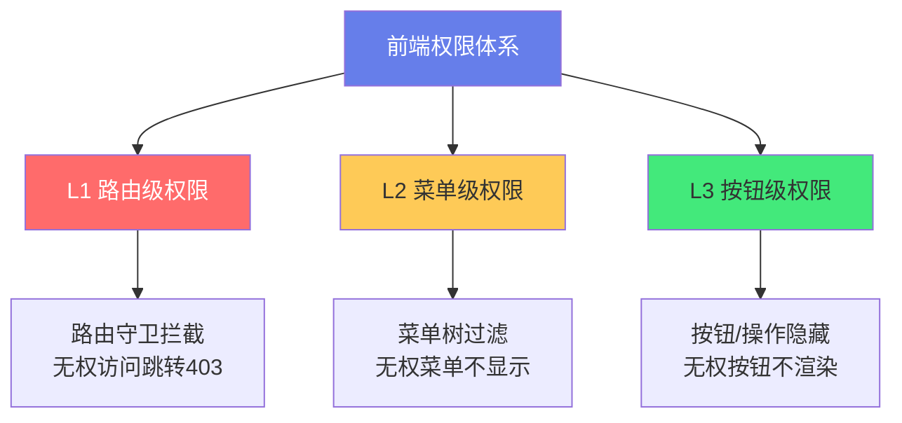
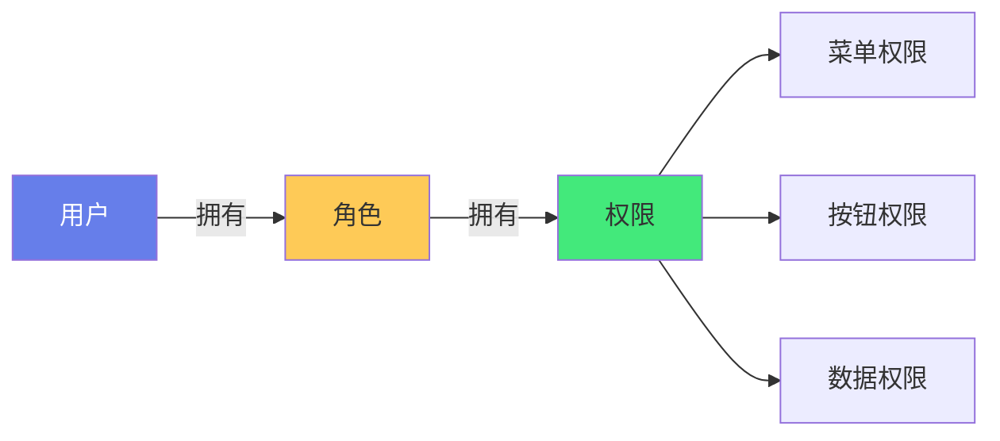
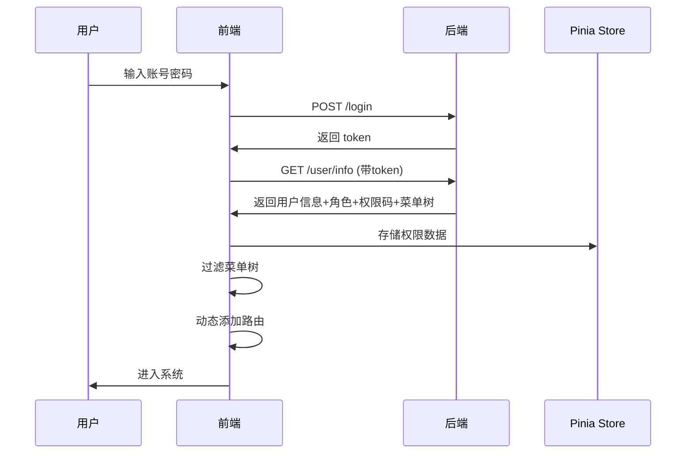

# 🔐 菜单与按钮级权限控制

> **文档说明**：系统讲解前端细粒度权限控制的完整方案，涵盖权限模型概述（RBAC 基于角色 / ABAC 基于属性 / 权限码体系）、前端权限三层体系（路由级 / 菜单级 / 按钮级）、菜单权限实现（动态路由生成 / 菜单树过滤 / 递归过滤 / 菜单与路由同步）、按钮权限实现（v-permission 自定义指令 / hasPerm 权限函数 / PermissionWrap 权限组件 / 三种方式对比）、权限数据结构设计（用户信息 / 角色列表 / 权限码集合 / 菜单树）、登录后权限获取与初始化流程、动态路由 addRoute 实战、权限缓存与持久化（Pinia / localStorage）、权限变更实时更新、数据权限与字段权限、后端权限接口设计、与路由守卫的配合、常见问题（权限闪烁 / 刷新丢失 / 404 处理）与最佳实践。
>
> **适用人群**：中高级前端开发者、全栈工程师、需要搭建后台管理系统的开发者
>
> **前置知识**：[[路由守卫与鉴权流程]] · [[Vue3-组合式API]] · [[Vue-Router路由管理]]

---

## 一、概述

### 1.1 前端权限三层体系



| 层级 | 控制对象 | 实现方式 | 粒度 |
|------|---------|---------|------|
| **路由级** | 页面访问 | 路由守卫 beforeEach | 页面 |
| **菜单级** | 菜单显示 | 菜单树过滤 | 菜单/页面 |
| **按钮级** | 操作按钮 | v-permission 指令 / 权限函数 | 按钮/操作 |

### 1.2 权限模型

#### RBAC（基于角色的访问控制）

最常用的权限模型：**用户 → 角色 → 权限**



```typescript
// 权限数据结构
interface UserInfo {
  id: string
  name: string
  roles: string[]           // 角色：['admin', 'editor']
  permissions: string[]      // 权限码：['user:add', 'user:edit', 'user:delete']
  menus: MenuItem[]          // 菜单树
}

interface MenuItem {
  id: string
  name: string
  path: string
  icon?: string
  permission?: string        // 菜单所需权限码
  children?: MenuItem[]
}
```

#### ABAC（基于属性的访问控制）

更灵活的模型，根据用户属性、资源属性、环境属性动态判断：

```typescript
// 示例：只有部门负责人且在工作时间才能删除
function canDelete(user: User, resource: Resource, env: Environment) {
  return user.dept === resource.dept 
      && user.role === 'manager' 
      && env.time >= '09:00' && env.time <= '18:00'
}
```

> 大多数后台系统使用 RBAC，复杂场景（如多租户、细粒度数据权限）使用 ABAC 或 RBAC+ABAC 混合。

---

## 二、菜单权限实现

### 2.1 菜单树过滤

根据用户权限过滤菜单树，无权菜单不显示：

```typescript
// utils/permission.ts
export function filterMenus(menus: MenuItem[], permissions: string[]): MenuItem[] {
  return menus
    .filter(menu => {
      // 没有权限要求的菜单显示；有权限要求的检查是否拥有
      if (!menu.permission) return true
      return permissions.includes(menu.permission)
    })
    .map(menu => ({
      ...menu,
      // 递归过滤子菜单
      children: menu.children ? filterMenus(menu.children, permissions) : undefined
    }))
    // 过滤掉子菜单为空的父菜单（可选）
    .filter(menu => !menu.children || menu.children.length > 0)
}
```

### 2.2 动态路由生成

根据后端返回的菜单树动态生成路由：

```typescript
// router/dynamic.ts
import { createRouter, createWebHistory, type RouteRecordRaw } from 'vue-router'

// 组件映射表（路径 → 组件）
const componentMap: Record<string, () => Promise<any>> = {
  'dashboard': () => import('@/views/dashboard/index.vue'),
  'user/list': () => import('@/views/user/list.vue'),
  'user/role': () => import('@/views/user/role.vue'),
  'system/config': () => import('@/views/system/config.vue')
}

// 菜单树转路由
function menusToRoutes(menus: MenuItem[]): RouteRecordRaw[] {
  return menus.map(menu => ({
    path: menu.path,
    name: menu.name,
    component: componentMap[menu.component] || (() => import('@/views/404.vue')),
    meta: { title: menu.name, icon: menu.icon, permission: menu.permission },
    children: menu.children ? menusToRoutes(menu.children) : undefined
  }))
}

// 动态添加路由
export function addDynamicRoutes(menus: MenuItem[]) {
  const routes = menusToRoutes(menus)
  routes.forEach(route => router.addRoute(route))
  // 添加 404 兜底路由（必须最后添加）
  router.addRoute({ path: '/:pathMatch(.*)*', name: 'NotFound', component: () => import('@/views/404.vue') })
}
```

### 2.3 菜单组件渲染

```vue
<!-- components/SidebarMenu.vue -->
<script setup lang="ts">
import { computed } from 'vue'
import { useUserStore } from '@/stores/user'

const userStore = useUserStore()
const menus = computed(() => userStore.menus)  // 已过滤的菜单树
</script>

<template>
  <el-menu :default-active="$route.path" router>
    <template v-for="menu in menus" :key="menu.id">
      <!-- 有子菜单 -->
      <el-sub-menu v-if="menu.children?.length" :index="menu.path">
        <template #title>
          <el-icon><component :is="menu.icon" /></el-icon>
          <span>{{ menu.name }}</span>
        </template>
        <el-menu-item v-for="child in menu.children" :key="child.id" :index="child.path">
          {{ child.name }}
        </el-menu-item>
      </el-sub-menu>
      <!-- 无子菜单 -->
      <el-menu-item v-else :index="menu.path">
        <el-icon><component :is="menu.icon" /></el-icon>
        <template #title>{{ menu.name }}</template>
      </el-menu-item>
    </template>
  </el-menu>
</template>
```

---

## 三、按钮权限实现

### 3.1 三种实现方式对比

| 方式 | 语法 | 适用场景 | 优点 | 缺点 |
|------|------|---------|------|------|
| **v-permission 指令** | `v-permission="'user:add'"` | 单个按钮 | 简洁、声明式 | 不支持复杂逻辑 |
| **hasPerm 函数** | `v-if="hasPerm('user:add')"` | 复杂条件 | 灵活、支持逻辑组合 | 稍繁琐 |
| **PermissionWrap 组件** | `<PermissionWrap perm="user:add">` | 包裹多个元素 | 可复用、支持 fallback | 多一层组件 |

### 3.2 v-permission 自定义指令

```typescript
// directives/permission.ts
import type { Directive, DirectiveBinding } from 'vue'
import { useUserStore } from '@/stores/user'

export const permission: Directive = {
  mounted(el: HTMLElement, binding: DirectiveBinding) {
    const { value } = binding
    const userStore = useUserStore()
    
    if (value && typeof value === 'string') {
      // 单个权限码
      if (!userStore.hasPermission(value)) {
        el.parentNode?.removeChild(el)  // 无权则移除元素
      }
    } else if (Array.isArray(value)) {
      // 多个权限码（满足任一即可）
      const hasPermission = value.some(p => userStore.hasPermission(p))
      if (!hasPermission) {
        el.parentNode?.removeChild(el)
      }
    }
  }
}

// 全局注册
// main.ts
app.directive('permission', permission)
```

**使用**：
```vue
<!-- 单个权限 -->
<el-button v-permission="'user:add'" type="primary">新增用户</el-button>

<!-- 多个权限（满足任一） -->
<el-button v-permission="['user:edit', 'user:admin']">编辑</el-button>
```

### 3.3 hasPerm 权限函数

```typescript
// composables/usePermission.ts
import { useUserStore } from '@/stores/user'

export function usePermission() {
  const userStore = useUserStore()

  // 是否拥有某个权限
  function hasPerm(permission: string): boolean {
    return userStore.permissions.includes(permission)
  }

  // 是否拥有所有权限（AND）
  function hasAllPerms(permissions: string[]): boolean {
    return permissions.every(p => userStore.permissions.includes(p))
  }

  // 是否拥有任一权限（OR）
  function hasAnyPerm(permissions: string[]): boolean {
    return permissions.some(p => userStore.permissions.includes(p))
  }

  // 是否拥有某个角色
  function hasRole(role: string): boolean {
    return userStore.roles.includes(role)
  }

  // 是否是管理员（跳过权限检查）
  function isAdmin(): boolean {
    return userStore.roles.includes('admin')
  }

  return { hasPerm, hasAllPerms, hasAnyPerm, hasRole, isAdmin }
}
```

**使用**：
```vue
<script setup>
import { usePermission } from '@/composables/usePermission'
const { hasPerm, hasAnyPerm } = usePermission()
</script>

<template>
  <el-button v-if="hasPerm('user:delete')" type="danger">删除</el-button>
  <el-button v-if="hasAnyPerm(['user:edit', 'user:admin'])">编辑</el-button>
</template>
```

### 3.4 PermissionWrap 权限组件

```vue
<!-- components/PermissionWrap.vue -->
<script setup lang="ts">
import { computed } from 'vue'
import { usePermission } from '@/composables/usePermission'

const props = defineProps<{
  perm?: string | string[]     // 权限码
  role?: string | string[]     // 角色
  mode?: 'any' | 'all'         // 满足任一 or 全部
}>()

const { hasPerm, hasAnyPerm, hasAllPerms, hasRole } = usePermission()

const hasAccess = computed(() => {
  // 管理员直接通过
  if (hasRole('admin')) return true
  
  let permOk = true
  if (props.perm) {
    const perms = Array.isArray(props.perm) ? props.perm : [props.perm]
    permOk = props.mode === 'all' ? hasAllPerms(perms) : hasAnyPerm(perms)
  }
  
  let roleOk = true
  if (props.role) {
    const roles = Array.isArray(props.role) ? props.role : [props.role]
    roleOk = roles.some(r => hasRole(r))
  }
  
  return permOk && roleOk
})
</script>

<template>
  <slot v-if="hasAccess" />
  <slot v-else name="fallback" />
</template>
```

**使用**：
```vue
<PermissionWrap perm="user:add">
  <el-button type="primary">新增</el-button>
</PermissionWrap>

<!-- 带 fallback -->
<PermissionWrap perm="user:delete">
  <el-button type="danger">删除</el-button>
  <template #fallback>
    <el-tooltip content="无权限">
      <el-button disabled>删除</el-button>
    </el-tooltip>
  </template>
</PermissionWrap>
```

---

## 四、权限初始化流程

### 4.1 登录后获取权限



### 4.2 Pinia 权限 Store

```typescript
// stores/user.ts
import { defineStore } from 'pinia'
import { ref, computed } from 'vue'
import type { UserInfo, MenuItem } from '@/types'
import { filterMenus } from '@/utils/permission'
import { addDynamicRoutes } from '@/router/dynamic'

export const useUserStore = defineStore('user', () => {
  const token = ref(localStorage.getItem('token') || '')
  const userInfo = ref<UserInfo | null>(null)
  const roles = ref<string[]>([])
  const permissions = ref<string[]>([])
  const menus = ref<MenuItem[]>([])
  const isLoaded = ref(false)  // 权限是否已加载

  // 是否拥有权限
  function hasPermission(perm: string): boolean {
    if (roles.value.includes('admin')) return true  // 管理员跳过
    return permissions.value.includes(perm)
  }

  // 获取用户信息和权限
  async function fetchUserInfo() {
    const res = await api.getUserInfo()
    userInfo.value = res.user
    roles.value = res.roles
    permissions.value = res.permissions
    // 过滤菜单树
    menus.value = filterMenus(res.menus, res.permissions)
    // 动态添加路由
    addDynamicRoutes(menus.value)
    isLoaded.value = true
  }

  // 登出
  function logout() {
    token.value = ''
    userInfo.value = null
    roles.value = []
    permissions.value = []
    menus.value = []
    isLoaded.value = false
    localStorage.removeItem('token')
    // 重置路由（移除动态路由）
    router.resetStaticRoutes()
  }

  return { token, userInfo, roles, permissions, menus, isLoaded, hasPermission, fetchUserInfo, logout }
})
```

### 4.3 路由守卫配合

```typescript
// router/guard.ts
import { useUserStore } from '@/stores/user'

router.beforeEach(async (to, from, next) => {
  const userStore = useUserStore()
  
  // 白名单（登录页等）
  if (['/login'].includes(to.path)) return next()
  
  // 未登录
  if (!userStore.token) return next('/login')
  
  // 已登录但权限未加载
  if (!userStore.isLoaded) {
    await userStore.fetchUserInfo()
    return next({ ...to, replace: true })  // 重新进入路由（触发动态路由匹配）
  }
  
  // 路由级权限检查
  if (to.meta.permission && !userStore.hasPermission(to.meta.permission as string)) {
    return next('/403')
  }
  
  next()
})
```

---

## 五、数据权限与字段权限

### 5.1 数据权限

数据权限控制用户能看到哪些数据（行级权限），通常由后端实现，前端配合：

```typescript
// 前端传递数据范围参数
interface DataScope {
  type: 'all' | 'dept' | 'self' | 'custom'
  deptIds?: string[]
}

// 请求时携带数据范围
function getUserList(params: any) {
  return request.get('/users', { params: { ...params, dataScope: 'dept' } })
}
```

### 5.2 字段权限

字段权限控制用户能看到哪些字段（列级权限）：

```typescript
// 根据权限动态显示表格列
const allColumns = [
  { prop: 'name', label: '姓名' },
  { prop: 'phone', label: '电话', permission: 'user:phone:view' },
  { prop: 'salary', label: '薪资', permission: 'user:salary:view' }
]

const visibleColumns = computed(() => 
  allColumns.filter(col => !col.permission || hasPerm(col.permission))
)
```

---

## 六、权限缓存与持久化

### 6.1 Token 持久化

```typescript
// Token 存 localStorage，权限数据存 Pinia（内存）
// 刷新页面时：token 仍在 → 重新获取权限数据
// 不建议把权限数据存 localStorage（权限变更后不能实时更新）
```

### 6.2 权限变更实时更新

```typescript
// 管理员修改用户权限后，前端需要刷新权限
async function refreshPermissions() {
  const userStore = useUserStore()
  // 移除旧的动态路由
  router.removeDynamicRoutes()
  // 重新获取
  await userStore.fetchUserInfo()
  // 提示用户
  ElMessage.success('权限已更新')
}
```

---

## 七、常见问题

| 问题 | 原因 | 解决方案 |
|------|------|---------|
| **刷新页面白屏** | 动态路由丢失 | 路由守卫中重新获取权限并 addRoute |
| **菜单闪烁** | 权限未加载完就渲染菜单 | 加 loading，权限加载完再渲染 |
| **404 页面** | 动态路由未添加就访问 | 路由守卫中 `next({...to, replace:true})` 重新匹配 |
| **按钮权限不生效** | 指令中 removeChild 时机问题 | 用 `el.parentNode?.removeChild(el)` 或 v-if |
| **管理员权限判断** | 忘记跳过管理员 | hasPermission 中 admin 直接返回 true |
| **权限变更不更新** | 权限数据缓存了 | 修改权限后调用 refreshPermissions |
| **动态路由重复添加** | 多次调用 addRoute | 用 isLoaded 标志防止重复 |
| **v-permission 不支持 v-if** | 指令和 v-if 同时用 | 优先用 v-if+hasPerm，或调整顺序 |

---

## 八、最佳实践

1. **前端权限只是 UI 控制，后端必须做权限校验**——前端隐藏按钮不代表接口安全，后端每个接口都要鉴权
2. **管理员跳过权限检查**——`hasPermission` 中 admin 角色直接返回 true，简化逻辑
3. **权限码命名规范**——`模块:操作` 格式，如 `user:add`、`user:edit`、`user:delete`
4. **路由级 + 菜单级 + 按钮级三层配合**——路由守卫防直接访问，菜单过滤防看到，按钮隐藏防操作
5. **动态路由最后加 404 兜底**——`/:pathMatch(.*)*` 必须在所有动态路由之后添加
6. **刷新页面重新获取权限**——不要把权限数据存 localStorage，刷新时用 token 重新获取
7. **v-permission 指令适合简单场景，复杂逻辑用 hasPerm 函数**——指令不支持 AND/OR 组合
8. **PermissionWrap 组件适合复用**——多个页面相同的权限控制封装为组件
9. **权限变更实时更新**——提供 refreshPermissions 方法，修改权限后调用
10. **数据权限和字段权限后端为主**——前端只做显示控制，真正的过滤在后端
11. **权限测试要覆盖各角色**——每个角色的菜单、按钮、路由访问都要测试
12. **不要把权限逻辑散落在各处**——统一用 usePermission composable 和 v-permission 指令

---

## 九、关联笔记

### 权限与安全
- [[路由守卫与鉴权流程]] · [[JWT认证机制]] · [[SpringSecurity安全框架]]
- [[OAuth2.0与第三方登录]] · [[接口安全与签名]]

### 前端工程
- [[Vue-Router路由管理]] · [[Vue3-组合式API]] · [[Pinia-状态管理核心]]
- [[ElementPlus-二次封装]]

### 后端
- [[SpringBoot安全认证]] · [[RBAC权限设计]] · [[多租户架构设计]]

### 导航
- [[MOC-前端开发]] · [[MOC-组件与UI]] · [[Home]] · [[学习路线总览]]

> 🔍 **知识点深度解析**
>
> **作用**：菜单与按钮级权限控制解决的是「如何在前端实现细粒度的权限管理，让不同角色的用户看到不同的菜单、操作不同的按钮、访问不同的页面，同时保证系统安全」的核心问题——前端权限是后台管理系统的基础能力，直接影响用户体验和系统安全。
>
> **底层原理**：①前端权限的本质是「根据用户权限动态控制 UI 渲染和路由访问」——三层权限（路由级/菜单级/按钮级）从粗到细控制用户能看到什么、能做什么。路由级用路由守卫拦截无权访问，菜单级用菜单树过滤隐藏无权菜单，按钮级用自定义指令/函数/组件隐藏无权按钮。这三层配合实现完整的前端权限控制。②RBAC 模型的核心是「角色作为用户和权限的中间层」——用户不直接拥有权限，而是通过角色间接获得权限。这样做的好处是解耦：一个用户可以有多个角色，一个角色可以有多个权限，权限变更只需要修改角色-权限关系，不需要修改每个用户。权限码（permission code）是权限的最小单位，通常用 `模块:操作` 格式命名（如 `user:add`），前端检查用户是否拥有某个权限码来决定是否显示对应元素。③动态路由的本质是「运行时根据权限生成路由配置」——传统方式是在路由表中写死所有路由，通过 meta.permission 控制访问；动态路由方式是登录后从后端获取菜单树，通过 `router.addRoute()` 动态添加路由，用户只能看到和访问自己有权限的路由。动态路由更安全（无权路由根本不存在），但实现更复杂（需要处理刷新、404、路由重置等）。④v-permission 自定义指令的原理是「在 mounted 钩子中检查权限，无权则从 DOM 中移除元素」——Vue 自定义指令提供了 mounted/updated 等钩子，在元素挂载到 DOM 后执行权限检查，如果用户没有权限，用 `el.parentNode?.removeChild(el)` 将元素从 DOM 中移除。这种方式比 v-if 更简洁（不需要在 script 中引入权限函数），但不支持复杂的逻辑组合（如 AND/OR），也不支持响应式更新（权限变更后不会自动重新检查）。⑤菜单树过滤的核心是「递归 + 权限检查」——遍历菜单树的每个节点，如果节点有 permission 字段且用户没有该权限，则过滤掉该节点；同时递归过滤子节点，并可选地过滤掉子节点为空的父节点。这个过程本质上是树的「条件裁剪」，和文件系统的权限过滤原理一致。⑥前端权限的「安全底线」是「前端权限只是 UI 控制，后端必须做权限校验」——前端隐藏按钮只是为了用户体验（不让用户看到不能点的按钮），但用户可以通过浏览器 DevTools 修改 DOM 或直接调用 API，所以后端每个接口都必须做权限校验。前端权限不能替代后端安全，这是最重要的原则。⑦权限刷新的核心问题是「动态路由的生命周期管理」——当用户权限变更时，需要移除旧的动态路由（`router.removeRoute()`），重新获取权限数据，再次添加新的动态路由。Vue Router 4 提供了 `removeRoute()` 方法，但没有批量移除的 API，需要记录添加的路由名称逐个移除，或者用 `router.getRoutes()` 对比找出动态路由。
>
> **用法要点**：① 三层权限：路由级(守卫拦截)/菜单级(树过滤)/按钮级(指令/函数/组件) ② RBAC模型：用户→角色→权限，权限码格式`模块:操作`(user:add) ③ 菜单过滤：递归filterMenus(检查permission+递归子节点+过滤空父菜单) ④ 动态路由：menusToRoutes(菜单转路由)+addRoute(动态添加)+404兜底最后加 ⑤ v-permission指令：mounted中检查权限+removeChild移除，支持单个/数组(任一)，全局注册 ⑥ hasPerm函数：usePermission composable，hasPerm/hasAllPerms/hasAnyPerm/hasRole/isAdmin，v-if中使用 ⑦ PermissionWrap组件：props(perm/role/mode)+computed(hasAccess)+slot/fallback，适合复用 ⑧ 权限初始化：登录→getUserInfo(角色+权限码+菜单树)→filterMenus→addDynamicRoutes→isLoaded=true ⑨ Pinia Store：token/userInfo/roles/permissions/menus/isLoaded/hasPermission(admin跳过)/fetchUserInfo/logout(重置路由) ⑩ 路由守卫：白名单→未登录跳login→未加载则fetchUserInfo+next({...to,replace})→路由级meta.permission检查→next ⑪ 数据权限：行级后端为主，前端传dataScope参数；字段权限：列级前端filter+后端过滤 ⑫ 常见问题：刷新白屏(守卫重新获取+replace)/菜单闪烁(loading等待)/404(动态路由未加，replace重匹配)/指令不生效(removeChild时机)/管理员跳过/isLoaded防重复 ⑬ 最佳实践：后端必须校验/admin跳过/权限码命名规范/三层配合/404最后加/刷新重新获取/指令简单函数复杂/组件复用/权限变更refresh/数据权限后端为主/各角色测试/逻辑不散落。

> 💡 **深度讲解**：菜单与按钮级权限控制最核心的智慧是「前端权限是 UI 控制，后端权限是安全底线——两者配合才能既好用又安全」——很多初学者把前端权限当成安全措施，以为隐藏了按钮就安全了，这是最大的误区。前端权限的真正目的是「用户体验」——不让用户看到不能点的按钮、不让用户访问无权的页面、让菜单只显示有权的项，这样界面更简洁、操作更清晰。但安全必须靠后端——每个 API 接口都要校验用户权限，因为前端的一切都可以被绕过（DevTools 修改 DOM、直接调接口、修改 JS）。理解了这一点，就能理解为什么前端权限可以「灵活简化」（admin 跳过、权限码检查），而后端权限必须「严格完整」（每个接口、每个数据行都要校验）。动态路由是前端权限的进阶方案——传统方式是路由写死+meta.permission 控制，简单但不安全（用户知道路径就能访问，虽然会被守卫拦截）；动态路由是登录后根据权限 addRoute，无权路由根本不存在，更安全但更复杂。选择哪种方式取决于项目需求：简单系统用静态路由+守卫，复杂/安全要求高的系统用动态路由。v-permission 指令是按钮权限的最简洁方式——它把权限检查封装为自定义指令，使用时只需 `v-permission="'user:add'"`，不需要在 script 中引入任何东西。但它有局限性：不支持复杂逻辑（如「同时拥有 A 和 B」）、不支持响应式（权限变更后不自动更新）、和 v-if 同时使用时有顺序问题。复杂场景应该用 hasPerm 函数 + v-if，或者 PermissionWrap 组件。在 AI 时代，权限控制有了新的场景——AI Agent 的工具调用权限（哪些用户可以调用哪些工具）、AI 生成内容的审核权限（哪些角色可以审核 AI 输出）、AI 模型的使用权限（哪些角色可以用 GPT-4，哪些只能用 GPT-3.5）。这些都可以用 RBAC 模型扩展，增加「AI 权限」模块。掌握菜单与按钮级权限控制，就是掌握了后台管理系统的「准入控制」能力——这是从「做页面」到「做系统」的关键一步。

> 📝 **精简总结**：菜单与按钮级权限控制=前端细粒度权限管理。三层体系：路由级(守卫)/菜单级(树过滤)/按钮级(指令/函数/组件)。RBAC模型：用户→角色→权限码(模块:操作)。菜单过滤：递归filterMenus。动态路由：menusToRoutes+addRoute+404兜底。按钮权限：v-permission指令(简单)/hasPerm函数(灵活)/PermissionWrap组件(复用)。权限初始化：登录→getUserInfo→filterMenus→addRoute→isLoaded。Pinia Store：token/roles/permissions/menus/hasPermission(admin跳过)。路由守卫：白名单→未登录→未加载则fetch+replace→meta.permission检查。安全原则：前端只是UI控制，后端必须校验。常见问题：刷新白屏(守卫replace)/404(动态路由)/指令不生效(removeChild)。最佳实践：admin跳过/权限码规范/三层配合/404最后加/刷新重新获取/后端校验为主。

> **学习路径建议**：先学习 [[路由守卫与鉴权流程]] 理解路由级权限 → 学习 RBAC 模型和权限码设计 → 实践：实现菜单树过滤 → 学习动态路由 addRoute → 实践：实现登录后动态添加路由 → 学习 v-permission 自定义指令 → 实践：实现按钮级权限控制 → 学习 hasPerm 函数和 PermissionWrap 组件 → 实践：处理复杂权限逻辑 → 学习权限刷新和动态路由管理 → 研究后端权限设计（Spring Security / RBAC） → 形成完整的前后端权限方案。

---

> **菜单与按钮级权限控制最核心的智慧是「前端权限是 UI 控制，后端权限是安全底线——两者配合才能既好用又安全」——很多初学者把前端权限当成安全措施，以为隐藏了按钮就安全了，这是最大的误区。前端权限的真正目的是用户体验：不让用户看到不能点的按钮、不让用户访问无权的页面、让菜单只显示有权的项，界面更简洁操作更清晰。但安全必须靠后端——每个 API 都要校验权限，因为前端一切都可以被绕过（DevTools 改 DOM、直接调接口、改 JS）。理解了这一点，就能理解为什么前端权限可以灵活简化（admin 跳过、权限码检查），而后端权限必须严格完整（每个接口、每个数据行都校验）。动态路由是前端权限的进阶方案——传统方式路由写死+meta.permission 控制，简单但不安全（用户知道路径就能访问，虽被守卫拦截）；动态路由登录后根据权限 addRoute，无权路由根本不存在，更安全但更复杂。v-permission 指令是按钮权限最简洁方式——把权限检查封装为自定义指令，使用时只需 v-permission="'user:add'"，但有局限性：不支持复杂逻辑、不支持响应式、和 v-if 有顺序问题，复杂场景用 hasPerm 函数+ v-if 或 PermissionWrap 组件。AI 时代权限控制有了新场景：Agent 工具调用权限、AI 内容审核权限、AI 模型使用权限，都可用 RBAC 扩展。掌握菜单与按钮级权限控制，就是掌握了后台管理系统的准入控制能力——这是从做页面到做系统的关键一步。下次你做后台系统时，先想清楚权限模型再写代码——权限是系统的骨架，骨架对了，后面才好建。**
