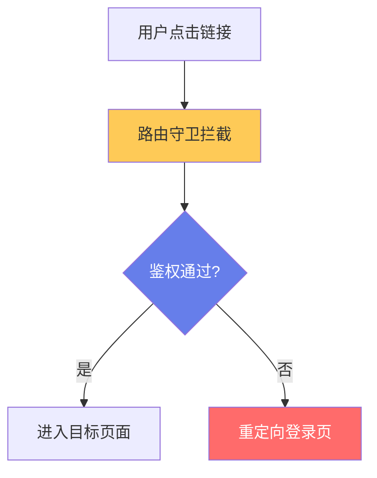
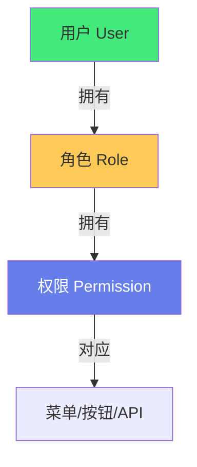

# 🛡️ 路由守卫与鉴权流程

> **文档说明**：系统讲解 Vue Router 路由守卫机制与前端鉴权流程的完整设计与实现，涵盖路由守卫的概念与分类（全局前置守卫 beforeEach/全局解析守卫 beforeResolve/全局后置钩子 afterEach/路由独享守卫 beforeEnter/组件内守卫 beforeRouteEnter/Update/Leave）、完整的导航解析流程（10 步执行顺序）、鉴权流程设计（登录态管理/Token 存储与刷新/权限校验/路由元信息 meta 配置）、基于角色的访问控制 RBAC（角色-权限-菜单三级模型）、动态路由实现（addRoute/removeRoute/权限路由过滤）、自定义权限指令（v-permission/v-auth）、完整登录流程（登录/Token 存储/自动刷新/登出/401 拦截/重定向回原页面）、前端鉴权 vs 后端鉴权的边界与协作、常见鉴权模式（JWT/Session-Cookie/OAuth2.0/SSO 单点登录）、路由懒加载与权限预加载、403/404/401 状态处理、按钮级权限控制、安全最佳实践（XSS/CSRF/Token 安全/前端鉴权不可信原则）、常见问题与排查。
>
> **适用人群**：中高级前端开发者、全栈工程师、需要设计权限系统的技术负责人
>
> **前置知识**：[[Vue3-组合式API]] · [[TypeScript-类型系统进阶]]

---

## 一、概述

### 1.1 什么是路由守卫

**路由守卫（Navigation Guards）** 是 Vue Router 提供的钩子函数，在路由导航过程中拦截并执行特定逻辑（如鉴权、权限校验、数据预加载），可以决定是否允许导航、重定向或取消导航。



### 1.2 为什么需要路由守卫

- 🔐 **页面鉴权**：未登录用户不能访问需要登录的页面
- 🎫 **权限控制**：不同角色看到不同页面/菜单
- 📦 **数据预加载**：进入页面前加载必要数据
- 🚫 **离开确认**：未保存内容时提示用户
- 📊 **页面埋点**：记录页面访问日志
- ⏳ **加载状态**：导航期间显示进度条

---

## 二、路由守卫分类

### 2.1 守卫类型总览

| 守卫类型 | API | 执行时机 | 能否取消导航 |
|---------|-----|---------|------------|
| **全局前置守卫** | `router.beforeEach` | 导航开始时 | ✅ |
| **全局解析守卫** | `router.beforeResolve` | 组件解析后、导航确认前 | ✅ |
| **全局后置钩子** | `router.afterEach` | 导航完成后 | ❌ |
| **路由独享守卫** | `beforeEnter`（路由配置中） | 进入该路由时 | ✅ |
| **组件内守卫** | `beforeRouteEnter/Update/Leave` | 组件生命周期中 | ✅ |

### 2.2 全局前置守卫（最常用）

```typescript
// router/index.ts
import { createRouter, createWebHistory } from 'vue-router'

const router = createRouter({
  history: createWebHistory(),
  routes: [...]
})

// 全局前置守卫
router.beforeEach((to, from, next) => {
  // to: 即将进入的路由
  // from: 当前导航正要离开的路由
  // next: 回调函数，决定如何导航
  
  const isLoggedIn = checkAuth()
  
  if (to.meta.requiresAuth && !isLoggedIn) {
    // 需要登录但未登录 → 重定向到登录页
    next({ path: '/login', query: { redirect: to.fullPath } })
  } else {
    next()  // 放行
  }
})
```

**next 的用法**：
```typescript
next()              // 放行，进入下一个钩子
next(false)         // 取消导航
next('/login')      // 重定向到指定路径
next({ path: '/login' })  // 重定向（对象形式）
next(error)         // 导航出错，触发 error 回调
```

> Vue Router 4 中也可以直接 `return` 值代替 `next()`：
> ```typescript
> router.beforeEach((to) => {
>   if (to.meta.requiresAuth && !isLoggedIn) {
>     return { path: '/login', query: { redirect: to.fullPath } }
>   }
> })
> ```

### 2.3 全局解析守卫

```typescript
router.beforeResolve((to, from) => {
  // 在导航被确认之前，所有组件内守卫和异步路由组件解析之后调用
  // 适合做需要组件数据的权限校验
})
```

### 2.4 全局后置钩子

```typescript
router.afterEach((to, from, failure) => {
  // 导航完成后调用，不能取消导航
  // 常用于：页面标题、埋点、进度条结束
  document.title = to.meta.title || '默认标题'
  
  // 页面访问埋点
  trackPageView(to.path)
  
  // 滚动到顶部
  window.scrollTo(0, 0)
})
```

### 2.5 路由独享守卫

```typescript
const routes = [
  {
    path: '/admin',
    component: AdminPage,
    beforeEnter: (to, from) => {
      // 只在进入该路由时执行
      if (!hasRole('admin')) {
        return { path: '/403' }
      }
    }
  }
]
```

### 2.6 组件内守卫

```vue
<script setup lang="ts">
import { onBeforeRouteLeave, onBeforeRouteUpdate } from 'vue-router'

// 离开当前路由前调用（适合未保存提示）
onBeforeRouteLeave((to, from) => {
  if (formDirty.value && !confirm('有未保存的内容，确定离开吗？')) {
    return false  // 取消导航
  }
})

// 路由参数变化但组件复用时调用（如 /user/1 → /user/2）
onBeforeRouteUpdate((to, from) => {
  // 重新加载数据
  loadUser(to.params.id)
})
</script>
```

> `beforeRouteEnter` 不能用组合式 API（组件实例还未创建），需要用选项式 API 或 `next(vm => ...)`。

---

## 三、完整导航解析流程

```mermaid
graph LR
    A[1.导航触发] --> B[2.失活组件<br/>beforeRouteLeave]
    B --> C[3.全局beforeEach]
    C --> D[4.复用组件<br/>beforeRouteUpdate]
    D --> E[5.路由配置<br/>beforeEnter]
    E --> F[6.解析异步路由组件]
    F --> G[7.激活组件<br/>beforeRouteEnter]
    G --> H[8.全局beforeResolve]
    H --> I[9.导航确认]
    I --> J[10.全局afterEach]
    J --> K[11.DOM更新]
    
    style C fill:#feca57,color:#333
    style H fill:#feca57,color:#333
    style J fill:#43e97b,color:#333
```



**关键顺序**：
1. 导航被触发
2. 失活组件的 `beforeRouteLeave`
3. 全局 `beforeEach`
4. 复用组件的 `beforeRouteUpdate`
5. 路由配置的 `beforeEnter`
6. 解析异步路由组件
7. 激活组件的 `beforeRouteEnter`
8. 全局 `beforeResolve`
9. 导航被确认
10. 全局 `afterEach`
11. DOM 更新

---

## 四、鉴权流程设计

### 4.1 路由元信息（meta）配置

在路由配置中用 `meta` 标记权限要求：

```typescript
// router/routes.ts
export const routes = [
  {
    path: '/login',
    component: () => import('@/views/Login.vue'),
    meta: { requiresAuth: false, title: '登录' }
  },
  {
    path: '/dashboard',
    component: () => import('@/views/Dashboard.vue'),
    meta: { requiresAuth: true, title: '仪表盘', roles: ['user', 'admin'] }
  },
  {
    path: '/admin',
    component: () => import('@/views/Admin.vue'),
    meta: { requiresAuth: true, title: '管理后台', roles: ['admin'], permissions: ['user:manage'] }
  },
  {
    path: '/:pathMatch(.*)*',
    component: () => import('@/views/NotFound.vue'),
    meta: { title: '404' }
  }
]
```

### 4.2 全局鉴权守卫

```typescript
// router/guard.ts
import type { Router } from 'vue-router'
import { useUserStore } from '@/stores/user'

export function setupAuthGuard(router: Router) {
  router.beforeEach(async (to, from) => {
    const userStore = useUserStore()
    
    // 1. 不需要登录的页面直接放行
    if (!to.meta.requiresAuth) {
      return true
    }
    
    // 2. 检查登录态
    if (!userStore.token) {
      // 未登录 → 重定向到登录页，记录原页面用于登录后跳回
      return { path: '/login', query: { redirect: to.fullPath } }
    }
    
    // 3. 如果还没获取用户信息，先获取
    if (!userStore.userInfo) {
      try {
        await userStore.fetchUserInfo()
      } catch (error) {
        // Token 失效 → 清除并跳转登录
        userStore.logout()
        return { path: '/login', query: { redirect: to.fullPath } }
      }
    }
    
    // 4. 角色权限校验
    if (to.meta.roles && !to.meta.roles.includes(userStore.role)) {
      return { path: '/403' }
    }
    
    // 5. 权限点校验
    if (to.meta.permissions) {
      const hasPermission = to.meta.permissions.every(p => 
        userStore.permissions.includes(p)
      )
      if (!hasPermission) {
        return { path: '/403' }
      }
    }
    
    return true  // 放行
  })
  
  // 后置钩子：设置页面标题
  router.afterEach((to) => {
    document.title = (to.meta.title as string) || '管理系统'
  })
}
```

### 4.3 用户状态管理（Pinia）

```typescript
// stores/user.ts
import { defineStore } from 'pinia'
import { ref, computed } from 'vue'
import { login as loginApi, getUserInfo, refreshToken } from '@/api/auth'

export const useUserStore = defineStore('user', () => {
  const token = ref(localStorage.getItem('token') || '')
  const userInfo = ref<UserInfo | null>(null)
  
  const role = computed(() => userInfo.value?.role || '')
  const permissions = computed(() => userInfo.value?.permissions || [])
  
  // 登录
  async function login(username: string, password: string) {
    const res = await loginApi(username, password)
    token.value = res.token
    localStorage.setItem('token', res.token)
    await fetchUserInfo()
  }
  
  // 获取用户信息
  async function fetchUserInfo() {
    userInfo.value = await getUserInfo()
  }
  
  // 刷新 Token
  async function refreshAccessToken() {
    const res = await refreshToken()
    token.value = res.token
    localStorage.setItem('token', res.token)
  }
  
  // 登出
  function logout() {
    token.value = ''
    userInfo.value = null
    localStorage.removeItem('token')
  }
  
  return { token, userInfo, role, permissions, login, fetchUserInfo, refreshAccessToken, logout }
})
```

---

## 五、基于角色的访问控制（RBAC）

### 5.1 RBAC 三级模型



| 层级 | 说明 | 示例 |
|------|------|------|
| **用户** | 系统使用者 | 张三、李四 |
| **角色** | 权限的集合 | 管理员、编辑、普通用户 |
| **权限** | 具体的操作许可 | user:create、order:view |

### 5.2 动态路由实现

后端返回用户有权限的路由，前端动态添加：

```typescript
// stores/permission.ts
import { defineStore } from 'pinia'
import { ref } from 'vue'
import { router, asyncRoutes } from '@/router'

export const usePermissionStore = defineStore('permission', () => {
  const routes = ref<RouteRecord[]>([])
  const isRoutesLoaded = ref(false)
  
  // 根据角色过滤异步路由
  function filterAsyncRoutes(routes: RouteRecord[], role: string): RouteRecord[] {
    return routes.filter(route => {
      if (route.meta?.roles) {
        return route.meta.roles.includes(role)
      }
      // 有子路由的递归过滤
      if (route.children) {
        route.children = filterAsyncRoutes(route.children, role)
        return route.children.length > 0
      }
      return true
    })
  }
  
  // 生成动态路由
  async function generateRoutes(role: string) {
    const accessedRoutes = filterAsyncRoutes(asyncRoutes, role)
    // 动态添加路由
    accessedRoutes.forEach(route => router.addRoute(route))
    routes.value = accessedRoutes
    isRoutesLoaded.value = true
    return accessedRoutes
  }
  
  // 重置路由（登出时）
  function resetRoutes() {
    routes.value.forEach(route => {
      if (route.name) router.removeRoute(route.name)
    })
    routes.value = []
    isRoutesLoaded.value = false
  }
  
  return { routes, isRoutesLoaded, generateRoutes, resetRoutes }
})
```

### 5.3 鉴权守卫中集成动态路由

```typescript
router.beforeEach(async (to, from) => {
  const userStore = useUserStore()
  const permissionStore = usePermissionStore()
  
  if (!to.meta.requiresAuth) return true
  if (!userStore.token) return { path: '/login', query: { redirect: to.fullPath } }
  
  if (!userStore.userInfo) {
    await userStore.fetchUserInfo()
  }
  
  // 首次进入或刷新页面时，生成动态路由
  if (!permissionStore.isRoutesLoaded) {
    await permissionStore.generateRoutes(userStore.role)
    // 重新导航（确保动态路由生效）
    return { ...to, replace: true }
  }
  
  return true
})
```

---

## 六、按钮级权限控制

### 6.1 自定义权限指令

```typescript
// directives/permission.ts
import type { Directive } from 'vue'
import { useUserStore } from '@/stores/user'

export const permission: Directive = {
  mounted(el, binding) {
    const userStore = useUserStore()
    const { value } = binding  // 如 v-permission="'user:delete'"
    
    if (value && !userStore.permissions.includes(value)) {
      el.parentNode?.removeChild(el)  // 无权限则移除元素
    }
  }
}

// 支持数组：v-permission="['user:create', 'user:edit']"
export const permissionAny: Directive = {
  mounted(el, binding) {
    const userStore = useUserStore()
    const permissions = binding.value as string[]
    const hasAny = permissions.some(p => userStore.permissions.includes(p))
    if (!hasAny) el.parentNode?.removeChild(el)
  }
}
```

```vue
<template>
  <!-- 单个权限 -->
  <button v-permission="'user:create'">创建用户</button>
  
  <!-- 多个权限（满足任一） -->
  <button v-permission-any="['user:edit', 'user:delete']">操作</button>
</template>
```

### 6.2 权限判断函数

```typescript
// utils/permission.ts
import { useUserStore } from '@/stores/user'

export function hasPermission(permission: string): boolean {
  const userStore = useUserStore()
  return userStore.permissions.includes(permission)
}

export function hasAnyPermission(permissions: string[]): boolean {
  return permissions.some(p => hasPermission(p))
}

export function hasRole(role: string): boolean {
  const userStore = useUserStore()
  return userStore.role === role
}
```

---

## 七、完整登录流程

### 7.1 登录页

```vue
<script setup lang="ts">
import { ref } from 'vue'
import { useRoute, useRouter } from 'vue-router'
import { useUserStore } from '@/stores/user'
import { ElMessage } from 'element-plus'

const route = useRoute()
const router = useRouter()
const userStore = useUserStore()

const form = ref({ username: '', password: '' })
const loading = ref(false)

async function handleLogin() {
  loading.value = true
  try {
    await userStore.login(form.value.username, form.value.password)
    ElMessage.success('登录成功')
    // 登录后跳回原页面，没有则去首页
    const redirect = (route.query.redirect as string) || '/dashboard'
    router.replace(redirect)
  } catch (error) {
    ElMessage.error('用户名或密码错误')
  } finally {
    loading.value = false
  }
}
</script>
```

### 7.2 Token 刷新与 401 拦截

```typescript
// api/request.ts（Axios 拦截器）
import axios from 'axios'
import { useUserStore } from '@/stores/user'
import router from '@/router'

const request = axios.create({ baseURL: '/api' })

// 请求拦截：附加 Token
request.interceptors.request.use(config => {
  const userStore = useUserStore()
  if (userStore.token) {
    config.headers.Authorization = `Bearer ${userStore.token}`
  }
  return config
})

// 响应拦截：处理 401
let isRefreshing = false
let refreshSubscribers: Array<(token: string) => void> = []

request.interceptors.response.use(
  response => response.data,
  async error => {
    const { response, config } = error
    const userStore = useUserStore()
    
    if (response.status === 401) {
      // Token 过期，尝试刷新
      if (!isRefreshing) {
        isRefreshing = true
        try {
          await userStore.refreshAccessToken()
          // 刷新成功，重试所有排队请求
          refreshSubscribers.forEach(cb => cb(userStore.token))
          refreshSubscribers = []
          // 重试当前请求
          config.headers.Authorization = `Bearer ${userStore.token}`
          return request(config)
        } catch {
          // 刷新失败 → 登出
          userStore.logout()
          router.replace('/login')
          return Promise.reject(error)
        } finally {
          isRefreshing = false
        }
      } else {
        // 正在刷新，加入队列等待
        return new Promise(resolve => {
          refreshSubscribers.push((token: string) => {
            config.headers.Authorization = `Bearer ${token}`
            resolve(request(config))
          })
        })
      }
    }
    
    return Promise.reject(error)
  }
)
```

---

## 八、鉴权模式对比

| 模式 | 原理 | 优点 | 缺点 | 适用 |
|------|------|------|------|------|
| **JWT** | 无状态 Token，包含用户信息 | 无状态、易扩展、跨域 | Token 无法主动失效、体积大 | 前后端分离、微服务 |
| **Session-Cookie** | 服务端存 Session，Cookie 存 ID | 可主动失效、安全可控 | 有状态、跨域麻烦、集群需共享 | 传统 Web、同域应用 |
| **OAuth2.0** | 第三方授权，Access Token + Refresh Token | 安全、标准化、支持第三方 | 复杂、实现成本高 | 需要第三方登录、开放平台 |
| **SSO** | 单点登录，一次登录多处访问 | 用户体验好 | 架构复杂、统一认证中心 | 多系统企业应用 |

---

## 九、前端鉴权 vs 后端鉴权

### 9.1 职责边界

| 层面 | 前端 | 后端 |
|------|------|------|
| **路由级** | 隐藏无权限路由、跳转 403 | 接口鉴权，返回 401/403 |
| **按钮级** | 隐藏/禁用无权限按钮 | 接口鉴权，越权操作拒绝 |
| **数据级** | 不展示无权限数据 | 查询时过滤数据 |
| **原则** | 提升体验，不可信 | 安全底线，必须校验 |

> ⚠️ **前端鉴权只是「体验优化」，不是「安全保障」**——前端的路由守卫和按钮隐藏可以被绕过（改 URL、删元素、调接口），真正的安全必须在后端做。前端鉴权的目的是「不让用户看到点不了的东西」，后端鉴权的目的是「不让用户做没权限的事」。

---

## 十、常见问题

| 问题 | 原因 | 解决方案 |
|------|------|---------|
| **刷新页面白屏/404** | 动态路由在刷新后丢失 | 守卫中重新生成路由，`return { ...to, replace: true }` |
| **登录后跳回原页面** | 未记录原路径 | 重定向登录时带 `redirect` 参数，登录后读取 |
| **Token 过期 401** | 未处理 Token 刷新 | Axios 拦截器统一刷新，队列重试 |
| **动态路由重复添加** | 未判断是否已加载 | `isRoutesLoaded` 标志位控制 |
| **登出后路由还在** | 未移除动态路由 | `router.removeRoute()` 逐个移除 |
| **v-permission 不生效** | 指令在 Pinia 初始化前执行 | 确保 app.use(pinia) 在指令注册前 |
| **并发请求 401** | 多个请求同时触发刷新 | 刷新队列 + isRefreshing 锁 |
| **后退按钮绕过鉴权** | 浏览器缓存 | 配合 `no-store` 缓存头 + 守卫检查 |

---

## 十一、最佳实践

1. **路由 meta 统一配置**：requiresAuth/roles/permissions/title 都放 meta
2. **Token 存 localStorage**：XSS 风险，配合 HttpOnly Cookie 双 Token 更安全
3. **动态路由按需加载**：`() => import()` 懒加载，减少首屏体积
4. **401 统一处理**：Axios 拦截器 + 刷新队列，不要每个请求单独处理
5. **登出清理彻底**：清除 Token、用户信息、动态路由、跳转登录页
6. **按钮级权限用指令**：v-permission 统一处理，不要每个组件写 v-if
7. **前端鉴权不可信**：所有接口后端必须鉴权，前端只是体验优化
8. **路由守卫保持简单**：复杂逻辑抽函数，守卫只做调度
9. **进度条反馈**：NProgress 等库，导航时显示进度
10. **403/404 页面友好**：不要只显示错误码，给用户操作指引

---

## 十二、关联笔记

### Vue3 生态
- [[Vue3-组合式API]] · [[Vue3-组件通信与插槽]] · [[VueUse-工具函数库]]
- [[Pinia-状态管理核心]] · [[Vue3-Teleport与Suspense]]

### 安全与后端
- [[JWT认证原理]] · [[OAuth2.0与SSO]] · [[SpringSecurity权限管理]]
- [[Web安全防护]]

### 前端工程
- [[TypeScript-类型系统进阶]] · [[组件库设计与发布]] · [[前端性能优化实战]]

### 导航
- [[MOC-前端开发]] · [[MOC-组件与UI]] · [[Home]] · [[学习路线总览]]

> 🔍 **知识点深度解析**
>
> **作用**：路由守卫与鉴权流程解决的是「如何在前端实现页面级和按钮级的访问控制，确保用户只能看到和操作其有权限的内容，同时提供流畅的登录/登出/Token 刷新体验」的核心问题——这是任何需要用户系统的 Web 应用的基础能力，涉及路由拦截、状态管理、Token 安全、权限模型等多个维度。
>
> **底层原理**：①路由守卫的本质是「中间件模式（Middleware）」——Vue Router 在导航过程中设置了多个钩子点（beforeEach/beforeResolve/afterEach/beforeEnter/组件内守卫），每个钩子都是一个中间件，可以决定放行、重定向或取消导航。多个守卫按固定顺序执行（导航解析流程），形成一条「中间件链」。这和 Express/Koa 的中间件、Axios 的拦截器是同一个设计模式——在核心流程中插入可扩展的拦截点。②鉴权的核心是「状态检查 + 重定向」——全局前置守卫在每次导航时检查用户登录态（Token 是否存在、用户信息是否获取）和权限（角色/权限点是否匹配路由 meta），不满足则重定向到登录页或 403 页。关键是「在导航确认前拦截」——如果等页面加载了再检查，会出现「闪一下再跳转」的糟糕体验，所以必须在 beforeEach 中同步或异步地完成检查。③动态路由的本质是「按需注册路由」——不是所有路由都在应用启动时注册，而是根据用户权限动态添加（router.addRoute）。这有两个好处：一是无权限的路由根本不存在，用户无法通过 URL 直接访问（虽然前端仍不可信，但体验更好）；二是可以实现菜单和路由的后端配置化。动态路由的关键问题是「刷新页面后路由丢失」——因为 addRoute 是运行时操作，刷新后需要重新生成，所以在守卫中判断「路由是否已加载」，未加载则先生成再 `return { ...to, replace: true }` 重新导航。④RBAC（基于角色的访问控制）的本质是「权限的间接分配」——不直接给用户分配权限，而是给角色分配权限，用户拥有角色就拥有了角色的所有权限。这样用户和权限解耦：新增用户只需分配角色，调整权限只需修改角色。三级模型（用户→角色→权限）是最常用的权限模型，更复杂的还有 ABAC（基于属性的访问控制）和 RBAC 的扩展（角色继承、数据权限）。⑤Token 刷新的「队列模式」是处理并发 401 的经典方案——当多个请求同时返回 401 时，不能每个都去刷新 Token（会导致多次刷新、Token 失效），而是用 `isRefreshing` 锁确保只有一个刷新请求，其他请求加入队列等待，刷新成功后用新 Token 重试队列中的所有请求。这和「单例模式 + 观察者模式」类似。⑥前端鉴权「不可信原则」是安全的基石——前端的所有鉴权（路由守卫、按钮隐藏、权限指令）都可以被绕过：用户可以手动改 URL、可以在控制台删除隐藏的元素、可以直接调用后端 API。所以前端鉴权只是「体验优化」（不让用户看到点不了的东西），真正的安全必须在后端——每个接口都要校验 Token 和权限，越权操作必须拒绝。理解这一点很重要：不要以为前端做了鉴权就安全了。⑦组件内守卫 `beforeRouteLeave` 的典型场景是「未保存提示」——用户在表单页面输入了内容但未保存，此时点击导航离开，应该提示用户确认。这是路由守卫独有的能力（全局守卫不知道组件内部状态），需要用 `onBeforeRouteLeave` 在组件内实现。
>
> **用法要点**：① 守卫分类：全局beforeEach(最常用鉴权)/beforeResolve/afterEach(标题埋点)/路由beforeEnter/组件内beforeRouteLeave(未保存提示)/beforeRouteUpdate(参数变化重载) ② 导航流程10步：触发→leave→beforeEach→update→beforeEnter→解析组件→enter→beforeResolve→确认→afterEach ③ meta配置：requiresAuth/roles/permissions/title ④ 鉴权守卫：检查登录态→获取用户信息→角色校验→权限校验→放行或重定向 ⑤ Pinia管理：token/userInfo/role/permissions/login/logout/refreshToken ⑥ RBAC三级：用户→角色→权限，动态路由addRoute按角色过滤 ⑦ 按钮权限：v-permission指令(无权限移除元素)/hasPermission函数 ⑧ 登录流程：登录→存token→获取用户信息→生成动态路由→跳回redirect ⑨ Token刷新：Axios拦截401→isRefreshing锁→队列重试→失败登出 ⑩ 鉴权模式：JWT(无状态)/Session(有状态)/OAuth2(第三方)/SSO(单点) ⑪ 前端vs后端：前端体验优化不可信，后端安全底线必须校验 ⑫ 常见问题：刷新404(重新生成路由+replace)/登录跳回(redirect参数)/并发401(刷新队列)/登出清理(removeRoute) ⑬ 最佳实践：meta统一配置/Token安全/动态路由懒加载/401统一处理/登出彻底/按钮用指令/守卫保持简单/进度条/403友好页面。

> 💡 **深度讲解**：路由守卫与鉴权最核心的智慧是「前端鉴权是体验优化，后端鉴权是安全底线——两者协作，前者让用户体验流畅，后者保障系统安全」——很多初学者把前端鉴权当成安全措施，以为加了路由守卫就安全了，这是严重的误解。前端的所有鉴权都可以被绕过：改 URL、删元素、调接口。前端鉴权的真正价值是「体验」——不让用户看到点不了的按钮，不让用户进入无权限的页面后才被告知「没权限」，而是直接隐藏或重定向。真正的安全在后端：每个接口校验 Token，每个操作校验权限，每条查询过滤数据。理解这个边界后，前端鉴权的设计就清晰了：路由守卫负责「页面级体验」（未登录跳登录、无权限跳403），权限指令负责「按钮级体验」（隐藏无权限按钮），后端负责「真正的安全」。动态路由是前端鉴权的进阶——不是所有路由都提前注册，而是根据用户权限动态添加。这比「全量路由 + 守卫拦截」体验更好（无权限的路由根本不存在，不会出现「进入页面再被踢出来」的闪烁），但实现更复杂（刷新后要重新生成、登出要移除、菜单要同步）。Token 刷新的「队列模式」是一个经典的并发控制设计——多个请求同时 401 时，只有一个去刷新 Token，其他排队等待，这避免了多次刷新导致的 Token 失效问题。在 AI 时代，鉴权流程有了新的挑战——AI 应用通常需要调用第三方大模型 API，涉及 API Key 的安全存储、用户配额管理、流式响应的鉴权等。但底层的路由守卫、Token 管理、权限模型不变。掌握路由守卫与鉴权，就是掌握了「如何构建安全且体验良好的用户系统」的能力——这是从「写页面」到「做系统」的关键一步。

> 📝 **精简总结**：路由守卫与鉴权=Vue Router守卫机制+前端权限控制完整方案。守卫分类：全局beforeEach(鉴权)/beforeResolve/afterEach(标题埋点)/路由beforeEnter/组件内leave(未保存)/update(参数重载)。导航10步流程。meta配置requiresAuth/roles/permissions。鉴权守卫：登录态检查→获取用户→角色校验→权限校验→放行/重定向。Pinia管理token/userInfo/role/permissions。RBAC三级用户→角色→权限，动态路由addRoute按角色过滤。按钮权限v-permission指令。登录流程：登录→存token→获取用户→生成路由→跳回redirect。Token刷新：Axios 401拦截+isRefreshing锁+队列重试。鉴权模式：JWT/Session/OAuth2/SSO。核心原则：前端鉴权是体验优化不可信，后端鉴权是安全底线必须校验。最佳实践：meta统一/Token安全/动态路由懒加载/401统一处理/登出清理/按钮用指令/守卫简单/进度条/403友好。

> **学习路径建议**：先学习 [[Vue3-组合式API]] 和 Vue Router 基础 → 学习本文档的路由守卫分类和导航流程 → 实践：用 beforeEach 实现简单的登录鉴权 → 学习 Pinia 状态管理（[[Pinia-状态管理核心]]） → 实践：用 Pinia 管理用户状态和 Token → 学习 RBAC 和动态路由 → 实践：实现基于角色的动态路由和菜单 → 学习 Axios 拦截器和 Token 刷新 → 实践：实现 401 自动刷新和队列重试 → 学习按钮级权限（自定义指令） → 学习后端鉴权（[[JWT认证原理]]、[[SpringSecurity权限管理]]） → 形成「前端体验 + 后端安全」的完整鉴权体系。

---

> **路由守卫与鉴权的本质是「前端鉴权是体验优化，后端鉴权是安全底线——两者协作，前者让用户体验流畅，后者保障系统安全」——很多初学者把前端鉴权当成安全措施，以为加了路由守卫就安全了，这是严重误解。前端的所有鉴权都可以被绕过：改 URL、删元素、直接调接口。前端鉴权的真正价值是体验——不让用户看到点不了的按钮，不让用户进入无权限页面后才被告知没权限，而是直接隐藏或重定向。真正的安全在后端：每个接口校验 Token，每个操作校验权限，每条查询过滤数据。理解这个边界后，前端鉴权设计就清晰了：路由守卫负责页面级体验（未登录跳登录、无权限跳403），权限指令负责按钮级体验（隐藏无权限按钮），后端负责真正的安全。动态路由是前端鉴权的进阶——根据用户权限动态添加路由，比全量路由+守卫拦截体验更好（无权限路由根本不存在，不会闪烁），但实现更复杂（刷新重新生成、登出移除、菜单同步）。Token 刷新的队列模式是经典并发控制——多个请求同时401时，只有一个去刷新Token，其他排队等待，避免多次刷新导致失效。在AI时代，鉴权有了新挑战——AI应用调用第三方大模型API涉及API Key安全存储、用户配额、流式响应鉴权，但底层的路由守卫、Token管理、权限模型不变。掌握路由守卫与鉴权，就是掌握了构建安全且体验良好的用户系统的能力——这是从写页面到做系统的关键一步。从今天开始，审视你的项目：路由守卫是不是只做了简单的登录判断？有没有角色和权限控制？Token过期有没有自动刷新？403页面是不是友好？——好的鉴权，用户感知不到它的存在，但它无处不在。**
