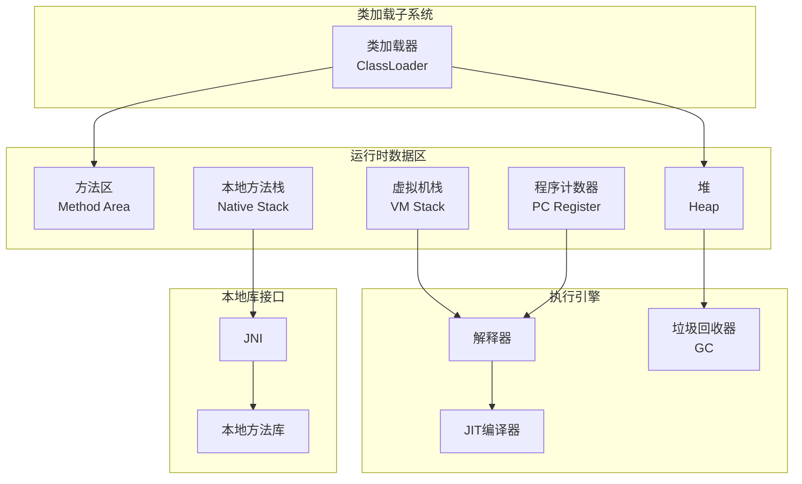
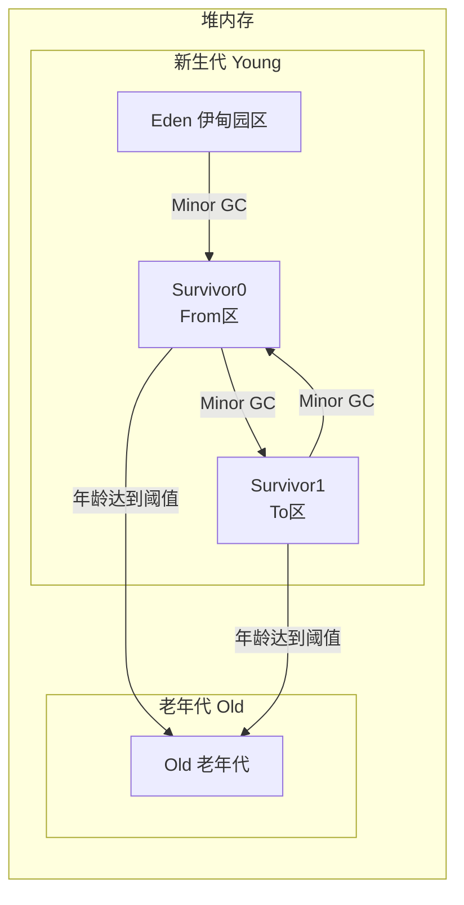
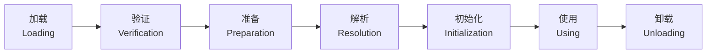
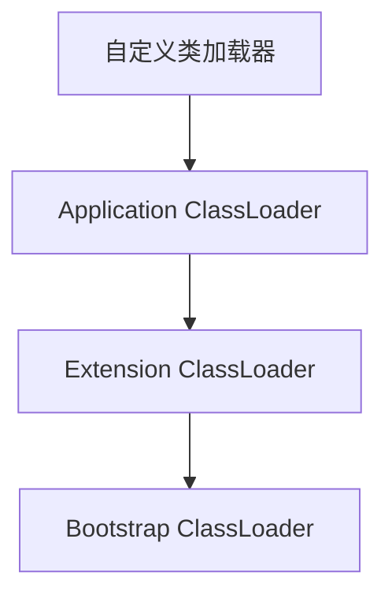

# JVM 内存模型与 GC 调优

> **文档说明**：系统讲解 JVM 内存模型、类加载机制、垃圾回收算法与收集器（Serial/Parallel/CMS/G1/ZGC）、GC 调优参数与工具、常见 OOM 与性能问题排查，含丰富的命令示例、参数配置和生产级调优实践。
>
> **适用人群**：Java 后端开发工程师、全栈开发者、需要深入理解 JVM 的工程师、面试准备者、性能调优工程师
>
> **前置知识**：[[Java知识点完整整合大全_优化版]]、[[Java-并发编程JUC]]

---

## 一、概述

**JVM（Java Virtual Machine）** 是 Java 程序的运行环境，负责将 Java 字节码翻译为机器码并执行。JVM 的内存管理和垃圾回收是 Java 性能的核心，理解 JVM 内存模型和 GC 机制是 Java 高级开发和性能调优的必备技能。

### 1. JVM 架构



### 2. JVM 内存区域划分

| 区域 | 线程私有/共享 | 作用 | 异常 |
|------|-------------|------|------|
| **程序计数器** | 线程私有 | 当前线程执行的字节码行号指示器 | 无（唯一不会 OOM 的区域） |
| **虚拟机栈** | 线程私有 | 存储局部变量表、操作数栈、动态链接、方法出口 | StackOverflowError / OutOfMemoryError |
| **本地方法栈** | 线程私有 | 为 Native 方法服务 | StackOverflowError / OutOfMemoryError |
| **堆** | 线程共享 | 存储对象实例和数组，GC 主要区域 | OutOfMemoryError: Java heap space |
| **方法区** | 线程共享 | 存储类信息、常量、静态变量、JIT 编译代码 | OutOfMemoryError: Metaspace |
| **运行时常量池** | 方法区一部分 | 存储编译期生成的字面量和符号引用 | OutOfMemoryError |
| **直接内存** | 非 JVM 管理 | NIO 使用的堆外内存，由操作系统管理 | OutOfMemoryError |

### 3. 堆内存分代

JVM 堆采用**分代收集**策略，根据对象存活周期分为不同区域：



| 区域 | 占比 | 作用 | GC 类型 |
|------|------|------|---------|
| **Eden** | 新生代 8/10 | 对象最初分配的区域 | Minor GC |
| **Survivor0/1** | 新生代各 1/10 | 经过一次 Minor GC 后存活的对象 | Minor GC |
| **Old** | 堆 2/3（默认） | 长期存活的对象、大对象 | Major GC / Full GC |

**对象分配与晋升规则**：
1. 对象优先在 Eden 分配
2. Eden 满时触发 Minor GC，存活对象复制到 Survivor
3. 长期存活对象（默认年龄 15）晋升到老年代
4. 大对象（超过阈值）直接进入老年代
5. Survivor 空间不足时，存活对象直接进入老年代（分配担保）

---

## 二、类加载机制

### 1. 类加载过程



| 阶段 | 说明 |
|------|------|
| **加载** | 通过类全限定名获取字节码，转换为方法区运行时数据结构，生成 Class 对象 |
| **验证** | 验证字节码合法性（文件格式、元数据、字节码、符号引用） |
| **准备** | 为类变量分配内存并设置零值（static 变量，非 final） |
| **解析** | 将符号引用替换为直接引用（类、字段、方法） |
| **初始化** | 执行 `<clinit>()` 方法，初始化静态变量和静态代码块 |

### 2. 类加载器

| 类加载器 | 加载范围 | 说明 |
|---------|---------|------|
| **Bootstrap ClassLoader** | `$JAVA_HOME/jre/lib` 或 `-Xbootclasspath` | C++ 实现，无父类，加载核心类库 |
| **Extension ClassLoader** | `$JAVA_HOME/jre/lib/ext` | 加载扩展类库 |
| **Application ClassLoader** | 用户 classpath | 加载用户应用类，默认加载器 |
| **自定义 ClassLoader** | 自定义路径 | 继承 ClassLoader，实现自定义加载逻辑 |

### 3. 双亲委派模型



**工作流程**：
1. 类加载器收到加载请求
2. 先委托给父类加载器加载
3. 父类加载器无法加载时，自己才加载

**优点**：
- 避免类重复加载
- 保证核心类安全（如 `java.lang.String` 不会被篡改）
- 类层次关系清晰

**破坏双亲委派的场景**：
- SPI（Service Provider Interface）：JDBC、JNDI 等，线程上下文类加载器
- OSGi：模块化热部署，每个模块有自己的类加载器
- Tomcat：每个 Web 应用有独立的类加载器

```java
// 自定义类加载器
public class MyClassLoader extends ClassLoader {
    private String classPath;

    public MyClassLoader(String classPath) {
        this.classPath = classPath;
    }

    @Override
    protected Class<?> findClass(String name) throws ClassNotFoundException {
        try {
            byte[] bytes = loadClassData(name);
            return defineClass(name, bytes, 0, bytes.length);
        } catch (IOException e) {
            throw new ClassNotFoundException(name, e);
        }
    }

    private byte[] loadClassData(String className) throws IOException {
        String path = classPath + className.replace('.', '/') + ".class";
        try (InputStream is = new FileInputStream(path);
             ByteArrayOutputStream baos = new ByteArrayOutputStream()) {
            byte[] buffer = new byte[1024];
            int len;
            while ((len = is.read(buffer)) != -1) {
                baos.write(buffer, 0, len);
            }
            return baos.toByteArray();
        }
    }
}
```

---

## 三、垃圾回收算法

### 1. 判断对象是否可回收

| 算法 | 说明 | 优缺点 |
|------|------|--------|
| **引用计数法** | 每个对象维护引用计数器，引用+1，引用失效-1，计数为0则回收 | 简单，但无法解决循环引用 |
| **可达性分析** | 从 GC Roots 出发，不可达的对象判定为可回收 | 准确，JVM 使用此方法 |

**GC Roots 包括**：
- 虚拟机栈中引用的对象（局部变量）
- 方法区中静态变量引用的对象
- 方法区中常量引用的对象
- 本地方法栈中 JNI 引用的对象
- 活跃线程引用的对象

### 2. 引用类型

| 引用类型 | 说明 | 回收时机 | 用途 |
|---------|------|---------|------|
| **强引用** | `Object obj = new Object()` | 永不回收（只要引用存在） | 普通对象 |
| **软引用** | `SoftReference` | 内存不足时回收 | 缓存 |
| **弱引用** | `WeakReference` | 下次 GC 时回收 | ThreadLocal、WeakHashMap |
| **虚引用** | `PhantomReference` | 随时回收，必须配合引用队列 | 管理堆外内存 |

```java
// 软引用：内存不足时回收，适合缓存
SoftReference<byte[]> cache = new SoftReference<>(new byte[1024 * 1024]);
byte[] data = cache.get();  // 可能返回 null（已被回收）

// 弱引用：下次 GC 时回收
WeakReference<User> weakRef = new WeakReference<>(new User());
User user = weakRef.get();  // GC 后可能返回 null

// 虚引用：必须配合引用队列
ReferenceQueue<Object> queue = new ReferenceQueue<>();
PhantomReference<Object> phantomRef = new PhantomReference<>(new Object(), queue);
```

### 3. 垃圾回收算法

| 算法 | 原理 | 优点 | 缺点 | 适用场景 |
|------|------|------|------|---------|
| **标记-清除** | 标记存活对象，清除未标记对象 | 简单，不需要移动对象 | 产生内存碎片，分配大对象困难 | 老年代 |
| **标记-整理** | 标记存活对象，将存活对象向一端移动，清除边界外内存 | 无内存碎片 | 需要移动对象，效率低 | 老年代 |
| **复制算法** | 将内存分为两块，每次只用一块，回收时将存活对象复制到另一块 | 无碎片，分配快，实现简单 | 内存利用率低（只用一半） | 新生代 |
| **分代收集** | 根据对象存活周期分代，不同代使用不同算法 | 综合各算法优点 | 实现复杂 | JVM 默认策略 |

### 4. 分代收集策略

| 分代 | 存活率 | 使用算法 | GC 类型 | 频率 |
|------|--------|---------|---------|------|
| **新生代** | 低（约 90% 对象朝生夕死） | 复制算法（Eden + 2 Survivor） | Minor GC | 频繁 |
| **老年代** | 高 | 标记-清除 或 标记-整理 | Major GC / Full GC | 较少 |

---

## 四、垃圾收集器

### 1. 收集器对比

| 收集器 | 分代 | 算法 | 线程 | 特点 | 适用场景 | JDK 版本 |
|--------|------|------|------|------|---------|---------|
| **Serial** | 新生代 | 复制 | 单线程 | 简单，STW 时间长 | 客户端、单核 | 1.3+ |
| **Serial Old** | 老年代 | 标记-整理 | 单线程 | Serial 的老年代版本 | 客户端 | 1.3+ |
| **ParNew** | 新生代 | 复制 | 多线程 | Serial 的多线程版本 | 配合 CMS | 1.4+ |
| **Parallel Scavenge** | 新生代 | 复制 | 多线程 | 吞吐量优先，可控制 GC 时间 | 后台计算 | 1.4+ |
| **Parallel Old** | 老年代 | 标记-整理 | 多线程 | Parallel Scavenge 的老年代版本 | 吞吐量优先 | 1.6+ |
| **CMS** | 老年代 | 标记-清除 | 并发 | 低延迟，STW 短 | 互联网应用 | 1.5+（9 废弃） |
| **G1** | 全堆 | 复制+标记-整理 | 并发 | 区域化，可预测停顿时间 | 服务端、大堆 | 1.7+（9 默认） |
| **ZGC** | 全堆 | 标记-整理 | 并发 | 极低延迟（<10ms），TB 级堆 | 大内存、低延迟 | 11+（15 正式） |
| **Shenandoah** | 全堆 | 标记-整理 | 并发 | 极低延迟，与堆大小无关 | 低延迟 | 12+（OpenJDK） |

### 2. CMS（Concurrent Mark Sweep）

CMS 是第一款真正并发的低延迟收集器，以获取最短回收停顿时间为目标。

**执行过程**：
```
1. 初始标记（STW）：标记 GC Roots 直接关联的对象（很快）
2. 并发标记：从 GC Roots 遍历整个对象图（与用户线程并发）
3. 重新标记（STW）：修正并发标记期间变化的对象（比初始标记长）
4. 并发清除：清除未标记对象（与用户线程并发）
```

**缺点**：
- 对 CPU 资源敏感（并发阶段占用 CPU）
- 无法处理浮动垃圾（并发清除期间产生的垃圾）
- 标记-清除算法产生内存碎片
- 需要更大的堆空间（预留空间给并发阶段）

**JDK 9 废弃，JDK 14 移除**。

### 3. G1（Garbage First）

G1 是 JDK 9 默认收集器，面向服务端，可预测停顿时间。

**核心特点**：
- **区域化（Region）**：堆划分为多个大小相等的 Region（1-32MB）
- **可预测停顿**：通过 `-XX:MaxGCPauseMillis` 设置目标停顿时间
- **优先回收垃圾多的 Region**：Garbage First，回收效率高
- **无内存碎片**：整体看是标记-整理，Region 间是复制

**Region 类型**：
| 类型 | 说明 |
|------|------|
| Eden | 新生代 Eden 区 |
| Survivor | 新生代 Survivor 区 |
| Old | 老年代 |
| Humongous | 大对象区（超过 Region 50% 的对象） |

**G1 执行过程**：
```
1. 初始标记（STW）：标记 GC Roots 直接关联对象
2. 并发标记：从 GC Roots 遍历对象图，计算 Region 存活对象
3. 最终标记（STW）：修正并发标记期间的变化
4. 筛选回收（STW）：根据回收价值和成本排序，选择回收收益最高的 Region
```

**G1 常用参数**：
```bash
-XX:+UseG1GC                    # 启用 G1
-XX:MaxGCPauseMillis=200        # 目标停顿时间（默认 200ms）
-XX:G1HeapRegionSize=16m        # Region 大小（1-32MB，2的幂）
-XX:G1NewSizePercent=5          # 新生代最小占比（默认 5%）
-XX:G1MaxNewSizePercent=60      # 新生代最大占比（默认 60%）
-XX:G1MixedGCCountTarget=8      # Mixed GC 次数（默认 8）
-XX:InitiatingHeapOccupancyPercent=45  # 触发并发标记的堆占用阈值（默认 45%）
```

### 4. ZGC（Z Garbage Collector）

ZGC 是 JDK 11 引入的实验性、JDK 15 正式的低延迟收集器，目标是 TB 级堆、<10ms 停顿。

**核心技术**：
- **着色指针（Colored Pointers）**：在指针中存储对象元信息（标记信息）
- **负载屏障（Load Barrier）**：读对象时触发屏障，处理并发转移
- **并发整理**：几乎所有阶段都与用户线程并发

**ZGC 执行过程**：
```
1. 暂停标记（STW，<1ms）：标记 GC Roots
2. 并发标记：遍历对象图
3. 暂停处理（STW，<1ms）：处理非强根引用
4. 并发转移准备：选择要回收的 Region
5. 暂停转移（STW，<1ms）：转移 GC Roots 引用的对象
6. 并发转移：转移剩余对象
```

**ZGC 常用参数**：
```bash
-XX:+UseZGC                     # 启用 ZGC
-XX:ZCollectionInterval=30      # 最小 GC 间隔（秒）
-XX:ZAllocationSpikeTolerance=2 # 分配突增容忍度
-Xmx16g -Xms16g                 # 建议固定堆大小
```

### 5. 收集器选择建议

| 场景 | 推荐收集器 | 说明 |
|------|-----------|------|
| 堆 < 4GB，客户端 | Serial / Parallel | 简单，吞吐量好 |
| 堆 4-16GB，通用 | G1 | JDK 9+ 默认，均衡 |
| 堆 16GB+，低延迟 | ZGC | 极低停顿，大堆友好 |
| 堆 16GB+，低延迟（OpenJDK） | Shenandoah | 与 ZGC 类似 |
| 遗留系统，JDK 8 | CMS / Parallel Old | CMS 已废弃，建议升级 |

---

## 五、JVM 内存参数

### 1. 堆内存参数

| 参数 | 说明 | 默认值 | 示例 |
|------|------|--------|------|
| `-Xms` | 初始堆大小 | 物理内存 1/64 | `-Xms4g` |
| `-Xmx` | 最大堆大小 | 物理内存 1/4 | `-Xmx8g` |
| `-Xmn` | 新生代大小 | 堆的 1/3 | `-Xmn2g` |
| `-XX:NewRatio` | 老年代/新生代比例 | 2（老年代:新生代=2:1） | `-XX:NewRatio=3` |
| `-XX:SurvivorRatio` | Eden/Survivor 比例 | 8（Eden:Survivor=8:1:1） | `-XX:SurvivorRatio=6` |
| `-XX:MaxTenuringThreshold` | 晋升老年代年龄阈值 | 15（G1 动态调整） | `-XX:MaxTenuringThreshold=10` |
| `-XX:PretenureSizeThreshold` | 大对象直接进老年代阈值 | 0（G1 不适用） | `-XX:PretenureSizeThreshold=1m` |

**生产环境建议**：
- `-Xms` 和 `-Xmx` 设置为相同值，避免堆动态扩展
- 新生代大小约为堆的 1/3 到 1/2
- 堆大小不超过物理内存的 70-80%（留空间给元空间、直接内存、操作系统）

### 2. 方法区/元空间参数

| 参数 | 说明 | 默认值 |
|------|------|--------|
| `-XX:MetaspaceSize` | 元空间初始大小 | 约 21MB |
| `-XX:MaxMetaspaceSize` | 元空间最大大小 | 无限制（受物理内存限制） |
| `-XX:MaxDirectMemorySize` | 直接内存最大大小 | 与 -Xmx 相同 |

**JDK 8 变化**：方法区（永久代）被元空间（Metaspace）替代，使用本地内存，不再受 `-XX:MaxPermSize` 限制。

### 3. 栈参数

| 参数 | 说明 | 默认值 |
|------|------|--------|
| `-Xss` | 每个线程栈大小 | 1024KB（64位） |
| `-XX:ThreadStackSize` | 线程栈大小（与 -Xss 相同） | 1024KB |

**栈大小选择**：
- 递归深、局部变量多 → 增大栈（如 `-Xss2m`）
- 线程数多、递归浅 → 减小栈（如 `-Xss512k`），节省内存

### 4. GC 日志参数

**JDK 9+（统一日志系统）**：
```bash
-Xlog:gc*:file=/var/log/gc.log:time,uptime,level,tags:filecount=10,filesize=100m
```

**JDK 8**：
```bash
-XX:+PrintGCDetails                    # 打印 GC 详情
-XX:+PrintGCDateStamps                 # 打印日期时间戳
-XX:+PrintGCTimeStamps                 # 打印 JVM 启动时间戳
-XX:+PrintHeapAtGC                     # GC 前后打印堆信息
-Xloggc:/var/log/gc.log                # GC 日志输出到文件
-XX:+UseGCLogFileRotation              # 启用日志滚动
-XX:NumberOfGCLogFiles=10              # 日志文件数
-XX:GCLogFileSize=100M                 # 单个日志文件大小
```

### 5. 完整生产配置示例

```bash
# G1 收集器，8GB 堆
java -server \
  -Xms8g -Xmx8g \
  -XX:+UseG1GC \
  -XX:MaxGCPauseMillis=200 \
  -XX:G1HeapRegionSize=16m \
  -XX:MetaspaceSize=256m \
  -XX:MaxMetaspaceSize=512m \
  -XX:MaxDirectMemorySize=1g \
  -Xss512k \
  -XX:+HeapDumpOnOutOfMemoryError \
  -XX:HeapDumpPath=/var/log/heapdump.hprof \
  -XX:+PrintCommandLineFlags \
  -Xlog:gc*:file=/var/log/gc.log:time,uptime,level,tags:filecount=10,filesize=100m \
  -Dfile.encoding=UTF-8 \
  -jar app.jar
```

---

## 六、JVM 监控与调优工具

### 1. 命令行工具

| 工具 | 说明 | 常用命令 |
|------|------|---------|
| **jps** | 查看 Java 进程 | `jps -l` |
| **jstat** | JVM 统计信息 | `jstat -gc <pid> 1000` |
| **jinfo** | 查看/修改 JVM 参数 | `jinfo -flags <pid>` |
| **jmap** | 内存映射/堆转储 | `jmap -heap <pid>` / `jmap -dump:format=b,file=heap.hprof <pid>` |
| **jstack** | 线程堆栈 | `jstack <pid>` |
| **jcmd** | 综合诊断工具 | `jcmd <pid> GC.heap_dump heap.hprof` |
| **jhat** | 堆转储分析（已过时） | `jhat heap.hprof` |

```bash
# jps：列出 Java 进程
jps -l
# 12345 com.example.Application
# 67890 sun.tools.jps.Jps

# jstat：GC 统计（每秒刷新一次）
jstat -gc 12345 1000
# S0C    S1C    S0U    S1U      EC       EU        OC         OU       MC     MU    CCSC   CCSU   YGC     YGCT    FGC    FGCT     GCT
# 1024.0 1024.0  0.0   512.0  8192.0   4096.0   20480.0   10240.0  20480  18000 2048   1800    10     0.500   2      0.300   0.800

# jstat 常用选项
jstat -gcutil <pid>    # 百分比显示
jstat -gccapacity <pid> # 各代容量
jstat -gcnew <pid>     # 新生代统计
jstat -gcold <pid>     # 老年代统计

# jinfo：查看 JVM 参数
jinfo -flags 12345
jinfo -sysprops 12345
jinfo -flag MaxHeapSize 12345  # 查看单个参数
jinfo -flag +PrintGCDetails 12345  # 动态开启参数

# jmap：堆信息
jmap -heap 12345           # 堆配置和使用情况
jmap -histo 12345 | head -20  # 对象统计（按数量排序）
jmap -histo:live 12345 | head -20  # 存活对象统计（会触发 Full GC）
jmap -dump:format=b,file=/tmp/heap.hprof 12345  # 堆转储

# jstack：线程堆栈
jstack 12345 > thread_dump.txt
jstack -l 12345  # 包含锁信息
jstack -F 12345  # 强制 dump（进程无响应时）

# jcmd：综合工具
jcmd 12345 help                    # 查看可用命令
jcmd 12345 VM.flags                # JVM 参数
jcmd 12345 GC.heap_dump /tmp/heap.hprof  # 堆转储
jcmd 12345 Thread.print            # 线程堆栈
jcmd 12345 GC.run                  # 触发 GC
jcmd 12345 VM.system_properties    # 系统属性
```

### 2. 图形化工具

| 工具 | 说明 |
|------|------|
| **JConsole** | JDK 自带，监控内存、线程、类、GC |
| **VisualVM** | JDK 自带（JDK 9+ 需单独下载），功能强大，支持插件 |
| **JMC（Java Mission Control）** | Oracle 商业工具，JFR（Java Flight Recorder）分析 |
| **Arthas** | 阿里开源，在线诊断工具，命令行交互 |
| **MAT（Memory Analyzer Tool）** | Eclipse 开源，堆转储分析 |
| **GCViewer** | GC 日志可视化分析 |
| **GCEasy** | 在线 GC 日志分析工具 |

### 3. Arthas 常用命令

```bash
# 启动 Arthas
java -jar arthas-boot.jar
# 选择要诊断的 Java 进程

# 常用命令
dashboard                    # 实时监控面板（线程、内存、GC）
thread                       # 查看线程信息
thread -n 3                  # 查看最忙的 3 个线程
thread -b                    # 查看阻塞线程（死锁）
thread <id>                  # 查看指定线程堆栈

jvm                          # JVM 信息
memory                       # 内存信息
gc                           # GC 统计

heapdump /tmp/heap.hprof     # 堆转储
classloader -l               # 类加载器信息
sc -d *ClassName*            # 查看类信息
sm *ClassName*               # 查看方法信息

watch *ClassName* methodName '{params,returnObj,throwExp}' -x 2  # 监控方法调用
trace *ClassName* methodName  # 方法调用链路耗时
stack *ClassName* methodName  # 方法调用栈
tt -t *ClassName* methodName  # 方法调用时间隧道（可回放）

ognl '@java.lang.System@out.println("hello")'  # 执行 OGNL 表达式
```

---

## 七、常见 OOM 与问题排查

### 1. OOM 类型

| OOM 类型 | 原因 | 解决方案 |
|---------|------|---------|
| **Java heap space** | 堆内存不足，对象无法分配 | 增大 -Xmx、检查内存泄漏、优化对象创建 |
| **Metaspace** | 元空间不足，类加载过多 | 增大 -XX:MaxMetaspaceSize、检查类加载泄漏 |
| **GC overhead limit exceeded** | GC 时间占比过高（默认 98%），回收内存过少（默认 2%） | 检查内存泄漏、增大堆、优化 GC |
| **unable to create new native thread** | 线程数过多，无法创建新线程 | 减小 -Xss、限制线程数、检查线程泄漏 |
| **Direct buffer memory** | 直接内存不足（NIO） | 增大 -XX:MaxDirectMemorySize、检查 ByteBuffer 泄漏 |
| **request size bytes for reason. Out of swap space?** | 本地内存不足，操作系统交换空间耗尽 | 增加物理内存/交换空间、减小堆、检查本地内存泄漏 |

### 2. 堆内存 OOM 排查

```bash
# 1. 开启 OOM 时自动堆转储
-XX:+HeapDumpOnOutOfMemoryError
-XX:HeapDumpPath=/var/log/heapdump.hprof

# 2. 分析堆转储
# 使用 MAT（Memory Analyzer Tool）打开 hprof 文件
# 重点查看：
# - Leak Suspects（泄漏嫌疑报告）
# - Dominator Tree（支配树，找大对象）
# - Histogram（对象统计，按数量/大小排序）
# - Top Consumers（内存消耗最大的对象）

# 3. 在线分析（不重启）
jmap -histo:live <pid> | head -30  # 查看存活对象最多的类
jmap -dump:format=b,file=heap.hprof <pid>  # 在线堆转储

# 4. Arthas 分析
dashboard                    # 查看堆内存使用趋势
heapdump /tmp/heap.hprof     # 堆转储
ognl '@java.lang.Runtime@getRuntime().totalMemory()'  # 查看总内存
```

### 3. 内存泄漏常见原因

| 原因 | 说明 | 排查方法 |
|------|------|---------|
| **静态集合** | static Map/List 持有对象引用不释放 | 检查 static 集合，使用弱引用 |
| **ThreadLocal 未清理** | ThreadLocal 使用后未 remove | 检查 ThreadLocal，finally 中 remove |
| **连接/流未关闭** | 数据库连接、文件流、网络连接未关闭 | 使用 try-with-resources |
| **监听器未注销** | 注册了监听器但未注销 | 检查 addXxxListener，对应 remove |
| **缓存无上限** | 缓存无限增长不淘汰 | 使用 LRU 缓存、设置最大容量 |
| **内部类持有外部类** | 非静态内部类隐式持有外部类引用 | 使用静态内部类 |
| **JNI 本地内存泄漏** | 本地代码分配内存未释放 | 检查 JNI 代码、使用 jmap -histo |

### 4. 线程泄漏排查

```bash
# 1. 查看线程数
jstack <pid> | grep "java.lang.Thread.State" | sort | uniq -c
# 按状态统计线程数

# 2. 查看线程堆栈
jstack <pid> > thread_dump.txt
# 分析：是否有大量同名线程、是否有线程阻塞、是否有死锁

# 3. Arthas 分析
thread -n 5                   # 最忙的 5 个线程
thread --state WAITING        # 所有等待状态线程
thread -b                      # 阻塞线程（死锁检测）

# 4. 常见原因
# - 线程池未关闭（ExecutorService 未 shutdown）
# - Timer 未 cancel
# - 连接池连接泄漏
# - 无限创建线程（未使用线程池）
```

### 5. Full GC 频繁排查

```bash
# 1. 查看 GC 统计
jstat -gcutil <pid> 1000
# 关注：OU（老年代使用率）、FGC（Full GC 次数）、FGCT（Full GC 总时间）

# 2. 分析 GC 日志
# 使用 GCViewer / GCEasy 分析 GC 日志
# 关注：Full GC 频率、每次回收量、晋升速率

# 3. 常见原因
# - 老年代空间不足（增大 -Xmx 或 -XX:NewRatio）
# - 大对象直接进入老年代（调整 -XX:PretenureSizeThreshold）
# - 内存泄漏导致老年代无法回收
# - 元空间不足触发 Full GC
# - System.gc() 被显式调用（加 -XX:+DisableExplicitGC）
# - 分配担保失败（Survivor 空间不足）
```

---

## 八、GC 调优实践

### 1. 调优目标

| 目标 | 说明 | 指标 |
|------|------|------|
| **吞吐量** | 应用代码执行时间占比 | 吞吐量 = 1 - GC时间/总时间，目标 > 95% |
| **延迟** | GC 停顿时间 | P99 < 200ms（根据业务调整） |
| **内存占用** | 堆内存大小 | 在满足性能前提下尽量小 |

**三者权衡**：吞吐量、延迟、内存占用构成"不可能三角"，需根据业务优先级取舍。

### 2. 调优步骤

```
1. 明确目标：吞吐量优先 / 延迟优先 / 内存优先
2. 监控现状：GC 日志、jstat、Arthas dashboard
3. 分析瓶颈：Full GC 频繁？Minor GC 耗时？晋升速率高？
4. 调整参数：根据瓶颈调整对应参数
5. 压测验证：对比调整前后的 GC 指标和业务指标
6. 持续迭代：根据监控数据持续优化
```

### 3. 常见调优场景

**场景1：Minor GC 频繁**
- 原因：新生代太小，对象频繁分配和回收
- 解决：增大新生代（`-Xmn` 或 `-XX:NewRatio`）

**场景2：Full GC 频繁但回收后老年代使用率低**
- 原因：内存泄漏，对象无法回收
- 解决：堆转储分析，定位泄漏点

**场景3：Full GC 频繁且回收后老年代使用率高**
- 原因：老年代空间不足
- 解决：增大堆（`-Xmx`）、增大老年代比例（`-XX:NewRatio`）

**场景4：GC 停顿时间长**
- 原因：使用了 STW 时间长的收集器（如 Serial Old）
- 解决：切换到 G1/ZGC，调整 `-XX:MaxGCPauseMillis`

**场景5：元空间 OOM**
- 原因：动态生成类过多（CGLIB、JSP、热部署）
- 解决：增大 `-XX:MaxMetaspaceSize`，检查类加载泄漏

### 4. 压测与验证

```bash
# 使用 JMeter / wrk / ab 进行压测
# 监控指标：
# - 业务指标：QPS、响应时间（P50/P95/P99）、错误率
# - JVM 指标：堆使用率、GC 频率、GC 停顿时间、吞吐量

# 对比调优前后：
# 1. 相同压测参数
# 2. 收集 GC 日志
# 3. 分析 GC 指标变化
# 4. 确认业务指标是否改善
```

---

## 九、关联笔记

### Java 核心
- [[Java知识点完整整合大全_优化版]] · [[Java-并发编程JUC]] · [[Java-集合框架源码分析]]
- [[Java-异常体系与最佳实践]] · [[Java-语法进阶与StreamAPI]] · [[Java-反射与字节码操作]]
- [[JVM-调优工具实战-Arthas]]

### 后端
- [[SpringBoot-自动装配原理]] · [[Spring-IOCAOP核心机制]] · [[高并发系统设计案例]]
- [[Java-应用性能调优实战]] · [[线上故障排查手册]] · [[Java问题排查手册]]

### 分布式
- [[分布式事务 知识点系统梳理_优化版]] · [[分布式锁知识点系统梳理_优化版]]
- [[消息队列-Kafka与RabbitMQ]] · [[微服务核心组件知识点系统梳理_优化版]]

### 云原生
- [[Docker-核心原理与镜像优化]] · [[K8s-核心概念与架构]] · [[Prometheus监控体系]]

### 计算机基础
- [[操作系统核心概念]] · [[Linux内核基础概念]] · [[计算机网络分层模型速查]]

### 导航
- [[MOC-后端开发]] · [[MOC-Java全栈-四级展开]] · [[全栈+AI工程双轨融合学习路线图]]

> **学习路径建议**：先掌握 [[Java知识点完整整合大全_优化版]] Java 基础 → 学习 [[Java-并发编程JUC]] 并发编程 → 深入本文 JVM 内存模型与 GC 调优 → 实践 [[JVM-调优工具实战-Arthas]] 调优工具 → 研究 [[Java-应用性能调优实战]] 和 [[线上故障排查手册]] 生产问题 → 应用于 [[高并发系统设计案例]] 性能优化。
