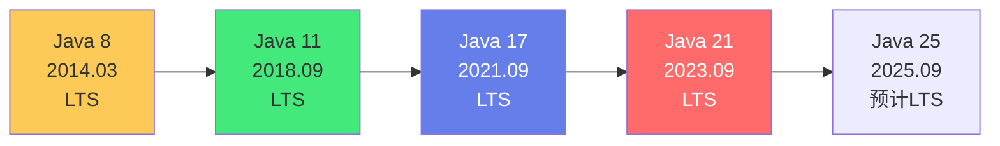

# ☕ Java LTS 版本新特性全解析

> **文档说明**：系统梳理 Java 各 LTS（长期支持）版本的核心新特性与演进脉络，涵盖 Java 版本体系概述（LTS 概念 / 发布周期 / 支持策略 / 版本历史时间线 / 如何选择版本）、Java 8 LTS（Lambda 表达式 / Stream API / Optional 空安全 / 新日期时间 API / 接口默认方法与静态方法 / 重复注解 / 类型注解 / CompletableFuture / 方法引用 / 函数式接口）、Java 11 LTS（var 局部变量类型推断 / 全新 HTTP Client API / 字符串新方法（isBlank/strip/repeat）/ 文件 API 增强 / 移除 Java EE 模块 / ZGC 实验性 / Epsilon GC / 飞行记录器 / 单文件源码运行）、Java 17 LTS（Sealed 密封类 / Pattern Matching for instanceof / Record 记录类 / Switch 表达式 / 文本块 / Helpful NullPointerExceptions / 强封装 JDK 内部 / ZGC 生产就绪 / 模式匹配预览）、Java 21 LTS（虚拟线程 Virtual Threads / Pattern Matching for switch / Record Patterns / Sequenced Collections 有序集合 / String Templates 预览 / 分代 ZGC / 未命名类与实例 main 方法预览 / 向量 API 孵化）、版本迁移指南（8→11 迁移要点 / 11→17 迁移要点 / 17→21 迁移要点 / 兼容性检查工具 / 废弃与移除 API 清单 / 第三方库兼容性）、性能对比（各版本 JVM 基准性能 / G1 vs ZGC vs 分代 ZGC / 启动时间 / 内存占用 / 吞吐量对比）、最佳实践（企业版本选择策略 / 升级路线规划 / 新特性渐进式采用 / 代码现代化重构 / 团队培训与规范）、常见问题与解决方案（升级后编译错误 / 反射访问受限 / 性能回退 / 第三方库不兼容 / GC 调优变化）。
>
> **适用人群**：Java 开发者、架构师、技术负责人、准备版本升级的团队、关注 Java 新特性的学习者
>
> **前置知识**：[[Java-语法基础与面向对象]] · [[JVM-内存模型与垃圾回收]]

---

## 一、Java 版本体系概述

### 1.1 什么是 LTS

**LTS（Long-Term Support，长期支持）** 是 Oracle 从 Java 9 开始实施的新发布模型中的版本类型：

| 版本类型 | 发布周期 | 支持时长 | 说明 |
|---------|---------|---------|------|
| **LTS（长期支持）** | 每 3 年 | 8 年（Oracle Premier） | 企业生产环境首选，稳定可靠 |
| **非 LTS（特性版本）** | 每 6 个月 | 6 个月 | 引入新特性，快速迭代，不建议生产长期使用 |

**LTS 版本时间线**：



| LTS 版本 | 发布日期 | 最新小版本（2026） | Oracle 支持至 | 主流使用情况 |
|---------|---------|-------------------|-------------|------------|
| **Java 8** | 2014-03 | 8u432 | 2030-12（扩展支持） | 存量系统最多，逐步淘汰 |
| **Java 11** | 2018-09 | 11.0.28 | 2026-09 | 当前企业主流版本 |
| **Java 17** | 2021-09 | 17.0.16 | 2029-09 | 新项目首选，快速普及 |
| **Java 21** | 2023-09 | 21.0.6 | 2031-09 | 最新 LTS，虚拟线程革命 |

### 1.2 发布周期与支持策略

```
新发布模型（Java 9 起）：

- 每 6 个月发布一个特性版本（3月、9月）
- 每 3 年（第 6 个特性版本）发布一个 LTS 版本
- 非 LTS 版本只支持到下一个版本发布（约 6 个月）
- LTS 版本提供 8 年 Premier Support + 扩展支持

版本号规则：
- Java 8 → 1.8.0_xxx
- Java 9+ → 主版本.小版本.补丁版本（如 17.0.1）
- 小版本：每季度更新（CPU，Critical Patch Update）
- 补丁版本：紧急安全修复
```

### 1.3 如何选择版本

| 场景 | 推荐版本 | 理由 |
|------|---------|------|
| **全新项目** | Java 21 | 最新 LTS，虚拟线程等革命性特性，长期支持 |
| **企业保守项目** | Java 17 | 稳定成熟，生态完善，大多数框架已支持 |
| **存量系统维护** | Java 11 | 当前主流，兼容性好，逐步升级到 17/21 |
| **老系统不升级** | Java 8 | 仅维护，建议制定升级计划 |
| **学习/实验** | Java 21（或最新 EA） | 体验最新特性 |

> **升级建议**：不要跨多个 LTS 版本一次性升级（如 8→17），建议逐步升级（8→11→17→21），每个版本稳定运行一段时间后再升下一个。使用 `jdeps` 工具检查依赖兼容性。

---

## 二、Java 8 LTS（2014）

### 2.1 Lambda 表达式

```java
// Java 8 之前：匿名内部类
Runnable r1 = new Runnable() {
    @Override
    public void run() {
        System.out.println("Hello");
    }
};

// Java 8：Lambda 表达式
Runnable r2 = () -> System.out.println("Hello");

// 带参数的 Lambda
Comparator<String> cmp = (a, b) -> a.compareTo(b);
Comparator<String> cmp2 = (String a, String b) -> a.compareTo(b);

// 多行 Lambda
List<String> names = Arrays.asList("Alice", "Bob", "Charlie");
names.forEach(name -> {
    String upper = name.toUpperCase();
    System.out.println(upper);
});

// 方法引用
names.forEach(System.out::println);  // 静态方法引用
names.forEach(String::toUpperCase);   // 实例方法引用

// 函数式接口（只有一个抽象方法的接口）
@FunctionalInterface
interface Calculator {
    int calculate(int a, int b);
}

Calculator add = (a, b) -> a + b;
Calculator multiply = (a, b) -> a * b;
```

### 2.2 Stream API

```java
import java.util.*;
import java.util.stream.*;

List<Person> people = Arrays.asList(
    new Person("Alice", 30, "F"),
    new Person("Bob", 25, "M"),
    new Person("Charlie", 35, "M"),
    new Person("Diana", 28, "F")
);

// 过滤 + 映射 + 收集
List<String> femaleNames = people.stream()
    .filter(p -> "F".equals(p.getGender()))
    .map(Person::getName)
    .collect(Collectors.toList());
// [Alice, Diana]

// 聚合计算
double avgAge = people.stream()
    .mapToInt(Person::getAge)
    .average()
    .orElse(0);
// 29.5

// 分组
Map<String, List<Person>> byGender = people.stream()
    .collect(Collectors.groupingBy(Person::getGender));

// 排序
List<Person> sortedByAge = people.stream()
    .sorted(Comparator.comparingInt(Person::getAge))
    .collect(Collectors.toList());

// 并行流
int sum = people.parallelStream()
    .mapToInt(Person::getAge)
    .sum();

// 常用收集器
String joined = people.stream()
    .map(Person::getName)
    .collect(Collectors.joining(", "));
// Alice, Bob, Charlie, Diana

Map<String, Integer> nameToAge = people.stream()
    .collect(Collectors.toMap(Person::getName, Person::getAge));
```

### 2.3 Optional 空安全

```java
import java.util.Optional;

// Java 8 之前：空指针风险
String getUserName(User user) {
    if (user != null) {
        Address addr = user.getAddress();
        if (addr != null) {
            City city = addr.getCity();
            if (city != null) {
                return city.getName();
            }
        }
    }
    return "Unknown";
}

// Java 8：Optional 链式调用
String getUserName(User user) {
    return Optional.ofNullable(user)
        .map(User::getAddress)
        .map(Address::getCity)
        .map(City::getName)
        .orElse("Unknown");
}

// Optional 常用方法
Optional<String> name = Optional.of("Alice");  // 非空值
Optional<String> empty = Optional.empty();       // 空值
Optional<String> nullable = Optional.ofNullable(maybeNull);  // 可能为空

// 判断与获取
name.isPresent();  // true
name.ifPresent(n -> System.out.println(n));  // 如果存在则执行
name.get();  // Alice（空会抛 NoSuchElementException）
name.orElse("Default");  // Alice
name.orElseGet(() -> "Default");  // 延迟计算默认值
name.orElseThrow(() -> new RuntimeException("not found"));

// 过滤与转换
name.filter(n -> n.length() > 3)
    .map(String::toUpperCase)
    .ifPresent(System.out::println);  // ALICE
```

### 2.4 新日期时间 API（java.time）

```java
import java.time.*;
import java.time.format.*;
import java.time.temporal.*;

// 本地日期时间
LocalDate date = LocalDate.now();  // 2026-08-29
LocalTime time = LocalTime.now();  // 14:30:00.123
LocalDateTime datetime = LocalDateTime.now();  // 2026-08-29T14:30:00.123

// 创建指定日期
LocalDate birthday = LocalDate.of(1990, Month.JANUARY, 15);
LocalTime meetingTime = LocalTime.of(14, 30);

// 日期运算
LocalDate tomorrow = LocalDate.now().plusDays(1);
LocalDate nextWeek = LocalDate.now().plusWeeks(1);
LocalDate lastMonth = LocalDate.now().minusMonths(1);

// 计算日期间隔
long daysBetween = ChronoUnit.DAYS.between(
    LocalDate.of(2026, 1, 1), 
    LocalDate.of(2026, 12, 31)
);  // 364

Period period = Period.between(
    LocalDate.of(1990, 1, 15), 
    LocalDate.now()
);
int years = period.getYears();  // 36

// 格式化与解析
DateTimeFormatter formatter = DateTimeFormatter.ofPattern("yyyy-MM-dd HH:mm:ss");
String formatted = datetime.format(formatter);  // 2026-08-29 14:30:00
LocalDateTime parsed = LocalDateTime.parse("2026-08-29 14:30:00", formatter);

// 时区
ZonedDateTime zoned = ZonedDateTime.now(ZoneId.of("Asia/Shanghai"));
ZonedDateTime utc = ZonedDateTime.now(ZoneOffset.UTC);

// 时间戳（Instant）
Instant now = Instant.now();
long epochMilli = now.toEpochMilli();  // 毫秒时间戳
Instant fromEpoch = Instant.ofEpochMilli(1700000000000L);

// 与旧 API 转换
Date oldDate = Date.from(now);
Instant newInstant = oldDate.toInstant();
```

### 2.5 接口默认方法与静态方法

```java
// Java 8 之前：接口只能有抽象方法
// Java 8：接口可以有默认方法和静态方法

public interface Vehicle {
    // 抽象方法（必须实现）
    void start();
    void stop();
    
    // 默认方法（实现类可以不重写，直接继承）
    default void honk() {
        System.out.println("Honking the horn!");
    }
    
    default String getType() {
        return "Generic Vehicle";
    }
    
    // 静态方法（接口级别的工具方法）
    static Vehicle createDefault() {
        return new Car();  // 假设 Car 实现了 Vehicle
    }
    
    static int compareBySpeed(Vehicle v1, Vehicle v2) {
        return Integer.compare(v1.getSpeed(), v2.getSpeed());
    }
}

// 实现类
public class Car implements Vehicle {
    @Override
    public void start() {
        System.out.println("Car started");
    }
    
    @Override
    public void stop() {
        System.out.println("Car stopped");
    }
    
    // 可以选择重写默认方法
    @Override
    public String getType() {
        return "Car";
    }
    // honk() 不需要重写，直接使用默认实现
}

// 多继承冲突解决
interface A {
    default void hello() { System.out.println("A"); }
}
interface B {
    default void hello() { System.out.println("B"); }
}
class C implements A, B {
    @Override
    public void hello() {
        A.super.hello();  // 显式指定使用哪个接口的默认方法
    }
}
```

### 2.6 CompletableFuture

```java
import java.util.concurrent.*;

// Java 8 之前：Future 接口功能有限，无法链式组合
// Java 8：CompletableFuture 强大的异步编程

// 基础异步执行
CompletableFuture<String> future = CompletableFuture.supplyAsync(() -> {
    // 异步任务
    return "Hello, Async!";
});

// 链式调用：thenApply（转换结果）
CompletableFuture<String> result = CompletableFuture
    .supplyAsync(() -> "Hello")
    .thenApply(s -> s + " World")
    .thenApply(String::toUpperCase);

// thenAccept（消费结果，无返回值）
CompletableFuture.supplyAsync(() -> "Hello")
    .thenAccept(s -> System.out.println("Received: " + s));

// thenCompose（扁平化嵌套 Future）
CompletableFuture<String> getUserAsync(String id) { ... }
CompletableFuture<String> getOrdersAsync(String userId) { ... }

CompletableFuture<String> result = getUserAsync("123")
    .thenCompose(user -> getOrdersAsync(user));  // 避免嵌套

// thenCombine（组合两个 Future）
CompletableFuture<String> userFuture = getUserAsync("123");
CompletableFuture<String> orderFuture = getOrdersAsync("456");

CompletableFuture<String> combined = userFuture.thenCombine(
    orderFuture,
    (user, order) -> user + " - " + order
);

// 异常处理
CompletableFuture<String> result = CompletableFuture
    .supplyAsync(() -> {
        if (true) throw new RuntimeException("Error!");
        return "Success";
    })
    .exceptionally(ex -> "Fallback: " + ex.getMessage())  // 异常时返回默认值
    .handle((res, ex) -> ex != null ? "Error" : res);    // 处理结果和异常

// 等待多个 Future
CompletableFuture<String> f1 = CompletableFuture.supplyAsync(() -> "A");
CompletableFuture<String> f2 = CompletableFuture.supplyAsync(() -> "B");
CompletableFuture<String> f3 = CompletableFuture.supplyAsync(() -> "C");

// allOf：等待所有完成
CompletableFuture<Void> all = CompletableFuture.allOf(f1, f2, f3);
all.join();

// anyOf：等待任意一个完成
CompletableFuture<Object> any = CompletableFuture.anyOf(f1, f2, f3);
Object firstResult = any.join();

// 指定线程池
ExecutorService customPool = Executors.newFixedThreadPool(10);
CompletableFuture.supplyAsync(() -> "task", customPool);
```

### 2.7 其他 Java 8 重要特性

| 特性 | 说明 |
|------|------|
| **重复注解** | `@Repeatable` 允许同一注解多次使用 |
| **类型注解** | 注解可以用在类型上（如 `List<@NonNull String>`） |
| **方法引用** | `::` 语法引用方法或构造器 |
| **函数式接口** | `@FunctionalInterface` 标记，只有一个抽象方法 |
| **StampedLock** | 新的读写锁，性能优于 ReentrantReadWriteLock |
| **Base64 编码** | 标准库内置 `java.util.Base64` |
| **并行数组排序** | `Arrays.parallelSort()` |
| **Nashorn JavaScript 引擎** | 内置 JS 引擎（Java 15 移除） |

---

## 三、Java 11 LTS（2018）

### 3.1 var 局部变量类型推断

```java
// Java 10 引入，Java 11 增强（可用于 Lambda 参数）

// 之前：类型声明冗长
String name = "Alice";
List<String> names = new ArrayList<>();
Map<String, List<Integer>> complex = new HashMap<>();

// Java 10+：var 推断类型（编译器推断，运行时仍是强类型）
var name = "Alice";              // 推断为 String
var count = 42;                   // 推断为 int
var list = new ArrayList<String>();  // 推断为 ArrayList<String>
var map = new HashMap<String, List<Integer>>();

// Java 11：var 可用于 Lambda 参数
(var x, var y) -> x + y
// 等价于 (x, y) -> x + y，但 var 允许加注解
(@NonNull var x, @Nullable var y) -> x + y

// var 的限制
var x;              // ❌ 必须初始化，无法推断
var x = null;       // ❌ 不能初始化为 null
var x = () -> "hi"; // ❌ Lambda 需要目标类型
var[] arr = new int[10];  // ❌ 不能是数组类型
public var method() { return "hi"; }  // ❌ 不能用于方法返回值
var field = "value";  // ❌ 不能用于字段（只能局部变量）

// 最佳实践：变量名清晰时用 var，类型不明显时显式声明
var userService = new UserService();  // ✅ 类型从变量名可知
var result = process();  // ⚠️ result 是什么类型？建议显式声明
```

### 3.2 全新 HTTP Client API

```java
import java.net.URI;
import java.net.http.*;
import java.time.Duration;

// Java 9 孵化，Java 11 正式：java.net.http.HttpClient
// 替代老旧的 HttpURLConnection，支持 HTTP/1.1 和 HTTP/2

// 创建客户端
HttpClient client = HttpClient.newBuilder()
    .version(HttpClient.Version.HTTP_2)  // 优先 HTTP/2
    .connectTimeout(Duration.ofSeconds(10))
    .followRedirects(HttpClient.Redirect.NORMAL)
    .build();

// 同步 GET 请求
HttpRequest request = HttpRequest.newBuilder()
    .uri(URI.create("https://api.example.com/users"))
    .timeout(Duration.ofSeconds(30))
    .header("Accept", "application/json")
    .GET()
    .build();

HttpResponse<String> response = client.send(request, HttpResponse.BodyHandlers.ofString());
System.out.println("Status: " + response.statusCode());
System.out.println("Body: " + response.body());

// 异步 GET 请求
CompletableFuture<HttpResponse<String>> future = client.sendAsync(
    request, HttpResponse.BodyHandlers.ofString()
);
future.thenAccept(res -> System.out.println(res.body()));

// POST 请求（JSON）
String jsonBody = "{\"name\":\"Alice\",\"age\":30}";
HttpRequest postRequest = HttpRequest.newBuilder()
    .uri(URI.create("https://api.example.com/users"))
    .header("Content-Type", "application/json")
    .POST(HttpRequest.BodyPublishers.ofString(jsonBody))
    .build();

HttpResponse<String> postResponse = client.send(postRequest, HttpResponse.BodyHandlers.ofString());

// 响应体处理器
HttpResponse.BodyHandlers.ofString();        // 字符串
HttpResponse.BodyHandlers.ofByteArray();     // 字节数组
HttpResponse.BodyHandlers.ofInputStream();   // 输入流（流式处理大响应）
HttpResponse.BodyHandlers.ofFile(Path.of("download.zip"));  // 直接写入文件
HttpResponse.BodyHandlers.discarding();      // 丢弃响应体

// 并发请求
List<URI> uris = List.of(
    URI.create("https://api.example.com/a"),
    URI.create("https://api.example.com/b"),
    URI.create("https://api.example.com/c")
);

List<CompletableFuture<HttpResponse<String>>> futures = uris.stream()
    .map(uri -> client.sendAsync(
        HttpRequest.newBuilder().uri(uri).build(),
        HttpResponse.BodyHandlers.ofString()
    ))
    .collect(Collectors.toList());

CompletableFuture.allOf(futures.toArray(new CompletableFuture[0]))
    .thenRun(() -> futures.forEach(f -> {
        try { System.out.println(f.get().body()); } 
        catch (Exception e) { e.printStackTrace(); }
    }));
```

### 3.3 字符串新方法

```java
// Java 11 新增的 String 方法

String text = "  Hello World  ";

// isBlank：检查是否空白（空字符串或只含空白字符）
"".isBlank();        // true
"  ".isBlank();      // true
"hello".isBlank();   // false

// strip/stripLeading/stripTrailing：去除空白（Unicode 感知，比 trim 更强）
"  hello  ".strip();          // "hello"
"  hello  ".stripLeading();   // "hello  "
"  hello  ".stripTrailing();  // "  hello"
// 与 trim 的区别：trim 只去除 ASCII 空白（<= U+0020）
// strip 去除所有 Unicode 空白字符

// repeat：重复字符串
"ab".repeat(3);       // "ababab"
"a".repeat(0);        // ""
"a".repeat(-1);       // IllegalArgumentException

// lines：按行分割为 Stream
String multiline = "line1\nline2\nline3";
List<String> lines = multiline.lines().collect(Collectors.toList());
// [line1, line2, line3]

// isEmpty vs isBlank
"".isEmpty();       // true
"".isBlank();       // true
"  ".isEmpty();     // false
"  ".isBlank();     // true
```

### 3.4 文件 API 增强

```java
import java.nio.file.*;

// Java 11：Files 类新增读写字符串的方法

Path path = Path.of("test.txt");

// 读取文件为字符串（之前需要 BufferedReader 手动拼接）
String content = Files.readString(path);
String contentUtf8 = Files.readString(path, StandardCharsets.UTF_8);

// 写入字符串到文件
Files.writeString(path, "Hello, Java 11!");
Files.writeString(path, "Append", StandardOpenOption.APPEND);

// Path.of() 工厂方法（Java 11 新增，替代 Paths.get()）
Path p1 = Path.of("dir", "file.txt");  // 相对路径
Path p2 = Path.of("/home/user/file.txt");  // 绝对路径
```

### 3.5 移除与废弃

| 移除/废弃 | 说明 | 替代方案 |
|----------|------|---------|
| **Java EE 模块** | java.xml.ws、java.xml.bind 等 | 使用第三方库（JAXB、JAX-WS） |
| **CORBA** | java.corba 模块 | 第三方 CORBA 实现 |
| **JAXB** | XML 绑定 | jakarta.xml.bind-api |
| **JAX-WS** | Web 服务 | jakarta.xml.ws-api |
| **Nashorn** | JavaScript 引擎（Java 15 移除） | GraalVM JS |
| **Java Web Start** | 应用部署技术 | 无官方替代 |
| **appletviewer** | Applet 工具 | 已废弃 |

### 3.6 其他 Java 11 特性

| 特性 | 说明 |
|------|------|
| **ZGC（实验性）** | 低延迟垃圾回收器，暂停时间 < 10ms |
| **Epsilon GC** | 无操作垃圾回收器（用于性能测试和内存分配分析） |
| **飞行记录器（JFR）** | 开源的低开销性能分析工具 |
| **单文件源码运行** | `java HelloWorld.java` 直接运行单文件程序 |
| **Unicode 10** | 支持最新 Unicode 标准 |
| **TLS 1.3** | 支持最新 TLS 协议 |
| **ChaCha20-Poly1305** | 新加密算法 |
| **动态类文件常量** | JVM 常量池增强 |

---

## 四、Java 17 LTS（2021）

### 4.1 Record 记录类

```java
// Java 14 预览，Java 16 正式：Record 类
// 不可变数据载体，自动生成构造器、getter、equals、hashCode、toString

// 之前：需要写大量样板代码
public class Point {
    private final int x;
    private final int y;
    
    public Point(int x, int y) {
        this.x = x;
        this.y = y;
    }
    
    public int getX() { return x; }
    public int getY() { return y; }
    
    @Override
    public boolean equals(Object o) {
        if (this == o) return true;
        if (!(o instanceof Point)) return false;
        Point point = (Point) o;
        return x == point.x && y == point.y;
    }
    
    @Override
    public int hashCode() {
        return Objects.hash(x, y);
    }
    
    @Override
    public String toString() {
        return "Point{x=" + x + ", y=" + y + "}";
    }
}

// Java 16+：一行搞定
public record Point(int x, int y) {}

// 使用
Point p = new Point(3, 4);
p.x();  // 3（注意：是 x() 不是 getX()）
p.y();  // 4
p.toString();  // Point[x=3, y=4]
p.equals(new Point(3, 4));  // true

// 紧凑构造器（验证逻辑）
public record Range(int start, int end) {
    public Range {
        if (start > end) {
            throw new IllegalArgumentException("start must be <= end");
        }
    }
}

// 自定义构造器
public record Person(String name, int age) {
    public Person(String name) {
        this(name, 0);  // 必须委托给规范构造器
    }
}

// 实例方法
public record Circle(double radius) {
    public double area() {
        return Math.PI * radius * radius;
    }
    
    public double circumference() {
        return 2 * Math.PI * radius;
    }
}

// 静态字段和方法
public record Config(String env) {
    private static final Map<String, String> DEFAULTS = Map.of(
        "dev", "development",
        "prod", "production"
    );
    
    public static Config defaultConfig() {
        return new Config("dev");
    }
}

// Record 的限制
// - 隐式 final，不能被继承
// - 不能有实例字段（只能在组件列表中声明）
// - 组件隐式 final
// - 可以实现接口
// - 可以有注解

// 嵌套 Record
public record Address(String street, String city, String zip) {}
public record User(String name, int age, Address address) {}

User user = new User("Alice", 30, new Address("123 Main St", "NYC", "10001"));
user.address().city();  // "NYC"
```

### 4.2 Sealed 密封类

```java
// Java 15 预览，Java 17 正式：Sealed 类和接口
// 限制哪些类可以继承/实现，实现穷举模式匹配

// 密封类：permits 指定允许的子类
public sealed class Shape
    permits Circle, Square, Triangle {
    // 公共方法
}

// 子类必须是 final、sealed 或 non-sealed
public final class Circle extends Shape {
    private final double radius;
    public Circle(double radius) { this.radius = radius; }
}

public final class Square extends Shape {
    private final double side;
    public Square(double side) { this.side = side; }
}

public final class Triangle extends Shape {
    private final double base, height;
    public Triangle(double base, double height) {
        this.base = base;
        this.height = height;
    }
}

// 密封接口
public sealed interface Vehicle
    permits Car, Truck, Motorcycle {
    int getWheels();
}

public final class Car implements Vehicle {
    public int getWheels() { return 4; }
}

public final class Truck implements Vehicle {
    public int getWheels() { return 6; }
}

public final class Motorcycle implements Vehicle {
    public int getWheels() { return 2; }
}

// 与模式匹配结合（穷举 switch）
// Java 17 预览，Java 21 正式
static double area(Shape shape) {
    return switch (shape) {
        case Circle c -> Math.PI * c.radius() * c.radius();
        case Square s -> s.side() * s.side();
        case Triangle t -> 0.5 * t.base() * t.height();
        // 不需要 default，因为密封类穷举了所有子类
    };
}

// non-sealed：允许任意子类继承
public sealed class Animal permits Dog, Cat {}
public non-sealed class Dog extends Animal {}  // Dog 可以被任意类继承
public final class Cat extends Animal {}         // Cat 不能被继承

class Husky extends Dog {}  // 合法，因为 Dog 是 non-sealed
// class Tabby extends Cat {}  // 非法，Cat 是 final
```

### 4.3 Pattern Matching for instanceof

```java
// Java 16 正式：instanceof 模式匹配

// 之前：需要先判断类型，再强制转换
if (obj instanceof String) {
    String s = (String) obj;  // 冗余的强制转换
    System.out.println(s.toUpperCase());
}

// Java 16+：模式变量，自动转换
if (obj instanceof String s) {
    System.out.println(s.toUpperCase());  // s 已经是 String 类型
}

// 作用域：模式变量在 if 块内可用
if (obj instanceof String s && s.length() > 5) {
    System.out.println(s.toUpperCase());  // s 可用
}

// if-else 中的作用域
if (!(obj instanceof String s)) {
    // s 在这里不可用
    System.out.println("not a string");
} else {
    System.out.println(s.toUpperCase());  // s 可用
}

// 与 Record 结合（解构模式，Java 19 预览，Java 21 正式）
if (obj instanceof Point(int x, int y)) {
    System.out.println("x=" + x + ", y=" + y);
}

// 复杂模式
if (obj instanceof Map<?, ?> map && map.containsKey("key")) {
    Object value = map.get("key");
}
```

### 4.4 Switch 表达式

```java
// Java 12 预览，Java 14 正式：Switch 表达式

// 之前：switch 语句，需要 break，容易出错
String dayType;
switch (day) {
    case "MONDAY":
    case "TUESDAY":
    case "WEDNESDAY":
    case "THURSDAY":
    case "FRIDAY":
        dayType = "Weekday";
        break;
    case "SATURDAY":
    case "SUNDAY":
        dayType = "Weekend";
        break;
    default:
        dayType = "Unknown";
}

// Java 14+：Switch 表达式，箭头语法，不需要 break
String dayType = switch (day) {
    case "MONDAY", "TUESDAY", "WEDNESDAY", "THURSDAY", "FRIDAY" -> "Weekday";
    case "SATURDAY", "SUNDAY" -> "Weekend";
    default -> "Unknown";
};

// 多语句 case：用 yield 返回值
int numLetters = switch (day) {
    case "MONDAY", "FRIDAY", "SUNDAY" -> 6;
    case "TUESDAY" -> 7;
    case "THURSDAY", "SATURDAY" -> 8;
    case "WEDNESDAY" -> 9;
    default -> {
        System.out.println("Invalid day: " + day);
        yield -1;  // yield 返回值
    }
};

// 枚举 switch（不需要 default，如果穷举了所有值）
enum Day { MONDAY, TUESDAY, WEDNESDAY, THURSDAY, FRIDAY, SATURDAY, SUNDAY }

int numLetters = switch (day) {
    case MONDAY, FRIDAY, SUNDAY -> 6;
    case TUESDAY -> 7;
    case THURSDAY, SATURDAY -> 8;
    case WEDNESDAY -> 9;
    // 不需要 default，因为穷举了所有枚举值
};

// Java 17 预览，Java 21 正式：模式匹配 switch
static String format(Object o) {
    return switch (o) {
        case Integer i -> String.format("int %d", i);
        case Long l -> String.format("long %d", l);
        case Double d -> String.format("double %f", d);
        case String s -> String.format("String %s", s);
        case null -> "null";  // Java 21：null  case
        default -> o.toString();
    };
}
```

### 4.5 文本块

```java
// Java 13 预览，Java 15 正式：文本块（Text Blocks）

// 之前：多行字符串需要转义，可读性差
String json = "{\n" +
    "  \"name\": \"Alice\",\n" +
    "  \"age\": 30,\n" +
    "  \"city\": \"New York\"\n" +
    "}";

String sql = "SELECT *\n" +
    "FROM users\n" +
    "WHERE age > 18\n" +
    "ORDER BY name";

// Java 15+：文本块，用三个双引号
String json = """
    {
      "name": "Alice",
      "age": 30,
      "city": "New York"
    }
    """;

String sql = """
    SELECT *
    FROM users
    WHERE age > 18
    ORDER BY name
    """;

// 文本块的缩进处理：以最后一行 """ 为基准去除共同缩进
String html = """
        <html>
            <body>
                <h1>Hello</h1>
            </body>
        </html>
        """;
// 实际内容（去除了 8 个空格的共同缩进）：
// <html>
//     <body>
//         <h1>Hello</h1>
//     </body>
// </html>

// 保留缩进：把 """ 放在行首
String indented = """
    Line 1
    Line 2
""";  // """ 在行首，不去除缩进

// 转义序列
String escaped = """
    Line 1\n
    Line 2\tTabbed
    """;

// \s：保留行尾空格
String withSpaces = """
    Line 1   \s
    Line 2
    """;

// 字符串拼接与格式化
String name = "Alice";
String greeting = """
    Hello, %s!
    Welcome to Java 17.
    """.formatted(name);

// 文本块中嵌入表达式（Java 21 字符串模板预览）
// String template = STR."""
//     Hello, \{name}!
//     """;
```

### 4.6 Helpful NullPointerExceptions

```java
// Java 14 正式：更有帮助的 NullPointerException

// 之前：NPE 只告诉你哪一行出错，不告诉你具体哪个变量为 null
// Exception in thread "main" java.lang.NullPointerException
//     at com.example.Main.main(Main.java:10)

// Java 14+：NPE 精确指出哪个变量为 null
// Exception in thread "main" java.lang.NullPointerException: 
//     Cannot invoke "String.length()" because "name" is null

// 复杂链式调用
user.getAddress().getCity().getName().length();
// 如果 getAddress() 返回 null：
// Cannot invoke "Address.getCity()" because the return value of "User.getAddress()" is null

// 如果 getCity() 返回 null：
// Cannot invoke "City.getName()" because the return value of "Address.getCity()" is null

// 启用/禁用（默认启用）
// java -XX:+ShowCodeDetailsInExceptionMessages  （启用，默认）
// java -XX:-ShowCodeDetailsInExceptionMessages  （禁用）
```

### 4.7 强封装 JDK 内部

```java
// Java 16 起：默认强封装 JDK 内部 API
// 之前可以通过反射访问的内部类（如 sun.misc.Unsafe）现在默认不可访问

// 错误示例
try {
    Class<?> unsafeClass = Class.forName("sun.misc.Unsafe");
    Field field = unsafeClass.getDeclaredField("theUnsafe");
    field.setAccessible(true);  // Java 16+ 默认会抛 InaccessibleObjectException
    Unsafe unsafe = (Unsafe) unsafeClass.cast(field.get(null));
} catch (Exception e) {
    // InaccessibleObjectException: Unable to make field ... accessible
}

// 解决方案1：使用官方 API（推荐）
// java.util.concurrent.locks.LockSupport 替代部分 Unsafe 功能
// MethodHandles 替代反射

// 解决方案2：添加 --add-opens 启动参数（临时）
// java --add-opens java.base/sun.misc=ALL-UNNAMED -jar app.jar

// 解决方案3：模块化（module-info.java 中声明）
// open module my.module {
//     requires jdk.unsupported;
// }

// 受影响的常见内部 API：
// - sun.misc.Unsafe
// - sun.reflect.*
// - com.sun.org.apache.xerces.internal.*
// - 各种 com.sun.* 内部类
```

### 4.8 其他 Java 17 特性

| 特性 | 说明 |
|------|------|
| **ZGC 生产就绪** | 低延迟 GC，最大暂停时间亚毫秒级 |
| **模式匹配 switch（预览）** | switch 支持类型模式，Java 21 正式 |
| **增强伪随机数生成器** | 新的 RandomGenerator 接口 |
| **基于 Java 的 macOS 渲染管道** | 性能提升 |
| **移除 AOT 和 Graal VM 选项** | 简化 JDK |
| **移除 RMI 激活机制** | 废弃已久的功能 |
| **密封类（正式）** | 限制继承，支持穷举模式匹配 |
| **Always-Strict 浮点语义** | 简化浮点运算 |

---

## 五、Java 21 LTS（2023）

### 5.1 虚拟线程（Virtual Threads）

```java
// Java 19 预览，Java 21 正式：虚拟线程（轻量级线程）
// 革命性特性：百万级并发，同步代码风格，异步性能

// 平台线程（Platform Thread）：操作系统线程，重量级，数量有限（千级）
// 虚拟线程（Virtual Thread）：JVM 管理的轻量级线程，数量可达百万级

// 创建虚拟线程
// 方式1：Thread.startVirtualThread()
Thread.startVirtualThread(() -> {
    System.out.println("Running in virtual thread: " + Thread.currentThread());
});

// 方式2：Thread.ofVirtual()
Thread vThread = Thread.ofVirtual()
    .name("virtual-", 0)
    .start(() -> {
        System.out.println("Hello from virtual thread");
    });

// 方式3：ExecutorService（自动关闭）
try (ExecutorService executor = Executors.newVirtualThreadPerTaskExecutor()) {
    // 每个任务都在虚拟线程中运行
    for (int i = 0; i < 10000; i++) {
        executor.submit(() -> {
            // 阻塞操作（如 HTTP 请求、数据库查询）不会阻塞载体线程
            Thread.sleep(Duration.ofSeconds(1));
            return "done";
        });
    }
}  // executor 关闭时等待所有任务完成

// 虚拟线程的核心优势：同步代码风格 + 高并发
// 之前：为了高并发需要用异步编程（CompletableFuture、Reactor），代码复杂
// 现在：直接写同步阻塞代码，虚拟线程自动处理并发

// 示例：并发调用 1000 个 HTTP 请求
try (ExecutorService executor = Executors.newVirtualThreadPerTaskExecutor()) {
    List<Future<String>> futures = new ArrayList<>();
    for (int i = 0; i < 1000; i++) {
        int id = i;
        futures.add(executor.submit(() -> {
            // 同步阻塞代码，每个请求在独立虚拟线程中运行
            // 虚拟线程在等待 IO 时自动挂起，不占用载体线程
            return fetchFromApi("https://api.example.com/users/" + id);
        }));
    }
    
    // 收集结果
    List<String> results = new ArrayList<>();
    for (Future<String> future : futures) {
        results.add(future.get());
    }
}

// 虚拟线程的注意事项
// 1. 不要池化虚拟线程（每个任务一个新虚拟线程，创建成本极低）
// ❌ Executors.newFixedThreadPool(100)  // 不要用平台线程池
// ✅ Executors.newVirtualThreadPerTaskExecutor()  // 每个任务新虚拟线程

// 2. 避免在虚拟线程中使用 synchronized（会 pin 到载体线程）
// ❌ synchronized 块在虚拟线程中会导致载体线程被占用
// ✅ 使用 ReentrantLock 替代
private final ReentrantLock lock = new ReentrantLock();

void doWork() {
    lock.lock();
    try {
        // 临界区
    } finally {
        lock.unlock();
    }
}

// 3. 线程局部变量（ThreadLocal）在虚拟线程中要谨慎
// 虚拟线程数量多，ThreadLocal 可能导致内存问题
// 可以用 ScopedValue（Java 21 预览）替代

// 4. 虚拟线程适合 IO 密集型，不适合 CPU 密集型
// CPU 密集型任务还是用平台线程池（受 CPU 核数限制）

// 查看线程信息
Thread current = Thread.currentThread();
boolean isVirtual = current.isVirtual();  // true
Thread.State state = current.getState();
```

### 5.2 Pattern Matching for switch（正式）

```java
// Java 21 正式：Switch 模式匹配
// 支持类型模式、守卫模式、Record 解构、null case

// 类型模式
static String formatType(Object obj) {
    return switch (obj) {
        case Integer i -> "int: " + i;
        case Long l -> "long: " + l;
        case Double d -> "double: " + d;
        case String s -> "string: " + s;
        case null -> "null value";  // 支持 null case
        default -> "unknown: " + obj;
    };
}

// 守卫模式（when 子句）
static String describeNumber(Number num) {
    return switch (num) {
        case Integer i when i > 0 -> "positive integer: " + i;
        case Integer i when i < 0 -> "negative integer: " + i;
        case Integer i -> "zero";
        case Long l when l > 1000 -> "large long: " + l;
        case Long l -> "small long: " + l;
        default -> "other number";
    };
}

// Record 解构模式
sealed interface Shape permits Circle, Rectangle, Triangle {}
record Circle(double radius) implements Shape {}
record Rectangle(double width, double height) implements Shape {}
record Triangle(double base, double height) implements Shape {}

static double area(Shape shape) {
    return switch (shape) {
        case Circle(double r) -> Math.PI * r * r;           // 解构 Circle
        case Rectangle(double w, double h) -> w * h;          // 解构 Rectangle
        case Triangle(double b, double h) -> 0.5 * b * h;    // 解构 Triangle
        // 不需要 default，密封接口穷举
    };
}

// 嵌套解构
record Point(int x, int y) {}
record ColoredPoint(Point point, String color) {}

static String describe(ColoredPoint cp) {
    return switch (cp) {
        case ColoredPoint(Point(int x, int y), String c) 
            when x > 0 && y > 0 -> "First quadrant, color: " + c;
        case ColoredPoint(_, String c) -> "Other quadrant, color: " + c;
    };
}

// 枚举 + 类型模式
sealed interface Result<T> permits Success, Failure {}
record Success<T>(T value) implements Result<T> {}
record Failure<T>(String error) implements Result<T> {}

static <T> T getOrThrow(Result<T> result) {
    return switch (result) {
        case Success<T>(T value) -> value;
        case Failure<T>(String error) -> throw new RuntimeException(error);
    };
}
```

### 5.3 Record Patterns（正式）

```java
// Java 21 正式：Record 模式（解构 Record）

record Point(int x, int y) {}
record Rectangle(Point topLeft, Point bottomRight) {}

// 之前：需要手动获取字段
int area(Object obj) {
    if (obj instanceof Rectangle rect) {
        int width = rect.bottomRight().x() - rect.topLeft().x();
        int height = rect.bottomRight().y() - rect.topLeft().y();
        return width * height;
    }
    return 0;
}

// Java 21+：Record 解构模式，直接提取嵌套字段
int area(Object obj) {
    if (obj instanceof Rectangle(Point(int x1, int y1), Point(int x2, int y2))) {
        return (x2 - x1) * (y2 - y1);
    }
    return 0;
}

// 在 for 循环中使用（Java 21 预览）
// for (Rectangle(Point(int x, int y), _) : rectangles) {
//     System.out.println("Top-left: (" + x + ", " + y + ")");
// }

// 泛型 Record 解构
record Box<T>(T value) {}

static <T> T unwrap(Object obj) {
    if (obj instanceof Box<T>(T value)) {
        return value;
    }
    throw new IllegalArgumentException("not a Box");
}

// 可变模式（var）
if (obj instanceof Rectangle(var topLeft, var bottomRight)) {
    // topLeft 和 bottomRight 类型由 Record 组件推断
}
```

### 5.4 Sequenced Collections（有序集合）

```java
// Java 21 正式：有序集合接口（SequencedCollection、SequencedSet、SequencedMap）
// 统一了 List、Deque、LinkedHashSet、LinkedHashMap 的首尾操作

// 之前：不同集合的首尾操作 API 不统一
// List：list.get(0) / list.get(list.size()-1)
// Deque：deque.getFirst() / deque.getLast()
// Set：没有直接的首尾方法
// Map：没有直接的首尾键值对

// Java 21+：统一的 SequencedCollection 接口
SequencedCollection<String> coll = new ArrayList<>(List.of("A", "B", "C"));

// 获取首尾元素
coll.getFirst();  // "A"
coll.getLast();   // "C"

// 添加首尾元素
coll.addFirst("Z");  // [Z, A, B, C]
coll.addLast("D");   // [Z, A, B, C, D]

// 删除首尾元素
coll.removeFirst();  // "Z"，集合变为 [A, B, C, D]
coll.removeLast();   // "D"，集合变为 [A, B, C]

// 反转视图
SequencedCollection<String> reversed = coll.reversed();
// reversed 是视图，修改会影响原集合

// SequencedSet
SequencedSet<String> set = new LinkedHashSet<>(List.of("A", "B", "C"));
set.getFirst();  // "A"
set.getLast();   // "C"
set.addFirst("Z");
set.addLast("D");

// SequencedMap
SequencedMap<String, Integer> map = new LinkedHashMap<>();
map.put("A", 1);
map.put("B", 2);
map.put("C", 3);

map.firstEntry();   // A=1
map.lastEntry();    // C=3
map.firstKey();     // "A"
map.lastKey();      // "C"
map.pollFirstEntry();  // 移除并返回第一个
map.pollLastEntry();   // 移除并返回最后一个

// 反转视图
SequencedMap<String, Integer> reversedMap = map.reversed();

// 继承关系
// SequencedCollection → List, Deque, LinkedHashSet（通过适配）
// SequencedSet → LinkedHashSet
// SequencedMap → LinkedHashMap
```

### 5.5 分代 ZGC

```java
// Java 21：ZGC 支持分代（Generational ZGC）
// 显著提升应用吞吐，降低内存占用

// 启用分代 ZGC
// java -XX:+UseZGC -XX:+ZGenerational -jar app.jar

// Java 21 默认 ZGC 是非分代的，需要显式启用分代
// Java 22+ 分代 ZGC 成为默认

// ZGC 的优势：
// - 最大暂停时间 < 1ms（亚毫秒级）
// - 支持 TB 级堆
// - 分代后：年轻代和老年代分开回收
//   - 年轻代回收频率高、速度快
//   - 老年代回收频率低
//   - 整体吞吐量提升，内存占用降低

// 对比：G1 vs ZGC vs 分代 ZGC
// G1：暂停时间 10-100ms，适合大多数应用
// ZGC（非分代）：暂停时间 < 1ms，但吞吐略低
// ZGC（分代）：暂停时间 < 1ms，吞吐接近 G1，内存占用更低

// 适用场景：
// - 低延迟要求高的服务（API 网关、交易系统）
// - 大堆内存（>16GB）
// - 高吞吐 + 低延迟需求
```

### 5.6 其他 Java 21 特性

| 特性 | 状态 | 说明 |
|------|------|------|
| **虚拟线程** | 正式 | 轻量级线程，百万级并发 |
| **Pattern Matching for switch** | 正式 | switch 类型模式、守卫模式、null case |
| **Record Patterns** | 正式 | Record 解构模式 |
| **Sequenced Collections** | 正式 | 有序集合统一接口 |
| **分代 ZGC** | 正式 | ZGC 分代回收，吞吐提升 |
| **String Templates** | 预览 | 字符串插值（`STR."Hello \{name}"`） |
| **未命名类与实例 main 方法** | 预览 | 简化入门程序（`void main() { ... }`） |
| **Scoped Values** | 预览 | 替代 ThreadLocal，虚拟线程友好 |
| **向量 API** | 孵化 | 显式向量计算，利用 CPU SIMD |
| **外部函数与内存 API** | 预览 | 替代 JNI，安全调用本地代码 |
| **结构化并发** | 预览 | 类似 Python TaskGroup，结构化并发编程 |

---

## 六、版本迁移指南

### 6.1 迁移检查工具

```bash
# jdeps：分析依赖，检查内部 API 使用和兼容性
jdeps --jdk-internals myapp.jar
jdeps --multi-release 17 --print-module-deps myapp.jar

# jdeprscan：扫描已废弃的 API
jdeprscan --release 17 myapp.jar

# 迁移工具（Maven）
# mvn versions:display-dependency-updates
# mvn dependency:tree
```

### 6.2 Java 8 → 11 迁移要点

| 问题 | 解决方案 |
|------|---------|
| **Java EE 模块移除** | 添加第三方依赖：JAXB（jakarta.xml.bind）、JAX-WS 等 |
| **sun.misc.Unsafe 等内部 API** | 迁移到官方 API，或临时用 `--add-opens` |
| **Nashorn JS 引擎** | 迁移到 GraalVM JS 或其他 JS 引擎 |
| **字体渲染变化** | 测试 UI 应用，可能需要调整字体配置 |
| **GC 变化** | CMS 被废弃，迁移到 G1（默认）或 ZGC |
| **TLS 安全增强** | 旧的加密算法可能被禁用，更新证书和加密配置 |
| **第三方库兼容性** | 升级 Spring Boot 2.x、Hibernate 5.x 等支持 Java 11 的版本 |

### 6.3 Java 11 → 17 迁移要点

| 问题 | 解决方案 |
|------|---------|
| **强封装内部 API** | 移除 `--illegal-access`，迁移到官方 API 或用 `--add-opens` |
| **Applet/Web Start 移除** | 移除相关代码，使用替代技术 |
| **Security Manager 废弃** | 迁移到其他安全机制（模块系统、容器隔离） |
| **Nashorn 移除（Java 15）** | 迁移到 GraalVM JS |
| **ZGC 改进** | 可以从 G1 迁移到 ZGC（低延迟场景） |
| **第三方库兼容性** | 升级 Spring Boot 3.x（要求 Java 17）、Hibernate 6.x 等 |
| **字节码版本** | 重新编译，目标版本 17 |
| **反射访问** | 检查所有反射调用，确保不访问封装的内部 API |

### 6.4 Java 17 → 21 迁移要点

| 问题 | 解决方案 |
|------|---------|
| **虚拟线程适配** | 检查 synchronized 块（可能 pin 载体线程），考虑用 ReentrantLock |
| **ThreadLocal 内存** | 虚拟线程数量多，检查 ThreadLocal 使用，考虑 ScopedValue |
| **分代 ZGC** | 评估是否启用 `+ZGenerational` |
| **新特性采用** | 逐步采用 Record、Sealed、Pattern Matching、虚拟线程 |
| **第三方库兼容性** | 升级到支持 Java 21 的版本（Spring Boot 3.2+、Netty 4.1.100+） |
| **预览特性** | 谨慎使用预览特性（可能在未来版本变化），生产环境建议只用正式特性 |

### 6.5 升级策略建议

```
渐进式升级路线：

1. 准备阶段（1-2周）
   - 运行 jdeps/jdeprscan 分析兼容性
   - 升级第三方依赖到支持目标版本的版本
   - 修复内部 API 使用和废弃 API
   - 完善测试覆盖（单元测试 + 集成测试）

2. 测试环境升级（1-2周）
   - 在测试环境升级 JDK
   - 运行全部测试，修复兼容性问题
   - 性能基准测试（对比升级前后）
   - 压力测试和稳定性测试

3. 灰度发布（2-4周）
   - 小流量灰度（5% → 20% → 50% → 100%）
   - 监控关键指标（响应时间、错误率、GC、内存）
   - 准备回滚方案

4. 全量发布
   - 全量升级
   - 持续监控 1-2 周
   - 总结升级经验

注意：
- 不要跨多个 LTS 版本一次性升级（8→17 风险大）
- 建议 8→11→17→21 逐步升级
- 每个版本稳定运行 1-3 个月后再升下一个
- 升级前确保有完整的测试和回滚方案
```

---

## 七、性能对比

### 7.1 JVM 性能基准

| 版本 | 启动时间（相对） | 峰值性能（相对） | 内存占用（相对） | GC 暂停 |
|------|----------------|----------------|----------------|---------|
| Java 8 | 1.0x | 1.0x | 1.0x | G1: 10-100ms |
| Java 11 | 0.9x（更快） | 1.05x | 0.95x | G1: 10-50ms |
| Java 17 | 0.85x（更快） | 1.1x | 0.9x | ZGC: <1ms |
| Java 21 | 0.8x（更快） | 1.15x | 0.85x | 分代ZGC: <1ms |

> 注：以上为相对基准，实际性能因应用类型、硬件、JVM 参数而异。数据基于常见微基准测试（如 Renaissance、SPECjbb）。

### 7.2 GC 对比

| GC | 版本 | 暂停时间 | 吞吐量 | 堆大小 | 适用场景 |
|----|------|---------|--------|--------|---------|
| **Serial** | 所有 | 高 | 低 | 小（<1GB） | 单线程、小应用 |
| **Parallel** | 所有 | 中 | 高 | 中 | 批处理、CPU密集 |
| **G1** | 9+ 默认 | 10-100ms | 高 | 中-大 | 大多数应用（默认） |
| **ZGC** | 11+ | <1ms | 中-高 | 大（TB级） | 低延迟、大堆 |
| **分代 ZGC** | 21+ | <1ms | 高 | 大 | 低延迟+高吞吐 |
| **Shenandoah** | 12+ | <10ms | 中 | 中-大 | 低延迟（OpenJDK） |

### 7.3 虚拟线程性能

```
虚拟线程 vs 平台线程（IO 密集型场景）：

并发连接数：
- 平台线程：受限于操作系统，通常 1000-5000
- 虚拟线程：JVM 管理，可达 1,000,000+

内存占用：
- 平台线程：每个约 1MB 栈空间
- 虚拟线程：每个约 1KB（按需增长）

切换开销：
- 平台线程：内核态切换，微秒级
- 虚拟线程：用户态切换，纳秒级

适用场景：
- IO 密集型（Web 服务、API 网关、爬虫）：虚拟线程优势巨大
- CPU 密集型（计算、加密）：平台线程/进程池更合适
- 混合场景：虚拟线程处理 IO，平台线程池处理 CPU 密集任务
```

---

## 八、最佳实践

### 8.1 企业版本选择策略

| 企业类型 | 推荐版本 | 理由 |
|---------|---------|------|
| **互联网/高并发** | Java 21 | 虚拟线程提升并发能力，降低资源成本 |
| **传统企业/金融** | Java 17 | 稳定成熟，生态完善，合规性好 |
| **初创/新项目** | Java 21 | 最新特性，长期支持，技术栈现代化 |
| **存量系统** | Java 11（当前）→ 17（目标） | 逐步升级，降低风险 |
| **微服务/云原生** | Java 17/21 | 容器化友好，启动快，内存占用低 |

### 8.2 新特性渐进式采用

```
新特性采用路线（以 Java 17 为例）：

阶段1：语法糖（低风险，立即采用）
- var 局部变量类型推断（Java 10+）
- 文本块（Java 15+）
- Switch 表达式（Java 14+）
- isBlank/strip/repeat 等字符串方法（Java 11+）

阶段2：数据类（中风险，逐步采用）
- Record 记录类（Java 16+）：替代 POJO/DTO
- Pattern Matching for instanceof（Java 16+）：简化类型判断

阶段3：架构级（高风险，评估后采用）
- Sealed 密封类（Java 17+）：限制继承，配合模式匹配
- 虚拟线程（Java 21+）：高并发 IO 场景
- 模块化（JPMS）：大型项目按需采用

注意：
- 预览特性不要在生产环境使用（可能变化）
- 新特性需要团队培训和代码规范
- 采用前评估第三方库兼容性
- 保留旧代码风格，新代码用新特性（不要大规模重构）
```

### 8.3 代码现代化重构

```java
// 重构示例：Java 8 风格 → Java 17/21 风格

// 1. POJO → Record
// 旧
public class UserDTO {
    private final String name;
    private final int age;
    public UserDTO(String name, int age) { this.name = name; this.age = age; }
    public String getName() { return name; }
    public int getAge() { return age; }
    // equals, hashCode, toString...
}
// 新
public record UserDTO(String name, int age) {}

// 2. 类型判断 + 强转 → Pattern Matching
// 旧
if (obj instanceof String) {
    String s = (String) obj;
    System.out.println(s.length());
}
// 新
if (obj instanceof String s) {
    System.out.println(s.length());
}

// 3. switch 语句 → switch 表达式
// 旧
String result;
switch (day) {
    case MONDAY: case TUESDAY: ... result = "weekday"; break;
    default: result = "other";
}
// 新
String result = switch (day) {
    case MONDAY, TUESDAY, WEDNESDAY, THURSDAY, FRIDAY -> "weekday";
    case SATURDAY, SUNDAY -> "weekend";
};

// 4. 字符串拼接 → 文本块
// 旧
String json = "{\"name\":\"" + name + "\",\"age\":" + age + "}";
// 新
String json = """
    {"name":"%s","age":%d}
    """.formatted(name, age);

// 5. 异步编程 → 虚拟线程（Java 21）
// 旧：CompletableFuture 链式调用，代码复杂
// 新：同步代码风格 + 虚拟线程，简单直观
try (var executor = Executors.newVirtualThreadPerTaskExecutor()) {
    var results = executor.invokeAll(tasks);
}
```

---

## 九、关联笔记

### Java 核心
- [[Java-语法基础与面向对象]] · [[Java-LTS版本新特性]] · [[Java-集合框架源码解析]]
- [[Java-并发编程实战]] · [[Java-JVM调优实战]] · [[Java-函数式编程]]

### 后端开发
- [[SpringBoot实战]] · [[SpringCloud-Alibaba组件体系]] · [[微服务架构设计]]
- [[MySQL问题排查手册]] · [[Redis缓存实战]] · [[RocketMQ-事务消息]]

### 全栈项目
- [[实战-SpringCloud微服务电商系统]] · [[实战-SpringBoot+Vue3权限管理系统]]
- [[实战-Java对接大模型智能客服]]

### 工程化与质量
- [[代码质量与静态分析]] · [[CI-CD持续集成与部署]] · [[Docker容器化]]
- [[JVM性能调优]] · [[应用监控与告警]]

### 导航
- [[MOC-Java核心]] · [[MOC-后端开发]] · [[MOC-项目实战]] · [[Home]] · [[学习路线总览]]

> 🔍 **核心认知深度解析**
>
> **作用**：Java LTS 版本新特性解决的是「Java 语言和平台持续演进，开发者需要了解各版本的核心特性、性能提升和迁移策略，以选择合适的版本、利用新特性提升开发效率和系统性能」的核心问题——从 Java 8 的函数式编程革命，到 Java 11 的模块化与 HTTP Client，到 Java 17 的 Record/Sealed/模式匹配，再到 Java 21 的虚拟线程革命，每个 LTS 版本都带来了显著的语言和平台进步。
>
> **底层原理**：①Java 的发布模型从「特性驱动」转向「时间驱动 + LTS」——Java 9 之前，Java 版本发布不规律（Java 8 到 Java 9 间隔 3 年半），每个版本包含大量特性，风险高、升级难。Java 9 之后改为每 6 个月一个特性版本、每 3 年一个 LTS 版本的时间驱动模型：特性版本快速引入新特性（很多是预览/孵化状态），LTS 版本提供长期支持（8 年），企业可以选择稳定的 LTS 版本，同时新特性可以在特性版本中预览和成熟。这种模型的优势是：语言演进速度加快（每年都有新特性）、企业升级风险降低（LTS 稳定可靠）、新特性有足够的预览和反馈周期（从预览到正式通常需要 2-3 个版本）。代价是：版本号增长快（Java 17 到 Java 21 中间有 4 个非 LTS 版本）、开发者需要持续学习新特性、第三方库需要频繁适配新版本。②Java 8 是 Java 历史上最重要的版本之一——它引入了函数式编程（Lambda、Stream、Optional、函数式接口），彻底改变了 Java 的编程范式。在 Java 8 之前，Java 是纯粹的面向对象语言，处理集合需要写大量的 for 循环和样板代码，异步编程需要用匿名内部类（Callback Hell）。Java 8 的 Lambda 表达式让函数可以作为一等公民传递，Stream API 让集合操作变成声明式的（过滤-映射-聚合的管道），Optional 让空指针异常有了类型安全的处理方式，新的日期时间 API（java.time）解决了老旧的 Date/Calendar 的线程安全和 API 设计问题。这些特性让 Java 代码更简洁、更易读、更不容易出错，也为后续的函数式编程和响应式编程奠定了基础。Java 8 之所以成为史上使用最广泛的 Java 版本，正是因为它的改进是革命性的，而且后续版本都是在 Java 8 的基础上渐进式改进。③Java 17 的 Record、Sealed、Pattern Matching 构成了「数据导向编程」的铁三角——传统 Java 中，数据类（DTO、POJO、值对象）需要写大量样板代码（构造器、getter、equals、hashCode、toString），不仅繁琐而且容易出错（手写 equals 可能遗漏字段）。Record 类（Java 16 正式）通过 `record Point(int x, int y) {}` 一行代码自动生成所有样板代码，而且是不可变的（final 类、final 组件），非常适合作为数据载体。Sealed 类（Java 17 正式）通过 `permits` 限制哪些类可以继承，解决了「继承失控」的问题——传统 Java 中一个类可以被任意类继承，导致类型层次不可控，无法进行穷举的模式匹配。Sealed 类配合模式匹配 switch，可以实现穷举的类型判断（不需要 default 分支，编译器检查是否覆盖了所有子类）。Pattern Matching for instanceof（Java 16 正式）和 Pattern Matching for switch（Java 21 正式）简化了类型判断和强制转换的样板代码，配合 Record 解构可以直接提取嵌套字段。这三个特性组合起来，让 Java 也能像函数式语言一样进行「代数数据类型 + 模式匹配」的编程，这是 Java 从纯面向对象向「面向对象 + 函数式」混合范式演进的重要一步。④Java 21 的虚拟线程是 Java 并发编程的革命——从 Java 诞生以来，Java 的并发模型一直是「每任务一线程」（thread-per-request），但操作系统线程是重量级的：每个线程约 1MB 栈空间、内核态切换开销大、单台机器能支撑的线程数有限（千级）。在 IO 密集型场景（Web 服务）中，大部分线程在等待 IO（数据库查询、HTTP 请求），CPU 实际计算量很小，但线程数限制了并发量。为了解决这个问题，业界发展出了异步编程（Node.js 的事件循环、Java 的 CompletableFuture/Reactor），用单线程事件循环处理高并发，但异步编程的代码复杂度高（回调地狱、链式调用、异常处理困难），调试和维护困难。虚拟线程（Virtual Threads，Java 21 正式）是 JVM 管理的轻量级线程：创建成本极低（KB 级内存）、切换开销极小（用户态切换）、单台机器可以创建百万级虚拟线程。虚拟线程在等待 IO 时自动挂起（不占用载体线程），IO 完成后自动恢复，这样开发者可以用「同步阻塞」的代码风格（简单直观、易调试），同时获得「异步非阻塞」的高并发性能。这是 Java 并发编程的范式转变——从「异步编程」回归「同步编程」，用 JVM 层面的虚拟线程解决并发问题，而不是用应用层面的异步框架。虚拟线程特别适合 IO 密集型的 Web 服务、API 网关、爬虫等场景，但不适合 CPU 密集型任务（虚拟线程仍受 CPU 核数限制）。⑤Java 的性能演进是「持续优化 + 革命性 GC」的结合——每个 LTS 版本都带来了 JVM 性能的提升：JIT 编译器优化（C2 编译器、Graal JIT）、类数据共享（CDS/AppCDS）、AOT 编译（GraalVM Native Image）、向量 API（利用 CPU SIMD）等。但最革命性的是垃圾回收器（GC）的演进：Java 8 的 G1（区域化分代 GC，暂停时间可预测）→ Java 11 的 ZGC（实验性，着色指针 + 负载屏障，暂停时间 < 10ms）→ Java 17 的 ZGC（生产就绪，暂停时间 < 1ms）→ Java 21 的分代 ZGC（年轻代/老年代分开回收，吞吐提升、内存占用降低）。ZGC 的核心创新是「着色指针（Colored Pointers）」和「负载屏障（Load Barrier）」——在指针的高位存储对象的元数据（标记、重定位、是否已标记），访问对象时通过负载屏障自动处理并发回收，这样 GC 工作线程和应用线程可以并发执行，暂停时间极短（亚毫秒级），而且暂停时间不随堆大小增长（TB 级堆也是亚毫秒暂停）。分代 ZGC 进一步将堆分为年轻代和老年代，年轻代回收频率高（对象存活率低、回收快），老年代回收频率低（对象存活率高），这样整体吞吐量提升、内存占用降低，同时保持低暂停时间。对于低延迟要求高的服务（交易系统、API 网关），ZGC/分代 ZGC 是最佳选择。⑥版本迁移的核心原则是「渐进式 + 自动化 + 可回滚」——Java 版本升级不是简单的「换个 JDK 重新编译」，而是涉及语言特性、API 变化、内部封装、第三方库兼容性、性能变化等多方面的系统工程。渐进式升级意味着不要跨多个 LTS 版本一次性升级（如 8→17），而是逐步升级（8→11→17→21），每个版本稳定运行一段时间后再升下一个，这样每次升级的变化范围小、风险可控。自动化意味着使用工具（jdeps 分析依赖、jdeprscan 扫描废弃 API、Maven/Gradle 插件自动化构建、测试自动化）减少人工错误，提升升级效率。可回滚意味着升级前要有完整的测试和回滚方案——灰度发布（小流量→全量）、监控关键指标（响应时间、错误率、GC、内存）、准备快速回滚的机制（镜像回滚、流量切换）。对于企业来说，版本升级的最大风险不是技术问题，而是「第三方库不兼容」和「内部 API 被封装」——因此升级前必须用 jdeps 分析所有依赖，升级第三方库到支持目标版本的版本，替换被封装的内部 API（sun.misc.Unsafe 等）。⑦新特性的采用应该是「渐进式 + 价值驱动」的——不要为了用新特性而用新特性，而是根据新特性能带来的实际价值（代码简洁性、性能、可维护性）来决定是否采用。建议分阶段采用：第一阶段采用「语法糖类」特性（var、文本块、Switch 表达式、字符串新方法），这些特性风险低、立即提升代码可读性；第二阶段采用「数据类」特性（Record、Pattern Matching for instanceof），逐步替换老旧的 POJO 和类型判断代码；第三阶段采用「架构级」特性（Sealed、虚拟线程、模块化），这些特性影响架构设计，需要评估后谨慎采用。预览特性（Preview）不要在生产环境使用，因为预览特性可能在未来版本中变化甚至移除，生产环境应该只用正式（Final）特性。团队采用新特性前需要培训和制定代码规范，避免不同成员使用不同风格导致代码不一致。
>
> **用法要点**：① 版本选择：新项目选Java21(最新LTS+虚拟线程)、企业保守选Java17(稳定成熟)、存量维护选Java11(逐步升级到17/21)、老系统维护选Java8(制定升级计划) ② Java8核心：Lambda表达式、Stream API(filter/map/collect/groupingBy)、Optional空安全(链式map/orElse)、java.time新日期API(LocalDate/LocalDateTime/DateTimeFormatter)、接口默认方法/静态方法、CompletableFuture异步编程(supplyAsync/thenApply/thenCompose/exceptionally)、方法引用:: ③ Java11核心：var局部变量类型推断(只能局部变量+必须初始化)、全新HttpClient(java.net.http,支持HTTP/2+异步sendAsync)、字符串新方法(isBlank/strip/repeat/lines)、Files.readString/writeString、Path.of()、移除Java EE模块(JAXB/JAX-WS需第三方)、ZGC实验性 ④ Java17核心：Record记录类(自动生成构造器/getter/equals/hashCode/toString,不可变,紧凑构造器验证)、Sealed密封类(permits限制子类,子类必须final/sealed/non-sealed,配合穷举switch)、Pattern Matching for instanceof(if (obj instanceof String s)自动转换)、Switch表达式(箭头语法->,多case逗号, yield返回值,枚举穷举不需default)、文本块(三个双引号,自动去缩进,适合JSON/SQL/HTML)、Helpful NPE(精确指出哪个变量null)、强封装JDK内部(默认不可访问sun.misc等,需--add-opens或迁移官方API)、ZGC生产就绪 ⑤ Java21核心：虚拟线程(Thread.startVirtualThread/Executors.newVirtualThreadPerTaskExecutor,百万级并发,同步代码风格异步性能,避免synchronized和ThreadLocal,适合IO密集)、Pattern Matching for switch正式(类型模式+守卫when+Record解构+null case+密封类穷举)、Record Patterns正式(嵌套解构record字段)、Sequenced Collections(SequencedCollection/Set/Map统一首尾操作getFirst/addFirst/removeFirst/reversed)、分代ZGC(+ZGenerational,吞吐提升内存降低) ⑥ 迁移工具：jdeps --jdk-internals分析内部API、jdeprscan扫描废弃API、Maven versions插件升级依赖 ⑦ 迁移要点：8→11(Java EE模块移除+内部API+Nashorn+CMS废弃)、11→17(强封装内部+Security Manager废弃+Nashorn移除+Spring Boot3要求17)、17→21(synchronized pin载体线程+ThreadLocal内存+第三方库支持+预览特性谨慎用) ⑧ 升级策略：渐进式(8→11→17→21不跨版本)+准备阶段(jdeps分析+升级依赖+完善测试)+测试环境(全量测试+性能基准)+灰度发布(5%→20%→50%→100%+监控+回滚) ⑨ 性能：各版本启动更快/峰值更高/内存更低；GC选择(G1默认通用/ZGC低延迟大堆/分代ZGC低延迟+高吞吐)；虚拟线程(IO密集百万并发+KB级内存+纳秒切换,CPU密集仍用平台线程/进程池) ⑩ 新特性采用：分阶段(语法糖→数据类→架构级)+价值驱动(不为用而用)+预览特性不生产用+团队培训规范 ⑪ 代码现代化：POJO→Record、类型判断+强转→Pattern Matching、switch语句→switch表达式、字符串拼接→文本块、CompletableFuture异步→虚拟线程同步 ⑫ 最佳实践：生产用正式(Final)特性不用预览(Preview)、升级前备份+测试+回滚方案、新代码用新特性旧代码保持风格(不大规模重构)、关注第三方库JDK兼容性矩阵、定期评估升级计划(每LTS版本评估一次)。

> 💡 **深度讲解**：Java LTS 版本新特性最核心的智慧是「时间驱动的发布模型 + 渐进式语言演进 + 工程化迁移策略，让 Java 在保持向后兼容的同时持续现代化，每个 LTS 版本都是企业可以信赖的稳定基石」——Java 是一门历史悠久的语言（1995 年诞生，30 年历史），最大的优势是「向后兼容」（20 年前的 Java 代码今天仍能运行），最大的挑战也是「向后兼容」（历史包袱重，新特性引入慢）。Java 9 之后的时间驱动发布模型（6 个月特性版本 + 3 年 LTS）很好地平衡了「快速演进」和「稳定可靠」：特性版本快速引入新特性（很多是预览状态），让语言保持活力；LTS 版本提供 8 年长期支持，让企业有稳定的选择。每个 LTS 版本都带来了显著的进步：Java 8 的函数式编程革命（Lambda/Stream/Optional）让 Java 代码更简洁；Java 11 的模块化和 HTTP Client 让 Java 更适合云原生；Java 17 的 Record/Sealed/Pattern Matching 让 Java 支持数据导向编程；Java 21 的虚拟线程彻底改变了 Java 的并发模型。这些特性不是一蹴而就的，而是经过多个版本的预览和反馈逐步成熟的（如 Record 从 Java 14 预览到 Java 16 正式，虚拟线程从 Java 19 预览到 Java 21 正式），这种「预览→反馈→正式」的流程保证了新特性的质量和稳定性。版本迁移是企业必须面对的工程挑战——Java 版本升级不是简单的换 JDK，而是涉及语言特性、API 变化、内部封装、第三方库兼容性、性能变化的系统工程。核心原则是「渐进式 + 自动化 + 可回滚」：不要跨多个 LTS 版本一次性升级（8→17 风险大），而是逐步升级（8→11→17→21）；用 jdeps/jdeprscan 等工具自动化分析兼容性；灰度发布 + 监控 + 回滚方案保证升级安全。对于大多数企业来说，当前的合理选择是：存量系统运行在 Java 11，新项目用 Java 17 或 Java 21，制定 1-2 年内升级到 Java 17/21 的计划。虚拟线程是 Java 21 最革命性的特性——它让开发者可以用简单直观的同步代码风格，同时获得百万级并发的高性能，这是 Java 并发编程的范式转变（从异步编程回归同步编程）。对于 IO 密集型的 Web 服务、API 网关、微服务，虚拟线程可以显著降低资源成本（更少的线程、更少的内存）、提升并发能力、简化代码（不需要 CompletableFuture/Reactor 的复杂链式调用）。但虚拟线程不是银弹——CPU 密集型任务仍需用平台线程/进程池，synchronized 块和 ThreadLocal 在虚拟线程中需要特别注意。掌握 Java 版本演进和新特性是 Java 开发者的必备能力——选择合适的版本、利用新特性提升效率、制定合理的升级策略，这些直接影响项目的技术栈选择、开发效率和系统性能。

> 📝 **精简总结**：Java LTS=8/11/17/21，每3年一个，支持8年。Java8：Lambda+Stream+Optional+新日期API+CompletableFuture。Java11：var+HttpClient+字符串新方法+移除Java EE+ZGC实验。Java17：Record+Sealed+Pattern Matching instanceof+Switch表达式+文本块+Helpful NPE+强封装内部+ZGC生产。Java21：虚拟线程(百万并发同步风格)+Pattern Matching switch正式+Record Patterns+Sequenced Collections+分代ZGC。迁移：渐进式8→11→17→21，jdeps分析，灰度发布，可回滚。选择：新项目21，企业17，存量11逐步升级。

> **学习路径建议**：先学习 [[Java-语法基础与面向对象]] 掌握 Java 基础 → 学习本文档了解各 LTS 版本特性 → 根据当前使用的版本深入学习对应特性（Java 8 学 Stream/Lambda/Optional，Java 17 学 Record/Sealed/Pattern Matching，Java 21 学虚拟线程）→ 学习 [[SpringBoot实战]] 了解框架对 JDK 版本的要求 → 学习 [[JVM-内存模型与垃圾回收]] 深入理解 GC（G1/ZGC）→ 学习 [[Java-并发编程实战]] 结合虚拟线程理解并发 → 动手实践：在个人项目中尝试新特性（Record、Switch 表达式、虚拟线程）→ 制定工作项目的版本升级计划 → 持续关注 Java 新版本（每 6 个月特性版本、每 3 年 LTS）。

---

> **Java LTS 版本新特性最核心的智慧是「时间驱动的发布模型+渐进式语言演进+工程化迁移策略让 Java 在保持向后兼容的同时持续现代化每个 LTS 版本都是企业可以信赖的稳定基石」——Java 是一门历史悠久的语言（1995年诞生30年历史）最大的优势是向后兼容（20年前的 Java 代码今天仍能运行）最大的挑战也是向后兼容（历史包袱重新特性引入慢）。Java 9 之后的时间驱动发布模型（6个月特性版本+3年LTS）很好地平衡了快速演进和稳定可靠：特性版本快速引入新特性（很多是预览状态）让语言保持活力LTS版本提供8年长期支持让企业有稳定的选择。每个 LTS 版本都带来了显著的进步：Java 8 的函数式编程革命（Lambda/Stream/Optional）让 Java 代码更简洁Java 11 的模块化和 HTTP Client 让 Java 更适合云原生Java 17 的 Record/Sealed/Pattern Matching 让 Java 支持数据导向编程Java 21 的虚拟线程彻底改变了 Java 的并发模型。这些特性不是一蹴而就的而是经过多个版本的预览和反馈逐步成熟的（如 Record 从 Java 14 预览到 Java 16 正式虚拟线程从 Java 19 预览到 Java 21 正式）这种预览→反馈→正式的流程保证了新特性的质量和稳定性。版本迁移是企业必须面对的工程挑战——Java 版本升级不是简单的换 JDK而是涉及语言特性API变化内部封装第三方库兼容性性能变化的系统工程。核心原则是渐进式+自动化+可回滚：不要跨多个 LTS 版本一次性升级（8→17风险大）而是逐步升级（8→11→17→21）用 jdeps/jdeprscan 等工具自动化分析兼容性灰度发布+监控+回滚方案保证升级安全。对于大多数企业来说当前的合理选择是存量系统运行在 Java 11新项目用 Java 17 或 Java 21制定1-2年内升级到 Java 17/21 的计划。虚拟线程是 Java 21 最革命性的特性——它让开发者可以用简单直观的同步代码风格同时获得百万级并发的高性能这是 Java 并发编程的范式转变（从异步编程回归同步编程）。对于 IO 密集型的 Web 服务API网关微服务虚拟线程可以显著降低资源成本（更少的线程更少的内存）提升并发能力简化代码（不需要 CompletableFuture/Reactor 的复杂链式调用）。但虚拟线程不是银弹——CPU 密集型任务仍需用平台线程/进程池synchronized 块和 ThreadLocal 在虚拟线程中需要特别注意。掌握 Java 版本演进和新特性是 Java 开发者的必备能力——选择合适的版本利用新特性提升效率制定合理的升级策略这些直接影响项目的技术栈选择开发效率和系统性能。**
