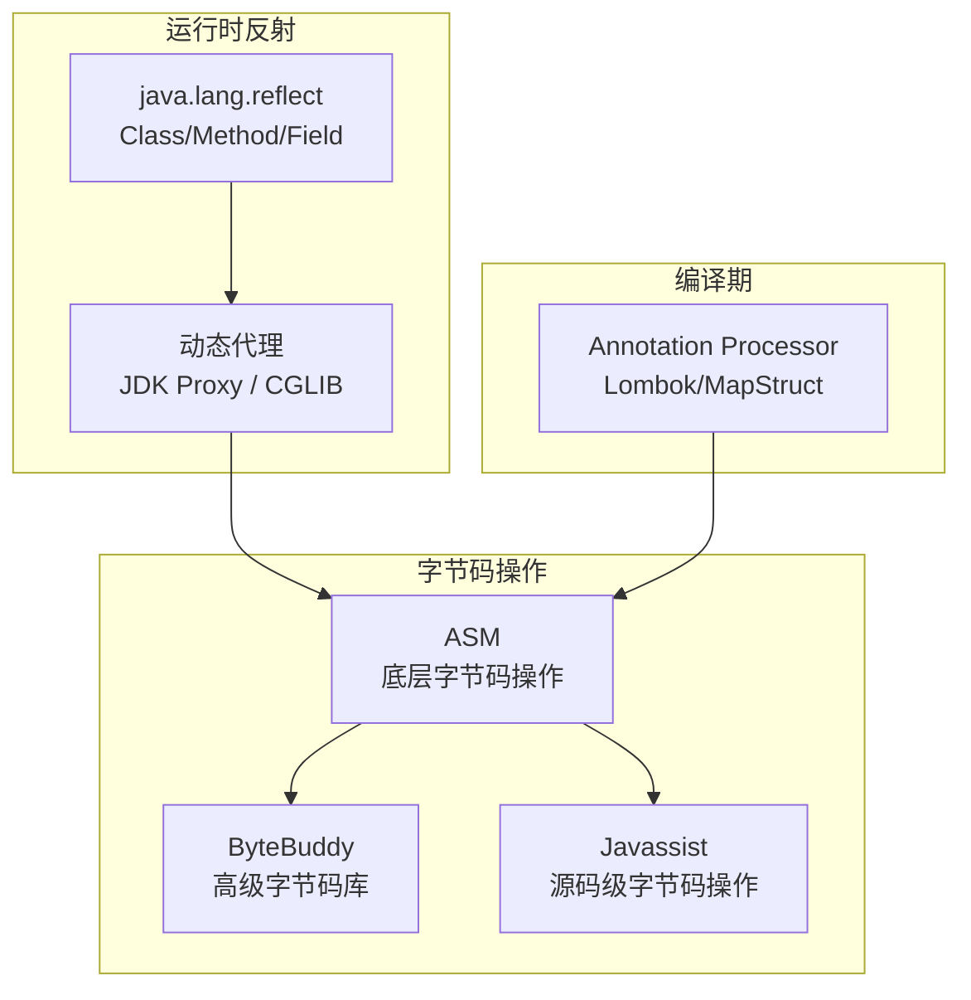

# Java 反射与字节码操作

> **文档说明**：深入讲解 Java 反射机制（Class/Method/Field/Constructor）、动态代理（JDK Proxy/CGLIB）、字节码操作（ASM/ByteBuddy）的底层原理与实战，涵盖 Spring AOP、MyBatis Mapper、ORM 框架中的反射应用，含可运行的 Spring Boot 代码和性能对比。
>
> **适用人群**：Java 后端开发者、需要理解框架底层原理的全栈工程师、关注元编程的高级开发者
>
> **前置知识**：[[Java-语法进阶与StreamAPI]]、[[JVM-内存模型与GC调优]]、[[Spring-IOCAOP核心机制]]

---

## 一、概述

### 1. 定义与核心价值

Java 反射（Reflection）是在运行时获取类信息、动态调用方法、操作字段的机制。字节码操作是直接操作 `.class` 文件的字节码，在运行时或编译期生成/修改类。两者是 Spring AOP、MyBatis Mapper、Hibernate ORM、Lombok 等框架的核心技术基础。理解反射和字节码操作，才能真正理解 Spring 框架的"魔法"。

### 2. 痛点对比

| 痛点（无反射/字节码） | 反射/字节码解决方式 |
|-------------------|------------------|
| 每个类的 getter/setter 手动编写 | 反射统一调用，或字节码编译期生成（Lombok） |
| 框架需要硬编码支持每个业务类 | 反射动态获取类信息，通用处理任意类 |
| AOP 切面需要手动包装每个方法 | 动态代理在运行时生成代理类，自动织入切面 |
| ORM 需要为每个表写 SQL 映射 | 反射读取注解，自动生成 SQL 和映射 |
| 方法调用性能差 | 字节码生成直接调用代码，避免反射开销 |

### 3. 技术体系



---

## 二、底层原理

### 1. 反射性能开销

| 操作 | 直接调用 | 反射调用 | 开销倍数 |
|------|---------|---------|---------|
| 方法调用 | 1x | ~10-50x | 类查找、方法查找、权限检查 |
| 字段访问 | 1x | ~5-20x | 字段查找、类型检查 |
| 对象创建 | 1x | ~3-10x | 构造器查找 |

**优化手段**：
- 缓存 `Method`/`Field` 对象，避免重复 `getDeclaredMethod()`
- 调用 `setAccessible(true)` 关闭权限检查
- 使用 `MethodHandle`（Java 7+）比传统反射快
- 热点代码用字节码生成直接调用

### 2. JDK 动态代理 vs CGLIB

| 维度 | JDK 动态代理 | CGLIB |
|------|------------|-------|
| 原理 | 实现目标接口，生成代理类 | 继承目标类，生成子类 |
| 限制 | 目标必须实现接口 | 不能代理 final 类/方法 |
| 性能 | 调用稍慢（接口转发） | 调用稍快（直接继承） |
| Spring 默认 | 有接口时使用 | 无接口时使用 |
| 生成方式 | `Proxy.newProxyInstance()` | `Enhancer.create()` |

---

## 三、实操

### 1. 反射基础

```java
// ReflectionBasics.java
import java.lang.reflect.*;
import java.util.Arrays;

public class ReflectionBasics {

    public static void main(String[] args) throws Exception {
        // 1. 获取 Class 对象的三种方式
        Class<?> clazz1 = User.class;
        Class<?> clazz2 = Class.forName("com.example.User");
        Class<?> clazz3 = new User().getClass();

        // 2. 获取构造器并创建实例
        Constructor<?> constructor = clazz1.getDeclaredConstructor(String.class, int.class);
        constructor.setAccessible(true);
        User user = (User) constructor.newInstance("张三", 25);

        // 3. 获取并调用方法
        Method greetMethod = clazz1.getDeclaredMethod("greet", String.class);
        greetMethod.setAccessible(true);
        String result = (String) greetMethod.invoke(user, "世界");
        System.out.println(result);  // 你好，世界！我是张三

        // 4. 获取并修改字段
        Field nameField = clazz1.getDeclaredField("name");
        nameField.setAccessible(true);
        nameField.set(user, "李四");
        System.out.println(user.getName());  // 李四

        // 5. 获取所有方法（含继承）
        Method[] methods = clazz1.getMethods();
        Arrays.stream(methods)
              .filter(m -> !m.getDeclaringClass().equals(Object.class))
              .forEach(m -> System.out.println(m.getName()));

        // 6. 获取注解
        if (clazz1.isAnnotationPresent(Deprecated.class)) {
            System.out.println("类已废弃");
        }
    }
}

class User {
    private String name;
    private int age;

    public User(String name, int age) {
        this.name = name;
        this.age = age;
    }

    private String greet(String target) {
        return "你好，" + target + "！我是" + name;
    }

    public String getName() { return name; }
}
```

### 2. 通用 ORM 映射（反射实战）

```java
// GenericORM.java - 用反射实现通用对象-关系映射
import java.lang.reflect.Field;
import java.sql.*;
import java.util.ArrayList;
import java.util.List;

public class GenericORM<T> {

    private final Class<T> clazz;

    public GenericORM(Class<T> clazz) {
        this.clazz = clazz;
    }

    /**
     * 将 ResultSet 映射为对象列表
     */
    public List<T> mapResultSet(ResultSet rs) throws Exception {
        List<T> results = new ArrayList<>();
        Field[] fields = clazz.getDeclaredFields();

        while (rs.next()) {
            T instance = clazz.getDeclaredConstructor().newInstance();
            for (Field field : fields) {
                field.setAccessible(true);
                String columnName = getColumnName(field);
                Object value = rs.getObject(columnName);
                if (value != null) {
                    field.set(instance, value);
                }
            }
            results.add(instance);
        }
        return results;
    }

    /**
     * 生成 INSERT SQL
     */
    public String generateInsertSQL(T entity) throws Exception {
        StringBuilder columns = new StringBuilder();
        StringBuilder values = new StringBuilder();
        Field[] fields = clazz.getDeclaredFields();

        for (int i = 0; i < fields.length; i++) {
            fields[i].setAccessible(true);
            if (i > 0) {
                columns.append(", ");
                values.append(", ");
            }
            columns.append(getColumnName(fields[i]));
            values.append("'").append(fields[i].get(entity)).append("'");
        }

        return String.format("INSERT INTO %s (%s) VALUES (%s)",
                getTableName(), columns, values);
    }

    private String getTableName() {
        Table table = clazz.getAnnotation(Table.class);
        return table != null ? table.name() : clazz.getSimpleName().toLowerCase();
    }

    private String getColumnName(Field field) {
        Column column = field.getAnnotation(Column.class);
        return column != null ? column.name() : field.getName();
    }

    // 注解定义
    @interface Table { String name(); }
    @interface Column { String name(); }
}
```

### 3. JDK 动态代理

```java
// JdkProxyExample.java
import java.lang.reflect.InvocationHandler;
import java.lang.reflect.Method;
import java.lang.reflect.Proxy;
import java.util.Arrays;

// 接口
interface UserService {
    User findById(Long id);
    void save(User user);
}

// 实现类
class UserServiceImpl implements UserService {
    @Override
    public User findById(Long id) {
        System.out.println("查询用户: " + id);
        return new User("张三", 25);
    }

    @Override
    public void save(User user) {
        System.out.println("保存用户: " + user.getName());
    }
}

// 日志切面
class LoggingInvocationHandler implements InvocationHandler {
    private final Object target;

    public LoggingInvocationHandler(Object target) {
        this.target = target;
    }

    @Override
    public Object invoke(Object proxy, Method method, Object[] args) throws Throwable {
        // 前置通知
        System.out.printf("[日志] 调用 %s.%s, 参数: %s%n",
                method.getDeclaringClass().getSimpleName(),
                method.getName(),
                Arrays.toString(args));

        long start = System.nanoTime();
        try {
            Object result = method.invoke(target, args);
            // 返回通知
            System.out.printf("[日志] %s 返回: %s%n", method.getName(), result);
            return result;
        } catch (Exception e) {
            // 异常通知
            System.out.printf("[日志] %s 异常: %s%n", method.getName(), e.getMessage());
            throw e;
        } finally {
            // 后置通知
            long elapsed = System.nanoTime() - start;
            System.out.printf("[日志] %s 耗时: %.2fms%n", method.getName(), elapsed / 1e6);
        }
    }
}

// 使用
public class JdkProxyExample {
    public static void main(String[] args) {
        UserService target = new UserServiceImpl();
        UserService proxy = (UserService) Proxy.newProxyInstance(
                target.getClass().getClassLoader(),
                target.getClass().getInterfaces(),
                new LoggingInvocationHandler(target)
        );

        proxy.findById(1L);
        proxy.save(new User("李四", 30));
    }
}
```

### 4. CGLIB 动态代理

```java
// CglibProxyExample.java
import org.springframework.cglib.proxy.Enhancer;
import org.springframework.cglib.proxy.MethodInterceptor;
import org.springframework.cglib.proxy.MethodProxy;
import java.lang.reflect.Method;

// 不需要接口的类
class OrderService {
    public void createOrder(String product) {
        System.out.println("创建订单: " + product);
    }

    public final void cancelOrder(Long id) {
        // final 方法无法被 CGLIB 代理
        System.out.println("取消订单: " + id);
    }
}

class CglibMethodInterceptor implements MethodInterceptor {
    @Override
    public Object intercept(Object obj, Method method, Object[] args, MethodProxy proxy) throws Throwable {
        System.out.println("[CGLIB] 前置: " + method.getName());
        Object result = proxy.invokeSuper(obj, args);  // 调用父类方法
        System.out.println("[CGLIB] 后置: " + method.getName());
        return result;
    }
}

public class CglibProxyExample {
    public static void main(String[] args) {
        Enhancer enhancer = new Enhancer();
        enhancer.setSuperclass(OrderService.class);
        enhancer.setCallback(new CglibMethodInterceptor());

        OrderService proxy = (OrderService) enhancer.create();
        proxy.createOrder("iPhone");  // 被代理
        proxy.cancelOrder(1L);        // final 方法不被代理
    }
}
```

### 5. Spring Boot AOP 实战

```java
// pom.xml 依赖
// <dependency>
//     <groupId>org.springframework.boot</groupId>
//     <artifactId>spring-boot-starter-aop</artifactId>
// </dependency>

// TimeLogAspect.java - 性能监控切面
package com.example.aop;

import org.aspectj.lang.ProceedingJoinPoint;
import org.aspectj.lang.annotation.Around;
import org.aspectj.lang.annotation.Aspect;
import org.aspectj.lang.annotation.Pointcut;
import org.slf4j.Logger;
import org.slf4j.LoggerFactory;
import org.springframework.stereotype.Component;

@Aspect
@Component
public class TimeLogAspect {

    private static final Logger log = LoggerFactory.getLogger(TimeLogAspect.class);

    // 切点：所有 @Service 类的公共方法
    @Pointcut("within(@org.springframework.stereotype.Service *)")
    public void serviceMethods() {}

    // 切点：标注了 @TimeLog 注解的方法
    @Pointcut("@annotation(com.example.aop.TimeLog)")
    public void annotatedMethods() {}

    @Around("serviceMethods() || annotatedMethods()")
    public Object measureTime(ProceedingJoinPoint joinPoint) throws Throwable {
        String methodName = joinPoint.getSignature().toShortString();
        long start = System.nanoTime();

        try {
            return joinPoint.proceed();
        } finally {
            long elapsed = System.nanoTime() - start;
            if (elapsed > 100_000_000) {  // 超过 100ms 记录警告
                log.warn("慢方法: {} 耗时 {:.2f}ms", methodName, elapsed / 1e6);
            } else {
                log.debug("{} 耗时 {:.2f}ms", methodName, elapsed / 1e6);
            }
        }
    }
}
```

```java
// TimeLog.java - 自定义注解
package com.example.aop;

import java.lang.annotation.*;

@Target(ElementType.METHOD)
@Retention(RetentionPolicy.RUNTIME)
public @interface TimeLog {
    long thresholdMs() default 100;  // 超时阈值
}
```

```java
// UserService.java - 使用切面
package com.example.service;

import com.example.aop.TimeLog;
import org.springframework.stereotype.Service;

@Service
public class UserService {

    // 被 serviceMethods 切点匹配
    public User findById(Long id) {
        return userRepository.findById(id);
    }

    // 被 annotatedMethods 切点匹配
    @TimeLog(thresholdMs = 500)
    public void batchImport(List<User> users) {
        // 批量导入逻辑
    }
}
```

### 6. ASM 字节码操作

```java
// AsmExample.java - 用 ASM 生成类
import org.objectweb.asm.*;
import java.io.FileOutputStream;

public class AsmExample {

    public static void main(String[] args) throws Exception {
        // 生成等价于以下代码的类：
        // public class GeneratedClass {
        //     public String sayHello(String name) {
        //         return "Hello, " + name;
        //     }
        // }

        ClassWriter cw = new ClassWriter(ClassWriter.COMPUTE_FRAMES);

        // 定义类头
        cw.visit(Opcodes.V17, Opcodes.ACC_PUBLIC, "GeneratedClass",
                null, "java/lang/Object", null);

        // 生成默认构造器
        MethodVisitor constructor = cw.visitMethod(Opcodes.ACC_PUBLIC, "<init>", "()V", null, null);
        constructor.visitVarInsn(Opcodes.ALOAD, 0);
        constructor.visitMethodInsn(Opcodes.INVOKESPECIAL, "java/lang/Object", "<init>", "()V", false);
        constructor.visitInsn(Opcodes.RETURN);
        constructor.visitMaxs(1, 1);
        constructor.visitEnd();

        // 生成 sayHello 方法
        MethodVisitor mv = cw.visitMethod(Opcodes.ACC_PUBLIC, "sayHello",
                "(Ljava/lang/String;)Ljava/lang/String;", null, null);

        mv.visitTypeInsn(Opcodes.NEW, "java/lang/StringBuilder");
        mv.visitInsn(Opcodes.DUP);
        mv.visitLdcInsn("Hello, ");
        mv.visitMethodInsn(Opcodes.INVOKESPECIAL, "java/lang/StringBuilder", "<init>",
                "(Ljava/lang/String;)V", false);
        mv.visitVarInsn(Opcodes.ALOAD, 1);
        mv.visitMethodInsn(Opcodes.INVOKEVIRTUAL, "java/lang/StringBuilder", "append",
                "(Ljava/lang/String;)Ljava/lang/StringBuilder;", false);
        mv.visitMethodInsn(Opcodes.INVOKEVIRTUAL, "java/lang/StringBuilder", "toString",
                "()Ljava/lang/String;", false);
        mv.visitInsn(Opcodes.ARETURN);
        mv.visitMaxs(3, 2);
        mv.visitEnd();

        cw.visitEnd();

        // 写入 class 文件
        byte[] bytecode = cw.toByteArray();
        try (FileOutputStream fos = new FileOutputStream("GeneratedClass.class")) {
            fos.write(bytecode);
        }

        // 加载并使用
        Class<?> generatedClass = new ClassLoader() {
            public Class<?> defineClass(byte[] b) {
                return defineClass("GeneratedClass", b, 0, b.length);
            }
        }.defineClass(bytecode);

        Object instance = generatedClass.getDeclaredConstructor().newInstance();
        String result = (String) generatedClass.getMethod("sayHello", String.class)
                .invoke(instance, "World");
        System.out.println(result);  // Hello, World
    }
}
```

### 7. 注解处理器（编译期）

```java
// BuilderAnnotationProcessor.java - 编译期生成 Builder 模式
import javax.annotation.processing.*;
import javax.lang.model.SourceVersion;
import javax.lang.model.element.*;
import javax.tools.Diagnostic;
import java.io.IOException;
import java.io.PrintWriter;
import java.util.Set;

@SupportedAnnotationTypes("com.example.Builder")
@SupportedSourceVersion(SourceVersion.RELEASE_17)
public class BuilderAnnotationProcessor extends AbstractProcessor {

    @Override
    public boolean process(Set<? extends TypeElement> annotations, RoundEnvironment roundEnv) {
        for (Element element : roundEnv.getElementsAnnotatedWith(Builder.class)) {
            if (element.getKind() != ElementKind.CLASS) {
                processingEnv.getMessager().printMessage(
                        Diagnostic.Kind.ERROR, "@Builder 只能用于类", element);
                continue;
            }

            TypeElement classElement = (TypeElement) element;
            String className = classElement.getSimpleName().toString();
            String builderName = className + "Builder";

            try {
                generateBuilder(classElement, builderName);
            } catch (IOException e) {
                processingEnv.getMessager().printMessage(
                        Diagnostic.Kind.ERROR, "生成失败: " + e.getMessage(), element);
            }
        }
        return true;
    }

    private void generateBuilder(TypeElement classElement, String builderName) throws IOException {
        String packageName = processingEnv.getElementUtils()
                .getPackageOf(classElement).toString();
        String className = classElement.getSimpleName().toString();

        JavaFileObject file = processingEnv.getFiler()
                .createSourceFile(packageName + "." + builderName);

        try (PrintWriter writer = new PrintWriter(file.openWriter())) {
            writer.println("package " + packageName + ";");
            writer.println();
            writer.println("public class " + builderName + " {");

            // 生成字段
            for (Element enclosed : classElement.getEnclosedElements()) {
                if (enclosed.getKind() == ElementKind.FIELD) {
                    VariableElement field = (VariableElement) enclosed;
                    String fieldName = field.getSimpleName().toString();
                    String fieldType = field.asType().toString();
                    writer.printf("    private %s %s;%n", fieldType, fieldName);
                }
            }

            // 生成 setter 方法（链式）
            for (Element enclosed : classElement.getEnclosedElements()) {
                if (enclosed.getKind() == ElementKind.FIELD) {
                    VariableElement field = (VariableElement) enclosed;
                    String fieldName = field.getSimpleName().toString();
                    String fieldType = field.asType().toString();
                    writer.printf("    public %s %s(%s %s) {%n",
                            builderName, fieldName, fieldType, fieldName);
                    writer.printf("        this.%s = %s;%n", fieldName, fieldName);
                    writer.println("        return this;");
                    writer.println("    }");
                }
            }

            // 生成 build 方法
            writer.println("    public " + className + " build() {");
            writer.println("        return new " + className + "(");
            // ... 参数传递
            writer.println("        );");
            writer.println("    }");
            writer.println("}");
        }
    }
}
```

---

## 四、常见问题与排查

| 问题现象 | 原因 | 解决方案 |
|---------|------|---------|
| `IllegalAccessException` 访问私有方法/字段 | 未调用 `setAccessible(true)` | 调用 `method.setAccessible(true)` 或 `field.setAccessible(true)` |
| `NoSuchMethodException` | 方法名或参数类型不匹配 | 用 `getDeclaredMethods()` 列出所有方法确认签名；注意基本类型和包装类型区别 |
| CGLIB 代理 final 类报错 | CGLIB 通过继承生成代理，final 类无法继承 | 改用 JDK 动态代理（需接口）；或去掉 final |
| 反射调用比直接调用慢 100 倍 | 每次都重新查找 Method 对象，且未关闭权限检查 | 缓存 Method 对象；调用 `setAccessible(true)`；热点用 MethodHandle |
| Spring AOP 不生效 | 同类内部方法调用（this 调用）绕过代理 | 通过 `AopContext.currentProxy()` 获取代理对象；或拆分到不同类 |
| 注解处理器不执行 | 未在 META-INF/services 注册，或未启用注解处理 | 用 `@AutoService` 自动注册；确保 IDE 开启注解处理 |
| ASM 生成的类 `VerifyError` | 字节码栈帧不正确，或方法签名错误 | 用 `ClassWriter.COMPUTE_FRAMES` 自动计算；用 ASMifier 反编译参考类 |
| 动态代理中 `method.invoke()` 抛 `UndeclaredThrowableException` | 被代理方法抛出受检异常，代理接口未声明 | 在 `invoke()` 中捕获并包装为运行时异常；或在接口中声明异常 |
| 反射修改 final 字段不生效 | final 字段在编译期被内联优化 | 用 `Field.setAccessible(true)` 后仍可能不生效（常量折叠）；避免反射修改 final 字段 |
| `Class.forName()` 找不到类 | 类名不包含包名，或类不在 classpath | 使用全限定名：`Class.forName("com.example.User")`；检查依赖是否包含该类 |

---

## 五、进阶与最佳实践

### 1. 反射性能优化

```java
// 反射调用优化示例
public class ReflectionOptimizer {

    // 缓存 Method 对象（避免重复查找）
    private static final Method GET_NAME_METHOD;
    static {
        try {
            GET_NAME_METHOD = User.class.getDeclaredMethod("getName");
            GET_NAME_METHOD.setAccessible(true);  // 关闭权限检查
        } catch (NoSuchMethodException e) {
            throw new RuntimeException(e);
        }
    }

    // MethodHandle（比传统反射快）
    private static final MethodHandle GET_NAME_HANDLE;
    static {
        try {
            MethodHandles.Lookup lookup = MethodHandles.lookup();
            GET_NAME_HANDLE = lookup.findVirtual(User.class, "getName",
                    MethodType.methodType(String.class));
        } catch (Exception e) {
            throw new RuntimeException(e);
        }
    }

    public static String fastReflectCall(User user) throws Throwable {
        return (String) GET_NAME_HANDLE.invoke(user);  // MethodHandle 调用
    }
}
```

### 2. 何时使用反射/字节码

| 场景 | 推荐方案 |
|------|---------|
| 框架通用处理（ORM/AOP/DI） | 反射 + 动态代理 |
| 运行时生成类（代理、Mock） | ByteBuddy（比 ASM 易用） |
| 编译期代码生成（Lombok/MapStruct） | 注解处理器 |
| 性能敏感的热点代码 | 避免反射，用字节码生成直接调用 |
| 简单的配置驱动逻辑 | 反射（够用即可） |
| 序列化/反序列化 | 反射 + 缓存（Jackson/Gson 原理） |

### 3. ByteBuddy 简化字节码操作

```java
// ByteBuddyExample.java - 比 ASM 更高级的字节码库
import net.bytebuddy.ByteBuddy;
import net.bytebuddy.implementation.MethodDelegation;
import net.bytebuddy.matcher.ElementMatchers;

public class ByteBuddyExample {
    public static void main(String[] args) throws Exception {
        // 动态生成子类，拦截所有方法
        Class<?> dynamicType = new ByteBuddy()
                .subclass(UserService.class)
                .method(ElementMatchers.any())
                .intercept(MethodDelegation.to(LoggingInterceptor.class))
                .make()
                .load(getClass().getClassLoader())
                .getLoaded();

        UserService service = (UserService) dynamicType.getDeclaredConstructor().newInstance();
        service.findById(1L);  // 自动添加日志
    }
}
```

### 4. 安全注意事项

- 反射可以绕过访问控制，**不要在不可信代码中使用**
- `setAccessible(true)` 在 SecurityManager 环境下可能被拒绝
- 字节码操作可能破坏 JVM 的类型安全，需充分测试
- 注解处理器在编译期执行，不要有副作用（如修改源文件）

---

## 六、关联笔记

### Java 核心
- [[Java-语法进阶与StreamAPI]] · [[JVM-内存模型与GC调优]] · [[Java-集合框架源码分析]]
- [[Java-并发编程JUC]] · [[Java-异常体系与最佳实践]]

### Spring 框架
- [[Spring-IOCAOP核心机制]] · [[SpringBoot-自动装配原理]] · [[SpringBoot-Web层设计]]

### 设计模式
- [[设计模式-代理模式]] · [[设计模式-装饰器模式]] · [[设计模式知识点系统梳理_优化版]]

### 导航
- [[MOC-后端开发]] · [[MOC-Java全栈-四级展开]] · [[Java-全栈技术枢纽]]

> **学习路径建议**：先掌握 [[Java-语法进阶与StreamAPI]] Java 基础 → 学习 [[JVM-内存模型与GC调优]] 理解类加载机制 → 深入本文反射与字节码 → 实践 [[Spring-IOCAOP核心机制]] 理解 AOP 底层 → 对比学习 [[Python-面向对象与元类]] Python 元类。
