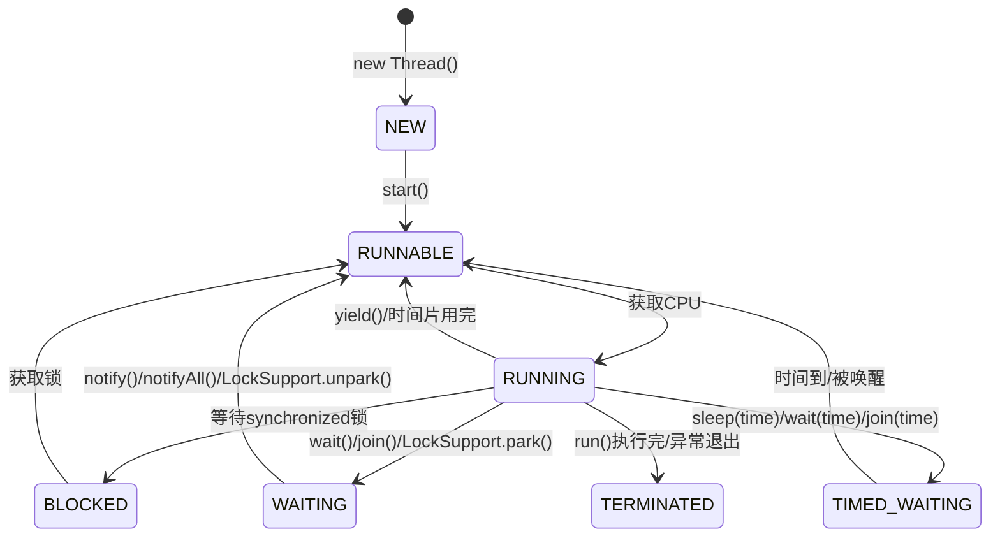
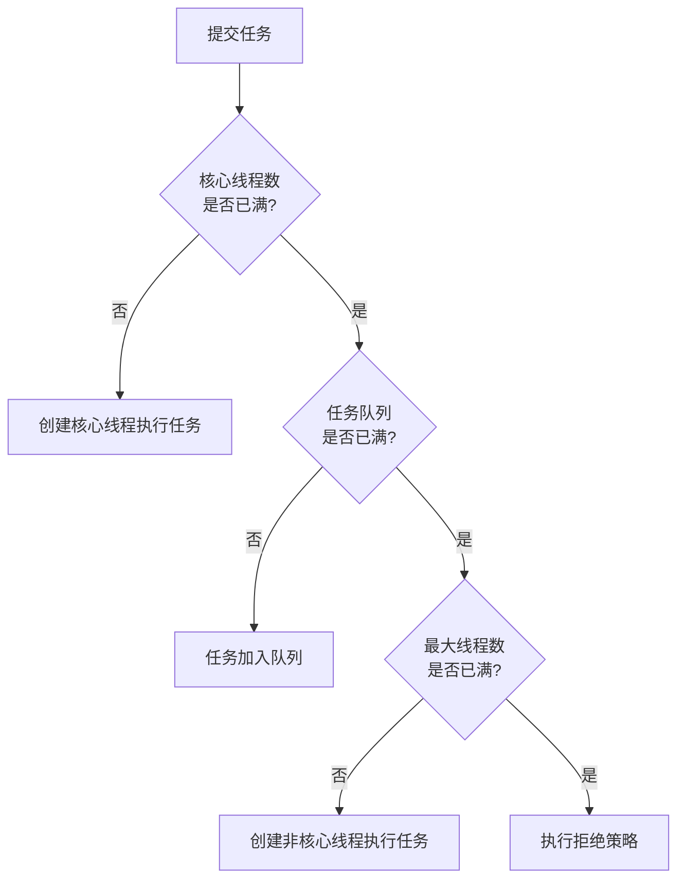
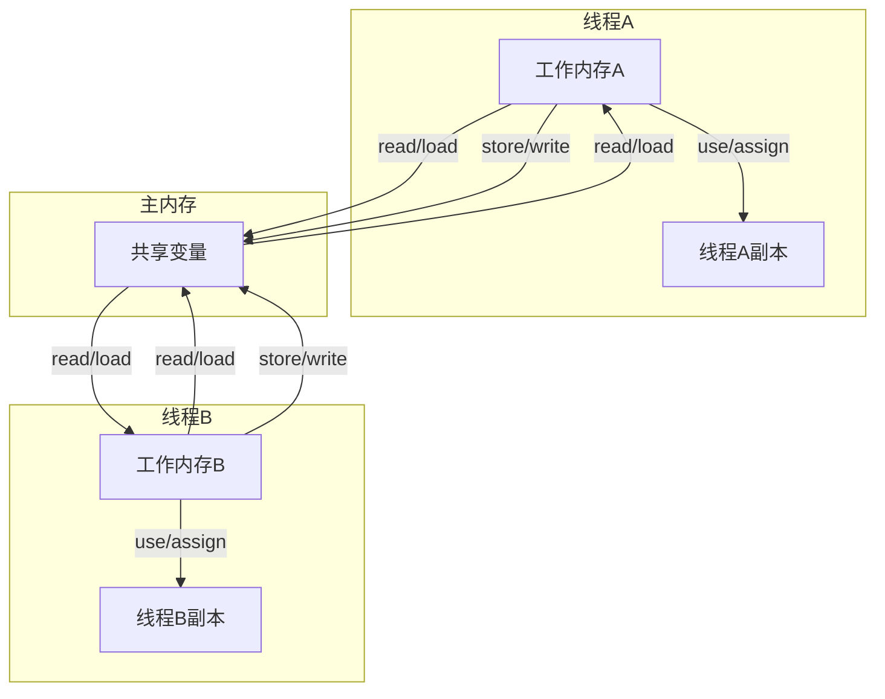

# 并发编程 JUC

> **文档说明**：系统讲解 Java 并发编程 JUC（java.util.concurrent）包的完整知识体系，包括线程基础、原子类、锁机制、并发容器、同步工具类、线程池、CompletableFuture 异步编程、JMM 内存模型，以及并发编程常见问题与最佳实践，含丰富代码示例和底层原理分析。
>
> **适用人群**：Java 后端开发工程师、全栈开发者、需要深入理解并发编程的工程师、面试准备者
>
> **前置知识**：[[Java知识点完整整合大全_优化版]]、[[JVM-内存模型与GC调优]]

---

## 一、概述

**JUC（java.util.concurrent）** 是 Java 5 引入的并发编程工具包，由并发编程大师 Doug Lea 设计，提供了比 `synchronized` 和 `wait/notify` 更高效、更灵活的并发编程工具。

### 1. 为什么需要 JUC

| 痛点 | 说明 | JUC 解决方案 |
|------|------|------------|
| **synchronized 效率低** | 重量级锁，不支持公平锁、读写分离、超时获取 | `ReentrantLock`、`ReadWriteLock` |
| **wait/notify 难用** | 容易丢失信号、条件不满足时无法精确唤醒 | `Condition`、`CountDownLatch` |
| **线程创建销毁开销大** | 频繁创建线程浪费资源 | `ThreadPoolExecutor` 线程池 |
| **HashMap 线程不安全** | 多线程 put 可能死循环或数据丢失 | `ConcurrentHashMap` |
| **原子操作难实现** | i++ 非原子，需加锁 | `AtomicInteger`、`LongAdder` |
| **异步编程复杂** | Future 阻塞获取结果，无法链式调用 | `CompletableFuture` |

### 2. JUC 包结构

```
java.util.concurrent
├── 原子类 (atomic)
│   ├── AtomicInteger / AtomicLong / AtomicBoolean
│   ├── AtomicReference / AtomicStampedReference
│   ├── LongAdder / LongAccumulator
│   └── Striped64 (基类)
├── 锁机制 (locks)
│   ├── Lock / ReentrantLock
│   ├── ReadWriteLock / ReentrantReadWriteLock
│   ├── StampedLock
│   ├── Condition
│   └── LockSupport
├── 并发容器
│   ├── ConcurrentHashMap / ConcurrentSkipListMap
│   ├── CopyOnWriteArrayList / CopyOnWriteArraySet
│   ├── ConcurrentLinkedQueue / ConcurrentLinkedDeque
│   ├── BlockingQueue (ArrayBlockingQueue / LinkedBlockingQueue / ...)
│   └── ConcurrentHashMap.KeySetView
├── 同步工具
│   ├── CountDownLatch
│   ├── CyclicBarrier
│   ├── Semaphore
│   ├── Exchanger
│   └── Phaser
├── 线程池
│   ├── Executor / ExecutorService
│   ├── ThreadPoolExecutor
│   ├── ScheduledThreadPoolExecutor
│   ├── Executors (工厂类)
│   ├── Future / FutureTask
│   └── CompletableFuture
└── 其他
    ├── ThreadLocalRandom
    ├── TimeUnit
    ├── Callable / Runnable
    └── ForkJoinPool / ForkJoinTask
```

### 3. 并发编程三大特性

| 特性 | 说明 | 保障机制 |
|------|------|---------|
| **原子性** | 一个操作不可中断，要么全部执行要么不执行 | `synchronized`、`Lock`、原子类 |
| **可见性** | 一个线程修改共享变量后，其他线程能立即看到最新值 | `volatile`、`synchronized`、`Lock` |
| **有序性** | 程序执行顺序按代码顺序执行（禁止指令重排） | `volatile`、`synchronized`、`Lock` |

---

## 二、线程基础

### 1. 线程状态



| 状态 | 说明 |
|------|------|
| **NEW** | 新建，线程对象已创建但未调用 start() |
| **RUNNABLE** | 可运行，包括就绪（等待CPU）和运行中（正在执行） |
| **BLOCKED** | 阻塞，等待获取 synchronized 锁 |
| **WAITING** | 无限期等待，等待其他线程唤醒（wait/join/park） |
| **TIMED_WAITING** | 限时等待，sleep/wait(time)/join(time) |
| **TERMINATED** | 终止，线程执行完毕 |

### 2. 线程创建方式

```java
// 方式1：继承 Thread
class MyThread extends Thread {
    @Override
    public void run() {
        System.out.println("线程执行: " + Thread.currentThread().getName());
    }
}
new MyThread().start();

// 方式2：实现 Runnable
class MyRunnable implements Runnable {
    @Override
    public void run() {
        System.out.println("Runnable 执行");
    }
}
new Thread(new MyRunnable()).start();

// 方式3：Lambda（推荐）
new Thread(() -> System.out.println("Lambda 线程")).start();

// 方式4：实现 Callable（有返回值）
class MyCallable implements Callable<String> {
    @Override
    public String call() {
        return "Callable 结果";
    }
}
FutureTask<String> task = new FutureTask<>(new MyCallable());
new Thread(task).start();
String result = task.get();  // 阻塞获取结果

// 方式5：线程池（生产环境推荐）
ExecutorService executor = Executors.newFixedThreadPool(10);
executor.submit(() -> System.out.println("线程池执行"));
executor.shutdown();
```

### 3. 线程核心方法

| 方法 | 说明 | 是否释放锁 |
|------|------|-----------|
| `start()` | 启动线程，进入就绪状态 | - |
| `run()` | 线程执行体，直接调用不会启动新线程 | - |
| `sleep(long)` | 休眠指定时间，进入 TIMED_WAITING | ❌ 不释放 |
| `yield()` | 让出 CPU，进入就绪状态 | ❌ 不释放 |
| `join()` | 等待其他线程执行完毕 | ✅ 释放（内部 wait） |
| `interrupt()` | 中断线程（设置中断标志） | - |
| `wait()` | 释放锁并等待，进入 WAITING | ✅ 释放 |
| `notify()` | 唤醒一个等待的线程 | - |
| `notifyAll()` | 唤醒所有等待的线程 | - |

```java
// interrupt 正确用法
public class InterruptDemo {
    public static void main(String[] args) throws InterruptedException {
        Thread thread = new Thread(() -> {
            while (!Thread.currentThread().isInterrupted()) {
                System.out.println("线程运行中...");
                try {
                    Thread.sleep(1000);
                } catch (InterruptedException e) {
                    // sleep 被中断会清除中断标志，需要重新设置
                    Thread.currentThread().interrupt();
                    System.out.println("线程被中断");
                }
            }
        });
        thread.start();
        Thread.sleep(3000);
        thread.interrupt();  // 发送中断信号
    }
}
```

---

## 三、原子类

### 1. 原子类概览

原子类基于 **CAS（Compare-And-Swap）** 操作实现，无需加锁即可保证原子性，性能优于锁。

| 类别 | 类名 | 说明 |
|------|------|------|
| **基本类型** | `AtomicInteger`、`AtomicLong`、`AtomicBoolean` | 原子更新基本类型 |
| **引用类型** | `AtomicReference`、`AtomicStampedReference`、`AtomicMarkableReference` | 原子更新引用类型 |
| **数组类型** | `AtomicIntegerArray`、`AtomicLongArray`、`AtomicReferenceArray` | 原子更新数组元素 |
| **字段更新器** | `AtomicIntegerFieldUpdater`、`AtomicLongFieldUpdater`、`AtomicReferenceFieldUpdater` | 原子更新对象的字段 |
| **高并发累加器** | `LongAdder`、`LongAccumulator`、`DoubleAdder`、`DoubleAccumulator` | 高并发场景下性能更优 |

### 2. CAS 原理

CAS（Compare-And-Swap）是一种无锁原子操作，包含三个操作数：内存位置 V、预期值 A、新值 B。当且仅当 V == A 时，将 V 更新为 B，否则不做任何操作。

```java
// AtomicInteger 的 incrementAndGet 底层实现（简化）
public final int incrementAndGet() {
    return unsafe.getAndAddInt(this, valueOffset, 1) + 1;
}

// Unsafe.getAndAddInt 底层（CAS 自旋）
public final int getAndAddInt(Object obj, long offset, int delta) {
    int v;
    do {
        v = getIntVolatile(obj, offset);  // 读取当前值
    } while (!compareAndSwapInt(obj, offset, v, v + delta));  // CAS 更新
    return v;
}
```

**CAS 的问题**：
| 问题 | 说明 | 解决方案 |
|------|------|---------|
| **ABA 问题** | 值从 A→B→A，CAS 认为没变 | `AtomicStampedReference`（加版本号） |
| **自旋开销大** | 竞争激烈时循环重试消耗 CPU | 高并发用 `LongAdder`（分段累加） |
| **只能保证一个变量** | CAS 只能保证单个变量的原子操作 | 多个变量用 `synchronized` 或 `AtomicReference` 封装 |

```java
// AtomicStampedReference 解决 ABA 问题
AtomicStampedReference<String> ref = new AtomicStampedReference<>("A", 0);

// 线程1：A → B → A
ref.compareAndSet("A", "B", 0, 1);  // 版本 0→1
ref.compareAndSet("B", "A", 1, 2);  // 版本 1→2

// 线程2：期望 A 版本 0，但实际版本是 2，CAS 失败
boolean success = ref.compareAndSet("A", "C", 0, 3);
System.out.println(success);  // false（版本不匹配）
```

### 3. AtomicInteger 常用方法

```java
AtomicInteger count = new AtomicInteger(0);

// 基本操作
count.incrementAndGet();      // +1，返回新值（类似 ++i）
count.decrementAndGet();      // -1，返回新值
count.getAndIncrement();      // +1，返回旧值（类似 i++）
count.getAndDecrement();      // -1，返回旧值
count.addAndGet(5);           // +5，返回新值
count.getAndAdd(5);           // +5，返回旧值
count.get();                   // 获取当前值
count.set(100);               // 设置新值
count.lazySet(100);           // 延迟设置（不保证立即可见）

// CAS 操作
count.compareAndSet(expect, update);  // 期望值匹配才更新
count.weakCompareAndSet(expect, update);  // 弱化版本（可能虚假失败）

// 使用示例：计数器
public class Counter {
    private final AtomicInteger count = new AtomicInteger(0);

    public void increment() {
        count.incrementAndGet();
    }

    public int get() {
        return count.get();
    }
}
```

### 4. LongAdder（高并发累加器）

`LongAdder` 是 Java 8 新增的高并发累加器，通过**分段（Cell 数组）**减少 CAS 竞争，在高并发场景下性能远优于 `AtomicLong`。

```java
// AtomicLong：所有线程竞争同一个 value，CAS 冲突严重
// LongAdder：每个线程有自己的 Cell，最后汇总

LongAdder adder = new LongAdder();
adder.add(1);        // 累加
adder.increment();    // +1
adder.decrement();    // -1
long sum = adder.sum();  // 汇总所有 Cell 的值
adder.reset();        // 重置为 0
long sumThenReset = adder.sumThenReset();  // 汇总并重置

// 性能对比：高并发下 LongAdder 比 AtomicLong 快 5-10 倍
```

**LongAdder vs AtomicLong 选择**：
| 场景 | 推荐 |
|------|------|
| 低并发、需要精确值 | `AtomicLong` |
| 高并发、只需要统计总和（如计数器、指标统计） | `LongAdder` |
| 需要 CAS 复杂操作 | `AtomicLong` |

---

## 四、锁机制

### 1. synchronized vs Lock

| 维度 | synchronized | Lock (ReentrantLock) |
|------|-------------|---------------------|
| **实现** | JVM 层面，关键字 | JDK 层面，接口实现 |
| **释放** | 自动释放（退出同步块/异常） | 必须手动释放（finally 中 unlock） |
| **公平锁** | ❌ 非公平 | ✅ 支持公平/非公平 |
| **可中断** | ❌ 不可中断 | ✅ lockInterruptibly() |
| **超时获取** | ❌ 不支持 | ✅ tryLock(timeout) |
| **多条件** | ❌ 只有一个条件队列 | ✅ 多个 Condition |
| **读写分离** | ❌ 不支持 | ✅ ReadWriteLock |
| **性能** | 优化后不错 | 竞争激烈时更优 |
| **可重入** | ✅ | ✅ |

### 2. ReentrantLock（可重入锁）

```java
// 基本用法
public class ReentrantLockDemo {
    private final Lock lock = new ReentrantLock();  // 默认非公平
    // private final Lock lock = new ReentrantLock(true);  // 公平锁

    public void method() {
        lock.lock();  // 获取锁
        try {
            // 临界区代码
            System.out.println("执行临界区");
        } finally {
            lock.unlock();  // 必须在 finally 中释放锁
        }
    }

    // 尝试获取锁（不阻塞）
    public boolean tryMethod() {
        if (lock.tryLock()) {  // 尝试获取，成功返回 true
            try {
                System.out.println("获取锁成功");
                return true;
            } finally {
                lock.unlock();
            }
        } else {
            System.out.println("获取锁失败，做其他事");
            return false;
        }
    }

    // 超时获取锁
    public boolean timeoutMethod() throws InterruptedException {
        if (lock.tryLock(5, TimeUnit.SECONDS)) {  // 最多等待 5 秒
            try {
                System.out.println("5秒内获取到锁");
                return true;
            } finally {
                lock.unlock();
            }
        }
        return false;
    }

    // 可中断获取锁
    public void interruptibleMethod() throws InterruptedException {
        lock.lockInterruptibly();  // 等待时可被中断
        try {
            System.out.println("获取锁");
        } finally {
            lock.unlock();
        }
    }
}
```

**ReentrantLock 可重入验证**：
```java
public class ReentrantDemo {
    private final ReentrantLock lock = new ReentrantLock();

    public void outer() {
        lock.lock();
        try {
            System.out.println("外层方法，持有数: " + lock.getHoldCount());  // 1
            inner();  // 调用内层方法，可重入
        } finally {
            lock.unlock();
        }
    }

    public void inner() {
        lock.lock();  // 同一线程可再次获取
        try {
            System.out.println("内层方法，持有数: " + lock.getHoldCount());  // 2
        } finally {
            lock.unlock();  // 释放一次，持有数变为 1
        }
    }
}
```

### 3. Condition（条件变量）

`Condition` 替代 `wait/notify`，支持多个条件队列，精确唤醒。

```java
public class ConditionDemo {
    private final Lock lock = new ReentrantLock();
    private final Condition notFull = lock.newCondition();   // 队列不满条件
    private final Condition notEmpty = lock.newCondition();  // 队列不空条件
    private final Queue<String> queue = new LinkedList<>();
    private final int capacity = 10;

    // 生产者
    public void produce(String item) throws InterruptedException {
        lock.lock();
        try {
            while (queue.size() == capacity) {
                notFull.await();  // 队列满，等待"不满"信号
            }
            queue.offer(item);
            notEmpty.signal();  // 通知消费者"队列不空"
        } finally {
            lock.unlock();
        }
    }

    // 消费者
    public String consume() throws InterruptedException {
        lock.lock();
        try {
            while (queue.isEmpty()) {
                notEmpty.await();  // 队列空，等待"不空"信号
            }
            String item = queue.poll();
            notFull.signal();  // 通知生产者"队列不满"
            return item;
        } finally {
            lock.unlock();
        }
    }
}
```

### 4. ReadWriteLock（读写锁）

读写锁允许多个读线程同时持有读锁，但写锁是独占的。适合**读多写少**场景。

```java
public class ReadWriteLockDemo {
    private final ReentrantReadWriteLock rwLock = new ReentrantReadWriteLock();
    private final Lock readLock = rwLock.readLock();
    private final Lock writeLock = rwLock.writeLock();
    private Map<String, String> cache = new HashMap<>();

    // 读操作：多个线程可同时读
    public String get(String key) {
        readLock.lock();
        try {
            return cache.get(key);
        } finally {
            readLock.unlock();
        }
    }

    // 写操作：独占
    public void put(String key, String value) {
        writeLock.lock();
        try {
            cache.put(key, value);
        } finally {
            writeLock.unlock();
        }
    }

    // 锁降级：写锁 → 读锁（Java 支持）
    public void putIfAbsent(String key, String value) {
        readLock.lock();
        if (!cache.containsKey(key)) {
            readLock.unlock();       // 释放读锁
            writeLock.lock();        // 获取写锁
            try {
                if (!cache.containsKey(key)) {  // 双重检查
                    cache.put(key, value);
                }
                readLock.lock();    // 获取读锁（锁降级）
            } finally {
                writeLock.unlock(); // 释放写锁，仍持有读锁
            }
        }
        try {
            // 使用读锁做后续操作
        } finally {
            readLock.unlock();
        }
    }
}
```

**读写锁注意事项**：
- 读锁与读锁不互斥（可并发读）
- 读锁与写锁互斥
- 写锁与写锁互斥
- 支持锁降级（写锁→读锁），不支持锁升级（读锁→写锁，会死锁）
- 公平模式下写锁优先级高于读锁（防止写饥饿）

### 5. StampedLock（邮戳锁）

Java 8 新增，比 ReadWriteLock 性能更好，支持**乐观读**模式。

```java
public class StampedLockDemo {
    private final StampedLock lock = new StampedLock();
    private double x, y;

    // 乐观读：不需要加锁，先读再验证
    public double distanceFromOrigin() {
        long stamp = lock.tryOptimisticRead();  // 尝试乐观读，返回邮戳
        double currentX = x;
        double currentY = y;
        if (!lock.validate(stamp)) {  // 验证邮戳（期间是否有写操作）
            stamp = lock.readLock();   // 验证失败，升级为悲观读锁
            try {
                currentX = x;
                currentY = y;
            } finally {
                lock.unlockRead(stamp);
            }
        }
        return Math.sqrt(currentX * currentX + currentY * currentY);
    }

    // 写锁
    public void move(double deltaX, double deltaY) {
        long stamp = lock.writeLock();
        try {
            x += deltaX;
            y += deltaY;
        } finally {
            lock.unlockWrite(stamp);
        }
    }
}
```

### 6. 锁优化策略

| 策略 | 说明 |
|------|------|
| **减少锁持有时间** | 只在必要时加锁，缩小临界区 |
| **减小锁粒度** |  ConcurrentHashMap 分段锁、LongAdder 分段累加 |
| **读写分离** | 读多写少用 ReadWriteLock/StampedLock |
| **锁消除** |  JIT 检测到不可能共享的锁时自动消除 |
| **锁粗化** |  频繁加解锁合并为一次大锁 |
| **偏向锁/轻量级锁** |  synchronized 的优化（无竞争时不升级为重量级锁） |
| **无锁编程** |  CAS、原子类、ThreadLocal |

---

## 五、并发容器

### 1. 并发容器概览

| 容器 | 数据结构 | 特点 | 适用场景 |
|------|---------|------|---------|
| **ConcurrentHashMap** | 数组+链表/红黑树 | 分段锁（JDK7）/CAS+synchronized（JDK8） | 高并发 Map |
| **ConcurrentSkipListMap** | 跳表 | 有序、并发安全 | 需要排序的并发 Map |
| **CopyOnWriteArrayList** | 数组 | 写时复制，读无锁 | 读多写少的 List |
| **CopyOnWriteArraySet** | 基于 CopyOnWriteArrayList | 写时复制，去重 | 读多写少的 Set |
| **ConcurrentLinkedQueue** | 链表 | 无锁队列（CAS） | 高并发无界队列 |
| **ArrayBlockingQueue** | 数组 | 有界阻塞队列 | 生产者消费者 |
| **LinkedBlockingQueue** | 链表 | 可选有界阻塞队列 | 生产者消费者 |
| **PriorityBlockingQueue** | 堆 | 优先级阻塞队列 | 任务调度 |
| **DelayQueue** | 优先级队列 | 延迟获取 | 定时任务 |
| **SynchronousQueue** | 无存储 | 直接传递 | 线程池交接 |

### 2. ConcurrentHashMap

JDK 8 实现：数组 + 链表/红黑树，CAS 初始化 + synchronized 锁桶（锁粒度为单个 Node）。

```java
// 基本用法
ConcurrentHashMap<String, Integer> map = new ConcurrentHashMap<>();

map.put("key", 1);
map.get("key");
map.remove("key");
map.size();

// 原子操作（避免 if-not-null 竞态）
map.putIfAbsent("key", 1);          // key 不存在才 put
map.computeIfAbsent("key", k -> 1); // key 不存在时计算并 put
map.computeIfPresent("key", (k, v) -> v + 1); // key 存在时计算并更新
map.compute("key", (k, v) -> v == null ? 1 : v + 1); // 不管存在与否都计算
map.merge("key", 1, Integer::sum);  // 合并值

// 遍历（弱一致性，不抛 ConcurrentModificationException）
map.forEach((k, v) -> System.out.println(k + ": " + v));

// 统计
map.search(1, (k, v) -> v > 100 ? k : null);  // 并行搜索
map.reduce(1, (k, v) -> v, Integer::sum);       // 并行归约
```

**ConcurrentHashMap 不允许 null key/value**（与 HashMap 不同），因为无法区分"key 不存在"和"value 为 null"。

### 3. CopyOnWriteArrayList

写时复制：写操作时复制整个数组，读操作无锁。适合**读多写极少**场景。

```java
CopyOnWriteArrayList<String> list = new CopyOnWriteArrayList<>();

// 写操作：加锁 + 复制数组 + 替换引用
list.add("item");        // 加锁，复制整个数组，添加元素，替换引用
list.remove("item");     // 加锁，复制整个数组，删除元素，替换引用
list.set(0, "new");      // 加锁，复制整个数组，修改元素，替换引用

// 读操作：无锁，直接读底层数组
list.get(0);             // 无锁，直接返回
list.size();             // 无锁
list.iterator();         // 弱一致性迭代器，遍历的是创建时的快照

// 适用场景：监听器列表、配置列表（读多写极少）
public class EventManager {
    private final CopyOnWriteArrayList<EventListener> listeners = new CopyOnWriteArrayList<>();

    public void register(EventListener listener) {
        listeners.add(listener);  // 写操作（少）
    }

    public void fireEvent(Event event) {
        for (EventListener listener : listeners) {  // 读操作（多，无锁）
            listener.onEvent(event);
        }
    }
}
```

**缺点**：
- 写操作开销大（复制整个数组）
- 内存占用翻倍
- 数据最终一致性（读操作可能读到旧数据）
- 不适合写多或数据量大的场景

### 4. BlockingQueue（阻塞队列）

阻塞队列是生产者消费者模式的核心，支持在队满时阻塞生产者、队空时阻塞消费者。

```java
// ArrayBlockingQueue：有界，基于数组
BlockingQueue<String> queue = new ArrayBlockingQueue<>(100);

// LinkedBlockingQueue：可选有界，基于链表（默认 Integer.MAX_VALUE）
BlockingQueue<String> queue2 = new LinkedBlockingQueue<>();
BlockingQueue<String> queue3 = new LinkedBlockingQueue<>(100);

// 核心方法对比
| 方法 | 队满/队空时行为 |
|------|----------------|
| `add(e)` | 抛 IllegalStateException |
| `offer(e)` | 返回 false |
| `put(e)` | 阻塞等待 |
| `offer(e, timeout, unit)` | 超时等待 |
| `remove()` | 抛 NoSuchElementException |
| `poll()` | 返回 null |
| `take()` | 阻塞等待 |
| `poll(timeout, unit)` | 超时等待 |
| `element()` | 抛 NoSuchElementException |
| `peek()` | 返回 null |

// 生产者消费者示例
public class ProducerConsumer {
    private final BlockingQueue<Integer> queue = new ArrayBlockingQueue<>(10);

    // 生产者
    public void produce() throws InterruptedException {
        int value = 0;
        while (true) {
            queue.put(value++);  // 队满时阻塞
            System.out.println("生产: " + value);
            Thread.sleep(100);
        }
    }

    // 消费者
    public void consume() throws InterruptedException {
        while (true) {
            Integer value = queue.take();  // 队空时阻塞
            System.out.println("消费: " + value);
            Thread.sleep(200);
        }
    }
}
```

---

## 六、同步工具类

### 1. CountDownLatch（倒计时门闩）

一个或多个线程等待其他线程完成操作后再继续执行。**一次性使用，计数不能重置**。

```java
// 场景：主线程等待 3 个工作线程完成
public class CountDownLatchDemo {
    public static void main(String[] args) throws InterruptedException {
        int workerCount = 3;
        CountDownLatch latch = new CountDownLatch(workerCount);
        ExecutorService executor = Executors.newFixedThreadPool(workerCount);

        for (int i = 0; i < workerCount; i++) {
            final int id = i;
            executor.submit(() -> {
                try {
                    System.out.println("工作线程 " + id + " 开始");
                    Thread.sleep(1000);
                    System.out.println("工作线程 " + id + " 完成");
                } catch (InterruptedException e) {
                    Thread.currentThread().interrupt();
                } finally {
                    latch.countDown();  // 计数减 1
                }
            });
        }

        latch.await();  // 主线程等待计数变为 0
        System.out.println("所有工作线程完成，主线程继续");
        executor.shutdown();
    }
}
```

**常用场景**：
- 并行计算后汇总结果
- 等待多个服务初始化完成
- 模拟并发（多个线程同时开始）

### 2. CyclicBarrier（循环栅栏）

一组线程互相等待，直到所有线程都到达栅栏点，然后一起继续执行。**可重复使用**。

```java
public class CyclicBarrierDemo {
    public static void main(String[] args) {
        int threadCount = 3;
        // 栅栏：3 个线程，全部到达后执行回调
        CyclicBarrier barrier = new CyclicBarrier(threadCount, () -> {
            System.out.println("所有线程到达栅栏，开始下一阶段");
        });

        ExecutorService executor = Executors.newFixedThreadPool(threadCount);

        for (int i = 0; i < threadCount; i++) {
            final int id = i;
            executor.submit(() -> {
                try {
                    // 第一阶段
                    System.out.println("线程 " + id + " 完成第一阶段");
                    barrier.await();  // 等待其他线程

                    // 第二阶段
                    System.out.println("线程 " + id + " 完成第二阶段");
                    barrier.await();  // 可重复使用

                    // 第三阶段
                    System.out.println("线程 " + id + " 完成第三阶段");
                } catch (InterruptedException | BrokenBarrierException e) {
                    Thread.currentThread().interrupt();
                }
            });
        }
        executor.shutdown();
    }
}
```

**CountDownLatch vs CyclicBarrier**：
| 维度 | CountDownLatch | CyclicBarrier |
|------|---------------|---------------|
| **作用** | 一个/多个线程等待其他线程完成 | 多个线程互相等待 |
| **可重用** | ❌ 一次性 | ✅ 可重复使用 |
| **计数器** | 由工作线程 countDown | 由等待线程 await |
| **回调** | ❌ 不支持 | ✅ 支持到达后执行回调 |
| **异常** | 中断异常 | BrokenBarrierException |

### 3. Semaphore（信号量）

控制同时访问特定资源的线程数量，实现流量控制。

```java
public class SemaphoreDemo {
    // 模拟 5 个停车位
    private final Semaphore semaphore = new Semaphore(5);
    // 公平信号量：new Semaphore(5, true)

    public void park(String car) {
        try {
            semaphore.acquire();  // 获取许可（没有则阻塞）
            System.out.println(car + " 停车成功");
            Thread.sleep(1000);   // 停车 1 秒
            System.out.println(car + " 离开");
        } catch (InterruptedException e) {
            Thread.currentThread().interrupt();
        } finally {
            semaphore.release();  // 释放许可
        }
    }

    // 非阻塞获取
    public boolean tryPark(String car) {
        if (semaphore.tryAcquire()) {  // 尝试获取，成功返回 true
            try {
                System.out.println(car + " 停车成功");
                return true;
            } finally {
                semaphore.release();
            }
        }
        System.out.println(car + " 没有停车位");
        return false;
    }

    public static void main(String[] args) {
        SemaphoreDemo demo = new SemaphoreDemo();
        ExecutorService executor = Executors.newFixedThreadPool(10);
        for (int i = 0; i < 10; i++) {
            final int car = i;
            executor.submit(() -> demo.park("车" + car));
        }
        executor.shutdown();
    }
}
```

**常用场景**：
- 限流（接口限流、数据库连接数控制）
- 资源池管理（连接池、线程池）
- 互斥锁（Semaphore(1) 相当于互斥锁）

### 4. Exchanger（交换器）

两个线程在同步点交换数据。

```java
public class ExchangerDemo {
    public static void main(String[] args) {
        Exchanger<String> exchanger = new Exchanger<>();

        new Thread(() -> {
            try {
                String data = "线程A的数据";
                System.out.println("线程A准备交换: " + data);
                String received = exchanger.exchange(data);  // 交换数据
                System.out.println("线程A收到: " + received);
            } catch (InterruptedException e) {
                Thread.currentThread().interrupt();
            }
        }).start();

        new Thread(() -> {
            try {
                String data = "线程B的数据";
                System.out.println("线程B准备交换: " + data);
                String received = exchanger.exchange(data);
                System.out.println("线程B收到: " + received);
            } catch (InterruptedException e) {
                Thread.currentThread().interrupt();
            }
        }).start();
    }
}
```

---

## 七、线程池

### 1. ThreadPoolExecutor 核心参数

```java
public ThreadPoolExecutor(
    int corePoolSize,           // 核心线程数（常驻线程）
    int maximumPoolSize,        // 最大线程数
    long keepAliveTime,         // 非核心线程空闲存活时间
    TimeUnit unit,              // 时间单位
    BlockingQueue<Runnable> workQueue,  // 任务队列
    ThreadFactory threadFactory,        // 线程工厂
    RejectedExecutionHandler handler    // 拒绝策略
)
```

### 2. 线程池执行流程



**执行顺序**：核心线程 → 任务队列 → 非核心线程 → 拒绝策略

### 3. 拒绝策略

| 策略 | 说明 |
|------|------|
| `AbortPolicy`（默认） | 抛 RejectedExecutionException 异常 |
| `CallerRunsPolicy` | 由提交任务的线程自己执行（降低提交速度） |
| `DiscardPolicy` | 静默丢弃任务 |
| `DiscardOldestPolicy` | 丢弃队列中最旧的任务，然后重试提交 |
| 自定义 | 实现 RejectedExecutionHandler 接口 |

### 4. 线程池配置示例

```java
// 生产环境推荐：手动创建 ThreadPoolExecutor（不使用 Executors）
@Configuration
public class ThreadPoolConfig {

    @Bean("taskExecutor")
    public ThreadPoolExecutor taskExecutor() {
        // CPU 密集型：核心线程数 = CPU 核数 + 1
        // IO 密集型：核心线程数 = CPU 核数 * 2
        int corePoolSize = Runtime.getRuntime().availableProcessors() * 2;

        return new ThreadPoolExecutor(
            corePoolSize,                          // 核心线程数
            corePoolSize * 2,                      // 最大线程数
            60L,                                   // 空闲存活时间
            TimeUnit.SECONDS,
            new LinkedBlockingQueue<>(1000),      // 有界队列（防止 OOM）
            new ThreadFactoryBuilder()             // 自定义线程工厂（Guava）
                .setNameFormat("task-pool-%d")
                .setDaemon(false)
                .build(),
            new ThreadPoolExecutor.CallerRunsPolicy()  // 拒绝策略
        );
    }
}

// 使用
@Service
public class TaskService {
    @Autowired
    @Qualifier("taskExecutor")
    private ThreadPoolExecutor executor;

    public void asyncTask() {
        executor.submit(() -> {
            System.out.println("异步任务执行");
        });
    }
}
```

### 5. 线程池监控

```java
// 监控指标
int activeCount = executor.getActiveCount();        // 活跃线程数
long completedTaskCount = executor.getCompletedTaskCount();  // 已完成任务数
int poolSize = executor.getPoolSize();               // 当前线程数
int largestPoolSize = executor.getLargestPoolSize(); // 历史最大线程数
long taskCount = executor.getTaskCount();            // 总任务数
int queueSize = executor.getQueue().size();          // 队列中任务数
boolean isShutdown = executor.isShutdown();          // 是否关闭
boolean isTerminated = executor.isTerminated();      // 是否终止

// 优雅关闭
executor.shutdown();               // 不再接受新任务，等待已提交任务完成
executor.awaitTermination(60, TimeUnit.SECONDS);  // 等待终止
executor.shutdownNow();            // 立即关闭，尝试中断正在执行的任务
```

### 6. CompletableFuture（异步编程）

```java
// 1. 创建异步任务
CompletableFuture<String> future = CompletableFuture.supplyAsync(() -> {
    return "异步结果";
}, executor);  // 指定线程池

// 2. 链式调用
CompletableFuture<String> result = CompletableFuture
    .supplyAsync(() -> "Hello")
    .thenApply(s -> s + " World")           // 转换结果
    .thenApply(String::toUpperCase)          // 继续转换
    .thenAccept(System.out::println);        // 消费结果

// 3. 组合两个 Future
CompletableFuture<String> future1 = CompletableFuture.supplyAsync(() -> "Hello");
CompletableFuture<String> future2 = CompletableFuture.supplyAsync(() -> "World");

CompletableFuture<String> combined = future1.thenCombine(future2, (s1, s2) -> s1 + " " + s2);

// 4. 任一完成即继续
CompletableFuture<String> either = future1.applyToEither(future2, s -> s + " first");

// 5. 等待所有完成
CompletableFuture<Void> all = CompletableFuture.allOf(future1, future2);
all.join();  // 等待所有完成

// 6. 异常处理
CompletableFuture<String> safe = CompletableFuture
    .supplyAsync(() -> {
        if (true) throw new RuntimeException("出错了");
        return "正常";
    })
    .exceptionally(ex -> "默认值：" + ex.getMessage())  // 异常时返回默认值
    .handle((result, ex) -> ex != null ? "错误处理" : result);  // 处理结果或异常

// 7. 完整示例：并行查询
public UserProfile getUserProfile(Long userId) {
    // 并行查询用户信息、订单、积分
    CompletableFuture<User> userFuture = CompletableFuture
        .supplyAsync(() -> userService.getUser(userId), executor);
    CompletableFuture<List<Order>> orderFuture = CompletableFuture
        .supplyAsync(() -> orderService.getOrders(userId), executor);
    CompletableFuture<Integer> pointsFuture = CompletableFuture
        .supplyAsync(() -> pointsService.getPoints(userId), executor);

    // 等待所有完成并组装结果
    return CompletableFuture.allOf(userFuture, orderFuture, pointsFuture)
        .thenApply(v -> new UserProfile(
            userFuture.join(),
            orderFuture.join(),
            pointsFuture.join()
        ))
        .join();
}
```

---

## 八、JMM 内存模型

### 1. JMM 概述

JMM（Java Memory Model）定义了线程与主内存之间的抽象关系，解决多线程内存可见性和有序性问题。



**主内存 vs 工作内存**：
- 主内存：所有线程共享，存储共享变量
- 工作内存：每个线程私有，存储共享变量的副本
- 线程对变量的操作必须在工作内存中进行，不能直接读写主内存

### 2. volatile 关键字

`volatile` 是轻量级同步机制，保证**可见性**和**有序性**，但**不保证原子性**。

```java
public class VolatileDemo {
    private volatile boolean running = true;  // 保证可见性

    public void start() {
        new Thread(() -> {
            while (running) {  // 其他线程修改 running 后立即可见
                // 执行任务
            }
            System.out.println("线程停止");
        }).start();
    }

    public void stop() {
        running = false;  // 修改后其他线程立即可见
    }
}
```

**volatile 的两个作用**：
1. **可见性**：写 volatile 变量时立即刷新到主内存，读时直接从主内存读取
2. **有序性**：禁止指令重排（通过内存屏障实现）

**volatile 不保证原子性**：
```java
private volatile int count = 0;

// ❌ 非原子操作：读取-修改-写入，多线程下会丢失更新
public void increment() {
    count++;  // 等价于 count = count + 1，三步操作
}

// ✅ 保证原子性：用 AtomicInteger 或 synchronized
private AtomicInteger count = new AtomicInteger(0);
public void increment() {
    count.incrementAndGet();
}
```

**volatile 适用场景**：
- 状态标志位（如 running、flag）
- 双重检查锁定（DCL）单例模式
- 简单的变量发布（不涉及复合操作）

### 3. happens-before 原则

JMM 通过 happens-before 规则定义操作之间的内存可见性：如果 A happens-before B，则 A 的操作结果对 B 可见。

| 规则 | 说明 |
|------|------|
| **程序顺序规则** | 同一线程中，前面的操作 happens-before 后面的操作 |
| **监视器锁规则** | 对一个锁的解锁 happens-before 后续对这个锁的加锁 |
| **volatile 规则** | 对 volatile 变量的写 happens-before 后续对这个变量的读 |
| **线程启动规则** | Thread.start() happens-before 线程内的所有操作 |
| **线程终止规则** | 线程内所有操作 happens-before 其他线程检测到该线程终止 |
| **线程中断规则** | 对线程 interrupt() happens-before 被中断线程检测到中断 |
| **对象终结规则** | 对象构造完成 happens-before finalize() 开始 |
| **传递性** | A happens-before B，B happens-before C → A happens-before C |

### 4. 双重检查锁定（DCL）单例

```java
public class Singleton {
    // 必须加 volatile：防止 new 操作指令重排导致半初始化对象
    private static volatile Singleton instance;

    private Singleton() {}

    public static Singleton getInstance() {
        if (instance == null) {              // 第一次检查（无锁）
            synchronized (Singleton.class) {  // 加锁
                if (instance == null) {      // 第二次检查（加锁后）
                    instance = new Singleton();  // 创建对象
                }
            }
        }
        return instance;
    }
}

// 为什么需要 volatile？
// new Singleton() 分为三步：
// 1. 分配内存空间
// 2. 初始化对象
// 3. 将 instance 指向分配的内存
// 指令重排可能导致 1→3→2，此时 instance 非 null 但对象未初始化
// volatile 禁止这种重排，保证其他线程看到的是完全初始化的对象
```

---

## 九、ThreadLocal

### 1. ThreadLocal 原理

ThreadLocal 为每个线程提供独立的变量副本，线程之间互不影响。

```java
// 基本用法
public class ThreadLocalDemo {
    private static final ThreadLocal<User> userHolder = new ThreadLocal<>();

    public void setUser(User user) {
        userHolder.set(user);  // 设置当前线程的变量
    }

    public User getUser() {
        return userHolder.get();  // 获取当前线程的变量
    }

    public void clear() {
        userHolder.remove();  // 清除当前线程的变量（防止内存泄漏）
    }
}

// 实际应用：Spring 事务管理、请求上下文、用户信息传递
public class RequestContext {
    private static final ThreadLocal<Map<String, Object>> context =
        ThreadLocal.withInitial(HashMap::new);  // 初始值

    public static void set(String key, Object value) {
        context.get().put(key, value);
    }

    public static Object get(String key) {
        return context.get().get(key);
    }

    public static void clear() {
        context.remove();  // 必须在请求结束时清除
    }
}
```

### 2. ThreadLocal 内存泄漏

```
Thread → ThreadLocalMap → Entry(弱引用 key, 强引用 value)
                ↑
          ThreadLocal 对象（弱引用）
```

**泄漏原因**：
- Entry 的 key 是弱引用，GC 后 key 变为 null
- Entry 的 value 是强引用，不会被 GC
- 如果线程长期存活（线程池），value 一直无法回收

**解决方案**：
- 使用完后调用 `remove()` 清除
- 使用 `try-finally` 确保清除
- JDK 优化：ThreadLocalMap 的 set/get/remove 会清理 key 为 null 的 Entry

```java
// 正确用法
try {
    userHolder.set(user);
    // 业务逻辑
} finally {
    userHolder.remove();  // 必须清除
}
```

---

## 十、常见问题与最佳实践

### 1. 常见问题排查表

| 问题现象 | 可能原因 | 解决方案 |
|---------|---------|---------|
| **死锁** | 多个线程循环等待锁 | 按固定顺序获取锁、使用 tryLock 超时、减少锁粒度 |
| **活锁** | 线程都在重试但无法进展 | 增加随机退避时间、限制重试次数 |
| **饥饿** | 线程长期获取不到资源 | 使用公平锁、调整优先级、增加资源 |
| **线程安全问题** | 共享变量未正确同步 | 使用线程安全容器、加锁、原子类 |
| **性能下降** | 锁竞争激烈、上下文切换频繁 | 减少锁粒度、使用无锁编程、合理设置线程数 |
| **OOM** | 线程池队列无界、ThreadLocal 未清理 | 使用有界队列、finally 中 remove |
| **线程数过多** | 无限制创建线程 | 使用线程池、限制最大线程数 |
| **可见性问题** | 变量未加 volatile/锁 | 使用 volatile、synchronized、Lock |
| **伪共享** | 多个变量在同一缓存行 | 使用 @Contended 注解、缓存行填充 |
| **ABA 问题** | CAS 操作值被改回原值 | 使用 AtomicStampedReference 加版本号 |

### 2. 死锁排查

```bash
# 1. 找到 Java 进程 PID
jps -l

# 2. 查看线程堆栈（检测死锁）
jstack <pid> | grep -A 20 "Found one Java-level deadlock"

# 3. 使用 jconsole / VisualVM 图形化查看
jconsole

# 4. 使用 Arthas（推荐）
thread -b  # 查看阻塞线程
thread --state BLOCKED  # 查看所有阻塞线程
```

**死锁的四个必要条件**（破坏任意一个即可避免）：
1. 互斥条件：资源不能共享
2. 持有并等待：持有资源同时等待其他资源
3. 不可剥夺：资源不能被强制剥夺
4. 循环等待：线程间形成循环等待链

### 3. 线程数配置公式

| 任务类型 | 核心线程数公式 | 说明 |
|---------|--------------|------|
| **CPU 密集型** | CPU 核数 + 1 | 计算密集，减少上下文切换 |
| **IO 密集型** | CPU 核数 * 2 或 CPU 核数 / (1 - 阻塞系数) | 等待 IO 时可运行更多线程 |
| **混合型** | 根据实际情况拆分 | 拆分为 CPU 密集和 IO 密集分别配置 |

```java
// IO 密集型精确公式
// 线程数 = CPU 核数 * (1 + 等待时间 / 计算时间)
// 例如：CPU 8核，等待时间 90%，计算时间 10%
// 线程数 = 8 * (1 + 0.9/0.1) = 8 * 10 = 80
int cpuCores = Runtime.getRuntime().availableProcessors();
double waitTimeRatio = 0.9;  // 等待时间占比
double computeTimeRatio = 0.1;  // 计算时间占比
int threadCount = (int) (cpuCores * (1 + waitTimeRatio / computeTimeRatio));
```

### 4. 并发编程最佳实践

- [ ] **优先使用 JUC 工具**，不要自己实现 wait/notify
- [ ] **优先使用线程池**，不要手动 new Thread
- [ ] **使用有界队列**，防止 OOM
- [ ] **指定线程名称**，便于排查问题
- [ ] **finally 中释放锁**，防止死锁
- [ ] **finally 中 remove ThreadLocal**，防止内存泄漏
- [ ] **缩小临界区**，减少锁持有时间
- [ ] **使用 volatile 修饰状态标志**，保证可见性
- [ ] **使用原子类替代锁**，提升性能
- [ ] **读写分离**，读多写少用 ReadWriteLock
- [ ] **避免活锁**，增加随机退避
- [ ] **监控线程池**，及时发现问题
- [ ] **优雅关闭线程池**，shutdown + awaitTermination
- [ ] **CompletableFuture 处理异步**，避免 Future.get() 阻塞

---

## 十一、关联笔记

### Java 核心
- [[Java知识点完整整合大全_优化版]] · [[JVM-内存模型与GC调优]] · [[Java-集合框架源码分析]]
- [[Java-异常体系与最佳实践]] · [[Java-语法进阶与StreamAPI]] · [[Java-反射与字节码操作]]

### 后端
- [[SpringBoot-自动装配原理]] · [[Spring-IOCAOP核心机制]] · [[SpringCache-缓存抽象]]
- [[高并发系统设计案例]] · [[秒杀系统架构设计]] · [[分布式锁原理与实现]]

### 分布式
- [[分布式事务 知识点系统梳理_优化版]] · [[分布式锁知识点系统梳理_优化版]]
- [[消息队列-Kafka与RabbitMQ]] · [[微服务核心组件知识点系统梳理_优化版]]

### 计算机基础
- [[操作系统核心概念]] · [[Linux内核基础概念]] · [[计算机网络分层模型速查]]

### 设计模式
- [[设计模式核心]] · [[设计模式-策略模式]] · [[设计模式-工厂模式]]

### 导航
- [[MOC-后端开发]] · [[MOC-Java全栈-四级展开]] · [[全栈+AI工程双轨融合学习路线图]]

> **学习路径建议**：先掌握 [[Java知识点完整整合大全_优化版]] Java 基础 → 学习 [[JVM-内存模型与GC调优]] JMM 内存模型 → 深入本文并发编程 JUC → 实践 [[高并发系统设计案例]] 并发应用 → 研究 [[分布式锁原理与实现]] 和 [[分布式事务 知识点系统梳理_优化版]] 分布式并发 → 应用于 [[秒杀系统架构设计]] 高并发实战。
