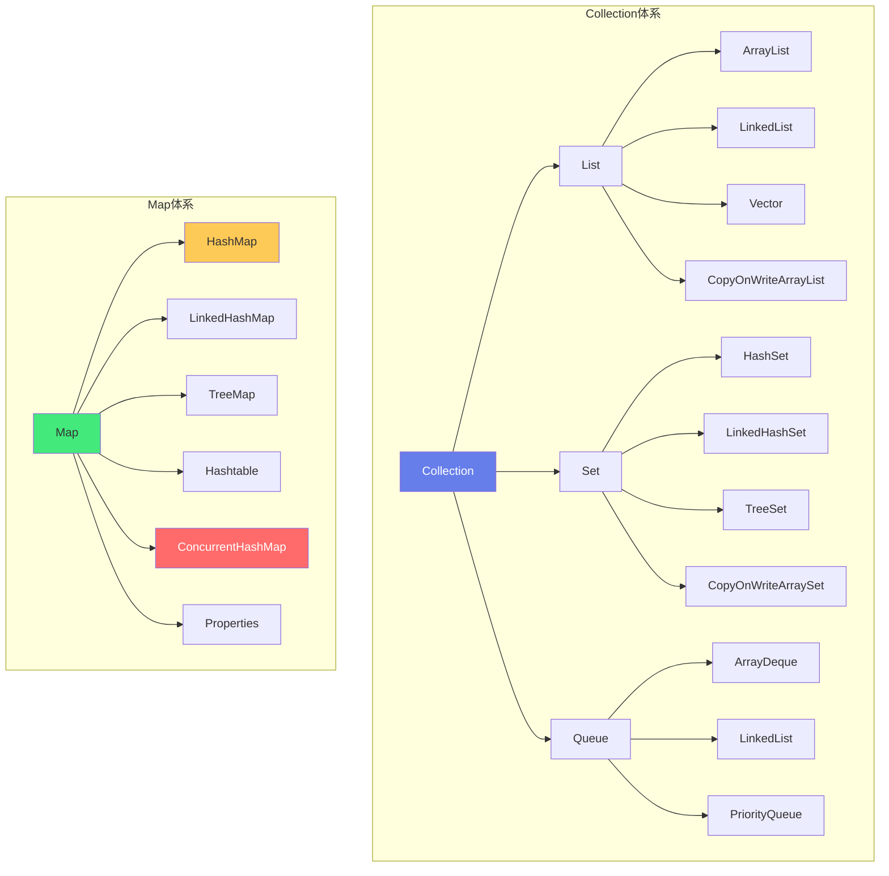

# 📚 Java 集合框架源码分析

> **文档说明**：系统深入分析 Java 集合框架（Java Collections Framework, JCF）的核心实现类源码，涵盖集合框架概述（Collection/Map 两大体系 / 接口层次结构 / 常用实现类分类 / 设计模式）、ArrayList 源码分析（底层 Object 数组 / 扩容机制 1.5 倍 / 增删改查实现 / 迭代器 Iterator / 随机访问 RandomAccess / fail-fast 机制 / 序列化 / subList 坑）、LinkedList 源码分析（双向链表 Node 节点结构 / 头插尾插 / 增删改查 / 队列 Deque 操作 / 栈操作 / 与 ArrayList 对比）、HashMap 源码分析（数组+链表+红黑树数据结构 / 哈希函数 hash() / put 完整流程 / get 查询流程 / resize 扩容机制 / 树化与红黑树 / 负载因子 / JDK7 头插 vs JDK8 尾插 / 并发死循环问题 / 扰动函数）、ConcurrentHashMap 源码分析（线程安全实现 / CAS + synchronized 锁桶 / JDK7 Segment 分段锁 vs JDK8 桶级锁 / put 流程 / 扩容 transfer / 计数 CounterCell / size 方法 / get 无锁读 / 红黑树 / 与 Hashtable/Collections.synchronizedMap 对比）、其他集合（HashSet / LinkedHashMap 访问顺序 / TreeMap 红黑树排序 / TreeSet / ArrayDeque / CopyOnWriteArrayList）、集合选型指南（不同场景选择合适的集合 / 性能对比表 / 内存占用对比）、常见问题与最佳实践（初始化容量 / 遍历删除 / equals 与 hashCode / 并发集合选择 / 不可变集合 / 空集合）、性能调优（预分配容量 / 负载因子调优 / 避免装箱 / 迭代方式选择 / 大集合分片）。
>
> **适用人群**：Java 后端开发者、准备面试的求职者、想深入理解 JDK 源码的工程师、性能优化工程师
>
> **前置知识**：[[Java-语法进阶与StreamAPI]] · [[Java-并发编程JUC]]

---

## 一、集合框架概述

### 1.1 两大体系：Collection 与 Map



### 1.2 核心接口层次

| 接口 | 特点 | 常用实现 |
|------|------|---------|
| **Collection** | 集合根接口，定义 add/remove/contains/size 等 | - |
| **List** | 有序、可重复、有索引 | ArrayList, LinkedList, Vector |
| **Set** | 无序、不可重复 | HashSet, LinkedHashSet, TreeSet |
| **Queue** | 队列，FIFO/LIFO/优先级 | ArrayDeque, LinkedList, PriorityQueue |
| **Map** | 键值对，key 不可重复 | HashMap, LinkedHashMap, TreeMap, ConcurrentHashMap |
| **SortedSet** | 有序 Set | TreeSet |
| **SortedMap** | 有序 Map | TreeMap |
| **NavigableSet** | 可导航 Set（范围查询） | TreeSet |
| **NavigableMap** | 可导航 Map | TreeMap |
| **ConcurrentMap** | 并发 Map | ConcurrentHashMap |

### 1.3 设计模式

| 设计模式 | 应用 |
|---------|------|
| **迭代器模式（Iterator）** | 所有 Collection 都实现 Iterable，统一遍历方式 |
| **工厂方法** | Collections.emptyList()/singletonList() 等 |
| **适配器模式** | Arrays.asList() 数组转 List |
| **装饰器模式** | Collections.synchronizedList()/unmodifiableList() |
| **策略模式** | Comparator 比较器，TreeSet/TreeMap 排序策略 |
| **享元模式** | Integer 缓存（-128~127），小对象复用 |

---

## 二、ArrayList 源码分析

### 2.1 底层数据结构

```java
// JDK 8 ArrayList 核心字段
public class ArrayList<E> extends AbstractList<E>
        implements List<E>, RandomAccess, Cloneable, java.io.Serializable {
    
    // 默认初始容量
    private static final int DEFAULT_CAPACITY = 10;
    
    // 空数组（用于空实例）
    private static final Object[] EMPTY_ELEMENTDATA = {};
    
    // 默认容量空数组（用于无参构造，第一次 add 时扩容到 10）
    private static final Object[] DEFAULTCAPACITY_EMPTY_ELEMENTDATA = {};
    
    // 底层存储数组（transient 不参与默认序列化）
    transient Object[] elementData;
    
    // 实际元素个数
    private int size;
}
```

**关键点**：
- 底层是 **Object[] 数组**，连续内存存储
- `RandomAccess` 接口标记：支持快速随机访问（for 循环比迭代器快）
- `elementData` 用 `transient` 修饰：自定义序列化（只序列化实际元素，不序列化整个数组）
- 无参构造时数组是 `DEFAULTCAPACITY_EMPTY_ELEMENTDATA`，第一次 add 才扩容到 10（懒加载）

### 2.2 构造函数

```java
// 1. 无参构造：默认空数组，第一次 add 扩容到 10
public ArrayList() {
    this.elementData = DEFAULTCAPACITY_EMPTY_ELEMENTDATA;
}

// 2. 指定初始容量
public ArrayList(int initialCapacity) {
    if (initialCapacity > 0) {
        this.elementData = new Object[initialCapacity];
    } else if (initialCapacity == 0) {
        this.elementData = EMPTY_ELEMENTDATA;
    } else {
        throw new IllegalArgumentException("Illegal Capacity: " + initialCapacity);
    }
}

// 3. 从其他集合构造
public ArrayList(Collection<? extends E> c) {
    elementData = c.toArray();
    if ((size = elementData.length) != 0) {
        // c.toArray() 可能不返回 Object[]（如 Arrays.asList）
        if (elementData.getClass() != Object[].class)
            elementData = Arrays.copyOf(elementData, size, Object[].class);
    } else {
        this.elementData = EMPTY_ELEMENTDATA;
    }
}
```

### 2.3 扩容机制（核心）

```java
// add 方法入口
public boolean add(E e) {
    ensureCapacityInternal(size + 1);  // 确保容量足够
    elementData[size++] = e;
    return true;
}

private void ensureCapacityInternal(int minCapacity) {
    ensureExplicitCapacity(calculateCapacity(elementData, minCapacity));
}

// 计算所需容量：如果是默认空数组，至少扩容到 10
private static int calculateCapacity(Object[] elementData, int minCapacity) {
    if (elementData == DEFAULTCAPACITY_EMPTY_ELEMENTDATA) {
        return Math.max(DEFAULT_CAPACITY, minCapacity);
    }
    return minCapacity;
}

private void ensureExplicitCapacity(int minCapacity) {
    modCount++;  // 修改次数+1（fail-fast 检测）
    // 需要的容量 > 当前数组长度，才扩容
    if (minCapacity - elementData.length > 0)
        grow(minCapacity);
}

// 扩容核心：1.5 倍
private void grow(int minCapacity) {
    int oldCapacity = elementData.length;
    // 新容量 = 旧容量 + 旧容量/2 = 1.5 倍
    // oldCapacity >> 1 等价于 oldCapacity / 2（位运算更快）
    int newCapacity = oldCapacity + (oldCapacity >> 1);
    
    // 如果 1.5 倍还不够，就用需要的容量
    if (newCapacity - minCapacity < 0)
        newCapacity = minCapacity;
    
    // 超过最大数组大小，用 Integer.MAX_VALUE
    if (newCapacity - MAX_ARRAY_SIZE > 0)
        newCapacity = hugeCapacity(minCapacity);
    
    // 数组拷贝：创建新数组，复制旧元素
    elementData = Arrays.copyOf(elementData, newCapacity);
}

private static int hugeCapacity(int minCapacity) {
    if (minCapacity < 0) throw new OutOfMemoryError();
    return (minCapacity > MAX_ARRAY_SIZE) ?
        Integer.MAX_VALUE : MAX_ARRAY_SIZE;
}
```

**扩容流程总结**：
```
add(e)
  → ensureCapacityInternal(size+1)
    → calculateCapacity：默认空数组→至少10
    → ensureExplicitCapacity：modCount++，判断是否需要扩容
      → grow(minCapacity)
        → newCapacity = oldCapacity + (oldCapacity >> 1)  // 1.5倍
        → Arrays.copyOf 复制到新数组
  → elementData[size++] = e
```

**为什么是 1.5 倍？**
- 1.5 倍是时间和空间的折中：扩容太小（如 1.2 倍）会频繁扩容（数组拷贝开销大）；扩容太大（如 2 倍）会浪费内存
- 1.5 倍的另一个好处：可以复用之前释放的内存（1.5 倍增长序列：10→15→22→33→49...，之前的数组总和可能刚好能容纳新数组，减少内存碎片）

### 2.4 增删改查

```java
// 1. 指定位置插入（O(n)，需要移动元素）
public void add(int index, E element) {
    rangeCheckForAdd(index);  // 检查 index 范围
    ensureCapacityInternal(size + 1);  // 扩容检查
    // 数组拷贝：从 index 开始的元素后移一位
    // System.arraycopy(源数组, 源起始, 目标数组, 目标起始, 长度)
    System.arraycopy(elementData, index, elementData, index + 1, size - index);
    elementData[index] = element;
    size++;
}

// 2. 删除指定位置（O(n)，需要移动元素）
public E remove(int index) {
    rangeCheck(index);
    modCount++;
    E oldValue = elementData(index);
    int numMoved = size - index - 1;
    if (numMoved > 0)
        System.arraycopy(elementData, index+1, elementData, index, numMoved);
    elementData[--size] = null;  // 置空，帮助 GC
    return oldValue;
}

// 3. 删除指定元素（O(n)，需要遍历查找+移动）
public boolean remove(Object o) {
    if (o == null) {
        for (int index = 0; index < size; index++)
            if (elementData[index] == null) {
                fastRemove(index);
                return true;
            }
    } else {
        for (int index = 0; index < size; index++)
            if (o.equals(elementData[index])) {
                fastRemove(index);
                return true;
            }
    }
    return false;
}

// 4. 修改（O(1)）
public E set(int index, E element) {
    rangeCheck(index);
    E oldValue = elementData(index);
    elementData[index] = element;
    return oldValue;
}

// 5. 查询（O(1)，随机访问）
public E get(int index) {
    rangeCheck(index);
    return elementData(index);
}

E elementData(int index) {
    return (E) elementData[index];
}
```

### 2.5 迭代器与 fail-fast

```java
// ArrayList 的迭代器
private class Itr implements Iterator<E> {
    int cursor;       // 下一个要返回的元素索引
    int lastRet = -1; // 上一个返回的元素索引
    int expectedModCount = modCount;  // 期望的修改次数
    
    public boolean hasNext() {
        return cursor != size;
    }
    
    public E next() {
        checkForComodification();  // 检查是否并发修改
        int i = cursor;
        if (i >= size) throw new NoSuchElementException();
        Object[] elementData = ArrayList.this.elementData;
        if (i >= elementData.length) throw new ConcurrentModificationException();
        cursor = i + 1;
        return (E) elementData[lastRet = i];
    }
    
    public void remove() {
        if (lastRet < 0) throw new IllegalStateException();
        checkForComodification();
        try {
            ArrayList.this.remove(lastRet);  // 调用 ArrayList 的 remove
            cursor = lastRet;
            lastRet = -1;
            expectedModCount = modCount;  // 更新期望修改次数
        } catch (IndexOutOfBoundsException ex) {
            throw new ConcurrentModificationException();
        }
    }
    
    // fail-fast 核心：检查 modCount 是否被外部修改
    final void checkForComodification() {
        if (modCount != expectedModCount)
            throw new ConcurrentModificationException();
    }
}
```

**fail-fast 机制**：
- `modCount` 记录 ArrayList 的修改次数（add/remove/clear 等都会 +1）
- 迭代器创建时记录 `expectedModCount = modCount`
- 每次 `next()` 调用检查 `modCount != expectedModCount`，如果不等说明在迭代过程中被外部修改了，抛出 `ConcurrentModificationException`
- **注意**：迭代器自己的 `remove()` 方法会更新 `expectedModCount`，所以不会抛异常

**常见坑：for-each 中调用 remove**

```java
// ❌ 错误：for-each 中调用 list.remove()，会抛 ConcurrentModificationException
for (String s : list) {
    if (s.equals("xxx")) {
        list.remove(s);  // modCount++，但迭代器的 expectedModCount 没变
    }
}

// ✅ 正确1：使用 Iterator.remove()
Iterator<String> it = list.iterator();
while (it.hasNext()) {
    if (it.next().equals("xxx")) {
        it.remove();  // 迭代器自己的 remove，会更新 expectedModCount
    }
}

// ✅ 正确2：使用 removeIf（JDK 8+）
list.removeIf(s -> s.equals("xxx"));

// ✅ 正确3：倒序 for 循环删除
for (int i = list.size() - 1; i >= 0; i--) {
    if (list.get(i).equals("xxx")) {
        list.remove(i);
    }
}
```

### 2.6 subList 的坑

```java
// subList 返回的是原列表的视图，不是新列表
List<String> list = new ArrayList<>(Arrays.asList("A", "B", "C", "D", "E"));
List<String> sub = list.subList(1, 3);  // ["B", "C"]

sub.set(0, "X");  // 修改 sub 会影响原 list
System.out.println(list);  // [A, X, C, D, E]

sub.add("Y");  // sub 增加元素，原 list 也增加
System.out.println(list);  // [A, X, C, Y, D, E]

// ❌ 坑：修改原 list 后再用 sub，会抛 ConcurrentModificationException
list.add("F");
sub.get(0);  // ConcurrentModificationException

// ✅ 正确：如果需要独立列表，用 new ArrayList<>(list.subList(...))
List<String> independent = new ArrayList<>(list.subList(1, 3));
```

---

## 三、LinkedList 源码分析

### 3.1 底层数据结构

```java
public class LinkedList<E> extends AbstractSequentialList<E>
    implements List<E>, Deque<E>, Cloneable, java.io.Serializable {
    
    // 元素个数
    transient int size = 0;
    
    // 头节点（第一个节点）
    transient Node<E> first;
    
    // 尾节点（最后一个节点）
    transient Node<E> last;
    
    // 节点内部类：双向链表
    private static class Node<E> {
        E item;         // 元素值
        Node<E> next;   // 下一个节点
        Node<E> prev;   // 上一个节点
        
        Node(Node<E> prev, E element, Node<E> next) {
            this.item = element;
            this.next = next;
            this.prev = prev;
        }
    }
}
```

**关键点**：
- 底层是**双向链表**，每个节点有 prev 和 next 指针
- 有 first 和 last 两个指针，分别指向头和尾
- 实现了 `Deque` 接口，可以当队列、双端队列、栈使用
- 没有实现 `RandomAccess`，随机访问慢（需要遍历）

### 3.2 增删操作

```java
// 1. 尾插（O(1)）
public boolean add(E e) {
    linkLast(e);
    return true;
}

void linkLast(E e) {
    final Node<E> l = last;
    final Node<E> newNode = new Node<>(l, e, null);
    last = newNode;
    if (l == null)
        first = newNode;  // 空链表，头也是新节点
    else
        l.next = newNode;  // 旧尾节点的 next 指向新节点
    size++;
    modCount++;
}

// 2. 头插（O(1)）
public void addFirst(E e) {
    linkFirst(e);
}

private void linkFirst(E e) {
    final Node<E> f = first;
    final Node<E> newNode = new Node<>(null, e, f);
    first = newNode;
    if (f == null)
        last = newNode;
    else
        f.prev = newNode;
    size++;
    modCount++;
}

// 3. 指定位置插入（O(n)，需要先遍历找到位置）
public void add(int index, E element) {
    checkPositionIndex(index);
    if (index == size)
        linkLast(element);
    else
        linkBefore(element, node(index));  // node(index) 需要遍历
}

// 找到 index 位置的节点（O(n/2)，从头或尾遍历）
Node<E> node(int index) {
    if (index < (size >> 1)) {  // 在前半部分，从头遍历
        Node<E> x = first;
        for (int i = 0; i < index; i++)
            x = x.next;
        return x;
    } else {  // 在后半部分，从尾遍历
        Node<E> x = last;
        for (int i = size - 1; i > index; i--)
            x = x.prev;
        return x;
    }
}

// 4. 删除头节点（O(1)）
public E removeFirst() {
    final Node<E> f = first;
    if (f == null) throw new NoSuchElementException();
    return unlinkFirst(f);
}

private E unlinkFirst(Node<E> f) {
    final E element = f.item;
    final Node<E> next = f.next;
    f.item = null;
    f.next = null;  // help GC
    first = next;
    if (next == null)
        last = null;
    else
        next.prev = null;
    size--;
    modCount++;
    return element;
}
```

### 3.3 队列与栈操作

```java
// 作为队列（FIFO）
Queue<String> queue = new LinkedList<>();
queue.offer("A");  // 入队（尾插）
queue.poll();      // 出队（头删），返回 null 如果空
queue.peek();      // 查看队头，不删除

// 作为双端队列（Deque）
Deque<String> deque = new LinkedList<>();
deque.offerFirst("A");  // 头插
deque.offerLast("B");   // 尾插
deque.pollFirst();      // 头删
deque.pollLast();       // 尾删

// 作为栈（LIFO）- 推荐用 Deque 接口
Deque<String> stack = new LinkedList<>();
stack.push("A");  // 入栈（头插）
stack.pop();      // 出栈（头删）
stack.peek();     // 查看栈顶

// ❌ 不推荐用 Stack 类（继承 Vector，方法都 synchronized，性能差）
Stack<String> oldStack = new Stack<>();
```

### 3.4 ArrayList vs LinkedList

| 维度 | ArrayList | LinkedList |
|------|-----------|------------|
| **底层结构** | Object[] 数组 | 双向链表 |
| **随机访问** | O(1) ✅ 快 | O(n) ❌ 慢（需遍历） |
| **头插** | O(n)（需移动所有元素） | O(1) ✅ 快 |
| **尾插** | O(1) 均摊（扩容时 O(n)） | O(1) ✅ 快 |
| **中间插删** | O(n)（需移动元素） | O(n)（需先遍历找到位置） |
| **内存占用** | 连续内存，可能有闲置容量 | 每个节点额外存 prev/next 指针（16 字节） |
| **遍历方式** | for 循环快（RandomAccess） | 迭代器快（for 循环每次都从头遍历） |
| **适用场景** | 随机访问多、遍历多 | 频繁头尾增删、队列/栈 |

> **实际选型**：大多数场景用 ArrayList（性能更好，缓存友好），只有频繁头尾增删时才用 LinkedList。LinkedList 的中间插入也是 O(n)（需要先遍历找到位置），并不比 ArrayList 快。

---

## 四、HashMap 源码分析（重点）

### 4.1 底层数据结构

```java
// JDK 8 HashMap 核心字段
public class HashMap<K,V> extends AbstractMap<K,V>
    implements Map<K,V>, Cloneable, Serializable {
    
    // 默认初始容量 16（必须是 2 的幂）
    static final int DEFAULT_INITIAL_CAPACITY = 1 << 4;
    
    // 最大容量 2^30
    static final int MAXIMUM_CAPACITY = 1 << 30;
    
    // 默认负载因子 0.75
    static final float DEFAULT_LOAD_FACTOR = 0.75f;
    
    // 树化阈值：链表长度 >= 8 时转红黑树
    static final int TREEIFY_THRESHOLD = 8;
    
    // 反树化阈值：红黑树节点 <= 6 时转回链表
    static final int UNTREEIFY_THRESHOLD = 6;
    
    // 树化的最小容量：容量 >= 64 才允许树化（否则优先扩容）
    static final int MIN_TREEIFY_CAPACITY = 64;
    
    // 哈希表数组（桶）
    transient Node<K,V>[] table;
    
    // 缓存 entrySet
    transient Set<Map.Entry<K,V>> entrySet;
    
    // 实际键值对个数
    transient int size;
    
    // 修改次数（fail-fast）
    transient int modCount;
    
    // 扩容阈值 = capacity * loadFactor
    int threshold;
    
    // 负载因子
    final float loadFactor;
    
    // 链表节点
    static class Node<K,V> implements Map.Entry<K,V> {
        final int hash;
        final K key;
        V value;
        Node<K,V> next;
    }
    
    // 红黑树节点（JDK 8 新增）
    static final class TreeNode<K,V> extends LinkedHashMap.Entry<K,V> {
        TreeNode<K,V> parent;
        TreeNode<K,V> left;
        TreeNode<K,V> right;
        TreeNode<K,V> prev;
        boolean red;
    }
}
```

**JDK 8 数据结构**：数组 + 链表 + 红黑树

```
table[] (数组，容量 16)
├── [0] → Node → Node → Node (链表，长度 < 8)
├── [1] → null
├── [2] → TreeNode (红黑树，链表长度 >= 8 且容量 >= 64 时树化)
├── [3] → Node
├── ...
└── [15] → null
```

### 4.2 哈希函数与扰动函数

```java
// 计算 key 的哈希值
static final int hash(Object key) {
    int h;
    // key.hashCode() 是原生哈希值
    // 高 16 位与低 16 位异或（扰动函数），让高位也参与取模
    return (key == null) ? 0 : (h = key.hashCode()) ^ (h >>> 16);
}

// 定位桶：(n - 1) & hash 等价于 hash % n，但 n 必须是 2 的幂
// 因为 n 是 2 的幂，n-1 的二进制是全 1，& 运算就是取低 log2(n) 位
int index = (n - 1) & hash;
```

**为什么需要扰动函数？**
- `key.hashCode()` 返回 int（32 位），范围很大
- 但 `(n-1) & hash` 只取低几位（如 n=16 时只取低 4 位）
- 如果不扰动，高位完全不参与桶定位，哈希冲突概率大增
- 扰动函数 `h ^ (h >>> 16)` 让高 16 位与低 16 位异或，高位也参与取模，减少冲突

**为什么容量必须是 2 的幂？**
- `(n - 1) & hash` 比 `hash % n` 快（位运算 vs 取模）
- 只有 n 是 2 的幂时，`(n-1) & hash` 才等价于 `hash % n`
- 扩容时也是 2 倍扩容，保持 2 的幂

### 4.3 put 完整流程（核心）

```java
public V put(K key, V value) {
    return putVal(hash(key), key, value, false, true);
}

final V putVal(int hash, K key, V value, boolean onlyIfAbsent, boolean evict) {
    Node<K,V>[] tab;
    Node<K,V> p;
    int n, i;
    
    // 1. table 为空则初始化（懒加载，第一次 put 才创建数组）
    if ((tab = table) == null || (n = tab.length) == 0)
        n = (tab = resize()).length;
    
    // 2. 计算桶位置，如果桶为空，直接创建新节点放入
    if ((p = tab[i = (n - 1) & hash]) == null)
        tab[i] = newNode(hash, key, value, null);
    
    // 3. 桶不为空（有哈希冲突）
    else {
        Node<K,V> e;
        K k;
        
        // 3.1 桶中第一个节点的 key 相同（哈希相同且 equals 相同），覆盖 value
        if (p.hash == hash &&
            ((k = p.key) == key || (key != null && key.equals(k))))
            e = p;
        
        // 3.2 桶中是红黑树，按红黑树方式插入
        else if (p instanceof TreeNode)
            e = ((TreeNode<K,V>)p).putTreeVal(this, tab, hash, key, value);
        
        // 3.3 桶中是链表，遍历链表
        else {
            for (int binCount = 0; ; ++binCount) {
                // 遍历到链表尾部，尾插新节点（JDK 8 是尾插，JDK 7 是头插）
                if ((e = p.next) == null) {
                    p.next = newNode(hash, key, value, null);
                    // 链表长度 >= 8（binCount 从 0 开始，到 7 时是第 8 个节点），尝试树化
                    if (binCount >= TREEIFY_THRESHOLD - 1)
                        treeifyBin(tab, hash);  // 树化（内部还会判断容量 >= 64）
                    break;
                }
                // 遍历过程中发现 key 相同，覆盖 value
                if (e.hash == hash &&
                    ((k = e.key) == key || (key != null && key.equals(k))))
                    break;
                p = e;
            }
        }
        
        // 4. e != null 说明找到了相同 key，覆盖 value，返回旧 value
        if (e != null) {
            V oldValue = e.value;
            if (!onlyIfAbsent || oldValue == null)
                e.value = value;
            afterNodeAccess(e);  // LinkedHashMap 用，HashMap 空实现
            return oldValue;
        }
    }
    
    // 5. 是新插入的节点（不是覆盖），修改次数+1
    ++modCount;
    
    // 6. size+1，如果超过阈值，扩容
    if (++size > threshold)
        resize();
    
    afterNodeInsertion(evict);  // LinkedHashMap 用，HashMap 空实现
    return null;
}
```

**put 流程总结**：
```
put(key, value)
  → hash(key)：扰动函数计算哈希
  → putVal(hash, key, value)
    1. table 为空 → resize() 初始化（容量 16，阈值 12）
    2. (n-1) & hash 定位桶
    3. 桶为空 → 直接放新节点
    4. 桶不为空：
       - 第一个节点 key 相同 → 覆盖 value
       - 是红黑树 → 红黑树插入
       - 是链表 → 遍历：
         · 找到 key 相同 → 覆盖
         · 遍历到尾部 → 尾插新节点，链表长度>=8 → 树化
    5. 新插入 → size++，超过阈值 → resize() 扩容
    6. 返回 null（新插入）或旧 value（覆盖）
```

### 4.4 resize 扩容机制

```java
final Node<K,V>[] resize() {
    Node<K,V>[] oldTab = table;
    int oldCap = (oldTab == null) ? 0 : oldTab.length;
    int oldThr = threshold;
    int newCap, newThr = 0;
    
    // 1. 计算新容量和新阈值
    if (oldCap > 0) {
        // 超过最大容量，不再扩容
        if (oldCap >= MAXIMUM_CAPACITY) {
            threshold = Integer.MAX_VALUE;
            return oldTab;
        }
        // 新容量 = 旧容量 * 2
        else if ((newCap = oldCap << 1) < MAXIMUM_CAPACITY && oldCap >= DEFAULT_INITIAL_CAPACITY)
            newThr = oldThr << 1;  // 新阈值 = 旧阈值 * 2
    }
    else if (oldThr > 0) {
        newCap = oldThr;  // 有参构造，threshold 存的是初始容量
    }
    else {
        // 无参构造：默认容量 16，阈值 12
        newCap = DEFAULT_INITIAL_CAPACITY;
        newThr = (int)(DEFAULT_LOAD_FACTOR * DEFAULT_INITIAL_CAPACITY);
    }
    
    // 2. 创建新数组
    Node<K,V>[] newTab = (Node<K,V>[])new Node[newCap];
    table = newTab;
    
    // 3. 迁移旧数据到新数组
    if (oldTab != null) {
        for (int j = 0; j < oldCap; ++j) {
            Node<K,V> e;
            if ((e = oldTab[j]) != null) {
                oldTab[j] = null;  // 帮助 GC
                
                // 3.1 只有一个节点，直接重新定位
                if (e.next == null)
                    newTab[e.hash & (newCap - 1)] = e;
                
                // 3.2 是红黑树，拆分（可能拆成两棵树或反树化）
                else if (e instanceof TreeNode)
                    ((TreeNode<K,V>)e).split(this, newTab, j, oldCap);
                
                // 3.3 是链表，拆分成两条链表（JDK 8 优化）
                else {
                    Node<K,V> loHead = null, loTail = null;  // 低位链表（索引不变）
                    Node<K,V> hiHead = null, hiTail = null;  // 高位链表（索引 + oldCap）
                    Node<K,V> next;
                    
                    do {
                        next = e.next;
                        // 关键：hash & oldCap 判断最高位是 0 还是 1
                        // 因为容量是 2 倍扩容，新索引 = 旧索引 或 旧索引 + oldCap
                        if ((e.hash & oldCap) == 0) {
                            // 最高位是 0，索引不变（低位）
                            if (loTail == null) loHead = e;
                            else loTail.next = e;
                            loTail = e;
                        } else {
                            // 最高位是 1，索引 = 旧索引 + oldCap（高位）
                            if (hiTail == null) hiHead = e;
                            else hiTail.next = e;
                            hiTail = e;
                        }
                    } while ((e = next) != null);
                    
                    // 低位链表放到新数组的原索引位置
                    if (loTail != null) {
                        loTail.next = null;
                        newTab[j] = loHead;
                    }
                    // 高位链表放到新数组的 原索引 + oldCap 位置
                    if (hiTail != null) {
                        hiTail.next = null;
                        newTab[j + oldCap] = hiHead;
                    }
                }
            }
        }
    }
    return newTab;
}
```

**扩容核心优化（JDK 8）**：
- 容量 2 倍扩容，新索引只有两种可能：**原索引** 或 **原索引 + oldCap**
- 判断依据：`hash & oldCap`（oldCap 是 2 的幂，二进制只有一位是 1）
  - 结果为 0 → 最高位是 0 → 新索引 = 旧索引
  - 结果为 1 → 最高位是 1 → 新索引 = 旧索引 + oldCap
- **不需要重新计算 hash**，只需要判断最高位，大幅提升扩容效率
- 链表拆分成两条（loHead/loTail 和 hiHead/hiTail），保持原有顺序（尾插，不会倒序）

**JDK 7 vs JDK 8 扩容对比**：
| 维度 | JDK 7 | JDK 8 |
|------|-------|-------|
| 扩容方式 | 重新计算 hash，头插法 | 判断最高位，尾插法 |
| 链表顺序 | 扩容后倒序 | 扩容后保持原序 |
| 并发问题 | 多线程扩容可能形成环形链表，死循环 | 不会形成环形链表（但仍不线程安全） |
| 效率 | 较低（重新 hash） | 较高（只判断最高位） |

### 4.5 树化与红黑树

```java
// 链表转红黑树
final void treeifyBin(Node<K,V>[] tab, int hash) {
    int n, index;
    Node<K,V> e;
    // 关键：容量 < 64 时，优先扩容而不是树化
    if (tab == null || (n = tab.length) < MIN_TREEIFY_CAPACITY)
        resize();
    else if ((e = tab[index = (n - 1) & hash]) != null) {
        // 链表转红黑树
        TreeNode<K,V> hd = null, tl = null;
        do {
            TreeNode<K,V> p = replacementTreeNode(e, null);
            if (tl == null) hd = p;
            else {
                p.prev = tl;
                tl.next = p;
            }
            tl = p;
        } while ((e = e.next) != null);
        
        if ((tab[index] = hd) != null)
            hd.treeify(tab);  // 构建红黑树
    }
}
```

**树化条件**（必须同时满足）：
1. 链表长度 >= 8（`TREEIFY_THRESHOLD = 8`）
2. 数组容量 >= 64（`MIN_TREEIFY_CAPACITY = 64`），否则优先扩容

**反树化条件**：
- 红黑树节点数 <= 6（`UNTREEIFY_THRESHOLD = 6`），扩容拆分时可能反树化

**为什么阈值是 8 和 6？**
- 8 和 6 之间有差值（8 树化，6 反树化），避免频繁在链表和红黑树之间转换（抖动）
- 链表长度达到 8 的概率极低（泊松分布，负载因子 0.75 时，链表长度为 8 的概率约 0.00000006），所以正常情况下不会树化
- 红黑树查询 O(log n)，链表查询 O(n)，n=8 时红黑树 log2(8)=3 次比较，链表平均 4 次，红黑树开始有优势

### 4.6 get 查询流程

```java
public V get(Object key) {
    Node<K,V> e;
    return (e = getNode(hash(key), key)) == null ? null : e.value;
}

final Node<K,V> getNode(int hash, Object key) {
    Node<K,V>[] tab;
    Node<K,V> first, e;
    int n;
    K k;
    
    // 1. table 不为空且桶不为空
    if ((tab = table) != null && (n = tab.length) > 0 &&
        (first = tab[(n - 1) & hash]) != null) {
        
        // 2. 检查第一个节点（哈希相同且 key 相同）
        if (first.hash == hash &&
            ((k = first.key) == key || (key != null && key.equals(k))))
            return first;
        
        // 3. 遍历链表或红黑树
        if ((e = first.next) != null) {
            if (first instanceof TreeNode)
                return ((TreeNode<K,V>)first).getTreeNode(hash, key);  // 红黑树查找 O(log n)
            do {
                if (e.hash == hash &&
                    ((k = e.key) == key || (key != null && key.equals(k))))
                    return e;
            } while ((e = e.next) != null);  // 链表遍历 O(n)
        }
    }
    return null;
}
```

### 4.7 并发问题

```java
// ❌ HashMap 不是线程安全的，多线程 put 可能导致：
// 1. 数据丢失（两个线程同时 put 到同一个桶，覆盖）
// 2. size 不准确（++size 不是原子操作）
// 3. JDK 7 扩容时可能形成环形链表，get 时死循环（JDK 8 修复了环形链表，但仍不线程安全）
// 4. 并发修改导致 ConcurrentModificationException（迭代时）

// ✅ 线程安全的 Map：
// 1. ConcurrentHashMap（推荐，性能好）
Map<String, String> map = new ConcurrentHashMap<>();

// 2. Hashtable（不推荐，所有方法 synchronized，性能差）
Map<String, String> map = new Hashtable<>();

// 3. Collections.synchronizedMap（不推荐，包装类，所有方法加锁）
Map<String, String> map = Collections.synchronizedMap(new HashMap<>());
```

---

## 五、ConcurrentHashMap 源码分析（重点）

### 5.1 JDK 7 vs JDK 8 实现对比

| 维度 | JDK 7 ConcurrentHashMap | JDK 8 ConcurrentHashMap |
|------|------------------------|------------------------|
| **数据结构** | Segment 数组 + HashEntry 数组 + 链表 | Node 数组 + 链表 + 红黑树 |
| **锁机制** | Segment 分段锁（默认 16 段） | CAS + synchronized（锁桶） |
| **锁粒度** | Segment 级（一段包含多个桶） | 桶级（单个桶） |
| **并发度** | 16（默认 Segment 数） | 数组长度（更高） |
| **红黑树** | 不支持 | 支持（链表 >= 8 树化） |
| **size 计算** | 分段计算 + 重试 | CounterCell 数组 + 累加 |
| **性能** | 较好 | 更好（锁粒度更细） |

### 5.2 JDK 8 底层数据结构

```java
public class ConcurrentHashMap<K,V> extends AbstractMap<K,V>
    implements ConcurrentMap<K,V>, Serializable {
    
    // 最大容量
    private static final int MAXIMUM_CAPACITY = 1 << 30;
    
    // 默认容量 16
    private static final int DEFAULT_CAPACITY = 16;
    
    // 负载因子 0.75（固定，不可配置）
    private static final float LOAD_FACTOR = 0.75f;
    
    // 树化阈值 8
    static final int TREEIFY_THRESHOLD = 8;
    
    // 反树化阈值 6
    static final int UNTREEIFY_THRESHOLD = 6;
    
    // 最小树化容量 64
    static final int MIN_TREEIFY_CAPACITY = 64;
    
    // 哈希表数组（volatile 保证可见性）
    transient volatile Node<K,V>[] table;
    
    // 扩容时的新数组
    private transient volatile Node<K,V>[] nextTable;
    
    // 基础计数器（无竞争时用）
    private transient volatile long baseCount;
    
    // 计数器单元格数组（有竞争时用，分散计数）
    private transient volatile CounterCell[] counterCells;
    
    // 控制变量：
    // - 负数：正在扩容（-1 表示初始化中，-(1+n) 表示 n 个线程在扩容）
    // - 0：默认值
    // - 正数：初始化容量或扩容阈值
    private transient volatile int sizeCtl;
    
    // 节点（volatile 保证可见性）
    static class Node<K,V> implements Map.Entry<K,V> {
        final int hash;
        final K key;
        volatile V val;  // value 用 volatile
        volatile Node<K,V> next;  // next 用 volatile
    }
    
    // 红黑树节点
    static final class TreeNode<K,V> extends Node<K,V> {
        TreeNode<K,V> parent;
        TreeNode<K,V> left;
        TreeNode<K,V> right;
        TreeNode<K,V> prev;
        boolean red;
    }
    
    // 计数器单元格（用于分散计数，避免竞争）
    @sun.misc.Contended
    static final class CounterCell {
        volatile long value;
        CounterCell(long x) { value = x; }
    }
}
```

### 5.3 put 流程（CAS + synchronized）

```java
public V put(K key, V value) {
    return putVal(key, value, false);
}

final V putVal(K key, V value, boolean onlyIfAbsent) {
    if (key == null || value == null) throw new NullPointerException();
    
    int hash = spread(key.hashCode());  // 扰动函数（与 HashMap 类似）
    int binCount = 0;
    
    for (Node<K,V>[] tab = table;;) {  // 自旋循环
        Node<K,V> f;
        int n, i, fh;
        
        // 1. table 为空，初始化
        if (tab == null || (n = tab.length) == 0)
            tab = initTable();
        
        // 2. 桶为空，CAS 插入新节点（无锁）
        else if ((f = tabAt(tab, i = (n - 1) & hash)) == null) {
            if (casTabAt(tab, i, null, new Node<K,V>(hash, key, value, null)))
                break;  // CAS 成功，跳出循环
        }
        
        // 3. 桶正在扩容，帮助扩容
        else if ((fh = f.hash) == MOVED)
            tab = helpTransfer(tab, f);
        
        // 4. 桶不为空且不在扩容，synchronized 锁桶节点
        else {
            V oldVal = null;
            synchronized (f) {  // 锁桶头节点（粒度比 Segment 更细）
                if (tabAt(tab, i) == f) {  // 双重检查，确认桶头没变
                    if (fh >= 0) {  // 链表节点
                        binCount = 1;
                        for (Node<K,V> e = f;; ++binCount) {
                            K ek;
                            if (e.hash == hash &&
                                ((ek = e.key) == key || (ek != null && key.equals(ek)))) {
                                oldVal = e.val;
                                if (!onlyIfAbsent)
                                    e.val = value;  // 覆盖 value
                                break;
                            }
                            Node<K,V> pred = e;
                            if ((e = e.next) == null) {
                                pred.next = new Node<K,V>(hash, key, value, null);  // 尾插
                                break;
                            }
                        }
                    }
                    else if (f instanceof TreeBin) {  // 红黑树节点
                        Node<K,V> p;
                        binCount = 2;
                        if ((p = ((TreeBin<K,V>)f).putTreeVal(hash, key, value)) != null) {
                            oldVal = p.val;
                            if (!onlyIfAbsent)
                                p.val = value;
                        }
                    }
                }
            }
            
            // 5. 链表长度 >= 8，树化
            if (binCount != 0) {
                if (binCount >= TREEIFY_THRESHOLD)
                    treeifyBin(tab, i);
                if (oldVal != null)
                    return oldVal;
                break;
            }
        }
    }
    
    // 6. 计数 + 检查是否需要扩容
    addCount(1L, binCount);
    return null;
}
```

**put 流程总结**：
```
put(key, value)
  → spread(hash)：扰动函数
  → 自旋循环：
    1. table 为空 → initTable() 初始化（CAS 保证只有一个线程初始化）
    2. 桶为空 → CAS 插入新节点（无锁，失败则重试）
    3. 桶在扩容（hash == MOVED）→ helpTransfer() 帮助扩容
    4. 桶不为空 → synchronized(f) 锁桶头节点：
       - 双重检查桶头没变
       - 链表：遍历，key 相同覆盖，否则尾插
       - 红黑树：红黑树插入
    5. 链表长度 >= 8 → treeifyBin() 树化
  → addCount()：计数 + 检查扩容
```

**线程安全实现**：
- **桶为空时**：用 CAS 插入（`casTabAt`），无锁，高并发
- **桶不为空时**：用 `synchronized(f)` 锁桶头节点，粒度是单个桶（比 JDK 7 的 Segment 更细）
- **扩容时**：多线程可以一起帮助扩容（`helpTransfer`），提升扩容速度
- **value 和 next**：用 `volatile` 修饰，保证可见性
- **size 计数**：用 `CounterCell[]` 分散计数，避免竞争

### 5.4 初始化与扩容

```java
// 初始化 table（CAS 保证只有一个线程初始化）
private final Node<K,V>[] initTable() {
    Node<K,V>[] tab;
    int sc;
    while ((tab = table) == null || tab.length == 0) {
        if ((sc = sizeCtl) < 0)
            Thread.yield();  // 有其他线程在初始化，让出 CPU
        else if (U.compareAndSwapInt(this, SIZECTL, sc, -1)) {  // CAS 抢锁
            try {
                if ((tab = table) == null || tab.length == 0) {
                    int n = (sc > 0) ? sc : DEFAULT_CAPACITY;
                    Node<K,V>[] nt = (Node<K,V>[])new Node<?,?>[n];
                    table = nt;
                    sc = n - (n >>> 2);  // 阈值 = n * 0.75
                }
            } finally {
                sizeCtl = sc;  // 设置扩容阈值
            }
            break;
        }
    }
    return tab;
}

// 扩容（多线程可以一起帮助迁移）
private final void transfer(Node<K,V>[] tab, Node<K,V>[] nextTab) {
    int n = tab.length, stride;
    // 每个线程负责迁移的桶数（最少 16 个）
    if ((stride = (NCPU > 1) ? (n >>> 3) / NCPU : n) < MIN_TRANSFER_STRIDE)
        stride = MIN_TRANSFER_STRIDE;
    
    if (nextTab == null) {
        nextTab = (Node<K,V>[])new Node<?,?>[n << 1];  // 2 倍扩容
        nextTable = nextTab;
        transferIndex = n;  // 从后往前迁移
    }
    
    int nextn = nextTab.length;
    ForwardingNode<K,V> fwd = new ForwardingNode<>(nextTab);  // 标记节点（hash = MOVED）
    
    boolean advance = true;
    boolean finishing = false;
    
    for (int i = 0, bound = 0;;) {
        Node<K,V> f;
        int fh;
        // CAS 领取迁移任务（每个线程领一段）
        while (advance) {
            int nextIndex, nextBound;
            if (--i >= bound || finishing)
                advance = false;
            else if ((nextIndex = transferIndex) <= 0) {
                i = -1;
                advance = false;
            }
            else if (U.compareAndSwapInt(this, TRANSFERINDEX, nextIndex,
                    nextBound = (nextIndex > stride ? nextIndex - stride : 0))) {
                bound = nextBound;
                i = nextIndex - 1;
                advance = false;
            }
        }
        
        if (i < 0 || i >= n || i + n >= nextn) {
            // 迁移完成
            if (finishing) {
                nextTable = null;
                table = nextTab;
                sizeCtl = (n << 1) - (n >>> 1);  // 新阈值 = 2n * 0.75
                return;
            }
            if (U.compareAndSwapInt(this, SIZECTL, sizeCtl, sizeCtl - 1)) {
                // 当前线程迁移完成，sizeCtl -1
                if ((sizeCtl - 2) != resizeStamp(n) << RESIZE_STAMP_SHIFT)
                    return;  // 还有其他线程在迁移
                finishing = advance = true;
                i = n;  // 重新检查一遍
            }
        }
        else if ((f = tabAt(tab, i)) == null)
            advance = casTabAt(tab, i, null, fwd);  // 空桶放标记节点
        else if ((fh = f.hash) == MOVED)
            advance = true;  // 已经被其他线程迁移了
        else {
            synchronized (f) {  // 锁桶，迁移数据（与 HashMap 类似，拆成两条链表）
                // ... 迁移逻辑（链表拆分 / 红黑树拆分）
            }
        }
    }
}
```

**扩容特点**：
- 多线程可以一起帮助迁移（`helpTransfer`），每个线程领一段桶
- 迁移中的桶被标记为 `ForwardingNode`（hash = MOVED），其他线程 put 时会帮助扩容
- 扩容期间可以正常读（读旧数组或新数组）
- 扩容期间写操作会被阻塞或帮助扩容

### 5.5 size 计数（CounterCell）

```java
// 计数（无竞争时用 baseCount，有竞争时用 CounterCell 分散）
private final void addCount(long x, int check) {
    CounterCell[] as;
    long b, s;
    
    // 1. 先尝试 CAS 更新 baseCount
    if ((as = counterCells) != null ||
        !U.compareAndSwapLong(this, BASECOUNT, b = baseCount, s = b + x)) {
        
        // 2. baseCount CAS 失败（有竞争），用 CounterCell
        CounterCell a;
        long v;
        int m;
        boolean uncontended = true;
        
        if (as == null || (m = as.length - 1) < 0 ||
            (a = as[ThreadLocalRandom.getProbe() & m]) == null ||
            !(uncontended = U.compareAndSwapLong(a, CELLVALUE, v = a.value, v + x))) {
            // 3. CounterCell 也失败，进入 fullAddCount（重试或扩容 CounterCell）
            fullAddCount(x, uncontended);
            return;
        }
        if (check <= 1) return;
        s = sumCount();  // 计算总数
    }
    
    // 4. 检查是否需要扩容
    if (check >= 0) {
        Node<K,V>[] tab, nt;
        int n, sc;
        while (s >= (long)(sc = sizeCtl) && (tab = table) != null &&
               (n = tab.length) < MAXIMUM_CAPACITY) {
            int rs = resizeStamp(n);
            if (sc < 0) {
                // 正在扩容，检查是否可以加入
                if ((sc >>> RESIZE_STAMP_SHIFT) != rs || sc == rs + 1 ||
                    sc == rs + MAX_RESIZERS || (nt = nextTable) == null ||
                    transferIndex <= 0)
                    break;
                if (U.compareAndSwapInt(this, SIZECTL, sc, sc + 1))
                    transfer(tab, nt);  // 帮助扩容
            }
            else if (U.compareAndSwapInt(this, SIZECTL, sc,
                    (rs << RESIZE_STAMP_SHIFT) + 2))
                transfer(tab, null);  // 发起扩容
            s = sumCount();
        }
    }
}

// 计算总数（baseCount + 所有 CounterCell）
final long sumCount() {
    CounterCell[] as = counterCells;
    CounterCell a;
    long sum = baseCount;
    if (as != null) {
        for (int i = 0; i < as.length; ++i) {
            if ((a = as[i]) != null)
                sum += a.value;
        }
    }
    return sum;
}

public int size() {
    long n = sumCount();
    return ((n < 0L) ? 0 : (n > (long)Integer.MAX_VALUE) ? Integer.MAX_VALUE : (int)n);
}
```

**计数原理**：
- 无竞争时：直接 CAS 更新 `baseCount`
- 有竞争时：用 `CounterCell[]` 分散计数，每个线程通过 `ThreadLocalRandom.getProbe()` 映射到一个 CounterCell，减少竞争
- `@sun.misc.Contended` 注解避免伪共享（缓存行填充）
- `size()` 时累加 `baseCount + 所有 CounterCell`，结果是**近似值**（因为计数期间可能有并发修改）

### 5.6 get 无锁读

```java
public V get(Object key) {
    Node<K,V>[] tab;
    Node<K,V> e, p;
    int n, eh;
    K ek;
    int h = spread(key.hashCode());
    
    if ((tab = table) != null && (n = tab.length) > 0 &&
        (e = tabAt(tab, (n - 1) & h)) != null) {
        
        // 1. 检查第一个节点
        if (e.hash == h &&
            ((ek = e.key) == key || (ek != null && key.equals(ek))))
            return e.val;
        
        // 2. 遍历
        if ((eh = e.hash) < 0) {
            // 红黑树或 ForwardingNode
            if (e instanceof TreeNode)
                return ((TreeNode<K,V>)e).find(h, key).val;
            else if (e instanceof ForwardingNode) {
                // 正在扩容，去新数组找
                Node<K,V>[] nextTab = ((ForwardingNode<K,V>)e).nextTable;
                if (nextTab == null) return null;
                // ... 在新数组中查找
            }
        }
        else {
            // 链表遍历
            while ((e = e.next) != null) {
                if (e.hash == h &&
                    ((ek = e.key) == key || (ek != null && key.equals(ek))))
                    return e.val;
            }
        }
    }
    return null;
}
```

**get 为什么不需要加锁？**
- `table` 是 `volatile`，保证可见性
- `Node.val` 和 `Node.next` 是 `volatile`，保证可见性
- 读操作不会修改数据，所以不需要加锁
- 扩容期间，如果桶被标记为 `ForwardingNode`，会去新数组查找
- get 可能读到旧数据（弱一致性），但不会读到损坏的数据

### 5.7 ConcurrentHashMap vs Hashtable vs synchronizedMap

| 维度 | ConcurrentHashMap | Hashtable | Collections.synchronizedMap |
|------|------------------|-----------|---------------------------|
| **锁机制** | CAS + synchronized（桶级） | synchronized（方法级，this 锁） | synchronized（包装类，mutex 锁） |
| **锁粒度** | 单个桶 | 整个 Map | 整个 Map |
| **并发度** | 高（数组长度） | 1 | 1 |
| **读操作** | 无锁 | 加锁 | 加锁 |
| **null key/value** | 不允许 | 不允许 | 取决于底层 Map |
| **迭代器** | 弱一致性（不会抛 CME） | fail-fast | fail-fast |
| **性能** | 高 | 低 | 低 |
| **推荐** | ✅ 推荐 | ❌ 不推荐 | ❌ 不推荐 |

---

## 六、其他集合

### 6.1 HashSet

```java
// HashSet 底层就是 HashMap，key 存元素，value 存固定对象 PRESENT
public class HashSet<E> extends AbstractSet<E>
    implements Set<E>, Cloneable, java.io.Serializable {
    
    private transient HashMap<E,Object> map;
    private static final Object PRESENT = new Object();
    
    public HashSet() {
        map = new HashMap<>();
    }
    
    public boolean add(E e) {
        return map.put(e, PRESENT) == null;  // key 是元素，value 是 PRESENT
    }
    
    public boolean remove(Object o) {
        return map.remove(o) == PRESENT;
    }
    
    public boolean contains(Object o) {
        return map.containsKey(o);
    }
    
    public int size() {
        return map.size();
    }
}
```

**关键点**：
- HashSet 底层是 HashMap，所有操作委托给 HashMap
- value 固定为 `PRESENT`（一个静态 Object），不占用额外空间
- 元素不可重复（HashMap 的 key 不可重复）
- 无序（HashMap 无序）
- 允许 null（HashMap 允许 null key）

### 6.2 LinkedHashMap

```java
// LinkedHashMap 继承 HashMap，额外维护一条双向链表保证插入顺序（或访问顺序）
public class LinkedHashMap<K,V> extends HashMap<K,V> implements Map<K,V> {
    
    // 双向链表头
    transient LinkedHashMap.Entry<K,V> head;
    // 双向链表尾
    transient LinkedHashMap.Entry<K,V> tail;
    // true：访问顺序（LRU）；false：插入顺序（默认）
    final boolean accessOrder;
    
    // Entry 继承 HashMap.Node，额外有 before/after 指针
    static class Entry<K,V> extends HashMap.Node<K,V> {
        Entry<K,V> before, after;
    }
    
    // 构造函数指定访问顺序
    public LinkedHashMap(int initialCapacity, float loadFactor, boolean accessOrder) {
        super(initialCapacity, loadFactor);
        this.accessOrder = accessOrder;
    }
    
    // HashMap 的 afterNodeAccess 钩子：访问节点后调用
    void afterNodeAccess(Node<K,V> e) {
        if (accessOrder) {
            // 将访问的节点移到链表尾部（最近使用的在尾部）
            // ...
        }
    }
    
    // 移除最老的节点（LRU 缓存用）
    protected boolean removeEldestEntry(Map.Entry<K,V> eldest) {
        return false;  // 默认不移除，子类可重写
    }
}
```

**LRU 缓存实现**：
```java
// 用 LinkedHashMap 实现 LRU 缓存
public class LRUCache<K,V> extends LinkedHashMap<K,V> {
    private final int capacity;
    
    public LRUCache(int capacity) {
        super(capacity, 0.75f, true);  // accessOrder = true
        this.capacity = capacity;
    }
    
    @Override
    protected boolean removeEldestEntry(Map.Entry<K,V> eldest) {
        return size() > capacity;  // 超过容量时移除最老的
    }
}
```

### 6.3 TreeMap

```java
// TreeMap 底层是红黑树，key 按自然顺序或 Comparator 排序
public class TreeMap<K,V> extends AbstractMap<K,V>
    implements NavigableMap<K,V>, Cloneable, java.io.Serializable {
    
    private final Comparator<? super K> comparator;  // 比较器（null 则用自然顺序）
    private transient Entry<K,V> root;  // 红黑树根节点
    private transient int size = 0;
    
    static final class Entry<K,V> implements Map.Entry<K,V> {
        K key;
        V value;
        Entry<K,V> left, right, parent;
        boolean color = BLACK;
    }
    
    // put：红黑树插入 + 旋转 + 变色
    public V put(K key, V value) {
        Entry<K,V> t = root;
        if (t == null) {
            compare(key, key);  // 检查 key 是否可比较
            root = new Entry<>(key, value, null);
            size = 1;
            modCount++;
            return null;
        }
        int cmp;
        Entry<K,V> parent;
        Comparator<? super K> cpr = comparator;
        if (cpr != null) {
            do {
                parent = t;
                cmp = cpr.compare(key, t.key);
                if (cmp < 0) t = t.left;
                else if (cmp > 0) t = t.right;
                else return t.setValue(value);
            } while (t != null);
        } else {
            // 用 key 的自然顺序（Comparable）
            Comparable<? super K> k = (Comparable<? super K>) key;
            do {
                parent = t;
                cmp = k.compareTo(t.key);
                if (cmp < 0) t = t.left;
                else if (cmp > 0) t = t.right;
                else return t.setValue(value);
            } while (t != null);
        }
        // 插入新节点 + 红黑树调整（旋转/变色）
        Entry<K,V> e = new Entry<>(key, value, parent);
        if (cmp < 0) parent.left = e;
        else parent.right = e;
        fixAfterInsertion(e);  // 红黑树平衡调整
        size++;
        modCount++;
        return null;
    }
}
```

**TreeMap 特点**：
- 底层红黑树，key 有序（自然顺序或 Comparator）
- 插入/删除/查询都是 O(log n)
- 支持范围查询（subMap/headMap/tailMap）
- key 必须实现 Comparable 或传入 Comparator
- 不允许 null key（无法比较）

### 6.4 ArrayDeque

```java
// ArrayDeque 底层是循环数组，作为双端队列，比 LinkedList 快
public class ArrayDeque<E> extends AbstractCollection<E>
    implements Deque<E>, Cloneable, Serializable {
    
    transient Object[] elements;  // 循环数组
    transient int head;  // 头指针
    transient int tail;  // 尾指针
    
    // 默认容量 16（必须是 2 的幂）
    public ArrayDeque() {
        elements = new Object[16];
    }
    
    // 头插
    public void addFirst(E e) {
        if (e == null) throw new NullPointerException();
        elements[head = (head - 1) & (elements.length - 1)] = e;
        if (head == tail)
            doubleCapacity();  // 扩容（2 倍）
    }
    
    // 尾插
    public void addLast(E e) {
        if (e == null) throw new NullPointerException();
        elements[tail] = e;
        if ((tail = (tail + 1) & (elements.length - 1)) == head)
            doubleCapacity();
    }
    
    // 头删
    public E pollFirst() {
        int h = head;
        E result = (E) elements[h];
        if (result == null) return null;
        elements[h] = null;
        head = (h + 1) & (elements.length - 1);
        return result;
    }
}
```

**ArrayDeque vs LinkedList（作为队列）**：
- ArrayDeque 底层循环数组，内存连续，缓存友好，性能更好
- LinkedList 底层链表，每个节点有额外指针开销
- **作为队列/栈，优先用 ArrayDeque**

---

## 七、集合选型指南

### 7.1 List 选型

| 场景 | 推荐 | 原因 |
|------|------|------|
| 随机访问多、遍历多 | ArrayList | O(1) 随机访问，缓存友好 |
| 频繁头尾增删 | ArrayDeque / LinkedList | O(1) 头尾操作 |
| 队列（FIFO） | ArrayDeque | 比 LinkedList 快 |
| 栈（LIFO） | ArrayDeque（Deque 接口） | 不推荐 Stack 类 |
| 双端队列 | ArrayDeque | 循环数组，性能好 |
| 并发读多写少 | CopyOnWriteArrayList | 写时复制，读无锁 |
| 频繁中间插入 | LinkedList（但实际也不快） | 中间插入也是 O(n)，需先遍历 |

### 7.2 Map 选型

| 场景 | 推荐 | 原因 |
|------|------|------|
| 通用键值对 | HashMap | 性能最好，O(1) 增删查 |
| 需要插入顺序 | LinkedHashMap | 维护插入顺序 |
| LRU 缓存 | LinkedHashMap（accessOrder=true） | 访问顺序 + removeEldestEntry |
| 需要排序 | TreeMap | 红黑树，key 有序，O(log n) |
| 并发场景 | ConcurrentHashMap | 线程安全，高吞吐 |
| 并发且需要排序 | ConcurrentSkipListMap | 跳表，线程安全且有序 |
| 枚举 key | EnumMap | 数组实现，性能最好 |
| 弱引用 key | WeakHashMap | key 弱引用，可被 GC，适合缓存 |

### 7.3 Set 选型

| 场景 | 推荐 | 原因 |
|------|------|------|
| 通用去重 | HashSet | 底层 HashMap，O(1) |
| 需要插入顺序 | LinkedHashSet | 底层 LinkedHashMap |
| 需要排序 | TreeSet | 底层 TreeMap，红黑树 |
| 并发场景 | CopyOnWriteArraySet / ConcurrentHashMap.newKeySet() | 线程安全 |
| 枚举 | EnumSet | 位向量，性能最好 |

### 7.4 性能对比

| 操作 | ArrayList | LinkedList | HashMap | TreeMap | ConcurrentHashMap |
|------|-----------|------------|---------|---------|------------------|
| **随机访问** | O(1) | O(n) | O(1) | O(log n) | O(1) |
| **头插** | O(n) | O(1) | O(1) | O(log n) | O(1) |
| **尾插** | O(1) 均摊 | O(1) | O(1) | O(log n) | O(1) |
| **中间插** | O(n) | O(n) | - | - | - |
| **删除** | O(n) | O(1)（已知节点） | O(1) | O(log n) | O(1) |
| **查询** | O(n)（无索引） | O(n) | O(1) | O(log n) | O(1) |
| **内存** | 连续，可能闲置 | 每节点 16 字节额外 | 数组+链表/树 | 红黑树节点 | 同 HashMap |

---

## 八、常见问题与最佳实践

### 8.1 初始化容量

```java
// ❌ 不好：默认容量 10，频繁扩容（数组拷贝开销）
List<String> list = new ArrayList<>();
for (int i = 0; i < 1000; i++) {
    list.add("item" + i);  // 会触发多次扩容
}

// ✅ 好：预知大小则初始化容量，避免扩容
List<String> list = new ArrayList<>(1000);
for (int i = 0; i < 1000; i++) {
    list.add("item" + i);
}

// HashMap 同理
// ❌ 不好：默认 16，扩容阈值 12，放入 100 个元素会多次扩容
Map<String, String> map = new HashMap<>();

// ✅ 好：初始化容量 = 预期大小 / 0.75 + 1
Map<String, String> map = new HashMap<>(136);  // 100 / 0.75 ≈ 134，取 136（2 的幂）

// JDK 19+ 可以用 HashMap.newHashMap(100) 自动计算
Map<String, String> map = HashMap.newHashMap(100);
```

### 8.2 遍历删除

```java
// ❌ 错误1：for-each 中 remove（ConcurrentModificationException）
for (String s : list) {
    if (s.equals("xxx")) list.remove(s);
}

// ❌ 错误2：正序 for 循环 remove（会跳过元素）
for (int i = 0; i < list.size(); i++) {
    if (list.get(i).equals("xxx")) {
        list.remove(i);  // 删除后元素前移，下一个元素被跳过
    }
}

// ✅ 正确1：Iterator.remove()
Iterator<String> it = list.iterator();
while (it.hasNext()) {
    if (it.next().equals("xxx")) it.remove();
}

// ✅ 正确2：removeIf（JDK 8+，推荐）
list.removeIf(s -> s.equals("xxx"));

// ✅ 正确3：倒序 for 循环
for (int i = list.size() - 1; i >= 0; i--) {
    if (list.get(i).equals("xxx")) list.remove(i);
}

// Map 遍历删除
// ✅ 正确：Iterator.remove()
Iterator<Map.Entry<String, String>> it = map.entrySet().iterator();
while (it.hasNext()) {
    Map.Entry<String, String> entry = it.next();
    if (entry.getKey().equals("xxx")) it.remove();
}

// ✅ 正确：removeIf（JDK 8+）
map.entrySet().removeIf(entry -> entry.getKey().equals("xxx"));
```

### 8.3 equals 与 hashCode

```java
// ❌ 错误：只重写 equals，不重写 hashCode
// 会导致 HashMap/HashSet 中相同对象找不到（哈希不同）
class User {
    private String name;
    
    @Override
    public boolean equals(Object o) {
        if (this == o) return true;
        if (!(o instanceof User)) return false;
        User user = (User) o;
        return Objects.equals(name, user.name);
    }
    // 没有重写 hashCode！
}

// ✅ 正确：equals 和 hashCode 必须一起重写
class User {
    private String name;
    
    @Override
    public boolean equals(Object o) {
        if (this == o) return true;
        if (!(o instanceof User)) return false;
        User user = (User) o;
        return Objects.equals(name, user.name);
    }
    
    @Override
    public int hashCode() {
        return Objects.hash(name);  // 用 Objects.hash
    }
}

// 约定：
// 1. equals 相等的对象，hashCode 必须相等
// 2. hashCode 相等的对象，equals 不一定相等（哈希冲突）
// 3. 重写 equals 必须重写 hashCode
// 4. 可变对象作为 HashMap 的 key 时，修改后可能找不到（hash 变了）
```

### 8.4 并发集合选择

```java
// 并发 List
// ✅ 读多写少：CopyOnWriteArrayList（写时复制，读无锁）
List<String> list = new CopyOnWriteArrayList<>();

// ✅ 写多读少：Collections.synchronizedList（所有方法加锁）
List<String> list = Collections.synchronizedList(new ArrayList<>());

// 并发 Map
// ✅ 通用：ConcurrentHashMap（CAS + synchronized，高吞吐）
Map<String, String> map = new ConcurrentHashMap<>();

// ✅ 需要排序：ConcurrentSkipListMap（跳表，线程安全且有序）
ConcurrentNavigableMap<String, String> map = new ConcurrentSkipListMap<>();

// 并发 Set
// ✅ 通用：ConcurrentHashMap.newKeySet()（基于 ConcurrentHashMap）
Set<String> set = ConcurrentHashMap.newKeySet();

// ✅ 读多写少：CopyOnWriteArraySet
Set<String> set = new CopyOnWriteArraySet<>();

// 并发队列
// ✅ 有界队列：ArrayBlockingQueue（数组，有界，阻塞）
BlockingQueue<String> queue = new ArrayBlockingQueue<>(100);

// ✅ 无界队列：LinkedBlockingQueue（链表，可选有界）
BlockingQueue<String> queue = new LinkedBlockingQueue<>();

// ✅ 高吞吐队列：ConcurrentLinkedQueue（链表，无界，非阻塞，CAS）
Queue<String> queue = new ConcurrentLinkedQueue<>();
```

### 8.5 不可变集合

```java
// JDK 9+：of() 方法创建不可变集合
List<String> list = List.of("A", "B", "C");
Set<String> set = Set.of("A", "B", "C");
Map<String, String> map = Map.of("k1", "v1", "k2", "v2");

// 不可变集合的特点：
// - 不允许 add/remove/set（抛 UnsupportedOperationException）
// - 不允许 null 元素
// - 线程安全（不可变）
// - 内存效率高

// JDK 8 及之前：Collections.unmodifiableXXX
List<String> list = Collections.unmodifiableList(Arrays.asList("A", "B", "C"));

// 空集合（避免返回 null）
return Collections.emptyList();
return Collections.emptySet();
return Collections.emptyMap();

// 单元素集合
return Collections.singletonList("A");
return Collections.singleton("A");
return Collections.singletonMap("k", "v");
```

### 8.6 集合与数组转换

```java
// List → 数组
List<String> list = Arrays.asList("A", "B", "C");

// ❌ 不好：toArray() 返回 Object[]，需要强转
Object[] arr = list.toArray();

// ✅ 好：toArray(T[]) 指定类型
String[] arr = list.toArray(new String[0]);  // 传入空数组，JVM 会自动创建正确大小
// 或（JDK 11+）
String[] arr = list.toArray(String[]::new);

// 数组 → List
String[] arr = {"A", "B", "C"};

// ⚠️ 注意：Arrays.asList 返回的是固定大小的 List（Arrays 内部类），不支持 add/remove
List<String> list = Arrays.asList(arr);
// list.add("D");  // 抛 UnsupportedOperationException

// ✅ 正确：包装成 ArrayList
List<String> list = new ArrayList<>(Arrays.asList(arr));
list.add("D");  // 可以

// JDK 9+：List.of
List<String> list = List.of(arr);  // 不可变
```

---

## 九、性能调优

### 9.1 ArrayList 调优

```
1. 预分配容量
   - 预知大小时用 new ArrayList<>(n)
   - 避免频繁扩容（数组拷贝开销）

2. 避免过度扩容
   - 大量添加后用 trimToSize() 释放多余空间
   list.trimToSize();

3. 遍历方式
   - ArrayList 实现 RandomAccess，for 循环比迭代器快
   for (int i = 0; i < list.size(); i++) { ... }

4. 避免装箱
   - 基本类型用 IntArrayList（FastUtil）或数组
   - ArrayList<Integer> 会有装箱开销和内存浪费

5. subList 注意
   - subList 是视图，修改会影响原列表
   - 需要独立列表用 new ArrayList<>(list.subList(...))
```

### 9.2 HashMap 调优

```
1. 初始化容量
   - 预期大小 n，初始化容量 = n / 0.75 + 1
   - 或用 HashMap.newHashMap(n)（JDK 19+）

2. 负载因子
   - 默认 0.75 是时间和空间的折中
   - 内存充足、追求速度：0.5（减少冲突，但浪费空间）
   - 内存紧张：0.9（节省空间，但冲突多）
   - 一般不要改默认值

3. Key 的选择
   - 用不可变对象作为 key（String、Integer、自定义不可变类）
   - 可变对象作为 key，修改后可能找不到
   - String 的 hashCode 有缓存（第一次计算后缓存），性能好

4. 避免哈希冲突
   - 重写 hashCode 时尽量分散（Objects.hash）
   - 不要用对象默认的 hashCode（内存地址，每次运行不同）

5. 遍历方式
   - 只需要 key：map.keySet()
   - 只需要 value：map.values()
   - 需要 key 和 value：map.entrySet()（比反复 get 快）
   - JDK 8+：map.forEach((k, v) -> ...)

6. 大集合
   - 超大 Map（百万级）考虑分库分表或专用存储（Redis）
   - 内存占用大，注意 GC 压力
```

### 9.3 通用调优

```
1. 选择合适的集合
   - 根据访问模式选择（随机访问 vs 顺序访问 vs 键值对）
   - 不要一律用 ArrayList/HashMap

2. 避免频繁创建集合
   - 方法内频繁创建小集合有开销
   - 考虑复用或用数组

3. 批量操作
   - addAll/removeAll/retainAll 比循环 add/remove 快
   - 内部有优化（数组拷贝）

4. 及时清理
   - 大集合不用时置 null，帮助 GC
   - 避免内存泄漏（静态集合持有对象引用）

5. 监控
   - 用 JVisualVM/JProfiler 监控集合内存占用
   - 大集合是内存泄漏的常见原因
```

---

## 十、关联笔记

### Java 核心
- [[Java-语法进阶与StreamAPI]] · [[Java-集合框架源码分析]] · [[Java-并发编程JUC]]
- [[Java-LTS版本新特性]] · [[Java-JVM调优]] · [[Java-异常处理]]
- [[Java-泛型与类型擦除]] · [[Java-反射与注解]] · [[Java-IO与NIO]]

### 数据结构与算法
- [[哈希表与一致性哈希]] · [[红黑树详解]] · [[跳表与B+树]]
- [[数组与链表]] · [[栈与队列]] · [[排序算法]]

### 并发编程
- [[Java-并发编程JUC]] · [[CAS与原子操作]] · [[AQS队列同步器]]
- [[线程池原理]] · [[锁机制详解]] · [[并发容器]]

### 后端开发
- [[SpringBoot核心原理]] · [[MyBatis源码分析]] · [[Redis数据结构]]
- [[MySQL索引原理]] · [[消息队列原理]]

### 导航
- [[MOC-后端开发]] · [[MOC-Java核心]] · [[MOC-计算机基础]] · [[Home]] · [[学习路线总览]]

> 🔍 **核心认知深度解析**
>
> **作用**：Java 集合框架（JCF）解决的是「程序中数据存储和操作的标准化问题」——在没有集合框架之前，开发者需要自己实现数组、链表、哈希表等数据结构，重复造轮子且质量参差不齐，JCF 提供了一套标准化、高性能、线程安全可选的数据结构实现，涵盖 List（有序可重复）、Set（无序不可重复）、Queue（队列）、Map（键值对）四大体系，是 Java 开发中使用最频繁的 API，也是面试和性能优化的核心考点。
>
> **底层原理**：①ArrayList 的本质是「动态数组」——底层用 Object[] 存储元素，连续内存，支持 O(1) 随机访问（实现 RandomAccess 接口），但插入删除需要移动元素（O(n)）。扩容机制是核心：当 size 超过 capacity 时，创建新数组（1.5 倍容量），用 Arrays.copyOf 复制旧元素，旧数组被 GC。1.5 倍是时间和空间的折中：扩容太小会频繁扩容（数组拷贝开销大），扩容太大会浪费内存；1.5 倍的另一个好处是可以复用之前释放的内存（减少内存碎片）。无参构造时数组是 DEFAULTCAPACITY_EMPTY_ELEMENTDATA（空数组），第一次 add 才扩容到 10（懒加载，避免创建空列表就分配 10 个元素的内存）。fail-fast 机制是 ArrayList 的重要特性：modCount 记录修改次数，迭代器创建时记录 expectedModCount，每次 next() 检查是否相等，不等则抛 ConcurrentModificationException，防止迭代过程中被外部修改导致不可预期行为。常见坑是 for-each 中调用 list.remove()（会抛 CME），正确做法是用 Iterator.remove() 或 removeIf()。subList 返回的是原列表的视图（不是新列表），修改 subList 会影响原列表，修改原列表后再用 subList 会抛 CME，需要独立列表时用 new ArrayList<>(list.subList(...))。②LinkedList 的本质是「双向链表」——每个节点有 prev 和 next 指针，first 和 last 分别指向头尾，支持 O(1) 头尾增删，但随机访问需要遍历（O(n)，优化是前半部分从头遍历、后半部分从尾遍历，即 O(n/2)）。LinkedList 实现了 Deque 接口，可以当队列、双端队列、栈使用。与 ArrayList 对比：ArrayList 随机访问快、遍历快（缓存友好，连续内存），LinkedList 头尾增删快但中间增删也是 O(n)（需要先遍历找到位置），大多数场景用 ArrayList 性能更好，只有频繁头尾增删时才用 LinkedList（或 ArrayDeque，作为队列比 LinkedList 更快）。LinkedList 每个节点有额外的 prev/next 指针开销（16 字节），内存占用比 ArrayList 大。③HashMap 的本质是「数组 + 链表 + 红黑树」的哈希表——数组是桶（table），每个桶存储链表或红黑树的头节点。哈希函数用扰动函数（h ^ (h >>> 16)）让高位也参与取模，减少冲突；桶定位用 (n-1) & hash（位运算，比取模快，要求 n 是 2 的幂）。put 流程是核心：计算哈希→定位桶→桶空则 CAS/直接放→桶非空则遍历链表/红黑树找 key 相同则覆盖，否则尾插→链表长度>=8 且容量>=64 则树化→size 超过阈值则扩容（2 倍）。扩容机制（resize）是 JDK 8 的重要优化：容量 2 倍扩容，新索引只有两种可能（原索引或原索引+oldCap），通过 hash & oldCap 判断最高位，不需要重新计算哈希，大幅提升扩容效率；链表拆分成两条（低位/高位），尾插保持原有顺序（JDK 7 头插会倒序且并发扩容可能形成环形链表死循环，JDK 8 修复了环形链表但仍不线程安全）。树化条件是链表长度>=8 且容量>=64（容量不足时优先扩容），反树化条件是节点<=6，8 和 6 之间的差值避免频繁转换（抖动）；链表长度达到 8 的概率极低（泊松分布，约 0.00000006），正常情况下不会树化。负载因子 0.75 是时间和空间的折中：太小浪费空间，太大冲突多。HashMap 不是线程安全的，并发场景用 ConcurrentHashMap。④ConcurrentHashMap 的本质是「CAS + synchronized 的线程安全哈希表」——JDK 7 用 Segment 分段锁（默认 16 段，每段一个 ReentrantLock，锁粒度是段），JDK 8 改为 CAS + synchronized（锁桶头节点，锁粒度是单个桶，并发度更高）。put 流程：桶空用 CAS 插入（无锁），桶非空用 synchronized(f) 锁桶头节点，扩容时多线程可以一起帮助迁移（helpTransfer）。线程安全的实现：value 和 next 用 volatile 保证可见性，读操作无锁（get 不需要加锁，因为 volatile 保证可见性），写操作用 CAS 或 synchronized。size 计数用 CounterCell[] 分散计数（无竞争时用 baseCount，有竞争时每个线程映射到一个 CounterCell，@Contended 避免伪共享），size() 是近似值（弱一致性）。扩容是多线程协作的：每个线程领一段桶迁移，迁移中的桶标记为 ForwardingNode（hash=MOVED），其他线程 put 时遇到 MOVED 会帮助扩容。与 Hashtable（所有方法 synchronized，this 锁，性能差）和 Collections.synchronizedMap（包装类，所有方法加锁，性能差）相比，ConcurrentHashMap 锁粒度更细、并发度更高、读无锁，是并发场景的首选。⑤红黑树是「自平衡二叉搜索树」——每个节点有颜色（红或黑），通过五条性质保证平衡（根黑、叶子黑、红节点子节点黑、任意节点到叶子的黑节点数相同），插入删除后通过旋转和变色恢复平衡，保证查询/插入/删除都是 O(log n)。HashMap 中链表长度>=8 时转红黑树，因为链表查询 O(n)，红黑树查询 O(log n)，n=8 时红黑树 log2(8)=3 次比较，链表平均 4 次，红黑树开始有优势。TreeMap 底层是红黑树，key 有序（自然顺序或 Comparator），支持范围查询（subMap/headMap/tailMap），插入删除查询都是 O(log n)，但比 HashMap 慢（O(log n) vs O(1)），只有需要排序时才用。⑥集合框架的设计智慧是「接口与实现分离、策略模式、迭代器模式、不可变集合」——顶层接口（Collection/Map）定义契约，抽象类（AbstractList/AbstractMap）提供骨架实现，具体类（ArrayList/HashMap）提供具体实现，开发者可以针对接口编程，切换实现不需要改业务代码。Comparator 是策略模式，可以灵活切换排序策略；Iterator 是迭代器模式，统一遍历方式，屏蔽底层数据结构差异；Collections.unmodifiableXXX 是装饰器模式，提供不可变视图。理解这些设计模式，才能真正理解集合框架的设计哲学，而不仅仅是记住 API 用法。
>
> **用法要点**：① ArrayList：动态数组、O(1)随机访问、O(n)插入删除、1.5倍扩容、new ArrayList<>(n)预分配、for循环遍历比迭代器快、for-each中remove抛CME用Iterator.remove()或removeIf()、subList是视图需new ArrayList包装、trimToSize()释放多余空间 ② LinkedList：双向链表、O(1)头尾增删、O(n)随机访问、实现Deque可当队列/栈、大多数场景用ArrayList更快、作为队列用ArrayDeque比LinkedList快 ③ HashMap：数组+链表+红黑树、默认容量16负载因子0.75、扰动函数hash=(h=key.hashCode())^(h>>>16)、桶定位(n-1)&hash、put流程(空桶直接放/遍历找key覆盖/尾插/链表>=8树化/size>阈值扩容)、扩容2倍+判断最高位(原索引或原索引+oldCap)、JDK8尾插不会环形链表但仍非线程安全、初始化容量=预期大小/0.75+1、key用不可变对象+equals/hashCode一起重写、entrySet遍历比反复get快 ④ ConcurrentHashMap：JDK8 CAS+synchronized锁桶(比JDK7 Segment分段锁更细)、桶空CAS插入无锁、桶非空synchronized(f)锁头节点、读无锁(volatile保证可见性)、扩容多线程协作helpTransfer、size用CounterCell分散计数近似值、不允许null key/value、并发场景首选、比Hashtable/synchronizedMap性能好 ⑤ HashSet：底层HashMap、key存元素value固定PRESENT、无序不可重复、允许null ⑥ LinkedHashMap：继承HashMap+双向链表、插入顺序或访问顺序(accessOrder=true)、LRU缓存(重写removeEldestEntry) ⑦ TreeMap：红黑树、key有序(自然顺序或Comparator)、O(log n)、支持范围查询subMap/headMap/tailMap、不允许null key ⑧ ArrayDeque：循环数组、双端队列、比LinkedList快、作为队列/栈首选 ⑨ 选型：随机访问多用ArrayList、键值对用HashMap、并发用ConcurrentHashMap、排序用TreeMap、队列用ArrayDeque、LRU用LinkedHashMap ⑩ 最佳实践：预分配容量避免扩容、遍历删除用Iterator/removeIf、equals和hashCode一起重写、并发集合选对、不可变集合用List.of/Set.of、空集合用Collections.emptyList避免null、数组转List用new ArrayList<>(Arrays.asList(arr))、大集合注意内存和GC ⑪ 性能调优：ArrayList预分配+trimToSize+for循环遍历、HashMap初始化容量+负载因子默认0.75+不可变key+entrySet遍历、批量操作addAll/removeAll、及时清理帮助GC、监控内存占用 ⑫ 常见坑：for-each remove抛CME、subList修改影响原列表、可变对象作为HashMap key修改后找不到、Arrays.asList返回固定大小List不支持add/remove、HashMap并发死循环(JDK7)用ConcurrentHashMap、ArrayList遍历时修改抛CME。

> 💡 **深度讲解**：Java 集合框架最核心的智慧是「接口与实现分离 + 针对不同场景优化的数据结构 + 线程安全与性能的权衡」——集合框架不是简单的数据结构集合，而是一套精心设计的体系：顶层接口（Collection/Map/List/Set/Queue）定义契约，抽象类提供骨架实现，具体类（ArrayList/LinkedList/HashMap/TreeMap/ConcurrentHashMap）针对不同场景做深度优化。理解集合框架的关键不是记住 API，而是理解每个实现类的底层数据结构和适用场景——ArrayList 是动态数组，连续内存，随机访问快但插入删除慢；LinkedList 是双向链表，头尾增删快但随机访问慢；HashMap 是哈希表，O(1) 增删查但无序；TreeMap 是红黑树，有序但 O(log n)；ConcurrentHashMap 是线程安全的哈希表，用 CAS + synchronized 实现高并发。HashMap 是集合框架中最复杂也最重要的实现，JDK 8 的数组+链表+红黑树结构、扰动函数、2 倍扩容、最高位判断、树化阈值（8/6/64）等设计都体现了对性能和空间的深度权衡；ConcurrentHashMap 则体现了线程安全与性能的精妙平衡——桶空用 CAS 无锁插入，桶非空用 synchronized 锁单个桶，读操作完全无锁（volatile 保证可见性），扩容时多线程协作，size 用 CounterCell 分散计数，这些设计让 ConcurrentHashMap 在保证线程安全的同时达到了极高的并发性能。集合框架还广泛应用了设计模式：迭代器模式统一遍历方式，策略模式（Comparator）灵活切换排序，装饰器模式（Collections.unmodifiableXXX/synchronizedXXX）增强功能，工厂方法（Collections.emptyList/singletonList）创建特殊集合，理解这些设计模式才能真正理解集合框架的设计哲学。实际开发中，选择合适的集合是性能优化的第一步——随机访问多用 ArrayList，键值对用 HashMap，并发用 ConcurrentHashMap，排序用 TreeMap，队列用 ArrayDeque，LRU 用 LinkedHashMap，用错集合可能导致性能差几个数量级。同时要注意常见坑：for-each 中 remove 抛 ConcurrentModificationException，subList 是视图修改会影响原列表，可变对象作为 HashMap 的 key 修改后找不到，Arrays.asList 返回固定大小 List 不支持 add/remove，这些坑在面试和实际开发中都经常遇到。掌握集合框架的核心是「理解底层数据结构 + 记住适用场景 + 避开常见坑」，而不是死记硬背 API。

> 📝 **精简总结**：Java集合框架=List/Set/Queue/Map四大体系。ArrayList=动态数组(O(1)随机访问/O(n)增删/1.5倍扩容/预分配容量)；LinkedList=双向链表(O(1)头尾增删/O(n)随机访问/多数场景用ArrayList)；HashMap=数组+链表+红黑树(默认16/0.75/扰动函数/尾插/链表>=8树化/2倍扩容/非线程安全)；ConcurrentHashMap=CAS+synchronized锁桶(JDK8/读无锁/多线程扩容/CounterCell计数/并发首选)；HashSet=底层HashMap；LinkedHashMap=插入/访问顺序+LRU；TreeMap=红黑树有序O(logn)；ArrayDeque=循环数组队列。最佳实践：预分配容量、遍历删除用Iterator/removeIf、equals+hashCode一起重写、并发用ConcurrentHashMap、不可变集合List.of、选对集合类型。

> **学习路径建议**：先学习 [[Java-语法进阶与StreamAPI]] 掌握 Java 基础 → 学习本文档掌握集合框架核心（ArrayList/HashMap/ConcurrentHashMap 是重点）→ 学习 [[Java-并发编程JUC]] 理解并发容器 → 学习 [[哈希表与一致性哈希]] 深入理解哈希表原理 → 学习 [[红黑树详解]] 理解 TreeMap/HashMap 树化 → 学习 [[Java-JVM调优]] 理解集合的内存和 GC → 动手实践：用集合框架实现 LRU 缓存、用 ConcurrentHashMap 实现并发计数器、对比 ArrayList 和 LinkedList 的性能差异 → 阅读 JDK 源码（ArrayList.java/HashMap.java/ConcurrentHashMap.java）→ 在实际项目中选择合适的集合并优化性能。

---

> **Java 集合框架最核心的智慧是「接口与实现分离+针对不同场景优化的数据结构+线程安全与性能的权衡」——集合框架不是简单的数据结构集合而是一套精心设计的体系顶层接口（Collection/Map/List/Set/Queue）定义契约抽象类提供骨架实现具体类（ArrayList/LinkedList/HashMap/TreeMap/ConcurrentHashMap）针对不同场景做深度优化。理解集合框架的关键不是记住 API而是理解每个实现类的底层数据结构和适用场景——ArrayList 是动态数组连续内存随机访问快但插入删除慢LinkedList 是双向链表头尾增删快但随机访问慢HashMap 是哈希表 O(1) 增删查但无序TreeMap 是红黑树有序但 O(log n)ConcurrentHashMap 是线程安全的哈希表用 CAS+synchronized 实现高并发。HashMap 是集合框架中最复杂也最重要的实现JDK 8 的数组+链表+红黑树结构扰动函数2 倍扩容最高位判断树化阈值（8/6/64）等设计都体现了对性能和空间的深度权衡ConcurrentHashMap 则体现了线程安全与性能的精妙平衡——桶空用 CAS 无锁插入桶非空用 synchronized 锁单个桶读操作完全无锁（volatile 保证可见性）扩容时多线程协作size 用 CounterCell 分散计数这些设计让 ConcurrentHashMap 在保证线程安全的同时达到了极高的并发性能。集合框架还广泛应用了设计模式：迭代器模式统一遍历方式策略模式（Comparator）灵活切换排序装饰器模式（Collections.unmodifiableXXX/synchronizedXXX）增强功能工厂方法（Collections.emptyList/singletonList）创建特殊集合理解这些设计模式才能真正理解集合框架的设计哲学。实际开发中选择合适的集合是性能优化的第一步——随机访问多用 ArrayList键值对用 HashMap并发用 ConcurrentHashMap排序用 TreeMap队列用 ArrayDequeLRU 用 LinkedHashMap用错集合可能导致性能差几个数量级。同时要注意常见坑：for-each 中 remove 抛 ConcurrentModificationExceptionsubList 是视图修改会影响原列表可变对象作为 HashMap 的 key 修改后找不到Arrays.asList 返回固定大小 List 不支持 add/remove这些坑在面试和实际开发中都经常遇到。掌握集合框架的核心是「理解底层数据结构+记住适用场景+避开常见坑」而不是死记硬背 API。**
