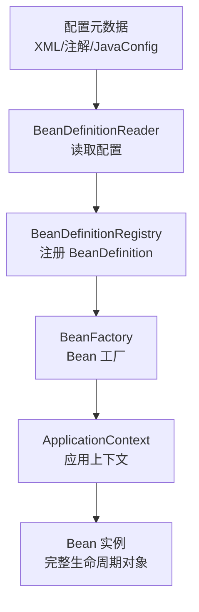
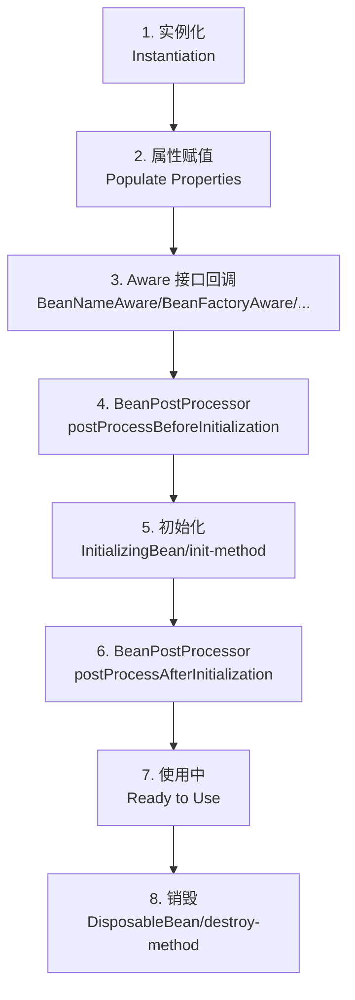

# Spring IOC 与 AOP 核心机制

> **文档说明**：系统讲解 Spring 两大核心机制——IOC（控制反转）和 AOP（面向切面编程）的底层原理，包括 Bean 生命周期、依赖注入方式、Bean 作用域、动态代理实现（JDK/CGLIB）、通知类型、切点表达式、事务管理，以及常见问题与最佳实践。
>
> **适用人群**：Java 后端开发工程师、全栈开发者、需要深入理解 Spring 原理的工程师、面试准备者
>
> **前置知识**：[[SpringBoot-自动装配原理]]、[[Java知识点完整整合大全_优化版]]、[[Java-反射与字节码操作]]

---

## 一、IOC 概述

### 1. 什么是 IOC

**IOC（Inversion of Control，控制反转）** 是 Spring 的核心思想，将对象的创建和依赖管理交给 Spring 容器，而非开发者手动 `new` 对象和管理依赖。

**传统方式 vs IOC 方式**：

```java
// 传统方式：手动创建对象和管理依赖（耦合度高）
public class UserService {
    private UserDao userDao = new UserDao();  // 手动创建依赖
    public User getUser(Long id) {
        return userDao.findById(id);
    }
}

// IOC 方式：Spring 容器注入依赖（耦合度低）
@Service
public class UserService {
    @Autowired
    private UserDao userDao;  // 由 Spring 容器注入
    public User getUser(Long id) {
        return userDao.findById(id);
    }
}
```

**IOC 的核心是 DI（Dependency Injection，依赖注入）**：IOC 是思想，DI 是实现方式。

### 2. IOC 容器

Spring IOC 容器负责创建、配置、管理 Bean 的完整生命周期。



| 容器接口 | 说明 |
|---------|------|
| **BeanFactory** | 最基础的 IOC 容器，提供 Bean 的创建和获取，懒加载 |
| **ApplicationContext** | BeanFactory 的子接口，功能更丰富，支持国际化、事件传播、资源加载，启动时预加载所有单例 Bean |
| **WebApplicationContext** | Web 应用上下文，为 Web 应用提供支持 |

**ApplicationContext 常见实现**：
| 实现类 | 说明 |
|--------|------|
| `ClassPathXmlApplicationContext` | 从 classpath 加载 XML 配置 |
| `FileSystemXmlApplicationContext` | 从文件系统加载 XML 配置 |
| `AnnotationConfigApplicationContext` | 基于注解的配置（JavaConfig） |
| `SpringBootServletInitializer` | Spring Boot Web 应用 |

### 3. BeanDefinition

BeanDefinition 是 Spring 对 Bean 的抽象描述，包含 Bean 的所有元信息：

| 属性 | 说明 |
|------|------|
| `beanClass` | Bean 的全限定类名 |
| `scope` | 作用域（singleton/prototype/...） |
| `lazyInit` | 是否懒加载 |
| `dependsOn` | 依赖的 Bean |
| `constructorArgumentValues` | 构造函数参数 |
| `propertyValues` | 属性值 |
| `initMethodName` | 初始化方法 |
| `destroyMethodName` | 销毁方法 |
| `autowireMode` | 自动装配模式 |
| `primary` | 是否为主要候选 Bean |

---

## 二、Bean 生命周期

### 1. 完整生命周期



### 2. 生命周期详细说明

| 阶段 | 说明 | 回调接口/方法 |
|------|------|-------------|
| **1. 实例化** | 调用构造函数创建 Bean 实例 | 构造函数 |
| **2. 属性赋值** | 注入依赖属性（DI） | setter 方法 / 字段注入 |
| **3. Aware 回调** | 注入 Spring 容器资源 | `BeanNameAware`、`BeanFactoryAware`、`ApplicationContextAware` |
| **4. 前置处理** | BeanPostProcessor 前置处理 | `postProcessBeforeInitialization()` |
| **5. 初始化** | 自定义初始化逻辑 | `InitializingBean.afterPropertiesSet()` / `@PostConstruct` / `init-method` |
| **6. 后置处理** | BeanPostProcessor 后置处理（AOP 代理在此生成） | `postProcessAfterInitialization()` |
| **7. 使用** | Bean 就绪，可以使用 | - |
| **8. 销毁** | 容器关闭时销毁 Bean | `DisposableBean.destroy()` / `@PreDestroy` / `destroy-method` |

### 3. 生命周期示例

```java
@Component
public class LifecycleDemo implements BeanNameAware, BeanFactoryAware,
        ApplicationContextAware, InitializingBean, DisposableBean {

    private String beanName;

    // 构造函数（1. 实例化）
    public LifecycleDemo() {
        System.out.println("1. 构造函数：实例化");
    }

    // 属性注入（2. 属性赋值）由 Spring 自动完成

    // Aware 接口回调（3.）
    @Override
    public void setBeanName(String name) {
        this.beanName = name;
        System.out.println("3. BeanNameAware：beanName = " + name);
    }

    @Override
    public void setBeanFactory(BeanFactory beanFactory) {
        System.out.println("3. BeanFactoryAware");
    }

    @Override
    public void setApplicationContext(ApplicationContext applicationContext) {
        System.out.println("3. ApplicationContextAware");
    }

    // @PostConstruct（5. 初始化，优先级最高）
    @PostConstruct
    public void postConstruct() {
        System.out.println("5. @PostConstruct 初始化");
    }

    // InitializingBean（5. 初始化，优先级次之）
    @Override
    public void afterPropertiesSet() {
        System.out.println("5. InitializingBean.afterPropertiesSet()");
    }

    // init-method（5. 初始化，优先级最低）
    public void initMethod() {
        System.out.println("5. init-method");
    }

    // @PreDestroy（8. 销毁，优先级最高）
    @PreDestroy
    public void preDestroy() {
        System.out.println("8. @PreDestroy 销毁");
    }

    // DisposableBean（8. 销毁，优先级次之）
    @Override
    public void destroy() {
        System.out.println("8. DisposableBean.destroy()");
    }

    // destroy-method（8. 销毁，优先级最低）
    public void destroyMethod() {
        System.out.println("8. destroy-method");
    }
}
```

### 4. BeanPostProcessor（后置处理器）

BeanPostProcessor 是 Spring 扩展点，允许在 Bean 初始化前后进行自定义处理。AOP 代理就是通过 BeanPostProcessor 生成的。

```java
@Component
public class MyBeanPostProcessor implements BeanPostProcessor {

    @Override
    public Object postProcessBeforeInitialization(Object bean, String beanName) {
        // 初始化前处理
        if (bean instanceof MyService) {
            System.out.println("Before init: " + beanName);
        }
        return bean;
    }

    @Override
    public Object postProcessAfterInitialization(Object bean, String beanName) {
        // 初始化后处理（AOP 代理在此生成）
        if (bean instanceof MyService) {
            System.out.println("After init: " + beanName);
            // 可以返回代理对象替换原 Bean
        }
        return bean;
    }
}
```

---

## 三、依赖注入

### 1. 注入方式

| 注入方式 | 说明 | 优点 | 缺点 |
|---------|------|------|------|
| **构造器注入** | 通过构造函数参数注入 | 不可变、依赖必填、测试方便、循环依赖友好 | 参数多时构造函数臃肿 |
| **Setter 注入** | 通过 setter 方法注入 | 可选依赖、可重新注入 | 可变、可能未初始化就使用 |
| **字段注入** | `@Autowired` 直接注入字段 | 简洁、代码少 | 不可变、测试困难、循环依赖问题、隐藏依赖 |

**Spring 推荐构造器注入**（Spring 4.3+ 单构造函数可省略 `@Autowired`）。

```java
@Service
public class UserService {

    private final UserDao userDao;
    private final EmailService emailService;

    // 构造器注入（推荐）
    // Spring 4.3+ 单构造函数可省略 @Autowired
    public UserService(UserDao userDao, EmailService emailService) {
        this.userDao = userDao;
        this.emailService = emailService;
    }

    // Setter 注入（可选依赖）
    private LogService logService;
    @Autowired
    public void setLogService(LogService logService) {
        this.logService = logService;
    }

    // 字段注入（不推荐）
    @Autowired
    private CacheService cacheService;
}
```

### 2. 自动装配模式

| 模式 | 说明 |
|------|------|
| `no` | 不自动装配，必须显式指定（默认） |
| `byName` | 按属性名匹配 Bean 名称 |
| `byType` | 按属性类型匹配 Bean 类型 |
| `constructor` | 按构造函数参数类型匹配 |

### 3. @Autowired vs @Resource vs @Inject

| 注解 | 来源 | 匹配规则 | 支持属性 |
|------|------|---------|---------|
| `@Autowired` | Spring | 默认 byType，多个候选时 byName（配合 @Qualifier） | required |
| `@Resource` | JSR-250 | 默认 byName，找不到时 byType | name, type |
| `@Inject` | JSR-330 | byType，配合 @Named 指定名称 | - |

```java
// @Autowired：按类型注入，多个同类型 Bean 时配合 @Qualifier
@Autowired
@Qualifier("mysqlUserDao")
private UserDao userDao;

// @Resource：默认按名称注入
@Resource(name = "mysqlUserDao")
private UserDao userDao;

// @Primary：多个同类型 Bean 时，标记为主要候选
@Primary
@Bean
public UserDao mysqlUserDao() { return new MysqlUserDao(); }
```

### 4. 循环依赖

**循环依赖**：A 依赖 B，B 依赖 A，形成循环。

| 注入方式 | 是否支持循环依赖 | 说明 |
|---------|----------------|------|
| 构造器注入 | ❌ 不支持 | 构造时需要完整对象，无法提前暴露 |
| Setter/字段注入 | ✅ 支持（单例） | 通过三级缓存提前暴露半成品对象 |
| prototype 作用域 | ❌ 不支持 | 每次创建新对象，无法缓存 |

**Spring 解决循环依赖的三级缓存**：
| 缓存 | 名称 | 存储内容 |
|------|------|---------|
| 一级缓存 | `singletonObjects` | 完全初始化好的单例 Bean |
| 二级缓存 | `earlySingletonObjects` | 提前暴露的半成品 Bean（已实例化，未初始化） |
| 三级缓存 | `singletonFactories` | Bean 工厂（用于生成早期引用，AOP 代理） |

```
A 创建 → 实例化 A → 放入三级缓存 → 注入 B
  → B 创建 → 实例化 B → 放入三级缓存 → 注入 A
    → 从三级缓存获取 A（生成早期引用）→ 放入二级缓存
    → B 初始化完成 → 放入一级缓存
  → A 注入 B 完成 → A 初始化完成 → 放入一级缓存
```

---

## 四、Bean 作用域

| 作用域 | 说明 | 适用场景 |
|--------|------|---------|
| **singleton** | 单例，容器中唯一实例（默认） | 无状态 Bean（Service、Dao、Controller） |
| **prototype** | 原型，每次获取创建新实例 | 有状态 Bean |
| **request** | 每次 HTTP 请求一个实例 | Web 应用 |
| **session** | 每个 HTTP Session 一个实例 | Web 应用 |
| **application** | 每个 ServletContext 一个实例 | Web 应用 |
| **websocket** | 每个 WebSocket 连接一个实例 | WebSocket 应用 |

```java
// 单例（默认）
@Service
public class SingletonService {}

// 原型
@Service
@Scope("prototype")
public class PrototypeService {}

// Web 作用域
@Component
@Scope(value = WebApplicationContext.SCOPE_REQUEST, proxyMode = ScopedProxyMode.TARGET_CLASS)
public class RequestScopedBean {}
```

**单例 Bean 注入原型 Bean 的问题**：
单例 Bean 只创建一次，注入的原型 Bean 也只注入一次，不会每次都更新。解决方案：使用 `ObjectFactory`、`ApplicationContext.getBean()` 或 `@Lookup`。

```java
@Service
public class SingletonService {
    @Autowired
    private ObjectFactory<PrototypeBean> prototypeBeanFactory;

    public void doSomething() {
        PrototypeBean bean = prototypeBeanFactory.getObject();  // 每次获取新实例
        bean.process();
    }
}
```

---

## 五、AOP 概述

### 1. 什么是 AOP

**AOP（Aspect-Oriented Programming，面向切面编程）** 是一种编程范式，将横切关注点（如日志、事务、安全、监控）从业务逻辑中分离出来，通过动态代理在运行时织入到目标方法中。

**横切关注点 vs 核心关注点**：
- 核心关注点：业务逻辑（用户注册、订单处理）
- 横切关注点：影响多个模块的通用功能（日志、事务、安全、性能监控）

```java
// 传统方式：日志代码散落在各处（重复代码、耦合）
public class UserService {
    public void createUser(User user) {
        long start = System.currentTimeMillis();
        System.out.println("开始执行 createUser");
        try {
            // 业务逻辑
            userDao.save(user);
            System.out.println("createUser 执行成功");
        } catch (Exception e) {
            System.out.println("createUser 执行失败: " + e.getMessage());
            throw e;
        } finally {
            System.out.println("createUser 耗时: " + (System.currentTimeMillis() - start) + "ms");
        }
    }
}

// AOP 方式：日志逻辑统一在切面中，业务代码纯净
@Aspect
@Component
public class LogAspect {
    @Around("execution(* com.example.service.*.*(..))")
    public Object around(ProceedingJoinPoint pjp) throws Throwable {
        long start = System.currentTimeMillis();
        System.out.println("开始执行: " + pjp.getSignature().getName());
        try {
            Object result = pjp.proceed();
            System.out.println("执行成功");
            return result;
        } catch (Exception e) {
            System.out.println("执行失败: " + e.getMessage());
            throw e;
        } finally {
            System.out.println("耗时: " + (System.currentTimeMillis() - start) + "ms");
        }
    }
}
```

### 2. AOP 核心概念

| 概念 | 说明 |
|------|------|
| **Aspect（切面）** | 横切关注点的模块化，包含通知和切点 |
| **Join Point（连接点）** | 程序执行的某个点（方法执行、异常抛出），Spring AOP 只支持方法执行 |
| **Pointcut（切点）** | 匹配连接点的表达式，决定哪些方法被拦截 |
| **Advice（通知）** | 在连接点执行的动作（前置、后置、环绕、异常、返回） |
| **Target（目标对象）** | 被代理的原始对象 |
| **Proxy（代理）** | AOP 框架创建的代理对象，包含通知逻辑 |
| **Weaving（织入）** | 将切面应用到目标对象创建代理对象的过程（编译期/类加载期/运行期） |
| **Introduction（引介）** | 为类动态添加新方法或属性 |

### 3. AOP 实现原理：动态代理

Spring AOP 基于动态代理实现，运行时生成代理对象。

| 代理方式 | 实现 | 适用场景 | 限制 |
|---------|------|---------|------|
| **JDK 动态代理** | `java.lang.reflect.Proxy` + `InvocationHandler` | 目标类实现了接口 | 只能代理接口方法 |
| **CGLIB 代理** | 继承目标类，生成子类 | 目标类没有实现接口 | 不能代理 final 类/方法 |

**Spring AOP 代理选择策略**：
- 目标类实现了接口 → 默认使用 JDK 动态代理
- 目标类没有实现接口 → 使用 CGLIB 代理
- 配置 `spring.aop.proxy-target-class=true` → 强制使用 CGLIB（Spring Boot 默认开启）

```java
// JDK 动态代理示例
public class JdkProxyExample {
    public static void main(String[] args) {
        UserService target = new UserServiceImpl();
        UserService proxy = (UserService) Proxy.newProxyInstance(
            target.getClass().getClassLoader(),
            target.getClass().getInterfaces(),
            (proxy1, method, args1) -> {
                System.out.println("前置通知");
                Object result = method.invoke(target, args1);
                System.out.println("后置通知");
                return result;
            }
        );
        proxy.createUser(new User());
    }
}

// CGLIB 动态代理示例
public class CglibProxyExample {
    public static void main(String[] args) {
        Enhancer enhancer = new Enhancer();
        enhancer.setSuperclass(UserService.class);
        enhancer.setCallback((MethodInterceptor) (obj, method, args, proxy) -> {
            System.out.println("前置通知");
            Object result = proxy.invokeSuper(obj, args);
            System.out.println("后置通知");
            return result;
        });
        UserService proxy = (UserService) enhancer.create();
        proxy.createUser(new User());
    }
}
```

---

## 六、通知类型

| 通知类型 | 注解 | 执行时机 | 说明 |
|---------|------|---------|------|
| **Before（前置）** | `@Before` | 目标方法执行前 | 不能阻止方法执行（除非抛异常） |
| **AfterReturning（返回后）** | `@AfterReturning` | 目标方法正常返回后 | 可获取返回值 |
| **AfterThrowing（异常后）** | `@AfterThrowing` | 目标方法抛出异常后 | 可获取异常对象 |
| **After（后置）** | `@After` | 目标方法执行后（无论正常或异常） | 类似 finally |
| **Around（环绕）** | `@Around` | 目标方法执行前后 | 最强大，可控制方法执行、修改参数和返回值 |

### 通知执行顺序

```
正常返回：
@Around（前）→ @Before → 目标方法 → @Around（后）→ @AfterReturning → @After

异常返回：
@Around（前）→ @Before → 目标方法（抛异常）→ @AfterThrowing → @After
```

### 通知示例

```java
@Aspect
@Component
public class AdviceDemoAspect {

    // 切点定义
    @Pointcut("execution(* com.example.service.*.*(..))")
    public void servicePointcut() {}

    // 前置通知
    @Before("servicePointcut()")
    public void before(JoinPoint joinPoint) {
        System.out.println("前置通知: " + joinPoint.getSignature().getName());
        Object[] args = joinPoint.getArgs();  // 获取方法参数
    }

    // 返回后通知
    @AfterReturning(pointcut = "servicePointcut()", returning = "result")
    public void afterReturning(JoinPoint joinPoint, Object result) {
        System.out.println("返回后通知: 返回值 = " + result);
    }

    // 异常后通知
    @AfterThrowing(pointcut = "servicePointcut()", throwing = "ex")
    public void afterThrowing(JoinPoint joinPoint, Exception ex) {
        System.out.println("异常后通知: 异常 = " + ex.getMessage());
    }

    // 后置通知（finally）
    @After("servicePointcut()")
    public void after(JoinPoint joinPoint) {
        System.out.println("后置通知（finally）: " + joinPoint.getSignature().getName());
    }

    // 环绕通知（最强大）
    @Around("servicePointcut()")
    public Object around(ProceedingJoinPoint pjp) throws Throwable {
        long start = System.currentTimeMillis();
        System.out.println("环绕通知-前: " + pjp.getSignature().getName());

        try {
            // 修改参数
            Object[] args = pjp.getArgs();
            // 执行目标方法
            Object result = pjp.proceed(args);
            // 修改返回值
            System.out.println("环绕通知-后: 耗时 " + (System.currentTimeMillis() - start) + "ms");
            return result;
        } catch (Throwable e) {
            System.out.println("环绕通知-异常: " + e.getMessage());
            throw e;
        }
    }
}
```

---

## 七、切点表达式

### 1. execution 表达式（最常用）

```
execution(修饰符? 返回类型 类名? 方法名(参数) 异常?)
```

| 部分 | 说明 | 示例 |
|------|------|------|
| 修饰符 | public/private（可选） | `public` |
| 返回类型 | `*` 表示任意 | `*`、`void`、`String` |
| 类名 | 全限定类名，`*` 通配 | `com.example.service.*` |
| 方法名 | `*` 表示任意 | `*`、`get*`、`*Service` |
| 参数 | `()` 无参，`(..)` 任意参数 | `(String)`、`(..)` |
| 异常 | 可选 | `throws Exception` |

```java
// 常用切点表达式
@Pointcut("execution(public * com.example.service.*.*(..))")  // service 包下所有 public 方法
@Pointcut("execution(* com.example.service.UserService.*(..))")  // UserService 所有方法
@Pointcut("execution(* com.example.service..*.*(..))")  // service 包及子包所有方法
@Pointcut("execution(* get*(..))")  // 所有以 get 开头的方法
@Pointcut("execution(* com.example.service.*.*(String, ..))")  // 第一个参数是 String 的方法
```

### 2. 其他切点指示符

| 指示符 | 说明 | 示例 |
|--------|------|------|
| `within` | 匹配指定类/包内的方法 | `within(com.example.service.*)` |
| `this` | 匹配代理对象是指定类型的 | `this(com.example.service.UserService)` |
| `target` | 匹配目标对象是指定类型的 | `target(com.example.service.UserService)` |
| `args` | 匹配方法参数类型 | `args(String, Long)` |
| `@annotation` | 匹配有指定注解的方法 | `@annotation(org.springframework.transaction.annotation.Transactional)` |
| `@within` | 匹配类上有指定注解的 | `@within(org.springframework.stereotype.Service)` |
| `@target` | 匹配目标对象类上有指定注解的 | `@target(org.springframework.stereotype.Service)` |
| `@args` | 匹配参数对象上有指定注解的 | `@args(com.example.anno.Valid)` |
| `bean` | 匹配指定 Bean 名称 | `bean(userService)`、`bean(*Service)` |

```java
// 组合切点表达式
@Pointcut("execution(* com.example.service.*.*(..)) && @annotation(com.example.anno.Log)")
public void logPointcut() {}  // service 包下有 @Log 注解的方法

@Pointcut("within(com.example.service..*) || within(com.example.controller..*)")
public void webPointcut() {}  // service 或 controller 包下的方法
```

---

## 八、事务管理

### 1. 事务传播行为

`@Transactional(propagation = ...)`

| 传播行为 | 说明 |
|---------|------|
| **REQUIRED**（默认） | 有事务则加入，没有则新建 |
| **REQUIRES_NEW** | 总是新建事务，挂起当前事务 |
| **SUPPORTS** | 有事务则加入，没有则非事务执行 |
| **NOT_SUPPORTED** | 非事务执行，挂起当前事务 |
| **MANDATORY** | 必须在事务中执行，否则抛异常 |
| **NEVER** | 必须非事务执行，有事务则抛异常 |
| **NESTED** | 嵌套事务（保存点），有事务则嵌套，没有则新建 |

### 2. 事务隔离级别

`@Transactional(isolation = ...)`

| 隔离级别 | 说明 |
|---------|------|
| **DEFAULT**（默认） | 使用数据库默认隔离级别 |
| **READ_UNCOMMITTED** | 读未提交（脏读、不可重复读、幻读） |
| **READ_COMMITTED** | 读已提交（不可重复读、幻读） |
| **REPEATABLE_READ** | 可重复读（幻读） |
| **SERIALIZABLE** | 串行化（最安全，性能最差） |

### 3. 事务回滚规则

```java
// 默认只回滚 RuntimeException 和 Error
@Transactional
public void method() {
    throw new RuntimeException();  // 回滚
    throw new Exception();         // 不回滚（默认）
}

// 指定回滚异常
@Transactional(rollbackFor = Exception.class)  // 所有 Exception 都回滚
@Transactional(rollbackFor = {IOException.class, SQLException.class})
@Transactional(noRollbackFor = BusinessException.class)  // 指定异常不回滚
```

### 4. 事务失效的常见场景

| 场景 | 原因 | 解决方案 |
|------|------|---------|
| **非 public 方法** | Spring AOP 只拦截 public 方法 | 方法改为 public |
| **同类内部调用** | this 调用不走代理 | 注入自身代理 / 拆分类 / 使用 AopContext |
| **异常被 catch** | 异常被捕获未抛出，事务不感知回滚 | 重新抛出 / 手动回滚 |
| **非运行时异常** | 默认只回滚 RuntimeException | 配置 rollbackFor |
| **数据库不支持事务** | MyISAM 引擎不支持事务 | 使用 InnoDB 引擎 |
| **多线程** | 事务基于线程，新线程不在事务中 | 避免事务方法内开新线程 |
| **final 方法/类** | CGLIB 无法代理 final | 去掉 final |

```java
// 同类内部调用事务失效的解决方案
@Service
public class UserService {

    @Autowired
    private UserService self;  // 注入自身代理

    public void outerMethod() {
        // this.innerMethod();  // ❌ 事务失效（this 调用不走代理）
        self.innerMethod();      // ✅ 走代理，事务生效
    }

    @Transactional
    public void innerMethod() {
        // 事务方法
    }
}
```

---

## 九、常见问题与最佳实践

| 问题 | 原因 | 解决方案 |
|------|------|---------|
| **Bean 注入为 null** | 手动 new 对象 / 静态方法中注入 / 循环依赖 | 使用 Spring 管理的 Bean / 避免静态注入 |
| **循环依赖报错** | 构造器注入循环依赖 / prototype 循环依赖 | 改用 setter/字段注入 / 重构代码消除循环 |
| **事务不生效** | 同类调用 / 非 public / 异常被 catch | 参考事务失效场景 |
| **AOP 不生效** | 同类调用 / final 方法 / 非 public | 走代理调用 / 去掉 final |
| **多个同类型 Bean 冲突** | 容器中有多个同类型 Bean | 使用 @Qualifier / @Primary / @Resource(name) |
| **配置属性不生效** | 配置类未被扫描 / 属性名错误 / 缺少 @ConfigurationProperties | 检查 @ComponentScan / 配置前缀 |
| **启动慢** | Bean 过多 / 初始化耗时 / 自动配置过多 | 懒加载 / 排除不必要的自动配置 |
| **内存泄漏** | 静态集合持有 Bean 引用 / ThreadLocal 未清理 | 避免静态引用 / finally 中清理 ThreadLocal |
| **@Value 注入为 null** | 静态字段 / 手动 new 对象 | 非静态字段 / Spring 管理 Bean |
| **事件不触发** | 事件发布者和监听者在不同上下文 / 异步事件异常 | 检查 ApplicationContext / 异步事件异常处理 |

### 最佳实践

- [ ] **优先使用构造器注入**，保证依赖不可变和必填
- [ ] **避免字段注入**，不利于测试和不可变性
- [ ] **使用 @RequiredArgsConstructor（Lombok）** 简化构造器注入
- [ ] **合理划分 Bean 作用域**，默认 singleton，有状态用 prototype
- [ ] **避免循环依赖**，通过重构代码消除，而非依赖 Spring 解决
- [ ] **事务方法保持短小**，避免长事务占用连接
- [ ] **事务方法内避免远程调用**，可能导致长事务
- [ ] **AOP 切面粒度适中**，不要滥用环绕通知
- [ ] **使用 @Profile 区分环境**，开发/测试/生产配置分离
- [ ] **开启 actuator 端点**，监控 Bean 和健康状态
- [ ] **合理使用 @Conditional**，条件化注册 Bean

---

## 十、关联笔记

### Spring 生态
- [[SpringBoot-自动装配原理]] · [[SpringCache-缓存抽象]] · [[SpringSecurity-认证授权]]
- [[SpringWebFlux-响应式编程]] · [[SpringAI-框架入门与模型抽象]] · [[Spring原理 知识点系统梳理_优化版]]
- [[Spring Boot 知识点系统梳理_优化版]]

### Java 核心
- [[Java知识点完整整合大全_优化版]] · [[Java-并发编程JUC]] · [[JVM-内存模型与GC调优]]
- [[Java-反射与字节码操作]] · [[Java-集合框架源码分析]]

### 设计模式
- [[设计模式核心]] · [[设计模式-代理模式]] · [[设计模式-策略模式]] · [[设计模式-工厂模式]]
- [[架构设计原则-SOLID]]

### 后端
- [[Gateway-网关路由与鉴权]] · [[Spring事务管理与传播机制]] · [[高并发系统设计案例]]
- [[统一AI网关设计与实现]]

### 导航
- [[MOC-后端开发]] · [[MOC-Java全栈-四级展开]] · [[全栈+AI工程双轨融合学习路线图]]

> **学习路径建议**：先掌握 [[Java知识点完整整合大全_优化版]] Java 基础 → 学习 [[Java-反射与字节码操作]] 反射和动态代理 → 深入本文 Spring IOC 与 AOP 核心机制 → 实践 [[SpringBoot-自动装配原理]] Spring Boot 自动装配 → 研究 [[Spring事务管理与传播机制]] 事务管理 → 应用于 [[高并发系统设计案例]] 生产环境。
