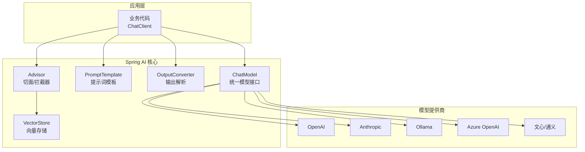

# Spring AI 框架入门与模型抽象

> **文档说明**：系统讲解 Spring AI 框架的核心设计，包括 ChatClient 统一模型抽象、Prompt 模板、输出解析、多模态支持、RAG 检索增强、向量数据库集成、Function Calling 工具调用，含可运行的 Spring Boot 代码（含 pom.xml/application.yml 配置）和完整的 AI 聊天服务实现。
>
> **适用人群**：Java 后端开发者、需要在 Spring Boot 中集成大模型的全栈工程师、AI 应用开发者
>
> **前置知识**：[[SpringBoot-自动装配原理]]、[[Java调用OpenAI兼容API]]、[[大模型应用开发实战]]

---

## 一、概述

### 1. 定义与核心价值

Spring AI 是 Spring 官方推出的 AI 应用开发框架，它将大模型调用抽象为统一的 API，支持 OpenAI、Anthropic、Azure OpenAI、Ollama、百度文心、阿里通义等多种模型提供商。核心价值在于**模型无关性**——切换模型只需修改配置，无需改动业务代码，同时提供了 RAG、Function Calling、输出解析等高级能力的标准化实现。

### 2. 痛点对比

| 痛点（直接调用大模型 API） | Spring AI 解决方式 |
|------------------------|------------------|
| 每个模型提供商 API 不同，切换需重写代码 | `ChatClient` 统一接口，配置切换模型 |
| Prompt 拼接混乱，变量替换易错 | `PromptTemplate` 标准化模板管理 |
| 模型输出格式不固定，解析困难 | `BeanOutputConverter`/`MapOutputConverter` 结构化输出 |
| RAG 流程需要自己实现检索+拼接 | `QuestionAnswerAdvisor` 标准化 RAG |
| Function Calling 协议复杂 | `@Tool` 注解自动注册工具函数 |
| 向量数据库集成各有差异 | `VectorStore` 统一抽象，支持多种向量库 |

### 3. Spring AI 架构



---

## 二、底层原理

### 1. 核心抽象

| 抽象 | 职责 | 实现 |
|------|------|------|
| `ChatModel` | 聊天模型统一接口 | OpenAiChatModel、OllamaChatModel |
| `EmbeddingModel` | 嵌入模型统一接口 | OpenAiEmbeddingModel |
| `Prompt` | 提示词（消息列表 + 参数） | 包含 System/User/Assistant 消息 |
| `ChatResponse` | 模型响应 | 包含生成内容、元数据、Token 用量 |
| `VectorStore` | 向量存储抽象 | SimpleVectorStore、PgVectorStore |
| `Advisor` | 调用拦截器 | QuestionAnswerAdvisor、MessageChatMemoryAdvisor |

### 2. Advisor 机制

Advisor 是 Spring AI 的拦截器机制，类似 Spring AOP，在模型调用前后插入逻辑：

```
用户请求 → Advisor链（RAG检索/记忆注入/日志） → ChatModel → Advisor链（后处理） → 响应
```

---

## 三、实操

### 1. 项目配置

```xml
<!-- pom.xml -->
<project>
    <parent>
        <groupId>org.springframework.boot</groupId>
        <artifactId>spring-boot-starter-parent</artifactId>
        <version>3.2.0</version>
    </parent>

    <dependencies>
        <dependency>
            <groupId>org.springframework.ai</groupId>
            <artifactId>spring-ai-openai-spring-boot-starter</artifactId>
        </dependency>
        <dependency>
            <groupId>org.springframework.boot</groupId>
            <artifactId>spring-boot-starter-web</artifactId>
        </dependency>
    </dependencies>

    <dependencyManagement>
        <dependencies>
            <dependency>
                <groupId>org.springframework.ai</groupId>
                <artifactId>spring-ai-bom</artifactId>
                <version>1.0.0</version>
                <type>pom</type>
                <scope>import</scope>
            </dependency>
        </dependencies>
    </dependencyManagement>
</project>
```

```yaml
# application.yml
spring:
  ai:
    openai:
      api-key: ${OPENAI_API_KEY:sk-your-key}
      base-url: ${OPENAI_BASE_URL:https://api.openai.com}
      chat:
        options:
          model: gpt-4o
          temperature: 0.7
          max-tokens: 2000
      embedding:
        options:
          model: text-embedding-3-small
```

### 2. 基础聊天服务

```java
// ChatService.java
package com.example.ai.service;

import org.springframework.ai.chat.client.ChatClient;
import org.springframework.ai.chat.model.ChatResponse;
import org.springframework.ai.chat.prompt.Prompt;
import org.springframework.ai.chat.messages.SystemMessage;
import org.springframework.ai.chat.messages.UserMessage;
import org.springframework.stereotype.Service;

import java.util.List;

@Service
public class ChatService {

    private final ChatClient chatClient;

    public ChatService(ChatClient.Builder builder) {
        this.chatClient = builder
                .defaultSystem("你是一个专业的技术顾问，回答简洁准确。")
                .build();
    }

    /**
     * 简单聊天
     */
    public String chat(String message) {
        return chatClient.prompt()
                .user(message)
                .call()
                .content();
    }

    /**
     * 带系统提示的聊天
     */
    public String chatWithRole(String message, String role) {
        return chatClient.prompt()
                .system("你是一个" + role + "专家，请用专业术语回答。")
                .user(message)
                .call()
                .content();
    }

    /**
     * 多轮对话
     */
    public String multiTurnChat(List<String> history, String newMessage) {
        var promptBuilder = Prompt.builder();

        // 历史消息
        for (int i = 0; i < history.size(); i++) {
            if (i % 2 == 0) {
                promptBuilder.messages(new UserMessage(history.get(i)));
            } else {
                promptBuilder.messages(new SystemMessage(history.get(i)));
            }
        }
        promptBuilder.messages(new UserMessage(newMessage));

        ChatResponse response = chatClient.prompt(promptBuilder.build()).call().chatResponse();
        return response.getResult().getOutput().getText();
    }

    /**
     * 流式输出
     */
    public Flux<String> streamChat(String message) {
        return chatClient.prompt()
                .user(message)
                .stream()
                .content();
    }
}
```

```java
// ChatController.java
package com.example.ai.controller;

import com.example.ai.service.ChatService;
import org.springframework.http.MediaType;
import org.springframework.web.bind.annotation.*;
import reactor.core.publisher.Flux;

import java.util.Map;

@RestController
@RequestMapping("/api/ai")
public class ChatController {

    private final ChatService chatService;

    public ChatController(ChatService chatService) {
        this.chatService = chatService;
    }

    @PostMapping("/chat")
    public Map<String, String> chat(@RequestBody Map<String, String> request) {
        String response = chatService.chat(request.get("message"));
        return Map.of("response", response);
    }

    @PostMapping(value = "/stream", produces = MediaType.TEXT_EVENT_STREAM_VALUE)
    public Flux<String> streamChat(@RequestBody Map<String, String> request) {
        return chatService.streamChat(request.get("message"));
    }
}
```

### 3. Prompt 模板

```java
// PromptTemplateService.java
package com.example.ai.service;

import org.springframework.ai.chat.client.ChatClient;
import org.springframework.ai.chat.prompt.Prompt;
import org.springframework.ai.chat.prompt.PromptTemplate;
import org.springframework.stereotype.Service;

import java.util.Map;

@Service
public class PromptTemplateService {

    private final ChatClient chatClient;

    public PromptTemplateService(ChatClient.Builder builder) {
        this.chatClient = builder.build();
    }

    /**
     * 翻译模板
     */
    public String translate(String text, String targetLanguage) {
        PromptTemplate template = new PromptTemplate("""
                请将以下文本翻译为{language}：
                文本：{text}
                要求：保持原意，语言流畅自然。
                """);

        Prompt prompt = template.create(Map.of(
                "language", targetLanguage,
                "text", text
        ));

        return chatClient.prompt(prompt).call().content();
    }

    /**
     * 代码审查模板
     */
    public String reviewCode(String code, String language) {
        PromptTemplate template = new PromptTemplate("""
                你是一位资深{language}开发专家，请审查以下代码：

                ```{language}
                {code}
                ```

                请从以下方面审查：
                1. 潜在 Bug
                2. 性能问题
                3. 代码规范
                4. 安全隐患
                5. 改进建议

                输出格式：
                ## 问题列表
                - [严重程度] 问题描述
                ## 改进建议
                - 具体建议
                """);

        return chatClient.prompt(template.create(Map.of("code", code, "language", language)))
                .call().content();
    }
}
```

### 4. 结构化输出

```java
// StructuredOutputService.java
package com.example.ai.service;

import org.springframework.ai.chat.client.ChatClient;
import org.springframework.ai.converter.BeanOutputConverter;
import org.springframework.ai.converter.ListOutputConverter;
import org.springframework.ai.converter.MapOutputConverter;
import org.springframework.core.ParameterizedTypeReference;
import org.springframework.stereotype.Service;

import java.util.List;
import java.util.Map;

@Service
public class StructuredOutputService {

    private final ChatClient chatClient;

    public StructuredOutputService(ChatClient.Builder builder) {
        this.chatClient = builder.build();
    }

    // 输出为 Java Bean
    public record MovieInfo(String title, String director, int year, double rating) {}

    public MovieInfo getMovieInfo(String movieName) {
        BeanOutputConverter<MovieInfo> converter =
                new BeanOutputConverter<>(MovieInfo.class);

        String format = converter.getFormat();

        String response = chatClient.prompt()
                .user(u -> u.text("请提供电影《{movie}》的信息。{format}")
                        .param("movie", movieName)
                        .param("format", format))
                .call()
                .content();

        return converter.convert(response);
    }

    // 输出为 List
    public List<String> getRecommendations(String topic) {
        ListOutputConverter converter = new ListOutputConverter();

        String response = chatClient.prompt()
                .user(u -> u.text("推荐5个关于{topic}的资源。{format}")
                        .param("topic", topic)
                        .param("format", converter.getFormat()))
                .call()
                .content();

        return converter.convert(response);
    }

    // 输出为 Map
    public Map<String, Object> analyzeSentiment(String text) {
        MapOutputConverter converter = new MapOutputConverter();

        String response = chatClient.prompt()
                .user(u -> u.text("分析以下文本的情感。{format}\n文本：{text}")
                        .param("text", text)
                        .param("format", converter.getFormat()))
                .call()
                .content();

        return converter.convert(response);
    }
}
```

### 5. RAG 检索增强

```java
// RagService.java
package com.example.ai.service;

import org.springframework.ai.chat.client.ChatClient;
import org.springframework.ai.chat.client.advisor.QuestionAnswerAdvisor;
import org.springframework.ai.document.Document;
import org.springframework.ai.vectorstore.SearchRequest;
import org.springframework.ai.vectorstore.VectorStore;
import org.springframework.stereotype.Service;

import java.util.List;
import java.util.Map;

@Service
public class RagService {

    private final ChatClient chatClient;
    private final VectorStore vectorStore;

    public RagService(ChatClient.Builder builder, VectorStore vectorStore) {
        this.vectorStore = vectorStore;
        this.chatClient = builder
                .defaultAdvisors(new QuestionAnswerAdvisor(vectorStore, SearchRequest.defaults()))
                .build();
    }

    /**
     * 向知识库添加文档
     */
    public void addDocuments(List<String> contents) {
        List<Document> documents = contents.stream()
                .map(content -> new Document(content))
                .toList();
        vectorStore.add(documents);
    }

    /**
     * 基于知识库问答
     */
    public String ask(String question) {
        return chatClient.prompt()
                .user(question)
                .advisors(a -> a.param(QuestionAnswerAdvisor.FILTER_EXPRESSION, ""))
                .call()
                .content();
    }

    /**
     * 带相似度阈值的 RAG
     */
    public String askWithThreshold(String question, double similarityThreshold) {
        SearchRequest searchRequest = SearchRequest.builder()
                .query(question)
                .topK(5)
                .similarityThreshold(similarityThreshold)
                .build();

        return chatClient.prompt()
                .user(question)
                .advisors(new QuestionAnswerAdvisor(vectorStore, searchRequest))
                .call()
                .content();
    }
}
```

### 6. Function Calling 工具调用

```java
// WeatherTools.java - 工具函数定义
package com.example.ai.tools;

import org.springframework.ai.tool.annotation.Tool;
import org.springframework.ai.tool.annotation.ToolParam;
import org.springframework.stereotype.Component;

import java.util.Map;
import java.util.Random;

@Component
public class WeatherTools {

    @Tool(description = "获取指定城市的当前天气信息")
    public Map<String, Object> getWeather(
            @ToolParam(description = "城市名称，如北京、上海") String city) {

        // 模拟天气 API 调用
        String[] conditions = {"晴", "多云", "阴", "小雨", "雷阵雨"};
        return Map.of(
                "city", city,
                "temperature", new Random().nextInt(15) + 15,
                "condition", conditions[new Random().nextInt(conditions.length)],
                "humidity", new Random().nextInt(40) + 40
        );
    }

    @Tool(description = "获取未来几天的天气预报")
    public Map<String, Object> getForecast(
            @ToolParam(description = "城市名称") String city,
            @ToolParam(description = "预报天数，1-7天") int days) {

        return Map.of(
                "city", city,
                "forecast_days", days,
                "message", city + "未来" + days + "天天气良好"
        );
    }
}
```

```java
// ToolCallingService.java
package com.example.ai.service;

import com.example.ai.tools.WeatherTools;
import org.springframework.ai.chat.client.ChatClient;
import org.springframework.stereotype.Service;

@Service
public class ToolCallingService {

    private final ChatClient chatClient;

    public ToolCallingService(ChatClient.Builder builder, WeatherTools weatherTools) {
        this.chatClient = builder
                .defaultTools(weatherTools)  // 注册工具
                .build();
    }

    public String askWeather(String question) {
        return chatClient.prompt()
                .user(question)
                .call()
                .content();
    }
}
```

### 7. 多模态支持

```java
// MultimodalService.java
package com.example.ai.service;

import org.springframework.ai.chat.client.ChatClient;
import org.springframework.ai.chat.messages.UserMessage;
import org.springframework.ai.model.Media;
import org.springframework.stereotype.Service;
import org.springframework.util.MimeTypeUtils;

import java.net.URL;

@Service
public class MultimodalService {

    private final ChatClient chatClient;

    public MultimodalService(ChatClient.Builder builder) {
        this.chatClient = builder.build();
    }

    /**
     * 图像理解
     */
    public String analyzeImage(String imageUrl, String question) {
        UserMessage userMessage = new UserMessage(
                question,
                new Media(MimeTypeUtils.IMAGE_PNG, imageUrl)
        );

        return chatClient.prompt()
                .messages(userMessage)
                .call()
                .content();
    }

    /**
     * 多图对比
     */
    public String compareImages(String imageUrl1, String imageUrl2) {
        UserMessage userMessage = new UserMessage(
                "请对比这两张图片的差异",
                new Media(MimeTypeUtils.IMAGE_JPEG, imageUrl1),
                new Media(MimeTypeUtils.IMAGE_JPEG, imageUrl2)
        );

        return chatClient.prompt()
                .messages(userMessage)
                .call()
                .content();
    }
}
```

### 8. 切换模型提供商

```yaml
# 切换到 Ollama（本地模型）
spring:
  ai:
    ollama:
      base-url: http://localhost:11434
      chat:
        options:
          model: llama3
          temperature: 0.8

# 切换到 Azure OpenAI
spring:
  ai:
    azure:
      openai:
        api-key: ${AZURE_OPENAI_KEY}
        endpoint: ${AZURE_OPENAI_ENDPOINT}
        chat:
          options:
            deployment-name: gpt-4o
```

```java
// 代码无需修改，只需切换配置
// ChatClient 自动使用配置的模型提供商
```

---

## 四、常见问题与排查

| 问题现象 | 原因 | 解决方案 |
|---------|------|---------|
| `ChatClient.Builder` 注入失败 | 未引入对应模型的 starter 依赖 | 添加 `spring-ai-openai-spring-boot-starter` 等依赖 |
| 模型调用返回 401/403 | API Key 错误或无权限 | 检查 `spring.ai.openai.api-key` 配置；确认账户有模型访问权限 |
| 流式输出不生效 | Controller 未设置 `produces = TEXT_EVENT_STREAM_VALUE` | 添加 `@PostMapping(produces = MediaType.TEXT_EVENT_STREAM_VALUE)` |
| RAG 检索不到相关内容 | 文档未正确向量化，或相似度阈值过高 | 确认 `VectorStore.add()` 已调用；降低 `similarityThreshold` |
| Function Calling 不触发 | 工具描述不清晰，或模型选择不支持 | 用 `@Tool(description=...)` 写清工具用途；使用支持工具调用的模型 |
| 结构化输出解析失败 | 模型未按格式返回，或格式指令不完整 | 在 Prompt 中明确要求输出格式；用 `BeanOutputConverter.getFormat()` 注入格式指令 |
| 切换模型后行为差异大 | 不同模型对 Prompt 敏感度不同 | 针对具体模型调优 System Prompt；不要假设所有模型行为一致 |
| `VectorStore` Bean 未找到 | 未配置向量数据库或未引入对应 starter | 引入 `spring-ai-pgvector-store-spring-boot-starter` 等；或用 `SimpleVectorStore` |
| Token 消耗超出预期 | 未设置 max-tokens，或历史消息过长 | 配置 `max-tokens`；限制对话历史长度；用 `MessageChatMemoryAdvisor` 管理记忆 |
| 本地 Ollama 连接超时 | Ollama 服务未启动或端口不对 | 确认 `ollama serve` 运行；检查 `spring.ai.ollama.base-url` |

---

## 五、进阶与最佳实践

### 1. 生产环境配置

```yaml
# application-prod.yml
spring:
  ai:
    openai:
      api-key: ${OPENAI_API_KEY}
      base-url: ${OPENAI_BASE_URL}
      chat:
        options:
          model: gpt-4o
          temperature: 0.3        # 生产环境降低随机性
          max-tokens: 1000        # 限制输出长度
          top-p: 0.9
      embedding:
        options:
          model: text-embedding-3-small
    retry:
      max-attempts: 3             # 重试次数
      backoff:
        initial-interval: 1000ms  # 初始退避
        multiplier: 2.0           # 指数退避
```

### 2. 模型抽象对比

| 特性 | Spring AI | LangChain4j | 直接调用 SDK |
|------|-----------|-------------|------------|
| 模型无关性 | 高 | 高 | 低 |
| Spring 集成 | 原生 | 良好 | 需自行集成 |
| RAG 支持 | 内置 | 内置 | 需自行实现 |
| Function Calling | `@Tool` 注解 | `@Tool` 注解 | 手动实现 |
| 学习曲线 | 低（Spring 开发者） | 中 | 低 |
| 社区生态 | 快速增长 | 成熟 | 最灵活 |

### 3. 成本控制

```java
// Token 用量监控
@Service
public class TokenMonitorService {

    private final ChatClient chatClient;
    private final MeterRegistry meterRegistry;

    public String chatWithMonitoring(String message) {
        ChatResponse response = chatClient.prompt()
                .user(message)
                .call()
                .chatResponse();

        // 记录 Token 用量
        Usage usage = response.getMetadata().getUsage();
        meterRegistry.counter("ai.tokens.prompt").increment(usage.getPromptTokens());
        meterRegistry.counter("ai.tokens.completion").increment(usage.getCompletionTokens());
        meterRegistry.counter("ai.tokens.total").increment(usage.getTotalTokens());

        return response.getResult().getOutput().getText();
    }
}
```

---

## 六、关联笔记

### AI 后端集成
- [[Java调用OpenAI兼容API]] · [[Java-LLM接口封装与降级策略]] · [[LangChain4j-Agent与RAG实现]]
- [[Java-向量数据库客户端]] · [[Java-AI流式响应实战]]

### Spring 生态
- [[SpringBoot-自动装配原理]] · [[SpringBoot-Web层设计]] · [[SpringWebFlux-响应式编程]]

### AI 应用
- [[大模型应用开发实战]] · [[RAG架构设计与流程]] · [[Agent工具调用FunctionCalling]]
- [[SSE-流式响应对接LLM]] · [[实战-SpringBoot+AI Agent平台]]

### 导航
- [[MOC-后端开发]] · [[MOC-Java全栈-四级展开]] · [[Java-全栈技术枢纽]]

> **学习路径建议**：先掌握 [[SpringBoot-自动装配原理]] Spring Boot 基础 → 学习 [[Java调用OpenAI兼容API]] 原生 API 调用 → 深入本文 Spring AI 框架抽象 → 实践 [[LangChain4j-Agent与RAG实现]] 对比另一个框架 → 应用于 [[实战-SpringBoot+AI Agent平台]] 完整项目。
