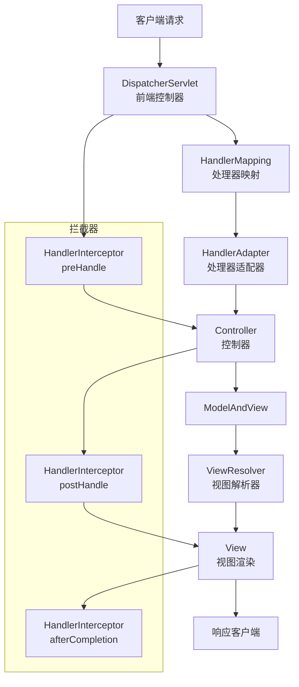

# SpringBoot Web 层设计

> **文档说明**：系统讲解 Spring Boot Web 层的完整设计，包括 Spring MVC 架构、请求处理流程、Controller 设计规范、参数绑定与校验、统一响应封装、全局异常处理、拦截器与过滤器、文件上传下载、RESTful API 设计、Web 性能优化，含丰富的代码示例和生产级最佳实践。
>
> **适用人群**：Java 后端开发工程师、全栈开发者、需要构建高质量 Web 层的工程师
>
> **前置知识**：[[SpringBoot-自动装配原理]]、[[Spring-IOCAOP核心机制]]、[[API设计规范与选型]]

---

## 一、Spring MVC 架构

### 1. 核心组件



| 组件 | 说明 |
|------|------|
| **DispatcherServlet** | 前端控制器，所有请求的入口，负责调度整个流程 |
| **HandlerMapping** | 处理器映射，根据请求 URL 找到对应的 Controller 方法 |
| **HandlerAdapter** | 处理器适配器，调用 Controller 方法 |
| **Controller** | 控制器，处理业务逻辑，返回 ModelAndView |
| **ViewResolver** | 视图解析器，解析视图名称为具体 View |
| **View** | 视图，渲染模型数据 |
| **HandlerInterceptor** | 拦截器，在请求处理前后执行 |
| **HandlerExceptionResolver** | 异常解析器，处理异常 |

### 2. 请求处理流程

```
1. 客户端发送 HTTP 请求
2. DispatcherServlet 接收请求
3. HandlerMapping 查找对应的 Handler（Controller 方法）
4. HandlerInterceptor.preHandle() 执行
5. HandlerAdapter 调用 Handler（Controller 方法）
6. Controller 执行业务逻辑，返回 ModelAndView
7. HandlerInterceptor.postHandle() 执行
8. ViewResolver 解析视图
9. View 渲染模型数据
10. HandlerInterceptor.afterCompletion() 执行
11. DispatcherServlet 返回响应
```

### 3. Spring Boot 自动配置

Spring Boot 通过 `WebMvcAutoConfiguration` 自动配置 Spring MVC，无需手动配置 `DispatcherServlet`、`ViewResolver` 等。

```yaml
# application.yml Web 相关配置
server:
  port: 8080
  servlet:
    context-path: /api
    encoding:
      charset: UTF-8
      enabled: true
  tomcat:
    max-threads: 200
    min-spare-threads: 10
    accept-count: 100
    max-connections: 10000
    connection-timeout: 20000

spring:
  mvc:
    format:
      date: yyyy-MM-dd
      date-time: yyyy-MM-dd HH:mm:ss
      time: HH:mm:ss
    throw-exception-if-no-handler-found: true
    static-path-pattern: /static/**
  web:
    resources:
      static-locations: classpath:/static/
      cache:
        period: 3600
```

---

## 二、Controller 设计规范

### 1. RESTful API 设计

| HTTP 方法 | 操作 | 示例 | 幂等 |
|-----------|------|------|------|
| **GET** | 查询 | `GET /users`、`GET /users/{id}` | ✅ |
| **POST** | 创建 | `POST /users` | ❌ |
| **PUT** | 全量更新 | `PUT /users/{id}` | ✅ |
| **PATCH** | 部分更新 | `PATCH /users/{id}` | ❌ |
| **DELETE** | 删除 | `DELETE /users/{id}` | ✅ |

### 2. Controller 示例

```java
@RestController
@RequestMapping("/api/users")
@RequiredArgsConstructor
@Validated
public class UserController {

    private final UserService userService;

    // 查询列表
    @GetMapping
    public Result<PageResult<UserVO>> list(
            @RequestParam(defaultValue = "1") @Min(1) Integer pageNum,
            @RequestParam(defaultValue = "10") @Min(1) @Max(100) Integer pageSize,
            @RequestParam(required = false) String keyword) {
        PageResult<UserVO> result = userService.list(pageNum, pageSize, keyword);
        return Result.success(result);
    }

    // 查询详情
    @GetMapping("/{id}")
    public Result<UserVO> getById(@PathVariable @NotNull Long id) {
        UserVO user = userService.getById(id);
        return Result.success(user);
    }

    // 创建
    @PostMapping
    public Result<Long> create(@RequestBody @Valid UserCreateDTO dto) {
        Long id = userService.create(dto);
        return Result.success(id);
    }

    // 全量更新
    @PutMapping("/{id}")
    public Result<Void> update(@PathVariable @NotNull Long id,
                               @RequestBody @Valid UserUpdateDTO dto) {
        userService.update(id, dto);
        return Result.success();
    }

    // 部分更新
    @PatchMapping("/{id}")
    public Result<Void> patch(@PathVariable @NotNull Long id,
                              @RequestBody Map<String, Object> updates) {
        userService.patch(id, updates);
        return Result.success();
    }

    // 删除
    @DeleteMapping("/{id}")
    public Result<Void> delete(@PathVariable @NotNull Long id) {
        userService.delete(id);
        return Result.success();
    }
}
```

### 3. Controller 层设计原则

- [ ] **职责单一**：Controller 只负责请求参数接收、校验、调用 Service、返回响应，不包含业务逻辑
- [ ] **统一返回**：使用统一的 Result 封装返回值
- [ ] **参数校验**：使用 `@Valid` + JSR-303 注解校验参数
- [ ] **路径规范**：RESTful 风格，名词复数，层级清晰
- [ ] **HTTP 方法正确**：GET 查询、POST 创建、PUT 更新、DELETE 删除
- [ ] **避免业务逻辑**：复杂业务逻辑放在 Service 层
- [ ] **避免直接操作 DAO**：通过 Service 层调用数据访问
- [ ] **注释清晰**：接口功能、参数、返回值说明

---

## 三、参数绑定与校验

### 1. 参数绑定方式

| 注解 | 说明 | 示例 |
|------|------|------|
| `@PathVariable` | 路径变量 | `GET /users/{id}` → `@PathVariable Long id` |
| `@RequestParam` | 查询参数 | `GET /users?name=xx` → `@RequestParam String name` |
| `@RequestBody` | 请求体（JSON） | `POST /users` → `@RequestBody UserDTO dto` |
| `@RequestHeader` | 请求头 | `@RequestHeader("Authorization") String token` |
| `@CookieValue` | Cookie | `@CookieValue("sessionId") String sessionId` |
| `@ModelAttribute` | 表单参数 | `@ModelAttribute UserDTO dto` |
| `@MatrixVariable** | 矩阵变量 | `GET /users;name=xx` |

```java
@RestController
@RequestMapping("/api/demo")
public class ParamDemoController {

    // 路径变量
    @GetMapping("/{id}/{type}")
    public void pathVar(@PathVariable Long id, @PathVariable String type) {}

    // 查询参数（必填/可选/默认值）
    @GetMapping("/query")
    public void queryParam(
            @RequestParam String name,           // 必填
            @RequestParam(required = false) Integer age,  // 可选
            @RequestParam(defaultValue = "1") Integer page) {}  // 默认值

    // 请求体
    @PostMapping("/body")
    public void body(@RequestBody UserDTO dto) {}

    // 请求头
    @GetMapping("/header")
    public void header(@RequestHeader("Authorization") String token,
                       @RequestHeader(value = "X-Request-Id", required = false) String requestId) {}

    // 数组/集合参数
    @GetMapping("/batch")
    public void batch(@RequestParam List<Long> ids) {}  // GET /batch?ids=1,2,3

    // Map 参数
    @GetMapping("/map")
    public void map(@RequestParam Map<String, String> params) {}
}
```

### 2. 参数校验（JSR-303）

```java
// DTO 定义校验注解
@Data
public class UserCreateDTO {

    @NotBlank(message = "用户名不能为空")
    @Size(min = 2, max = 20, message = "用户名长度 2-20")
    @Pattern(regexp = "^[a-zA-Z0-9_]+$", message = "用户名只能包含字母数字下划线")
    private String username;

    @NotBlank(message = "密码不能为空")
    @Size(min = 6, max = 32, message = "密码长度 6-32")
    private String password;

    @NotBlank(message = "邮箱不能为空")
    @Email(message = "邮箱格式不正确")
    private String email;

    @NotNull(message = "年龄不能为空")
    @Min(value = 0, message = "年龄不能小于 0")
    @Max(value = 150, message = "年龄不能大于 150")
    private Integer age;

    @Pattern(regexp = "^1[3-9]\\d{9}$", message = "手机号格式不正确")
    private String phone;

    @Past(message = "生日必须是过去的日期")
    private LocalDate birthday;

    @Valid  // 嵌套校验
    @NotNull(message = "地址不能为空")
    private AddressDTO address;
}

@Data
public class AddressDTO {
    @NotBlank(message = "省份不能为空")
    private String province;

    @NotBlank(message = "城市不能为空")
    private String city;
}

// Controller 使用 @Valid 触发校验
@RestController
@RequestMapping("/api/users")
public class UserController {

    @PostMapping
    public Result<Long> create(@RequestBody @Valid UserCreateDTO dto) {
        // 校验失败会抛出 MethodArgumentNotValidException
        return Result.success();
    }

    // 方法级参数校验（需要类上加 @Validated）
    @GetMapping("/{id}")
    public Result<UserVO> getById(
            @PathVariable @NotNull(message = "ID 不能为空") Long id,
            @RequestParam @Min(value = 1, message = "页码最小 1") Integer page) {
        return Result.success();
    }
}
```

**常用校验注解**：
| 注解 | 说明 | 适用类型 |
|------|------|---------|
| `@NotNull` | 不能为 null | 任意 |
| `@NotBlank` | 不能为 null 且至少一个非空白字符 | String |
| `@NotEmpty` | 不能为 null 且不为空 | String/Collection/Map/数组 |
| `@Size` | 大小范围 | String/Collection/Map/数组 |
| `@Min`/`@Max` | 数值范围 | 数字 |
| `@DecimalMin`/`@DecimalMax` | 小数范围 | 数字 |
| `@Email` | 邮箱格式 | String |
| `@Pattern` | 正则匹配 | String |
| `@Past`/`@Future` | 过去/未来日期 | 日期 |
| `@Valid` | 嵌套校验 | 对象 |

---

## 四、统一响应封装

### 1. Result 统一返回类

```java
@Data
@AllArgsConstructor
@NoArgsConstructor
public class Result<T> implements Serializable {

    private Integer code;
    private String message;
    private T data;
    private Long timestamp;

    // 成功
    public static <T> Result<T> success() {
        return new Result<>(ResultCode.SUCCESS.getCode(), ResultCode.SUCCESS.getMessage(), null, System.currentTimeMillis());
    }

    public static <T> Result<T> success(T data) {
        return new Result<>(ResultCode.SUCCESS.getCode(), ResultCode.SUCCESS.getMessage(), data, System.currentTimeMillis());
    }

    public static <T> Result<T> success(String message, T data) {
        return new Result<>(ResultCode.SUCCESS.getCode(), message, data, System.currentTimeMillis());
    }

    // 失败
    public static <T> Result<T> error(String message) {
        return new Result<>(ResultCode.ERROR.getCode(), message, null, System.currentTimeMillis());
    }

    public static <T> Result<T> error(Integer code, String message) {
        return new Result<>(code, message, null, System.currentTimeMillis());
    }

    public static <T> Result<T> error(ResultCode resultCode) {
        return new Result<>(resultCode.getCode(), resultCode.getMessage(), null, System.currentTimeMillis());
    }
}

// 状态码枚举
@Getter
@AllArgsConstructor
public enum ResultCode {
    SUCCESS(200, "操作成功"),
    ERROR(500, "操作失败"),
    BAD_REQUEST(400, "请求参数错误"),
    UNAUTHORIZED(401, "未授权"),
    FORBIDDEN(403, "禁止访问"),
    NOT_FOUND(404, "资源不存在"),
    METHOD_NOT_ALLOWED(405, "方法不允许"),
    TOO_MANY_REQUESTS(429, "请求过于频繁"),
    SERVER_ERROR(500, "服务器内部错误"),
    SERVICE_UNAVAILABLE(503, "服务不可用"),

    // 业务错误码（1000+）
    USER_NOT_FOUND(1001, "用户不存在"),
    USER_ALREADY_EXISTS(1002, "用户已存在"),
    PASSWORD_ERROR(1003, "密码错误"),
    TOKEN_EXPIRED(1004, "Token 已过期"),
    TOKEN_INVALID(1005, "Token 无效");

    private final Integer code;
    private final String message;
}
```

### 2. 分页结果封装

```java
@Data
@AllArgsConstructor
@NoArgsConstructor
public class PageResult<T> implements Serializable {
    private List<T> records;
    private Long total;
    private Integer pageNum;
    private Integer pageSize;
    private Integer totalPages;

    public static <T> PageResult<T> of(List<T> records, Long total, Integer pageNum, Integer pageSize) {
        int totalPages = (int) Math.ceil((double) total / pageSize);
        return new PageResult<>(records, total, pageNum, pageSize, totalPages);
    }
}
```

---

## 五、全局异常处理

### 1. 全局异常处理器

```java
@RestControllerAdvice
@Slf4j
public class GlobalExceptionHandler {

    // 处理参数校验异常（@RequestBody @Valid）
    @ExceptionHandler(MethodArgumentNotValidException.class)
    public Result<Void> handleValidationException(MethodArgumentNotValidException e) {
        String message = e.getBindingResult().getFieldErrors().stream()
                .map(FieldError::getDefaultMessage)
                .collect(Collectors.joining("; "));
        log.warn("参数校验失败: {}", message);
        return Result.error(ResultCode.BAD_REQUEST.getCode(), message);
    }

    // 处理方法级参数校验异常（@Validated）
    @ExceptionHandler(ConstraintViolationException.class)
    public Result<Void> handleConstraintViolation(ConstraintViolationException e) {
        String message = e.getConstraintViolations().stream()
                .map(ConstraintViolation::getMessage)
                .collect(Collectors.joining("; "));
        log.warn("约束校验失败: {}", message);
        return Result.error(ResultCode.BAD_REQUEST.getCode(), message);
    }

    // 处理绑定异常（表单参数）
    @ExceptionHandler(BindException.class)
    public Result<Void> handleBindException(BindException e) {
        String message = e.getBindingResult().getFieldErrors().stream()
                .map(FieldError::getDefaultMessage)
                .collect(Collectors.joining("; "));
        log.warn("参数绑定失败: {}", message);
        return Result.error(ResultCode.BAD_REQUEST.getCode(), message);
    }

    // 处理业务异常
    @ExceptionHandler(BusinessException.class)
    public Result<Void> handleBusinessException(BusinessException e) {
        log.warn("业务异常: code={}, message={}", e.getCode(), e.getMessage());
        return Result.error(e.getCode(), e.getMessage());
    }

    // 处理未授权异常
    @ExceptionHandler(AuthenticationException.class)
    public Result<Void> handleAuthenticationException(AuthenticationException e) {
        log.warn("未授权: {}", e.getMessage());
        return Result.error(ResultCode.UNAUTHORIZED);
    }

    // 处理权限不足异常
    @ExceptionHandler(AccessDeniedException.class)
    public Result<Void> handleAccessDeniedException(AccessDeniedException e) {
        log.warn("权限不足: {}", e.getMessage());
        return Result.error(ResultCode.FORBIDDEN);
    }

    // 处理资源不存在
    @ExceptionHandler(NoHandlerFoundException.class)
    public Result<Void> handleNoHandlerFoundException(NoHandlerFoundException e) {
        log.warn("资源不存在: {} {}", e.getHttpMethod(), e.getRequestURL());
        return Result.error(ResultCode.NOT_FOUND);
    }

    // 处理请求方法不允许
    @ExceptionHandler(HttpRequestMethodNotSupportedException.class)
    public Result<Void> handleMethodNotSupported(HttpRequestMethodNotSupportedException e) {
        log.warn("方法不允许: {}", e.getMethod());
        return Result.error(ResultCode.METHOD_NOT_ALLOWED);
    }

    // 处理其他未知异常（兜底）
    @ExceptionHandler(Exception.class)
    public Result<Void> handleException(Exception e) {
        log.error("系统异常", e);
        return Result.error(ResultCode.SERVER_ERROR);
    }
}

// 自定义业务异常
@Data
@EqualsAndHashCode(callSuper = true)
public class BusinessException extends RuntimeException {
    private final Integer code;

    public BusinessException(String message) {
        super(message);
        this.code = ResultCode.ERROR.getCode();
    }

    public BusinessException(Integer code, String message) {
        super(message);
        this.code = code;
    }

    public BusinessException(ResultCode resultCode) {
        super(resultCode.getMessage());
        this.code = resultCode.getCode();
    }
}
```

---

## 六、拦截器与过滤器

### 1. 拦截器（HandlerInterceptor）

```java
// 自定义拦截器
@Component
@Slf4j
public class AuthInterceptor implements HandlerInterceptor {

    @Autowired
    private TokenService tokenService;

    // 目标方法执行前
    @Override
    public boolean preHandle(HttpServletRequest request, HttpServletResponse response, Object handler) throws Exception {
        // 如果不是 Controller 方法，直接放行
        if (!(handler instanceof HandlerMethod)) {
            return true;
        }

        HandlerMethod handlerMethod = (HandlerMethod) handler;

        // 检查是否有 @NoAuth 注解（不需要登录）
        if (handlerMethod.hasMethodAnnotation(NoAuth.class) ||
            handlerMethod.getBeanType().isAnnotationPresent(NoAuth.class)) {
            return true;
        }

        // 验证 Token
        String token = request.getHeader("Authorization");
        if (StringUtils.isBlank(token)) {
            throw new BusinessException(ResultCode.UNAUTHORIZED);
        }

        try {
            UserInfo userInfo = tokenService.parseToken(token);
            UserContext.setUser(userInfo);  // 存入 ThreadLocal
            return true;
        } catch (Exception e) {
            throw new BusinessException(ResultCode.TOKEN_INVALID);
        }
    }

    // 目标方法执行后，视图渲染前
    @Override
    public void postHandle(HttpServletRequest request, HttpServletResponse response,
                           Object handler, ModelAndView modelAndView) {
        // 可以修改 ModelAndView
    }

    // 整个请求完成后（视图渲染后）
    @Override
    public void afterCompletion(HttpServletRequest request, HttpServletResponse response,
                                Object handler, Exception ex) {
        UserContext.clear();  // 清理 ThreadLocal，防止内存泄漏
    }
}

// 注册拦截器
@Configuration
public class WebMvcConfig implements WebMvcConfigurer {

    @Autowired
    private AuthInterceptor authInterceptor;

    @Autowired
    private LogInterceptor logInterceptor;

    @Override
    public void addInterceptors(InterceptorRegistry registry) {
        // 认证拦截器
        registry.addInterceptor(authInterceptor)
                .addPathPatterns("/api/**")
                .excludePathPatterns("/api/auth/login", "/api/auth/register");

        // 日志拦截器
        registry.addInterceptor(logInterceptor)
                .addPathPatterns("/**");
    }
}
```

### 2. 过滤器（Filter）

```java
// 自定义过滤器
@Component
@Order(1)  // 执行顺序，数字越小越先执行
@WebFilter(urlPatterns = "/api/*", filterName = "corsFilter")
@Slf4j
public class CorsFilter implements Filter {

    @Override
    public void doFilter(ServletRequest request, ServletResponse response, FilterChain chain)
            throws IOException, ServletException {
        HttpServletRequest req = (HttpServletRequest) request;
        HttpServletResponse res = (HttpServletResponse) response;

        // CORS 配置
        res.setHeader("Access-Control-Allow-Origin", "*");
        res.setHeader("Access-Control-Allow-Methods", "GET, POST, PUT, DELETE, OPTIONS");
        res.setHeader("Access-Control-Allow-Headers", "*");
        res.setHeader("Access-Control-Max-Age", "3600");

        // 预检请求直接返回
        if ("OPTIONS".equalsIgnoreCase(req.getMethod())) {
            res.setStatus(HttpServletResponse.SC_OK);
            return;
        }

        chain.doFilter(request, response);
    }
}

// XSS 过滤过滤器
@Component
@Order(2)
@WebFilter(urlPatterns = "/*", filterName = "xssFilter")
public class XssFilter implements Filter {
    @Override
    public void doFilter(ServletRequest request, ServletResponse response, FilterChain chain)
            throws IOException, ServletException {
        XssHttpServletRequestWrapper wrappedRequest = new XssHttpServletRequestWrapper((HttpServletRequest) request);
        chain.doFilter(wrappedRequest, response);
    }
}
```

### 3. 拦截器 vs 过滤器

| 维度 | 过滤器 Filter | 拦截器 Interceptor |
|------|-------------|-------------------|
| **规范** | Servlet 规范 | Spring MVC 规范 |
| **执行时机** | 请求进入容器后，进入 Servlet 前 | DispatcherServlet 之后，Controller 之前 |
| **依赖** | 不依赖 Spring | 依赖 Spring 容器 |
| **粒度** | 粗粒度（URL 模式） | 细粒度（可精确到方法、注解） |
| **能访问** | ServletRequest/ServletResponse | HandlerMethod、ModelAndView |
| **执行顺序** | 先过滤器，后拦截器 | 后执行 |
| **使用场景** | CORS、XSS、编码、日志 | 认证、权限、日志、事务 |

---

## 七、文件上传下载

### 1. 文件上传

```java
@RestController
@RequestMapping("/api/files")
@RequiredArgsConstructor
public class FileController {

    private final FileStorageService fileStorageService;

    // 单文件上传
    @PostMapping("/upload")
    public Result<FileVO> upload(@RequestParam("file") @NotNull MultipartFile file) {
        if (file.isEmpty()) {
            throw new BusinessException("文件不能为空");
        }
        // 校验文件大小
        if (file.getSize() > 10 * 1024 * 1024) {
            throw new BusinessException("文件大小不能超过 10MB");
        }
        // 校验文件类型
        String contentType = file.getContentType();
        if (!isAllowedType(contentType)) {
            throw new BusinessException("不支持的文件类型");
        }

        FileVO fileVO = fileStorageService.save(file);
        return Result.success(fileVO);
    }

    // 多文件上传
    @PostMapping("/batch-upload")
    public Result<List<FileVO>> batchUpload(@RequestParam("files") MultipartFile[] files) {
        if (files == null || files.length == 0) {
            throw new BusinessException("请选择文件");
        }
        if (files.length > 10) {
            throw new BusinessException("最多上传 10 个文件");
        }
        List<FileVO> result = Arrays.stream(files)
                .map(fileStorageService::save)
                .collect(Collectors.toList());
        return Result.success(result);
    }

    // 分片上传（大文件）
    @PostMapping("/chunk-upload")
    public Result<ChunkUploadVO> chunkUpload(
            @RequestParam("file") MultipartFile file,
            @RequestParam("chunkIndex") Integer chunkIndex,
            @RequestParam("totalChunks") Integer totalChunks,
            @RequestParam("fileMd5") String fileMd5) {
        ChunkUploadVO vo = fileStorageService.saveChunk(file, chunkIndex, totalChunks, fileMd5);
        return Result.success(vo);
    }

    // 合并分片
    @PostMapping("/merge-chunks")
    public Result<FileVO> mergeChunks(@RequestParam("fileMd5") String fileMd5,
                                       @RequestParam("fileName") String fileName,
                                       @RequestParam("totalChunks") Integer totalChunks) {
        FileVO vo = fileStorageService.mergeChunks(fileMd5, fileName, totalChunks);
        return Result.success(vo);
    }

    private boolean isAllowedType(String contentType) {
        return Arrays.asList("image/jpeg", "image/png", "image/gif",
                "application/pdf", "application/msword",
                "application/vnd.openxmlformats-officedocument.wordprocessingml.document")
                .contains(contentType);
    }
}
```

```yaml
# 文件上传配置
spring:
  servlet:
    multipart:
      enabled: true
      max-file-size: 10MB        # 单文件最大
      max-request-size: 100MB    # 请求最大
      file-size-threshold: 2MB   # 超过此大小写入临时文件
      location: /tmp/uploads     # 临时文件目录
```

### 2. 文件下载

```java
@GetMapping("/download/{id}")
public void download(@PathVariable Long id, HttpServletResponse response) throws IOException {
    FileVO fileVO = fileStorageService.getById(id);

    // 设置响应头
    response.setContentType("application/octet-stream");
    response.setHeader("Content-Disposition",
            "attachment; filename=\"" + URLEncoder.encode(fileVO.getOriginalName(), "UTF-8") + "\"");
    response.setContentLengthLong(fileVO.getSize());

    // 写入输出流
    try (InputStream in = fileStorageService.getInputStream(fileVO.getPath());
         OutputStream out = response.getOutputStream()) {
        byte[] buffer = new byte[8192];
        int len;
        while ((len = in.read(buffer)) != -1) {
            out.write(buffer, 0, len);
        }
        out.flush();
    }
}

// 预览（图片/PDF）
@GetMapping("/preview/{id}")
public void preview(@PathVariable Long id, HttpServletResponse response) throws IOException {
    FileVO fileVO = fileStorageService.getById(id);
    response.setContentType(fileVO.getContentType());
    response.setHeader("Content-Disposition", "inline; filename=\"" + fileVO.getOriginalName() + "\"");
    // 写入流...
}
```

---

## 八、Web 性能优化

### 1. 常用优化手段

| 优化方向 | 手段 | 说明 |
|---------|------|------|
| **连接优化** | HTTP/2、连接池、Keep-Alive | 减少连接建立开销 |
| **缓存优化** | HTTP 缓存、Redis 缓存、本地缓存 | 减少重复计算和查询 |
| **压缩优化** | Gzip/Brotli 压缩 | 减少传输数据量 |
| **静态资源** | CDN、资源合并、雪碧图 | 加速静态资源加载 |
| **异步处理** | 异步请求、消息队列、CompletableFuture | 提升吞吐量 |
| **数据库优化** | 索引优化、分页优化、读写分离 | 减少数据库压力 |
| **Tomcat 优化** | 线程池调优、连接数调优 | 提升并发处理能力 |
| **JVM 优化** | 堆内存、GC 调优 | 减少 GC 停顿 |

### 2. Gzip 压缩配置

```yaml
server:
  compression:
    enabled: true
    mime-types: application/json,application/xml,text/html,text/xml,text/plain,text/css,application/javascript
    min-response-size: 2KB  # 超过 2KB 才压缩
```

### 3. 异步请求

```java
// Servlet 3.0 异步请求
@GetMapping("/async")
public Callable<Result<String>> async() {
    return () -> {
        // 异步执行（释放 Tomcat 线程）
        Thread.sleep(1000);
        return Result.success("异步结果");
    };
}

// DeferredResult（配合消息队列等异步场景）
@GetMapping("/deferred")
public DeferredResult<Result<String>> deferred() {
    DeferredResult<Result<String>> result = new DeferredResult<>(5000L);
    // 异步处理...
    CompletableFuture.runAsync(() -> {
        try {
            Thread.sleep(1000);
            result.setResult(Result.success("DeferredResult 结果"));
        } catch (Exception e) {
            result.setErrorResult(Result.error("处理失败"));
        }
    });
    return result;
}
```

### 4. Tomcat 调优

```yaml
server:
  tomcat:
    threads:
      max: 200              # 最大工作线程数
      min-spare: 20         # 最小空闲线程数
    accept-count: 100       # 等待队列长度
    max-connections: 10000  # 最大连接数
    connection-timeout: 20000  # 连接超时（ms）
    uri-encoding: UTF-8
```

---

## 九、常见问题与排查

| 问题 | 原因 | 解决方案 |
|------|------|---------|
| **404 Not Found** | URL 错误 / Controller 未被扫描 / 路径不匹配 | 检查 @RequestMapping、@ComponentScan 包路径 |
| **405 Method Not Allowed** | HTTP 方法不匹配 | 检查 @GetMapping/@PostMapping 与请求方法 |
| **400 Bad Request** | 参数校验失败 / 参数类型不匹配 / 缺少必填参数 | 检查参数注解、校验注解、请求参数 |
| **415 Unsupported Media Type** | Content-Type 不匹配 | 检查请求 Content-Type 和 @RequestBody |
| **参数为 null** | 字段名不匹配 / 缺少 setter / 序列化问题 | 检查字段名、@Data 注解、getter/setter |
| **日期格式错误** | 日期格式不匹配 / 时区问题 | 使用 @DateTimeFormat / @JsonFormat，配置全局日期格式 |
| **文件上传失败** | 文件过大 / 类型不支持 / 配置错误 | 检查 multipart 配置、文件大小限制 |
| **跨域问题** | CORS 未配置 / 配置不正确 | 使用 @CrossOrigin 或全局 CORS 配置 / CorsFilter |
| **拦截器不生效** | 未注册 / 路径不匹配 / 顺序问题 | 检查 addInterceptors 配置、路径模式 |
| **异常未被全局处理** | 异常类型不匹配 / 处理器未被扫描 | 检查 @ExceptionHandler 类型、@RestControllerAdvice 包扫描 |
| **中文乱码** | 编码配置问题 | 配置 server.servlet.encoding.charset=UTF-8 |
| **静态资源 404** | 静态资源路径配置错误 | 检查 spring.web.resources.static-locations |
| **请求超时** | 业务处理慢 / 超时配置短 | 优化业务逻辑、调整连接超时、异步处理 |
| **并发量上不去** | Tomcat 线程数不足 / 数据库连接池不足 | 调整 max-threads、数据库连接池大小 |

---

## 十、关联笔记

### Spring 生态
- [[SpringBoot-自动装配原理]] · [[Spring-IOCAOP核心机制]] · [[SpringCache-缓存抽象]]
- [[SpringSecurity-认证授权]] · [[SpringWebFlux-响应式编程]] · [[Spring Boot 知识点系统梳理_优化版]]

### 后端
- [[Gateway-网关路由与鉴权]] · [[API设计规范与选型]] · [[高并发系统设计案例]]
- [[Spring事务管理与传播机制]] · [[统一AI网关设计与实现]]

### 前端
- [[Vue3-组合式API设计模式]] · [[Vue3-组件通信全方案]] · [[SSE-流式响应对接LLM]]

### 云原生
- [[Nginx-反向代理与负载均衡]] · [[Docker-核心原理与镜像优化]] · [[K8s-核心概念与架构]]

### 导航
- [[MOC-后端开发]] · [[MOC-Java全栈-四级展开]] · [[全栈+AI工程双轨融合学习路线图]]

> **学习路径建议**：先掌握 [[SpringBoot-自动装配原理]] Spring Boot 基础 → 学习 [[Spring-IOCAOP核心机制]] IOC/AOP 原理 → 深入本文 Web 层设计 → 实践 [[API设计规范与选型]] RESTful API 设计 → 研究 [[Gateway-网关路由与鉴权]] 网关层 → 应用于 [[高并发系统设计案例]] 生产环境。
