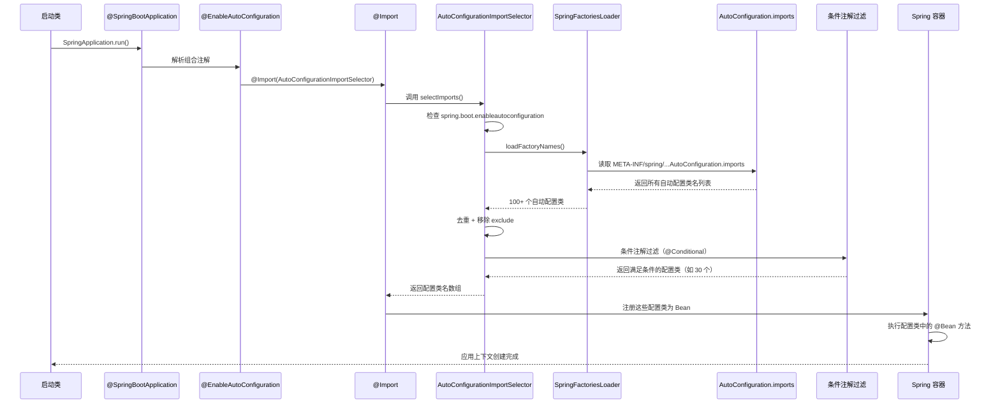

# SpringBoot 自动装配原理

> **文档说明**：深入讲解 Spring Boot 自动装配（Auto Configuration）的核心原理，包括 `@SpringBootApplication` 注解拆解、`@EnableAutoConfiguration` 工作机制、`spring.factories` / `AutoConfiguration.imports` 配置、条件注解、自动配置类加载流程，以及自定义 Starter 开发实战。
>
> **适用人群**：Java 后端开发工程师、需要深入理解 Spring Boot 底层原理的开发者、准备面试的同学
>
> **前置知识**：[[Spring基础与IoC容器]]、[[Java注解与反射机制]]

---

## 一、概述

**Spring Boot 自动装配（Auto Configuration）** 是 Spring Boot 最核心的特性之一，它能够根据 classpath 中的依赖自动配置 Spring 应用，极大地简化了传统 Spring 应用中繁琐的 XML 配置和 Bean 声明。

传统 Spring 应用需要手动配置大量 XML（如数据源、事务管理器、视图解析器等），而 Spring Boot 通过"约定优于配置"的理念，只需引入对应的 starter 依赖，就能自动完成配置。

### 1. 自动装配解决了什么问题

| 传统 Spring 痛点 | Spring Boot 自动装配方案 |
|----------------|------------------------|
| 需要手动配置 DataSource | 引入 `spring-boot-starter-jdbc` 自动配置数据源 |
| 需要手动配置事务管理器 | 自动配置 `DataSourceTransactionManager` |
| 需要手动配置 DispatcherServlet | 引入 web starter 自动配置内嵌 Tomcat |
| 需要手动配置 Jackson | 自动配置 ObjectMapper |
| 需要手动配置日志 | 自动配置 Logback |
| 需要手动配置 RedisTemplate | 引入 data-redis starter 自动配置 |
| 依赖版本冲突 | starter 统一管理依赖版本 |

### 2. 一个简单的对比

**传统 Spring MVC 配置**（web.xml + applicationContext.xml）：
```xml
<!-- web.xml -->
<servlet>
    <servlet-name>dispatcher</servlet-name>
    <servlet-class>org.springframework.web.servlet.DispatcherServlet</servlet-class>
    <init-param>
        <param-name>contextConfigLocation</param-name>
        <param-value>classpath:applicationContext.xml</param-value>
    </init-param>
</servlet>

<!-- applicationContext.xml -->
<bean id="dataSource" class="com.alibaba.druid.pool.DruidDataSource">
    <property name="url" value="jdbc:mysql://localhost:3306/db"/>
    <property name="username" value="root"/>
    <property name="password" value="123456"/>
</bean>
<bean id="sqlSessionFactory" class="org.mybatis.spring.SqlSessionFactoryBean">
    <property name="dataSource" ref="dataSource"/>
</bean>
<bean id="transactionManager" class="org.springframework.jdbc.datasource.DataSourceTransactionManager">
    <property name="dataSource" ref="dataSource"/>
</bean>
```

**Spring Boot 自动装配**：
```xml
<!-- pom.xml 只需引入依赖 -->
<dependency>
    <groupId>org.springframework.boot</groupId>
    <artifactId>spring-boot-starter-web</artifactId>
</dependency>
<dependency>
    <groupId>org.mybatis.spring.boot</groupId>
    <artifactId>mybatis-spring-boot-starter</artifactId>
</dependency>
```
```java
// 启动类
@SpringBootApplication
public class Application {
    public static void main(String[] args) {
        SpringApplication.run(Application.class, args);
    }
}
```
```yaml
# application.yml 只需配置必要参数
spring:
  datasource:
    url: jdbc:mysql://localhost:3306/db
    username: root
    password: 123456
```

DataSource、SqlSessionFactory、TransactionManager、DispatcherServlet、Tomcat 全部自动配置完成。

---

## 二、@SpringBootApplication 注解拆解

### 1. 注解组合结构

`@SpringBootApplication` 是一个组合注解，包含三个核心注解：

```java
@Target(ElementType.TYPE)
@Retention(RetentionPolicy.RUNTIME)
@Documented
@Inherited
@SpringBootConfiguration
@EnableAutoConfiguration
@ComponentScan(excludeFilters = {
    @Filter(type = FilterType.CUSTOM, classes = TypeExcludeFilter.class),
    @Filter(type = FilterType.CUSTOM, classes = AutoConfigurationExcludeFilter.class)
})
public @interface SpringBootApplication {
    // 排除自动配置类
    Class<?>[] exclude() default {};
    String[] excludeName() default {};
    // 扫描包路径
    String[] scanBasePackages() default {};
    Class<?>[] scanBasePackageClasses() default {};
    // 代理 Bean 方法
    boolean proxyBeanMethods() default true;
}
```

| 注解 | 作用 |
|------|------|
| `@SpringBootConfiguration` | 标记为 Spring Boot 配置类（本质是 `@Configuration`） |
| `@EnableAutoConfiguration` | **开启自动装配**（核心） |
| `@ComponentScan` | 组件扫描，扫描启动类所在包及其子包下的 Bean |

### 2. 三个注解的协作关系

```mermaid
graph TB
    A[@SpringBootApplication] --> B[@SpringBootConfiguration]
    A --> C[@EnableAutoConfiguration]
    A --> D[@ComponentScan]

    B --> B1[本质是 @Configuration<br/>标记为配置类<br/>允许 @Bean 方法]

    C --> C1[@AutoConfigurationPackage<br/>记录自动配置包路径]
    C --> C2[@Import(AutoConfigurationImportSelector.class)<br/>核心：加载自动配置类]

    D --> D1[扫描启动类所在包<br/>注册 @Component/@Service/@Controller 等]
    D --> D2[排除 TypeExcludeFilter<br/>和 AutoConfigurationExcludeFilter]
```

### 3. @ComponentScan 的默认行为

默认扫描启动类（`@SpringBootApplication` 标注的类）所在包及其子包。这就是为什么启动类要放在最外层包的根目录下。

```
com.example.myapp          ← 启动类放在这里
├── MyApplication.java      ← @SpringBootApplication
├── controller/             ← 会被扫描
│   └── UserController.java
├── service/                ← 会被扫描
│   └── UserService.java
└── repository/             ← 会被扫描
    └── UserRepository.java
```

如果启动类放在 `com.example.myapp.Application` 包下，那么 `com.example.other` 包下的组件不会被扫描到，需要手动指定 `scanBasePackages`。

---

## 三、@EnableAutoConfiguration 核心机制

### 1. 注解定义

```java
@Target(ElementType.TYPE)
@Retention(RetentionPolicy.RUNTIME)
@Documented
@Inherited
@AutoConfigurationPackage
@Import(AutoConfigurationImportSelector.class)
public @interface EnableAutoConfiguration {
    String ENABLED_OVERRIDE_PROPERTY = "spring.boot.enableautoconfiguration";
    Class<?>[] exclude() default {};
    String[] excludeName() default {};
}
```

两个关键元注解：
- `@AutoConfigurationPackage`：将启动类所在包注册为自动配置包，供后续自动配置类使用
- `@Import(AutoConfigurationImportSelector.class)`：**导入自动配置选择器，这是自动装配的核心入口**

### 2. AutoConfigurationImportSelector

`AutoConfigurationImportSelector` 实现了 `DeferredImportSelector` 接口，它的核心方法是 `selectImports()`，负责选择需要导入的自动配置类。

```java
public class AutoConfigurationImportSelector implements DeferredImportSelector, BeanClassLoaderAware, ResourceLoaderAware, BeanFactoryAware, EnvironmentAware, Ordered {

    @Override
    public String[] selectImports(AnnotationMetadata annotationMetadata) {
        // 1. 检查自动装配是否开启
        if (!isEnabled(annotationMetadata)) {
            return NO_IMPORTS;
        }

        // 2. 加载自动配置元数据（从 META-INF/spring-autoconfigure-metadata.properties）
        AutoConfigurationEntry autoConfigurationEntry = getAutoConfigurationEntry(annotationMetadata);

        // 3. 返回需要导入的自动配置类全限定名
        return StringUtils.toStringArray(autoConfigurationEntry.getConfigurations());
    }

    protected AutoConfigurationEntry getAutoConfigurationEntry(AnnotationMetadata annotationMetadata) {
        if (!isEnabled(annotationMetadata)) {
            return EMPTY_ENTRY;
        }

        // 2.1 获取 @EnableAutoConfiguration 的属性（exclude/excludeName）
        AnnotationAttributes attributes = getAttributes(annotationMetadata);

        // 2.2 从 spring.factories / AutoConfiguration.imports 加载所有自动配置类
        List<String> configurations = getCandidateConfigurations(annotationMetadata, attributes);

        // 2.3 去重
        configurations = removeDuplicates(configurations);

        // 2.4 移除用户排除的配置类（exclude/excludeName）
        Set<String> exclusions = getExclusions(annotationMetadata, attributes);
        checkExcludedClasses(configurations, exclusions);
        configurations.removeAll(exclusions);

        // 2.5 应用过滤器（根据条件注解过滤）
        configurations = getConfigurationClassFilter().filter(configurations);

        // 2.6 触发自动配置导入事件
        fireAutoConfigurationImportEvents(configurations, exclusions);

        return new AutoConfigurationEntry(configurations, exclusions);
    }
}
```

### 3. 自动配置类的加载来源

**Spring Boot 2.7 之前**：从 `META-INF/spring.factories` 文件加载

```properties
# META-INF/spring.factories
org.springframework.boot.autoconfigure.EnableAutoConfiguration=\
org.springframework.boot.autoconfigure.jdbc.DataSourceAutoConfiguration,\
org.springframework.boot.autoconfigure.web.servlet.DispatcherServletAutoConfiguration,\
org.springframework.boot.autoconfigure.data.redis.RedisAutoConfiguration,\
...
```

**Spring Boot 2.7+（推荐）**：从 `META-INF/spring/org.springframework.boot.autoconfigure.AutoConfiguration.imports` 文件加载

```
# META-INF/spring/org.springframework.boot.autoconfigure.AutoConfiguration.imports
org.springframework.boot.autoconfigure.jdbc.DataSourceAutoConfiguration
org.springframework.boot.autoconfigure.web.servlet.DispatcherServletAutoConfiguration
org.springframework.boot.autoconfigure.data.redis.RedisAutoConfiguration
...
```

**Spring Boot 3.x**：完全使用新的 `AutoConfiguration.imports` 文件，`spring.factories` 中的自动配置已被移除。

```java
// 加载候选配置类的核心方法
protected List<String> getCandidateConfigurations(AnnotationMetadata metadata, AnnotationAttributes attributes) {
    // Spring Boot 2.7+: 从 AutoConfiguration.imports 加载
    List<String> configurations = new ArrayList<>(
        SpringFactoriesLoader.loadFactoryNames(getSpringFactoriesLoaderFactoryClass(), getBeanClassLoader()));

    // 新方式：ImportCandidates 加载
    ImportCandidates.load(AutoConfiguration.class, getBeanClassLoader())
        .forEach(configurations::add);

    Assert.notEmpty(configurations,
        "No auto configuration classes found in META-INF/spring.factories nor in META-INF/spring/org.springframework.boot.autoconfigure.AutoConfiguration.imports.");

    return configurations;
}
```

### 4. 完整加载流程



---

## 四、条件注解（@Conditional）

自动配置类之所以能"智能"地只在需要时才配置，核心依赖于 Spring 的条件注解 `@Conditional` 及其派生注解。

### 1. 常用条件注解

| 注解 | 作用 | 示例 |
|------|------|------|
| `@ConditionalOnClass` | classpath 中存在指定类时生效 | `@ConditionalOnClass(DruidDataSource.class)` |
| `@ConditionalOnMissingClass` | classpath 中不存在指定类时生效 | `@ConditionalOnMissingClass("org.apache.tomcat.jdbc.pool.DataSource")` |
| `@ConditionalOnBean` | 容器中存在指定 Bean 时生效 | `@ConditionalOnBean(DataSource.class)` |
| `@ConditionalOnMissingBean` | 容器中不存在指定 Bean 时生效 | `@ConditionalOnMissingBean(SqlSessionFactory.class)` |
| `@ConditionalOnProperty` | 配置文件中存在指定属性且值匹配时生效 | `@ConditionalOnProperty(prefix="spring.datasource", name="url")` |
| `@ConditionalOnWebApplication` | 当前是 Web 应用时生效 | `@ConditionalOnWebApplication(type=SERVLET)` |
| `@ConditionalOnNotWebApplication` | 当前不是 Web 应用时生效 | - |
| `@ConditionalOnExpression` | SpEL 表达式为 true 时生效 | `@ConditionalOnExpression("${cache.enabled:true}")` |
| `@ConditionalOnJava` | JDK 版本满足条件时生效 | `@ConditionalOnJava(JavaVersion.EIGHTEEN)` |
| `@ConditionalOnCloudPlatform` | 指定云平台时生效 | `@ConditionalOnCloudPlatform(CloudPlatform.KUBERNETES)` |
| `@ConditionalOnSingleCandidate` | 容器中只有一个候选 Bean 时生效 | - |
| `@ConditionalOnWarDeployment` | 以 WAR 包部署时生效 | - |
| `@ConditionalOnJndi` | JNDI 中存在指定资源时生效 | - |

### 2. 条件注解组合使用

自动配置类通常会组合多个条件注解，确保只在正确的场景下生效：

```java
@AutoConfiguration
@ConditionalOnClass({ SqlSessionFactory.class, SqlSessionFactoryBean.class })
@ConditionalOnSingleCandidate(DataSource.class)
@EnableConfigurationProperties(MybatisProperties.class)
@AutoConfigureAfter({ DataSourceAutoConfiguration.class, MybatisLanguageDriverAutoConfiguration.class })
public class MybatisAutoConfiguration implements InitializingBean {

    @Bean
    @ConditionalOnMissingBean
    public SqlSessionFactory sqlSessionFactory(DataSource dataSource) throws Exception {
        // 只有当容器中没有 SqlSessionFactory 时才创建
        SqlSessionFactoryBean factory = new SqlSessionFactoryBean();
        factory.setDataSource(dataSource);
        return factory.getObject();
    }

    @Bean
    @ConditionalOnMissingBean
    public SqlSessionTemplate sqlSessionTemplate(SqlSessionFactory sqlSessionFactory) {
        return new SqlSessionTemplate(sqlSessionFactory);
    }
}
```

**条件解读**：
1. `@ConditionalOnClass`：classpath 中必须有 MyBatis 的类（引入了 mybatis 依赖）
2. `@ConditionalOnSingleCandidate(DataSource.class)`：容器中必须有且只有一个 DataSource Bean
3. `@ConditionalOnMissingBean`：用户没有自定义 SqlSessionFactory 时才自动配置（用户优先）

### 3. 用户自定义优先原则

自动配置类中的 `@Bean` 方法几乎都标注了 `@ConditionalOnMissingBean`，这意味着：

- **如果用户自己定义了对应的 Bean，自动配置就不会创建**（用户定义优先）
- **如果用户没有定义，才使用自动配置的默认 Bean**

这就是 Spring Boot "约定优于配置"且"可定制"的核心机制——默认提供合理配置，但用户随时可以覆盖。

```java
// 用户自定义了 DataSource，自动配置的 DataSource 就不会生效
@Configuration
public class MyDataSourceConfig {
    @Bean
    public DataSource dataSource() {
        DruidDataSource ds = new DruidDataSource();
        ds.setUrl("jdbc:mysql://localhost:3306/mydb");
        ds.setUsername("root");
        ds.setPassword("custom");
        return ds;
    }
}
```

---

## 五、自动配置类深度解析

### 1. DataSourceAutoConfiguration

数据源自动配置是最经典的自动配置示例。

```java
@AutoConfiguration
@ConditionalOnClass({ DataSource.class, EmbeddedDatabaseType.class })
@ConditionalOnMissingBean(type = "io.r2dbc.spi.ConnectionFactory")
@EnableConfigurationProperties(DataSourceProperties.class)
@Import({ DataSourcePoolMetadataProvidersConfiguration.class,
          DataSourceInitializationConfiguration.class })
public class DataSourceAutoConfiguration {

    @Configuration(proxyBeanMethods = false)
    @Conditional(PooledDataSourceCondition.class)
    @ConditionalOnMissingBean({ DataSource.class, XADataSource.class })
    @Import({ Hikari.class, Tomcat.class, Dbcp2.class, OracleUcp.class, Generic.class, DataSourceJmxConfiguration.class })
    protected static class PooledDataSourceConfiguration {
    }

    @Configuration(proxyBeanMethods = false)
    @ConditionalOnMissingBean({ DataSource.class, XADataSource.class })
    @ConditionalOnProperty(prefix = "spring.datasource", name = "url")
    @Import(EmbeddedDataSourceConfiguration.class)
    protected static class EmbeddedDatabaseConfiguration {
    }
}
```

**配置流程**：
1. 检查 classpath 中有 `DataSource` 类（引入了 spring-jdbc 或 starter-jdbc）
2. 检查用户没有自定义 DataSource Bean
3. 根据连接池优先级选择：HikariCP（默认）→ Tomcat JDBC → DBCP2 → Oracle UCP
4. 从 `spring.datasource.*` 配置读取连接参数
5. 创建对应的 DataSource Bean

### 2. 内置 Web 服务器自动配置

```java
@AutoConfiguration
@AutoConfigureOrder(Ordered.HIGHEST_PRECEDENCE)
@ConditionalOnClass(ServletRequest.class)
@ConditionalOnWebApplication(type = Type.SERVLET)
@EnableConfigurationProperties(ServerProperties.class)
@Import({ ServletWebServerFactoryAutoConfiguration.BeanPostProcessorsRegistrar.class,
        ServletWebServerFactoryConfiguration.EmbeddedTomcat.class,
        ServletWebServerFactoryConfiguration.EmbeddedJetty.class,
        ServletWebServerFactoryConfiguration.EmbeddedUndertow.class })
public class ServletWebServerFactoryAutoConfiguration {
    // 根据 classpath 中的依赖自动选择 Tomcat / Jetty / Undertow
}
```

**服务器选择优先级**：
1. Tomcat（spring-boot-starter-web 默认引入）
2. Jetty（排除 Tomcat，引入 jetty-starter）
3. Undertow（排除 Tomcat，引入 undertow-starter）

### 3. RedisAutoConfiguration

```java
@AutoConfiguration
@ConditionalOnClass(RedisOperations.class)
@EnableConfigurationProperties(RedisProperties.class)
@Import({ LettuceConnectionConfiguration.class, JedisConnectionConfiguration.class })
public class RedisAutoConfiguration {

    @Bean
    @ConditionalOnMissingBean(name = "redisTemplate")
    @ConditionalOnSingleCandidate(RedisConnectionFactory.class)
    public RedisTemplate<Object, Object> redisTemplate(RedisConnectionFactory redisConnectionFactory) {
        RedisTemplate<Object, Object> template = new RedisTemplate<>();
        template.setConnectionFactory(redisConnectionFactory);
        return template;
    }

    @Bean
    @ConditionalOnMissingBean
    @ConditionalOnSingleCandidate(RedisConnectionFactory.class)
    public StringRedisTemplate stringRedisTemplate(RedisConnectionFactory redisConnectionFactory) {
        return new StringRedisTemplate(redisConnectionFactory);
    }
}
```

**客户端选择优先级**：Lettuce（默认，响应式）→ Jedis（排除 Lettuce，引入 Jedis）

---

## 六、自定义 Starter 开发

### 1. Starter 的本质

Spring Boot Starter 本质上是一个包含以下内容的 Maven 依赖：
- 一组必要的依赖（传递依赖）
- 自动配置类（`@AutoConfiguration`）
- 自动配置注册文件（`AutoConfiguration.imports`）
- 配置属性类（`@ConfigurationProperties`）

引入 starter = 引入依赖 + 自动配置，开箱即用。

### 2. 自定义 Starter 完整步骤

**步骤1：创建 Maven 项目**

```xml
<!-- pom.xml -->
<project>
    <groupId>com.example</groupId>
    <artifactId>my-spring-boot-starter</artifactId>
    <version>1.0.0</version>

    <dependencies>
        <!-- 自动配置核心依赖 -->
        <dependency>
            <groupId>org.springframework.boot</groupId>
            <artifactId>spring-boot-autoconfigure</artifactId>
        </dependency>
        <!-- 配置元数据生成（IDE 自动提示） -->
        <dependency>
            <groupId>org.springframework.boot</groupId>
            <artifactId>spring-boot-configuration-processor</artifactId>
            <optional>true</optional>
        </dependency>
    </dependencies>
</project>
```

**步骤2：创建配置属性类**

```java
@ConfigurationProperties(prefix = "my.hello")
public class HelloProperties {
    /** 是否启用 hello 功能 */
    private boolean enabled = true;
    /** 问候语前缀 */
    private String prefix = "Hello, ";
    /** 问候语后缀 */
    private String suffix = "!";
    /** 语言 */
    private Language language = Language.CHINESE;

    public enum Language {
        CHINESE, ENGLISH, JAPANESE
    }
    // getter/setter 省略
}
```

**步骤3：创建服务类**

```java
public class HelloService {
    private final HelloProperties properties;

    public HelloService(HelloProperties properties) {
        this.properties = properties;
    }

    public String sayHello(String name) {
        if (!properties.isEnabled()) {
            return "Hello service is disabled";
        }
        return properties.getPrefix() + name + properties.getSuffix();
    }
}
```

**步骤4：创建自动配置类**

```java
@AutoConfiguration
@ConditionalOnClass(HelloService.class)
@ConditionalOnProperty(prefix = "my.hello", name = "enabled", havingValue = "true", matchIfMissing = true)
@EnableConfigurationProperties(HelloProperties.class)
public class HelloAutoConfiguration {

    @Bean
    @ConditionalOnMissingBean
    public HelloService helloService(HelloProperties properties) {
        return new HelloService(properties);
    }
}
```

**步骤5：注册自动配置类**

在 `src/main/resources/META-INF/spring/org.springframework.boot.autoconfigure.AutoConfiguration.imports` 文件中：

```
com.example.hello.HelloAutoConfiguration
```

**步骤6：使用自定义 Starter**

```xml
<!-- 引入依赖 -->
<dependency>
    <groupId>com.example</groupId>
    <artifactId>my-spring-boot-starter</artifactId>
    <version>1.0.0</version>
</dependency>
```

```yaml
# application.yml 配置
my:
  hello:
    enabled: true
    prefix: "你好，"
    suffix: "！"
```

```java
// 直接注入使用
@RestController
public class HelloController {
    @Autowired
    private HelloService helloService;

    @GetMapping("/hello")
    public String hello(@RequestParam String name) {
        return helloService.sayHello(name);
    }
}
```

### 3. Starter 命名规范

| 类型 | 命名格式 | 示例 |
|------|---------|------|
| 官方 Starter | `spring-boot-starter-*` | `spring-boot-starter-web` |
| 第三方 Starter | `*-spring-boot-starter` | `mybatis-spring-boot-starter` |
| 不要使用 | `spring-boot-starter-*-spring-boot-starter` | - |

---

## 七、自动装配调试与排错

### 1. 查看自动配置报告

启动时添加 `--debug` 参数或在配置中设置 `debug=true`，可以查看自动配置报告：

```yaml
debug: true
```

输出分为两部分：
- **Positive matches**：匹配成功，已生效的自动配置类
- **Negative matches**：匹配失败，未生效的自动配置类（含失败原因）

```
============================
CONDITIONS EVALUATION REPORT
============================

Positive matches:
-----------------
   DataSourceAutoConfiguration matched:
      - @ConditionalOnClass found required class 'javax.sql.DataSource'
      - @ConditionalOnMissingBean (types: io.r2dbc.spi.ConnectionFactory) did not find any beans

Negative matches:
-----------------
   ActiveMQAutoConfiguration:
      Did not match:
         - @ConditionalOnClass did not find required class 'javax.jms.ConnectionFactory'
```

### 2. 查看哪些自动配置被排除

```java
// 方式1：注解排除
@SpringBootApplication(exclude = {DataSourceAutoConfiguration.class})
public class Application { }

// 方式2：配置文件排除
spring:
  autoconfigure:
    exclude:
      - org.springframework.boot.autoconfigure.jdbc.DataSourceAutoConfiguration
```

### 3. 常见问题排查

| 问题 | 原因 | 解决方案 |
|------|------|---------|
| 自动配置不生效 | 启动类包位置不对，组件扫描不到 | 启动类放在最外层根包 |
| 自定义 Bean 不生效 | 被自动配置的 `@ConditionalOnMissingBean` 跳过 | 检查是否已有同类型 Bean，或用 `@Primary` |
| 配置属性不生效 | `@ConfigurationProperties` 未被扫描 | 加 `@EnableConfigurationProperties` 或 `@Component` |
| 循环依赖 | 自动配置类之间循环依赖 | 用 `@Lazy` 或调整 `@AutoConfigureAfter/Before` |
| 启动慢 | 自动配置类太多，条件评估耗时 | 排除不需要的自动配置，用 `spring.autoconfigure.exclude` |
| 版本不兼容 | starter 版本与 Spring Boot 版本不匹配 | 检查 starter 兼容性矩阵 |
| 多数据源冲突 | 多个 DataSource 导致 `@ConditionalOnSingleCandidate` 不满足 | 手动配置，标记 `@Primary` |

---

## 八、Spring Boot 3.x 变化

### 1. 自动配置文件变化

| 版本 | 配置文件 | 说明 |
|------|---------|------|
| 2.6 及以前 | `META-INF/spring.factories` | 唯一方式 |
| 2.7 | `spring.factories` + `AutoConfiguration.imports` | 两种方式并存，推荐新方式 |
| 3.0+ | `AutoConfiguration.imports` | `spring.factories` 中的自动配置已移除 |

### 2. 注解变化

- `@AutoConfiguration` 取代 `@Configuration` 标注自动配置类（Spring Boot 2.7+）
- `@AutoConfigureBefore` / `@AutoConfigureAfter` 控制配置顺序
- Jakarta EE 9+ 命名空间：`javax.*` → `jakarta.*`

### 3. 性能优化

Spring Boot 3.x 对自动装配做了性能优化：
- 自动配置类使用 `@AutoConfiguration` 标记，可被提前过滤
- 条件注解评估效率提升
- AOT（Ahead-of-Time）编译支持，减少运行时反射

---

## 九、关联笔记

### Spring 生态
- [[Spring基础与IoC容器]] · [[SpringBoot-部署与Docker化]] · [[SpringCloud-服务注册与发现]]
- [[Gateway-网关路由与鉴权]] · [[配置中心-Nacos与Apollo]] · [[Spring事务管理与传播机制]]

### 后端核心
- [[Java注解与反射机制]] · [[Java并发编程核心]] · [[JVM-内存模型与垃圾回收]]
- [[MyBatis-核心原理与插件]] · [[数据库连接池-HikariCP与Druid]]

### 架构
- [[微服务架构核心概念]] · [[高可用架构设计]] · [[技术选型决策指南]]

### 云原生
- [[Docker-核心原理与镜像优化]] · [[K8s-核心概念与架构]] · [[CI-CD持续集成与部署]]

### 导航
- [[MOC-后端开发]] · [[全栈+AI工程双轨融合学习路线图]]

> **学习路径建议**：先掌握 [[Spring基础与IoC容器]] 理解 Bean 管理 → 深入本文自动装配原理 → 学习 [[SpringCloud-服务注册与发现]] 微服务 → 实践 [[SpringBoot-部署与Docker化]] 容器化部署 → 研究 [[Gateway-网关路由与鉴权]] 网关。
