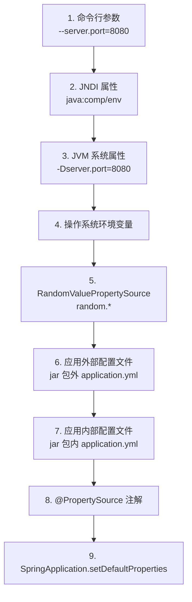

# SpringBoot 配置管理与多环境

> **文档说明**：系统讲解 Spring Boot 配置管理体系，包括配置文件格式（properties/yml）、配置加载顺序与优先级、多环境 Profile 管理、配置注入方式（@Value/@ConfigurationProperties）、配置加密、外部化配置、配置中心集成，以及生产级最佳实践和常见问题排查。
>
> **适用人群**：Java 后端开发工程师、全栈开发者、需要构建多环境配置体系的工程师
>
> **前置知识**：[[SpringBoot-自动装配原理]]、[[Spring-IOCAOP核心机制]]

---

## 一、概述

### 1. 配置管理的重要性

Spring Boot 通过"约定优于配置"大幅简化了配置，但生产环境仍需完善的配置管理体系：多环境隔离、敏感信息加密、配置热更新、配置版本管理等。

### 2. 配置文件格式

| 格式 | 扩展名 | 特点 |
|------|--------|------|
| **Properties** | `.properties` | 键值对，层级用 `.` 分隔，简单直观 |
| **YAML** | `.yml` / `.yaml` | 树形结构，缩进表示层级，可读性强，支持列表 |

```properties
# application.properties
server.port=8080
spring.datasource.url=jdbc:mysql://localhost:3306/db
spring.datasource.username=root
spring.datasource.password=123456
spring.profiles.active=dev
```

```yaml
# application.yml
server:
  port: 8080
spring:
  datasource:
    url: jdbc:mysql://localhost:3306/db
    username: root
    password: "123456"
  profiles:
    active: dev

# YAML 列表示例
my:
  servers:
    - dev.example.com
    - test.example.com
    - prod.example.com
```

### 3. 配置加载顺序（优先级从高到低）



**关键规则**：
- 高优先级配置覆盖低优先级
- 同位置 `.properties` 优先级高于 `.yml`
- `application-{profile}.yml` 优先级高于 `application.yml`
- 配置文件加载位置优先级：`file:./config/` > `file:./` > `classpath:/config/` > `classpath:/`

---

## 二、多环境配置

### 1. Profile 机制

Spring Profile 用于区分不同环境（dev/test/staging/prod），实现配置隔离。

```yaml
# application.yml（公共配置）
spring:
  application:
    name: my-app
  profiles:
    active: dev  # 默认激活 dev 环境

server:
  port: 8080
```

```yaml
# application-dev.yml（开发环境）
spring:
  datasource:
    url: jdbc:mysql://localhost:3306/dev_db
    username: root
    password: root
  redis:
    host: localhost
    port: 6379

logging:
  level:
    com.example: DEBUG
```

```yaml
# application-test.yml（测试环境）
spring:
  datasource:
    url: jdbc:mysql://test-db:3306/test_db
    username: test_user
    password: test_pass
  redis:
    host: test-redis
    port: 6379

logging:
  level:
    com.example: INFO
```

```yaml
# application-prod.yml（生产环境）
spring:
  datasource:
    url: jdbc:mysql://prod-db:3306/prod_db
    username: ${DB_USERNAME}  # 从环境变量读取
    password: ${DB_PASSWORD}
  redis:
    host: prod-redis
    port: 6379

logging:
  level:
    com.example: WARN
  file:
    name: /var/log/my-app/app.log
```

### 2. 激活 Profile 的方式

| 方式 | 示例 | 优先级 |
|------|------|--------|
| **配置文件** | `spring.profiles.active=dev` | 低 |
| **JVM 参数** | `-Dspring.profiles.active=dev` | 中 |
| **环境变量** | `SPRING_PROFILES_ACTIVE=dev` | 中 |
| **命令行参数** | `java -jar app.jar --spring.profiles.active=dev` | 高 |
| **代码设置** | `SpringApplication.setAdditionalProfiles("dev")` | 最高 |

```bash
# 命令行激活
java -jar my-app.jar --spring.profiles.active=prod

# JVM 参数激活
java -Dspring.profiles.active=prod -jar my-app.jar

# 环境变量激活（Linux/Mac）
export SPRING_PROFILES_ACTIVE=prod
java -jar my-app.jar

# 环境变量激活（Windows）
set SPRING_PROFILES_ACTIVE=prod
java -jar my-app.jar

# 同时激活多个 Profile
java -jar my-app.jar --spring.profiles.active=prod,mysql,redis
```

### 3. Profile 分组

```yaml
# Spring Boot 2.4+ 支持 Profile 分组
spring:
  profiles:
    group:
      production:
        - prod
        - mysql
        - redis
        - security
      development:
        - dev
        - h2
        - mock
    active: production  # 激活 production 组，自动激活组内所有 Profile
```

### 4. @Profile 注解

```java
// 配置类：仅在 dev 环境生效
@Configuration
@Profile("dev")
public class DevConfig {
    @Bean
    public DataSource devDataSource() {
        // 开发环境数据源
    }
}

// 配置类：仅在 prod 环境生效
@Configuration
@Profile("prod")
public class ProdConfig {
    @Bean
    public DataSource prodDataSource() {
        // 生产环境数据源
    }
}

// 组件：仅在指定环境生效
@Service
@Profile({"dev", "test"})
public class MockEmailService implements EmailService {
    // 开发/测试环境使用模拟邮件服务
}

@Service
@Profile("prod")
public class SmtpEmailService implements EmailService {
    // 生产环境使用真实 SMTP 邮件服务
}

// 取反：非 prod 环境生效
@Configuration
@Profile("!prod")
public class NonProdConfig { }
```

---

## 三、配置注入

### 1. @Value 注入

```java
@Component
public class AppConfig {

    // 简单值注入
    @Value("${server.port}")
    private int serverPort;

    // 带默认值
    @Value("${app.name:my-default-app}")
    private String appName;

    // 注入列表（逗号分隔）
    @Value("${app.servers:server1,server2}")
    private List<String> servers;

    // 注入 Map（需特殊格式）
    @Value("#{${app.map}}")
    private Map<String, String> appMap;

    // SpEL 表达式
    @Value("#{systemProperties['user.home']}")
    private String userHome;

    // 随机值
    @Value("${random.uuid}")
    private String randomUuid;
}
```

### 2. @ConfigurationProperties（推荐）

```yaml
# application.yml
app:
  name: my-app
  version: 1.0.0
  servers:
    - dev.example.com
    - test.example.com
  security:
    enabled: true
    token-expire: 3600
  datasource:
    url: jdbc:mysql://localhost:3306/db
    username: root
    password: root
```

```java
// 方式1：@Component + @ConfigurationProperties
@Component
@ConfigurationProperties(prefix = "app")
@Data  // Lombok 生成 getter/setter
public class AppProperties {
    private String name;
    private String version;
    private List<String> servers = new ArrayList<>();
    private Security security = new Security();
    private Datasource datasource = new Datasource();

    @Data
    public static class Security {
        private boolean enabled = true;
        private int tokenExpire = 3600;
    }

    @Data
    public static class Datasource {
        private String url;
        private String username;
        private String password;
    }
}

// 方式2：@EnableConfigurationProperties（Spring Boot 2.2+ 推荐）
@Configuration
@EnableConfigurationProperties(AppProperties.class)
public class AppConfig { }

// 使用
@Service
public class MyService {
    @Autowired
    private AppProperties appProperties;

    public void doSomething() {
        System.out.println(appProperties.getName());
        System.out.println(appProperties.getSecurity().getTokenExpire());
    }
}
```

### 3. @Value vs @ConfigurationProperties

| 维度 | @Value | @ConfigurationProperties |
|------|--------|--------------------------|
| **注入方式** | 逐个字段注入 | 批量绑定到 POJO |
| **类型安全** | 弱（运行时转换） | 强（编译期检查） |
| **复杂类型** | 支持有限 | 完全支持（嵌套对象、列表、Map） |
| **元数据支持** | 不支持 | 支持（IDE 自动补全） |
| **校验支持** | 需手动 | 支持 JSR-303 校验 |
| **适用场景** | 少量简单配置 | 大量结构化配置 |
| **推荐度** | 简单场景 | ⭐⭐⭐⭐⭐ 推荐 |

### 4. 配置校验（JSR-303）

```java
@Component
@ConfigurationProperties(prefix = "app")
@Validated  // 启用校验
@Data
public class AppProperties {

    @NotBlank(message = "应用名称不能为空")
    private String name;

    @Min(value = 1, message = "端口最小为1")
    @Max(value = 65535, message = "端口最大为65535")
    private int port = 8080;

    @Email(message = "邮箱格式不正确")
    private String adminEmail;

    @Valid  // 嵌套对象校验
    private Security security = new Security();

    @Data
    public static class Security {
        @NotNull
        private Boolean enabled;

        @Positive
        private int tokenExpire;
    }
}
```

---

## 四、配置加密

### 1. Jasypt 集成

```xml
<!-- Maven 依赖 -->
<dependency>
    <groupId>com.github.ulisesbocchio</groupId>
    <artifactId>jasypt-spring-boot-starter</artifactId>
    <version>3.0.5</version>
</dependency>
```

```yaml
# application.yml
jasypt:
  encryptor:
    password: ${JASYPT_ENCRYPTOR_PASSWORD}  # 加密密钥（从环境变量读取，不要硬编码）
    algorithm: PBEWithMD5AndDES              # 加密算法
    iv-generator-classname: org.jasypt.iv.NoIvGenerator

spring:
  datasource:
    username: root
    password: ENC(加密后的密文)  # 使用 ENC() 包裹密文
```

```bash
# 生成加密密文
java -cp jasypt-1.9.3.jar org.jasypt.intf.cli.JasyptPBEStringEncryptionCLI \
  input="your-password" \
  password="your-encryption-key" \
  algorithm=PBEWithMD5AndDES

# 启动时传入加密密钥
java -jar app.jar -Djasypt.encryptor.password=your-encryption-key
# 或环境变量
export JASYPT_ENCRYPTOR_PASSWORD=your-encryption-key
java -jar app.jar
```

### 2. 自定义加密

```java
// 自定义 StringEncryptor
@Bean("jasyptStringEncryptor")
public StringEncryptor stringEncryptor() {
    PooledPBEStringEncryptor encryptor = new PooledPBEStringEncryptor();
    SimpleStringPBEConfig config = new SimpleStringPBEConfig();
    config.setPassword(System.getenv("JASYPT_PASSWORD"));
    config.setAlgorithm("PBEWithMD5AndDES");
    config.setKeyObtentionIterations("1000");
    config.setPoolSize("1");
    config.setSaltGeneratorClassName("org.jasypt.salt.RandomSaltGenerator");
    config.setIvGeneratorClassName("org.jasypt.iv.NoIvGenerator");
    config.setStringOutputType("base64");
    encryptor.setConfig(config);
    return encryptor;
}
```

---

## 五、外部化配置

### 1. 配置文件位置

```
项目结构：
my-app/
├── config/
│   └── application.yml      # 优先级最高（外部 config 目录）
├── application.yml          # 外部根目录
└── my-app.jar
    └── BOOT-INF/classes/
        ├── config/
        │   └── application.yml  # 内部 config 目录
        └── application.yml      # 内部根目录（优先级最低）
```

### 2. 环境变量绑定

```yaml
# 配置中引用环境变量
spring:
  datasource:
    url: ${DB_URL:jdbc:mysql://localhost:3306/db}  # 冒号后为默认值
    username: ${DB_USERNAME:root}
    password: ${DB_PASSWORD}

server:
  port: ${SERVER_PORT:8080}
```

```bash
# 设置环境变量
export DB_URL=jdbc:mysql://prod-db:3306/prod
export DB_USERNAME=prod_user
export DB_PASSWORD=prod_password
export SERVER_PORT=8080
```

### 3. 配置占位符

```yaml
app:
  name: my-app
  version: 1.0.0
  full-name: ${app.name}-${app.version}  # 引用其他配置
  description: 应用 ${app.name} 版本 ${app.version}
  home: ${user.home}/.my-app              # 引用系统属性
```

---

## 六、配置中心集成

### 1. Nacos 配置中心

```xml
<dependency>
    <groupId>com.alibaba.cloud</groupId>
    <artifactId>spring-cloud-starter-alibaba-nacos-config</artifactId>
</dependency>
```

```yaml
# bootstrap.yml（必须使用 bootstrap，优先级高于 application）
spring:
  application:
    name: my-app
  cloud:
    nacos:
      config:
        server-addr: localhost:8848
        namespace: dev
        group: DEFAULT_GROUP
        file-extension: yaml  # 配置文件格式
        username: nacos
        password: nacos
  config:
    import:
      - nacos:my-app.yaml?refreshEnabled=true  # Spring Boot 2.4+ 新方式
```

```java
// 配置自动刷新
@RestController
@RefreshScope  // 配置变更后自动刷新 Bean
public class ConfigController {

    @Value("${app.name}")
    private String appName;

    @GetMapping("/config")
    public String getConfig() {
        return appName;
    }
}
```

### 2. Apollo 配置中心

```xml
<dependency>
    <groupId>com.ctrip.framework.apollo</groupId>
    <artifactId>apollo-client</artifactId>
    <version>2.1.0</version>
</dependency>
```

```yaml
# application.yml
app:
  id: my-app
apollo:
  meta: http://localhost:8080
  bootstrap:
    enabled: true
    namespaces: application,my-app.yaml
```

---

## 七、生产最佳实践

### 1. 配置管理规范

- [ ] **敏感信息不入库**：密码、密钥等使用环境变量或配置中心
- [ ] **多环境隔离**：dev/test/staging/prod 严格分离
- [ ] **配置版本管理**：配置变更记录版本，支持回滚
- [ ] **默认值合理**：本地开发可直接运行，不需额外配置
- [ ] **配置文档化**：关键配置添加注释说明
- [ ] **配置校验**：使用 JSR-303 校验配置合法性
- [ ] **配置热更新**：生产环境支持配置动态刷新（需配合 @RefreshScope）

### 2. 目录结构建议

```
src/main/resources/
├── application.yml          # 公共配置
├── application-dev.yml      # 开发环境
├── application-test.yml     # 测试环境
├── application-staging.yml  # 预发布环境
├── application-prod.yml     # 生产环境（仅非敏感配置）
├── logback-spring.xml       # 日志配置
└── mapper/                  # MyBatis 映射文件
```

### 3. 配置元数据（IDE 自动补全）

```json
// META-INF/spring-configuration-metadata.json
{
  "groups": [
    {
      "name": "app",
      "type": "com.example.config.AppProperties",
      "description": "应用配置"
    }
  ],
  "properties": [
    {
      "name": "app.name",
      "type": "java.lang.String",
      "description": "应用名称",
      "defaultValue": "my-app"
    },
    {
      "name": "app.port",
      "type": "java.lang.Integer",
      "description": "服务端口",
      "defaultValue": 8080
    }
  ]
}
```

---

## 八、常见问题与排查

| 问题 | 原因 | 解决方案 |
|------|------|---------|
| **配置不生效** | 配置文件位置错误 / Profile 未激活 / 优先级被覆盖 | 检查配置文件位置、spring.profiles.active、启动日志 |
| **@Value 注入为 null** | Bean 未被 Spring 管理 / 配置 key 不存在 | 检查 @Component 注解、配置 key 拼写、默认值 |
| **@ConfigurationProperties 不绑定** | 未启用 @EnableConfigurationProperties / 前缀不匹配 | 检查注解、prefix 配置、setter 方法 |
| **多环境配置混乱** | Profile 命名不规范 / 公共配置重复 | 统一命名规范、公共配置放 application.yml |
| **敏感信息泄露** | 密码明文写在配置文件 / 配置文件提交到 Git | 使用环境变量、Jasypt 加密、.gitignore 排除 |
| **配置热更新不生效** | 未加 @RefreshScope / 配置中心未推送 | 添加 @RefreshScope、检查配置中心推送 |
| **YAML 语法错误** | 缩进错误 / 特殊字符未引号 | 使用 2 空格缩进、特殊值加引号、在线校验 |
| **随机值每次不同** | random.* 每次启动重新生成 | 如需固定值，不要使用 random |
| **配置覆盖不生效** | 高优先级配置覆盖了低优先级 | 检查配置加载顺序、命令行参数 |
| **bootstrap.yml 不加载** | Spring Cloud 版本不兼容 / 未引入依赖 | 检查 spring-cloud-starter、Spring Boot 版本 |
| **Nacos 配置不刷新** | 未加 @RefreshScope / dataId 不匹配 | 添加注解、检查 dataId、group、namespace |
| **Jasypt 解密失败** | 加密密钥错误 / 算法不匹配 / IV 配置 | 检查密钥、算法配置、密文格式 |
| **配置校验不触发** | 未加 @Validated / 校验注解位置错误 | 添加 @Validated、检查注解位置 |
| **列表/Map 注入失败** | @Value 不支持复杂类型 / YAML 格式错误 | 使用 @ConfigurationProperties、检查 YAML 格式 |

---

## 九、关联笔记

### Spring 生态
- [[SpringBoot-自动装配原理]] · [[Spring-IOCAOP核心机制]] · [[SpringBoot-Web层设计]]
- [[SpringSecurity-认证授权]] · [[SpringCache-缓存抽象]] · [[SpringWebFlux-响应式编程]]

### 微服务
- [[Nacos-注册中心与配置中心]] · [[SpringCloud-Alibaba组件体系]] · [[Gateway-网关路由与鉴权]]
- [[微服务核心组件知识点系统梳理_优化版]] · [[Sentinel-流量控制与熔断]]

### 后端
- [[高可用架构设计]] · [[高并发系统设计案例]] · [[API设计规范与选型]]
- [[Spring事务管理与传播机制]] · [[MyBatis-核心原理与插件]]

### 云原生
- [[Docker-核心原理与镜像优化]] · [[K8s-核心概念与架构]] · [[CI-CD持续集成与部署]]
- [[Nginx-反向代理与负载均衡]]

### 导航
- [[MOC-后端开发]] · [[MOC-Java全栈-四级展开]] · [[全栈+AI工程双轨融合学习路线图]]

> **学习路径建议**：先掌握 [[SpringBoot-自动装配原理]] Spring Boot 基础 → 深入本文配置管理与多环境 → 实践 [[Nacos-注册中心与配置中心]] 配置中心 → 研究 [[SpringSecurity-认证授权]] 安全配置 → 应用于 [[高可用架构设计]] 生产环境配置体系。
