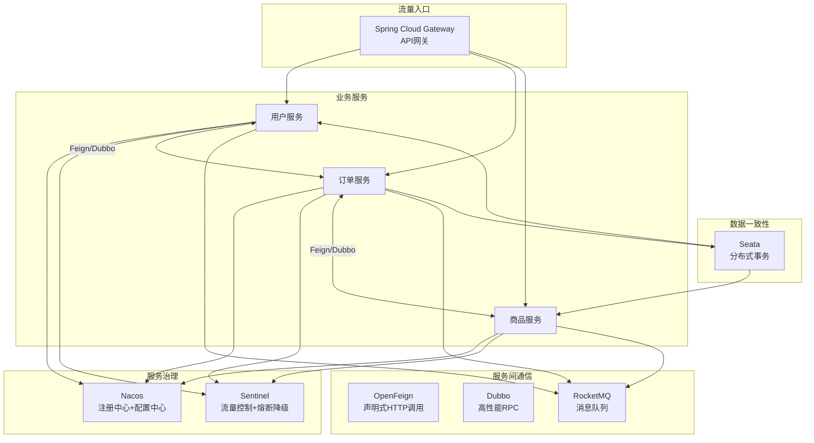

# Spring Cloud Alibaba 组件体系

> **文档说明**：系统讲解 Spring Cloud Alibaba 微服务生态，包括 Nacos（注册中心+配置中心）、Sentinel（流量控制与熔断降级）、Seata（分布式事务）、RocketMQ（消息队列）、Dubbo（RPC 调用）的核心原理与集成方式，含可运行的 Spring Cloud 微服务代码（含 pom.xml/application.yml 配置）。
>
> **适用人群**：Java 后端开发者、微服务架构师、需要构建高可用分布式系统的全栈工程师
>
> **前置知识**：[[微服务架构设计]]、[[SpringBoot-自动装配原理]]、[[OpenFeign-服务间调用]]

---

## 一、概述

### 1. 定义与核心价值

Spring Cloud Alibaba 是阿里巴巴开源的微服务解决方案，基于 Spring Cloud 规范，提供了一套完整的分布式系统开发工具集。相比 Spring Cloud Netflix（已进入维护模式），Spring Cloud Alibaba 组件更活跃、中文文档完善、在国内大规模生产环境验证，核心组件包括 Nacos（注册+配置）、Sentinel（流控熔断）、Seata（分布式事务）、RocketMQ（消息队列）。

### 2. 痛点对比

| 痛点（单体/传统微服务） | Spring Cloud Alibaba 解决方式 |
|---------------------|---------------------------|
| 服务实例硬编码，扩容需改配置 | Nacos 注册中心，服务自动发现 |
| 配置散落在各服务，修改需重启 | Nacos 配置中心，动态刷新配置 |
| 流量突增导致服务雪崩 | Sentinel 限流、熔断、降级 |
| 跨服务数据一致性难保证 | Seata 分布式事务（AT/TCC/Saga） |
| 同步调用耦合度高 | RocketMQ 异步解耦、削峰填谷 |
| 服务间调用性能差 | Dubbo 高性能 RPC（基于 Netty） |

### 3. 组件体系全景



---

## 二、底层原理

### 1. Nacos 服务发现机制

```
服务启动 → 注册到 Nacos（发送心跳）
服务消费 → 从 Nacos 获取服务列表（本地缓存 + 定时更新）
服务下线 → Nacos 检测心跳超时，剔除实例
```

| 特性 | Nacos | Eureka | Consul | Zookeeper |
|------|-------|--------|--------|-----------|
| CAP 模型 | AP（临时实例）/ CP（持久实例） | AP | CP | CP |
| 健康检查 | 心跳/TCP/HTTP | 心跳 | Agent + 健康检查 | Session |
| 配置中心 | 内置 | 无 | 内置（K/V） | 需自建 |
| 控制台 | 完善 | 基础 | 基础 | 第三方 |

### 2. Sentinel 工作原理

Sentinel 通过**滑动窗口**统计实时指标，在调用入口通过 ProcessorSlot 责任链进行流控、熔断、系统保护：

```
请求进入 → NodeSelectorSlot → ClusterBuilderSlot → LogSlot → StatisticSlot → AuthoritySlot → SystemSlot → FlowSlot → DegradeSlot → 实际调用
```

---

## 三、实操

### 1. 父工程 pom.xml

```xml
<!-- pom.xml（父工程） -->
<project>
    <groupId>com.example</groupId>
    <artifactId>cloud-alibaba-parent</artifactId>
    <version>1.0.0</version>
    <packaging>pom</packaging>

    <parent>
        <groupId>org.springframework.boot</groupId>
        <artifactId>spring-boot-starter-parent</artifactId>
        <version>3.2.0</version>
    </parent>

    <properties>
        <java.version>17</java.version>
        <spring-cloud.version>2023.0.0</spring-cloud.version>
        <spring-cloud-alibaba.version>2023.0.1.0</spring-cloud-alibaba.version>
    </properties>

    <dependencyManagement>
        <dependencies>
            <dependency>
                <groupId>org.springframework.cloud</groupId>
                <artifactId>spring-cloud-dependencies</artifactId>
                <version>${spring-cloud.version}</version>
                <type>pom</type>
                <scope>import</scope>
            </dependency>
            <dependency>
                <groupId>com.alibaba.cloud</groupId>
                <artifactId>spring-cloud-alibaba-dependencies</artifactId>
                <version>${spring-cloud-alibaba.version}</version>
                <type>pom</type>
                <scope>import</scope>
            </dependency>
        </dependencies>
    </dependencyManagement>

    <modules>
        <module>user-service</module>
        <module>order-service</module>
    </modules>
</project>
```

### 2. Nacos 服务注册与发现

```xml
<!-- user-service/pom.xml -->
<dependencies>
    <dependency>
        <groupId>com.alibaba.cloud</groupId>
        <artifactId>spring-cloud-starter-alibaba-nacos-discovery</artifactId>
    </dependency>
    <dependency>
        <groupId>com.alibaba.cloud</groupId>
        <artifactId>spring-cloud-starter-alibaba-nacos-config</artifactId>
    </dependency>
    <dependency>
        <groupId>org.springframework.cloud</groupId>
        <artifactId>spring-cloud-starter-openfeign</artifactId>
    </dependency>
    <dependency>
        <groupId>org.springframework.boot</groupId>
        <artifactId>spring-boot-starter-web</artifactId>
    </dependency>
</dependencies>
```

```yaml
# user-service/src/main/resources/application.yml
spring:
  application:
    name: user-service
  cloud:
    nacos:
      discovery:
        server-addr: ${NACOS_ADDR:localhost:8848}
        namespace: dev
        group: DEFAULT_GROUP
      config:
        server-addr: ${NACOS_ADDR:localhost:8848}
        namespace: dev
        file-extension: yaml
        shared-configs:
          - data-id: common.yaml
            refresh: true
```

```java
// UserServiceApplication.java
package com.example.user;

import org.springframework.boot.SpringApplication;
import org.springframework.boot.autoconfigure.SpringBootApplication;
import org.springframework.cloud.client.discovery.EnableDiscoveryClient;
import org.springframework.cloud.openfeign.EnableFeignClients;

@SpringBootApplication
@EnableDiscoveryClient
@EnableFeignClients
public class UserServiceApplication {
    public static void main(String[] args) {
        SpringApplication.run(UserServiceApplication.class, args);
    }
}
```

```java
// UserController.java
package com.example.user.controller;

import org.springframework.beans.factory.annotation.Value;
import org.springframework.cloud.context.config.annotation.RefreshScope;
import org.springframework.web.bind.annotation.*;

import java.util.Map;

@RestController
@RequestMapping("/api/users")
@RefreshScope  // 配置动态刷新
public class UserController {

    @Value("${user.default-role:普通用户}")
    private String defaultRole;

    @GetMapping("/{id}")
    public Map<String, Object> getUser(@PathVariable Long id) {
        return Map.of(
                "id", id,
                "name", "张三",
                "role", defaultRole  // 从 Nacos 配置读取，动态刷新
        );
    }
}
```

### 3. OpenFeign 服务间调用

```java
// order-service 中调用 user-service
package com.example.order.feign;

import org.springframework.cloud.openfeign.FeignClient;
import org.springframework.web.bind.annotation.GetMapping;
import org.springframework.web.bind.annotation.PathVariable;

import java.util.Map;

@FeignClient(name = "user-service", path = "/api/users")
public interface UserFeignClient {

    @GetMapping("/{id}")
    Map<String, Object> getUser(@PathVariable("id") Long id);
}
```

```java
// OrderService.java
package com.example.order.service;

import com.example.order.feign.UserFeignClient;
import org.springframework.stereotype.Service;

import java.util.Map;

@Service
public class OrderService {

    private final UserFeignClient userFeignClient;

    public OrderService(UserFeignClient userFeignClient) {
        this.userFeignClient = userFeignClient;
    }

    public Map<String, Object> createOrder(Long userId, String product) {
        // 通过 Feign 调用用户服务
        Map<String, Object> user = userFeignClient.getUser(userId);

        return Map.of(
                "orderId", System.currentTimeMillis(),
                "product", product,
                "user", user
        );
    }
}
```

### 4. Sentinel 流量控制

```xml
<dependency>
    <groupId>com.alibaba.cloud</groupId>
    <artifactId>spring-cloud-starter-alibaba-sentinel</artifactId>
</dependency>
```

```yaml
spring:
  cloud:
    sentinel:
      transport:
        dashboard: localhost:8080
      eager: true  # 立即初始化（不等首次请求）
```

```java
// SentinelController.java - 编程式流控
package com.example.order.controller;

import com.alibaba.csp.sentinel.Entry;
import com.alibaba.csp.sentinel.SphU;
import com.alibaba.csp.sentinel.annotation.SentinelResource;
import com.alibaba.csp.sentinel.slots.block.BlockException;
import com.alibaba.csp.sentinel.slots.block.RuleConstant;
import com.alibaba.csp.sentinel.slots.block.flow.FlowRule;
import com.alibaba.csp.sentinel.slots.block.flow.FlowRuleManager;
import jakarta.annotation.PostConstruct;
import org.springframework.web.bind.annotation.*;

import java.util.ArrayList;
import java.util.List;
import java.util.Map;

@RestController
@RequestMapping("/api/orders")
public class OrderController {

    @PostConstruct
    public void initFlowRules() {
        // 编程式配置流控规则（也可在 Sentinel 控制台配置）
        List<FlowRule> rules = new ArrayList<>();

        FlowRule rule = new FlowRule();
        rule.setResource("createOrder");
        rule.setGrade(RuleConstant.FLOW_GRADE_QPS);
        rule.setCount(10);  // 每秒最多 10 次
        rules.add(rule);

        FlowRuleManager.loadRules(rules);
    }

    /**
     * 注解式流控 + 降级处理
     */
    @GetMapping("/{id}")
    @SentinelResource(
            value = "getOrder",
            blockHandler = "handleBlock",
            fallback = "handleFallback"
    )
    public Map<String, Object> getOrder(@PathVariable Long id) {
        return Map.of("orderId", id, "status", "已完成");
    }

    // 流控触发时调用
    public Map<String, Object> handleBlock(Long id, BlockException ex) {
        return Map.of("error", "请求过于频繁，请稍后再试", "code", 429);
    }

    // 异常降级时调用
    public Map<String, Object> handleFallback(Long id, Throwable ex) {
        return Map.of("error", "服务暂时不可用", "code", 503);
    }

    /**
     * 编程式流控
     */
    @PostMapping
    public Map<String, Object> createOrder(@RequestBody Map<String, Object> order) {
        try (Entry entry = SphU.entry("createOrder")) {
            return Map.of("orderId", System.currentTimeMillis(), "status", "创建成功");
        } catch (BlockException e) {
            return Map.of("error", "系统繁忙，请稍后再试", "code", 429);
        }
    }
}
```

### 5. Seata 分布式事务

```xml
<dependency>
    <groupId>com.alibaba.cloud</groupId>
    <artifactId>spring-cloud-starter-alibaba-seata</artifactId>
</dependency>
```

```yaml
spring:
  cloud:
    alibaba:
      seata:
        tx-service-group: order_tx_group
seata:
  service:
    vgroup-mapping:
      order_tx_group: default
  registry:
    type: nacos
    nacos:
      server-addr: localhost:8848
```

```java
// OrderService.java - AT 模式分布式事务
package com.example.order.service;

import com.example.order.feign.UserFeignClient;
import com.example.order.mapper.OrderMapper;
import io.seata.spring.annotation.GlobalTransactional;
import org.springframework.stereotype.Service;
import org.springframework.transaction.annotation.Transactional;

@Service
public class OrderService {

    private final OrderMapper orderMapper;
    private final UserFeignClient userFeignClient;

    public OrderService(OrderMapper orderMapper, UserFeignClient userFeignClient) {
        this.orderMapper = orderMapper;
        this.userFeignClient = userFeignClient;
    }

    @GlobalTransactional(name = "create-order", rollbackFor = Exception.class)
    @Transactional
    public void createOrder(Long userId, String product, double amount) {
        // 1. 创建订单（本地事务）
        orderMapper.insert(userId, product, amount);

        // 2. 扣减用户余额（远程调用用户服务）
        userFeignClient.deductBalance(userId, amount);

        // 3. 扣减库存（远程调用商品服务）
        // productFeignClient.deductStock(productId, quantity);

        // 任何一步异常，Seata 自动回滚所有分支事务
        if (amount > 10000) {
            throw new RuntimeException("金额超限，触发回滚");
        }
    }
}
```

### 6. RocketMQ 消息队列

```xml
<dependency>
    <groupId>org.apache.rocketmq</groupId>
    <artifactId>rocketmq-spring-boot-starter</artifactId>
    <version>2.3.0</version>
</dependency>
```

```yaml
rocketmq:
  name-server: localhost:9876
  producer:
    group: order-producer-group
    send-message-timeout: 3000
```

```java
// OrderProducer.java
package com.example.order.mq;

import org.apache.rocketmq.spring.core.RocketMQTemplate;
import org.springframework.messaging.support.MessageBuilder;
import org.springframework.stereotype.Component;

@Component
public class OrderProducer {

    private final RocketMQTemplate rocketMQTemplate;

    public OrderProducer(RocketMQTemplate rocketMQTemplate) {
        this.rocketMQTemplate = rocketMQTemplate;
    }

    /**
     * 发送同步消息
     */
    public void sendOrderCreated(Long orderId) {
        rocketMQTemplate.syncSend(
                "order-topic:order-created",  // topic:tag
                MessageBuilder.withPayload(orderId).build()
        );
    }

    /**
     * 发送异步消息
     */
    public void sendAsync(Long orderId) {
        rocketMQTemplate.asyncSend("order-topic",
                MessageBuilder.withPayload(orderId).build(),
                new SendCallback() {
                    @Override
                    public void onSuccess(SendResult sendResult) {
                        // 发送成功
                    }
                    @Override
                    public void onException(Throwable e) {
                        // 发送失败，记录日志或重试
                    }
                });
    }

    /**
     * 发送事务消息
     */
    public void sendTransactionMessage(Long orderId) {
        rocketMQTemplate.sendMessageInTransaction(
                "order-topic",
                MessageBuilder.withPayload(orderId).build(),
                null
        );
    }
}
```

```java
// OrderConsumer.java
package com.example.order.mq;

import org.apache.rocketmq.spring.annotation.RocketMQMessageListener;
import org.apache.rocketmq.spring.core.RocketMQListener;
import org.springframework.stereotype.Component;

@Component
@RocketMQMessageListener(
        topic = "order-topic",
        selectorExpression = "order-created",
        consumerGroup = "order-consumer-group"
)
public class OrderCreatedConsumer implements RocketMQListener<Long> {

    @Override
    public void onMessage(Long orderId) {
        // 处理订单创建事件：通知用户、更新统计等
        System.out.println("收到订单创建事件: " + orderId);
    }
}
```

### 7. Gateway 网关集成

```xml
<dependency>
    <groupId>org.springframework.cloud</groupId>
    <artifactId>spring-cloud-starter-gateway</artifactId>
</dependency>
<dependency>
    <groupId>com.alibaba.cloud</groupId>
    <artifactId>spring-cloud-starter-alibaba-nacos-discovery</artifactId>
</dependency>
```

```yaml
spring:
  application:
    name: gateway
  cloud:
    nacos:
      discovery:
        server-addr: localhost:8848
    gateway:
      discovery:
        locator:
          enabled: true  # 自动根据服务名路由
      routes:
        - id: user-service
          uri: lb://user-service
          predicates:
            - Path=/api/users/**
        - id: order-service
          uri: lb://order-service
          predicates:
            - Path=/api/orders/**
```

---

## 四、常见问题与排查

| 问题现象 | 原因 | 解决方案 |
|---------|------|---------|
| 服务注册不到 Nacos | Nacos 地址错误、网络不通、命名空间不匹配 | 检查 `server-addr` 配置；确认 Nacos 服务运行；检查 namespace 是否一致 |
| 配置不自动刷新 | 未加 `@RefreshScope`，或配置 data-id 不匹配 | 在需要刷新的 Bean 上加 `@RefreshScope`；确认 `file-extension` 和 data-id 后缀一致 |
| Feign 调用报 `No instances available` | 服务未注册、服务名错误、负载均衡未配置 | 检查 Nacos 控制台服务列表；确认 `@FeignClient(name=...)` 与注册名一致 |
| Sentinel 流控不生效 | 资源名不匹配、规则未加载、`eager` 未开启 | 确认 `@SentinelResource(value=...)` 与规则 resource 一致；设置 `eager: true` |
| Seata 分布式事务不回滚 | 未加 `@GlobalTransactional`、undo_log 表缺失、TC 未连接 | 确保入口方法加 `@GlobalTransactional`；每个数据库创建 `undo_log` 表；检查 Seata Server 连接 |
| RocketMQ 消息消费失败 | 消费者组名不一致、tag 不匹配、消息重试 | 确认 `consumerGroup` 配置；检查 `selectorExpression` tag；查看死信队列 `%DLQ%` |
| 网关路由 503 | 下游服务未注册、负载均衡依赖缺失 | 检查 Nacos 服务列表；添加 `spring-cloud-starter-loadbalancer` 依赖 |
| Nacos 集群脑裂 | 集群节点数为偶数，网络分区 | Nacos 集群节点数用奇数（3/5/7）；配置正确的 cluster.conf |
| 服务下线后仍有流量 | Nacos 心跳检测延迟，缓存未更新 | 调整 `heart-beat-interval` 和 `ip-delete-timeout`；客户端配合优雅下线 |
| Sentinel 控制台看不到服务 | 客户端未连接控制台、`transport.dashboard` 配置错误 | 确认控制台地址端口；检查防火墙；设置 `eager: true` 立即注册 |

---

## 五、进阶与最佳实践

### 1. 版本兼容性矩阵

| Spring Boot | Spring Cloud | Spring Cloud Alibaba |
|------------|-------------|---------------------|
| 3.2.x | 2023.0.x (Leyton) | 2023.0.1.x |
| 3.0.x | 2022.0.x (Kilburn) | 2022.0.0.x |
| 2.7.x | 2021.0.x (Jubilee) | 2021.0.5.x |
| 2.4.x | 2020.0.x (Ilford) | 2021.1.x |

**务必使用兼容版本组合**，否则会出现类找不到、自动配置不生效等问题。

### 2. 生产环境部署架构

```
                    ┌─────────────┐
                    │   Nginx/LB  │
                    └──────┬──────┘
                           │
                    ┌──────▼──────┐
                    │   Gateway   │
                    └──────┬──────┘
                           │
        ┌──────────────────┼──────────────────┐
        │                  │                  │
   ┌────▼────┐       ┌────▼────┐       ┌────▼────┐
   │用户服务集群│      │订单服务集群│      │商品服务集群│
   └────┬────┘       └────┬────┘       └────┬────┘
        │                  │                  │
        └──────────────────┼──────────────────┘
                           │
        ┌──────────┬───────┼───────┬──────────┐
        │          │       │       │          │
   ┌────▼───┐ ┌───▼───┐ ┌─▼──┐ ┌──▼───┐ ┌───▼──┐
   │ Nacos  │ │Sentinel│ │Seata│ │RocketMQ│ │MySQL│
   │ (3节点) │ │(Dashboard)│ │(TC)│ │(2主2从)│ │(主从)│
   └────────┘ └───────┘ └────┘ └──────┘ └──────┘
```

### 3. 组件选型建议

| 需求 | 推荐组件 | 替代方案 |
|------|---------|---------|
| 注册中心 | Nacos | Consul、Eureka |
| 配置中心 | Nacos | Apollo、Spring Cloud Config |
| 流量控制 | Sentinel | Hystrix（已停更）、Resilience4j |
| 分布式事务 | Seata | 本地消息表、TCC 自研 |
| 消息队列 | RocketMQ | Kafka、RabbitMQ |
| RPC 调用 | OpenFeign（HTTP） | Dubbo（TCP，性能更高） |
| API 网关 | Spring Cloud Gateway | Zuul（已停更）、Kong |

---

## 六、关联笔记

### 微服务
- [[微服务架构设计]] · [[微服务架构设计模式]] · [[OpenFeign-服务间调用]]
- [[Gateway-网关路由与鉴权]] · [[Nacos-注册中心与配置中心]] · [[Sentinel-流量控制与熔断]]

### 消息队列
- [[RocketMQ-消息队列与消费模型]] · [[Kafka-消息队列与消费模型]] · [[RabbitMQ-消息中间件]]

### 分布式事务
- [[分布式事务解决方案]] · [[Seata-分布式事务框架]]

### 实战
- [[实战-SpringCloud微服务电商系统]] · [[实战-SpringBoot+Vue3权限管理系统]]

### 导航
- [[MOC-后端开发]] · [[MOC-Java全栈-四级展开]] · [[Java-全栈技术枢纽]]

> **学习路径建议**：先掌握 [[微服务架构设计]] 微服务基础 → 学习 [[SpringBoot-自动装配原理]] Spring Boot → 深入本文 Spring Cloud Alibaba 组件体系 → 实践 [[OpenFeign-服务间调用]] 服务通信 → 应用于 [[实战-SpringCloud微服务电商系统]] 完整项目。
